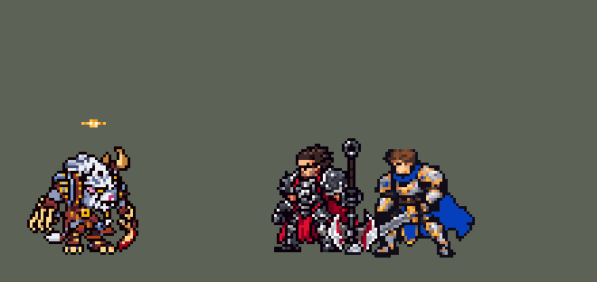

<!-- 本页上半部分由 tools/docs/gen_hero_docs.py 按仓库里现在的数据生成，手改会被覆盖；「开发记录」以下是手写的，生成时原样保留。 -->

# 雷恩加尔 Rengar


| 项目 | 内容 |
|---|---|
| id | `league_rengar` |
| 所属的包 | 主包（mod_id `league`） |
| 分路 | 打野 |
| 分类 / 标签 | 刺客（Assassin） · AD / Melee / CC |
| 高清帧 | 1 倍像素（无高清帧） |
| 附加包 | [雷恩加尔草丛附加包](#附加包)（`league_rengar_bush`） |



其他预览：[逐帧预览](../preview/league_rengar_frames.png)、[特效表](../preview/league_rengar_effects.png)

## 现在的技能

下面是游戏里显示的技能说明（`league/text/champion.i18n` 的简体中文，去掉了颜色和图标），冷却、距离来自 `league/champion/league_rengar.data_champion`；1 秒 = 60 tick。

### 普攻 / 被动

*攻击间隔 0.92 秒 · 攻击距离 23000*

无形掠食者：复活、脱战3秒或R后，下次攻击扑向目标造成20 + 150% 攻击力伤害。技能和扑击各得1点残暴，满4点强化下个技能。残忍无情（自动，5秒）：攻击造成30 + 90% 攻击力伤害，攻速+40%；强化时50 + 140% 攻击力。连招：空中Q、三Q。

### 技能1 · 战争咆哮

*冷却 9 秒 · 施放距离 22000 · 施放：指定目标 · 敌人（不含防御塔）*

咆哮，对周围敌人造成40 + 50% 攻击力伤害，回复40 + 50% 攻击力生命。强化：回复200%，1.5秒内免疫控制。

### 技能2 · 套索打击

*冷却 10 秒 · 施放距离 50000 · 施放：指定目标 · 敌人（不含防御塔）*

掷出套索，命中首个敌人造成40 + 60% 攻击力伤害并减速40%1.75秒。强化：禁锢1.75秒。连招扑脸定身：扑击命中英雄后1.5秒内的E必中，禁锢1秒。

### 大招 · 狩猎律动

*冷却 60 秒 · 施放距离 90000 · 施放：指定目标 · 刚交过手的敌方英雄*

对交战中的英雄发动：伪装5秒，移速+40%，下次攻击为扑击，额外造成60 + 80% 攻击力伤害，护甲-25%4秒。连招R一套：R→扑击→E禁锢→Q。

### 数值

攻击力 100（每级 +16）、生命 950（每级 +88）、护甲 28（每级 +8）、魔抗 18（每级 +4）、移速 1100（每级 +13）。

## 附加包

附加包是可选的原生代码 mod（都在附加包合集 `league_addons` 里），**不装主包里的英雄也是完整的**。

### 雷恩加尔草丛附加包

[雷恩加尔草丛附加包](../../addons/league_rengar_bush/README.md)：`league_rengar_bush` v0.1.2

主包 `league` 保持纯数据。数据读不到地形，主包里雷恩加尔的被动「无形掠食者」在复活、约 3 秒没出手和 R 之后就绪
（用户：「还有草丛可以跳跃 你要记住这游戏地图的草丛」）。这个附加包用原生代码读地图的草丛，做成英雄联盟的样子：

- **站进草丛就能扑**：原生被动 `league_rengar_bush:bush` 每 tick 看——他活着、脚下的格子是草丛、身上还没有
  `league_rengar_ready`，就加上它（攻击距离 +25000，下一次攻击由数据打出扑击并去掉）。「没出手就绪」去掉。
- **走出草丛就没了**：本包给的就绪在他离开草丛 20 tick 后去掉（英雄联盟里出了草丛就不能跳）；复活和 R 给的不动。
- **草丛从地图读**：地图自定义钩子读地图文档的 `bushes`（和卡密尔附加包读 `walls` 一样），每种模式记一张，当前对局取
  站进墙里的单位最少的那张。读不到时退回「敌方队伍看不见他」，日志里会写 `NOT FOUND` 和地图文档的开头，方便改键名。
- 数字从英雄数据的 `passive.params` 来（`make_override.py` 从 `tools/kit/build_rengar.py` 的参数表 `P` 写进去）。

## 相关脚本和素材

- [`tools/kit/build_rengar.py`](../../tools/kit/build_rengar.py)
- [`tools/kit/setup_rengar.py`](../../tools/kit/setup_rengar.py)
- [`tools/lol/extract_rengar.py`](../../tools/lol/extract_rengar.py)
- [`tools/art/preview_rengar.py`](../../tools/art/preview_rengar.py)
- [`tools/art/rig_rengar.py`](../../tools/art/rig_rengar.py)
- [`tools/art/import_rengar.py`](../../tools/art/import_rengar.py)
- [`tools/art/design_rengar.py`](../../tools/art/design_rengar.py)
- [`assets/source/rengar/`](../../assets/source/rengar)

## 开发记录

> 下面是原来 README 里「英雄：雷恩加尔」一节，原样搬过来（只改了相对链接）。

| 部分 | 内容 |
|---|---|
| 定位 | 打野（刺客，分类 Assassin），第 77 位英雄。傲之追猎者 雷恩加尔：藏在草丛里扑向猎物，攒满凶残值放强化技能。用户选打野、刺客、方案 A（完整还原）；另外：「还有草丛可以跳跃 你要记住这游戏地图的草丛 还有狮子狗螳螂碰到后的彩蛋」（选了主包替代 + 扩展包读真草丛、彩蛋双向还原）、「加入高手连招」 |
| 普攻 / 被动 | 弯刀近战，射程 23000，攻击间隔 55 tick，第 11 tick 砍中。被动「无形掠食者」：就绪时（头顶一只金色的眼）攻击距离 +25000，下一次攻击是飞扑：第 5 tick 冲向目标（`MoveToTarget`），第 17 tick 落地，20 + 150% 攻击力，起跳和落地扬起尘土。数据读不到地形，主包在每条命开始时、约 3 秒没出手后（伊芙琳脱战的做法）和 R 之后就绪。打塔：原来普攻那一下由一颗只作用于非防御塔敌人的追踪投射物打出，对塔挥手一点伤害都没有（玩家：「劫的平A没办法攻击防御塔」）；2026-10-17 起命中也作用于防御塔（含 Q 残暴打击的两下）。经典模拟里四位英雄原来对塔出手 66 次、打中 0 次，现在 69 次里打中 57 次（其余被打断或换成了技能） |
| 凶残值 | 每次 Q、W、E 和飞扑各得 1 点（头顶亮起几颗红牙，12 秒不再得就清空），满 4 点时下一个 Q / W / E 是强化版并清空 |
| Q（自动） | 「残忍无情」没有技能位，冷却 300 tick（5 秒），冷却好后的第一次攻击换成 Q 的动作：第 13 tick 砸地 10 + 30% 攻击力，第 16 tick 上挑 30 + 90% 攻击力，之后 3 秒攻速 +40%（脚下一圈金色刀光）。强化：上挑 50 + 140% 攻击力，5 秒攻速 +80%（身上红橙火光），不进冷却 |
| 技能1 | W「战争咆哮」：冷却 540 tick（9 秒），身边 22000 内有敌人（小兵、野怪也算）时放。第 8 tick 咆哮，周围敌人受到 40 + 50% 攻击力，他回复 40 + 50% 攻击力（英雄联盟回复刚受到伤害的一部分，数据读不到，改成固定回复）。强化：回复翻倍，1.5 秒免疫控制（英雄联盟是解控；数据去不掉身上的控制，改成免控） |
| 技能2 | E「套索打击」：冷却 600 tick（10 秒），射程 50000，也对小兵和野怪放。第 13 tick 朝目标甩出套索（直线，打中第一个单位，躲得开），40 + 60% 攻击力，减速 40% 1.75 秒。强化：定身 1.75 秒 |
| 大招 | R「狩猎律动」：冷却 3600 tick（60 秒），只对正在交战的敌方英雄放（`EnemyChampionRecentlyAttacked`，90000 内）。第 10 tick 隐身 5 秒（一团蓝灰烟雾）、移速 +40%，飞扑就绪，目标头顶亮起猎人的红眼；从 R 里扑出去的那一下额外 60 + 80% 攻击力，目标护甲 −25% 4 秒 |
| 高手连招 | 用户：「加入高手连招」。和李青、弗拉基米尔一样，每个连招只由它自己那个技能放出来，不占用别的技能的冷却：**空中 Q**：飞扑时 Q 已就绪，落地直接上挑并开攻速；**三 Q**：攒满凶残值的那次 Q 把冷却记在 `q_hold` 上（只挡普通 Q），下一刀直接是强化 Q；**扑脸定身**：飞扑落在英雄身上后 1.5 秒内的 E 立刻甩出、追踪必中，定身 1 秒（强化 1.75 秒）；**R 一套**：R → 飞扑 → E 定身 → Q |
| 卡兹克彩蛋 | 用户：「狮子狗螳螂碰到后的彩蛋」，选了双向还原。数据只读得到自己身上的 buff，所以两个英雄互相传话：他打中英雄会给对方挂 `league_rengar_rival_hit`；卡兹克出手时发现自己身上有这个标记，就给身边的敌方英雄挂 `league_khazix_seen`；雷恩加尔带着它击杀英雄（金克丝的击杀判定）就是杀了卡兹克：拿到战利品「卡兹克的头颅」（头顶弹出紫色虫首，攻击 +15% 直到死亡，配一句台词）。反过来卡兹克的命中挂 `league_khazix_rival_hit`，雷恩加尔出手时回 `league_rengar_seen`，卡兹克带着它击杀就是杀了雷恩加尔：额外进化（马上得到下一阶段进化，攻击 +10%，直到死亡，配 W 进化的台词）。两人第一次在 60000 内碰面时各放一次怒气符号，雷恩加尔说初遇卡兹克的台词，卡兹克笑一声（每条命一次）。团战里同时击杀别的英雄可能误判，作为彩蛋可以接受 |
| 草丛附加包 | 附加包 [`addons/league_rengar_bush`](../../addons/league_rengar_bush/README.md)（在附加包合集里）用原生代码读地图的草丛格子：他站在草丛里就给飞扑就绪，走出草丛 20 tick 后收回（复活和 R 给的不收）；主包「没出手就绪」去掉。地图钩子一个 mod 只能有一个，合集用 `MapReaders` 先调卡密尔的读墙、再调读草丛。草丛的键名（`bushes`）没在游戏里确认过：读不到时退回「敌方看不见他」，日志写明。主包不装附加包也完整可玩；附加包只做了单元测试，要在游戏里看日志确认 |
| 数值 | 攻击 100（+16）、生命 950（+88）、护甲 28（+8）、魔抗 18（+4）、移速 1100（+13）。数值是自己设计的，用 SDK 对战模拟调：打野，对 3 个原版打野（`ninja`、`hunter`、`demon`），3 套阵容、两边各打，10 分钟。初稿 −1.43（同一批卡兹克 +1.60、伊芙琳 +1.55）；攻击 90 → 100、生命 900 → 950，Q 上挑 60% → 90%（强化 100% → 140%）、砸地 20% → 30%，飞扑 120% → 150%，W 回复 35% → 50%：种子 1–12 +1.35、25–36 +1.92（同一批卡兹克 +1.30）。Q 冷却 4 秒那组 +3.11，偏强 |
| 亚索联动 | 强化 E 的定身是硬控。重跑亚索的模拟（亚索上单，候选打野，24 个种子两边各打）：雷恩加尔同队时亚索大招每局 1.17 次，原版忍者 0.58、卡兹克 0.35（凯隐 1.00、李青 1.67）。不用调 |
| 精灵图 | 10 个动作 65 帧：待机 8、移动 8、普攻 6、飞扑（`leap`）8、Q（`skill`）8、E（`skill2`）6、W（`skill_w`）7、R（`ult`）4、受击 2、死亡 8。高 40 px，25 色。头像截取点 (4, −36)；待机最高到 −29（角尖），`banpick_center` −10 |
| 特效 | Codex 生图的 20 张（`import_rengar.py` 缩成游戏像素）：`league_rengar_fx` 普攻划痕、飞扑的尘土和三道爪痕、被动的金眼、凶残值的四个状态、Q 的砸地和上挑、Q 攻速的刀光圈、W 回血、套索（朝飞行方向转，上下对称）、减速和定身的绳圈、猎人红眼、战利品、怒气符号；`league_rengar_big` W 的冲击波、强化 Q / W 的火光、R 的烟雾和暴击爪痕 |
| 音效 | 英雄联盟的音效和配音（`tools/lol/extract_rengar.py`）：普攻挥砍和命中、飞扑和落地、Q 出手 / 命中 / 强化命中、W / 强化 W、E 出手 / 命中 / 定身、R 出手和暴击；Q、W、E、R、满凶残值和初遇卡兹克的中文配音（卡兹克那边的彩蛋台词在 `tools/lol/extract_khazix.py`）。版权属于 Riot Games，**不提交到仓库**，按下面的命令在本地生成 |
| 图标 | 官方技能图标（W / E / R），从本地客户端提取，缩到 64×64；Q 自动，没有技能位 |

重新生成（素材来自本机的英雄联盟客户端，音频不进仓库）：

```bash
python tools/lol/extract_rengar.py --lol "D:\WeGameApps\lol" --vgmstream "<vgmstream-cli.exe 路径>"
python tools/kit/build_rengar.py        # 技能数据，数字都在脚本的参数表 P 里；--nodes 看每棵技能树的节点数
python tools/kit/setup_rengar.py --face 4,-36 --banpick -10   # 五种语言的文字、音效配置、共享文件里他的键
python addons/league_rengar_bush/make_override.py   # 附加包的副本（去掉没出手就绪，被动读草丛）
python tools/art/design_rengar.py --rebuild   # 造型：41 行的字母格子 -> 8 倍原尺寸图
python tools/art/rig_rengar.py          # 动作：造型自己的零件无损摆姿势（整格平移、90° 旋转、翻转、整行移动、叠放）
python tools/art/import_native.py --hero rengar
python tools/art/import_rengar.py       # 特效；--raw assets/source/rengar/codex_fx 先把生图原稿缩成游戏尺寸的原尺寸条
```

美术（动作的提示词见 [`assets/source/rengar/MODEL_STRIPS.md`](../../assets/source/rengar/MODEL_STRIPS.md)，特效的见 [`PROMPTS_FX.md`](../../assets/source/rengar/PROMPTS_FX.md)；Codex 的交付在 [`codex_model/`](../../assets/source/rengar/codex_model)、[`codex_strips/`](../../assets/source/rengar/codex_strips)、[`codex_fx/`](../../assets/source/rengar/codex_fx)）：

- 原画：Codex 画了几版，用户选 A；然后：「按做吸血鬼的方法 慢慢做成这样吧」。造型读回游戏尺寸后给了两版缩法，用户：「B吧」。
- 造型：按游戏尺寸读回格子后，各部件均匀删行删列（`cut3.py`，角、脸、肩甲、爪刃的硬行不删），用户：「可以了」。鼻子按用户「鼻子也有点怪？」改成三角猫鼻（`design_rengar.py` 的 POLISH）。
- 脸（10 月 9 日，用户：「狮子狗鼻子太怪也修复」「是这一块模型奇怪 看起来像一个大鼻子」）：眉下那块白色大方块加角上的蓝色远眼点整个读成了一只大鼻子。照原版（游戏尺寸渲染）改：白块上排改成浅灰毛、只在嘴吻前端留白，鼻头两格深粉在嘴吻尖，远眼藏进毛里（原版的远眼被辫子挡住），黑嘴线上两颗白牙。用户：「怎么看起来还是怪啊」——原版的嘴吻短、在眼睛正下方，这版的白嘴吻还横在金眼旁边往右伸；再改（B2）：白色只留眼下 2–3 格，鼻头在眼角正下方，右侧脸颊改成转过去的灰毛。`design_rengar.py` 的字母格更新（work/rn/face_rn.py 方案 A），动作由 `rig_rengar.py` 重新生成。模组版本 0.83.3。
- R 的隐身（10 月 9 日，用户：「狮子狗开大应该是隐身的 现在不隐身」）：数据里 R 一直有 300 tick 的 `CasterInvisible`，模拟器里也能看到 `EntityInvisibled` true/false 事件（和图奇一样），但游戏里图奇 Q 会半透明、他不会——一次性施加的隐身状态大概在随后的跳跃动画时被客户端丢了。照图奇 Q 的写法补一份：R 期间（`r_on` 在时）每 6 tick 重新施加 8 tick 的 `CasterInvisible`（`on_me(casted(300, 6, ...))`，`build_rengar.py`）。模组版本 0.84.5。
- 动作：Codex 第 2 步的动作条用户让我修（「有问题的地方你帮忙修复」），按弗拉基米尔的做法全部用造型自己的零件重摆（`rig_rengar.py`）：弯刀手、爪手、尾巴按格子切出，只做平移、90° 旋转、翻转和叠放；下蹲帧脚画在身体上面，脚趾不被吃掉；死亡先卸下手臂再侧倒。跑步用户先选交叉步，又改回 A：「不用交叉步」（小跑）。待机呼吸由 rig 自己做（共享的呼吸会把弯刀拖到脚底下面）。
- 特效：Codex 第 3 步的 20 张（`import_rengar.py --raw`：按交付的 `manifest.json` 切帧，颜色归到包里给每张的色阶：金、凶残红橙、骨色、尘土、烟雾、猎眼红、治疗绿、虚空紫）。
- 红色方：飞行的套索严格上下对称；其余命中、地面圈、头顶标记、烟雾严格左右对称，不需要画进动作帧。

逐帧预览：[`docs/preview/league_rengar_frames.png`](../preview/league_rengar_frames.png?v=1014g)，特效：[`docs/preview/league_rengar_effects.png`](../preview/league_rengar_effects.png?v=1014g)。
