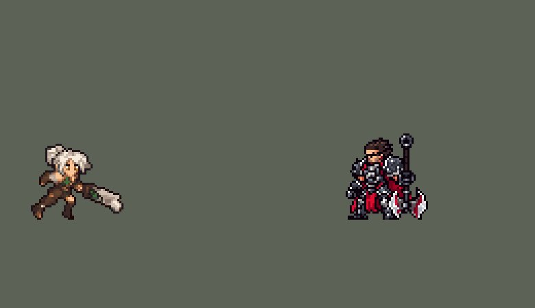

<!-- 本页上半部分由 tools/docs/gen_hero_docs.py 按仓库里现在的数据生成，手改会被覆盖；「开发记录」以下是手写的，生成时原样保留。 -->

# 锐雯 Riven


| 项目 | 内容 |
|---|---|
| id | `league_riven` |
| 所属的包 | 主包（mod_id `league`） |
| 分路 | 上单 |
| 分类 / 标签 | 近战（Melee） · AD / Melee / CC / Shield |
| 高清帧 | PPU 1.5 |
| 附加包 | [斩杀附加包：伊芙琳、阿卡丽、锐雯](#附加包)（`league_executes`） |



其他预览：[逐帧预览](../preview/league_riven_frames.png)、[特效表](../preview/league_riven_effects.png)

## 现在的技能

下面是游戏里显示的技能说明（`league/text/champion.i18n` 的简体中文，去掉了颜色和图标），冷却、距离来自 `league/champion/league_riven.data_champion`；1 秒 = 60 tick。

### 普攻 / 被动（被动「符文之刃」）

*攻击间隔 1.03 秒 · 攻击距离 25000*

普攻造成100% 攻击力的物理伤害。被动 符文之刃：每放一次技能（折翼之舞每一段、勇往直前、震魂怒吼、放逐之锋）获得一层符文，最多3层，持续6秒；普攻消耗一层，额外造成35% 攻击力的物理伤害。

### 技能1 · 折翼之舞

*冷却 12 秒 · 可存 3 次 · 施放距离 30000 · 施放：指定目标 · 敌人（不含防御塔）*

向目标跃斩，对周围敌人造成20 + 45% 攻击力的物理伤害。有3次充能，每4秒恢复一次；4秒内第三次施放改为跃起砸地，并击飞周围敌人0.75秒。

### 技能2 · 勇往直前

*冷却 9 秒 · 施放距离 35000 · 施放：指定目标 · 敌人（不含防御塔）*

冲到目标身边，获得50 + 70% 攻击力的护盾，持续1.5秒。落地施放震魂怒吼，对周围敌人造成50 + 80% 攻击力的物理伤害并眩晕0.75秒。

### 大招 · 放逐之锋

*冷却 50 秒 · 施放距离 45000 · 施放：无目标 · 敌方英雄*

身边有敌方英雄时开启，持续15秒：攻击力提高20%，攻击距离变长，折翼之舞和震魂怒吼范围扩大25%。开启5秒后向身边的敌方英雄放出疾风斩，对直线上的敌人造成100 + 100% 攻击力 + 8% 最大生命值的物理伤害。

### 数值

攻击力 85（每级 +18）、生命 950（每级 +100）、护甲 30（每级 +8）、魔抗 25（每级 +4）、移速 1050（每级 +10）。

## 附加包

附加包是可选的原生代码 mod（都在附加包合集 `league_addons` 里），**不装主包里的英雄也是完整的**。

### 斩杀附加包：伊芙琳、阿卡丽、锐雯

[斩杀附加包：伊芙琳、阿卡丽、锐雯](../../addons/league_executes/README.md)：`league_executes` v0.2.0

| 英雄 | 主包（纯数据） | 装了附加包 |
|---|---|---|
| 锐雯 R 疾风斩 | 开启 5 秒后身边 60000 内有敌方英雄就放；100 + 100% 攻击力 + 8% 最大生命 | 60000 内有敌方英雄生命不高于 30%、这一斩砍得死人、或大招只剩 1.5 秒时才放；100 + 100% 攻击力，按目标已损失生命最多 +200% 物理伤害（损失 75% 时加满） |

## 相关脚本和素材

- [`tools/lol/extract_riven.py`](../../tools/lol/extract_riven.py)
- [`tools/art/preview_riven.py`](../../tools/art/preview_riven.py)
- [`tools/art/import_riven.py`](../../tools/art/import_riven.py)
- [`tools/art/design_riven.py`](../../tools/art/design_riven.py)
- [`assets/source/riven/`](../../assets/source/riven)

## 开发记录

> 下面是原来 README 里「英雄：锐雯」一节，原样搬过来（只改了相对链接）。

| 部分 | 内容 |
|---|---|
| 定位 | 上单（Melee），第六组的上单，本包第六个上单（盖伦、德莱厄斯、提莫、墨菲特、凯尔之后），第一个技能和普攻穿插着打的连招型上单 |
| 普攻 | 断剑劈砍，100% 攻击力的物理伤害，攻击间隔约 1 秒（第 11 tick 出手） |
| 被动 | 「符文之刃」：每放一次技能（Q 每一段、E、W、R）得一层符文，最多 3 层，6 秒后一起消失；普攻用掉一层，多造成 35% 攻击力的物理伤害，被打的单位身上炸开一个交叉的符文斩（不带符文的普攻是一道白色斜斩）；她头顶亮着几块小符文就是几层。三层符文是三个同时刷新的 buff（各自计时的话会出现只剩第 2 层没有第 1 层的情况），E+W 一次给两层 |
| 技能1 | Q「折翼之舞」（用户选的 B：三次充能，原版手感）：每次施放跳向目标，落地斩击周围敌人，20 + 45% 攻击力的物理伤害；3 次充能，每 4 秒回一次；4 秒内的第三次施放改为跃起砸地，击飞周围敌人 0.75 秒。段数按施放算（不按命中）：第一段加 4 秒的 q_1 窗口，窗口里施放换成 q_2，q_2 里施放就是第三段。AI 自己会在段与段之间插普攻（Q、普攻、Q、普攻……），每段给的符文马上被普攻用掉，和英雄联盟的"光速 QA"一样。也对小兵和野怪放 |
| 技能2 | E「勇往直前」+ W「震魂怒吼」（用户选的 A）：冲到目标身边，获得 50 + 70% 攻击力的护盾（1.5 秒），落地怒吼：周围敌人受 50 + 80% 攻击力的物理伤害并眩晕 0.75 秒。冷却 9 秒，也对小兵和野怪放 |
| 大招 | R「放逐之锋」+ 疾风斩（用户选的 A：先强化，后斩）：15 秒内攻击力 +20%、攻击距离 +8000、Q 和 W 的范围扩大 25%；开启 5 秒后，身边（60000 内）有敌方英雄就挥出疾风斩：一道月牙剑气向前飞 70000，对路上的敌人造成 100 + 100% 攻击力 + 目标最大生命值 8% 的物理伤害（原版按已损失生命加伤害，数据读不到，改成最大生命值）。冷却 50 秒。AI 在还没接近敌人时就会放大招（凯尔那次也测到），第一版的 15 秒常常在路上浪费掉（一局 4 次大招只放出 1 次疾风斩），所以放大招先"待命"：身边 35000 内已有敌方英雄就立即开启（12 局里 45 次有 44 次），否则等她第一次在英雄身边普攻时开启；待命 10 秒没用上就返还冷却。疾风斩除了普攻时检查，还每 0.5 秒自动检查一次：每局约 3.5 次开大、2 次疾风斩、1.7 次打中英雄。开大时断剑被绿色的符文能量补成完整的剑（用户选的方案 B）：开大期间的普攻、Q 三段和 E+W 换成重铸剑的动作（普攻在第 1 tick 选动作，第 11 tick 照旧砍中，和永恩的第二斩一样），疾风斩也用重铸的剑；站着和跑步是引擎自己播的动画，换不了，那时脚下的符文光环表示大招还在 |
| 附加包 | 可选的附加包 [`addons/league_executes`](../../addons/league_executes/README.md)（在附加包合集里，原生代码，主包不装它也完整）：疾风斩照英雄联盟留着收人头——身边有敌方英雄生命不高于 30%、这一斩砍得死人、或大招只剩 1.5 秒时才放，伤害去掉 8% 最大生命，改成按目标已损失生命最多 +200%（损失 75% 时加满；主包开启 5 秒后身边有人就放） |
| 修正（0.128.1） | 用户：「瑞文、莎弥拉、崔斯特 有问题的话也修复」「先把永恩锐雯大招修复的合并了」。游戏 0.6.4 的 AI 几乎从不按这种只「备好」的 R 格（临时只读观察包：瑞文 6 局 0 次，多数英雄每局 4–12 次大招）——格子本身在它眼里没有价值。[`tools/fix/ult_ai_value.py`](../../tools/fix/ult_ai_value.py) 在 R 格最前面加一个只存在 1 tick 的 200 点自身护盾（护盾在 AI 眼里按全额算），备好、判断时机、用不上退还冷却都不变；经典模拟改前改后结果完全一样。游戏里改后 4 局放了 18 次（每 10 分钟 3.3 次） |
| 数值 | 攻击 85（+18）、生命 950（+100）、护甲 30（+8）、魔抗 25（+4）、移速 1050（+10）。数值是自己设计的，用 SDK 对战模拟调：打上单，对 6 个原版上单（`fighter`、`executioner`、`lancer`、`pole_warrior`、`knight`、`berserker`），两边、三套队友阵容各 24 局，一批 864 局，两批。初稿（攻击 90、生命 1000、Q 25 + 55%）+1.94 / +2.73；Q 降到 20 + 45% 后 +1.27 / +2.08；攻击 85、生命 950 后 +0.60 / +1.13。按 Codex 画的动作帧定下出手时机后（Q 前两段从第 2 tick 改到跳完落地的第 13 tick，第三段第 15 tick，普攻第 11 tick，E+W 第 13 tick，疾风斩第 8 tick 放出剑气）Q 的斩击落在她跳到的位置上，回到 +1.40 / +1.13（攻击 88、生命 980 为 +2.13 / +1.76）；加上特效后重测 +1.53 / +1.22，符文加成 40% → 35% 后 +1.08 / +1.02（Q 基础 20 → 15 为 +1.06 / +1.47，两批差得多）；普攻改成第 1 tick 选动作（开大期间换重铸剑）、第 11 tick 砍中之后 **+0.95 / +0.80**，数值没再动。同样两批原版 `fighter` 自己打上单是 +0.93 / +1.08（墨菲特合并时 +0.91 / +1.02，凯尔 +0.89 / +1.30）。锐雯每局放 Q 约 70 次（对英雄约 21 次）、E+W 约 25 次（对英雄约 9 次），KDA 3.2 / 2.1 / 3.5 |
| 亚索联动 | Q 第三段的击飞和 W 的眩晕都能触发亚索的 R：锐雯打上单、亚索打中单时，亚索每局 R 到被控英雄 2.12 次（按动作帧定出手时机之前的版本 2.56；同样的局原版 `fighter` 1.94、`knight` 0.85，墨菲特 2.42、德莱厄斯 1.21），在此前带击飞的英雄的范围内（永恩 2.15、安妮 2.19–2.50、原版雷电法师 3.19），亚索不用调 |
| 精灵图 | 16 个动作 106 帧：待机、移动、普攻、Q 三段、E+W、R 开启、疾风斩、受击、死亡，加上开大期间的普攻、Q 三段、E+W 五个重铸剑版本（35 帧）；开大第 3–6 帧和疾风斩也是重铸的剑。造型按用户给的图（Codex 画的小图 A）：白发扎起、绿眼睛、棕色皮甲和绑带，握着碎成几截、刻着符文的断剑；39×40 px（用户觉得 46 行在游戏里太大，缩到 40 行）、27 色（重铸剑多 4 种绿）。动作由 Codex 按确认的造型逐帧画，每帧的时机和站位照英雄联盟原版动画渲染的参考帧；有 18 帧照原版在 40 行大小重画过三轮 |
| 高清帧（PPU 1.5） | 2026-10-18 用 PPU 重做（用户：「下一个重做锐雯吧」「用 PPU 1.5」），按剑姬、诺手的做法：Codex 先画一张设计图（[`tools/art/pack_riven_ppu.py`](../../tools/art/pack_riven_ppu.py) / [`PICTURE_PROMPT_PPU.md`](../../assets/source/riven/PICTURE_PROMPT_PPU.md)），原图按自己 15.57 × 17.48 px 的格子读回成 68 × 61（[`tools/art/design_riven_hd.py`](../../tools/art/design_riven_hd.py)）。设计图里的剑是开大才有的大小，用户：「锐雯的剑有这么大？开大才有这么打吧 还有打的时候一套姿势吗？…还有武器挥打遮挡脸部？」：剑另让 Codex 画平时的断剑和重铸剑各 8 个角度（[`tools/art/pack_riven_swords.py`](../../tools/art/pack_riven_swords.py) / [`SWORDS_PROMPT_PPU.md`](../../assets/source/riven/SWORDS_PROMPT_PPU.md)），它的导出图被重新取样、边上全是杂点，改从原图读回：断剑 31 格、重铸剑 44 格，镜像后 32 个方向（[`tools/art/swords_riven_hd.py`](../../tools/art/swords_riven_hd.py)），每帧挑最接近英雄联盟剑方向的那张贴在拳头上。平A 照英雄联盟轮流用三套（riven_attack1/2/3，开大后 attack1_ult / attack2_ult / attack3；数据里两个短时 buff 计数，[`tools/fix/riven_attack_chain.py`](../../tools/fix/riven_attack_chain.py)；用户：「锐雯没有放技能时一直一个姿势吧」）。拆部件拼的动作身体不会动，用户看了 oppi 的锐雯后：「让 Codex 按定稿设计图逐帧重画平A三套、E、Q（参考英雄联盟关键帧和 oppi 画风）」：[`tools/art/pack_riven_actions.py`](../../tools/art/pack_riven_actions.py) / [`ACTIONS_PROMPT_PPU.md`](../../assets/source/riven/ACTIONS_PROMPT_PPU.md) 给每帧画英雄联盟的骨骼（按她的身材缩放）、握剑的拳头和剑的方向，剑不让画；47 帧从原图读回（[`tools/art/actions_riven_hd.py`](../../tools/art/actions_riven_hd.py)：每张按头发的面积统一大小，踩地的帧按脚、腾空的按躯干对齐英雄联盟的站位，握剑的拳头逐帧人工标），剑按英雄联盟这一帧的方向贴进拳头，在身前或身后照英雄联盟，被挡住大半就放到身前，会穿过头就转开（最多 120°）或放到身后。待机、移动、R 开启、疾风斩、受击、死亡照英雄联盟的骨骼摆（[`tools/art/rig_riven_hd.py`](../../tools/art/rig_riven_hd.py)：持剑的手臂和近侧前臂只做无损转向，拳头不碰脸，腿画在英雄联盟的骨骼上），待机把剑竖在肩旁（照英雄联盟扛在背后会整把藏在头后面）。特效照旧烘在帧里。头像点 (0, −37)，选人卡 −10（规则按待机时竖起的剑尖算成 −8，量头不量剑）。league.dll 0.7.51，主包 0.158.0 |
| 特效 | Codex 画的两批。第一批逐帧画在她自己的动作上（前后两层）：Q 前两段的绿色剑弧、Q 第三段砸地的地裂和碎石、E 冲刺时的护盾横扫、W 落地的地面爆发、R 开启时剑身裹上的绿光、疾风斩的月牙剑气（飞出去的也是这道剑气）。第二批：普攻的白色斜斩、用掉符文的交叉符文斩、Q 斩中、疾风斩打中、被击飞的人脚下卷起的尘土和碎石、被眩晕的人头顶转的符文环、E 的护盾（五块符文碎片绕腰转，护盾在就一直在）、头顶的符文层数（三种符文字，一层一块）、大招期间脚下的符文光环和身边上升的光点 |
| 图标 | 官方技能图标（Q 折翼之舞 / E 勇往直前 / R 放逐之锋），64×64 |
| 音频 | 从本地客户端提取的 15 条技能音效和 4 条中文语音（Q 第三段、W、R 开启、疾风斩；Q 前两段每几秒一次，配语音会太吵，不用）。不提交到仓库，按下面的命令在本地生成 |

```bash
python tools/lol/extract_riven.py --lol "D:\WeGameApps\lol" --vgmstream "<vgmstream-cli.exe 路径>"
python tools/art/design_riven.py      # 造型：从用户选的图整理到游戏尺寸（--check 和提交的比）
python tools/lol/native_pose.py assets/source/riven/poses.json --out <渲染文件夹> --alpha
python tools/art/tidy_riven.py <Codex 的动作交付文件夹>   # 角色图：检查、整理 40 行的动作帧，写进 assets/source/native/，每帧的头和剑记进 riven_frames40.json
python tools/art/tidy_riven.py --redo <Codex 的返修交付文件夹>   # 照原版重画的帧换进去（第二轮、第三轮各跑一次），其余帧必须逐格不变
python tools/art/tidy_riven.py --neck   # 下巴下面一格宽的细脖子补宽
python tools/art/tidy_riven.py --outline   # 补全缩小时删掉的描边（待机和所有动作）
python tools/art/tidy_riven.py --blade   # 开大期间的能量大剑：沿每帧剑的记录画在剑下面，cells 表加 *_r
python tools/art/import_native.py --hero riven
python tools/art/import_riven.py      # 特效；--raw <动作交付> / --fx2 <补充交付> 先检查、去描边，写成原尺寸条
python tools/art/pack_riven_ppu.py --out <文件夹>   # 高清造型（PPU 1.5）：给 Codex 的设计图包
python tools/art/design_riven_hd.py   # 设计图按自己的格子读回（68 × 61）
python tools/art/pack_riven_swords.py --out <文件夹>   # 断剑和重铸剑各 8 个角度：给 Codex 的包
python tools/art/swords_riven_hd.py   # 剑的原图读回（assets/source/riven/hd/swords/）
python tools/lol/league_joints.py assets/source/riven/poses.json --out <关节文件夹>   # 英雄联盟每帧的关节位置
python tools/art/pack_riven_actions.py --out <文件夹>   # 平A三套、Q 三段、E 逐帧重画：给 Codex 的包
python tools/art/actions_riven_hd.py   # 重画帧从原图读回（assets/source/riven/hd/actions/）
python tools/fix/riven_attack_chain.py   # 平A三套轮流（数据）
python tools/art/rig_riven_hd.py --joints assets/source/riven/hd/riven_joints.json   # 高清帧，写 assets/source/ppu/orig/；--review <文件夹> 先看
python tools/art/ppu_restyle.py --hero riven
python tools/art/ppu_hd.py --hero riven
python tools/art/preview_riven.py
```

美术（动作图的提示词见 [`assets/source/riven/MODEL_STRIPS.md`](../../assets/source/riven/MODEL_STRIPS.md)，缩到 40 行的见 [`MODEL_STRIPS40.md`](../../assets/source/riven/MODEL_STRIPS40.md)，照原版重画的见 [`REDO18.md`](../../assets/source/riven/REDO18.md)、[`REDO18B.md`](../../assets/source/riven/REDO18B.md) 和 [`REDO18C.md`](../../assets/source/riven/REDO18C.md)，特效的见 [`PROMPTS.md`](../../assets/source/riven/PROMPTS.md)，补充的特效和重铸剑见 [`PROMPTS_FX2.md`](../../assets/source/riven/PROMPTS_FX2.md)；Codex 四次交付的交接说明、清单和实际用的提示词在 [`codex_model/`](../../assets/source/riven/codex_model)）：
- 分工：模型和特效都由 Codex 画（从卢锡安起的分工），Claude 写提示词包、整理和导入。顺序照用户定的流程：先造型，再动作，最后特效。
- 造型（`design_riven.py`）：用户让 Codex 画了 A / B 两张锐雯的像素小图（`codex_model/design_riven_A_generated.png`、`_B_`），选了 A 交过来。A 是约 10 个原图像素一格的像素图，发顶到鞋底 50 格。按阿狸那一轮（18 个英雄重画）找到的路子整理（直接缩 3 倍、按颜色投票、面积平均都会把脸糊掉）：按原图自己的像素网格取色（颜色变化的峰值定格线，每格取中间 3×3 的中位色，50×48 格）；24 色（Lab 空间 k-means）；每组删掉和相邻最像的一行（列）缩到 46 行，不混色；补一圈描边，描边里面的黑换成材质自己的暗色，区域里的孤立杂点并进周围。给用户看了三个版本（版本 2 多一格嘴，版本 3 用头更大的 B 稿），用户选版本 1：两只眼睛都是 2×2、在同一行，中间隔两格皮肤，上面一排睫毛，白色高光和深绿在上、绿在下，这三种颜色只用在眼睛上，不画嘴。45×46 px、27 色。
- 动作参考（`poses.json`）：镜头 yaw 45、pitch 25，头放大 2.6 倍、腿 0.8，躯干 1.15、大腿 1.3、上臂 1.25；96×96 的格子，脚底在站位点下 11 行（`native/riven_cells.json`）。Q 的旋身、Q 第三段、E、普攻、开大和倒地里会背过身的帧逐帧转身（`turn`，按渲染里脸的朝向找角度，让脸朝镜头、看向右边）。普攻 6 帧 430 ms、Q 三段各 7 帧（460 / 460 / 510 ms）、E+W 8 帧 550 ms（E 的冲刺接 W 的怒吼）、R 开启 6 帧 510 ms、疾风斩 6 帧 480 ms，都取英雄联盟动画里的关键时刻；移动 8 帧 × 121 ms = 0.97 秒一个循环，是原版跑步动画自己的长度。技能的出手 tick 按这些帧定：Q 前两段第 13 tick、第三段第 15 tick，E+W 第 13 tick，疾风斩第 8 tick 放出剑气。
- 整理（`tidy_riven.py`）：Codex 按定稿画了 10 张动作图（65 帧），每帧都贴了造型的头。先逐项检查（每个游戏像素一个 8×8 色块、只用造型的 27 色、alpha 只有 0 / 255、每帧 6 格眼睛色、头贴在交付清单写的位置和角度），再做两件事：一是只留一圈描边，和阿狸分支的 `tidy_codex18.py` 一样（描边外的毛刺去掉、描边里面的黑圈换成材质的暗色、孤立杂点并进周围），Codex 贴的头和它外面一圈不动；二是移动的 8 帧整体浮在脚底线上 3–5 行，整条下移 3 行，第 4、7 帧踩在线上，头的一行起伏不变。每个动作帧的面积都不超过待机（最多多 1%），放技能时人不会变大。
- 重铸的剑（用户选的方案 B，`tidy_riven.py --blade`）：Codex 在现有的 7 条动作图上只改剑（开大第 3–6 帧、疾风斩，和普攻、Q 三段、E+W 的 `_r` 版本，共 45 帧）：断剑的碎块不动，断口往前接一段绿色能量剑身（多数帧 12 格，会碰到脚底线或格子边的帧短一些），剑身上的符文绿 #426E3B 提亮成 #87D46A，外缘用特效的深绿 #2D6940、不描黑边。逐像素和原图比对：只在透明处加了像素、只提亮了剑的符文绿，没有删掉任何像素，脸周围 0 格改动，脚底线以下 0 格，颜色全在特效的绿色里；`riven_cells.json` 加上 5 个 `_r` 标签（格子和时长照原动作）。用户看了 GIF 问"开大时刀没变大？"（只接了一截剑尖，剑没显得更大），选了 Claude 做的加大示意：沿 Codex 交付清单里每帧记下的剑轴，在所有像素下面再画一把宽约 13 格的绿色能量剑，把整把断剑包住（英雄联盟 R 的样子），剑尖在格子里伸到断口外 16 格（Codex 因为贴近脚底线或剑正对镜头而缩短的帧照它的长度），头周围和脚底线以下不画（`tidy_riven.py` 的 `reforge()`）。
- 缩到 40 行（`design_riven.py` 第 7 步、`MODEL_STRIPS40.md`）：用户在游戏里觉得锐雯太大（46 行，比盖伦的 37 行高出一截），在 40 / 42 行里选了 40 行。定稿按行列删减缩小，脸所在的行列整行整列保留，再补全删掉的描边（39×40 px，见下）；Codex 按新定稿把 10 条动作和 7 组特效缩到 40 行，每帧贴新头，并在清单里记下每帧断剑的断口和剑轴。
- 照原版重画 18 帧（`tidy_riven.py --redo`、`REDO18.md`、`REDO18B.md`）：用户看出“脖子拉伸、手看起来脱节”，逐帧查下来是 Codex 最早的动作（46 行时就有）在 18 帧里把剑举到头顶上、握剑的手搭在头发上、手臂被头挡住，Q1 第 5、6 帧剑和手断开，Q2 有 3 帧后手只有一格粗；英雄联盟原版里剑一直握在肩旁或胸前。返修包给每帧附上原版在 40 行大小、放在我们自己格子和站位点上的渲染（`native_pose.py` 身高 39）和分色图，硬性要求剑握在看得见的拳头里、拳头连着手臂连到肩膀、手臂和定稿一样粗、每帧连成一块。第一轮手臂画成了一格的细线、剑是旋转贴上去的（边缘毛刺），第二轮手臂按定稿画了白绷带和棕色护腕，剑从没改过的帧里取角度相近的直接复用（9 把）或逐格重画（9 把），颜色和前后帧一致。导入时检查：没列出的帧和原来逐格一样，每帧头贴在清单位置、6 格眼睛色、脚底线以下没有像素，剑的记录换成新的。另有 21 帧（移动 8 帧等）下巴下面只剩一格宽的脖子（`h p h`，两边透明），按定稿补成 `h p x r h` / `h p x h`（`--neck`）。
- 第三轮（`REDO18C.md`，21 帧）：独立复核还找出 Codex 画的几处，交回第三轮：重画的 9 帧里空着的那只手只是肚子上一个 2×2 的肤色块、前臂没画（用户说的“无影手”）；Q3 第 2–4 帧从第一轮起就站在脚底线上，跳起没了；另有 4 帧没改过但剑没有手握着（Q1、Q2 第 2 帧）或手臂是一条线（E+W 第 2、3 帧）；竖着的剑画成了带 U 形缺口的方板，比定稿宽；E+W 第 1、3 帧脖子是细杆。第三轮把近处的前臂画在身体前面接到手，Q1、Q2 第 2 帧的剑放进右手，E+W 的手臂补上粗细和绷带、护腕，脖子照定稿，竖剑改窄、断口改成斜向锯齿，Q3 第 2–4 帧照 40 行交付放回空中（脚底比脚底线高 8、12、6 格，收腿），并重新量了 Q2 第 5 帧的剑。导入时同样检查：没列出的 26 帧逐格不变，每帧连成一块、头和眼睛、脚底线。
- 独立复核（四个检查员逐帧查，每条问题另一人核实）找出、已由 Claude 修掉的三处：
  - 描边：删行删列时删掉了原来在轮廓上的描边行和列，填充色露在了边上（待机轮廓只有 82% 是深色描边，46 行时 100%；头发左边、身体右边、胯下、靴子、剑尖）。`--outline` 按定稿第 3 步同样的规则补一圈（透明格挨着非深色格就补成描边色；脚底线以下不补，改为把边上那一格涂深），定稿和待机也补（定稿宽 1 列，成 39×40），待机轮廓回到 100%；
  - 能量大剑的剑轴：Codex 清单里记的剑轴是估计值，第二轮复用别处的剑时有几格偏差（Q1、Q2 第 5 帧绿光偏到剑下面）。现在按这一帧剑身自己的像素拟合（记录的剑轴 6 格以内、头以外的定稿剑身色，取主轴），剑长也按剑身量，能量剑从护手画到断口外；
  - 能量大剑的边：护脸的范围从眼睛周围的方框改成贴着头的轮廓（让开 2 格），竖着的剑左边不再被切成直边；朝下的剑尖在脚底线收尖，剑身部分保持全宽。剑插在地上的 Q3 第 4–6 帧，剑立在腿前，绿光大多被身体挡住，只露出剑的右边。
- 能量大剑（`--blade`）：按 `riven_frames40.json` 里每帧剑的断口和剑轴，在所有像素下面画一把宽约 11 格的绿色能量剑（46 行时 13 格；剑尖伸出断口最多 14 格，按 40/46 缩小），剑身上的符文绿在能量剑范围内提亮；头周围和脚底线以下不画，开大前两帧保持断剑。
- 导入：待机 6 帧都用造型本身，第 3–5 帧在靴筒的接缝处下沉一格呼吸（`BOB`，缩到 40 行后接缝仍在靴筒里，腿不会断开）；移动和待机按眼睛的绿色 #3E8E48 把头稳在同一列（`EYES`）；头像截取点 (−1, −38)（46 行时是 (−3, −44)）。结果 106 帧、31 色，和右边像素同色的比例 32%（原版英雄 18%–46%）。
- 特效（`import_riven.py`）：Codex 照 oppi 的做法，把 7 组特效逐帧画在她自己的动作格上（同样的 96×96 格、站位点和帧时长），每组分成人物身后一层和身前一层（头的范围只放后层，不挡脸），6 种绿和白，Q 第三段多两种土石色。`--raw` 检查帧序、时长、站位点和交付清单一致、颜色都在色板里，再去描边：Codex 给每个图形都描了一圈最深的绿 #183A2A（Q1 边缘的 67%），特效不带描边（阿狸的特效边缘只有 1%–18% 是暗色）；边上的 #183A2A 有两个以上亮色邻格就删掉，否则换成次深的绿（细线不断），图形里面的留作阴影。每帧按那一帧的站位点切（和身体一样），在技能第一 tick 和动作一起播放、跟着她走（`CasterViewEffect`、`is_follow`），后层 z −1 在单位下面，前层 z 1 在上面。按她自己的比例画，不缩放：W 的地面爆发左右各够到 41–42 px、Q 第三段的地裂 28–39 px，正好是被打单位的站位点还能被打到的距离（`RangeEffect` 的半径 25000 / 26000 加上施法者和被打单位的碰撞半径，合起来约 17000：盖伦 E 的射程 28000，实测在相距 45 px 时就开始放；以前的英雄画的圈是不加碰撞半径的半径）。疾风斩飞出去的剑气用 Codex 自己画的月牙做（前层第 3、4 帧，在站位点上方 15 px 切，投射物 `y_offset` −15000 抬到同样高度，上下镜像成严格对称，因为游戏按飞行方向转图，放出那一 tick 正好接在画的位置上）。之后用户说"锐雯的大招效果最后放出去的波浪帮我做大一点"：飞出去的剑气放大 1.5 倍，从 31 px 高变成 46 px，差不多就是它真正打到的宽度（投射物半径 16000 加上目标自己的碰撞半径，两边各约 24 px），伤害和范围不变。放大的做法：把六种绿按深浅排成色阶，色阶图平滑放大后再分回原来的六种绿，色带边缘干净、不出现拉长的像素；边上冒出来的最深绿按 `--raw` 的规则去掉，月牙中心留在原来画的位置（`import_riven.py` 的 `WAVE_SCALE`）。
- 补充的特效（`import_riven.py --fx2`，`PROMPTS_FX2.md`）：第一批没画的 9 个，Codex 按补充包给的格子和锚点画在各自的格子里（11 张图、60 帧，没有用 #183A2A，只有击飞用了两种土石色），同样检查后按锚点切：普攻、符文普攻、Q 和疾风斩的命中放在被打单位站位点上方 8 格（胸口），击飞在它的站位点（脚下尘土），眩晕的符文环在站位点上方 28 格（头顶），都跟着单位走；E 的护盾是护盾同生同灭的 buff（和莫甘娜的护盾一样，`WithShield`），出现 2 帧、循环 4 帧、碎开 2 帧；三层符文各一块符文字，放在她站位点上方 40 格、左中右间隔 8 格，有几层亮几块；大招的光环是 R buff 的循环，画在她身后（z −1）。第一批的特效逐帧没变，符文普攻的命中换成这次画的交叉符文斩（第一版是从疾风斩的剑痕里切出来的）。

逐帧预览：[`docs/preview/league_riven_frames.png`](../preview/league_riven_frames.png?v=1018rv)，特效：[`docs/preview/league_riven_effects.png`](../preview/league_riven_effects.png?v=1018rv)。
