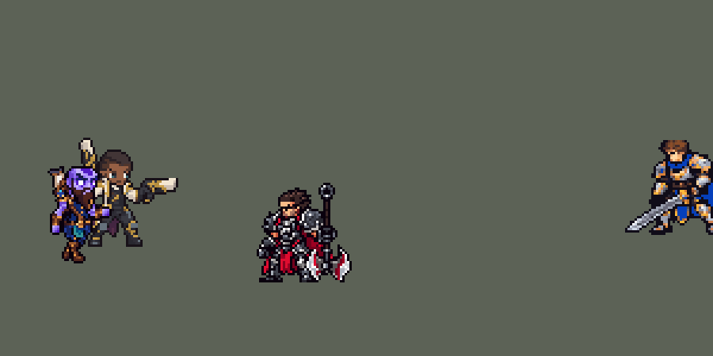

<!-- 本页上半部分由 tools/docs/gen_hero_docs.py 按仓库里现在的数据生成，手改会被覆盖；「开发记录」以下是手写的，生成时原样保留。 -->

# 瑞兹 Ryze


| 项目 | 内容 |
|---|---|
| id | `league_ryze` |
| 所属的包 | 主包（mod_id `league`） |
| 分路 | 中单 |
| 分类 / 标签 | 法师（Magician） · AP / Magic / CC |
| 高清帧 | 1 倍像素（无高清帧） |
| 附加包 | [游戏 AI 不按的技能替它按](#附加包)（`league_ult_press`） |



其他预览：[逐帧预览](../preview/league_ryze_frames.png)、[特效表](../preview/league_ryze_effects.png)

## 现在的技能

下面是游戏里显示的技能说明（`league/text/champion.i18n` 的简体中文，去掉了颜色和图标），冷却、距离来自 `league/champion/league_ryze.data_champion`；1 秒 = 60 tick。

### 普攻 / 被动（被动「奥术专精」）

*攻击间隔 1.5 秒 · 攻击距离 55000*

发射符文法球攻击。被动奥术专精：所有技能伤害额外加上2% 最大生命值（本作没有法力值，以生命值代替法力）。

### 技能1 · 超负荷

*冷却 3.5 秒 · 施放距离 80000 · 施放：方向 · 敌人（不含防御塔）*

向前释放魔爆，对命中的第一个敌人造成55 + 50% 法强的魔法伤害。若有敌人带着涌动，命中时它们全部受到35 + 35% 法强的弹射伤害，涌动随之消耗。

### 技能2 · 符文禁锢

*冷却 14 秒 · 施放距离 60000 · 施放：指定目标 · 敌人（不含防御塔）*

连招 E→W→Q→E→Q：法术涌动造成45 + 45% 法强伤害，给目标和附近敌人挂上涌动4秒；符文禁锢造成70 + 55% 法强伤害，有涌动时禁锢1.25秒，否则减速；超负荷引爆涌动，再一发法术涌动和超负荷，符文让他移速+30%。

### 大招 · 曲境折跃

*冷却 70 秒 · 施放距离 360000 · 施放：无目标 · 敌方英雄*

被敌方英雄贴身时开门逃到远处安全的队友身边（没有就往反方向逃）；身边没敌人、队友在远处交战时开门追过去。引导1秒后传送，门里的友军一起过去，落地补一发法术涌动。被控会打断。被动：施放后本条命内涌动弹射伤害提高到50 + 55% 法强。

### 数值

攻击力 78（每级 +6）、法强 35（每级 +20）、生命 900（每级 +105）、护甲 22（每级 +7）、魔抗 22（每级 +4）、移速 920（每级 +10）。

## 附加包

附加包是可选的原生代码 mod（都在附加包合集 `league_addons` 里），**不装主包里的英雄也是完整的**。

### 游戏 AI 不按的技能替它按

[游戏 AI 不按的技能替它按](../../addons/league_ult_press/README.md)：`league_ult_press` v0.5.8（通用附加包，下面只列和瑞兹有关的部分）

|  | 装了附加包，什么时候按 |
|---|---|
| 瑞兹 R（备好式） | 逃命：生命不到 35% 而 60000 内有敌方英雄；去打架：照崔斯特的规则（身边没敌人、远处队友在打）。传到哪里由主包判断 |

## 相关脚本和素材

- [`tools/kit/build_ryze.py`](../../tools/kit/build_ryze.py)
- [`tools/lol/extract_ryze.py`](../../tools/lol/extract_ryze.py)
- [`tools/art/preview_ryze.py`](../../tools/art/preview_ryze.py)
- [`tools/art/rig_ryze.py`](../../tools/art/rig_ryze.py)
- [`tools/art/import_ryze.py`](../../tools/art/import_ryze.py)
- [`tools/art/design_ryze.py`](../../tools/art/design_ryze.py)
- [`assets/source/ryze/`](../../assets/source/ryze)

## 开发记录

> 下面是原来 README 里「英雄：瑞兹」一节，原样搬过来（只改了相对链接）。

| 部分 | 内容 |
|---|---|
| 定位 | 中单（远程法师，分类 Magician），用户 10 月 2 日排的第十组的中单；本包第十个中单（拉克丝、亚索、安妮、永恩、阿狸、阿卡丽、维迦、菲兹、乐芙兰之后）。符文法师，技能就是英雄联盟里的那一套连招：E 给目标和身边的敌人挂涌动，W 把带涌动的敌人禁锢，Q 引爆涌动；R 打开传送门追人或逃跑，站在门里的队友和小兵一起传送 |
| 普攻 | 符文法球，100% 攻击力的物理伤害，射程 55000（英雄联盟 550），攻击间隔 90 tick，第 9 tick 出手（动作第 3 帧，双手推出），法球每 tick 4500，`y_offset` 1500 |
| 被动 | 「奥术专精」：英雄联盟里技能吃额外法力值；本作没有法力值，所有技能的魔法伤害额外加上 2% 最大生命值（`hp_ratio`），生命成长比一般法师高（+105） |
| 技能1 | Q「超负荷」单放（用户选）：朝 80000 内的敌人施放（小兵和野怪也算，清线、打野也用），冷却 3.5 秒。第 7 tick 出手（Q 动作第 3 帧，手掌前一闪），方向在施放时锁定（能躲），光弹每 tick 6000、半径 6000，打中第一个敌人：70 + 55% 法术强度的魔法伤害。身边有涌动时（见技能2），打中的同时所有带涌动的敌人受到 50 + 40% 法术强度的弹射伤害（英雄联盟里超负荷在带涌动的敌人之间弹射），涌动随之用掉；放过 R 后本条命内提高到 70 + 60% |
| 技能2 | E → W → Q → E → Q 连招（用户选的 E → W → Q；10 月 5 日用户：「没有高爆发的连招 查查高手怎么玩的」——高手的单体连招是 Q-E-Q-W-Q-E-Q，每个 E、W 之间都插一发 Q，所以加上第二发 E 和 Q：第 6 tick E、16 W、26 Q、36 E、46 Q；第二发 E、Q 只打施放目标，目标在前面就死了不补打。下面是原来的写法，数值见「数值」）：对 60000 内的敌人施放（小兵和野怪也算），冷却 9 秒，一个 12 帧的动作。第 6 tick E「法术涌动」：紫色法球（每 tick 4500），70 + 50% 法术强度的魔法伤害，打中后目标和 25000 内的敌人带上涌动 4 秒（已经带着涌动的再放 E 扩散到 38000）；第 24 tick W「符文禁锢」：70 + 55%，目标有涌动时禁锢 1.25 秒（蓝色符文牢笼），否则减速 40% 1.5 秒（脚下的符文锁链）；第 38 tick Q「超负荷」：同技能1，引爆涌动。E、W 各充一枚符文（绕着腰转），这一发 Q 放出两枚：移速 +30% 2 秒。目标中途死了，W、Q 打身边一个敌人（先找英雄）。涌动是每个敌人身上的一个 `AddCasted`（读瑞兹身上的标记），Q 打中时瑞兹身上的引爆标记亮 3 tick，每个带涌动的敌人各炸一次（模拟里数了 405 次，没有一个敌人炸两次） |
| 大招 | R「曲境折跃」（**10 月 18 日**用户：「卡牌和流浪推水晶的时候会往泉水里传送」——追人的隐形直线和崔斯特的一样，每 tick 走 120000、只在停下的地方看碰没碰到人（判定圈 50000），碰不到就飞满 360000、越过敌人落进泉水；现在每 tick 走 100000（`r_step`，不超过判定圈的宽度），只有碰到敌方英雄才开目的地的门、传送过去，碰不到就不传（`tools/fix/warp_beacon.py` 改游戏数据，`build_ryze.py` 生成的一样）；中路对 5 个原版法师 16 局种子 +2.86 → +2.68（噪声内）。**10 月 11 日**玩家：「瑞兹的大招不会像卡牌那样释放 远距离的追和逃命」——照崔斯特的大招改：360000 内都能放，追人不再要队友站在门里，也会传去队友在远处打的仗，落在离敌人 50000 处；逃命时随机挑 3 名队友，传到其中一名离他 60000 以上、身边 30000 内没有敌方英雄的队友身边（用户选的「传到远处的队友身边」），挑不到才照原来往反方向跳；冷却 50 → 70 秒。模拟（中路对 5 个原版法师，两批 25 局种子）：原来 +1.53 / +1.81，现在 +2.26 / +2.01，每局传送 1.5 → 5.6 次。以下是之前的说明。10 月 5 日用户：「团战开了大往里面送」——追人时落在第一名敌方英雄 5000 外，经常没人跟着；现在落在离他 38000 处（射程边上），要有队友站在他门里（25000 内），身边 100000 内敌方英雄三个以上（团战）时不追，只逃跑。模拟 240 局：落地 20000 内有敌方英雄 16% → 8%，45000 内两个以上 17% → 8%，落地 3 秒内阵亡 16% → 14%，每局追人 2.3 → 1.8 次；用户选：英雄联盟的团队传送，落地补一发 E；10 月 3 日用户：「敌人在身前为什么要释放？」「不是应该用来追敌人或者逃跑用吗」「或者运送小兵」）：冷却 50 秒。敌方英雄进入 120000 时只是「备好」10 秒（一个 3 tick 的待机动作，`league_riven` R 的做法；没用上就把冷却退回 1 秒），之后每 10 tick 判断一次（瑞兹身上的 `AddCasted`）：**逃跑**——30000 内有两名敌方英雄，或 15000 内有一名而 50000 内没有队友：脚下开门，引导 1 秒（被控打断）后朝远离其中一人的方向跳 60000（`MoveBack` 15000 × 4 tick）；**追人**——射程（45000）内已经没有敌方英雄、但 1.5 秒内还有，50000 内有队友，并且 100000 内有一名刚被己方打过的敌方英雄：脚下和朝他的方向各开一个门（一条隐形直线碰到第一个敌方英雄处停，最远 80000），引导 1 秒后传送过去。敌人就在射程里时不放。两种都把站在他门里（半径 25000）的友方英雄和小兵一起拉过去（每 tick 15000），落地 3 tick 后对 70000 内的一名敌方英雄补一发法术涌动（挂涌动，接下来的 Q 能引爆）。门里的单位各吃一发只打 `BothWithoutTower` 的隐形追踪弹再被拉：直接用区域对友方 `Grab` 会把防御塔也拖走（模拟里拖动了两座塔）。模拟里每局约 2.2 次追人、0.6 次逃跑、0.2 次被控打断，追人落地时 62% 离最近的敌方英雄在射程内；改之前 R 每次都是在敌人已经在射程里（30000–55000）时朝他传 30000，三成落在敌人脸上 |
| 附加包（替 AI 按） | 可选的附加包 [`addons/league_ult_press`](../../addons/league_ult_press/README.md)（在附加包合集里，原生代码，主包不装它也完整）：游戏 0.6.4 的 AI 很少按他「备好」的 R（只读观察包：每 10 分钟 1.7 次，525 局）。附加包按局面替 AI 按（用户：「有问题的英雄全部改成rust」）：生命不到 35% 而 60000 内有敌方英雄（逃命），或身边 75000 内没有敌方英雄、生命不低于 40%，而离他 100000–340000 有队友50000 内贴着敌方英雄（去打架）；传到哪里由主包判断 |
| 数值 | 攻击 78（+6）、法强 35（+20）、生命 900（+105）、护甲 22（+7）、魔抗 22（+4）、移速 920（+10）。数值是自己设计的，用 SDK 对战模拟调：中路，对 5 个原版中单（`pyromancer`、`ice_mage`、`lightning_mage`、`wind_mage`、`white_mage`），三套队友阵容、两边各 24 局，一批 720 局。第一版 +2.09；R 的传送距离 45000 时 +2.24，30000 反而更强（+3.41，落地离战场近）；Q 降到 60 + 50% 还有 +2.59；最后连招冷却 9 秒、生命 900（+105）：两批 +1.65 / +2.01（同两批阿狸 +1.55 / +1.76、安妮 +1.65 / +1.36、拉克丝 +2.23 / +1.89、维迦 +3.23 / +3.75、乐芙兰 +0.78 / +0.34），定下这版。R 改成追人 / 逃跑后两批 +1.41 / +1.35（不再每场一进射程就朝人传、白送一发落地 E），在阿狸、安妮和乐芙兰之间。10 月 5 日连招加到 E → W → Q → E → Q：原数值 +5.12；Q 55 + 50%、E 45 + 45%、涌动弹射 35 + 35%（R 后 50 + 55%）、连招冷却 14 秒后两批 +1.63 / +1.61，每局击杀 3.1 → 4.2 |
| 亚索联动 | 有涌动时 W 的禁锢是亚索大招要的控制：瑞兹打中路、亚索打上路同队时，亚索每局 R 到被控英雄 1.65 次（同一批阿狸 1.33、原版雷法 3.19），亚索不用调 |
| 精灵图 | 9 个动作 60 帧：待机、移动、普攻、Q、E → W → Q 连招、R 引导、R 落地、受击、死亡。造型按用户在 Codex 里挑的原画 A（英雄联盟的待机），Codex 生图草稿 A 按自己的格子读回、整行整列删到 40 行（用户选 A40）：光头、蓝紫皮肤和符文纹、发光的眼睛、长胡子、背上的大卷轴。29 × 40 px，30 色；待机最高点 −28（卷轴顶），不设 `banpick_center`；头像截取点 (−4, −39)。第二版（2026-10-03，用户：「瑞兹看起来也做的有点胖了」）：Codex 重画的瘦身稿 B 读回到 41 行、接第一版的头，25 × 41 px，664 格，30 色 |
| 音效 | 英雄联盟的音效和配音（`tools/lol/extract_ryze.py`）：普攻法球和命中、Q 出手 / 命中 / 引爆涌动、W 出手和命中、E 出手和命中、R 引导和传送；Q、E、R 带中文配音 |

重新生成（素材来自本机的英雄联盟客户端，音频不进仓库）：

```bash
python tools/kit/build_ryze.py          # 技能数据（2026-10-05 收进仓库），数字都在参数表 P 里
python tools/lol/extract_ryze.py --lol "D:\WeGameApps\lol" --vgmstream "<vgmstream-cli.exe 路径>"
python tools/lol/native_pose.py assets/source/ryze/poses.json --out <渲染文件夹>   # 动作参考帧
python tools/art/design_ryze_v2.py      # 造型（第二版）：Codex 的瘦身稿 B 读回到 41 行，接第一版的头，手和胯逐格画
python tools/art/fix_ryze_strips_v2.py  # 动作（第二版）：站着的帧是待机的身体，手臂沿 Codex 的重画成待机的粗细；跑步逐帧照英雄联盟的 Ryze_Run_Fast（腿、手臂、手），R 站着引导
python tools/art/import_native.py --hero ryze
python tools/art/import_ryze.py         # 特效；--raw <Codex 的特效交付文件夹> 先把生图原稿缩成游戏尺寸的原尺寸条
python tools/art/preview_ryze.py
```

美术（原画的提示词见 [`assets/source/ryze/PICTURE_PROMPT.md`](../../assets/source/ryze/PICTURE_PROMPT.md)，造型的见 [`MODEL_PROMPTS.md`](../../assets/source/ryze/MODEL_PROMPTS.md)，动作的见 [`MODEL_STRIPS.md`](../../assets/source/ryze/MODEL_STRIPS.md)，重画跑步的见 [`RUN_REDO.md`](../../assets/source/ryze/RUN_REDO.md)，特效的见 [`PROMPTS_FX.md`](../../assets/source/ryze/PROMPTS_FX.md)；Codex 的交接说明在 [`codex_picture/`](../../assets/source/ryze/codex_picture)、[`codex_model/`](../../assets/source/ryze/codex_model)、[`codex_strips/`](../../assets/source/ryze/codex_strips)、[`codex_run_redo/`](../../assets/source/ryze/codex_run_redo)、[`codex_fx/`](../../assets/source/ryze/codex_fx)）：

- 原画和造型：Codex 画了 A、B 两张原画，用户选 A（英雄联盟的待机，两手垂在身边）。造型 Codex 交的成品是用代码一格一格拼的（头糊成一团，眼睛是一条白杠），它的生图草稿反而好：草稿 A 按自己的格子读回（`scripts/regrid.py`，61 × 42），颜色并到 28 种（眼睛的格子不动），整行整列删到 40 行（脸的行列不删），一层描边。8 个候选里用户选 A40（`design_ryze.py`）。
- 动作：Codex 用生图画了 8 条，再自己转成游戏像素、贴回定稿的头。用户：「Codex生成的质量很差 你看看奇怪的地方能不能修复吧」。毛病出在它的转换，不在画：8 条按同一个格距取样（每条生图的格子其实不一样大，5–8 px），普攻条大了五分之一，移动有 3 帧在腿上断成两截；贴头前把头周围一整块都擦了，举在头边的手臂被擦成细棍（连招的 W、R 最后一帧的两只手飘在空中）；贴上的头上面还留着原画的头顶一圈，卷轴旁边留着原画的卷轴头；死亡躺在地上的几帧也贴了竖着的头。`fix_ryze_strips.py` 从 Codex 的生图原稿（`codex_strips/raw/`）重新读：每条按自己的格距读回（`regrid.py`，格距是颜色变化的周期），换成定稿的颜色，整行整列删到和待机一样的头顶到脚底高度；按眼睛贴回定稿的头，擦原画的头时只擦头周围一格、两侧 5 列和头顶，举着的手臂留着，细到不成块的残边和碎点去掉，原画的头更宽留下的缝由背后的卷轴补上；躺地的 3 帧留原画的头，低头的死亡第 3 帧按手标的眼睛贴头。普攻、Q、连招、落地的最后一帧用定稿本身（收招回到待机）；R 最后一帧（双手举过头）近侧的手臂被头挡住，用第 7 帧。用户：除跑步外「可以，用这版」。之后用户：「释放技能和攻击的时候 头和身体不协调」——Codex 把每一帧的头都放在站位点上同一列，身体在头下面往后滑 4–8 格；这些动作改成按胯部（腰前青色布条的中间）对准站位点，头跟着姿势前倾后仰。「手臂是不是有点变长」：伸出的手臂是英雄联盟的伸展长度，比定稿垂手时长 2–6 格，肩膀外侧的上臂删列，伸出身体最多 15 格（17 / 15 / 13 三档里用户选 15）；手边原画的蓝紫光圈被归成头皮的深紫，像深色的爪子，改成定稿手臂的暗紫。
- 跑步：原稿两步都是近侧的腿在前、手臂也不换，没有交叉步。按用户选的让 Codex 只重画跑步（`RUN_REDO.md`，附彩色腿位图：前 4 帧近腿在前、后 4 帧远腿在前，第 3、7 帧两膝交错，手臂和腿反着摆），它的第 4 稿两腿轮流在前，同样读回、贴头（旧稿留在 `codex_strips/raw/ryze_run_raw_v1.png`）。
- 导入：待机 6 帧都用定稿，第 3–5 帧从靴筒往上下沉一格呼吸（`BOB`，接缝在设计的第 96/97 行：手垂到护膝，不能从腿上切）；按眼睛的白色定头的位置（`EYES`）；描边补齐（`COMPLETE`）。
- 第二版（2026-10-03）：用户：「瑞兹看起来也做的有点胖了 顺带也修复一下吧」（第一版 40 行 828 格，手臂 6 格粗挂在身体外，裤子一整块）。Codex 照 `MODEL_V2.md` 画了 A / B / C，用户让我挑（「你挑一版吧」）：B，瘦但保留瑞兹的宽肩。`design_ryze_v2.py`：B 按 Codex 自己的读法读到 41 行、颜色归到第一版的 30 色，接第一版的头（按近侧眼睛的白定位），两只手逐格重画（「这里还变形」），手和衣服之间的缝补成描边，胯下逐格画到腰带（`HIPS`：「瑞兹这腿和身体感觉是分割的」）。动作由 Codex 按第二版重画（`MODEL_STRIPS_V2.md`），`fix_ryze_strips_v2.py` 收尾（用户：「手臂待机和释放技能时尺寸还是不一样」「上半身也是 释放技能上半身衣服变了」「体型也变了」）：站着的帧逐格用待机的上身（随 Codex 的头最多倾斜 4 格），手臂沿 Codex 手臂的骨线重画成待机的 3 格宽（上臂、金色护腕、手），胡子和脸不被手臂和它的描边盖住；跑步的腿用 Codex 的、换成待机的材质、推到待机的胯下，手臂（Codex 的碎成几块，自己按步子摆的又像钟摆：「瑞兹走路时手还是有点不自然」「看英雄联盟里面啊」）照英雄联盟 Ryze_Run_Fast 的骨骼逐帧摆（`lol_joints_v2.json`：肩→肘→手的方向，前后层按手相对脊柱的深度——远侧手臂往前摆时横过肚子挡在身前，近侧手臂往后摆时藏到身后），两腿交错的两帧补上被删掉的靴子；普攻第 3–4 帧远侧手臂（Codex 折成一团）和普攻、Q 收尾帧（手臂偏短）用待机的手臂；R 引导不再下跪（「瑞兹放大时候别跪下来啊」）：第 1 帧双臂张开在传送门上保持到第 4 帧（A / B 两版用户让我选：B），落地接引导最后一帧举手。内部逐帧检查后（用户：「错误的地方太多了」「你内部review完了再喊我审核」）：每个动作的手臂都是待机自己的手臂（上臂、护腕和手逐格原样，`tools/art/ryze_arms.py`：骨头朝下 45° 以内整行错位、朝侧面整条转 90° 后错位、朝上倒过来，不重采样；往前伸时从中间去掉几行，3/4 视角下的透视缩短，不再是一根长棍），角度照第一版（用户认可过的动作条）逐帧标出的肩、肘、腕、手（`assets/source/ryze/v1_arm_joints.json`，每条动作一个人标、另一个人在叠加图上复核）——之前转待机手臂只按 Codex 的手臂方向猜、跑步小幅摆，用户：「瑞兹的手臂感觉还是很奇怪真的」「像个僵尸一样」「不自然」；放技能时身体不再跟着头倾斜（「释放技能时身体有点变形」）；连招第 7 帧也站着；死亡 3–8 帧 Codex 画的是另一个身体，`ryze_death.py` 在待机身体上画：单膝跪、双膝跪着瘫下、趴在地上（卷轴在背上，头竖着、只露到胡子顶、下巴贴地：「这死了头是歪的？」）。
- 手臂缩短（2026-10-04）：用户「瑞兹的手臂看起来可以稍微改短一点」，在现在 / 短 1 格 / 短 2 格里选了短 2 格：`design_ryze_v2.py` 第 6 步把两条垂着的上臂各抽掉 2 行（从第 −11 行起），肘、护腕和手跟着上移；`rig_ryze.py` 按同一个 `ARM_CUT` 切手臂、放肘和手的关节，所以动作里摆出来的手臂、跑步转的手臂、恢复动作里待机的手臂和死亡帧都和待机一样短了 2 格（`ARM_CUT` 0 时逐格还原原来的造型）。Q 和 E 出手特效的位置跟着手移了（`Q_PALM` (21, −20)、`E_PALM` (21, −26)）。
- 跑步和 R 的手臂、跑步的腰、R 下跪（2026-10-05）：用户：「第一张图这里是像素丢失 一条黑线？ 第二张图这里手臂严重变形？ 右手臂和蛇精一样的？你看像官方瑞兹啊 好好修复吧」「腿和腰脱节的问题你没解决啊」「瑞兹走路时候这里少一块就像脱节一样」「瑞兹放大招时要下跪吧」。
  - 手臂：跑步 8 帧和 R 的手臂按关节逐格画（`ryze_arms.draw`：待机的材质和粗细，上臂按缩短后的长度；`fix_ryze_strips_v2.py` 的 `DRAWN`），不再把待机的手臂整块错位、横转（小臂转过 45° 后拳头碎掉，R 第 7–8 帧近侧手臂成了一根斜向上的长直线）。跑步 1–3、7 帧沿用第一版的关节；4–6 帧近侧手往后摆、远侧手收到身后（第一版近侧小臂向后反折，远侧小臂横在胸前，描边成一道黑线）；第 8 帧远侧上臂不再水平伸出。R 5–8 帧按英雄联盟的骨骼（`lol_joints_v2.json`）：远侧手举到头边、近侧手往右下伸，第 8 帧双手举起（落地第 1 帧沿用）。
  - 跑步的腰：Codex 画的大腿根比腰带窄，有 5 帧还偏左 2–5 格，胯侧露出地面。现在造型腰带下面两行（胯和腰布顶，`PELVIS`）并进上半身，Codex 的腿挂在胯下，按顶上两行居中（`legs_dx`）；腿里混进的 Codex 的手（皮肤、非腿部材质、不到 6 格的碎块）去掉。
  - R 第 2–4 帧改回下跪（之前用户说「瑞兹放大时候别跪下来啊」；看了英雄联盟原版的下蹲后选了跪）：死亡帧那套单膝跪的身体（`ryze_death.py` 的 `KNEEL`），双手按英雄联盟的位置往地面伸（`R_KNEEL`）：第 2 帧近侧手垂到膝边，第 3 帧双手在膝前，第 4 帧手收到胯边。
- 跑步重做（2026-10-05，用户：「感觉不对啊 这两个英雄 和英雄联盟不一样」「瑞兹走路也没那味 往上找个视频核对一下吧」「手臂做的很不好」「瑞兹右手臂还是有点小问题的」「手的形状也没有」「瑞兹这里有点色素丢失」）：英雄联盟里 `Run` 播的是 `Ryze_Run_Fast`（`tools/lol/anim_graph.py`），游戏尺寸下是小步颠着跑：后脚跟踢起、抬膝、身体前倾上下颠、两拳在腰前摆；我们的是 Codex 的腿（第 4、8 帧两脚叉开 29 格）加第一版的手臂关节（近侧手和近侧腿同时往前，第 7–8 帧小臂平伸）。现在逐帧照英雄联盟画在定稿自己的身体上（`fix_ryze_strips_v2.py` 的 `run_frame`）：腿按侧面看的角度（[`poses_run_profile.json`](../../assets/source/ryze/poses_run_profile.json) 导出的 [`lol_run_profile.json`](../../assets/source/ryze/lol_run_profile.json)，步子在屏幕上左右展开），骨头用定稿的长度，按定稿的裤子、护膝、靴子逐行画，左腿在前、各自描边，身体高度按最低的鞋底踩地；上半身是定稿去掉手臂，每行前倾 0.12 格、跟着原版的头上下颠；两只手臂各用前摆、经过、后摆 3 个固定姿势，按原版的节奏排（每帧都在原版的角度之间插值时，小臂一会长一格一会短一格、手一会挪一格，看着像虫子在扭：「右手臂还是奇怪看起来 在那晃动和个虫一样」），手肘一直弯着，往前摆时朝镜头，小臂缩短、拳头收在腰前（照原版自己的角度近侧手是一根斜直棍、平伸时护腕像一根带横纹的长条）；手臂是定稿自己的手臂像素（上臂、护腕、拳头）从肩膀整条摆（`ryze_arms.pose`：45° 以内逐行错开、再斜转 90°、朝镜头时去掉几行，不做非 90° 的旋转）：按关节画成的圆管手臂贴着身体时描边压进衣服边、身体看着窄了一圈（「右手臂是贴着身体的 还导致身体变形了」），只摆小臂又显得僵（「只有前臂晃动」）；右手和左手同一画法（「左手做的很好 右手不能按左手那样做吗」）：前摆时上臂竖直、护腕横平、拳头方正（斜着错位时护腕成了一条台阶），经过时接近待机的下垂，后摆时放到身体后面，远侧手往后时小臂朝后垂、不贴回胯部；手是拳头：定稿的手去掉下面那一格指尖，3×3 一块（之前画的圆拳头只是一团淡紫，带指尖的张开的手又像一根怪手指：「手指头做的是什么啊 你不然就做成拳头形状啊」）；被身体围住的空格补成旁边衣服的颜色；1 格宽的裂缝（手臂和身体之间、腰布下两腿之间）补成轮廓色，两条轮廓合成一条（和定稿一样；「这里也补补吧」）；更宽的空隙保留（补成衣服色时成了一块深色团：「你不觉得奇怪吗？」）。左手往后摆时整条手臂只稍微后倾（从肩膀斜着离开身体时会夹出一条上窄下宽的缝）。
- 特效用 Codex 画的 19 张（102 帧，生图原稿，`import_ryze.py --raw` 同卡莎：每个游戏像素取覆盖的原稿像素里最多的颜色，四分之一以上不透明才画，颜色归到包里的蓝、紫两套色阶，光效外圈最暗的一档去掉；三种飞行物上下对称，游戏按飞行方向转；传送门每格和画一样宽，格边混进来的邻格碎片去掉）。位置：Q 和 E 的出手闪光在手掌 (24, −8) 和 (24, −15)，命中和引爆在上半身 (0, −8)，涌动绕胸口 (0, −7)，符文绕腰 (0, −2)，牢笼、减速锁链、加速风、传送门、光柱、落地都在脚底。时长：涌动 4 帧 × 50 ms（技能每 12 tick 重放一次），禁锢的牢笼立着保持到 75 tick 再消散，没有涌动时牢笼只一闪（减速的锁链留在脚下），传送门展开、转过 1 秒引导、他离开时收起。

逐帧预览：[`docs/preview/league_ryze_frames.png`](../preview/league_ryze_frames.png?v=1014g)，特效：[`docs/preview/league_ryze_effects.png`](../preview/league_ryze_effects.png?v=1014g)。
