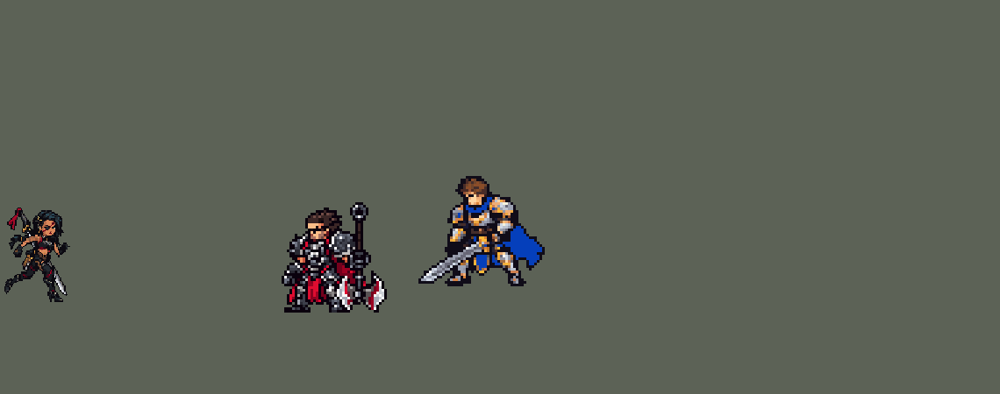

<!-- 本页上半部分由 tools/docs/gen_hero_docs.py 按仓库里现在的数据生成，手改会被覆盖；「开发记录」以下是手写的，生成时原样保留。 -->

# 莎弥拉 Samira


| 项目 | 内容 |
|---|---|
| id | `league_samira` |
| 所属的包 | 主包（mod_id `league`） |
| 分路 | ADC |
| 分类 / 标签 | 射手（Range） · AD / Range |
| 高清帧 | PPU 2.84 |
| 附加包 | [莎弥拉边走边射附加包](#附加包)（`league_samira_r`）、[游戏 AI 不按的技能替它按](#附加包)（`league_ult_press`） |



其他预览：[逐帧预览](../preview/league_samira_frames.png)、[特效表](../preview/league_samira_effects.png)

## 现在的技能

下面是游戏里显示的技能说明（`league/text/champion.i18n` 的简体中文，去掉了颜色和图标），冷却、距离来自 `league/champion/league_samira.data_champion`；1 秒 = 60 tick。

### 普攻 / 被动（被动「悍勇本色」）

*攻击间隔 0.97 秒 · 攻击距离 55000*

远处开枪，近身挥刀并附加15 + 20% 攻击力魔法伤害。被动悍勇本色：用和上一次不同的招式命中英雄，评价E→S升一级，每级移速+3%，9秒没打到英雄清零。攻击被控制的英雄时冲上去击飞0.5秒。

### 技能1 · 交火

*冷却 5 秒 · 施放距离 90000 · 施放：方向 · 敌人（不含防御塔）*

身边有敌人时挥刀斩击前方，否则开枪打中第一个敌人，造成30 + 130% 攻击力物理伤害。

### 技能2 · 狂飙

*冷却 12 秒 · 施放距离 60000 · 施放：指定目标 · 敌方英雄*

冲到敌方英雄身后，对周围敌人造成70 + 40% 攻击力魔法伤害，攻速+30%。随即锋旋：旋转0.75秒砍两次，每次25 + 70% 攻击力，期间受到的攻击伤害-60%。击杀英雄刷新冷却。

### 大招 · 炼狱扳机

*冷却 5 秒 · 施放距离 50000 · 施放：指定目标 · 敌方英雄*

评价到S时才会施放：原地旋转连射2秒，每0.2秒向周围所有敌人各开一枪，造成10 + 40% 攻击力物理伤害，期间生命偷取40%。放完评价清零。

### 数值

攻击力 112（每级 +20）、生命 1030（每级 +92）、护甲 26（每级 +7）、魔抗 15（每级 +3）、移速 900（每级 +9）。

## 附加包

附加包是可选的原生代码 mod（都在附加包合集 `league_addons` 里），**不装主包里的英雄也是完整的**。

### 莎弥拉边走边射附加包

[莎弥拉边走边射附加包](../../addons/league_samira_r/README.md)：`league_samira_r` v0.1.0

|  | 主包（纯数据） | 装了附加包 |
|---|---|---|
| R 期间 | 原地旋转连射 2 秒 | 旋转连射，同时走向 90000 内生命 + 护盾最少的敌方英雄，走到 30000 内站住；被硬控时不走 |
| 枪、伤害、生命偷取、画面 | 主包 | 主包（一样） |

### 游戏 AI 不按的技能替它按

[游戏 AI 不按的技能替它按](../../addons/league_ult_press/README.md)：`league_ult_press` v0.5.7（通用附加包，下面只列和莎弥拉有关的部分）

|  | 装了附加包，什么时候按 |
|---|---|
| 莎弥拉 R | R 好了、**R 射程（50000）内有敌方英雄**就按，目标是最近的那个。S 评价时这一下就放出炼狱扳机，不到 S 就备好 330 tick，期间到了 S 再放 |
| 莎弥拉 E、Q（攒评价） | S 要连着换五种出手打中英雄（枪 / 剑普攻、Q、E 冲刺、落地的 W 旋转），一下打不中 9 秒就掉。R 不按时：**60000 内有敌方英雄、她生命不低于 50%、目标身边的敌方英雄不超过 2 个、目标生命不高于 50% 或身边已有我方英雄（v0.5.1）**——按 E 冲过去（先冲生命最少的）（落地接 W）；再不然 **70000 内有敌方英雄、上一下打中英雄的不是 Q**——Q 朝他放。其余照旧由 AI 平 A |

## 相关脚本和素材

- [`tools/kit/build_samira.py`](../../tools/kit/build_samira.py)
- [`tools/kit/setup_samira.py`](../../tools/kit/setup_samira.py)
- [`tools/lol/extract_samira.py`](../../tools/lol/extract_samira.py)
- [`tools/art/preview_samira.py`](../../tools/art/preview_samira.py)
- [`tools/art/rig_samira.py`](../../tools/art/rig_samira.py)
- [`tools/art/import_samira.py`](../../tools/art/import_samira.py)
- [`tools/art/design_samira.py`](../../tools/art/design_samira.py)
- [`assets/source/samira/`](../../assets/source/samira)

## 开发记录

> 下面是原来 README 里「英雄：莎弥拉」一节，原样搬过来（只改了相对链接）。

| 部分 | 内容 |
|---|---|
| 定位 | ADC（射手，分类 Range），用户排的第十三组的 ADC（同组：上单蛮王、打野赵信、中单泽拉斯，辅助派克以后做），第 64 位英雄。沙漠玫瑰 莎弥拉：远处开枪、近身挥剑，打出不同的招式把评分从 E 升到 S，到 S 才能放 R。技能位用户选的「Q / E→W 连招」，W 选「旋转时减伤」，R 选「这个不能走的话可以改RUST文件」（主包里 R 原地旋转连射，主包自己完整可玩；边走边射以后做原生附加包），被动「冲上去挑飞被控制的英雄」选做 |
| 普攻 / 被动 | 普攻射程 55000（英雄联盟 500 码），攻击间隔 58 tick。第 1 tick 先发一颗看不见的探测弹：目标在 8000 内就挥剑（`attack_m`，第 12 tick 砍中，额外 15 + 20% 攻击力的魔法伤害——英雄联盟的近战加成），否则开枪（第 12 tick 子弹出枪口）。被动「悍勇本色」：用和上一次不同的招式（开枪、挥剑、Q、E、W 各算一种）命中英雄，评价 E→D→C→B→A→S 升一级，每级移速 +3%，9 秒没打到英雄清零；评价字母挂在头顶。攻击被控制住的敌方英雄时冲到他身上把他击飞 0.5 秒（英雄联盟的挑飞连击，6 秒一次，不然会和她自己的击飞无限连） |
| 技能1 | Q「交火」：冷却 300 tick（5 秒），射程 90000，也对小兵和野怪放。身边 28000 内有敌人时挥剑斩前方的半圆（半径 32000，第 10 tick），否则开枪：一发直线子弹（95000 长，每 tick 9000）打中第一个敌人（第 9 tick 出枪口）。都是 30 + 130% 攻击力的物理伤害，挥剑再加近战加成 |
| 技能2 | E「狂飙」→ W「锋旋」（英雄联盟的 E→W 连招）：冷却 720 tick（12 秒），只对敌方英雄放（射程 60000）。冲刺穿过目标落到他身后（每 tick 8000），落点 22000 内的敌人受到 70 + 40% 攻击力的魔法伤害，攻击速度 +30% 持续 5 秒；落地接锋旋：原地旋转 0.75 秒，32000 内砍两次（25 + 70% 攻击力 + 近战加成），旋转时受到的普攻伤害降低 60%（英雄联盟是挡掉飞行道具，这里挡不了弹道，用户选的减伤）。被她打中过的英雄 40 tick 内死掉就刷新所有技能冷却（英雄联盟的击杀刷新 E） |
| 大招 | R「炼狱扳机」：只对敌方英雄放（射程 50000），评价到 S 才会放（AI 会在任何时候放技能位，所以没到 S 时这个技能只「待命」330 tick：到 S 后的下一次普攻放出，没用上就退还冷却，伊芙琳 R 的做法）。原地旋转连射 2 秒（120 tick），每 12 tick 向 55000 内每个敌人各开一枪：10 + 40% 攻击力的物理伤害，期间生命偷取 40%；被控制会打断旋转动作，但枪照样打（英雄联盟的 R 也不停）。放完评价清零。冷却 300 tick |
| 附加包 | 可选的附加包 [`addons/league_ult_press`](../../addons/league_ult_press/README.md)（在附加包合集里，原生代码，主包不装它也完整）：游戏 0.6.4 的 AI 几乎不按她只「备好」的 R 格（只读观察包：每 10 分钟 0.2 次，多数英雄 3–9 次；格子里加 200 或 1000 的护盾、再加一次搜敌方英雄都没用）。附加包替 AI 按（用户：「莎弥拉和卡牌用附加包在合适时机替AI按R，主包保持现在这样」）：R 好了、她没被控住、R 射程（50000）内有敌方英雄就按，S 评价时立刻放出炼狱扳机，不到 S 就备好，期间到了 S 再放。只按 R 时 40 局一次都没到 S（游戏的 AI 几乎不对英雄放 E，Q 多半打小兵，评价 9 秒不打中英雄就掉），用户选「帮她连招攒评价」：R 不按时，60000 内有敌方英雄、她生命不低于 40%、目标身边的敌方英雄不超过 2 个就按 E 冲过去（落地接 W），再不然 70000 内有敌方英雄、上一下打中英雄的不是 Q 就把 Q 朝他放，其余照旧由 AI 平 A；主包的数据一点没改 |
| 数值 | 攻击 112（+20）、生命 1030（+92）、护甲 26（+7）、魔抗 15（+3）、移速 900（+9）。数值是自己设计的，用 SDK 对战模拟调：下路，对 4 个原版 ADC（`gunner`、`soldier`、`archer`、`gambler`），3 套阵容、两边各打，10 分钟。初稿 −2.72（E 冲刺距离固定把她留在兵线里、评价 9 秒太短升不到 S）；E 只冲英雄并落到目标身后、挥剑普攻单独算一种招式、攻击 100 → 112、生命 920 → 1030、护甲 22 → 26、射程 50000 → 55000、Q 110% → 130%、E 50 → 70、W 50% → 70% 后 +1.36 / +1.19；配上动作条和特效后 +1.73 / +1.38（同包韦鲁斯 +1.63 / +1.91、烬 +1.43 / +2.08） |
| 亚索联动 | 被动的挑飞是亚索大招要的击飞：莎弥拉在下路时亚索大招每局对英雄放 0.25 次（同批原版枪手 0.35，韦鲁斯 0.67），挑飞要先有人控住对面，不用调 |
| 精灵图（旧版 1 倍） | 10 个动作 101 帧（含画进帧里的特效）：待机、移动、开枪普攻（`attack`）、挥剑普攻（`attack_m`）、Q 开枪（`skill`）、Q 挥剑（`skill_m`）、E→W（`skill2`）、R（`ult`）、受击、死亡。第二版造型 32 × 37 px，25 色。待机 8 帧上下呼吸（剑身跟着身体整体移动，不前倾，两只靴子不动）；头像截取点 (−4, −36) |
| 高清帧（PPU 2.84，身体 2.2 的格子） | 2026-10-25 用 PPU 重做（用户：「下一个英雄重做萨米拉」）。设计图：Codex 照她现在的精灵和英雄联盟的样子画（[`tools/art/pack_samira_ppu.py`](tools/art/pack_samira_ppu.py)），用户选 v2 那张（「不对 应该使用这个」）；PPU 2.2 取平均把眼睛糊掉了（「太糊了 用2.84吧」），改成按原图自己的格子读回、脸的线条保留；头太大（「这头怎么这么大」）请 Codex 把头从 32% 缩到 26% 重画（[`tools/art/pack_samira_head.py`](tools/art/pack_samira_head.py)，v3）；背后的大剑是歪的（「背后的武器看起来是歪的」），[`tools/art/sword_samira_hd.py`](tools/art/sword_samira_hd.py) 把旧剑身去掉、从护手到剑尖画一把直的（6 档银色、往剑尖收窄），压在身体下面。76 × 105 格，头顶到脚底还是 37 像素（[`tools/art/design_samira_hd.py`](tools/art/design_samira_hd.py)），用户看过大小后「保持 100%」。动作：Codex 照旧版同一帧整帧重画（[`tools/art/pack_samira_actions.py`](tools/art/pack_samira_actions.py)，41 张，重复的姿势只画一次），每格按 5.5 px 一格、从站立点和脚底线读回（[`tools/art/casts_samira_hd.py`](tools/art/casts_samira_hd.py)）：Q 挥剑的起手 Codex 把剑换到了近侧手、W 旋转举剑那帧把她画小了一号，这两帧换成剑普攻的起手（远侧手高举大剑，剑永远在同一只手）；跑步按脸的位置对齐（Codex 有一帧偏了 12 格），读回留下的 1–3 格小洞补上。导出 [`tools/art/rig_samira_hd.py`](tools/art/rig_samira_hd.py)：待机底帧就是设计图，画进帧里的枪口火光、半月斩、R 两把枪的火光跟着新枪口挪（`samira_bake.json`，R 的火光左右朝向分开量），待机和选人卡轮播由 `hero_reels.py` 从动作里切。新枪口比旧版高约 3 像素，子弹高度不变（再高会斜着飞向目标）。头像点 (−4, −36) 不变；头顶到 −33.3，选人卡加 `banpick_center` −6。装进游戏后她显得细（「我怎么感觉身体有点细啊 和原版画风不符」），加宽身体的试验被否（「不不不 你方向错了 感觉降低像素就行了」「泽丽之前也一样 但是后面调整好了」——10 月 13 日 PPU 英雄统一到泽丽的画风、约 2.2 格一像素那次）：按 2.84 画好的帧原样保留（`ORIG_PPU`），由 [`tools/art/ppu_restyle.py`](tools/art/ppu_restyle.py) 降到 2.2 格一像素（2.84 / 2.2 / 1.8 / 1.5 对比图里用户选「用 2.2」，[`tools/art/review_samira_ppu.py`](tools/art/review_samira_ppu.py)），和金克丝、拉克丝、阿狸、安妮一样。2.2 的格子把她的嘴（深色唇线压在红唇上）投成一道深褐红的斜杠、一个像素的绿眼睛也投没了（「这嘴也太丑了」），用户：「你可以其他地方模糊点 脸做好点啊」——帧留在 2.84 的格子上，全身按 2.2 的格子取色再铺回原格子（`look`），脸（头发里的那块皮肤连同它围住的眼睛、眼罩、伤疤、鼻子、嘴，外扩一像素，[`tools/art/face_samira_hd.py`](tools/art/face_samira_hd.py)：受击闪白的那帧先去掉白再找，倒下第一帧手给范围）原样放回——认可过的 2.84 的脸配 2.2 的身体，像亚索的高清头配身体那样；铺回后 3 像素以内的封闭小洞补上；特效原样叠在上面。设计图的头比 Codex 画的每个动作都大一号（头顶到下巴 33 行，动作 28–31 行），待机和动作之间头一大一小（「现在头还会变一大一小」）：待机改用 Codex 自己画的站姿——剑 Q 收招那帧（`rig_samira_hd.py` 的 `IDLE`），尺寸保持 100%。头顶到 −34.0，选人卡 `banpick_center` −6 → −5 |
| 特效 | Codex 生图的 23 张（`import_samira.py` 缩成游戏像素）：`league_samira_fx` 普攻、Q、R 的子弹和命中，挥剑、Q 剑斩、E、W 的命中，挑飞，E 击杀刷新的金光，头顶的评价字母 E D C B A S、升级闪光和到 S 的爆闪；`league_samira_big` W 绕身旋转的剑刃火环、R 身边的枪火和玫瑰花瓣；画进她自己动作帧里的：普攻和 Q 的枪口火光、R 两把枪的火光、挥剑的火焰弧光、Q 的半月斩、E 冲刺的拖尾 |
| 音效 | 英雄联盟的音效和配音（`tools/lol/extract_samira.py`）：开枪、挥剑、命中，评价升级和到 S，Q 上膛、开枪、挥剑、命中，E 冲刺、命中，W 旋转、命中，R 开始、连射、每一枪；Q（开枪、挥剑各一句）、E、R 的中文配音。版权属于 Riot Games，**不提交到仓库**，按下面的命令在本地生成 |
| 图标 | 官方技能图标（Q / E / R），从本地客户端提取，缩到 64×64 |

重新生成（素材来自本机的英雄联盟客户端，音频不进仓库）：

```bash
python tools/lol/extract_samira.py --lol "D:\WeGameApps\lol" --vgmstream "<vgmstream-cli.exe 路径>"
python tools/kit/build_samira.py        # 技能数据，数字都在脚本的参数表 P 里；--nodes 看每棵技能树的节点数
python tools/kit/setup_samira.py        # 五种语言的文字、音效配置、共享文件里她的键（头像点在脚本的 VIEW 里）
python tools/art/design_samira2.py      # 造型（第二版）：用户的 ChatGPT 图按格子读回、整行整列删到 39 行，缩头、理脸型、理枪管（第一版的 design_samira.py 不能再跑）
python tools/lol/native_pose.py assets/source/samira/poses.json --out <渲染文件夹>   # 动作参考帧
python tools/art/rig_samira.py          # 动作：每帧都是造型本身，手臂、腿、武器按下面的做法摆；--review <文件夹> 先看
python tools/art/import_samira.py       # 特效；--raw assets/source/samira/codex_fx 先把生图原稿缩成游戏尺寸的原尺寸条
python tools/art/import_native.py --hero samira   # 动作条 + 画进帧里的特效（assets/source/native/samira_bake.json）
python tools/art/preview_samira.py     # 逐帧预览（高清帧）、特效预览、演示 GIF
# PPU 2.84 重做（2026-10-25）：
python tools/art/pack_samira_ppu.py --out <文件夹>       # 给 Codex 的设计图包（照她现在的精灵 + 英雄联盟的样子）
python tools/art/pack_samira_head.py --out <文件夹>      # 头缩到 26% 的重画包
python tools/art/design_samira_hd.py                   # Codex 的 v3 原图（hd/raw/samira-v3.png）按自己的格子读回、剑理直 -> hd/design.png
python tools/art/pack_samira_actions.py --out <文件夹>   # 给 Codex 的动作包（照旧版同一帧整帧重画）
python tools/art/rig_samira_hd.py                      # Codex 的交付（hd/casts）读回到设计图上 -> 原始条和 1 倍图（PPU 2.84）
python tools/art/ppu_restyle.py --hero samira && python tools/art/ppu_hd.py --hero samira && python tools/art/hero_reels.py --hero samira
python tools/art/review_samira_ppu.py --out <文件夹>    # 几档像素密度并排（2.84 / 2.2 / 1.8 / 1.5），和同批英雄同一游戏尺寸
python tools/art/face_samira_hd.py --review <文件夹>     # 每帧保留原样的脸的范围（品红框）
```

美术（原画的提示词见 [`assets/source/samira/PICTURE_PROMPT.md`](../../assets/source/samira/PICTURE_PROMPT.md)，造型的见 [`MODEL_PROMPTS.md`](../../assets/source/samira/MODEL_PROMPTS.md)，动作的见 [`MODEL_STRIPS.md`](../../assets/source/samira/MODEL_STRIPS.md)，特效的见 [`PROMPTS_FX.md`](../../assets/source/samira/PROMPTS_FX.md)；Codex 的交付在 [`codex_picture/`](../../assets/source/samira/codex_picture)、[`codex_model/`](../../assets/source/samira/codex_model)、[`codex_strips/`](../../assets/source/samira/codex_strips)、[`codex_fx/`](../../assets/source/samira/codex_fx)；附图包由 `tools/art/pack_samira_*.py` 在本地生成，英雄联盟的渲染和 oppi 的图不进仓库）：

- 原画：Codex 画了 A（双手叉腰、大剑背在身后）和 B，用户选 A。
- 造型：Codex 的草稿 1 按格子读回、整行整列删到 40 行（用户：「40 行原样」；先护住整张脸会把身体挤成碎点，改成只护眼睛的行列）。武器看不清（「武器有点看不清啊」「你可以参考隔壁oppi的怎么画的」）：照 oppi 的做法让大剑的剑身和近侧手枪的枪管露出身体轮廓；Codex 按 oppi 待机姿势重摆的版本用户没要（「用左边的」），只把膝盖以下的靴子理直（「你帮我挑挑干净 脚这里都是歪的」）。
- 第二版造型（2026-10-09）：第一版在游戏里看着很乱（用户：「这莎弥拉做的也太抽象了」），我照 oppi 比例画的几版头发和脸也不行（「太丑了」），用户自己用 ChatGPT 画了一张（[`gpt_picture/`](../../assets/source/samira/gpt_picture)）：「按照做吸血鬼的方法慢慢调成这样吧」。`design_samira2.py`：按格子读回 53 × 45，整行整列删到 39 行（用户选「39行」「压7行」：头发压到 7 行，眼罩、绑带、眼睛、嘴那几行几列整行保留，每一格都是原图的颜色）；「头还是有点大」→ 只在头部的行里删两行头发，大剑上半截先拿出来、缩完放回原位（剑不折）；「脸型有点奇怪」→ 下巴和额头换回原图逐行收窄的那几行、右脸颊收窄一列（用户选 F4）；近侧枪管理成一根直的两格宽银管。37 行、25 色。
- 动作：Codex 的动作条每条都重画了她、自己的检查也没通过，用户选「我用蛮王那套做」——全部用造型自己的像素摆（`rig_samira.py`）。第一版（手臂自己画成木板、身体按行错开、腿平移、死亡切掉几行）被否：「手变形 走路没交叉步 死亡动画完全错误 模型变形」；第二版（两段骨骼的手臂、照英雄联盟关节画的腿）也被否：「手臂对吗 走路对吗？」「你看了不奇怪吗 没违和感吗」——远侧肩膀放在了脖子旁边，手臂画在胸口和头发上面像从胸口长出来，R 两条手臂连成一根横穿身体的棍子；跑步的腿有一截她没有的皮肤大腿、红带跑到了胯上、两腿收成 V 字。第三版：手臂是直的、3 格粗（造型的肤色上亮下暗），手端两格墨绿手套，和叉腰的手臂一样长，从躯干上方的两个肩角出来——近侧从左肩外沿出来、画在身体上面，描边不压肩膀；远侧从躯干右上角出来、在躯干下面但压在背后的头发上；手臂抬起后原来叉腰的位置用躯干侧面和头发的颜色补上。枪和剑画在手臂下面、手套握住柄，剑只用整 90° 和 45° 的方向（不旋转像素），每一帧手和武器都看得见。跑步的腿用造型自己腿的每一行（两格深绿两格浅绿、膝盖红带、远侧靴子的脚和金鞋跟，脚尖朝前）沿着胯—膝—脚踝摆，两胯收到身体下方相隔 6 格，前后各迈 5 格：近侧腿在前时两腿交叉，远侧腿稍暗一档（不然交叉时糊成一团），抬起的脚最多离地 3 行，身体随落地下沉 1 行；手还是叉腰（英雄联盟跑步时手也在腰边）。死亡：受击、被击退、整个人转 45° 往后倒，再转 90° 仰躺（双腿并拢、手放在身侧），大剑落在头旁边。
- 第二版造型的动作（2026-10-09，「OK 动作帧全要大改吧」）：同一套做法按新造型逐格重定——叉腰的两只手臂和手拿开后补上的腰带、两个肩点、背上大刀的上半截（刀柄、红穗子、护手）和右下的刀身、刀取下后补上的肩边头发、远侧手臂压住的辫子、跑步时跟着身体走的两个枪套、三格宽的裤腿和靴子（红靴口、白扣、脚尖朝前）；手臂加一格金护腕；帧数和每帧时长不变（技能的出手时机不用改）；枪口、R 两把枪、挥剑弧光、Q 半月斩的位置在新动作上重量，头顶字母随头矮了 3 格；待机只上下呼吸、不前倾（叉开站的两只靴子每帧不动）。
- 特效用 Codex 画的 23 张（生图原稿，`import_samira.py --raw`：每张按格子等分，每个游戏像素取覆盖的原稿像素里最多的颜色，颜色归到包里给每张的色阶——枪火的白金橙、剑火的深红、玫瑰花瓣、评价字母的金、冲刺扬起的黄沙；火光外圈最暗的一档去掉，评价字母保留描边）。
- 红色方（用户：「注意红色方和蓝色方的技能特效不要不对称 导致歪的」）：游戏只会按朝向镜像英雄自己的动作帧、不镜像特效图，所以有朝向的特效全部画进她的动作帧（`samira_bake.json`）：普攻、Q、R 两把枪的枪口火光，挥剑的弧光，Q 的半月斩，E 冲刺的拖尾——技能数据里不再单独播放 Q 斩和 E 拖尾。三种子弹做成严格上下对称（朝左飞时转半圈和左右翻转一样）；挂在她身上、不管朝哪边都播放的（W 剑环、R 枪火、E 刷新、升级和到 S 的闪光）做成严格左右对称，剑环和枪火在她身体上方那半圈掏空，看起来从她身后绕过；评价字母不镜像。子弹从她身上 8 格高处出发、前 2–3 tick 不显示，飞过枪口才出现（太高会斜着飞向目标脚下）。演示 GIF 后半段她转身朝左打，就是红色方的样子。
- 10 月 7 日精修（「你把我44行的精修一下吧」）：头部按用户的图重画——两侧螺旋卷发、头顶两个小蝴蝶结、刘海和呆毛，裙子上的金饰减少；剪刀环上的爱心修好（清理步骤曾把它打成棋盘格），轮廓里的透明小洞补上。站姿照最初的设计微微侧身（「你现在站的太正了」）：大腿并拢、近腿直立、靴子朝前，远腿的脚尖朝右，脸的五官往右转一格，左脸一缕鬓发、近眼加眼角睫毛（「左边脸部有点奇怪吧 再精致一点」）。跑步改成英雄联盟那样一脚着地、另一只脚往后踢起（「走路姿势也有点奇怪」），空着的左手不再摆（「左手摇来摇去要变形了」），剪刀留在身后。

逐帧预览：[`docs/preview/league_samira_frames.png`](../preview/league_samira_frames.png?v=1026sm)，特效：[`docs/preview/league_samira_effects.png`](../preview/league_samira_effects.png?v=1014g)。
