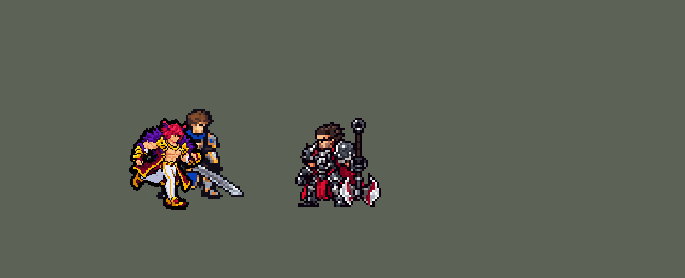

<!-- 本页上半部分由 tools/docs/gen_hero_docs.py 按仓库里现在的数据生成，手改会被覆盖；「开发记录」以下是手写的，生成时原样保留。 -->

# 瑟提 Sett


| 项目 | 内容 |
|---|---|
| id | `league_sett` |
| 所属的包 | 主包（mod_id `league`） |
| 分路 | 上单 |
| 分类 / 标签 | 近战（Melee） · AD / Melee / Tank / CC / Shield |
| 高清帧 | 1 倍像素（无高清帧） |
| 附加包 | [瑟提豪意附加包](#附加包)（`league_sett_grit`） |



其他预览：[逐帧预览](../preview/league_sett_frames.png)、[特效表](../preview/league_sett_effects.png)

## 现在的技能

下面是游戏里显示的技能说明（`league/text/champion.i18n` 的简体中文，去掉了颜色和图标），冷却、距离来自 `league/champion/league_sett.data_champion`；1 秒 = 60 tick。

### 普攻 / 被动（被动「沙场豪情」）

*攻击间隔 1.07 秒 · 攻击距离 25000*

被动沙场豪情：左右拳交替出击，右拳出手更快，额外造成15 + 20% 攻击力的物理伤害；2秒不出拳就从左拳重新开始。瑟提的生命回复很高。

### 技能1 · 强手裂颅

*冷却 8 秒 · 施放距离 30000 · 施放：无目标 · 敌方英雄*

把周围的敌人全部拉到面前对撞，造成40 + 70% 攻击力的物理伤害；拉到两个及以上时全部眩晕1秒，否则减速50%。之后两拳为屈人之威：额外30 + 20% 攻击力 + 4%最大生命值伤害，移速+30%。眩晕英雄后1.5秒内，蓄意轰拳整拳都是真实伤害。

### 技能2 · 蓄意轰拳

*冷却 9 秒 · 施放距离 42000 · 施放：方向 · 敌人（不含防御塔）*

受伤积攒豪意（最多5层，4秒消散）。消耗豪意获得50 + 20% 攻击力护盾，蓄力前轰一拳：40 + 70% 攻击力物理伤害，正中的敌人再受30 + 30% 攻击力真实伤害。每层豪意护盾+30 + 25% 攻击力，真伤+10 + 8% 攻击力。

### 大招 · 叹为观止

*冷却 50 秒 · 施放距离 30000 · 施放：指定目标 · 敌方英雄*

抓住一名敌方英雄眩晕并扔向前方，再跃起追上砸地：周围敌人受到120 + 100% 攻击力 + 4%最大生命值的物理伤害并减速99%，被扔的英雄再受6%最大生命值伤害。砸地后2.5秒内，强手裂颅必定眩晕，蓄意轰拳整拳都是真实伤害。

### 数值

攻击力 90（每级 +18）、生命 1100（每级 +110）、护甲 34（每级 +8）、魔抗 26（每级 +4）、移速 1000（每级 +11）、生命回复 5（每级 +2）。

## 附加包

附加包是可选的原生代码 mod（都在附加包合集 `league_addons` 里），**不装主包里的英雄也是完整的**。

### 瑟提豪意附加包

[瑟提豪意附加包](../../addons/league_sett_grit/README.md)：`league_sett_grit` v0.1.0

|  | 主包（纯数据） | 装了附加包 |
|---|---|---|
| 豪意 | 挨打一次一层，最多 5 层，4 秒没挨打就散 | 最近 4 秒受到的伤害（回血不抵），最多 50% 最大生命 |
| W 护盾 | 50 + 20% 攻击力，每层 +30 + 25% | 50 + 20% 攻击力 + 全部豪意 |
| W 正中真实伤害 | 30 + 30% 攻击力，每层 +10 + 8% | 30 + 30% 攻击力 + 25% 豪意 |

## 相关脚本和素材

- [`tools/lol/extract_sett.py`](../../tools/lol/extract_sett.py)
- [`tools/art/preview_sett.py`](../../tools/art/preview_sett.py)
- [`tools/art/import_sett.py`](../../tools/art/import_sett.py)
- [`tools/art/design_sett.py`](../../tools/art/design_sett.py)
- [`assets/source/sett/`](../../assets/source/sett)

## 开发记录

> 下面是原来 README 里「英雄：瑟提」一节，原样搬过来（只改了相对链接）。

| 部分 | 内容 |
|---|---|
| 定位 | 上单（近战战士，分类 Melee），用户 10 月 1 日定的第十二组的上单（同组：伊芙琳、丽桑卓、韦鲁斯、牛头）；本包第十二个上单（盖伦、德莱厄斯、提莫、墨菲特、凯尔、锐雯、贾克斯、菲奥娜、卡蜜尔、凯南、亚托克斯之后）。腕豪：左右拳交替，E 把身边的人拽过来对撞，W 挨打攒豪意、一拳轰出真实伤害，R 抓起英雄扔出去再跳起来砸地 |
| 普攻 / 被动 | 普攻射程 25000。被动「沙场豪情」：左右拳交替，左拳 100% 攻击力（第 12 tick 打中）；右拳出得更快（第 9 tick），15 + 120% 攻击力；2 秒不出拳就从左拳重新开始。英雄联盟按已损失生命回血，这里读不到当前生命，改成较高的固定生命回复 5（+2）/秒 |
| 技能1 | E「强手裂颅」，Q「屈人之威」并入：冷却 8 秒，身边 30000 内有敌方英雄时才施放（留给打架，不拿去清兵）。把半径 24000（加双方体积）内的敌人全部拽到面前，40 + 70% 物理伤害；拽到两个及以上就全部眩晕 1 秒，只拽到一个则减速 50% 0.5 秒。之后 5 秒内的两拳是屈人之威：每拳再加 30 + 20% 攻击力 + 目标 4% 最大生命值，并且移速 +30% 1.5 秒。连招：大招砸地后 2.5 秒内施放必定眩晕（只拽到一个也晕） |
| 技能2 | W「蓄意轰拳」：冷却 9 秒。被动「豪意」：挨打攒豪意，最多 5 层，4 秒没挨打就散。施放时消耗全部豪意，得到 50 + 20% 攻击力的护盾（每层 +30 + 25%），3 秒；蓄力约 0.5 秒后向前轰出一拳（出手时就锁定了方向，可以躲开）：拳头范围内 40 + 70% 物理伤害，正中一条再受 30 + 30% 真实伤害（每层 +10 + 8%）。连招：E 眩晕到英雄后 1.5 秒内、或大招砸地后 2.5 秒内施放，整只拳头都打真实伤害 |
| 大招 | R「叹为观止」：冷却 50 秒，对 30000 内的敌方英雄。抓住他（眩晕到砸地之后），往前扔出 24000，自己同速跳着追上去砸地：半径 26000 内的敌人受到 120 + 100% 攻击力 + 各自 4% 最大生命值的物理伤害、减速 99% 0.5 秒，被扔的英雄再受 6% 最大生命值；整个过程免疫控制 |
| 附加包 | 可选的附加包 [`addons/league_sett_grit`](../../addons/league_sett_grit/README.md)（在附加包合集里，原生代码，主包不装它也完整）：豪意照英雄联盟是最近 4 秒受到的伤害（最多 50% 最大生命），W 的护盾再加上全部豪意，正中再按 25% 豪意补真实伤害（主包按挨打次数分 5 层） |
| 附加包（对线） | 可选的附加包 [`addons/league_ult_press`](../../addons/league_ult_press/README.md)（在附加包合集里，原生代码，主包不装它也完整）：对线时游戏 0.6.4 的 AI 常把他停在对面英雄 26–32k 外（近战射程 25k）、下令「走到自己脚下」站着不打（只读观察包：他身边 50000 内有敌方英雄时站着不动 22–32%，盖伦 2.7%、贾克斯 3.9%；这些站桩 93% 在 10 分钟前、对面只有 1 人）。附加包替 AI 上去平 A（用户：「卡密尔、瑟提、奥拉夫对线被 AI 停住时，附加包替他们上去平 A（血量够、不在对面塔下、不被以少打多）」）：原地站了 15 tick、普攻好了、AI 还让他原地站时，35000 内最近的敌方英雄——他生命不低于一半、目标离敌方塔 75000 以外、目标身边 60000 内的敌方英雄不多于他身边的我方英雄（含他）——就普攻他，打出一下或 1.5 秒后重新算 |
| 数值 | 攻击 90（+18）、生命 1100（+110）、护甲 34（+8）、魔抗 26（+4）、移速 1000（+11）、生命回复 5（+2）。在 SDK 上模拟过（见下面「平衡」） |
| 精灵图 | 11 个动作 60 帧：待机、移动、左拳（`attack`）、右拳（`attack2`）、E（`skill`）、W（`skill2`）、R 抓起扔出（`ult`）、R 飞扑（`ult_dash`）、R 砸地（`ult_slam`）、受击、死亡。造型是 Codex 的生图原稿 B 按块读到 42 行（`design_sett.py`），26 × 42 px，26 色；动作是 Codex 的生图原稿按同样的读法读到 42 行、每帧贴定稿的头（`strips_sett.py`），跑步在定稿自己的身体上做（`run_sett.py`）；待机 6 帧同一张（不呼吸）；待机最高点 −30，`banpick_center` −9；头像截取点 (−2, −37) |
| 特效 | Codex 生图的 14 张 77 帧（`import_sett.py` 缩成游戏像素）：`league_sett_fx` 左右拳命中、强化拳的金色拳光和命中、E 拽到、W 护盾（出现 / 持续 / 碎掉）、W 真伤和两侧命中、R 抓取和砸中、豪意 4–5 层脚下的热浪；`league_sett_big` W 巨拳（铺在出拳线上）、E 对撞、R 砸地大坑。颜色照英雄联盟：拳头和冲击橙金、护盾银白、热浪橙红、砸地土黄 |
| 音效 | 从本地客户端提取的 13 条技能音效和 3 条中文语音（E、W、R 出手），`.sound_info` 写明每个技能放哪几条。版权属于 Riot Games，**不提交到仓库**，按下面的命令在本地生成 |
| 图标 | 官方技能图标（E / W / R），从本地客户端提取，缩到 64×64 |

重新生成：

```bash
python tools/lol/extract_sett.py --lol "D:\WeGameApps\lol" --vgmstream "<vgmstream-cli.exe 路径>"   # 音效和技能图标
python tools/kit/sett_kit.py              # 技能数据和五种语言的文字，数字都来自脚本里的常量；--check 只比对
python tools/art/design_sett.py           # 造型：Codex 的原稿 B 按块读到 42 行、清掉身体里的黑、画脸；--check 只比对
python tools/lol/native_pose.py assets/source/sett/poses.json --out <渲染文件夹>   # 第 2 步：英雄联盟的动作按游戏尺寸渲染
python tools/art/pack_sett_strips.py --renders <渲染文件夹> --out <包文件夹> --zip   # 第 2 步给 Codex 的包
python tools/art/strips_sett.py          # 动作：Codex 的原稿按定稿的读法读到 42 行、贴定稿的头；--raw <交付文件夹> 先存原稿
python tools/art/import_native.py --hero sett   # 动作条导入成游戏贴图 league/champions/league_sett
python tools/art/pack_sett_fx.py --out <包文件夹>/sett_fx_pack --zip   # 第 3 步给 Codex 的特效包
python tools/art/import_sett.py           # 特效；--raw <Codex 的特效交付文件夹> 先把生图缩成游戏尺寸的原尺寸条
python tools/art/preview_sett.py          # 逐帧图、特效图和展示动图
```

做法：

- 豪意：没有效果能读到「受到了伤害」。瑟提身上挂一个 1 点的护盾当传感器，再挂一个持续到护盾破掉的 `WithShield` buff（护盾被打破 2 tick 后消失，SDK 里测过）。每次普攻和大招检查一次：传感器破了就是挨打了，豪意加一层（1–5 层互斥，每层 4 秒，最高层刷新），再挂一个新的。检查不放进 E、W，因为游戏每 tick 都复制 `skill` / `skill2`。选他时的评估是「读不到，改成固定护盾加真实伤害」：`sett_kit.py` 里把 `GRIT_MAX` 改成 0 就是这个做法（文字跟着变）。
- E 的两侧：英雄联盟要两边都拽到人才眩晕；这个游戏的范围只有圆、矩形、线段和朝目标的扇形，`Forward` 也不能往身后放，分不出前后，所以改成「拽到两个及以上」。要做得和原版一样，可以像卡蜜尔钩墙、魔腾黑暗那样另做一个原生代码附加包，主包保持纯数据。
- R：英雄联盟砸地的伤害按被抓英雄的额外生命值算，这里读不到别人的生命值，改成每个敌人按自己的最大生命值、被扔的英雄再多 6%。扔出去用击退，他用同样的速度追（`MoveToTarget` 会追着目标走），所以总是在目标落地以后落在他身上砸下去（墨菲特 R 的落地写法）。
- 连招（用户：「瑟提加点高手的技能连招逻辑比较好」）：AI 一次只放一个技能，所以和李青一样，连招由后放的那个技能来打，前一个技能留下标记：大招砸地留下 `r_combo` 和 `w_combo`（2.5 秒），E 眩晕到英雄留下 `w_combo`（1.5 秒，只拽到小兵不算）。R → E：E 必定眩晕；E → W、R → W：W 的真实伤害覆盖整只拳头（高手把正中对准被晕住、被砸慢的人）。不拿标记卡住任何技能。另外 E 只在身边有敌方英雄时放：原来一局（10 分钟）放 28 次 E，只有 3.5 次拽到英雄；现在放 9 次，7 次拽到英雄。W 也这样留给英雄反而少 0.8 个击杀差（护盾在线上换血有用），大招只抓交战中的敌人（德莱厄斯 R 的做法）少 0.3，都没采用。
- 平衡（SDK 模拟，上单位置对 6 个原版上单，3 套阵容、两边各打，10 分钟，种子 1–12 和 13–24 两批，每批 432 局，看击杀差）：初稿 +0.39 / +0.50（原版战士 +1.14 / +0.72，德莱厄斯 +1.18）；E 留给英雄加连招 +0.81 / +0.76（不加连招 +0.55 / +0.49）；再把屈人之威从 20 + 3% 提到 30 + 4%：+1.08 / +1.24，和原版战士、德莱厄斯持平。对照：眩晕 1 → 1.25 秒 +1.19 / +0.59，E 伤害 40 → 60 +0.68 / +0.59，大招伤害 120 → 150 −0.04 / +1.03。亚索大招检查（亚索中路和他同队，24 个种子两边各打）：亚索每局对英雄放 1.88 次大招，改动前 2.12，原版战士 2.33、德莱厄斯 1.25，在控制型英雄的范围里，亚索不用改。

美术（原画的提示词见 [`assets/source/sett/PICTURE_PROMPT.md`](../../assets/source/sett/PICTURE_PROMPT.md)，造型的见 [`MODEL_PROMPTS.md`](../../assets/source/sett/MODEL_PROMPTS.md)，动作的见 [`MODEL_STRIPS.md`](../../assets/source/sett/MODEL_STRIPS.md)，特效的见 [`PROMPTS_FX.md`](../../assets/source/sett/PROMPTS_FX.md)；Codex 的交接说明在 [`codex_picture/`](../../assets/source/sett/codex_picture)、[`codex_model/`](../../assets/source/sett/codex_model)、[`codex_strips/`](../../assets/source/sett/codex_strips)、[`codex_fx/`](../../assets/source/sett/codex_fx)；参考是用户从本机客户端导出的原画、模型渲染和动作关键帧，Riot 素材，不进仓库）：

- 原画和造型：第 0 步原画（[`assets/source/sett/PICTURE_PROMPT.md`](../../assets/source/sett/PICTURE_PROMPT.md)）Codex 画了 A（英雄联盟的待机：挺胸抬下巴）、B（拳击架势），用户选 A（[`codex_picture/`](../../assets/source/sett/codex_picture)）；第 1 步按游戏尺寸画造型（[`MODEL_PROMPTS.md`](../../assets/source/sett/MODEL_PROMPTS.md)，包由 `tools/art/pack_sett_model.py` 生成）：耳尖到脚底 42 格，头 13 / 11 格两版，原画的头只占 16%，缩下来脸会糊。第一轮（[`codex_model/`](../../assets/source/sett/codex_model)）Codex 没画在游戏尺寸上：原稿按自己的格子读回是 50×81（B）和 78×118（A），交的 42 格版是缩小再把头和身体分开重采样拼的，脸、毛领、拳头碎成杂点；原稿 B 本身干净，第二轮的包（[`MODEL_REDO.md`](../../assets/source/sett/MODEL_REDO.md)，`tools/art/pack_sett_model_redo.py`）没有发出：用户「直接用这个然后你慢慢调整就行了」，造型直接从原稿 B 读到 42 行（`tools/art/design_sett.py`，蔚的做法：每个游戏像素读它覆盖的那块原稿，颜色归到原稿自己的 25 色，描边的黑占 40% 就保留，零星单格并掉，补齐描边；用户：「还有去掉身体上没用的黑色素 弄干净一点 现在非常不干净」——只留轮廓外圈的黑描边，身体里面的黑格从外往里换成材质的最深色：被一种材质包住的用那种材质的，两种材质交界的用较暗那种的（皮肤和外套之间是外套的深梅色，挨着毛领是深紫），黑格从 280 减到 147），脸照规则手画：眉毛用头发最深的红，一行眼睛——近眼白色高光旁一格深琥珀色的虹膜、远眼一格琥珀色，嘴是一格阴影，琥珀色只有眼睛有（第一版眼睛下面还有一行琥珀色，用户：「这两坨黄的有点怪吧」，三种脸里选了这种：「用option2」；之后照原稿 B 的眼睛试画过 3×2 的大眼睛——深色眼睑、白色高光、琥珀色虹膜、黑瞳、下面一行亮金，用户：「就用option2吧」），26 × 42，26 色（[`assets/source/native/sett_native.png`](../../assets/source/native/sett_native.png)）。用户：「没有了弄的很好 下一步吧」。后来用户又看到「右手臂上有个多余的色素」：远侧手肘旁、垂在手臂上的那缕头发末端有一格单独的金色（原稿上一点金色读成了一整格），连同只挨着它的一格描边去掉，头发末端补上描边（`design_sett.py` 的 `SPECK`）。
- 动作：第 2 步动作（[`MODEL_STRIPS.md`](../../assets/source/sett/MODEL_STRIPS.md)）：英雄联盟的动作按 [`poses.json`](../../assets/source/sett/poses.json) 在本机用 `native_pose.py` 渲染成游戏尺寸（格子 96×80，脚底线在第 67 行），帧时长按技能数据的出手 tick 排：普攻第 4 帧 = tick 12、右拳第 3 帧 = 动作 tick 9、E 第 4 帧抓住 = tick 10 / 第 6 帧对撞 = tick 18、W 的蓄力从原版 0.78 秒压到 0.48 秒、第 5 帧出拳 = tick 29、R 第 4 帧扔出 = tick 8、砸地第 2 帧 = tick 4；`tools/art/pack_sett_strips.py` 把渲染、定稿、要贴的头（耳尖到下巴 90 格）、色板、做好的待机条和参考线图打成给 Codex 的包。Codex 交回的动作条（[`codex_strips/`](../../assets/source/sett/codex_strips) 的 `HANDOFF.md`）是它把定稿切成部件再拼的：跑步的腿和外套碎成一片金色杂点，出拳的手臂拉成细长棍，拳头飘在外面，死亡倒地是一团。用户：「有问题的地方你帮我修正 codex太笨了」「你可以看一下其他窗口修复模型的经验 认真的修复」。它的生图原稿（每条一张，50–54 格高）姿势和像素都干净，所以照蔚的做法（`strips_vi.py`）：`tools/art/strips_sett.py` 把原稿每帧按定稿的读法读到 42 行（每条按它站着那帧的高度定方块大小，颜色归到定稿的 25 色，眼睛的琥珀色不用；零星单格并掉、补描边、清掉身体里的黑），在每帧自己的头最吻合的地方贴定稿的头（头发和皮肤对得上 75–94%），先擦掉 Codex 自己的头发、眼睛和脸那一侧的皮肤（瑟提脑后没有长发，Codex 画的一大蓬也擦掉）、头边上剩下的耳朵碎块和孤立的描边；倒地的死亡第 3–8 帧留 Codex 自己的头。位置：横向让贴的头落在英雄联盟头关节的位置（`sett_cells.json`），落地的帧脚底踩第 67 行，跑步和砸地第 1 帧离地多少照原稿，飞扑悬在地面上方 5 格，砸地第 1 帧落在第 2 帧的位置上方。原稿按定稿色板存成索引色 PNG（4.8 MB → 0.6 MB，读出来逐像素不变）。
- 移动：先用的是 Codex 的跑步原稿，换上定稿粗细的腿（用户：「移动的时候腿有点细？有点变形？」）；用户又说「跑步姿势有点怪吧？而且好像还有点变形」：每帧的上半身是 Codex 单独画的，躯干、毛领、外套和手臂每帧形状都不一样、比待机瘦一圈，三帧两腿直直叉成 A 字，胯和头忽高忽低。现在照希维尔跑步（`rig_sivir_run.py`，用户认可的那版）在定稿自己的身体上做（`tools/art/run_sett.py`）：腰带以上（头、躯干、毛领、金扣饰、外套前襟、腰带）去掉两只手臂后是定稿原样，每帧同一块，往前微倾（每往上一行前移 0.09 格），身体按腿能站多高就放多高；两条腿逐帧照英雄联盟的 Sett_Run（在定稿同一个镜头下，每帧膝盖和脚踝相对胯的位置：[`lol_run_joints.json`](../../assets/source/sett/lol_run_joints.json)，`tools/lol/pose_joints.py` 导出）：着地腿伸直，另一条往后踢再往前带，落地那一帧身体下沉缓冲；踢到身后的腿藏到外套后面，两腿靠近时中间的黑缝只留一格、其余补裤子暗色，被挡住后露出的零碎几格补成周围的颜色（用户：「瑟提走路应该不是弯曲的」——原来按自己排的跑步周期放脚、解出朝前的膝盖，每帧两膝都弯着，像蹲着小碎步；照英雄联盟侧面的角度套在这对相隔 5 格的胯上又会叉成扎马步）；粗细、颜色和鞋都照定稿；两只手臂和腿反着前后摆，照英雄联盟里他跑步的样子收在身体两侧；用户又说「瑟提走路时手臂变形」：原来的手臂是按皮肤、绷带颜色画的两段线、腕上贴定稿的拳头，只有定稿手臂一半粗，金色护臂也没了。改成定稿原样的手臂、绕肩和肘转动（RotSprite）后，远侧手臂会水平伸出去像根棍子，转过的护臂看着是歪的（「还是不对啊」「歪的？？」）。之后又试过护臂竖直平移、上臂逐行错开（空出的地方补成了黑线和凹口：「肚子上有一条黑线 还有右手臂比左手臂细？」「手臂那里还有一块凹进去的」），上臂不动、两手直直垂着（「你看看对吗 走路时手和手臂错误」），护臂翻成水平摆在腰前（和腰带混在一起、两个姿势之间一下跳过去：「手还是不对」「一坨屎」）。现在照瑞兹跑步的做法（`tools/art/ryze_arms.py`，用户认可过）：两只手臂都是定稿原样的像素，分上臂（皮肤和肘部绷带）、前臂（金色护臂、梅色手套和拳头）两段，离竖直 45° 以内按行错开、再斜就转 90°（亮面朝上）、指向镜头时去掉几行表现透视缩短，肘部拐角补齐，不做任何非 90° 的旋转；按英雄联盟的节奏摆：近侧脚在前时近侧整条手臂往后摆、护臂垂在胯后，远侧拳头伸到身前；远侧脚在前时反过来，手肘一直弯着。手臂离开的地方补上后面的东西（外套侧面、鬓毛、侧腰），不留空洞；近侧手臂画在身体前面，远侧手臂在身体后面：上臂和肘部绷带保持定稿原样，只有护臂连拳头竖直地挪（往前时往前上方挪到胯前、绷带跟着接上手肘，往后时藏到远侧大腿后面；让远侧上臂跟着摆、把护臂转成水平都显得穿模变形：「还有这里严重穿模 变形」「这里也有问题」「不是变形吗？？」），压在腿和外套上时用黑线分开，腰带以上的身体里不留黑格（和定稿一样）；之后用户：「你把像素块再清理清理 现在不干净有的地方」，又照逐像素检查清理了一遍：拳头不再带走它后面外套的像素，定稿里手臂和外套之间露底色的小缝用外套补上，肩后露出来的地方补鬓毛色，远侧手臂离开后才补侧腰的阴影（以前先补，盖住了它自己的皮肤、显得细），远侧拳头转成水平时亮面朝上、留一行绷带接住手肘，两只手臂贴背景的边都描黑，腰带以上手臂的边用旁边最深的颜色（贴皮肤是皮肤阴影、贴鬓毛是鬓毛最深色、贴外套是最深梅色），近侧手臂往后摆时整条胳膊做透视缩短（往身后摆是离开镜头，上臂去掉两行；甩到 −45° 不缩短时伸得太长：「左手伸出去太长了吧」），外套后片挂到鬓毛下面（不再露出一块底色），一格宽和两格宽的缺口都补上；外套下摆从腰后往后飘，开襟和下摆镶金边，跟着步子抖一格。8 帧头的位置一样，身体和待机一样大。
- 导入：待机 6 帧同一张不呼吸，按眼睛的琥珀色对齐跑步的头，补描边；60 帧 26 色，头像截取点 (−2, −37)。
- 特效：第 3 步特效（[`PROMPTS_FX.md`](../../assets/source/sett/PROMPTS_FX.md)，包由 `tools/art/pack_sett_fx.py` 生成：定稿、大小对照（W 往前 50 格、R 砸地 52 × 26 的椭圆）、出手帧的挂点（待机两拳 (±10, −5)、E 对撞 (7, −11)、W 出拳 (24, −14)、R 砸地在鞋底）、蔚的特效当画风参考）：14 张，小图进 `league_sett_fx`（左右拳命中、强化拳的金色拳光和命中、E 拽到、W 护盾三段、W 真伤和两侧命中、R 抓取和砸中、豪意 4–5 层脚下的热浪），大图进 `league_sett_big`（W 巨拳：朝右画、铺在 50 格的出拳线上，前 4 帧地上预警，第 27 tick 拳头轰出；E 对撞；R 砸地大坑）；颜色照英雄联盟：拳头和冲击橙金、护盾银白、热浪橙红、砸地土黄。Codex 交回 14 张生图（77 帧，[`codex_fx/HANDOFF.md`](../../assets/source/sett/codex_fx/HANDOFF.md)），`import_sett.py --raw` 照希维尔的做法缩成游戏像素：每个游戏像素取覆盖的原稿像素里最多的颜色，归到包里给每张的色阶，光效外圈最深的一档去掉（砸地的土块留着暗边）；每张按包里写的大小定比例（命中 12–22 格、拳光 30 格宽、E 对撞 26 格、W 巨拳的预警扇形正好 50 格，画面中心是出拳线的中点，R 砸坑 64 格宽、热浪 32 格宽）。W 护盾按 36 格导入时是个罩在胸口的圈，头顶和脚露在外面，放大到 44 格罩住全身。挂点：命中在上半身 (0, −8)，拳光两团对着待机的两只拳头（中点 (−1, −5)），E 对撞在两拳之间 (7, −11)，护盾中心 (−1, −10)，热浪和砸坑在鞋底 (0, 10)；时长：W 巨拳 46 tick（前 4 帧 27 tick 的地上预警，第 5 帧拳头轰出，正好在打中那一刻），护盾三段（出现 0.2 秒、持续循环、碎掉 0.26 秒），砸坑 0.7 秒。特效的平均亮度 173（蔚 152、希维尔 155），暗底上看得见。

逐帧预览：[`docs/preview/league_sett_frames.png`](../preview/league_sett_frames.png?v=1014g)，特效：[`docs/preview/league_sett_effects.png`](../preview/league_sett_effects.png?v=1014g)。
