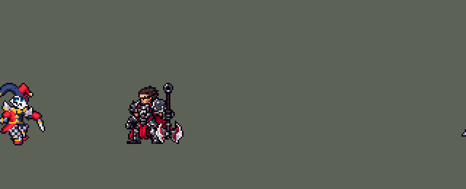

<!-- 本页上半部分由 tools/docs/gen_hero_docs.py 按仓库里现在的数据生成，手改会被覆盖；「开发记录」以下是手写的，生成时原样保留。 -->

# 萨科 Shaco


| 项目 | 内容 |
|---|---|
| id | `league_shaco` |
| 所属的包 | 主包（mod_id `league`） |
| 分路 | 打野 |
| 分类 / 标签 | 刺客（Assassin） · AD / Melee / CC |
| 高清帧 | 1 倍像素（无高清帧） |
| 附加包 | [萨科背刺附加包](#附加包)（`league_shaco_backstab`） |



其他预览：[逐帧预览](../preview/league_shaco_frames.png)、[特效表](../preview/league_shaco_effects.png)

## 现在的技能

下面是游戏里显示的技能说明（`league/text/champion.i18n` 的简体中文，去掉了颜色和图标），冷却、距离来自 `league/champion/league_shaco.data_champion`；1 秒 = 60 tick。

### 普攻 / 被动（被动「背刺」）

*攻击间隔 0.87 秒 · 攻击距离 23000*

匕首刺击。被动 背刺：攻击被控制的敌方英雄时额外造成15 + 25% 攻击力的物理伤害。双面毒刃：每8秒下一次普攻改为掷出毒刃，造成55 + 70% 法强的魔法伤害并减速30%。

### 技能1 · 欺诈魔术

*冷却 6 秒 · 施放距离 45000 · 施放：指定目标 · 敌人（不含防御塔）*

消失并闪到目标身后，隐身1.5秒。下一次普攻是背刺：必定暴击，造成20 + 85% 攻击力的物理伤害（暴击后翻倍）。

### 技能2 · 惊吓魔盒

*冷却 10 秒 · 施放距离 50000 · 施放：地点 · 敌人（不含防御塔）*

向敌人脚下扔出惊吓魔盒，弹开时恐惧周围敌方英雄1秒（小兵和野怪1.5秒），随后5秒内每0.5秒对周围所有敌人造成10 + 12% 法强的魔法伤害。

### 大招 · 幻像

*冷却 50 秒 · 施放距离 60000 · 施放：指定目标 · 敌方英雄*

短暂消失，在敌方英雄身后召出幻像，持续5秒：萨科每次攻击时幻像同步背刺，造成40% 攻击力的物理伤害。结束或目标死亡时爆炸，造成150 + 100% 法强的魔法伤害，并放出三个小魔盒恐惧周围敌人。

### 数值

攻击力 100（每级 +23）、法强 30（每级 +12）、生命 900（每级 +82）、护甲 23（每级 +7）、魔抗 15（每级 +3）、移速 1100（每级 +14）。

## 附加包

附加包是可选的原生代码 mod（都在附加包合集 `league_addons` 里），**不装主包里的英雄也是完整的**。

### 萨科背刺附加包

[萨科背刺附加包](../../addons/league_shaco_backstab/README.md)：`league_shaco_backstab` v0.1.0

|  | 主包（纯数据） | 装了附加包 |
|---|---|---|
| 普攻、毒刃的背刺 | 打中被控制的敌方英雄：+15 + 25% 攻击力 | 从背后打中敌方英雄：+15 + 25% 攻击力 |
| Q 落地那一刀、R 幻像 | 主包 | 一样 |

## 相关脚本和素材

- [`tools/lol/extract_shaco.py`](../../tools/lol/extract_shaco.py)
- [`tools/art/preview_shaco.py`](../../tools/art/preview_shaco.py)
- [`tools/art/import_shaco.py`](../../tools/art/import_shaco.py)
- [`tools/art/design_shaco.py`](../../tools/art/design_shaco.py)
- [`assets/source/shaco/`](../../assets/source/shaco)

## 开发记录

> 下面是原来 README 里「英雄：萨科」一节，原样搬过来（只改了相对链接）。

| 部分 | 内容 |
|---|---|
| 定位 | 打野（近战，分类 Assassin），计划里是第十组的打野，提前做了；本包第八个打野（李青、阿木木、易、艾克、费德提克、贝蕾亚、黛安娜之后）。刺客：Q 隐身闪到身后，背刺必定暴击；W 魔盒吓人；R 分身跟着砍 |
| 普攻 | 匕首刺击，100% 攻击力的物理伤害，射程 23000，攻击间隔 52 tick（0.87 秒），第 8 tick 命中（动作第 3 帧） |
| 被动 | 「背刺」（用户选的「身后与逃跑时」）：这个游戏读不到朝向，「从背后」做成三种情况：Q 落地后的那一刀（必定暴击，见技能1）；打中被控制的敌方英雄（被恐惧的英雄正背对着他逃跑）时，多一枚只打 `EnemyChampionInCC` 的分身投射物，额外造成 15 + 25% 攻击力的物理伤害（普攻和毒刃都算，可以暴击）；幻像的每一下（伤害里已经算进背刺） |
| 普攻里的 E | E「双面毒刃」并进普攻（用户选的「Q技能1 + W技能2」，E 折进普攻）：自己的冷却 8 秒，好了的时候下一次普攻改为掷出毒刃（掷刀动作第 4 帧、第 11 tick 出手，每 tick 6000），造成 55 + 70% 法术强度的魔法伤害，减速 30%（1.5 秒）。英雄联盟里 E 的被动减速并进了这一下 |
| 技能1 | Q「欺诈魔术」：对 45000 内的敌人施放（小兵和野怪也算，清线、打野也用），冷却 6 秒。第 7 tick（动作第 3 帧）原地化成一团烟、隐身 1.5 秒，每 tick 15000 闪到目标身后 15000（`RushMoveToBack`），4 tick 后身后冒出一小团烟。2.5 秒内的下一次普攻是背刺：播背刺动作，第 9 tick 刺中，那一刻先给自己 2 tick 的 100% 暴击率，所以必定暴击（2 倍），造成 20 + 85% 攻击力的物理伤害（暴击前） |
| 技能2 | W「惊吓魔盒」（用户选的「扔到脚下立即弹开」）：对 50000 内的敌人施放（`Position`，小兵和野怪也算），冷却 10 秒。第 8 tick 扔出，12 tick 后落在目标脚下，再过 10 tick 弹开：半径 30000 内的敌方英雄恐惧 1 秒，小兵和野怪恐惧 1.5 秒（英雄联盟的分法：先给英雄恐惧和 2 tick 的控制免疫，下一 tick 再给其余的，英雄就只吃到短的那次）；之后 5 秒每 0.5 秒对半径 35000 内的敌人造成 10 + 12% 法术强度的魔法伤害。不隐身、也不等人踩：AI 会把陷阱扔在任何地方，所以直接扔到敌人脚下 |
| 大招 | R「幻像」（用户选的「缠住目标」）：对 60000 内的敌方英雄施放，冷却 50 秒。第 6 tick 一团烟、萨科隐身 1 秒，12 tick 后分身出现在目标身后（安妮提伯斯的做法：分身的画面和伤害都挂在目标身上，目标走到哪跟到哪）。5 秒内萨科每打中一下，分身跟着砍一下（没打时每秒自己砍一下），每下 10 + 40% 攻击力的物理伤害（背刺已经算在里面），分身站在目标身边同一条地面线上，目标身上亮出背刺的血红刀光。5 秒到了，或者目标先死了，分身在目标站着（倒下）的地方爆炸：半径 30000 内的敌人受到 150 + 100% 法术强度的魔法伤害，再弹出三个小魔盒（英雄恐惧 0.75 秒、其余 1.25 秒，2.5 秒内每 0.5 秒 8 + 10% 法术强度）。目标死亡是这样判断的：分身每次检查都朝目标发一个隐形的抛物线投射物，下一 tick 就落地，在落点等 6 tick 再看：检查停了（目标死了），就在落点爆炸（死掉的单位上什么都发不出来，所以落点要趁他活着时先发出去）。这个投射物不能在空中多待：0.50.2 之前它要飞 6 tick，被大的英雄会走开躲它（见下面「大招的隐形检查弹」） |
| 附加包 | 可选的附加包 [`addons/league_shaco_backstab`](../../addons/league_shaco_backstab/README.md)（在附加包合集里，原生代码，主包不装它也完整）：背刺照英雄联盟看是不是从背后打的——由目标最近 10 tick 走的方向（站着不动就朝着离他最近的萨科一方单位）推出朝向，萨科在他背后那一半时普攻、毒刃多 15 + 25% 攻击力（主包要目标被控制） |
| 数值 | 攻击 100（+23）、法术强度 30（+12）、生命 900（+82）、护甲 23（+7）、魔抗 15（+3）、移速 1100（+14），攻击间隔 0.87 秒。数值是自己设计的，用 SDK 对战模拟调：打野，对 5 个原版打野（`demon`、`circus_blade`、`hunter`、`inquisitor`、`ninja`），三套队友阵容、两边各 24 局，一批 720 局。第一版 +3.43（Q 的背刺 40 + 145%、分身每下 15 + 75% 持续 6 秒、W 冷却 8 秒），调到 Q 20 + 85%、分身 10 + 45% 持续 5 秒、W 冷却 10 秒、护甲 23 后 +1.11；按动作条对齐出手时刻后两批 +1.25 / +1.84（同一批易 +1.21 / +0.68、李青 +0.73 / +0.87），偏强；分身每下 45% 改 40%、攻击成长 25 改 23 后两批 **+1.08 / +1.27**（只把分身改 40% 是 +0.89 / +1.66，分身 35% 是 +1.18 / +1.35），和黛安娜（+1.04 / +1.03）、菲奥娜（+1.22 / +1.23）同一档。每局放 Q 约 41 次（对英雄约 6 次）、W 约 30 次、R 约 4.9 次 |
| 亚索联动 | W 和小魔盒的恐惧是亚索大招要的控制：萨科打野、亚索同队时，亚索每局 R 到被控英雄 2.42 次（同一批阿木木 1.69、李青 1.52、艾克 0.90、原版忍者 0.65），和其他带控制的打野同一档，亚索不用调 |
| 精灵图 | 10 个动作 58 帧：待机、移动、普攻、背刺、毒刃、Q、W、R、受击、死亡。造型是 Codex 按游戏尺寸一格一格画的 46 行 v4 A 版：双角小丑帽（深蓝的角往左卷、红角往上，两个金铃）、白面具、冰青色眼睛、咧嘴的大笑、金色褶领、银色尖刺护肩、红上衣、深蓝袖子和红色大袖口、黑白格子灯笼裤、带银刺的深蓝靴子、红色卷尖鞋，两只手各握一把锯齿匕首。帽尖到脚底 43 px（定稿 46 行，用户说「现在放游戏里有点大」，腿上去掉了 3 行），37 px 宽，17 色 |
| 特效 | 普攻的银色刀光（14 px），背刺暴击的血红 X 和紫光（26 px），被动背刺的血红竖刀光（18 px），飞行的毒刃（12 px，上下对称，游戏会转到飞的方向）和绿色毒液（16 px），头顶的恐惧笑脸漩涡（16 px，1 秒），魔盒射中的紫色小爆点（10 px），Q 原地消失的烟和毛笔圈（30 px 宽）、身后现身的小烟（24 px），翻滚着飞出去的魔盒（10 px），落地弹一下的魔盒和尘土（24 px），弹开、晃着射击 5 秒、缩回化成烟的魔盒（24 × 32 px），R 施法的烟和紫红火星（32 px），分身爆炸的紫焰和冲击波（60 px，半径 30000），每个被炸到的敌人身上的紫焰（18 px），三个小魔盒（64 px 宽），以及幻像分身本身 |
| 图标 | 官方技能图标（Q / W / R），64×64 |
| 音频 | 从本地客户端提取的 12 条技能音效和 2 条中文语音（背刺的笑声、R 的笑声），合成 14 个游戏音效。不提交到仓库，按下面的命令在本地生成 |

```bash
python tools/lol/extract_shaco.py --lol "D:\WeGameApps\lol" --vgmstream "<vgmstream-cli.exe 路径>"
python tools/lol/native_pose.py assets/source/shaco/poses.json --out <渲染文件夹>   # 动作参考帧
python tools/art/design_shaco.py      # 造型：Codex 的 46 行 v4 A，左移 4 列、补上褶领
python tools/art/shrink_shaco.py     # 缩到 43 行：从 assets/source/shaco/native46/ 的 46 行动作条，每帧腿上去掉 3 行
python tools/art/import_native.py --hero shaco
python tools/art/import_shaco.py      # 特效和幻像分身；--raw <Codex 的特效交付文件夹> 先把生图原稿转成原尺寸条
python tools/art/preview_shaco.py
```

美术（原画的提示词见 [`assets/source/shaco/PICTURE_PROMPT.md`](../../assets/source/shaco/PICTURE_PROMPT.md)，造型的见 [`MODEL_PROMPTS.md`](../../assets/source/shaco/MODEL_PROMPTS.md) 和 46 行的 [`MODEL_PROMPTS_46.md`](../../assets/source/shaco/MODEL_PROMPTS_46.md)，9 条动作的见 [`MODEL_STRIPS.md`](../../assets/source/shaco/MODEL_STRIPS.md)，修腿的见 [`LEGS_FIX.md`](../../assets/source/shaco/LEGS_FIX.md)，特效的见 [`PROMPTS_FX.md`](../../assets/source/shaco/PROMPTS_FX.md)；Codex 的交接说明在 [`codex_model/`](../../assets/source/shaco/codex_model)、[`codex_strips/`](../../assets/source/shaco/codex_strips)、[`codex_legs/`](../../assets/source/shaco/codex_legs)、[`codex_fx/`](../../assets/source/shaco/codex_fx)）：
- 分工：模型和特效都由 Codex 画，Claude 写提示词包、整理和导入，按"原画 → 造型 → 动作 → 特效"分四步。
- 原画和造型：原画包里 Codex 画了 A、B 两张，用户选 A（红色在前）。第一轮按游戏尺寸画的 40 行造型，用户看了「太模糊了」（金色碎点、一格的眼睛），之后的 40 行又显得矮短。用户喜欢 Codex 那张方块干净的 76 格大图，要「稍微放大」：直接缩到 40–48 行，格子裤和面具都碎成噪点，所以让 Codex 按 46 行一格一格重画（`MODEL_PROMPTS_46.md` → `codex_model/v4/`：37 × 46，17 色，严格 8 倍网格，描边闭合，两只眼各是 2×2 的冰青色加一格亮芯）。Claude 按「可以减少身体别的元素来画头部」重画了两版脸，用户：「用codex版本」「你做的两版本都不行」，所以 v4 A 原样采用：`design_shaco.py` 只把它左移 4 列（两脚中点对到第 64 列），再加上 Codex 画动作时补的褶领（下巴下 19 格，金色褶领接到脖子上；Codex 的交接说明写的是用户认可的修补），头部一格不动。
- 动作参考（`poses.json`）：镜头 yaw 30、pitch 25，镜像；头 3.4 倍、腿 0.55 倍，帽子的两只角 0.4 倍，护肩和匕首 1.4 倍；两把匕首各挂在一只手上（`native_pose.py` 的 glue 现在可以给一串：萨科的两把匕首都挂在根骨骼上）；高度 46，112 × 96 的格子。待机 `Shaco_Idle1`（6 帧 × 180 ms），移动 `shaco_run_new`（8 帧 × 139 ms，平地，头保持待机时的样子），普攻 `Shaco_Attack1`，背刺 `Shaco_Attack3`（英雄联盟的暴击动作），毒刃 `Shaco_Spell3`，Q `Shaco_Spell1`，W `Shaco_Spell2`，R 用 `Shaco_Taunt`，受击取 `Shaco_Death` 开头和待机混合，死亡 `Shaco_Death`。
- 动作：Codex 用定稿自己的像素部件摆姿势（平移、旋转，重接袖子和膝盖，最后逐格贴回原来的头），9 条 52 帧，待机 6 帧用定稿。导入前逐帧检查（网格、色板、头部、连通块、脚底线、两腿交替）发现两处：移动的 8 帧里近侧的腿一直在后、远侧的腿一直在前，从不换步（用户：「萨科走路没交叉步的感觉啊」）；蹲下的帧（普攻 4、背刺 3–5、毒刃 4–5、Q 3–4、R 4、死亡 5–8）大腿成了红色和深蓝色的斜条，格子裤不见了（深格只剩 4–13 个，定稿 44 个）。修腿包（`LEGS_FIX.md`，附英雄联盟同样的帧：近腿涂橙、远腿涂蓝）交给 Codex，它只重画腰带以下的 21 帧：蹲下的帧恢复了两条格子裤（`codex_legs/`）。移动的这一版两只鞋最远分开 22 格、远侧那只鞋在第 7、8 帧之间一下从身前跳到身后 17 格，用户：「分叉的太大了 你可以微调一下 不用让codex继续修了」「还有没有前后交叉步的感觉」。Claude 在 Codex 自己的画腿脚本上（给髋、膝、鞋三个点，画出格子裤到膝盖、定稿的靴子和鞋，一圈描边；它的交付里带着这个脚本）重排了 8 帧的位置：每只鞋落地后撑 4 帧，每帧在身体下面往后滑约 3 格，然后抬起 3–4 格，从另一条腿旁边摆到前面（第 2、6 帧两个膝盖交错，第 7、8、1 帧近腿在前，第 3、4、5 帧远腿在前），两只鞋最多分开 12 格，腰带以上一格不动。用户：「这个很不错」。
- 缩到 43 行（`shrink_shaco.py`）：装进游戏后用户说「萨科能略微的变小一点吗尺寸 现在放游戏里有点大」。照李青、安妮缩短腿的办法（`shorten_legs.py`）只删整行、不重画：每帧在灯笼裤顶和鞋之间删 3 行，挑和上下行最像的、不相邻的行，头、帽子和脸原样下移 3 行，脚和地面线不动。穿过 2×2 格子的行（会剩下 1 行高的格子）、金箍唯一的一行、靴子上银刺那一行都额外加代价，所以待机删的是膝盖金箍的第二行、一行素色靴筒和靴底一行。死亡最后两帧是躺着的，改删腿那几列。46 行的动作条留在 `assets/source/shaco/native46/`。
- 导入：待机 6 帧用定稿，第 3–5 帧从灯笼裤最下面一条格子（站位点下第 3 行）往上下沉一格呼吸（`BOB`；缩到 43 行后再往下每一行都是金箍、银刺或鞋）；按冰青色的眼睛定头的位置（`EYES`）；描边补齐（`COMPLETE`）。头像截取点 (−1, −42)，在帽子的顶上。待机最高点 −31，高过 −28，按选人卡片的规则设 `banpick_center` (0, −8)。
- 特效用 Codex 画的 16 张（95 帧），交的是生图原稿（半透明边、颜色没锁色板，交付清单写了每帧的格子）：`import_shaco.py --raw` 按清单切帧，每个游戏像素取它覆盖的原图像素的多数色、有三分之一不透明才画，颜色只吸到这张要的色阶（刀光银、血红、恶魔紫、毒绿、烟、尘土、魔盒和小丑头的颜色），光和烟边上最深的一圈去掉，魔盒和小丑头是「物体」，保留近黑的描边。按技能定大小（1000 距离单位一格）：见上面「特效」那一格。魔盒在弹开、射击的帧里被 Codex 画高了 4 行（第 6–8 帧），左右也差 1–4 格，三个小魔盒每帧上下差 1–2 格：按盒底和盒子左边的金边逐帧对齐，后面散成烟的帧跟着最后一个盒子走。时长按技能：魔盒弹开 3 帧、循环 4–7 帧重复到 5 秒（W 的射击 300 tick）、缩回散烟 3 帧；三个小魔盒同样重复到 2.5 秒；恐惧 8 帧共 1 秒；落地的魔盒 170 ms，正好接上 10 tick 后的弹开。
- 幻像分身：就是萨科本人，从他导入后的待机和普攻帧做（`league_shaco_clone`）：描边从近黑换成恶魔紫，看得出不是本人。第一版照安妮的提伯斯画在目标身后往上 9 px、压在目标下面，用户：「大招的分身也有点奇怪 看起来像是挂在别人身上的」；现在站在目标的地面线上、目标左边 24 px，面朝目标，画在单位下面（游戏如果按目标的朝向翻转挂在它身上的画面，分身就一直在它背后）。`clone_idle` 是待机一帧（技能每 4 tick 播一次），`clone_attack` 是普攻（6 帧，约 24 tick，和技能里分身出手后的 `r_pic` 一样长），`clone_in` 是 Q 现身的小烟里站出来的分身。
- 出手时刻和动画对齐：普攻第 3 帧（第 8 tick），背刺第 3 帧（第 9 tick），毒刃第 4 帧（第 11 tick），Q 第 3 帧消失（第 7 tick），W 第 3 帧扔出（第 8 tick），R 第 2 帧施法（第 6 tick）；背刺、毒刃、Q、W、R 的帧时长按技能的长度压缩（24、24、18、20、24 tick）。
- 演示 GIF：用户看到「怎么小丑本地会消失？」「不开隐身的时候也会莫名其妙消失」——演示脚本里普攻的动画只有 390 ms，下一刀在 867 ms 后，中间没接待机，他每砍完一刀就消失半秒（游戏本身没有这个问题）。补上待机后，脚本检查每一帧都画了萨科；只有 Q（1.5 秒）和 R（1 秒）隐身时画成半透明。

逐帧预览：[`docs/preview/league_shaco_frames.png`](../preview/league_shaco_frames.png?v=1014g)，特效：[`docs/preview/league_shaco_effects.png`](../preview/league_shaco_effects.png?v=1014g)。

大招的隐形检查弹（0.50.2）：基兰的 Q 照抄了萨科这套死亡检查，模拟发现在空中飞 6 tick 的隐形投射物会让敌方 AI 去躲，基兰因此少了 0.4 的击杀差和 9% 的伤害。萨科按同样的方法测了：打野位三批各 720 局，原来的写法 +1.08 / +1.27 / +0.90，改成下一 tick 落地、在落点等 6 tick 再检查 +1.16 / +0.80 / +1.17，去掉检查 +1.02 / +1.23，都在噪声里（一批约 ±0.30），伤害 −1% 到 +6% 来回变——萨科的投射物只在分身那 5 秒里飞，大招冷却 50 秒。但 AI 确实在躲：两版各 240 局的日志里，分身期间目标死亡 32.9%，改后 39.8%（目标不再走开），萨科先死 3.2% 对 5.1%；两版在目标死亡时都每次爆炸（379 次 / 470 次，改后晚 1 tick）。用户：「那就换」——被大的英雄照常打，不再躲看不见的东西。
