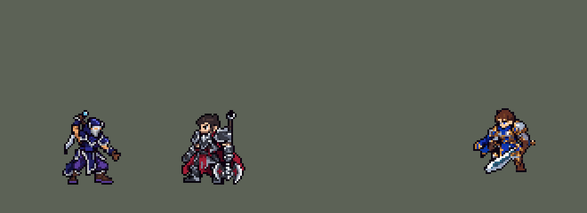

<!-- 本页上半部分由 tools/docs/gen_hero_docs.py 按仓库里现在的数据生成，手改会被覆盖；「开发记录」以下是手写的，生成时原样保留。 -->

# 慎 Shen


| 项目 | 内容 |
|---|---|
| id | `league_shen` |
| 所属的包 | 主包（mod_id `league`） |
| 分路 | 上单 |
| 分类 / 标签 | 近战（Melee） · AD / Melee / Tank / CC / Shield |
| 高清帧 | 1 倍像素（无高清帧） |
| 附加包 | [慎「秘奥义！慈悲度魂落」护盾按生命值附加包](#附加包)（`league_shen_shield`） |



其他预览：[逐帧预览](../preview/league_shen_frames.png)、[特效表](../preview/league_shen_effects.png)

## 现在的技能

下面是游戏里显示的技能说明（`league/text/champion.i18n` 的简体中文，去掉了颜色和图标），冷却、距离来自 `league/champion/league_shen.data_champion`；1 秒 = 60 tick。

### 普攻 / 被动

*攻击间隔 1.13 秒 · 攻击距离 25000*

忍法！气合盾：施放技能后获得90 + 40% 攻击力护盾2秒（8秒一次，技能命中英雄则缩短）。强化普攻额外25伤害，对英雄再加其最大生命4%（刀穿过英雄则6%、攻速+50%）。

### 技能1 · 奥义！暮临

*冷却 7 秒 · 施放距离 40000 · 施放：指定目标 · 敌人（不含防御塔）*

召回灵魂之刃，从目标身后飞回，沿途造成70 + 80% 攻击力伤害并减速25%，之后3次普攻强化。刀回手时附近有敌方英雄则施放奥义！魂佑：1.75秒内区域中的友方英雄不受普攻伤害（15秒冷却）。

### 技能2 · 奥义！影缚

*冷却 14 秒 · 施放距离 42000 · 施放：指定目标 · 敌方英雄*

向前突进，沿途敌人受到90 + 80% 攻击力伤害并被嘲讽1.17秒。嘲讽到英雄且暮临就绪时，灵魂之刃从突进起点飞回、穿过他们。

### 大招 · 秘奥义！慈悲度魂落

*冷却 70 秒 · 施放距离 960000 · 施放：无目标 · 敌方英雄*

全图有友方英雄被控，或与敌方英雄缠斗且离慎较远时：给他260 + 60% 攻击力护盾5秒，慎引导2.5秒后传送到他身边（被控则中断）。

### 数值

攻击力 94（每级 +15）、生命 1200（每级 +110）、护甲 38（每级 +9）、魔抗 30（每级 +5）、移速 1000（每级 +11）。

## 附加包

附加包是可选的原生代码 mod（都在附加包合集 `league_addons` 里），**不装主包里的英雄也是完整的**。

### 慎「秘奥义！慈悲度魂落」护盾按生命值附加包

[慎「秘奥义！慈悲度魂落」护盾按生命值附加包](../../addons/league_shen_shield/README.md)：`league_shen_shield` v0.1.0

|  | 主包（纯数据） | 装了附加包 |
|---|---|---|
| 大招给队友的护盾 | 260 + 60% 攻击力，5 秒 | 150 + 慎最大生命值的 12%，5 秒（英雄联盟：固定值 + 17.5% 额外生命值） |

## 相关脚本和素材

- [`tools/kit/build_shen.py`](../../tools/kit/build_shen.py)
- [`tools/kit/setup_shen.py`](../../tools/kit/setup_shen.py)
- [`tools/lol/extract_shen.py`](../../tools/lol/extract_shen.py)
- [`tools/art/preview_shen.py`](../../tools/art/preview_shen.py)
- [`tools/art/import_shen.py`](../../tools/art/import_shen.py)
- [`tools/art/design_shen.py`](../../tools/art/design_shen.py)
- [`assets/source/shen/`](../../assets/source/shen)

## 开发记录

> 下面是原来 README 里「英雄：慎」一节，原样搬过来（只改了相对链接）。

| 部分 | 内容 |
|---|---|
| 定位 | 上单（坦克，TFM2 没有坦克分类：分类 Melee，标签 AD / Melee / Tank / CC / Shield），第 85 位英雄。暮光之眼 慎：召回灵剑、结界挡普攻、影袭嘲讽、全图救人。用户选上单 + 坦克、完整还原 + 高手连招 |
| 普攻 / 被动 | 剑劈，射程 25000，攻击间隔 68 tick，第 10 tick 劈中。被动「忍法！气合盾」：放技能时给自己 90 + 40% 攻击力护盾 2 秒，冷却 8 秒；技能打中英雄时冷却缩到 2.5 秒 |
| 技能1 | Q「奥义！暮临」：冷却 420 tick（7 秒），射程 40000（也对小兵和野怪放）：灵剑出现在他前方 46000 处（目标身后）、飞回慎身边，沿途 70 + 80% 攻击力并减速 25% 1.5 秒；回到手里后接下来 3 次普攻强化（额外 25 伤害，对英雄再打最大生命 4%；灵剑穿过英雄时 6% 并攻速 +50%，8 秒内用完） |
| W（自动） | 「奥义！魂佑」没有技能位：灵剑回到身边时 45000 内有敌方英雄就在脚下展开结界（半径 22000，1.75 秒），结界里的友方英雄不受普攻伤害（`base_attack_damaged_reduce` 100），冷却 15 秒 |
| 技能2 | E「奥义！影缚」：冷却 840 tick（14 秒），只对敌方英雄放（`Targeting`：朝方向放时 AI 把冲刺用在兵线上，27 次只有 2 次撞到英雄），冲到目标位置，沿途 90 + 80% 攻击力并嘲讽 1.17 秒 |
| 大招 | R「秘奥义！慈悲度魂落」：冷却 4200 tick（70 秒）。主包读不到全队血量，所以用"被控 / 被围"判断（凯尔大招的写法）：放出后 15 秒内每 10 tick 检查一次，全图有友方英雄被控，或离慎 60000 以外、身边 25000 内连续两次有敌方英雄，就给他 260 + 60% 攻击力护盾 5 秒；慎引导 2.5 秒（被控就中断）后传送到他身边。没找到人就返还大部分冷却 |
。玩家：「Shen ult scales with ad wouldn't it be better if it scaled with hp?」——数据里的护盾读不到生命值；可选的附加包 [`addons/league_shen_shield`](../../addons/league_shen_shield/README.md)（在附加包合集里）把护盾改成 150 + 慎最大生命值的 12% |
| 高手连招 | **E → Q**：影缚嘲讽到英雄、而暮临就绪时，灵剑从冲刺起点飞回，再穿过被嘲讽的人；**Q → W**：灵剑回手时身边有敌方英雄就自动开结界；**R**：救人时顺带触发气合盾。连招只用自己那个技能的冷却 |
| 数值 | 攻击 94（+15）、生命 1200（+110）、护甲 38（+9）、魔抗 30（+5）、移速 1000（+11）。数值是自己设计的，用 SDK 对战模拟调：上单，对 6 个原版近战（战士、刽子手、枪兵、长柄、骑士、狂战士），3 套阵容、两边各打，10 分钟。初稿 −1.14（E 朝方向放、几乎撞不到英雄）；E 改成对英雄放、数值上调后，按动作帧对准出手时间：种子 1–12 +0.69、25–36 +0.92（同期墨菲特 +1.06 / +0.74、瑟提 +1.08），在已合并上单的范围里 |
| 亚索联动 | 没有击飞，亚索大招不受影响 |
| 技能树大小 | 普攻 42、Q 96、E 116、R 184 个节点（都在 300 以内） |
| 精灵图 | 9 个动作 41 帧：待机 8（腰带以上无损下沉的呼吸）、移动 8、普攻 6、Q（`skill`）2、E（`skill2`）4、R（`ult`）2 + 引导循环（`ult_loop`）2、受击 1、死亡 8。兜帽顶到脚底 38 行（连背上的刀柄 42 行，缩到 90%：用户「慎的模型太大 缩小一点」），待机 33 × 42，30 色。头像截取点 (0, −38)，选人卡片 −9（背上的刀柄顶在 −30，默认位置会顶出卡片） |
| 特效 | Codex 第 3 步的 15 张（`import_shen.py` 按 16 px 一格读回）：`league_shen_fx` 普攻弧光、强化普攻双弧光、飞回的灵剑、灵剑命中、减速波纹、强化待命的三团灵气、气合盾、结界里友方的护光、E 冲刺拖影和命中；`league_shen_big` 魂佑结界、R 起手螺旋光、引导光柱、队友护盾（头顶朝下的箭头）、传送落地光柱。颜色照英雄联盟慎：紫色灵光、蓝色结界、暗紫影子烟。灵剑和冲刺拖影朝右画（转到飞行方向，叠上自己的上下翻转），其余左右对称 |
| 音效 | 英雄联盟的音效和配音（`tools/lol/extract_shen.py`）：普攻挥剑和命中、强化普攻、被动护盾、Q 召剑 / 命中 / 回手、W、E 冲刺 / 命中、R 起手 / 队友护盾 / 落地；Q、W、E、R 的配音。版权属于 Riot Games，**不提交到仓库**，按下面的命令在本地生成 |
| 图标 | 官方技能图标（Q / E / R），从本地客户端提取，缩到 64×64；W 自动，没有技能位 |

重新生成（素材来自本机的英雄联盟客户端，音频不进仓库）：

```bash
python tools/lol/extract_shen.py --lol "D:\WeGameApps\lol" --vgmstream "<vgmstream-cli.exe 路径>"
python tools/kit/build_shen.py          # 技能数据，数字都在脚本的参数表 P 里；--nodes 看每棵技能树的节点数
python tools/kit/setup_shen.py --face 0,-38 --banpick -9   # 五种语言的文字、音效配置、共享文件里他的键
python tools/art/design_shen.py --final # 造型：Codex 原稿按格读回、缩到 40 行
python tools/art/fix_shen_strips.py     # 动作：Codex 逐帧原稿读回 + 待机呼吸 + 跑步 + 缩到 90%（见下）
python tools/art/import_native.py --hero shen
python tools/art/import_shen.py --raw assets/source/shen/codex_fx   # 特效
python tools/art/preview_shen.py        # 预览和演示 GIF
```

美术（提示词见 [`assets/source/shen/`](../../assets/source/shen) 里的 `MODEL_STRIPS.md`、`PROMPTS_FX.md`；Codex 的交付在 `codex_model/`、`codex_model_v2/`、`codex_strips/`、`codex_fx/`、`codex_run_swap/`）：

- 原画：Codex 画了待机（A，反手握刀垂在身后）和攻击（B）两版，用户选 A。
- 造型：Codex 的第一轮按自己的格子读回后太大，按原稿重画到 40 格；用户选 4_42，把脸（银面罩、肤色眼缝里两点紫光）和手套修回原画，再「略微缩小」到 40 格。
- 动作：Codex 每帧单独生成一张，它自己缩出来的成品糊了、眼睛没了，所以读它的原稿（每帧按描边量出自己的格子大小，6.5–10.7 px 不等），对到定稿的 30 色、缩到定稿的大小，按英雄联盟同一时刻的站位摆放；7 帧丢了眼睛的照原稿补回。Q 四帧是四个不同的身体，只留推掌那帧、起手用定稿本身；R 的引导循环四帧画法各不相同（循环起来会闪），改成合十那帧呼吸；R 起手也用定稿本身（Codex 那帧是把待机重画了一遍，会抖）。
- 跑步（`fix_shen_strips.py` 的 `TROT`）：定稿是两腿分开的宽站姿、穿灯笼裤，试过的几种都被否：定稿的腿整条平移去交叉（裤腿被腰布挡住、钻进腰带）、Codex 照 oppi 李青的跑步换皮两轮（交错帧两条腿挤成一个锥形，重画后又鼓成蹲姿）、照英雄联盟关节画腿（颜色和定稿对不上）。现在是定稿自己的腿、不重画：每条腿拆成大腿（灯笼裤鼓起的那段）和小腿（裤脚、靴筒、脚），整条腿向内横移最多 2 格、前后交替，抬脚只抬小腿、藏在自己大腿后面；左腿旁的腰布后摆，下半截跟着左小腿一起抬（「右腿好了 左腿还有一点」），身体在落脚帧下沉一行。之后用户：「慎的待机和跑步应该也不一样」——跑步的上半身原来就是待机的。现在跑起来身体前倾（腰带以上整行往前挪，越往上挪得越多，兜帽往前 5 格），兜帽、举着剑柄的远侧手连剑、近侧前臂都整块挪、不斜切（斜切会把剑身切出台阶）；近侧前臂连拳头绕手肘转 90°，拳头抬到胸前，和英雄联盟里他跑步的样子一样。然后用户：「慎姿势改对了 步伐没改对」——腿改成照英雄联盟的跑步走（`assets/source/shen/run_joints.json` 里 8 帧的关节，步幅不压缩）：定稿的腿块按任意角度转（RotSprite）每帧形状都不一样，用户：「慎的跑动腿部变形」（同时「佛耶戈不错」——佛耶戈的裤腿是画出来的），所以腿改成按英雄联盟的大腿、小腿角度画出来，用定稿自己的颜色：紫色灯笼裤（#593C9C，边 #231548）、银色裤脚、棕色靴筒，外面一圈描边，每帧形状一样；脚是定稿自己的整只靴子（从靴筒最后一行往下），始终平放、画在腿的上面——用户：「慎的脚变形了啊」：之前腿的描边压在脚上把脚切碎了，整 90° 转的脚立成一根棍，少了靴筒最后一行的远侧靴子脚跟也脱开了；英雄联盟里踩在地上的那只脚平放在地面上、膝盖用反向运动学求，抬起的脚跟着脚踝走（后腿向后踢起时脚跟几乎碰到屁股）；近侧的脚翻成脚尖朝前；腰布后摆挂在腰带上、往里收 3 格（它原来挨着的大腿会摆开）；身体按英雄联盟的胯部高低起伏 0–2 行。
- 缩小：用户「慎的模型太大 缩小一点」，缩到 90%（整行整列去掉、不重采样，眼睛和面罩不删）。待机和跑步是拼出来的，在每帧上删会删到移动的腿的不同列（「还有轻微的变形」），所以先把定稿和它的每个部件按同一套删法缩小、再拼；Codex 画的动作按动作整组缩。
- 特效：Codex 第 3 步的 15 张按要求的 16 px 格子画好，直接读回；落地光柱最后一帧只剩一条横线和一个点，去掉。

逐帧预览：[`docs/preview/league_shen_frames.png`](../preview/league_shen_frames.png?v=1014g)，特效：[`docs/preview/league_shen_effects.png`](../preview/league_shen_effects.png?v=1014g)。
