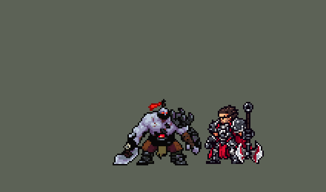

<!-- 本页上半部分由 tools/docs/gen_hero_docs.py 按仓库里现在的数据生成，手改会被覆盖；「开发记录」以下是手写的，生成时原样保留。 -->

# 赛恩 Sion


| 项目 | 内容 |
|---|---|
| id | `league_sion` |
| 所属的包 | 主包（mod_id `league`） |
| 分路 | 上单 |
| 分类 / 标签 | 近战（Melee） · AD / Melee / Tank / CC / Shield |
| 高清帧 | 1 倍像素（无高清帧） |
| 附加包 | [赛恩附加包](#附加包)（`league_sion`） |



其他预览：[逐帧预览](../preview/league_sion_frames.png)、[特效表](../preview/league_sion_effects.png)

## 现在的技能

下面是游戏里显示的技能说明（`league/text/champion.i18n` 的简体中文，去掉了颜色和图标），冷却、距离来自 `league/champion/league_sion.data_champion`；1 秒 = 60 tick。

### 普攻 / 被动

*攻击间隔 1.07 秒 · 攻击距离 25000*

灵魂熔炉被动：普攻每击杀一个单位，永久获得6点最大生命值（阵亡后重新累积）。

### 技能1 · 残虐猛击

*冷却 7 秒 · 施放距离 34000 · 施放：地点 · 敌人（不含防御塔）*

蓄力0.67秒后向前砸地，直线上的敌人受到140 + 180% 攻击力物理伤害并击飞0.83秒；蓄力时被控制会打断。

### 技能2 · 杀手怒吼

*冷却 1 秒 · 施放距离 50000 · 施放：方向 · 敌人（不含防御塔）*

怒吼穿过小兵，造成120 + 4% 最大生命魔法伤害，减速40%，护甲降低20%。灵魂熔炉：获得220 + 100% 攻击力护盾，3秒后护盾仍在则爆炸，造成80 + 8% 最大生命魔法伤害。

### 大招 · 蛮横冲撞

*冷却 60 秒 · 施放距离 90000 · 施放：无目标 · 敌方英雄*

免疫控制冲向敌方英雄，撞到第一个英雄造成200-400 + 100% 攻击力物理伤害并击飞0.75-1.58秒（冲得越远越强），周围敌人减速40%。救被控的队友、团战、和队友一起追击时才冲。

### 数值

攻击力 88（每级 +16）、生命 1400（每级 +140）、护甲 42（每级 +8）、魔抗 32（每级 +4）、移速 980（每级 +10）。

## 附加包

附加包是可选的原生代码 mod（都在附加包合集 `league_addons` 里），**不装主包里的英雄也是完整的**。

### 赛恩附加包

[赛恩附加包](../../addons/league_sion/README.md)：`league_sion` v0.1.3

主包 `league` 保持纯数据。用户选了「主包数据 + 附加包复活」。这个附加包用原生代码做主包数据做不到的两件事：

- **死亡荣耀（复活成亡灵）**：英雄联盟里赛恩每条命第一次被打死时会站起来继续打一阵。数据读不到血量，主包做不了。
  附加包的被动 `league_sion:glory` 在他这条命还没复活过时，每 10 tick 给他挂一个 30 tick 的不死 buff `league_sion_p_guard`，
  这样致命伤害只会把他打到 1 血。他到 1 血（并且身上没有别人给的不死，比如基兰的大招）时就**变成亡灵**：
  - 生命回满，之后每 tick 掉 最大生命 ÷ `z_t`；
  - 攻速 +`z_as`%，吸血 `z_vamp`%；
  - 不能放技能（`BlockSkill` 控制，`z_t` tick）；
  - 播起身音效和台词。
  - **不是不死的**（0.1.2，用户：「塞恩得尸体太变态 死了比活着的时候还能扛」）：以前亡灵身上的 buff 带不死，满血 + 100% 吸血 9 秒里谁也打不死；现在血被打光就照常阵亡。

## 相关脚本和素材

- [`tools/kit/build_sion.py`](../../tools/kit/build_sion.py)
- [`tools/kit/setup_sion.py`](../../tools/kit/setup_sion.py)
- [`tools/lol/extract_sion.py`](../../tools/lol/extract_sion.py)
- [`tools/art/preview_sion.py`](../../tools/art/preview_sion.py)
- [`tools/art/rig_sion.py`](../../tools/art/rig_sion.py)
- [`tools/art/design_sion.py`](../../tools/art/design_sion.py)
- [`assets/source/sion/`](../../assets/source/sion)

## 开发记录

> 下面是原来 README 里「英雄：赛恩」一节，原样搬过来（只改了相对链接）。

| 部分 | 内容 |
|---|---|
| 定位 | 上单（Melee，标签 AD / Tank / CC），第 101 位英雄。亡灵战神 赛恩（客户端里名字和称号是反着的，按官方）：近战大斧坦克，Q 蓄力砸地击飞一条线，E 怒吼减速破甲，W 灵魂熔炉护盾到时间爆炸，R 免控冲锋撞飞第一个英雄，被动死后变亡灵再打一阵。用户的选择（全按推荐）：上单近战 AD 坦克 / 战士；技能 1 是 Q；技能 2 是 E 怒吼，E 冷却时放 W 护盾；R 冲向远处的敌方英雄；W 的击杀加生命做进主包，死亡荣耀的复活做附加包；美术 Codex 四步、3/4 正面 |
| 普攻 / 被动 | 大斧（攻击距离 25000，攻击间隔 64 tick，第 13 tick 落斧，100% 攻击物理）。「灵魂熔炉」被动：普攻每打死一个单位，永久 +6 最大生命（数据只认得出普攻的击杀；mod 的 buff 阵亡清空，所以每条命重新攒）。「死亡荣耀」要读血量，交给附加包 |
| 技能1 | Q「残虐猛击」：冷却 420 tick，对 34000 内的敌人放（兵线、野怪也打）。原地蓄力 40 tick（举斧，脚前地上亮起一条 50000 长、半宽 10000 的暗红线），蓄力时每 10 tick 查一次，被控就打断；然后砸下去，线上每个敌人 140 + 180% 攻击物理、**击飞 50 tick**，裂纹沿线炸开（英雄联盟：蓄满 1 秒以上击飞并眩晕 1.25–1.75 秒） |
| 技能2 | 对 50000 内的敌人放，E 和 W 共用这一格，各有自己的冷却（这一格只等 60 tick）：**E「杀手怒吼」**（冷却 480 tick）：吼声直线飞 52000，穿过小兵（英雄联盟里被打飞的小兵会撞到后面的英雄），每个敌人 120 + 他最大生命 4% 魔法、减速 40% 120 tick、护甲 −20% 240 tick；E 在冷却、26000 内有敌方英雄时放 **W「灵魂熔炉」**（冷却 720 tick）：护盾 220 + 100% 攻击，持续 360 tick，180 tick 后护盾还在就炸开，26000 内每个敌人 80 + 他最大生命 8% 魔法 |
| 大招 | R「蛮横冲撞」：冷却 3600 tick，免疫控制，每 tick 2400 往前冲（最多 50 tick），撞上第一个敌方英雄停下：冲得越远越疼（开冲时挂的两个计时标记，泽拉斯 E 的做法），200 / 300 / 400 + 100% 攻击物理、击飞 45 / 70 / 95 tick，身边 24000 内的敌人减速 40% 150 tick。用户：「塞恩r大招逻辑不难乱放」「救队友也可以放啊 开团也可以放啊」——照加里奥 R，这一格只是**上膛** 600 tick，每 10 tick 查一次：60000 内有被控住的友方英雄，就冲向他身边 30000 内的敌方英雄（救人）；身边 50000 内有 2 名以上友方英雄（开团）；或者队友正在打的敌方英雄、身边有队友跟着（追击）——一个人在线上不冲；没冲就退还冷却。36 局统计：每局冲 3.97 次，撞中 77%（原来见人就冲：4.89 次、65%） |
| 连招 | 用户：「有连招要做连招」「都要帮我补」。英雄联盟的 **E→Q**：E 的吼声打中敌方英雄时（只认英雄的同路径孪生投射物）给他挂 120 tick 的连招窗口（= E 的减速时长），窗口内放 Q 只蓄力 20 tick（平时 40 tick，减半），砸下时对方还在减速里，窗口随之用掉。砸地的线、伤害、击飞、被控打断都不变；动作总长不变（省下的 20 tick 砸完后站着待机），Q 仍是自己的技能位和冷却（好了 AI 才放）。没加英雄联盟蓄满的眩晕（已经击飞 50 tick） |
| 附加包 | 可选的附加包 [`addons/league_sion`](../../addons/league_sion/README.md)（在附加包合集里，原生代码，主包不装它也完整）：**死亡荣耀**——每条命第一次挨到致命伤害时停在 1 血，变成亡灵：生命回满后按 540 tick 掉光，攻速 +60%、吸血 100%，不能放技能，身边燃起暗红的亡灵之火（主包的 `p_zombie` 特效），倒下时人头算最后打他的人；**灵魂熔炉**按英雄联盟来：每次击杀（技能、大招的也算）永久加最大生命，小兵野怪 +4、英雄 +15，阵亡不丢。附加包里的赛恩是 `make_override.py` 从主包生成的副本，普攻说明以「【附加包】」开头。日志 `league_sion.log`（`RISE` / `FALL` / `FURNACE` 行） |
| 数值 | 攻击 88（+16）、生命 1400（+140）、护甲 42（+8）、魔抗 32（+4）、移速 980（+10），本包上单里最肉、出手最慢的。SDK 对战模拟：上单位，对原版的 fighter、executioner、lancer、pole_warrior、knight、berserker，两边、三套队友阵容，10 分钟。初稿 d0 −1.90（Q 蓄力 1 秒、线窄）；Q 蓄力 0.67 秒、线 50000 × 10000、伤害加上去后 +0.19 / −0.03；R 改成上膛后 +0.24 / −0.12；加伤害反而 −0.44 / −0.29，加生命、护甲、护盾（生命 1400、护甲 42、护盾 220）后种子 1–12 **+0.77**、13–24 **+0.43**（同批雷克顿 +1.78 / +2.05、德莱厄斯 +1.73 / +1.75、莫德凯撒 +1.32 / +0.75、盖伦 −1.05 / −1.41），在本包上单中间 |
| 精灵图（1 倍） | Codex 画了两张原画，用户选 A（大斧垂在近侧腿边），44 行高。造型（第 1 步）Codex 的成品是脚本画的、块状，用户选了我们从它干净的细稿按整行整列切出来的那张（[`tools/art/design_sion.py`](../../tools/art/design_sion.py)），不要侧面，所有动作都用 3/4 正面；先按「用PPU优化一下 调稍微清晰一点」做成 PPU 1.52 的高清造型。动作是 Codex 画的 36 张细稿（[`tools/art/rig_sion.py`](../../tools/art/rig_sion.py)：每条动作按身体面积缩回造型大小，头换回造型的头，斧刃、拳头、护肩、腰布等逐帧修，独立审查 8 轮）；跑步照诺提勒斯 / 布隆在待机上迈腿（游戏里用户：「走路像平移？」——他腿短、靴子深色、夹在斧头和拳套中间，诺提勒斯那样前迈 1 格、抬 3 行看不出在走；让用户挑了三套里的 B：摆动的脚从身后 1 格迈到身前 2 格、最高抬 4 行，着地的脚在身下从前 2 格退到后 1 格，脚边留下的描边碎点清掉）。用户：「模型太大了吧 和铁男差不多大就行了吧」「调成90%」——画成 90%；然后「画质太高清了 要调低像素」（高清帧在游戏里按非整数倍缩放，身体一上下动腿上就多出一道黑线：「上下摆动造成模型变形了腿部」），从样张选了 **1 倍**（和原版英雄一样粗）：Codex 的帧按 1 / (1.52 / 0.90) 缩成 1 倍，每帧贴回 1 倍待机的头、补上针孔；待机、跑步、受击直接在 1 倍造型上整格移动；R 冲锋原来是 Codex 弯腰的姿势，用户：「放大招的时候模型完全变形」——改成和跑步一样迈腿往前冲。不在 league.dll 的高清名单里。头像截取点 (4, −37) |
| 特效 | Codex 第 3 步的 15 个特效（`assets/source/sion/codex_fx`），[`tools/art/import_sion_fx.py`](../../tools/art/import_sion_fx.py) 用它的 1 倍成品；普攻打中、灵魂、Q 的线、E 的吼声、W 打中这几个 Codex 缩小时整格缩没了，改从它的原稿按格重新读回（多数投票、左右镜像）。`league_sion_fx`：普攻打中、击杀的灵魂、Q 打中、E 的吼声 / 打中 / 破甲标记、W 打中、R 打中；`league_sion_big`：Q 的线和砸地裂纹、W 护盾和爆炸、R 脚下的光和撞击、亡灵之火 |
| 音效 | 英雄联盟的音效和配音（`tools/lol/extract_sion.py`）：挥斧 / 打中、Q 蓄力 / 砸中、E 吼 / 打中、W 护盾 / 爆炸、R 冲锋 / 撞中、复活，配音 Q / W / E / R / 复活（片段名 `league_sion_sfx_vo_*`，和声音名不同）。版权属于 Riot Games，**不提交到仓库**，按下面的命令在本地生成 |
| 图标 | 官方技能图标（Q 残虐猛击 / E 杀手怒吼 / R 蛮横冲撞，另有 W 灵魂熔炉、被动死亡荣耀），从本地客户端提取，缩到 64×64 |

重新生成（素材来自本机的英雄联盟客户端，音频不进仓库）：

```bash
python tools/lol/extract_sion.py --lol "D:\WeGameApps\lol" --vgmstream "<vgmstream-cli.exe 路径>"
python tools/kit/build_sion.py               # 技能数据，数字都在脚本的参数表 P 里；--nodes 看每棵技能树的节点数
python tools/kit/setup_sion.py               # 五种语言的文字、音效配置、共享文件里他的键
python tools/art/design_sion.py --hd         # Codex 的细稿切成 3/4 正面造型（PPU 1.52）
python tools/art/rig_sion.py                 # Codex 的动作细稿读回、逐帧修，出 1 倍帧
python tools/art/import_sion_fx.py           # 特效：Codex 的 1 倍成品，几张从原稿重新读回
python tools/art/preview_sion.py             # 预览和演示 GIF
python addons/league_sion/make_override.py   # 附加包的副本（主包的赛恩改了就重跑）
```

美术（提示词见 [`assets/source/sion/`](../../assets/source/sion) 里的 `PICTURE_PROMPT.md`、`MODEL_PROMPTS.md`、`MODEL_STRIPS.md`、`PROMPTS_FX.md`）：

- 原图：Codex 画的 A / B（`codex_picture/`），用户选 A。
- 造型：Codex 的第 1 步（`codex_model/`），我们从细稿切出来，定稿在 `hd/front.png`（1 倍的在 `design/front.png`）；侧面画了但没用。
- 动作：Codex 的 36 张细稿（`codex_strips/`）。
- 特效：Codex 的 15 个特效（`codex_fx/`）。

逐帧预览：[`docs/preview/league_sion_frames.png`](../preview/league_sion_frames.png?v=1014w)，特效：[`docs/preview/league_sion_effects.png`](../preview/league_sion_effects.png?v=1014g)。
