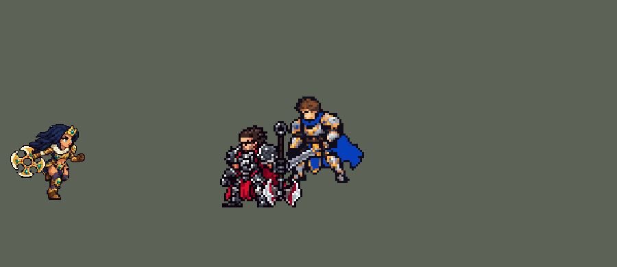

<!-- 本页上半部分由 tools/docs/gen_hero_docs.py 按仓库里现在的数据生成，手改会被覆盖；「开发记录」以下是手写的，生成时原样保留。 -->

# 希维尔 Sivir


| 项目 | 内容 |
|---|---|
| id | `league_sivir` |
| 所属的包 | 主包（mod_id `league`） |
| 分路 | ADC |
| 分类 / 标签 | 射手（Range） · AD / Range |
| 高清帧 | PPU 2.25 |
| 附加包 | [游戏 AI 不按的技能替它按](#附加包)（`league_ult_press`） |



其他预览：[shrink](../preview/league_sivir_shrink.gif)、[skills](../preview/league_sivir_skills.gif)、[逐帧预览](../preview/league_sivir_frames.png)、[特效表](../preview/league_sivir_effects.png)

## 现在的技能

下面是游戏里显示的技能说明（`league/text/champion.i18n` 的简体中文，去掉了颜色和图标），冷却、距离来自 `league/champion/league_sivir.data_champion`；1 秒 = 60 tick。

### 普攻 / 被动（被动「敏锐疾行」）

*攻击间隔 1 秒 · 攻击距离 55000*

被动 敏锐疾行：攻击或技能命中英雄时移速+25%，2秒内递减。弹射：每10秒下一次攻击开启4秒弹射：攻速+45%，攻击再弹向目标身后最多3个敌人，各造成60% 攻击力物理伤害（可暴击）。

### 技能1 · 回旋之刃

*冷却 8 秒 · 施放距离 100000 · 施放：方向 · 敌人（不含防御塔）*

掷出十字刃，飞到尽头再飞回手中，往返都对路上所有敌人造成60 + 80% 攻击力物理伤害。附近有英雄时朝他所在的位置掷出（出手前锁定，可以躲开）。

### 技能2 · 法术护盾

*冷却 12 秒 · 施放距离 65000 · 施放：指定目标 · 敌方英雄*

张开法术护盾，最多3秒：免疫技能伤害和控制。第一次被击中时回复60 + 40% 攻击力生命并触发敏锐疾行，护盾再撑1秒后破碎。

### 大招 · 狩猎

*冷却 50 秒 · 施放距离 75000 · 施放：指定目标 · 敌方英雄*

附近友方英雄（含自己）移速+30%，持续8秒。狩猎期间希维尔的攻击命中英雄会缩短回旋之刃和法术护盾的冷却，弹射冷却减半；她的攻击击杀英雄时刷新狩猎。

### 数值

攻击力 110（每级 +23）、生命 900（每级 +90）、护甲 20（每级 +7）、魔抗 15（每级 +3）、移速 900（每级 +9）。

## 附加包

附加包是可选的原生代码 mod（都在附加包合集 `league_addons` 里），**不装主包里的英雄也是完整的**。

### 游戏 AI 不按的技能替它按

[游戏 AI 不按的技能替它按](../../addons/league_ult_press/README.md)：`league_ult_press` v0.5.7（通用附加包，下面只列和希维尔有关的部分）

|  | 装了附加包，什么时候按 |
|---|---|
| 希维尔 E | 60000 内的敌方英雄**刚放了技能**（20 tick 内技能冷却开始走），或她生命不到 40% 而 40000 内有敌方英雄 |

## 相关脚本和素材

- [`tools/lol/extract_sivir.py`](../../tools/lol/extract_sivir.py)
- [`tools/art/preview_sivir.py`](../../tools/art/preview_sivir.py)
- [`tools/art/rig_sivir.py`](../../tools/art/rig_sivir.py)
- [`tools/art/import_sivir.py`](../../tools/art/import_sivir.py)
- [`tools/art/design_sivir.py`](../../tools/art/design_sivir.py)
- [`assets/source/sivir/`](../../assets/source/sivir)

## 开发记录

> 下面是原来 README 里「英雄：希维尔」一节，原样搬过来（只改了相对链接）。

| 部分 | 内容 |
|---|---|
| 定位 | ADC（远程，分类 Range），用户 10 月 2 日排的第十一组的 ADC，从用户旧 mod `lol_mod` 的 `boomerang_hunter` 移植。战争女神：十字刃弹射清线，Q 回旋之刃往返，E 法术护盾，R 全队加速 |
| 普攻 / 被动 | 普攻 100% 攻击力，射程 55000。被动「敏锐疾行」：攻击或技能命中英雄时移速 +25%，2 秒内递减。W「弹射」并入普攻：每 10 秒下一次攻击开启 4 秒弹射，攻速 +45%，攻击再弹向目标身后最多 3 个敌人，各 60% 物理伤害（可暴击） |
| 技能1 | Q「回旋之刃」：射程 100000，冷却 8 秒。掷出十字刃，飞到尽头再飞回手中，往返都对路上所有敌人造成 60 + 80% 物理伤害；附近有英雄时朝他所在的位置掷出（出手前锁定，可以躲开） |
| 技能2 | E「法术护盾」：对敌方英雄施放，冷却 12 秒。张开护盾最多 3 秒：免疫技能伤害和控制；第一次被击中时回复 60 + 40% 生命并触发敏锐疾行，护盾再撑 1 秒后破碎 |
| 大招 | R「狩猎」：冷却 50 秒。附近友方英雄（含自己）移速 +30%，持续 8 秒；狩猎期间希维尔的攻击命中英雄会缩短回旋之刃和法术护盾的冷却，弹射冷却减半；她的攻击击杀英雄时刷新狩猎 |
| 附加包（替 AI 按） | 可选的附加包 [`addons/league_ult_press`](../../addons/league_ult_press/README.md)（在附加包合集里，原生代码，主包不装它也完整）：游戏 0.6.4 的 AI 很少按她的 E（只读观察包：每 10 分钟 2.5 次，275 局，冷却 12 秒）。附加包按局面替 AI 按（用户：「有问题的英雄全部改成rust」）：60000 内的敌方英雄刚放了技能（20 tick 内技能冷却开始走），或她生命不到 40% 而 40000 内有敌方英雄，就张开法术护盾 |
| 数值 | 攻击 110（+23）、生命 900（+90）、护甲 20（+7）、魔抗 15（+3）、移速 900（+9）。数值是自己设计的，用 SDK 对战模拟调：下路，对 4 个原版射手（`gunner`、`soldier`、`archer`、`gambler`），每批两边各 12 局。旧 mod 的套路 −2.7 / −2.4（没有 W、Q 出手不锁定、E 只是减伤）；补上 W、真正的 E 和 R 的冷却缩减后 −1.05 / −0.77；Q 先锁定射程内的英雄、射程 100000（往返 110000）+1.01 / +1.14；攻击 110（+22）+2.02 / +1.60；接刃的停顿加上后再调到攻击成长 23、弹射 60%、W 攻速 +45%：+2.50 / +1.83，和包里的 ADC 持平（同一批烬 +1.43 / +2.08、卡莎 +2.07 / +2.85、凯特琳 +2.68 / +1.46），定下这版 |
| 精灵图 | 10 个动作 48 帧：待机、移动、普攻、Q 掷出、Q 等刃飞回（空手）、Q 接刃、E、R、受击、死亡。造型按用户在 Codex 里挑的原画 A（英雄联盟的待机：低重心宽站姿，展开的十字刃在后腰），Codex 第二轮的生图草稿 2 按自己的格子读回、删到 40 行（`design_sivir.py`，用户：「好的完美」）；每个动作都用造型自己的部件摆出（`rig_sivir.py`，移动的腿在 `rig_sivir_run.py`），十字刃缩到约 70%（「另外希维尔感觉模型偏大？」）。48 × 40 px，23 色；待机 6 帧同一张（不呼吸）；待机最高点 −28，`banpick_center` 不设；头像截取点 (0, −37) |
| 音效 | 英雄联盟的音效（`tools/lol/extract_sivir.py`）：普攻掷刃和命中、Q 掷出 / 回旋 / 命中、E 张开 / 挡下、R 施放 |
| 高清帧（PPU 2.25） | 2026-10-28 用 PPU 重做（用户：「下一个英雄重做希维尔吧」「通过，用 2.25」）。设计图：Codex 照她的旧精灵描密、「更像英雄联盟一点」的图，按原图自己的 11.6 像素格子逐格读回（98 × 81 格；81 行 / 2.25 = 原来的 36 像素，`design_sivir_hd.py`）。动作：Codex 照旧版同一帧用设计图整帧重画（`pack_sivir_actions.py`，39 帧；回旋刃跟着旧版那一帧走，飞出去的帧手里是空的；跑步一开始就逐帧写清腿怎么摆：第 1、5 帧收腿换步），每张按设计图的头原大小找缩放读回（`casts_sivir_hd.py`）；待机就是设计图（旧版一帧不动）；Q 掷出、W 弹射、接回的特效照旧烤进动作帧（`rig_sivir_hd.py`）。高 36 像素和原来一样，没有 SIZES 行；头像点不变，选人卡片值设为 -6（举起的回旋刃不再伸出卡片顶） |

重新生成（素材来自本机的英雄联盟客户端，音频不进仓库）：

```bash
python tools/lol/extract_sivir.py --lol "D:\WeGameApps\lol" --vgmstream "<vgmstream-cli.exe 路径>"
python tools/art/design_sivir.py          # 造型：Codex 的生图草稿 2 按自己的格子读回，删到 40 行
python tools/art/rig_sivir.py             # 动作：全部用造型的部件摆出（移动的腿在 rig_sivir_run.py）
python tools/art/import_native.py --hero sivir
python tools/art/import_sivir.py          # 特效；--raw <Codex 的特效交付文件夹> 先把整理版缩成游戏尺寸的原尺寸条
python tools/art/preview_sivir.py
# PPU 2.25 重做（2026-10-28）：
python tools/art/pack_sivir_ppu.py --out <文件夹>          # 给 Codex 的设计图包（照她的旧精灵描密）
python tools/art/design_sivir_hd.py                      # Codex 的图（hd/raw/sivir-A.png）按自己的格子读回 -> hd/design.png
python tools/art/pack_sivir_actions.py --out <文件夹>      # 给 Codex 的动作包（照旧版同一帧整帧重画）
python tools/art/casts_sivir_hd.py --measure             # 每帧按头量的放大倍数
python tools/art/rig_sivir_hd.py                         # 读回、烤特效 -> 原始条和 1 倍图
python tools/art/ppu_restyle.py --hero sivir && python tools/art/ppu_hd.py --hero sivir
python tools/art/ppu_one.py --hero sivir && python tools/art/rig_sivir_hd.py --one-ground && python tools/art/hero_reels.py --hero sivir
python tools/art/review_sivir_actions.py --out <文件夹>    # 旧版 / 新版对照动图
```

美术（原画的提示词见 [`assets/source/sivir/PICTURE_PROMPT.md`](../../assets/source/sivir/PICTURE_PROMPT.md)，造型的见 [`MODEL_PROMPTS.md`](../../assets/source/sivir/MODEL_PROMPTS.md)，动作的见 [`MODEL_STRIPS.md`](../../assets/source/sivir/MODEL_STRIPS.md)，特效的见 [`PROMPTS_FX.md`](../../assets/source/sivir/PROMPTS_FX.md)；Codex 的交接说明在 [`codex_picture/`](../../assets/source/sivir/codex_picture)、[`codex_model/`](../../assets/source/sivir/codex_model)、[`codex_fx/`](../../assets/source/sivir/codex_fx)）：

- 原画和造型：Codex 画了 A、B 两张原画，用户选 A。第一轮的 38 行造型和整行整列删短的版本都被否（「模型都有问题 太胖 太丑」），用户指着生图草稿说「用这张」，Codex 照草稿小一号重画；它的第二张按自己的格子读回是 49 × 62，用户要「继续缩小点吧 和别的ADC站一起太大了吧」，删到 40 行；再按用户的三处意见保住靴子的行（「腿上鞋子模型丢失」）、改删肚子的两行（「莫名其妙的黑线」：删掉远腿小腿的行后，护膝平贴在靴子上）、按列配额保住手套的列（「手没了？？」）。颜色按 CIELAB 归到 Codex 的 24 色，两只眼睛用薄荷色，别处不用。
- 十字刃缩小：用户「另外希维尔感觉模型偏大？」，在几种缩法里选了只缩十字刃：造型的 20 × 23 格十字刃按约 70% 重画成 16 × 16 格（`rig_sivir.py` 的 `SMALL_BLADE`：五片刃——带斧形刃口的上片、细长的左片、下片、手套下的右片和它下面的一片——亮边的米白、中间的圆环和 2 × 2 的孔、宝石），后手手套握在原来那一格上，身体不动；大刃盖住的地方露出垂下来的长发，同刃离开后腰的动作帧。待机、所有动作和死亡时地上的刃都用小刃，Q 飞出去的刃也改成同样大（16 格），接回手里不变样。整体从 51 × 40 变成 48 × 40。
- 技能时身体跟着动（2026-10-05，用户：「感觉放技能的时候身体不变 和平A时一样 你看看英雄联盟里面什么样吧」）：原来普攻、Q、E、R 都是待机的身体，只有手臂和十字刃在动。英雄联盟里这几个都是全身动作（Q、R 还会转身背对镜头），造型的部件画不出背面，所以用同一套部件让身体跟着动：腿绕髋转出不同站姿（站宽就低、站窄就高），上身在髋上前倾或后仰，整个人跳起或前冲。普攻：后仰蓄力，掷出时前倾弓步；Q：下蹲蓄力，后仰跃起举刃，掷出时前冲弓步，等刃时前倾，接刃时后仰跳起；E：站高后仰举刃；R：下蹲，站直踮起举刃过头，最后前倾弓步。没有重画任何部位，身体不会变胖（`rig_sivir.py` 的 `act`，用户看过试做动图：「希维尔OK了」）。对比：[`docs/preview/league_sivir_skills.gif`](../preview/league_sivir_skills.gif?v=1014g)。
- 动作：Codex 的动作条每帧都重画了一个更大的身体（比待机多 13–45% 的像素），缩小后贴上造型的头也还是「人物释放技能时变胖 模型变形」。现在每一帧都是造型本身：十字刃连同后手的手套和金色袖口当一整块，按手的位置摆，转动用 RotSprite，手离后肩不超过前臂的长度，肩到袖口画紫色袖子；前臂绕肩膀转；刃离开后腰时露出的空隙补成垂下来的长发；腿就是造型自己的腿。姿势照 Codex 动作条的意思：普攻后手往后一拉、刃到前手出手；Q 刃往后上举到头顶再掷出，等刃时双手空着张开，前手举高接住；E 后手把刃举在身侧（挡在身前时整个人被刃盖住，英雄联盟的法术护盾也是举在身侧）；R 刃举过头顶；受击上身后仰（头整块平移，不跟着斜）；死亡后仰、脱手、倒地，仰面躺着，刃平放在地上。所有帧的站位点相同，除了普攻的前冲身体不会滑动。普攻时整个人跟着出手（用户：「平A的时候没有身体联动 所以看起来僵硬」）：照英雄联盟的普攻（先把刃往后拉，再往前送着甩出去、人往前冲），整个人连同自己的腿一起移动，一个格子都不重画——蓄力时后退 1 格，出手后前进 1、2、2、1 格再回到待机（`frame` 的 `move`）；只移动上身、腿不动的做法会让模型变形（「你改的模型都变形了啊」：下沉一行腿就变短，胯也对不上腿），不用。弹射开启的光跟着后腰的刃到 (−17, −8)。
- 移动：第一版用造型的两条直腿各自绕胯部转动（「走路姿势不像希维尔 上下晃动时模型变形」：直腿开合像剪刀，远腿比近腿长，身体跳 2–5 行）；第二版按英雄联盟的跑姿画腿，但上身完全不动（「太僵硬了吧？和僵尸一样」）。现在：头和躯干是造型本身、微微前倾，整块随步伐起伏；两条腿逐帧照英雄联盟的 Sivir_Base_Run（2026-10-05，用户：「还有希维尔也有点奇怪 你按照刚才的方法看一看怎么改」，和瑟提同一做法）：每帧膝盖和脚踝相对胯的位置照原版在定稿同一个镜头下的位置（[`lol_run_joints.json`](../../assets/source/sivir/lol_run_joints.json)），高度缩到这双腿的长度、步幅再放宽三分之一（按高度同比缩时脚一直收在身体下面），着地腿伸直、另一条往后踢再往前带，身体高度按最低的靴底踩地（原版两帧腾空时抬起来会一跳一跳，不抬）；离镜头近的腿画在前面，往后踢的靴子脚尖朝后；两腿之间被围住的空格补成腿的暗色，十字刃中间的圆孔照旧（之前每只脚按自己排的跑步周期放、膝盖朝前解出来，两膝一直弯着，小碎步）；腿用造型的材质（大腿根的皮肤、紫色袜子），护膝和靴子是造型原样盖上去，不转；前臂屈肘握拳，和腿反着摆，往前时肘弯得多；刃在腰后跟着晃，往后踢的脚盖在刃上（用户：「新版很不错」）。
- 导入：待机 6 帧是同一张，不呼吸：之前第 3–5 帧从围巾下面往下沉一格，接缝每次切过十字刃和前肩，选人卡片跟着上下摇（用户：「BP界面还是会上下摇动」），用户选了不呼吸；按眼睛的薄荷色定头的位置（`EYES`）；描边补齐（`COMPLETE`）。
- 特效用 Codex 画的 16 张（86 帧，生图后整理成 8 倍方格，`import_sivir.py --raw` 同烬：每个游戏像素取覆盖的原稿像素里最多的颜色，颜色归到包里给每张的色阶——金、青绿、护盾的蓝紫、R 的青蓝——光效外圈最暗的一档去掉，飞行的十字刃保留描边）。飞行的刃比包里写的大一号（普攻 13、W 15 格：10 格转起来糊成一团；Q 16 格，和她手里的十字刃一样大）。位置：W 开启的光在后腰的刃上 (−17, −8)，Q 出手的闪光在前手 (23, −12)，接刃的闪光在举起的刃上 (22, −22)，挡下技能和刷新的闪光在胸口 (3, −10)，护盾的球心 (2, −9)，冲击波和加速的风环在脚底。飞行的刃第一帧前空 4 tick（刃飞过手之前不画），普攻和 W 的刃从 −8 的高度出发；Q 的回程弹道没有高度参数，去程也留在 −2，转身时不跳。

逐帧预览：[`docs/preview/league_sivir_frames.png`](../preview/league_sivir_frames.png?v=1028hd)，特效：[`docs/preview/league_sivir_effects.png`](../preview/league_sivir_effects.png?v=1014g)。
