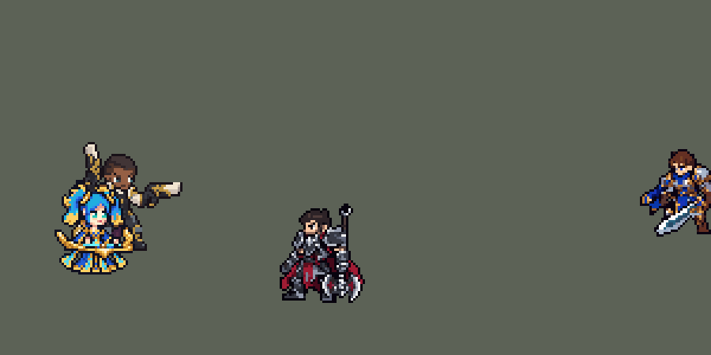

<!-- 本页上半部分由 tools/docs/gen_hero_docs.py 按仓库里现在的数据生成，手改会被覆盖；「开发记录」以下是手写的，生成时原样保留。 -->

# 娑娜 Sona


| 项目 | 内容 |
|---|---|
| id | `league_sona` |
| 所属的包 | 主包（mod_id `league`） |
| 分路 | 辅助 |
| 分类 / 标签 | 功能型（Util） · AP / Magic / CC / Heal / Shield |
| 高清帧 | PPU 3.88 |
| 附加包 | [辅助挑人附加包：迦娜、娑娜、璐璐](#附加包)（`league_support_pick`）、[游戏 AI 不按的技能替它按](#附加包)（`league_ult_press`） |



其他预览：[逐帧预览](../preview/league_sona_frames.png)、[特效表](../preview/league_sona_effects.png)

## 现在的技能

下面是游戏里显示的技能说明（`league/text/champion.i18n` 的简体中文，去掉了颜色和图标），冷却、距离来自 `league/champion/league_sona.data_champion`；1 秒 = 60 tick。

### 普攻 / 被动（被动「能量和弦」）

*攻击间隔 1.5 秒 · 攻击距离 55000*

弹出音符攻击。被动能量和弦：每放3次技能，下次普攻额外造成50 + 50% 法强的魔法伤害，并按最后一首歌：断奏 伤害翻倍；渐弱 目标伤害降低25%（3秒）；节奏 减速40%（2秒）。

### 技能1 · 英勇赞美诗

*冷却 7 秒 · 施放距离 65000 · 施放：指定目标 · 敌人（不含防御塔）*

对附近两个敌人（英雄优先）各造成95 + 60% 法强的魔法伤害。旋律：3秒内来到她身边的友方英雄3秒内获得15% 攻击力和15% 法强。

### 技能2 · 坚毅咏叹调

*冷却 8 秒 · 施放距离 80000 · 施放：指定目标 · 敌方英雄*

为自己和一名附近的友方英雄回复100 + 40% 法强生命值。旋律：身边的友方英雄获得70 + 40% 法强的护盾1.5秒。每14秒同时弹迅捷奏鸣曲：身边友方英雄移速+20%（自己+30%）3秒。

### 大招 · 狂舞终乐章

*冷却 50 秒 · 施放距离 75000 · 施放：方向 · 敌方英雄*

朝敌方英雄弹出一道音波，途经的敌方英雄受到150 + 60% 法强的魔法伤害并被晕眩1.5秒。被动：每条命放出大招后，技能冷却缩短20%。

### 数值

攻击力 80（每级 +6）、法强 30（每级 +15）、生命 950（每级 +95）、护甲 24（每级 +7）、魔抗 24（每级 +4）、移速 1000（每级 +10）。

## 附加包

附加包是可选的原生代码 mod（都在附加包合集 `league_addons` 里），**不装主包里的英雄也是完整的**。

### 辅助挑人附加包：迦娜、娑娜、璐璐

[辅助挑人附加包：迦娜、娑娜、璐璐](../../addons/league_support_pick/README.md)：`league_support_pick` v0.1.0

| 英雄 | 主包（纯数据） | 装了附加包 |
|---|---|---|
| 娑娜 W 回血（60000 内） | 随机一名队友 | 损失生命最多的队友 |

### 游戏 AI 不按的技能替它按

[游戏 AI 不按的技能替它按](../../addons/league_ult_press/README.md)：`league_ult_press` v0.5.5（通用附加包，下面只列和娑娜有关的部分）

|  | 装了附加包，什么时候按 |
|---|---|
| 娑娜 W | 她或 60000 内的队友生命不到 70%，射程内有敌方英雄 |

## 相关脚本和素材

- [`tools/lol/extract_sona.py`](../../tools/lol/extract_sona.py)
- [`tools/art/preview_sona.py`](../../tools/art/preview_sona.py)
- [`tools/art/import_sona.py`](../../tools/art/import_sona.py)
- [`tools/art/design_sona.py`](../../tools/art/design_sona.py)
- [`assets/source/sona/`](../../assets/source/sona)

## 开发记录

> 下面是原来 README 里「英雄：娑娜」一节，原样搬过来（只改了相对链接）。

| 部分 | 内容 |
|---|---|
| 定位 | 辅助（远程，分类 Util），第九组的辅助（按用户 10 月 2 日排的顺序，同组有青钢影、魔腾、乐芙兰、卡莎），第九组就此做齐；本包第九个辅助（索拉卡、蕾欧娜、迦娜、锤石、莫甘娜、娜美、塔里克、布里茨之后）。打法和英雄联盟一样：Q 远程消耗，W 奶和护盾，E 加速，每放三个技能下一次普攻带上能量和弦，R 一条线晕眩。技能方案用户全选 A：Q 单独一个技能位，W 带上 E，能量和弦和英雄联盟一样，渐入佳音做成大招的被动 |
| 普攻 | 弹出音符，100% 攻击力的物理伤害，射程 55000（英雄联盟 550），攻击间隔 90 tick（1.5 秒），第 7 tick 音符离开琴弦（动作第 3 帧），每 tick 5000 |
| 被动 | 「能量和弦」：每放一个技能记一次（Q、W 各一次，W 带出 E 时 E 再记一次），记满 3 次后她的琴边转起金色音符；下一次普攻改成强化动作，第 11 tick 弹出金色音符，打中敌人（小兵、野怪也算，防御塔不算，和英雄联盟一样）额外造成 50 + 50% 法强的魔法伤害，再按最后放的那首歌：断奏（Q）伤害翻倍；渐弱（W）目标 3 秒内攻击力和法强降低 25%；节奏（E）减速 40%，2 秒。模拟每局约 20 次（断奏约 13 次、节奏约 7 次；渐弱很少：一半的 W 带着 E 一起放，最后一首歌就成了 E） |
| 技能1 | Q「英勇赞美诗」：对 65000 内的敌人施放（小兵和野怪也算，清线、打野也用），冷却 7 秒。第 7 tick 向附近两个敌人各弹出一道蓝色音波（每 tick 5000），95 + 60% 法强的魔法伤害，英雄优先（引擎按单位编号的顺序处理范围，英雄排在前面）。旋律：脚下的蓝色光环跟着她 3 秒（半径 45000），碰到的友方英雄（她自己也算）3 秒内攻击力和法强 +15%，每次施放每人只吃一次（英雄联盟的旋律） |
| 技能2 | W「坚毅咏叹调」：80000 内有敌方英雄时施放（打架时才放），冷却 8 秒。第 8 tick 回复自己和 60000 内随机一名友方英雄 100 + 40% 法强的生命（游戏读不到当前生命，英雄联盟是伤得最重的那个）。旋律：绿色光环 3 秒，碰到的友方英雄获得 70 + 40% 法强的护盾，1.5 秒 |
| W 里的 E | E「迅捷奏鸣曲」：每 14 秒随 W 一起弹出，粉色光环 3 秒，碰到的友方英雄移速 +20%（她自己 +30%），3 秒。E 也算一次技能，而且是最后一首歌。光环第一版的目标是"除自己以外的友方"，结果连小兵和防御塔都加速了，改成"友方英雄" |
| 大招 | R「狂舞终乐章」：朝 75000 内的敌方英雄施放，冷却 50 秒。她把琴抛到头顶（金色和弦爆发），第 8 tick 金色音波朝前推出（每 tick 5000，飞 95000，宽 40000），穿过途中所有单位，只打敌方英雄：150 + 60% 法强的魔法伤害，晕眩 1.5 秒（英雄联盟里是被迫跳舞）。被动「渐入佳音」：每条命第一次放大招后，Q、W 的冷却缩短 20%（`skill_cooldown_mult` 25，加上符号相反的 `ult_cooldown_mult`，大招自己的冷却不变）。模拟每局放约 2.7 次，每次晕到约 1 个英雄 |
| 附加包 | 可选的附加包 [`addons/league_support_pick`](../../addons/league_support_pick/README.md)（在附加包合集里，原生代码，主包不装它也完整）：W 的回血照英雄联盟给 60000 内损失生命最多的队友（主包随机一名） |
| 附加包（替 AI 按） | 可选的附加包 [`addons/league_ult_press`](../../addons/league_ult_press/README.md)（在附加包合集里，原生代码，主包不装它也完整）：游戏 0.6.4 的 AI 很少按她的 W（只读观察包：每 10 分钟 4.9 次，552 局，冷却 8 秒）。附加包按局面替 AI 按（用户：「有问题的英雄全部改成rust」）：她或 60000 内的队友生命不到 70%、80000 内有敌方英雄就按 |
| 数值 | 攻击 80（+6）、法术强度 30（+15）、生命 950（+95）、护甲 24（+7）、魔抗 24（+4）、移速 1000（+10）。数值是自己设计的，用 SDK 对战模拟调：打辅助，对 5 个原版辅助（`priest`、`bard`、`enchanter`、`monk`、`taoist`），两边、三套队友阵容各 8 局，一批 240 局；同一批种子塔里克 +2.45、娜美 +0.79、蕾欧娜 +0.78、锤石 −0.04。第一版（Q 50 + 45%、治疗 50 + 25%、护盾 40 + 30%、和弦 30 + 40%、生命 860（+88）、护甲 20、魔抗 22）−0.77，每局死 2.6 次；技能和生命调高（Q 70 + 50%、治疗 70 + 30%、护盾 60 + 35%、生命 920（+95）、护甲魔抗 24）后约 −0.4；Q 85 + 55% +0.43；再把光环半径 35000 → 45000、旋律加攻 12% → 15%、治疗 90 + 35%、W 冷却 9 → 8 秒、和弦 50 + 50% 后两批 +1.03 / +1.35（R 再加强到 180 + 70% 的 +0.99，没有更好）；断奏改成和和弦一样的 50 + 50%（说明里的"伤害翻倍"）后正式版两批 +1.25 / +0.63（和上面同样的种子，差别是一批的波动：四批平均 +1.07），定下这版。10 月 3 日玩家反馈「琴女实测感觉全能，但是什么都不突出，对线有点炸了，对线伤害低，奶量和护盾基础底，看起来不错，但是对线身板又脆，感觉可以加强一点点」：生命 920 → 950、Q 85 + 55% → 95 + 60%、治疗 90 + 35% → 100 + 40%、护盾 60 + 35% → 70 + 40%，两批 +1.35 / +1.92（同种子的上一版 +1.25 / +0.63；输出 +9%、治疗 +14%、每局死亡 2.15 → 2.0）；再加护甲魔抗 26、和弦 60 的版本（+1.05 / +1.50）没有更好，更大的一档（Q 100 + 60%、治疗 110、护盾 80、生命 960）+1.50 / +1.96，按「一点点」没用。每局放 Q 约 46 次（打到英雄约 15 下）、W 约 16 次、R 约 2.7 次 |
| 亚索联动 | R 的晕眩是亚索大招要的控制：娑娜打辅助、亚索打上路同队时，亚索每局 R 到被控英雄 1.00 次（同一批蕾欧娜 2.19、娜美 1.94、原版牧师 0.50），亚索不用调 |
| 精灵图 | 9 个动作 56 帧：待机、移动、普攻、能量和弦普攻、Q、W（带 E）、R、受击、死亡。造型按用户在 Codex 里挑的原画画（A：英雄联盟的待机，琴横在腰前），由 Codex 按游戏尺寸画了两版（40 × 34），选 B（头 12 行）：蓝色双马尾、金色发饰、青绿色的眼睛、深蓝和金色的长裙、腰前的金色琴（叶琴）。马尾顶到裙摆 40 px，34 px 宽，23 色 |
| 特效 | 普攻的蓝色音波弹（11 px）和命中；能量和弦：金色音符、三种命中（金色高音谱号外一圈蓝 / 绿 / 粉音波）、琴边转着的三个金色音符、节奏的粉色五线谱减速环（42 px，套在脚下）、渐弱的头顶绿色音符；Q 的蓝色编织音波（23 px）、命中的星形光爆、旋律加攻的蓝色小音符；W 的绿色治疗光柱、护盾（23 × 35 px 的绿色椭圆罩）；E 的粉色加速风（38 px）；三个旋律光环（蓝 / 绿 / 粉，地上 90 × 45 px 的椭圆，正好是 45000 的半径，跟着她 3 秒）；R 头顶的金色和弦爆发（38 px）、金色音波（15 × 45 px）、晕眩时头顶转圈的金色音符（12 帧，1.5 秒） |
| 图标 | 官方技能图标（Q / W / R），64×64 |
| 音频 | 从本地客户端提取的 11 条技能音效和 4 条中文语音（Q、W、E、R），合成 13 个游戏音效。不提交到仓库，按下面的命令在本地生成 |
| 高清帧（PPU 3.88） | 2026-10-30 用 PPU 重做（用户：「接下来重做琴女」「调高PPU像素」「达到和我给你的图一样的效果」「通过，用 3.88」「动作通过」）。设计图：用户给的原图（描边和头发约 16 像素一格，眼睛、睫毛、琴弦、手指、裙子的金色花纹画在半格、三分之一格上），为了和原图一样细，按约 5.5 像素一格读回（117 × 155 格；头顶到裙摆 155 行 / 3.88 = 原来的 40 像素；调色板 64 色，`design_sona_hd.py`，`--pitch 8` / `16` 是更粗的读法）。动作：Codex 照旧版同一帧用设计图整帧重画（`pack_sona_actions.py`，36 帧；旧版里和待机一模一样的帧直接用设计图，R 第 6 帧 = 第 2 帧；R 第 3–5 帧竖琴悬在头顶，和人分开）。读回（`casts_sona_hd.py`）：每张的缩放按整个人的面积量，再乘头的大小（蓝色头发和脸）；站着的帧再按旧版同一帧的身高对齐（Codex 有的图头一样大、身体矮 8% 或高 5%，一次普攻里身高会跳），头和设计图的差距都在 6% 以内；对齐点按设计图和旧待机剪影重叠最多的那列（第 58 列）。死亡第 3–5 帧用 Codex 的第一版（修订版第 3–4 帧又站直、第 5 帧直接趴平），跪下去、裙子慢慢铺开，和旧版节奏一样。待机不上下起伏（待机和选人卡是从动作里剪的随机片段）；没有烤进动作的特效（`rig_sona_hd.py`）。高 40 像素和原来一样，没有 SIZES 行；头像点不变；选人卡片 −10 不变 |

```bash
python tools/lol/extract_sona.py --lol "D:\WeGameApps\lol" --vgmstream "<vgmstream-cli.exe 路径>"
python tools/lol/native_pose.py assets/source/sona/poses.json --out <渲染文件夹>   # 动作参考帧
python tools/art/design_sona.py         # 造型：Codex 的 B 版，一格马尾误用了瞳孔色，改回发色
python tools/art/fix_sona_strips.py     # 动作：擦掉 Codex 画的细棍手臂，贴上造型自己的手臂（按每帧的角度旋转），每帧贴待机的头
python tools/art/import_native.py --hero sona
python tools/art/import_sona.py         # 特效：缩一半；减速环、加速风、R 的爆发用原尺寸；光环按半径缩放；和弦的金色音符
python tools/art/preview_sona.py
# PPU 3.88 重做（2026-10-30）：
python tools/art/pack_sona_ppu.py --out <文件夹>           # 给 Codex 的设计图包（照她的旧精灵描密）
python tools/art/design_sona_hd.py                       # 用户的原图（hd/raw/sona-A.png）按约 5.5 像素一格读回 -> hd/design.png
python tools/art/pack_sona_actions.py --out <文件夹>       # 给 Codex 的动作包（照旧版同一帧整帧重画）
python tools/art/casts_sona_hd.py --area                 # 每张按面积的缩放；--heads 每帧头的大小（定 ZOOM）
python tools/art/rig_sona_hd.py                          # 读回 -> 原始条和 1 倍图
python tools/art/ppu_restyle.py --hero sona && python tools/art/ppu_hd.py --hero sona
python tools/art/ppu_one.py --hero sona && python tools/art/rig_sona_hd.py --one-ground && python tools/art/hero_reels.py --hero sona
python tools/art/preview_sona.py
python tools/art/review_sona_actions.py --out <文件夹>     # 旧版 / 新版对照动图
```

美术（原画的提示词见 [`PICTURE_PROMPT.md`](../../assets/source/sona/PICTURE_PROMPT.md)，造型的见 [`MODEL_PROMPTS.md`](../../assets/source/sona/MODEL_PROMPTS.md)，动作的见 [`MODEL_STRIPS.md`](../../assets/source/sona/MODEL_STRIPS.md)，特效的见 [`PROMPTS_FX.md`](../../assets/source/sona/PROMPTS_FX.md)；Codex 的交接说明在 [`codex_model/`](../../assets/source/sona/codex_model)、[`codex_strips/`](../../assets/source/sona/codex_strips)、[`codex_fx/`](../../assets/source/sona/codex_fx)）：

- 分工：模型和特效都由 Codex 画，Claude 写提示词包、整理和导入，按"原画 → 造型 → 动作 → 特效"分四步。用户：「你关注好 codex 做完了就进行下一步」——每一步 Codex 交了就直接进下一步，A/B 由 Claude 选并说明。
- 原画和造型：原画 A 是英雄联盟的待机（琴横在腰前），B 是放 E 的姿势，选 A。造型按 40 行（马尾顶到裙摆）画，A 头 10 行、B 头 12 行，选 B。`design_sona.py`：一格马尾用了瞳孔的颜色（导入时按眼睛定头的位置会认错），改回发色。
- 动作参考（`poses.json`）：她的脸、头骨和头发都绑在 `C_Head` 上，`head` 关节没有顶点，`native_pose.py` 为此加了 `"head_joint"` 选项；头 3.6 倍、头发 0.5 倍，腿用裙摆的骨骼。英雄联盟里她不迈步（裙摆下飘着走），移动 8 帧 × 160 ms。出手帧：普攻第 3 帧（第 7 tick），能量和弦第 4 帧（第 11 tick），Q 第 3 帧（第 7 tick），W 第 3 帧（第 8 tick），R 第 3 帧（第 8 tick，琴在第 3–5 帧抛到头顶）。
- 动作：Codex 画了 9 条（56 帧），每帧贴定稿的头，但手臂画成 1–2 格的细棍。第一版修正沿着长长的手臂补了袖子，用户：「手臂异常问题你不修复吗 还是看起来怪啊」「这里啊 手臂伸展这么长」；第二版画短袖子，和马尾糊在一起，没用；第三版 `fix_sona_strips.py` 擦掉 Codex 的手臂（琴和身体的像素按层还原），把造型自己的手臂（袖子和手）按每帧的角度用 RotSprite 旋转后贴回去，用户：「下面改对了」「没问题了」。
- 导入：待机 6 帧都用定稿，第 3–5 帧从裙摆往上下沉一格呼吸（`BOB`，接缝在设计的第 94/95 行：裙片是竖直的，这两行一样宽）；按虹膜的青绿色定头的位置（`EYES`）；描边补齐（`COMPLETE`）。补齐后脸两侧原来一格宽的缝口被封住，每帧脸边各露出一个透地面的小洞，贴回的手臂旁边也有几个——`PLUG` 用描边色补上（共 145 格），设计自己在裙片和腿之间的 4 个缝保留。头像截取点 (−1, −36)（`tfm2_ase.py face`），待机最高点 −28，不设选人卡位置。
- 特效用 Codex 画的 20 张（104 帧），交的是要求尺寸 2 倍的像素图（`logical-source`）。`import_sona.py` 缩一半（每 2 × 2 格取最亮的像素，白色的芯和一格的五线谱线都留得住）；节奏减速环、加速风缩一半后比人还窄，画在人身后会被完全挡住，R 的爆发缩一半后比抛起的琴还小，这三张用原尺寸；三个旋律光环按 45000 的半径缩放（宽 90 px，画的就是 2:1 的椭圆）；能量和弦的金色音符是普攻的音符按色阶换成金色。挂点：命中在上半身 (0, −8)，琴边的金色音符在腰前 (0, −3)，渐弱和晕眩在头顶 (0, −31)，治疗、护盾落在脚底，减速环、加速风和光环的椭圆中心在脚底上方 2 px（画在人身后，前半圈露在脚下），R 的爆发在抛起的琴上 (0, −40)。

逐帧预览：[`docs/preview/league_sona_frames.png`](../preview/league_sona_frames.png?v=1030hd)，特效：[`docs/preview/league_sona_effects.png`](../preview/league_sona_effects.png?v=1014g)。
