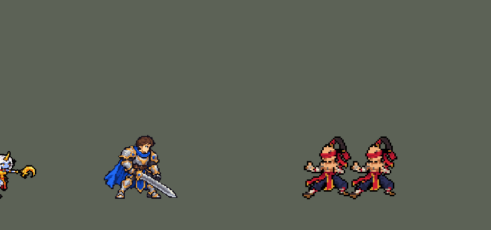

<!-- 本页上半部分由 tools/docs/gen_hero_docs.py 按仓库里现在的数据生成，手改会被覆盖；「开发记录」以下是手写的，生成时原样保留。 -->

# 索拉卡 Soraka


| 项目 | 内容 |
|---|---|
| id | `league_soraka` |
| 所属的包 | 主包（mod_id `league`） |
| 分路 | 辅助 |
| 分类 / 标签 | 功能型（Util） · AP / Heal / Magic / CC |
| 高清帧 | PPU 2.2（画成 110%） |
| 附加包 | 无 |



其他预览：[before_after](../preview/league_soraka_before_after.gif)、[逐帧预览](../preview/league_soraka_frames.png)、[特效表](../preview/league_soraka_effects.png)

## 现在的技能

下面是游戏里显示的技能说明（`league/text/champion.i18n` 的简体中文，去掉了颜色和图标），冷却、距离来自 `league/champion/league_soraka.data_champion`；1 秒 = 60 tick。

### 普攻 / 被动

*攻击间隔 1.5 秒 · 攻击距离 60000*

普攻用法杖射出星光弹，造成100% 攻击力的物理伤害。

### 技能1 · 流星坠落

*冷却 8 秒 · 施放距离 70000 · 施放：地点 · 敌人（不含防御塔）*

造成70+50%法术强度的魔法伤害并减速30%，命中敌方英雄时获得活力焕发：2.5秒内回复75+30%法术强度的生命值并加速20%。每16秒一次附带星体结界：沉默圈内敌人，1.5秒后仍在圈内的禁锢1秒并受到40+30%法术强度的魔法伤害。

### 技能2 · 星之灌注

*冷却 4 秒 · 施放距离 90000 · 施放：指定目标 · 友方（不含自己）*

消耗自身6%最大生命值（不会致死），为一名其他友方英雄回复200+50%法术强度的生命值。带活力焕发时不消耗生命值，目标也获得活力焕发。被动拯救：施放后2秒内移动速度提高30%。

### 大招 · 祈愿

*冷却 50 秒 · 施放距离 960000 · 施放：指定目标 · 友方英雄*

为全图所有友方英雄（包括自己）回复220 + 60% 法术强度的生命值。

### 数值

攻击力 75（每级 +6）、法强 30（每级 +15）、生命 780（每级 +80）、护甲 20（每级 +7）、魔抗 20（每级 +3）、移速 1000（每级 +10）。

## 相关脚本和素材

- [`tools/lol/extract_soraka.py`](../../tools/lol/extract_soraka.py)
- [`tools/art/preview_soraka.py`](../../tools/art/preview_soraka.py)
- [`tools/art/import_soraka.py`](../../tools/art/import_soraka.py)
- [`assets/source/soraka/`](../../assets/source/soraka)

## 开发记录

> 下面是原来 README 里「英雄：索拉卡」一节，原样搬过来（只改了相对链接）。

| 部分 | 内容 |
|---|---|
| 定位 | 辅助（Util），第一组里的辅助，也是本包第一个治疗 |
| 普攻 | 法杖射出星光弹，造成 100% 攻击力的物理伤害 |
| 技能1 | Q「流星坠落」：星星砸向敌人所在的位置，0.4 秒后落地，范围魔法伤害并减速 30%。命中敌方英雄时获得「活力焕发」：2.5 秒内持续回复 75 + 30% 法术强度的生命并加移速，每次施放只触发一次。合并 E「星体结界」：每 16 秒最多一次，星星落地后留下星之领域，沉默圈内敌人，1.5 秒后仍在圈里的被禁锢 1 秒并受到伤害。英雄联盟里 E 是单独的技能；这里没有第三个技能位，就跟着 Q 落下，用一个隐藏的冷却 buff 保留原版 8 秒 / 16 秒的节奏 |
| 技能2 | W「星之灌注」：扣自己 6% 最大生命，治疗一名其他友方英雄 200 + 50% 法术强度（射程 90000，冷却 4 秒）；带有活力焕发时不扣血，目标也获得活力焕发（持续回血和移速，和英雄联盟一样）。扣血前先加 3 tick 的不死 buff，不会把自己扣死。合并被动「拯救」：放完后 2 秒内移速 +30%（数据读不到移动方向和友方血量，近似成治疗后赶去支援） |
| 大招 | R「祈愿」：治疗全图所有友方英雄 220 + 60% 法术强度，包括自己。原版对生命低于 40% 的目标加成治疗，数据做不到，统一数值 |
| 修正（0.10.0） | 之前流星出现 0.15 秒就结算伤害和减速，画面上 0.4 秒才落地；星体结界挂在了引擎不读的字段上（`RangeProjectile` 没有 `end_effects`），从来没有出现过。现在流星在落地那一帧结算，星体结界在同一时刻出现在落点。SDK 对战模拟（对 `priest`、`bard`、`enchanter`、`monk`，两边各 36 局）团队击杀差 −0.55 → −0.93，在随机波动之内：结界生效了，但流星晚结算更容易被躲开 |
| 修正（0.15.0） | W 的扣血和 Q 的活力焕发写在 `WithSelf` 里，本意是"只给自己"；可引擎里动作目标是别的单位时，`WithSelf` 会给施法者一次、再给目标一次（见下面迦娜一节后的说明）。所以 W 扣自己 6% 最大生命的同时，被治疗的队友也扣了自己的 6%（1490 血的战士少了 89），Q 的活力焕发也挂到了被流星砸中的敌方英雄身上。现在这两处改成只对自己生效的范围效果（`RangeEffect` + `AllyOnlySelf`）。SDK 对战模拟（对 5 个原版辅助，两边、三套队友阵容各 16 局）团队击杀差 −0.45 → −0.12，在随机波动之内，数值不用调 |
| 生命 | 780，每级 +80，比原版的辅助都低（最低的 `priest` 900 / +80）。原来 880 / +95：用户觉得加强后她在下路太能赖线、对线无解，于是技能数值不动、只降生命和成长，团战里的治疗照旧。SDK 对战模拟（对 `priest`、`bard`、`enchanter`，两边各 60 局）：前 5 分钟她自己的死亡从 0.50 次升到 0.62 次，10 分钟的治疗量只少 2%，团队击杀差 +0.2 → −0.7（在随机波动之内） |
| 治疗给谁 | W 用 `AllyNotSelf`（除自己以外的友方英雄，不含小兵），R 用 `AllyChampion` 加全图范围。游戏 AI 给友方技能打分时，治疗的价值是"治疗量和目标缺失生命取小"，所以应该会先治疗掉血最多的友方，满血时价值为 0。这是从 mod SDK 的代码里读出来的；用 SDK 跑的对战模拟也对得上：单纯加大 W 的治疗量，实际治疗几乎不涨，加射程、缩冷却、把活力焕发传给队友才涨 |
| 精灵图 | 8 个动作 52 帧：待机、跑步、普攻、Q 召唤流星、W 举杖、R 祈愿鞠躬、受击、死亡。白发顶到蹄底 35 px，17 色，全部正面 3/4 朝右，按英雄联盟原版动作的时间点画：待机 1.5 秒呼吸一次，跑步是蹄子着地的蹦跳式跑 |
| 高清帧（PPU 2.2） | 用户：「下一个可以修正索拉卡」。Codex 一个包两步画的：先照原来的造型重画 PPU 3 的高清造型（`assets/source/ppu/soraka_codex.png`，47 色），再照它逐帧重画全部 46 帧动作（`pack_ppu_strips.py`），`import_ppu_strips.py` 读回到 `assets/source/ppu/orig`。造型画得比动作大约 19%（Codex 自己也说角尖到蹄底没对上），导入时按头发顶到蹄底的高度把造型缩到动作的大小（每格取平均色、对回造型自己的颜色），待机和动作一样大。然后照泽丽的样子统一画风（`tools/art/ppu_restyle.py`）：Codex 每帧的头都是重画的、和造型对不上，所以和布隆、铁男一样只改身体——每帧都加宽 1.25 倍、压矮到 0.92，像素降到每个游戏像素约 2.2 格，外描边加 1 格；选人界面用 1.5 格的 `lo_` 帧。**整体 110%**（用户：「稍微变大点」）：主包 DLL 的 `hd.rs` SIZES 按比例画，像素一格不改，卡牌、图鉴、头像也一样大；按站位点放大，所以每帧往上挪 3 格，蹄底还在地上（39 格高）。后来全部高清英雄统一成泽丽那种平涂像素（约 16 色加分界线，`pixel_down.py` 的 `crisp`）：她的皮肤是蓝的，脸按蓝色皮肤认出来照原样保留；细细的金法杖也照原样保留（分界线会把两三格宽的杖身整根描黑）。头像截取点 (7, −35) |
| 特效 | 普攻星光弹、命中、流星坠落、活力焕发、星体结界、定身光环、星之灌注、祈愿（头顶的星和落在每个友方身上的光柱） |
| 图标 | 官方技能图标（Q / W / R），64×64 |
| 音频 | 从本地客户端提取的 10 条技能音效和 2 条中文语音（Q 借一句攻击台词，R）。不提交到仓库，按下面的命令在本地生成 |

```bash
python tools/lol/extract_soraka.py --lol "D:\WeGameApps\lol" --vgmstream "<vgmstream-cli.exe 路径>"
python tools/lol/native_pose.py assets/source/soraka/poses.json --out <参考图文件夹>
python tools/art/import_native.py --hero soraka    # 角色图（套用 soraka_retouch.json）
python tools/art/import_soraka.py                  # 特效
python tools/art/preview_soraka.py
```

美术和李青一样直接按游戏原尺寸画（提示词见 [`assets/source/soraka/PROMPTS.md`](../../assets/source/soraka/PROMPTS.md)）：
- 她的角在模型里没有自己的蒙皮权重，是跟着头走的，头放大 2 倍时角也变成 2 倍、成了最高点。`native_pose.py` 的 `keep` 把角的顶点绑到 `horn` 骨骼上，让它保持原版长度；长马尾挂在胸部骨骼下，本来就不随头放大。
- 造型图 Codex 画了三版：第一版是没整理的模糊图，第二版变成正面站姿、眼睛像两块白斑，第三版通过；嘴去掉，眼睛由用户调亮。
- Codex 把造型图的头逐格贴进了每一帧，头的大小一致，待机和跑步不抖。交回后用户发现头发只盖住头顶和后脑，额头和右半边都是蓝色皮肤，脸显得很大：所有帧的头统一加了刘海和右侧一缕发丝。Q 第 2–3 帧法杖和手分开了，补上握杖的手臂，删掉 GPT 留下的碎块和闪光。
- 之后用户觉得眼睛和嘴还是丑。原因是两只眼睛左右画反了（宽的那只贴在远侧脸边），眼睛只有两行像眯着，眼下 5 行脸加一块深蓝阴影像大下巴。按用户从三个方案里选的：刘海再下移一行，眼睛换回近左远右、改成 3 行的金色大眼，阴影缩成下巴底下一行，加一格暗红小嘴（倒地两帧闭眼）。头部每帧 35 个像素，造型图同步。改动逐像素记在 [`native/soraka_retouch.json`](../../assets/source/native/soraka_retouch.json)，导入时套用。
- 还原（0.27.2）：Codex 按定稿重画过一版动作条（第二步，先用它精修过的脸，后来按用户的意思换回确认过的脸），用户说不要新的美术版本、还原成旧的：动作条、定稿、`soraka_retouch.json`、贴图、帧表、逐帧预览和导入工具的表都回到 ac94284 之前，重新导入的贴图和帧表与那时逐字节相同，展示动图重新渲染；头像截取点一直没变。
- 结果：17 色，和右边像素同色的比例 29%（原版英雄 18%–46%）；头像截取点 (5, −35)。
- 特效放大 2 倍后，流星落地环和星体结界约 60 px 宽，所以 Q、E 的半径定为 30000。

逐帧预览（高清帧）：[`docs/preview/league_soraka_frames.png`](../preview/league_soraka_frames.png?v=1014g)，特效：[`docs/preview/league_soraka_effects.png`](../preview/league_soraka_effects.png?v=1014g)。改成高清帧（110%）之前和之后（游戏里的大小，旁边是德莱厄斯）：[`docs/preview/league_soraka_before_after.gif`](../preview/league_soraka_before_after.gif?v=1014g)。
