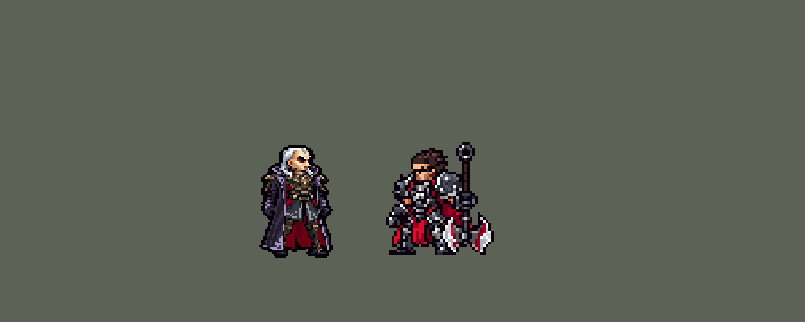

<!-- 本页上半部分由 tools/docs/gen_hero_docs.py 按仓库里现在的数据生成，手改会被覆盖；「开发记录」以下是手写的，生成时原样保留。 -->

# 斯维因 Swain


| 项目 | 内容 |
|---|---|
| id | `league_swain` |
| 所属的包 | 主包（mod_id `league`） |
| 分路 | 中单 |
| 分类 / 标签 | 法师（Magician） · AP / Magic / CC / Heal |
| 高清帧 | PPU 1.5 |
| 附加包 | [斯维因附加包](#附加包)（`league_swain`） |



其他预览：[逐帧预览](../preview/league_swain_frames.png)、[特效表](../preview/league_swain_effects.png)

## 现在的技能

下面是游戏里显示的技能说明（`league/text/champion.i18n` 的简体中文，去掉了颜色和图标），冷却、距离来自 `league/champion/league_swain.data_champion`；1 秒 = 60 tick。

### 普攻 / 被动

*攻击间隔 1.5 秒 · 攻击距离 52000*

恶魔手射出乌鸦弹。狂食鸦群：帝国视界、永不复行抓到英雄或他打过的英雄阵亡时得到魂屑，回复80 + 30% 法强生命，最大生命+15（死后清空）。帝国视界：每16秒在远处交战的敌方英雄脚下睁眼，1.5秒后炸开造成90 + 60% 法强魔法伤害并减速。

### 技能1 · 解脱之触

*冷却 4 秒 · 施放距离 55000 · 施放：指定目标 · 敌人（不含防御塔）*

恶魔手射出五道扇形散开的闪电，造成120 + 80% 法强魔法伤害；近处的敌人被更多闪电打中，另受60 + 45% 法强魔法伤害。

### 技能2 · 永不复行

*冷却 10 秒 · 施放距离 65000 · 施放：指定目标 · 敌人（不含防御塔）*

恶魔之手飞出再飞回，回程打中的敌人受到110 + 80% 法强魔法伤害并禁锢1.5秒；被禁锢的英雄随后被拉近，留下一片魂屑。

### 大招 · 恶魔升华

*冷却 60 秒 · 施放距离 55000 · 施放：指定目标 · 敌方英雄*

化身恶魔，吸取周围敌人的生命：每0.5秒造成25 + 8% 法强魔法伤害，每名英雄回复40 + 15% 法强；吸到英雄时形态延续。2秒后放出恶魔耀光：170 + 70% 法强魔法伤害并减速。2名敌方英雄在身边，或有敌方英雄且队友在旁时才放。

### 数值

攻击力 76（每级 +6）、法强 40（每级 +20）、生命 1000（每级 +105）、护甲 22（每级 +7）、魔抗 22（每级 +3）、移速 900（每级 +9）。

## 附加包

附加包是可选的原生代码 mod（都在附加包合集 `league_addons` 里），**不装主包里的英雄也是完整的**。

### 斯维因附加包

[斯维因附加包](../../addons/league_swain/README.md)：`league_swain` v0.1.1

|  | 主包（纯数据） | 装了附加包 |
|---|---|---|
| 魂屑 | 每块最大生命 +15，死亡时清空，每条命重新攒 | **永久保留**：死了、复活后一块不少（英雄联盟的规则） |
| 恶魔升华 | 普攻、Q、E、恶魔耀光是带翅膀的恶魔动作，站着、走着、挨打还是斯维因 | **整个身体换成恶魔**：站着、走着、挨打都是恶魔手臂、红眼的他（游戏 0.6.4），形态结束换回 |
| 开大时机 | 看场面（见上） | **不变**，照主包（用户：「是乌鸦看情况开大吧」），日志里记下每次变身时身边几个敌方英雄 |

装上附加包后游戏里显示的说明（和主包不同的部分）：

- **普攻 / 被动**：【附加包】恶魔手射出乌鸦弹。狂食鸦群：帝国视界、永不复行抓到英雄或他打过的英雄阵亡时得到魂屑，回复80 + 30% 法强生命，最大生命+15（永久）。帝国视界：每16秒在远处交战的敌方英雄脚下睁眼，1.5秒后炸开造成90 + 60% 法强魔法伤害并减速。
- **大招 · 恶魔升华**：【附加包】化身恶魔，吸取周围敌人的生命：每0.5秒造成25 + 8% 法强魔法伤害，每名英雄回复40 + 15% 法强；吸到英雄时形态延续。2秒后放出恶魔耀光：170 + 70% 法强魔法伤害并减速。2名敌方英雄在身边，或有敌方英雄且队友在旁时才放。期间整个化身恶魔。

## 相关脚本和素材

- [`tools/kit/build_swain.py`](../../tools/kit/build_swain.py)
- [`tools/kit/setup_swain.py`](../../tools/kit/setup_swain.py)
- [`tools/lol/extract_swain.py`](../../tools/lol/extract_swain.py)
- [`tools/art/preview_swain.py`](../../tools/art/preview_swain.py)
- [`tools/art/rig_swain.py`](../../tools/art/rig_swain.py)
- [`assets/source/swain/`](../../assets/source/swain)

## 开发记录

> 下面是原来 README 里「英雄：斯维因」一节，原样搬过来（只改了相对链接）。

| 部分 | 内容 |
|---|---|
| 定位 | 中单（Magician，标签 AP / Magic / CC / Heal），第 118 位英雄。诺克萨斯统领 斯维因：拄着手杖的银发将军，左臂是恶魔手臂，化身恶魔吸取周围的生命。用户的选择：「全按推荐」——中单、W 并进被动、做附加包、PPU 1.5。技能 1 = Q 解脱之触，技能 2 = E 永不复行，大招 = R 恶魔升华；W 帝国视界没有自己的格子，由被动的守望自动放。技能名照英雄联盟 16.20 的官方中文 |
| 普攻 / 被动 | 恶魔手射出乌鸦弹（追踪），攻击间隔 90 tick。**狂食鸦群**：每得到一块**魂屑**回复 80 + 30% 法强生命（英雄联盟是最大生命的 6%，数据读不到最大生命），最大生命 +15（每块是他身上一个永久 buff，同名 buff 会叠）。魂屑来自：帝国视界打中英雄、永不复行拉回英雄、**他打过的英雄 3 秒内阵亡**（照佛耶戈的击杀窗口：英雄联盟里掉在地上的魂屑由乌鸦带回）。引擎在他死亡时清掉身上所有 buff，所以主包里魂屑每条命重新攒（说明里写着「死后清空」），附加包让它永久 |
| W | **帝国视界**（被动的守望每 16 秒放一次）：在 100000 内**正在交战的敌方英雄**（`EnemyChampionRecentlyAttacked`）脚下睁开恶魔之眼，1.5 秒后爆炸：30000 内 90 + 60% 法强魔法伤害、减速 50% 1.5 秒，打中的英雄给一块魂屑。眼睛不跟人，走开就躲得掉 |
| 技能1 | **Q 解脱之触**（1 级起，对 55000 内的敌人放，小兵、野怪也打）：恶魔手射出五道扇形散开的闪电（出手时朝目标当时的位置，锁定方向）。出手那一刻判定扇形：62000 内、约 20° 以内的敌人 120 + 80% 法强魔法伤害，32000 内的近处另受 60 + 45% 法强（英雄联盟：离得越近被越多闪电打中）。打中的闪光等闪电飞到再出现。冷却 4 秒 |
| 技能2 | **E 永不复行**（3 级起，对 65000 内的敌人放）：恶魔之手朝目标当时的位置飞出 70000，再掉头飞回他手里；**回程**打中的敌人受到 110 + 80% 法强魔法伤害并**禁锢 1.5 秒**。被禁锢的英雄 0.5 秒后被拽近 29000（英雄联盟的再次施放）并留下一块魂屑。出手方向锁定，躲得掉。冷却 10 秒 |
| 大招 | **R 恶魔升华**（5 级起），**看场面才变身**（用户：「是乌鸦看情况开大吧」）：按 R 只是待命 6 秒，守望每 12 tick 看一次，**身边 60000 内有两个敌方英雄**、或者 **55000 内有被控住的敌方英雄、身边 45000 内又有友方英雄**时才化身恶魔；6 秒没等到就退还冷却（只留 1 秒）。第一版是按 R 立刻变身、条件不满足就空放，经典引擎模拟里一半的大招空放、60 秒冷却白费；改成待命以后 90 局 232 次变身、0 次空放，98% 吸到英雄，64% 在 10 秒内拿到击杀。化身恶魔 4 秒：每 0.5 秒吸取 60000 内所有敌人 25 + 8% 法强魔法伤害，每个英雄回复 40 + 15% 法强（小兵野怪 2）；吸到英雄时形态延续（最多 15 秒）。2 秒后吸到英雄时放出**恶魔耀光**（8 秒一次）：60000 内 170 + 70% 法强魔法伤害、减速 50% 1.5 秒。期间普攻、Q、E 是恶魔的动作，身后展开黑红翅膀的光环。冷却 60 秒。游戏的 AI 按标记当时选中的那一支打分，所以照奥莉安娜的做法加了打分分支（AI 平时看到的是恶魔耀光的伤害，真放的时候先挂 1 tick 的 `r_x` 走待命那一支） |
| 连招 | 用户要求：「有连招要做连招」「都要帮我补」。英雄联盟里斯维因 E 禁锢住人，接 Q 解脱之触。**E→Q**：恶魔之手回程禁锢敌方英雄时，他身上开一个 90 tick（1.5 秒，和禁锢一样长）的连招窗口；窗口里放 Q，五道闪电立刻射出（平时第 9 tick），趁人还被禁锢。伤害、禁锢、拽人、冷却都不变。W 没接：帝国视界由守望一好就放，E 命中时它几乎总在冷却，要等 E 就得压住 W、改它的频率。改在 [`tools/kit/build_swain.py`](../../tools/kit/build_swain.py)，附加包副本用 `make_override.py` 重新生成 |
| 附加包 | 可选的附加包 [`addons/league_swain`](../../addons/league_swain/README.md)（在附加包合集里，原生代码，主包不装它也完整）：**魂屑死后不掉**（最大生命永久保留，维迦附加包的做法）；**恶魔升华整身变恶魔**（站着、走着、挨打都是恶魔手臂、红眼的他，游戏 0.6.4）。开大时机照主包。日志 `league_swain.log`（FRAG、KEEP、RISE、FORM） |
| 数值 | 攻击 76（+6）、法强 40（+20）、生命 1000（+105）、护甲 22（+7）、魔抗 22（+3）、移速 900（+9）、射程 52000 |
| 平衡 | 中单对五个基础法师（pyromancer / ice_mage / lightning_mage / wind_mage / white_mage），三套阵容、两边各打，10 分钟经典引擎模拟：草案 −1.77（辛德拉 +1.17、弗拉基米尔 +2.54，伤害只有 6546）；伤害和治疗 +40%、生命 1000、Q 4 秒、R 吸取回复 40 + 15%、魂屑回复 80 + 30%、Q 120 + 80% 定稿：+1.38（种子 1–8）/ +2.20（种子 25–32，辛德拉 +1.42）；大招改成待命以后 +2.04 / +1.65 |
| 精灵图（高清帧 PPU 1.5） | Codex 第 0 步画了平时（A）和恶魔升华（B）两张原画（[`tools/art/pack_swain_picture.py`](../../tools/art/pack_swain_picture.py)；英雄联盟里大招没有单独的模型，只有恶魔手臂的材质和粒子），[`tools/art/review_swain_size.py`](../../tools/art/review_swain_size.py) 读回，用户：「高度 40，头加大到约 1/4，翅膀保持这个大小」。第 1 步 Codex 在游戏格子上重画（[`tools/art/pack_swain_model.py`](../../tools/art/pack_swain_model.py)），[`tools/art/design_swain_cut.py`](../../tools/art/design_swain_cut.py) 读回，取 A-1。动作不找 Codex（用户：「动作帧的话你参考塔姆那种方式做吧」）：[`tools/art/rig_swain.py`](../../tools/art/rig_swain.py) 在定稿上无损摆：**恶魔手臂是他的左臂，朝右站时在远侧**（英雄联盟的 Arm_Mat），整条手臂是一张图，只做 90° 转动和整格平移（用户：「右手臂移动时候有点变形」后改的）；上身只往下沉进大衣、不往上抬也不横移；死亡跪下后整个人转 90° 倒地。恶魔形态 B = A 的身体 + 远侧的恶魔手臂 + 发红光的眼睛 + 身后左右对称的一对翅膀（起初翅膀做成大招期间单独的光环 `r_wings`，游戏里位置偏了，2026-10-22 改成画进帧里，见下面的修正）。用户：「斯维因右臂这样可以，动作通过」。走路：用户进游戏看了说「斯维因走路没有明显的换腿感觉」「看起来平移」（长大衣下的靴子只在挪），按用户的办法用 oppi 斯维因的走路当骨架、我们的造型当皮找 Codex 换皮重画（[`tools/art/pack_swain_run.py`](../../tools/art/pack_swain_run.py) 读本机 oppi 的 swain.aseprite 生成换皮包，提示词和交付在 `assets/source/swain/codex_run/`，oppi 的帧不进仓库），大衣往后甩、两条腿露在前面走剪刀步，`rig_swain.py` 按 6 像素格读回、脚底对齐，恶魔形态的走路在同一组帧上叠恶魔手臂和红眼。用户：「斯维因新走路通过」。2026-10-19 补帧：普攻、Q、E（两种形态）的第 4 帧原来就是第 3 帧停住，改成收势（恶魔手收回一格），后仰和踏步加宽一倍；恶魔耀光的停顿低一行；死亡后 4 帧原来是同一张，改成落地前、落地、回弹、躺着。（恶魔形态的 `r_*` 和普通版的区别是红眼，只在高清帧里看得见） |
| 特效 | 第 3 步 15 张特效（[`tools/art/pack_swain_fx.py`](../../tools/art/pack_swain_fx.py)，颜色照英雄联盟：恶魔的魂火是深红带白芯，恶魔手和闪电带亮洋红，乌鸦、烟和恶魔的影子是黑紫色，恶魔耀光的内缘是蓝紫色），Codex 画并读回成游戏大小（`assets/source/swain/codex_fx`）。[`tools/art/import_swain_fx.py`](../../tools/art/import_swain_fx.py)：打中的在身上，禁锢的爪子、帝国视界的眼睛、变身爆发、恶魔耀光的火环在脚下，魂屑是两只乌鸦从两边飞到他胸口；飞行的乌鸦弹、五道闪电、恶魔之手朝方向转（上下对称），其余全部左右对称（游戏不镜像特效图）。写成 `league_swain_fx` 和 `league_swain_big`。用户：「其余特效通过」；乌鸦弹、帝国视界的眼睛、禁锢的爪子三张第一版按游戏大小量过太小太暗（乌鸦弹每帧约 13 个像素、眼睛只有 36 格宽被人挡住、爪子是几粒散点），Codex 重画（`HANDOFF_redo.md`）：实心的亮紫乌鸦带红白魂火、60 × 20 格的眼睛、2–3 格宽的实心爪子 |
| 音效 | 英雄联盟的音效和配音（[`tools/lol/extract_swain.py`](../../tools/lol/extract_swain.py)，23 段）：普攻出手 / 乌鸦弹 / 打中、解脱之触出手 / 闪电 / 命中、永不复行出手 / 飞出 / 飞回 / 禁锢 / 拉拽、帝国视界睁眼 / 爆炸、魂屑、恶魔升华和恶魔现身、恶魔耀光和命中，配音是他的 Q / E / W 台词、变身的笑声和恶魔耀光的台词（中文） |
| 图标 | 官方技能图标（解脱之触、永不复行、恶魔升华，另有帝国视界、永不复行再次施放、恶魔耀光和被动），从本地客户端取 |
| 修正（0.170.3） | 用户：「乌鸦开大时机挺烂的 一局开不了几次」。游戏 0.6.4 的 AI 很少按他的 R（R 只开 360 tick 的待命窗口），看的那一局整局只变身一次：附加包合集里的 [`addons/league_ult_press`](../../addons/league_ult_press/README.md) 现在在 R 好了、55000 内有敌方英雄时替 AI 按下，打架时窗口一直开着。经典模拟里（旧 AI 一直在按）他每局也只变身 1.83 次——变身条件本身太严，用户从两个放宽方案里选了「身边 1 个敌人且附近有队友也变身」：每局 3.92 次，平衡 +2.04 → +2.10（误差内）。日志里「60000 内 0 个敌方英雄」那一行只量中心距离，引擎的范围还要加上双方的体积，所以不等于空放 |
| 修正（Q 特效，2026-10-20） | 用户：「乌鸦的q是没特效吗」：解脱之触的五道光扇只有 17 像素宽、几根细线，飞 0.12 秒就没了（Q 的范围 62 像素），看着像没有。光扇整数放大 2 倍（[`tools/art/import_swain_fx.py`](../../tools/art/import_swain_fx.py) `SCALE`），飞行速度 9000 → 4500（`build_swain.P q_speed`，只管画面：伤害是出手那一刻的扇形判定，不变），留 0.23 秒，帧时长跟着飞行时间拉长。附加包副本同步 |
| 修正（R 翅膀，2026-10-22） | 用户：「乌鸦开大翅膀变形？」。R 期间身后的翅膀光环（他自己图集里的 `r_wings`；游戏不镜像特效图，所以按他的站立线左右对称）以前每边是原画 B-1 的两只翅膀叠在一起（近侧那只原样、远侧那只镜像过来）：一只翅膀两层轮廓、两个翅尖，翅膀下面还飘着 B-1 大衣下摆的一个灰色尖角、一截盔甲边和几粒散点。现在两边都是 B-1 的远侧翅膀（[`rig_swain.py`](../../tools/art/rig_swain.py) `b_far_wing`，不带夹在大衣和翅膀之间的盔甲金色和它的描边），只取它自己连着的最大一块，左边是它的镜像；内缘离站立线 9–13 格，从他第 16 行往下藏在肩后，两边都没有缝。只改了 `r_wings`（1 倍帧宽 55 → 47，高清 82 → 70）；主包 0.189.13、`league.dll` 0.7.101 |
| 修正（R 翅膀画进身体，2026-10-22 晚） | 用户：「乌鸦开大还是只有一个翅膀啊」「开大翅膀和身体脱节」。游戏里那个光环（buff 特效播他自己图集的 `r_wings`）整张往旁边偏了约半张宽：一只翅膀藏在身体后面，另一只离开肩膀。不再用单独的翅膀图：[`rig_swain.py`](../../tools/art/rig_swain.py) 把同一对翅膀画进每一帧恶魔形态的身体后面，跟着上半身走——恶魔的普攻、Q、E、恶魔耀光（`r_*`，主包自己播）、大招第 4 帧起，以及附加包整身替换用的站着、走着、挨打（`b_*`）。`r_wings` 和它的光环删掉；只装主包时恶魔形态站着、走着是斯维因本人（没有翅膀），出招时有。主包 0.195.2、`league.dll` 0.7.120 |
重新生成（素材来自本机的英雄联盟客户端，音频不进仓库）：

```bash
python tools/lol/extract_swain.py --lol "D:\WeGameApps\lol" --vgmstream <vgmstream-cli.exe>
python tools/kit/build_swain.py                      # 技能数据，数字都在脚本的参数表 P 里
python tools/kit/setup_swain.py                      # 五种语言的文字、音效配置、共享文件里他的键（头像点在 VIEW）
python tools/art/design_swain_cut.py                 # Codex 第 1 步的造型读回（A-1）
python tools/art/rig_swain.py                        # 1 倍帧和 1.5 的原帧（无损摆姿，平时 / 恶魔，恶魔帧身后画翅膀）
python tools/art/ppu_restyle.py --hero swain         # 描边（不要加 --preview）
python tools/art/ppu_hd.py --hero swain              # hd_ / lo_ 帧
python tools/art/import_swain_fx.py                  # 特效
python tools/art/preview_swain.py                    # 预览和演示 GIF
python addons/league_swain/make_override.py          # 附加包的副本（主包的斯维因改了就重跑）
```

美术提示词见 [`assets/source/swain/`](../../assets/source/swain) 里的 `PICTURE_PROMPT.md`、`MODEL_PROMPTS.md`、`PROMPTS_FX.md`；Codex 的交付在 `codex_picture/`、`codex_model/`、`codex_fx/`。

逐帧预览：[`docs/preview/league_swain_frames.png`](../preview/league_swain_frames.png?v=1022w)，特效：[`docs/preview/league_swain_effects.png`](../preview/league_swain_effects.png?v=1017a)。
