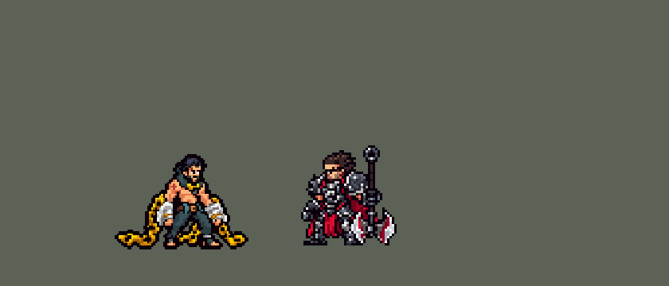

<!-- 本页上半部分由 tools/docs/gen_hero_docs.py 按仓库里现在的数据生成，手改会被覆盖；「开发记录」以下是手写的，生成时原样保留。 -->

# 塞拉斯 Sylas


| 项目 | 内容 |
|---|---|
| id | `league_sylas` |
| 所属的包 | 主包（mod_id `league`） |
| 分路 | 中单 |
| 分类 / 标签 | 刺客（Assassin） · AP / Magic / Melee / CC / Heal |
| 高清帧 | PPU 1.2 |
| 附加包 | [塞拉斯附加包](#附加包)（`league_sylas`） |



其他预览：[逐帧预览](../preview/league_sylas_frames.png)、[特效表](../preview/league_sylas_effects.png)

## 现在的技能

下面是游戏里显示的技能说明（`league/text/champion.i18n` 的简体中文，去掉了颜色和图标），冷却、距离来自 `league/champion/league_sylas.data_champion`；1 秒 = 60 tick。

### 普攻 / 被动

*攻击间隔 0.97 秒 · 攻击距离 26000*

甩链。破敌禁法：每放一个技能存一层（最多2层），有层时攻速+40%，下次普攻挥链横扫周围，20 + 35% 法强魔法伤害。弑君突刺：每9秒对英雄的普攻变成突刺，80 + 70% 法强魔法伤害，回复40 + 35% 法强生命。

### 技能1 · 锁链鞭击

*冷却 7 秒 · 施放距离 60000 · 施放：指定目标 · 敌人（不含防御塔）*

甩出两条锁链交叉于目标处，沿途敌人受到50 + 35% 法强魔法伤害并减速25%；0.6秒后交叉点爆炸，造成90 + 65% 法强魔法伤害。

### 技能2 · 潜掠/强掳

*冷却 11 秒 · 施放距离 70000 · 施放：方向 · 敌方英雄*

朝敌方英雄突进，再甩出锁链：命中的第一个敌方英雄受到80 + 70% 法强魔法伤害、被击飞0.5秒，塞拉斯把自己拉过去。

### 大招 · 其人之道

*冷却 45 秒 · 施放距离 70000 · 施放：指定目标 · 敌方英雄*

锁链命中敌方英雄，眩晕0.5秒并夺走大招；10秒内再放，在目标处爆发，200 + 80% 法强魔法伤害并击飞周围敌人。

### 数值

攻击力 78（每级 +9）、法强 50（每级 +20）、生命 980（每级 +96）、护甲 28（每级 +8）、魔抗 24（每级 +4）、移速 1100（每级 +10）。

## 附加包

附加包是可选的原生代码 mod（都在附加包合集 `league_addons` 里），**不装主包里的英雄也是完整的**。

### 塞拉斯附加包

[塞拉斯附加包](../../addons/league_sylas/README.md)：`league_sylas` v0.2.36

主包 `league` 保持纯数据。用户选了「做，含按类别偷大招+连招」，又要求「有连招要做连招」。主包的数据复制不了别的英雄的大招，也读不到当前生命，所以这两件事放在这个附加包里用原生代码做，外加连招：

- **其人之道：偷到谁就放谁的大招**（0.2.0，用户：「塞拉斯偷到谁就放谁的真大招」「只用管LOL的」）：偷到本包的英雄联盟英雄（`src/stealable.rs`，130 个）时，第二次 R 放出的就是**那名英雄自己的大招**——`make_override.py` 把主包每个英雄的大招效果树整棵抄进副本，放在 `SwitchByBuff league_sylas_steal_<英雄>` 后面（并排的一层，不是一层套一层），他大招用到的画面条目（特效、弹道、buff 的图）从他自己的列表抄过来，所以特效、音效都是对方的；对方的动作标签（ult、r_slash……）塞拉斯的图里没有，换成塞拉斯自己的 `ult_cast`（名字里有 dash / leap / jump / fly / air / hop 的换成 `ult_dash`）。被动偷到时给塞拉斯挂 `steal_<英雄>` 和 `r_real`（`r_keep` tick）；放的时候数据挂 `r_power_go`，被动给他加**法强的 `r2_ad`%（60%）当攻击**，持续 `r2_ad_t`（300）tick——照英雄联盟把偷来的大招的攻击力系数换成塞拉斯的法强（对方大招按攻击力算的伤害、治疗、护盾都跟着变强）。偷到原版英雄和别的 mod 的英雄时还是下面的五类。另有 **18 个英雄联盟英雄也按类别**（`make_override.py` 的 `BY_CLASS`）：他们的大招到了塞拉斯手里什么也不做——卡西奥佩娅、伊芙琳、普朗克、凯尔、千珏、莉莉娅、丽桑卓、莎弥拉、塔姆、蛮王、厄加特、孙悟空、基兰的 R 只是给自己挂一个「待命」标记，真正的效果由他们自己的普攻或监视去放；纳尔的 R 只有巨型能放，奥莉安娜的 R 要她的球，梅尔的 R 只打她自己叠的印记，维克兹的 R 只在他的被动正在「研究」一名英雄时才能放，希瓦娜的 R 要怒气满了或已经是龙形态才放（2026-10-21 补进表时查的；同一天加进来的奥恩、纳亚菲利、黑默丁格的 R 在塞拉斯手里照常放出，在 `stealable.rs` 里）。这是用 `tools/kit/sylas_steal_check.py` 逐个英雄跑一局经典引擎查出来的（偷到这名英雄、看有没有他自己的画面和弹道）；以后加了新英雄，重跑 `make_override.py` 后用它查一下新英雄。
  已知的偏差：对方大招里读他自己身上状态的分支（被动叠的层数、形态之类）塞拉斯身上没有，走默认的那一支；塞拉斯的 R 是指定敌方英雄放的，对方原本朝一个方向放的线会朝目标飞，原本指定地点的落在目标脚下，原本对自己放的（31 个）就放在塞拉斯身上和身边；对方动作里画进帧的特效（烘进他自己图里的刀光之类）看不到。每次放 R，引擎会把整棵大招树（142 个英雄的大招，约 2.2 MB、2.8 万个节点）复制一遍：经典引擎里每次 R 多花约 1.7 亿个 CPU 周期（约 50 毫秒），普通的 tick 不变（中位数一样），一局有塞拉斯的比赛模拟多约半秒（127 个大招、约 2.7 万个节点）。经典引擎固定偷某一名英雄的模拟（中路对五个原版法师，8 个种子；模拟跑不了原生代码，没算法强换成的攻击，按攻击力算的大招偏弱）：偷金克丝 +0.82、拉克丝 +0.67、索拉卡 +0.36、墨菲特 +2.05、劫 −1.30（同批主包塞拉斯 +0.82）——和英雄联盟一样，有的大招在他手里好用、有的一般。
- **其人之道（按类别偷大招，原版英雄和别的 mod 的英雄）**：英雄联盟里塞拉斯偷走对方的大招再放出来。主包是两段近似：第一次 R 甩链眩晕一名敌方英雄、拿到「夺来的大招」，10 秒内再放就在目标处爆发（对谁都一样）。副本里 R 的锁链打中英雄时在对方身上挂 `league_sylas_r_mark`（3 tick）；本包的被动 `league_sylas:hijack` 每 tick 找身上有这个标记的敌方英雄，按它的 id 查 `src/classes.rs`（原版英雄的表格类别和本包英雄的 `category`，`make_override.py` 用佛耶戈附加包的同一张表生成；查不到的别的 mod 英雄算近战），给塞拉斯挂 `league_sylas_cls_<类别>`（`r_keep` 600 tick），第二次 R 放出对应的那一套（伤害都是 `r2_dmg` 200 + `r2_ratio` 80% 法强）：
  - **近战**：跃到目标身上重砸，`r2_slam_r` 内的敌人受伤并眩晕 1 秒；
  - **射手**：朝目标射出贯穿长箭（`r2_alen` 120000），路上的敌人受伤并减速 40%；
  - **法师**：主包那一套，在目标处爆发、击飞周围敌人；
  - **辅助**：身边 `r2_song_r` 内的友方英雄回血（120 + 40% 法强）加护盾（100 + 30% 法强，3 秒），周围敌人受一半伤害并减速；
  - **刺客**：闪到目标身边一记重击（1.25 倍伤害）并隐身 1 秒。
  R 的说明换成 `description.league_sylas_addon.ult`（五种语言），写明五类。
- **弑君突刺**：英雄联盟里回血随已损失生命最多多 150%。副本里突刺的回血调 `league_sylas:kingslayer`：回 (`w_heal` 40 + `w_heal_r` 35% 法强) × (1 + `w_miss` 150% × 已损失生命比例)。普攻的说明换成 `description.league_sylas_addon.attack`。
- **连招**（用户：「有连招要做连招」；`src/combo.rs`）：AI 钩子 `league_sylas:combo`（优先级 110，排在 league_ult_press 之后）替游戏的 AI 按 Q、R，改普攻目标：
  - **E → Q**：强掳把他拉到英雄身上（E 放出后 `e_dur` 到 `e_dur` + 30 tick 内），Q 好了：朝离他最近的敌方英雄按 Q，锁链交叉在落点、爆炸接在击飞后面。（E → 弑君突刺在主包数据里：落地时突刺好了就马上刺。）
  - **夺来的大招挑时机**：手里有夺来的大招、R 好了：`r_range` 内有一名敌方英雄身边 `r2_r` 内还有另一名（能炸到两个），或者有生命低于 40% 的敌方英雄，就朝他按 R；AI 自己想放、但只炸得到一个满血的人、大招也还没快过期（剩 90 tick 以上）：改成普攻那个人，留着大招。
  - **残血优先**：弑君突刺好了、AI 想普攻小兵 / 野怪，而突刺够得着的地方有生命低于 40% 的敌方英雄：改成普攻那名英雄（普攻变成突刺）。
  - 被控住、正在放技能（施法动作）或被强制位移时什么都不做；格子的冷却自己看（引擎的「输入合法」不看冷却）。

## 相关脚本和素材

- [`tools/kit/build_sylas.py`](../../tools/kit/build_sylas.py)
- [`tools/kit/setup_sylas.py`](../../tools/kit/setup_sylas.py)
- [`tools/lol/extract_sylas.py`](../../tools/lol/extract_sylas.py)
- [`tools/art/preview_sylas.py`](../../tools/art/preview_sylas.py)
- [`tools/art/rig_sylas.py`](../../tools/art/rig_sylas.py)
- [`assets/source/sylas/`](../../assets/source/sylas)

## 开发记录

> 下面是原来 README 里「英雄：塞拉斯」一节，原样搬过来（只改了相对链接）。

| 部分 | 内容 |
|---|---|
| 定位 | 中单（Assassin，标签 AP / Magic / Melee / CC / Heal），第 143 位英雄。解脱者 塞拉斯：精瘦结实、赤裸上身的叛军首领，黑色长发往后梳、短黑胡子，近侧肩头一个暗红色的菱形烙印，脖子上深青灰的高领围巾和金色护颈片，两只前臂戴着很大的白色禁魔石镣铐（金边），镣铐上拖着金色的大方链，深青绿长裤、赤脚（10-17 之后分组的 E 组的中单）。用户的选择：「技能方案 A（Q / E / R，被动和 W 进普攻）」「R 两段：先偷后放」「做附加包，含按类别偷大招和连招」「有连招要做连招」。团战经理只有三个主动技能位：技能 1 = Q 锁链鞭击，技能 2 = E 潜掠/强掳，大招 = R 其人之道；被动破敌禁法和 W 弑君突刺在普攻里。技能名照英雄联盟 16.20.1 的 Data Dragon（五种语言） |
| 普攻 / 被动 / W | 甩链（射程 26000，100% 攻击，隐形的追踪一击）。**破敌禁法**：每放一个技能（Q、E、R 和弑君突刺）存一层（最多 2 层，4 秒），有层时攻速 +40%，下一次普攻改成挥链横扫：打中目标，再对身边 30000 内的敌人造成 20 + 35% 法强魔法伤害，用掉一层。**弑君突刺**：敌方英雄在 34000 内、冷却好了（9 秒）时普攻变成突刺：80 + 70% 法强魔法伤害，回复 40 + 35% 法强生命（英雄联盟里按损失生命最多多回 150%；数据读不到当前生命，附加包照英雄联盟做） |
| 技能1 | **Q 锁链鞭击**（对小兵、野怪也放，射程 60000）：两条锁链甩向目标、交叉在目标处，路上的敌人受到 50 + 35% 法强魔法伤害并减速 25%（1.5 秒）；锁链落地 0.6 秒后交叉点爆炸，半径 18000 内 90 + 65% 法强魔法伤害（一个延迟命中的圆）。冷却 7 秒 |
| 技能2 | **E 潜掠/强掳**（只对敌方英雄，射程 70000）：朝英雄冲 22000（潜掠），再甩出一条锁链（强掳），停在路上第一个敌方英雄身上：80 + 70% 法强魔法伤害、击飞 0.5 秒，把自己拉到他身上（英雄联盟里锁链会停在第一个任何敌人身上；这里只认英雄，AI 不会把它浪费在小兵上）。冷却 11 秒 |
| 大招 | **R 其人之道**（只对敌方英雄，射程 70000，两段）：英雄联盟里塞拉斯偷走对方的大招再放出来，数据复制不了别的英雄的招式，所以做成两段——**偷**：锁链飞向英雄，40 + 20% 法强魔法伤害、眩晕 0.5 秒，拿到「夺来的大招」（10 秒），大招冷却随即缩到 1.5 秒（卡兹克大招的做法）；**放**：10 秒内再按 R，在那名英雄脚下爆发：半径 32000 内 200 + 80% 法强魔法伤害并击飞 0.67 秒，之后走完整的 45 秒冷却。主包里夺来的大招对谁都一样；附加包按被偷的英雄的类别换成五种 |
| 连招 | 用户要求：「有连招要做连招」。主包数据里：**E → W**——强掳把他拉到英雄身上时弑君突刺好了就马上刺（伤害、回血、存一层破敌禁法）；每个技能都给下一下普攻存横扫。附加包的 AI 钩子替游戏的 AI 按：**E → Q**（拉过去以后朝身边的英雄甩锁链鞭击，爆炸接在击飞后面）；**夺来的大招挑时机**（能炸到两名英雄或者有残血英雄才放，只炸得到一个满血的人时改成普攻、留着大招，快过期才照 AI 的放）；**残血优先**（弑君突刺好了而 AI 想打小兵 / 野怪时，改打突刺够得着的残血英雄） |
| 附加包 | 可选的附加包 [`addons/league_sylas`](../../addons/league_sylas/README.md)（在附加包合集里，原生代码，主包不装它也完整），照英雄联盟：**偷到谁就放谁的大招**（0.2.0，用户：「塞拉斯偷到谁就放谁的真大招」「只用管LOL的」：偷到本包 129 个英雄联盟英雄时放的是那名英雄自己的大招，特效、音效都是他的，动作换成塞拉斯的，放的时候法强的 60% 当攻击、照英雄联盟换算攻击力系数；读对方自己身上状态的分支走默认的一支，烘进对方帧里的特效看不到；每次放 R 引擎复制整棵大招树，经典引擎里约 50 毫秒；另有 18 个英雄的大招只是挂「待命」标记、或者要他们自己才有的状态（梅尔的印记、奥莉安娜的球、巨型纳尔、维克兹的研究），到塞拉斯手里不起作用，也按类别）；偷到原版英雄和别的 mod 的英雄时**按类别偷大招**（R 的锁链打中谁，就按那名英雄的类别——近战 / 射手 / 法师 / 辅助 / 刺客，用佛耶戈附加包的同一张表——放出五种夺来的大招之一：近战跃到目标身上重砸眩晕，射手朝目标射出贯穿长箭减速，法师就是主包那一下爆发，辅助治疗并给身边的友方英雄加护盾、减速敌人，刺客闪到目标身边重击并隐身；R 的说明写明五类）；**弑君突刺按损失生命回血**（最多多 150%）；上面的**连招**。日志 `league_sylas.log`（SPAWN、STEAL、POWER、HEAL、E THEN Q / STOLEN R / HOLD R / W ON PREY） |
| 数值 | 攻击 78（+9）、法强 50（+20）、生命 980（+96）、护甲 28（+8）、魔抗 24（+4）、移速 1100（+10）、射程 26000 |
| 平衡 | 10 分钟经典引擎模拟，中路对五个原版法师（pyromancer / ice_mage / lightning_mage / wind_mage / white_mage），三套阵容两边各打，两批种子（1–8 / 9–16）：初稿 +1.65 / +1.20；按动作条的出手时间（甩链第 10 tick、横扫 / 突刺 / Q / 偷大招第 7 tick、夺来的大招第 17 tick）定稿 **+0.82 / +1.92**（约 +1.4，同批卡萨丁 +1.51 / +1.28）。模拟里 E 拉中后都接上了突刺，R 一局偷 8 次、放 4 次（没放的那几次 10 秒内身边没有英雄，大招照样好着）。附加包（原生代码）经典引擎跑不了，只有单元测试 |
| 精灵图（高清帧 PPU 1.2） | Codex 第 0 步画了 3/4 正面的长锁链（A）和短锁链（B）两张（只做 3/4，不做侧面；[`tools/art/pack_sylas_picture.py`](../../tools/art/pack_sylas_picture.py)：英雄联盟模型的镣铐和锁链有自己的贴图，`pose_ref.py --submesh-texture` 换上才是白石金链；读回 [`design_sylas_hd.py`](../../tools/art/design_sylas_hd.py)，大小对比 [`review_sylas_size.py`](../../tools/art/review_sylas_size.py)），用户：「A 长锁链」「38」「PPU 1.2」（46 行）。第 1 步 Codex 在游戏格子上画了三稿（[`pack_sylas_model.py`](../../tools/art/pack_sylas_model.py) / [`design_sylas_model.py`](../../tools/art/design_sylas_model.py)，按各自的格子读回、删到 46 行，脸是 Codex 原画的），用户选了 A-1（65 × 46）。动作用户选了「Codex 照骨架画关键姿势」：照英雄联盟的帧画了 16 张（[`pack_sylas_poses.py`](../../tools/art/pack_sylas_poses.py)：蓄力、甩链、挥链横扫、跃起、突刺、单膝砸地、冲刺、甩出锁链、被锁链拉过去、中招后仰、跪倒、趴倒，加 4 帧跑步，每张一具按定稿量的骨架），[`design_sylas_poses.py`](../../tools/art/design_sylas_poses.py) 按眼睛定比例读回（站着的姿势用眼睛到脚底的高度，其余用站姿的中位数）、颜色对到定稿、每张换上定稿同一个头（近侧眼睛对上 Codex 画的近侧眼睛）。[`rig_sylas.py`](../../tools/art/rig_sylas.py) 照英雄联盟的动画拼：待机（上身沉一行再起）、跑（4 帧）、普攻（蓄力 → 甩链）、横扫（蓄力 → 挥链横扫）、弑君突刺（跃起 → 突刺）、Q（跃起 → 单膝砸地）、E（冲刺 → 甩出锁链，被拉过去另一个动作）、偷大招（蓄力 → 甩出锁链）、放夺来的大招（跃起 → 砸地）、挨打、阵亡（中招后仰 → 跪倒 → 趴倒）；每个姿势身体（锁链除外）落在他的站位上方。对照英雄联盟的动画（[`review_sylas_actions.py`](../../tools/art/review_sylas_actions.py) 一张 GIF 左右对比）。选人卡片不用调（头顶在画布下 1.5 像素，宽 54 像素）。2026-10-22 用户：「塞拉斯局内也是跑的时候跳动频率太高 和之前奎桑提一个问题」：跑步每帧 110 → 150 毫秒（一圈 0.44 → 0.6 秒，奎桑提、索拉卡的做法）；主包 0.195.4、league.dll 0.7.122 |
| 特效 | 23 张特效（[`tools/art/pack_sylas_fx.py`](../../tools/art/pack_sylas_fx.py) 的提示词，颜色照英雄联盟：锁链是金色，魔法是蓝紫色的闪电，锁链鞭击的爆炸是金橙色，回血是淡蓝色；参考是英雄联盟里塞拉斯自己的贴图，[`tools/lol/fx_ref_sylas.py`](../../tools/lol/fx_ref_sylas.py)），Codex 画好按格子交回；[`import_sylas_fx.py`](../../tools/art/import_sylas_fx.py) 照技能播放的位置摆好，写成 `league_sylas_fx` 和 `league_sylas_big`（横扫、交叉点、夺来的大招爆发，附加包的重砸和治疗之歌）。交叉点的光照数据亮 0.6 秒再爆；四条飞行的锁链 / 长箭画成朝右、上下对称（游戏按飞行方向转它），别的全部左右对称（游戏不镜像特效图） |
| 音效 | 英雄联盟的音效和配音（[`tools/lol/extract_sylas.py`](../../tools/lol/extract_sylas.py)，21 段）：甩链 / 打中，横扫，突刺 / 刺中，Q 出手 / 抽中 / 爆炸，E 冲刺 / 甩链 / 命中，R 出手 / 偷到，放夺来的大招 / 爆发；Q、W、E、R、夺来的大招的配音（片段名 `league_sylas_sfx_*`，和声音名不同） |
| 图标 | 官方技能图标（锁链鞭击、潜掠/强掳、其人之道，另有弑君突刺和破敌禁法），从本地客户端取 |

重新生成（素材来自本机的英雄联盟客户端，音频不进仓库）：

```bash
python tools/lol/extract_sylas.py --lol "D:\WeGameApps\lol" --vgmstream <vgmstream-cli.exe>
python tools/kit/build_sylas.py                     # 技能数据，数字都在脚本的参数表 P 里
python tools/kit/setup_sylas.py --face 2,-31        # 五种语言的文字、音效配置、共享文件里他的键
python tools/art/design_sylas_model.py              # Codex 第 1 步的造型读回（A-1）
python tools/art/design_sylas_poses.py              # Codex 的十六个骨架姿势读回（换上定稿的头）
python tools/art/rig_sylas.py                       # 1 倍帧和 1.2 的原帧
python tools/art/ppu_restyle.py --hero sylas        # 外描边（不要加 --preview）
python tools/art/ppu_hd.py --hero sylas             # hd_ / lo_ 帧
python tools/art/import_sylas_fx.py                 # 特效
python tools/art/preview_sylas.py                   # 预览和演示 GIF
python addons/league_sylas/make_override.py         # 附加包的副本和类别表（主包的塞拉斯改了、加了新英雄就重跑）
```

美术提示词见 [`assets/source/sylas/`](../../assets/source/sylas) 里的 `PICTURE_PROMPT.md`、`MODEL_PROMPTS.md`、`POSE_PROMPTS.md`、`PROMPTS_FX.md`；Codex 的交付在 `codex_picture/`、`codex_model/`、`codex_poses/`、`codex_fx/`。

逐帧预览：[`docs/preview/league_sylas_frames.png`](../preview/league_sylas_frames.png?v=1020a)，特效：[`docs/preview/league_sylas_effects.png`](../preview/league_sylas_effects.png?v=1020a)。
