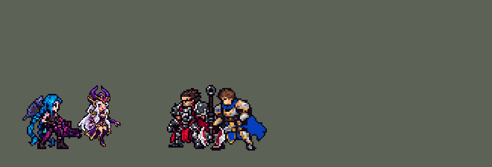

<!-- 本页上半部分由 tools/docs/gen_hero_docs.py 按仓库里现在的数据生成，手改会被覆盖；「开发记录」以下是手写的，生成时原样保留。 -->

# 辛德拉 Syndra


| 项目 | 内容 |
|---|---|
| id | `league_syndra` |
| 所属的包 | 主包（mod_id `league`） |
| 分路 | 中单 |
| 分类 / 标签 | 法师（Magician） · AP / Magic / CC / Range |
| 高清帧 | PPU 1.86 |
| 附加包 | [辛德拉举小兵附加包](#附加包)（`league_syndra`）、[游戏 AI 不按的技能替它按](#附加包)（`league_ult_press`） |



其他预览：[逐帧预览](../preview/league_syndra_frames.png)、[特效表](../preview/league_syndra_effects.png)

## 现在的技能

下面是游戏里显示的技能说明（`league/text/champion.i18n` 的简体中文，去掉了颜色和图标），冷却、距离来自 `league/champion/league_syndra.data_champion`；1 秒 = 60 tick。

### 普攻 / 被动（被动「卓尔不凡」）

*攻击间隔 1.5 秒 · 攻击距离 55000*

被动卓尔不凡：3级Q对英雄伤害+25%，5级W附带20%真实伤害，7级E范围更大，9级R的法球无视魔抗。

### 技能1 · 暗黑法球

*冷却 7 秒 · 施放距离 80000 · 施放：指定目标 · 敌人（不含防御塔）*

召唤暗黑法球，对周围敌人造成62 + 52% 法强魔法伤害。法球留在原地6秒。

### 技能2 · 弱者退散

*冷却 11 秒 · 施放距离 70000 · 施放：指定目标 · 敌人（不含防御塔）*

先用驱使念力把法球掷向敌方英雄，造成55 + 55% 法强魔法伤害并减速30%。再锥形击退敌人，造成45 + 45% 法强魔法伤害，被推开的法球使附近敌人晕眩1.25秒。

### 大招 · 能量倾泻

*冷却 70 秒 · 施放距离 75000 · 施放：指定目标 · 敌方英雄*

向一名敌方英雄发射3颗+场上法球数（最多7颗），每颗造成52 + 18% 法强魔法伤害。

### 数值

攻击力 76（每级 +7）、法强 40（每级 +20）、生命 860（每级 +92）、护甲 18（每级 +7）、魔抗 20（每级 +4）、移速 910（每级 +9）。

## 附加包

附加包是可选的原生代码 mod（都在附加包合集 `league_addons` 里），**不装主包里的英雄也是完整的**。

### 辛德拉举小兵附加包

[辛德拉举小兵附加包](../../addons/league_syndra/README.md)：`league_syndra` v0.1.1

这个附加包把主包的辛德拉换成 `override/` 里的副本（`make_override.py` 用 `tools/kit/build_syndra.py` 的 `--native` 生成：技能
一样，W 施放时在她身上挂 `league_syndra_w_grab`、在投掷目标身上挂 `league_syndra_w_at`；她身上有 `league_syndra_w_unit` 时掷出的是
一个不显示的抛物线，落点照样伤害、减速，不留法球；W 的说明多了「没有时举起附近的小兵或野怪，大小龙除外」），被动
`league_syndra:grab` 每 tick 看一次：

- 看到 `w_grab`（一次施放只处理一次）：她身上还记着法球（主包的计数 `league_syndra_o1`–`o4`）就什么都不做，数据照常掷法球
  （和英雄联盟一样法球优先）；
- 没有法球：在她身边 60000 内找最近的一个敌方小兵或野怪（不要英雄、防御塔、投掷目标本身，也不要大龙 `epic_monster`、小龙
  `serpen`），挂上 `w_unit`，把它击飞（期间不能行动），逐 tick 摆到位置上：先飞到她身前举着，第 12 tick（数据出手的那一刻）起
  16 tick 飞到目标脚下（目标走动就跟着他的位置），和数据的抛物线同时落地。

装上附加包后游戏里显示的说明（和主包不同的部分）：

- **技能2 · 弱者退散**：先用驱使念力把法球（没有时举起附近的小兵或野怪，大小龙除外）掷向敌方英雄，造成55 + 55% 法强魔法伤害并减速30%。再锥形击退敌人，造成45 + 45% 法强魔法伤害，被推开的法球使附近敌人晕眩1.25秒。

### 游戏 AI 不按的技能替它按

[游戏 AI 不按的技能替它按](../../addons/league_ult_press/README.md)：`league_ult_press` v0.5.7（通用附加包，下面只列和辛德拉有关的部分）

|  | 装了附加包，什么时候按 |
|---|---|
| 辛德拉 R | 75000 内的敌方英雄生命不到 60%、被控住，或射程内有两个以上；主包再按法球数和控制决定立刻放还是待命 8 秒（没用上退还冷却） |

## 相关脚本和素材

- [`tools/kit/build_syndra.py`](../../tools/kit/build_syndra.py)
- [`tools/kit/setup_syndra.py`](../../tools/kit/setup_syndra.py)
- [`tools/lol/extract_syndra.py`](../../tools/lol/extract_syndra.py)
- [`tools/art/preview_syndra.py`](../../tools/art/preview_syndra.py)
- [`tools/art/rig_syndra.py`](../../tools/art/rig_syndra.py)
- [`tools/art/import_syndra.py`](../../tools/art/import_syndra.py)
- [`tools/art/design_syndra.py`](../../tools/art/design_syndra.py)
- [`assets/source/syndra/`](../../assets/source/syndra)

## 开发记录

> 下面是原来 README 里「英雄：辛德拉」一节，原样搬过来（只改了相对链接）。

| 部分 | 内容 |
|---|---|
| 定位 | 中单（法师，分类 Magician），第 87 位英雄。暗黑元首 辛德拉（客户端里名字和称号两格是互换的）：Q 召唤暗黑法球砸下，法球留在原地 6 秒；W 抓起法球掷向敌人；E 推出一道锥形冲击波，被推开的法球撞到的敌人被晕眩；R 向一名敌方英雄发射 3 颗 + 场上法球数的法球；被动「卓尔不凡」按等级依次强化技能。用户选的：技能位「Q 单独 + W→E 连招」并加高手连招（QE），法球「地面区域 + 身上计数」，被动「按等级分段」，R「等球再放」 |
| 普攻 / 被动 | 远程暗黑小光弹（追踪），100% 攻击力，射程 55000，攻击间隔 90 tick（第 10 tick 放出）。被动「卓尔不凡」：英雄联盟靠收集碎片升级，数据里跨死亡的计数存不住（死亡会清掉自定义增益），改成按等级（维克托的做法：普攻顺带用护盾探针量她的攻击力，每条命开头静默重读）：3 级 Q 对英雄的伤害 +25%，5 级 W 附带 20% 的真实伤害，7 级 E 的锥形更宽（每边约 28° → 42°）、法球的晕眩范围 24000 → 30000，9 级 R 的法球无视魔抗（英雄联盟是斩杀 15% 生命以下的英雄，数据读不到生命百分比） |
| 法球 | Q 和 W 的落点各留一颗暗黑法球，持续 6 秒（360 tick）：画面是落点上的 `ViewEffect`（悬浮的球 + 地上的影子，不旋转），同一个点上还有一个看不见的区域（半径 24000）等 E 来推；她身上有 4 个计数位，每颗球占一个、6 秒后消失，R 按计数多发。引擎没法提前移除画面和区域，所以法球不会被消耗：W 掷出的是手里新凝聚的一颗（原地的球还在），R 发射的是复制出来的 |
| 技能1 | Q「暗黑法球」：冷却 420 tick（7 秒），也对小兵和野怪放，射程 80000。第 8 tick 施放，落点是目标当时的位置（会被躲开，落点上先显示凝聚的画面），0.5 秒（30 tick）后砸下：半径 20000 内的敌人受到 62 + 52% 法强的魔法伤害，法球留下 |
| 技能2 | W「驱使念力」→ E「弱者退散」：冷却 660 tick（11 秒，W 的），也对小兵和野怪放，射程 70000。85000 内有敌方英雄时：第 12 tick 把一颗法球朝他掷出（16 tick 的抛物线），半径 21000 内 55 + 55% 法强的魔法伤害、减速 30% 1.5 秒，落点留一颗法球；E 冷却好（14 秒）的话第 30 tick 接着朝同一个英雄推 E。附近没有英雄时：E 冷却好就单独放 E（清兵），否则用 W 打目标。E：她身前的锥形（70000 远、每边约 28°）45 + 45% 法强的魔法伤害并击退；2 tick 后，离她 90000 以内的每颗法球被推开：法球周围 24000 内的敌人晕眩 1.25 秒、受到 30 + 30% 法强的魔法伤害（法球的位置是真的，推的方向数据判断不了：她附近的球都算）。推波的画面是一条不打人、1000 长的线（线的画面画在线段中点，长线会画到她身前很远） |
| 举小兵附加包 | 用户：「辛德拉W的球应该要做成能举小兵和野怪吧 除了大小龙」。数据挑不出「只要小兵和普通野怪」的目标、也不能把单位挪到指定的点，所以主包的 W 总是掷出手里凝聚的法球。可选的附加包 [`addons/league_syndra`](../../addons/league_syndra/README.md)（在附加包合集里，原生代码，主包不装它也完整）：她身上记着法球时照常掷法球（和英雄联盟一样法球优先）；没有法球时举起她身边 60000 内最近的敌方小兵或野怪（不举英雄、防御塔、大龙和小龙），击飞着摆到她身前，出手那一刻和数据的抛物线一起飞到目标脚下，落点照样伤害、减速，不留法球。附加包里的辛德拉是 `make_override.py` 从主包生成的副本，W 多了给附加包看的标记，说明里加上「没有时举起附近的小兵或野怪，大小龙除外」 |
| 大招 | R「能量倾泻」：冷却 4200 tick（70 秒），对英雄放，射程 75000。身上计到 2 颗以上法球（发 5 颗），或射程内有被控制住的英雄（E 晕住的），就立刻放；否则待命 8 秒，期间每 10 tick 看一次，3 秒后有英雄在射程内就放，没用上退还冷却。第 14 tick 起每 5 tick 发一颗追踪法球，共 3 + 法球数（最多 7 颗），每颗 52 + 18% 法强的魔法伤害 |
| 附加包（替 AI 按） | 可选的附加包 [`addons/league_ult_press`](../../addons/league_ult_press/README.md)（在附加包合集里，原生代码，主包不装它也完整）：游戏 0.6.4 的 AI 很少按她的 R（只读观察包：每 10 分钟 0.7 次，246 局）。附加包按局面替 AI 按（用户：「有问题的英雄全部改成rust」）：75000 内的敌方英雄生命不到 60%、被控住，或射程内有两个以上（生命比例最低的在前）；立刻放还是待命由主包按法球数和控制决定 |
| 高手连招 | 用户：「Q单独 + W→E连招（推荐）」，加高手连招，只写在技能数据和这里，不写进技能说明。**QE**：E 冷却好、射程内有敌方英雄时，Q 砸向这个英雄，落下后紧接着 E，把刚落下的法球推进他身上（英雄联盟的远程晕眩）；**W→E**：法球掷到英雄脚下后马上推；**晕住接 R**：大招待命时先找被控制住的英雄 |
| 数值 | 攻击 76（+7）、法强 40（+20）、生命 860（+92）、护甲 18（+7）、魔抗 20（+4）、移速 910（+9）。数值是自己设计的，用 SDK 对战模拟调：中路，对 5 个原版法师（`pyromancer`、`ice_mage`、`lightning_mage`、`wind_mage`、`white_mage`），3 套阵容、两边各打，10 分钟。初稿 +1.43 / +1.22（同批维克托 +1.44 / +1.52、泽拉斯 +1.44）；Q 60 + 50% → 62 + 52%、R 每颗 50 + 17% → 52 + 18% 后 +2.03 / +1.41 |
| 亚索联动 | E 推开的法球的晕眩算控制：辛德拉在亚索队里打中路时，亚索每局对英雄放 R 1.85 次（原版闪电法师 3.40、布兰德 1.58），不用调 |
| 精灵图 | 9 个动作 49 帧：待机 8（悬浮，整个人上下 0–2 行）、移动 8（飘行，起伏两次、垂下的靴子拖在后面）、普攻 5、Q（`skill`）4、W（`skill2`）5、E（`skill2_e`）4、R（`ult`）5（浮起 2 行）、受击 2、死亡 8（从悬浮坠落、跪坐下去，英雄联盟的死亡动作）。造型 26 × 42 px（角尖到最低的脚尖），22 色。头像截取点 (−1, −39)，选人卡片中心 −9 |
| 特效 | Codex 画的 17 张，按游戏尺寸交付，两张表 `league_syndra_fx` / `league_syndra_big`：普攻的暗黑小光弹和命中，Q 落点的凝聚、砸下的爆发、命中、留在地上的法球（12 帧 6 秒），W 掷出的法球、落地冲击、命中、减速，E 往前推的锥形冲击波（画在格子右半边，从她身上往外）、命中、法球撞人后的晕眩，R 聚在她身边的七颗法球、飞出的法球、命中，被动升级的暗紫光。颜色照英雄联盟：法球是近黑的深紫球体、外圈亮紫、洋红边光 |
| 音效 | 英雄联盟的音效和配音（`tools/lol/extract_syndra.py`）：光弹、命中，Q 凝聚、砸下，W 抓取、掷出、落地，E 施放、推球、晕眩，R 施放、发射、命中，被动升级；Q、W、E、R 的中文配音（Q、W、E 在英雄联盟里共用一组台词，取了三句；片段名 `league_syndra_sfx_vo_*`，和声音名不同）。版权属于 Riot Games，**不提交到仓库**，按下面的命令在本地生成 |
| 图标 | 官方技能图标（Q / E / R），从本地客户端提取，缩到 64×64 |
| 高清帧（PPU 1.857） | 2026-10-27 用 PPU 重做（用户：「接下来可以重做辛德拉」「就用原样 1.86」）。设计图：Codex 照她的旧精灵描密的图（第三稿，按原图约 16 像素一格读回，54 × 78 格；78 行 / 1.857 = 原来的 42 像素，`design_syndra_hd.py`）。动作：旧版每一帧都是待机图整体平移（悬浮上下、R 升起、受击后退、死亡下沉），只重画了远侧的手或腿，所以新版也这样拼（`rig_syndra_hd.py`）：每帧是设计图按旧帧的平移 × 1.857，远侧的手（抬到肩、过肩、腰间推出、悬浮最高点）取自 Codex 画的姿势图（`casts_syndra_hd.py` 读回到设计图的格子上），跑步时下面那只长靴往后摆、死亡时身体沉下压在靴子上用设计图自己的腿（Codex 画的腿连裙摆一起改了，拼不上）。脸、头发、身体每帧和设计图一格不差，不会闪。高 42 像素和原来一样，没有 SIZES 行；头像点、选人卡片值不变 |

重新生成（素材来自本机的英雄联盟客户端，音频不进仓库）：

```bash
python tools/lol/extract_syndra.py --lol "D:\WeGameApps\lol" --vgmstream "<vgmstream-cli.exe 路径>"
python tools/kit/build_syndra.py            # 技能数据，数字都在脚本的参数表 P 里；--nodes 看每棵技能树的节点数
python tools/kit/setup_syndra.py            # 五种语言的文字、音效配置、共享文件里她的键（头像点和选人卡片点也在里面）
python tools/art/design_syndra.py --final   # 造型：Codex 第三稿按蛮王的做法删到 42 行，再加用户指出的修补（FIXES）
python tools/lol/native_pose.py assets/source/syndra/poses.json --out <渲染文件夹>   # 动作参考帧（英雄联盟原动作）
python tools/art/rig_syndra.py              # 动作：用定稿自己的部件摆出全部 49 帧
python tools/art/import_native.py --hero syndra   # 精灵
python tools/art/import_syndra.py           # 特效
python tools/art/preview_syndra.py          # 逐帧预览、特效预览、演示 GIF
# PPU 1.857 重做（2026-10-27）：
python tools/art/pack_syndra_ppu.py --out <文件夹>        # 给 Codex 的设计图包（照她的旧精灵描密）
python tools/art/design_syndra_hd.py                    # Codex 的图（hd/raw/syndra-A.png）按自己的格子读回 -> hd/design.png
python tools/art/pack_syndra_actions.py --out <文件夹>    # 给 Codex 的动作包（9 个姿势：远侧的手 / 腿）
python tools/art/casts_syndra_hd.py --measure           # 每个姿势的放大倍数（按头量）
python tools/art/rig_syndra_hd.py                       # 设计图按旧帧平移、远侧的手取自姿势图 -> 原始条和 1 倍图
python tools/art/ppu_restyle.py --hero syndra && python tools/art/ppu_hd.py --hero syndra
python tools/art/ppu_one.py --hero syndra && python tools/art/rig_syndra_hd.py --one-ground && python tools/art/hero_reels.py --hero syndra
python tools/art/review_syndra_actions.py --out <文件夹>  # 旧版 / 新版对照动图
python addons/league_syndra/make_override.py   # 举小兵附加包的副本（主包的辛德拉改了就重跑）
```

美术（造型、动作、特效的提示词见 [`assets/source/syndra/`](../../assets/source/syndra) 里的 `PICTURE_PROMPT.md`、`MODEL_PROMPTS.md`、`MODEL_STRIPS.md`、`PROMPTS_FX.md`；Codex 的交付在 `codex_picture/`、`codex_model/`、`codex_strips/`、`codex_fx/`）：

- 原画：Codex 画了英雄联盟待机（A，两臂向下张开）和一手举起（B）两版，用户选 A。
- 造型：Codex 自己整理的 A / B 只删了行、没删列，偏胖。先按赛娜的做法从第三稿均匀删到几档（用户选 3_42），用户指出眼睛旁的脏黑点和缺色素，说「之前蛮王什么的弄的不是挺好的吗 就按照那种方式」：改用蛮王的做法（原稿按自己的格子读回、用原稿自己的 24 色、每组删掉和邻行最像的那行、脸不删、只补描边），用户选「第三稿→42」。之后按用户的截图逐格修补：眼睛旁一块黑、左腿缺的一格、腿上大腿和靴口各一格；全身扫一遍「把同一种颜色截断的黑格」，补上头盔金边 4 格、额头 1 格、头发 3 格；描边里 3 个透出地面的小洞补成描边色。脸照用户选的方案 A：发光的洋红眼（中心白亮、外下角一抹深红）、远侧睫毛补成两格、深紫红的闭唇。
- 动作：Codex 用定稿部件拼的帧，手臂按任意角度转（像素变形），左臂挪开后露出的头发被平涂成一块浅灰，六帧左手藏到身体后面，死亡第 3 帧整个人斜转 45°，跑动帧有说不清的改动。用户：「有问题的帮我修复 做到完美了喊我review」。`rig_syndra.py` 按蛮王、霞的刚体部件规则重摆：左臂盖在长发上，一挪开就要凭空补头发，所以不动；右臂（Codex 切好的 26 格）只用 5 个无损姿势（下垂、转置的陡垂、整转 90° 上举、上下翻转的斜上、整列平移的平伸）；其余靠整个人前后挪、上下浮；待机是悬浮（`import_native` 的自动呼吸会删腿部的行，对她关掉）；跑动是飘行；死亡照英雄联盟坠落跪坐（垂下那条靴子删掉 4 行，脚尖不动）。每帧审计：一整块、没有洞、头和定稿逐像素一致。
- 特效：17 张按要求的格子画好，直接读回、逐格检查对称。掷出的法球和 R 的法球，Codex 为了上下对称把第 1、2 格拼成了上下两个半球，只用干净的第 3、4 格交替播放。

逐帧预览：[`docs/preview/league_syndra_frames.png`](../preview/league_syndra_frames.png?v=1027hd)，特效：[`docs/preview/league_syndra_effects.png`](../preview/league_syndra_effects.png?v=1014g)。
