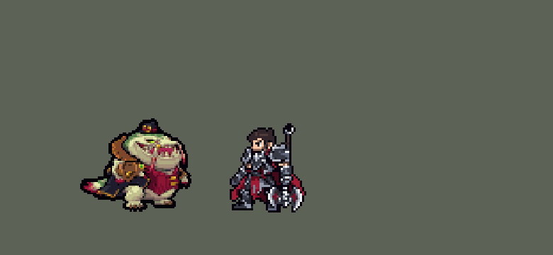

<!-- 本页上半部分由 tools/docs/gen_hero_docs.py 按仓库里现在的数据生成，手改会被覆盖；「开发记录」以下是手写的，生成时原样保留。 -->

# 塔姆 Tahm Kench


| 项目 | 内容 |
|---|---|
| id | `league_tahmkench` |
| 所属的包 | 主包（mod_id `league`） |
| 分路 | 辅助 |
| 分类 / 标签 | 功能型（Util） · AP / Magic / Melee / Tank / CC / Shield |
| 高清帧 | PPU 1.2 |
| 附加包 | [塔姆附加包](#附加包)（`league_tahmkench`） |



其他预览：[逐帧预览](../preview/league_tahmkench_frames.png)、[特效表](../preview/league_tahmkench_effects.png)

## 现在的技能

下面是游戏里显示的技能说明（`league/text/champion.i18n` 的简体中文，去掉了颜色和图标），冷却、距离来自 `league/champion/league_tahmkench.data_champion`；1 秒 = 60 tick。

### 普攻 / 被动

*攻击间隔 1.33 秒 · 攻击距离 28000*

培养品味：普攻额外造成30 + 2%最大生命魔法伤害，普攻、Q、W命中英雄叠一层，最多3层。厚实表皮：受到伤害降低15%，被两名敌方英雄围住时获得160 + 80% 法强护盾。

### 技能1 · 巨舌鞭笞

*冷却 6 秒 · 施放距离 60000 · 施放：指定目标 · 敌人（不含防御塔）*

舌头鞭打第一个单位，造成170 + 60% 法强 + 2%最大生命魔法伤害，减速40%1.5秒；命中英雄回复40 + 30% 法强生命并叠一层，3层时眩晕1.25秒。

### 技能2 · 深渊潜航

*冷却 1 秒 · 施放距离 70000 · 施放：指定目标 · 刚交过手的敌方英雄*

潜入地下1秒（不可选中），在目标处冒出，造成160 + 70% 法强 + 2%最大生命魔法伤害并击飞1秒。

### 大招 · 大快朵颐

*冷却 60 秒 · 施放距离 50000 · 施放：指定目标 · 敌方英雄*

吞下被控制、身陷敌群的队友2.5秒，吐出时给予150 + 100% 法强护盾；或吞下3层的敌方英雄2.5秒，造成220 + 50% 法强 + 3%最大生命魔法伤害和其最大生命6%真实伤害。

### 数值

攻击力 85（每级 +6）、法强 25（每级 +15）、生命 1900（每级 +120）、护甲 55（每级 +7）、魔抗 32（每级 +4）、移速 1000（每级 +10）。

## 附加包

附加包是可选的原生代码 mod（都在附加包合集 `league_addons` 里），**不装主包里的英雄也是完整的**。

### 塔姆附加包

[塔姆附加包](../../addons/league_tahmkench/README.md)：`league_tahmkench` v0.1.2

|  | 主包（纯数据） | 装了附加包 |
|---|---|---|
| 培养品味的层数 | 数他自己最近打中英雄的次数（换目标不清零），鱼标记画在被打的人头上 | **每个敌方英雄各自记层**（最多 3 层，5 秒），鱼标记按那个人自己的层数画 |
| 巨舌鞭笞打 3 层的人 | 大招上膛时留着层数，否则眩晕 | **大招冷却好了就留着层数给大招吞**，否则眩晕并吃掉层数 |
| 厚实表皮 | 固定少受 15% 伤害；被两名敌方英雄围住时给一个固定护盾 | **真的灰色生命**：受到伤害的 30% 存起来（最多最大生命的一半），3 秒没挨英雄打就慢慢回成生命；被两名敌方英雄围住、或生命低于 40% 且身边有敌人时，把存的全部加 160 + 80% 法强变成护盾（冷却 12 秒） |
| 大快朵颐吞谁 | 上膛后：被控住、身边有两个敌人的队友；没有就吞叠满 3 层的敌人 | **按真实生命判断**：生命低于 35% 且附近有敌人、或 1 秒内掉了四分之一以上生命、或被控住且身边两个敌人的队友（生命最低的先）；没有就吞近身 3 层的敌人；都没有就不放（改成普攻） |
| 吞着人的时候 | 塔姆照常打；被吞的人在被吞的地方吐出来 | 吞着队友**往远离敌人的方向走**，吞着敌人**往队友那边走**；吐出时把人放到他身边（队友在他背后，敌人在他前面） |
| 深渊潜航 | 身边一个队友且目标被控，或身边两个以上队友 | 同样的条件，再加上**落点附近的敌方英雄不多于身边队友加一**、**他自己生命不低于 30%**；不放时改成普攻或回到队友身边 |

## 相关脚本和素材

- [`tools/kit/build_tahmkench.py`](../../tools/kit/build_tahmkench.py)
- [`tools/kit/setup_tahmkench.py`](../../tools/kit/setup_tahmkench.py)
- [`tools/lol/extract_tahmkench.py`](../../tools/lol/extract_tahmkench.py)
- [`tools/art/preview_tahmkench.py`](../../tools/art/preview_tahmkench.py)
- [`tools/art/rig_tahmkench.py`](../../tools/art/rig_tahmkench.py)
- [`assets/source/tahmkench/`](../../assets/source/tahmkench)

## 开发记录

> 下面是原来 README 里「英雄：塔姆」一节，原样搬过来（只改了相对链接）。

| 部分 | 内容 |
|---|---|
| 定位 | 辅助（Util，标签 AP / Magic / Melee / Tank / CC / Shield），第 110 位英雄。河流之王 塔姆（客户端里名字和称号是反着的，按官方）：近战坦克辅助，舌头抽人叠「培养品味」，吞队友救命、吞敌人带走。用户的选择：按现在的英雄联盟排技能（方案 A）——技能 1 = Q 巨舌鞭笞，技能 2 = W 深渊潜航，大招 = R 大快朵颐，E 厚实表皮不占技能位、并进被动；附加包要；用户：「塔姆的R救队友的时候灵活判断 别乱放」「W也别乱放 看好时机懂了吗」；高清 PPU 1.8，进游戏前嫌太高清，改 1.5，再改 1.2 |
| 普攻 / 被动 | 舌头抽打（近战，攻击距离 28000，攻击间隔 80 tick，第 11 tick 打中），附带 30 + 2% 最大生命魔法伤害。「培养品味」：普攻、Q 打中英雄、W 落地打中英雄叠一层（最多 3 层，5 秒，叠新的刷新），层数画成目标头上的小鱼。**厚实表皮**：一直少受 15% 伤害（存成灰色生命的那部分）；他出手时身边 35000 内有两个以上敌方英雄，就把它变成 160 + 80% 法强的护盾（2.5 秒，冷却 12 秒） |
| 技能1 | Q「巨舌鞭笞」：冷却 360 tick，对 60000 内的敌人放（小兵、野怪也打）。第 15 tick 吐出舌头，飞向目标 8 tick 前站的地方（能躲，凯特琳 Q 的锁定），打中第一个单位：170 + 60% 法强 + 2% 最大生命魔法伤害，减速 40%（1.5 秒）。打中的是英雄时他回 40 + 30% 法强的生命、目标叠一层；3 层时眩晕 1.25 秒并吃掉层数——大招上膛时不吃，留给大招吞（Q→R） |
| 技能2 | W「深渊潜航」：冷却 900 tick，只在**时机对**的时候放（用户：「W也别乱放 看好时机」）：目标是 70000 内正在交战的敌方英雄，身边 50000 内只有一个队友时要那个英雄正被控住（接击飞），两个以上队友时直接放，没有队友不放。潜下去（18 tick）后放逐 60 tick（谁也选不中他），目标潜下时站的地方冒气泡和红圈，他从那里冲出来：160 + 70% 法强 + 2% 最大生命魔法伤害、半径 14000 击飞 1 秒，打中的英雄叠一层 |
| 大招 | R「大快朵颐」：冷却 3600 tick。数据读不到当前生命，所以大招槽只是「上膛」（凯尔大招的做法）：上膛 15 秒，期间每次出手都检查——① 40000 内有被控住的队友，而他身边 50000 内站着两个以上敌方英雄：吞下那个队友，放逐 2.5 秒（谁也打不到），吐出来时给 150 + 100% 法强的护盾（3 秒）；② 否则身边 30000 内有叠满 3 层、正在交战的敌方英雄：吞下他，放逐 2.5 秒，220 + 50% 法强 + 3% 塔姆最大生命魔法伤害、外加目标 6% 最大生命真实伤害，吃掉层数；③ 都没有就不吞（用户：「别乱放」），窗口结束时把冷却截到 1 秒，下次再上膛 |
| 附加包 | 可选的附加包 [`addons/league_tahmkench`](../../addons/league_tahmkench/README.md)（在附加包合集里，原生代码，主包不装它也完整）：**每个敌方英雄各自记层**；**真的灰色生命**（受到伤害的 30% 存起来，3 秒没挨英雄打慢慢回成生命，被围或残血时全部加 160 + 80% 法强变成护盾）；**大招按真实生命判断吞谁**（生命低于 35% 且附近有敌人、1 秒内掉了四分之一以上生命、或被控住且身边两个敌人的队友，生命最低的先；没有就吞近身 3 层的敌人；都没有不放）；**吞着人走位**（吞着队友远离敌人，吞着敌人往队友那边走，吐出时队友在他背后、敌人在他面前）；**W 再看落点**（落点附近的敌方英雄不多于身边队友加一、他自己生命不低于 30%）。日志 `league_tahmkench.log`。还没在游戏里看过日志 |
| 数值 | 攻击 85（+6）、法强 25（+15）、生命 1900（+120）、护甲 55（+7）、魔抗 32（+4）、移速 1000（+10） |
| 平衡 | 辅助位对五个基础辅助（priest / monk / bard / pythoness / spirit_caller），三套阵容、两边各打，10 分钟经典引擎模拟：定稿 b4 种子 1–12 −0.76、25–36 −0.77（同批布隆 −0.26 / +0.05，坦克辅助本来就在负数）。草案（照布隆起步）−4.1；W 改成看时机之后的 g6 −0.85，按帧重新对时间（Q 晚 4 tick）掉到 −1.55 / −2.42；b4 加生命、护甲、Q / W / 被动 / 大招伤害和厚实表皮的护盾拉回来。只加坦度（b1）−0.92 / −1.32、只加伤害（b2）−1.16 / −1.91；再加生命护甲（b5）−1.07、缩 Q 和大招冷却（b6）−0.91，都不如 b4（试过的几组在 `tools/kit/build_tahmkench.py` 的注释里） |
| 精灵图（高清帧 PPU 1.2） | Codex 第 0 步画了两张原画（A 英雄联盟的待机、得意的笑；B 张大嘴），用户选 A；[`tools/art/design_tahmkench_hd.py`](../../tools/art/design_tahmkench_hd.py) 按 Codex 自己的格子读回（约 8 px 一格，帽顶到脚底 125 格）。第 1 步的动作 Codex 额度用完了（用户：「codex额度不够了 你能画吗？用点工具和技术 然后弄到完美了喊我review」），[`tools/art/rig_tahmkench.py`](../../tools/art/rig_tahmkench.py) 用定稿自己的像素摆：只做无损的整块平移、四分之一旋转、整列错位和图层（不变形），张嘴是把嘴线以上（帽子、眼睛、鼻子、上牙、两条胡须）整体抬起、下巴不动，嘴里填嘴自己的品红；舌头沿折线用胡须的粉色画。待机 8、跑步 8（摇摆着走，两条短腿隔 39 格交替抬脚，尾巴摆）、普攻 5、Q 5、W 潜下 4、W 冲出 4、大招 5、受击 2、死亡 6。用户看过游戏大小：「感觉太高清了 降低点像素」→ 1.5 →「降到1.2吧」；1.2 下眼睛和金扣保留原色（缩小时按占比保住），`ppu_restyle.py` 加一格描边。2026-10-19 补帧（对照英雄联盟的动作）：普攻、Q、R 身体只前后动 2–3 格（不到一个游戏像素），幅度放大约三倍、各 6 帧；新增 `r_spit`（英雄联盟的 spit：吞下的人被吐出来时他张嘴前扑，数据在吐出那一刻播，放在只找得到活着的他的搜索里，死了不会爬起来吐）；死亡 8 帧 |
| 特效 | Codex 画的 19 张特效（用户贴在对话里，`assets/source/tahmkench/codex_fx/pasted`）。[`tools/art/import_tahmkench_fx.py`](../../tools/art/import_tahmkench_fx.py) 按提示词的格子读回：每格取像素均值往最亮的四分之一推、归到那张特效的色阶；整条特效按所有帧的画面一起定位（不会逐帧跳），舌头的尖对准落点，要对称的左右（舌头上下）镜像给红方用。W 的红圈 Codex 画成俯视的正圆，压扁到 0.38；水柱画高了一倍、护盾高了一些，压到 0.5、0.75；眩晕的星星画了两排，只取上排。写成 `league_tahmkench_fx`（舌头、打中、眩晕、回血、减速、三层小鱼、护盾、吞下、肚子里、吐出）和 `league_tahmkench_big`（潜下、红圈、冲出的水柱） |
| 音效 | 英雄联盟的音效和配音（[`tools/lol/extract_tahmkench.py`](../../tools/lol/extract_tahmkench.py)，18 段）：抽打出手 / 打中、叠层、Q 出手 / 打中 / 眩晕 / 回血、W 潜下 / 气泡 / 冲出、厚实表皮护盾、R 吞敌人 / 吞队友 / 吐出，配音 Q / W / E / R |
| 图标 | 官方技能图标（Q 巨舌鞭笞 / W 深渊潜航 / R 大快朵颐，另有 E 厚实表皮、被动培养品味），从本地客户端取 |

重新生成（素材来自本机的英雄联盟客户端，音频不进仓库）：

```bash
python tools/lol/extract_tahmkench.py --lol "D:\WeGameApps\lol" --vgmstream <vgmstream-cli.exe>
python tools/kit/build_tahmkench.py                # 技能数据，数字都在脚本的参数表 P 里
python tools/kit/setup_tahmkench.py --face -1,-36 --banpick -8   # 五种语言的文字、音效配置、共享文件里他的键
python tools/art/design_tahmkench_hd.py            # Codex 的原画读回成两张造型
python tools/art/rig_tahmkench.py                  # 用造型摆的动作：1 倍帧和 1.2 的高清帧
python tools/art/ppu_restyle.py --hero tahmkench   # 描边
python tools/art/rig_tahmkench.py --pinholes       # 补小洞
python tools/art/ppu_hd.py --hero tahmkench        # hd_ / lo_ 帧
python tools/art/import_tahmkench_fx.py            # 特效
python tools/art/preview_tahmkench.py              # 预览和演示 GIF
python addons/league_tahmkench/make_override.py    # 附加包的副本（主包的塔姆改了就重跑）
```

美术提示词见 [`assets/source/tahmkench/`](../../assets/source/tahmkench) 里的 `PICTURE_PROMPT.md`、`MODEL_STRIPS.md`（Codex 额度用完没画，动作是 `rig_tahmkench.py` 摆的）、`PROMPTS_FX.md`；Codex 的交付在 `codex_picture/`、`codex_fx/`。

逐帧预览：[`docs/preview/league_tahmkench_frames.png`](../preview/league_tahmkench_frames.png?v=1016a)，特效：[`docs/preview/league_tahmkench_effects.png`](../preview/league_tahmkench_effects.png?v=1016a)。
