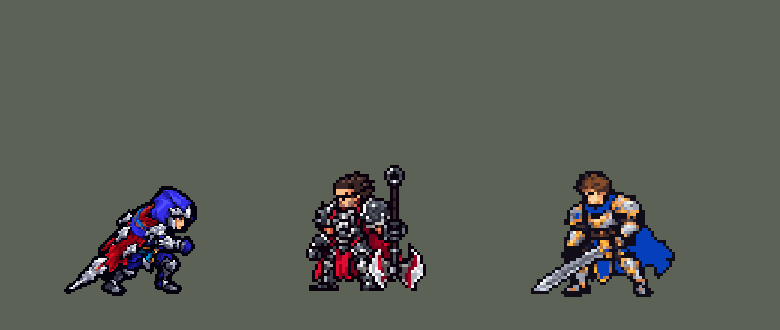

<!-- 本页上半部分由 tools/docs/gen_hero_docs.py 按仓库里现在的数据生成，手改会被覆盖；「开发记录」以下是手写的，生成时原样保留。 -->

# 泰隆 Talon


| 项目 | 内容 |
|---|---|
| id | `league_talon` |
| 所属的包 | 主包（mod_id `league`） |
| 分路 | 中单 |
| 分类 / 标签 | 刺客（Assassin） · AD / Melee |
| 高清帧 | PPU 2.21 |
| 附加包 | [泰隆「刺客之道」翻墙附加包](#附加包)（`league_talon_vault`） |



其他预览：[逐帧预览](../preview/league_talon_frames.png)、[特效表](../preview/league_talon_effects.png)

## 现在的技能

下面是游戏里显示的技能说明（`league/text/champion.i18n` 的简体中文，去掉了颜色和图标），冷却、距离来自 `league/champion/league_talon.data_champion`；1 秒 = 60 tick。

### 普攻 / 被动

*攻击间隔 0.92 秒 · 攻击距离 23000*

腕刃攻击。刀锋之末：技能命中英雄叠一层伤口，叠满3层后下次普攻使其流血，2秒内受到40 + 120% 攻击力伤害。刺客之道（自动，10秒）：收刀或Q击杀时身边有2名敌方英雄，就翻身跃开并加速。

### 技能1 · 斩草除根

*冷却 9 秒 · 施放距离 50000 · 施放：指定目标 · 敌人（不含防御塔）*

扇形掷出飞刀造成30 + 40% 攻击力伤害，随后飞刀收回，造成40 + 70% 攻击力伤害并减速40%。

### 技能2 · 诺克萨斯式外交

*冷却 5 秒 · 施放距离 40000 · 施放：指定目标 · 敌人（不含防御塔）*

跃向目标造成48 + 100% 攻击力伤害；目标就在身边时改为原地捅刺，造成150%暴击伤害。击杀目标回复60生命并返还冷却。

### 大招 · 暗影突袭

*冷却 50 秒 · 施放距离 30000 · 施放：指定目标 · 敌方英雄*

向四周甩出一圈飞刀造成55 + 75% 攻击力伤害，随后隐身2.5秒、移速+40%；隐身结束或攻击时飞刀收回，再次造成同样伤害。

### 数值

攻击力 122（每级 +25）、生命 930（每级 +88）、护甲 26（每级 +8）、魔抗 18（每级 +4）、移速 1100（每级 +13）。

## 附加包

附加包是可选的原生代码 mod（都在附加包合集 `league_addons` 里），**不装主包里的英雄也是完整的**。

### 泰隆「刺客之道」翻墙附加包

[泰隆「刺客之道」翻墙附加包](../../addons/league_talon_vault/README.md)：`league_talon_vault` v0.1.4

|  | 主包（纯数据） | 装了附加包（照英雄联盟） |
|---|---|---|
| 什么时候翻 | 收刀或 Q 击杀时身边有 2 名敌方英雄 | 照旧，另外：残血（低于 35%）而身边有敌方英雄，或被围（身边敌方英雄 ≥ 2、比身边友方多、生命低于 70%）时；残血敌方英雄（≤ 60%）躲在墙后、他自己生命 ≥ 40% 时 |
| 往哪翻 | 空地上背向一名敌人跃开 36000 | **翻过墙**：撤离时找背向敌人、16000 内的墙翻到另一边（落地后离敌人最远的那处）；追击时朝目标左右 35° 内找墙翻过去，落点要近 15000 以上、不翻进人堆 |
| 冷却 | 10 秒 | 同一个冷却（主包的 `league_talon_e_cd`），两种翻越不会连着出 |

## 相关脚本和素材

- [`tools/kit/build_talon.py`](../../tools/kit/build_talon.py)
- [`tools/kit/setup_talon.py`](../../tools/kit/setup_talon.py)
- [`tools/lol/extract_talon.py`](../../tools/lol/extract_talon.py)
- [`tools/art/preview_talon.py`](../../tools/art/preview_talon.py)
- [`tools/art/import_talon.py`](../../tools/art/import_talon.py)
- [`tools/art/design_talon.py`](../../tools/art/design_talon.py)
- [`assets/source/talon/`](../../assets/source/talon)

## 开发记录

> 下面是原来 README 里「英雄：泰隆」一节，原样搬过来（只改了相对链接）。

| 部分 | 内容 |
|---|---|
| 定位 | 中单（刺客，分类 Assassin），第 83 位英雄。刀锋之影 泰隆：飞刀叠伤口、跃击收割、隐身刀圈。用户选中单、完整还原 + 高手连招 |
| 普攻 / 被动 | 腕刃前刺，射程 23000，攻击间隔 55 tick，第 7 tick 刺中。被动「刀锋之末」：技能命中英雄叠一层伤口（W 去程、W 回程、Q、R 出刀 / 收刀各算一次，5 秒），叠满 3 层后下一次普攻让他流血：2 秒内 40 + 120% 攻击力物理伤害，之后 10 秒冷却。数据读不到目标身上的层数，所以层数记在泰隆自己身上（劫被动的写法），敌人头顶画伤口标记。打塔：原来普攻那一下由一颗只作用于非防御塔敌人的追踪投射物打出，对塔挥手一点伤害都没有（玩家：「劫的平A没办法攻击防御塔」）；2026-10-17 起命中也作用于防御塔。经典模拟里四位英雄原来对塔出手 66 次、打中 0 次，现在 69 次里打中 57 次（其余被打断或换成了技能） |
| 刺客之道（自动） | E 没有技能位；主包是纯数据，读不到地图的墙，所以主包里改成撤离：W 收刀或 Q 击杀时 40000 内有 2 名敌方英雄，就背向其中一个翻身跃开（36000）并移速 +30% 1.5 秒，冷却 10 秒 |
| 翻墙附加包 | 可选的扩展包 [`addons/league_talon_vault`](../../addons/league_talon_vault/README.md)（在附加包合集里，原生代码，主包不装它也完整）读地图的墙（5v5 野区的 90 格碰撞墙）：残血而身边有敌方英雄、或被围（敌方英雄比身边友方多、生命低于 70%）时，翻过身后 16000 内的墙撤离；残血（≤ 60%）的敌方英雄躲在墙后时翻墙追过去（不翻进人堆）。和主包的空地翻越共用 10 秒冷却，动作、弧光、音效、加速都是主包的 |
| 技能1 | W「斩草除根」：冷却 540 tick（9 秒），射程 50000（也对小兵和野怪放）：一扇刀刃飞出 55000，沿途 30 + 40% 攻击力；停 6 tick 后飞回泰隆，沿途 40 + 70% 攻击力并减速 40% 1 秒 |
| 技能2 | Q「诺克萨斯式外交」：冷却 300 tick（5 秒），射程 40000（也对小兵和野怪放）：26000 内有敌人就原地回旋斩（150% 暴击），否则跃向目标刺击，48 + 100% 攻击力；击杀回复 60 生命并返还一半冷却 |
| 大招 | R「暗影突袭」：冷却 3000 tick（50 秒），只对敌方英雄放：一圈刀刃向周围 30000 甩出（55 + 75% 攻击力），隐身 2.5 秒、移速 +40%；隐身结束、普攻或 Q 命中时刀刃飞回，再造成一次同样的伤害。画面照英雄联盟：刀刃 11 tick 飞到半径 30000 的圈上，**在出招的地方围成一圈悬停整个隐身期间**（他走开了刀圈也留在原地），收刀时刀刃从圈上飞回、收拢到他身上。刀圈是艾克 R 的落点（`r_anchor`，速度 1、射程 1 的投射物，不打任何人）：落点的 `end_effects` 里每 6 tick 一块刀圈画面（`r_ring0`–`r_ring3`，100 ms，刀刃一排排轮流亮起），`r_on` 在才播，收刀把 `r_on` 去掉，刀圈最多 6 tick 后消失。没有投射物能朝任意角度飞（直线投射物只飞向目标），所以八把刀是画面、不是八个投射物；伤害和以前完全一样（数据除了刀圈画面逐项不变） |
| 高手连招 | **W → Q**：Q 就绪时斩草除根出手后直接跃击，刀刃回程时人已经贴脸（去程、跃击、回程三层伤口，下一刀流血）；**R → 普攻 / Q**：隐身后出刀立刻收刀；**刺客之道**：收割完被包围就翻身撤离 |
| 数值 | 攻击 122（+25）、生命 930（+88）、护甲 26（+8）、魔抗 18（+4）、移速 1100（+13）。数值是自己设计的，用 SDK 对战模拟调：中单，对 5 个原版法师，种子 1–12 和 25–36 各 12 局、10 分钟。初稿 +1.12 / +1.92；按动作条对准出手时间后 +2.09 / +2.20，Q 降到 48、W 回程降到 40：+1.53 / +1.74（同期阿卡丽 +1.30 / +2.03、乐芙兰 +1.18 / +0.37、劫 +0.50） |
| 亚索联动 | 没有击飞和硬控，亚索大招不受影响，不用调 |
| 技能树大小 | 普攻 24、W 235、Q 171、R 259 个节点（都在 300 以内；R 收刀由大招每 2 tick 检查一次，不放进被复制的普攻和 Q 里；悬停的刀圈 23 块、每块 3 个节点，也在大招树里） |
| 精灵图 | 10 个动作 63 帧：待机 6、移动 8、普攻 5、W（`skill`）6、Q 跃击（`skill2`）7、Q 近身回旋斩（`skill2_stab`）6、E（`skill_e`）7、R（`ult`）8、受击 2、死亡 8，全部是英雄联盟原版泰隆的动作按游戏尺寸渲染、逐格上成泰隆的配色（`restyle_native.py`），头是定稿的兜帽头。按 35 行高渲染（`poses.json` 的 `height`；原来 40，换上大兜帽后连兜帽 43 格高，用户：「男刀体型偏大现在 需要适当缩小 但不要出现模型变形的情况」，在三档里选了 B），连兜帽 39 格高，和盖伦、泽丽差不多；整个动作按这个高度重新渲染，不删行列，兜帽头照旧是定稿那颗，21 色。不画眼睛：额前银色刀刃护额下是一条兜帽黑影，只露下半张脸（用户：「这眼睛不对 你要么就别画眼睛了 拿头罩遮住」）。之后用户：「男刀按照之前的遮挡了眼睛 但是面部还是奇怪」「而且这里都挺奇怪的」，又拿原画缩小后的样子问「泰隆这种感觉做不到？」「帽子改大点 然后照着这个轮廓描 不就好了吗」「注意模型不要过大」——头按原画 15 px 一格缩小后描出来（`design_talon.py`）：兜帽大了一圈（宽一列、高两行；圆顶和护额各比描下来的少一行，整个模型只高 2 行），护额是灰色金属，下面一条兜帽黑影（眼睛照旧不画），脸五格宽、四行高，中间亮、下巴收窄，左边一条灰色衬里。每一帧贴着的头都按原来那张脸的位置和朝向换成新头（转四分之一圈、翻转的也一样），新头和身体、刀之间合出来的几个小缝用旁边的颜色补上（restyle 的 fill_holes）。头像截取点 (10, −36)；选人卡片用默认位置（兜帽顶在站位点上方 26.5 格，不到 28 格不用设；缩小前兜帽顶在 −30，设过 −9）。普攻第 4 帧原来是英雄联盟 attack1 的 300 毫秒，正是他转身甩开披风的时候，缩到游戏尺寸两边成了两条细长的红线挂着刀尖，像翅膀（用户：「泰隆怎么普攻模型变形啊」），现在是刺出（222 毫秒）和收招（950 毫秒）各一半：刀还在身前往回收，披风垂着 |
| 高清帧（PPU 2.21） | 2026-10-31 用 PPU 重做（用户：「下一个英雄重做泰隆」「用A PPU2.21吧」「走路没有换腿」「动作通过」）。设计图：Codex 照他的旧精灵描密的原图（两版，用 A 版）；原图的描边和兜帽约 10.5 像素一格，所以按原图自己的格子读回（105 × 86 格；兜帽顶到脚底 86 行 / 2.21 = 原来的 39 像素；调色板 64 色，`design_talon_hd.py`，`--raw` / `--pitch` 是另外几种读法：A 按 7 / 5.25 像素是 3.33 / 4.28，v1 是 2.0 / 3.03 / 4.03）；脸那一块按均匀格子读（贴色边的读法会丢掉蓝灰色的瞳孔和嘴）。设计图比旧精灵宽（长银刀尖拖得更远、拳头更往前）。动作：Codex 照旧版同一帧用设计图整帧重画（`pack_talon_actions.py`，九个动作 57 帧，旧版没有和待机一样的帧；旧帧手上有刀的帧画一把长银刀，没有的画拳头）；第一轮跑步八帧一直是同一条腿在前，照旧版逐帧写明哪条腿撑地重画了跑步（`RUN_REDO_PROMPT_PPU.md`：第 1–4 帧近侧腿撑地，第 5–8 帧远侧腿）。读回（`casts_talon_hd.py`）：兜帽和上衣是同一种蓝、钢色到处都有，所以每张的缩放按整个人的面积量，再乘他脸上晒黑的皮肤面积和设计图之比；E 第 4 帧倒着翻跟头时头画大了三成，单独缩放；对齐点按设计图和旧待机剪影重叠最多的那列（第 68 列）。待机不上下起伏（待机和选人卡是从动作里剪的随机片段）；没有烤进动作的特效（`rig_talon_hd.py`）。高 39 像素和原来一样，没有 SIZES 行；头像点不变；选人卡片新设 −1（不设时兜帽顶伸进卡片顶上的黑边） |
| 特效 | Codex 第 3 步的 16 张，`import_talon.py` 按格读回、按技能范围定大小：`league_talon_fx` 普攻刀光、伤口标记（循环）、流血血雾、Q 起跳 / 刺中血花 / 击杀回血、W 去程一扇刀刃 / 回程拖暗红刀痕 / 命中 / 减速刀痕、E 翻越弧光 / 加速风线、R 命中 / 隐身的蓝紫烟；`league_talon_big` R 甩出的一圈刀刃（前 4 格，183 ms）、悬停的刀圈（`r_ring0`–`r_ring3`：甩出最后一格的刀刃，去掉刀刃之间的碎点、整体提亮一档，好在隐身的蓝紫烟上看清，每块让一排刀刃亮成白色）和收回的刀刃（先是亮起的刀圈，再收拢、闪光，去掉了最后残留的红点圈）。配色照英雄联盟：银白刀刃 + 冰蓝刃光、暗红血和刀痕、暗蓝紫隐身烟。飞刀朝右画（会转到飞行方向，上下对称），其余左右对称 |
| 音效 | 英雄联盟的音效和配音（`tools/lol/extract_talon.py`）：普攻挥刀和命中、被动流血、Q 跃击 / 捅刺 / 命中、W 出手 / 命中 / 回程、E、R 出手 / 命中 / 收刀；Q、W、E、R 的中文配音。版权属于 Riot Games，**不提交到仓库**，按下面的命令在本地生成 |
| 图标 | 官方技能图标（W / Q / R），从本地客户端提取，缩到 64×64；E 自动，没有技能位 |

重新生成（素材来自本机的英雄联盟客户端，音频不进仓库）：

```bash
python tools/lol/extract_talon.py --lol "D:\WeGameApps\lol" --vgmstream "<vgmstream-cli.exe 路径>"
python tools/kit/build_talon.py           # 技能数据，数字都在脚本的参数表 P 里；--nodes 看每棵技能树的节点数
python tools/kit/setup_talon.py --face 10,-36   # 五种语言的文字、音效配置、共享文件里他的键
python tools/art/design_talon.py --final  # 造型：定稿字母格 -> 8 倍画布（动作贴的头从这里取）
python tools/lol/native_pose.py assets/source/talon/poses.json --out <目录> --alpha --parts   # 英雄联盟原版动作按游戏尺寸渲染（只放本地）
python tools/art/restyle_native.py assets/source/talon/poses.json --renders <目录>   # 逐格上成泰隆的配色、贴上定稿的头
python tools/art/import_native.py --hero talon
python tools/art/import_talon.py --raw assets/source/talon/codex_fx   # 特效：读回成游戏尺寸，再拼成特效表
python tools/art/preview_talon.py         # 预览和演示 GIF
# PPU 2.21 重做（2026-10-31）：
python tools/art/pack_talon_ppu.py --out <文件夹>          # 给 Codex 的设计图包（照他的旧精灵描密）
python tools/art/design_talon_hd.py                      # Codex 的原图（hd/raw/talon-A.png）按原图约 10.5 像素一格读回 -> hd/design.png
python tools/art/pack_talon_actions.py --out <文件夹>      # 给 Codex 的动作包（照旧版同一帧整帧重画）；--only run --prompt RUN_REDO_PROMPT_PPU.md 是跑步重画包
python tools/art/casts_talon_hd.py --area                # 每张按面积的缩放；--heads 每帧脸上皮肤的大小（定 ZOOM）
python tools/art/rig_talon_hd.py                         # 读回 -> 原始条和 1 倍图
python tools/art/ppu_restyle.py --hero talon && python tools/art/ppu_hd.py --hero talon
python tools/art/ppu_one.py --hero talon && python tools/art/rig_talon_hd.py --one-ground && python tools/art/hero_reels.py --hero talon
python tools/art/review_talon_actions.py --out <文件夹>    # 旧版 / 新版对照动图
python addons/league_talon_vault/make_override.py   # 翻墙附加包的副本（主包的泰隆改了就重跑）
```

美术（提示词见 [`PROMPTS_FX.md`](../../assets/source/talon/PROMPTS_FX.md)；Codex 的交付在 [`picture/`](../../assets/source/talon/picture)、[`codex_fx/`](../../assets/source/talon/codex_fx)）：

- 原画：Codex 画了待机（A）和 Q 跃击（B）两版，用户选 A。
- 造型：Codex 的游戏尺寸版太粗糙（用户：「GPT做的有点差」）。改成按原画描出剪影（头放大 1.55 倍），里面逐格手画；眼睛几次都不对，最后按用户的意思不画眼睛、用兜帽黑影遮住。2026-10-11 头照原画缩小后的样子重描、兜帽改大（见上面精灵图一行）。动作现在只用造型的头。
- 动作：最初是 Codex 逐帧画、换上定稿的头和腰胯，缩到 95% 时整行整列删像素。用户看了：「武器做的像一点 模型缩小了武器还变了？」「而且身体像啤酒肚了」「这走路姿势也没lol的感觉啊」——删的列切到了披风上的刀，删的行都在小腿上（腿短了、上身显胖），跑步用的是待机的身体，没有前倾。于是全部动作改成英雄联盟原版泰隆的动画按 40 行高渲染（`tools/lol/native_pose.py`），逐格上成泰隆的配色（`tools/art/restyle_native.py`，规格在 [`poses.json`](../../assets/source/talon/poses.json) 的 `restyle`），用户选了这个方向（「用新版，全部动作都换」）：
  - 披风上的刀（knife_01–09 骨骼）单独标出来上银白钢色，就是英雄联盟那把从披风下伸到地上的倒刺长刀；跑步是英雄联盟的前倾冲刺，披风往后飘、手里握着刀；
  - 右手和手里的刀单独上色（手套蓝色，刀中灰带亮边），头始终画在它们前面（`head` 的 `front`：手和刀挡住下半张脸时，跑起来脸像变了形——「移动时脸部还是哪里有点变形」），刀碰到脸的地方补一圈描边（`weapon_edge`）；普攻第 4 帧和 W 第 2 帧刀正好挂在下巴下面像胡子，这两帧不画手里的刀（`weapon_off`）；
  - 逐块投票上色留下的单个杂点按周围同一材质的颜色抹平（`denoise`），被身体围住的空隙用旁边的颜色补上（`fill_holes`，贴头后再补一次头和脖子之间的缝 `fill_seams`），63 帧每帧一整块、没有空洞；
  - 头跟着身体转：躺倒、翻滚的帧按英雄联盟头的朝向转整四分之一圈（`forward`），Q 俯冲的第 4、5 帧头关节没转够，按画面指定成脸朝下（`tilt`）。

逐帧预览：[`docs/preview/league_talon_frames.png`](../preview/league_talon_frames.png?v=1031hd)，特效：[`docs/preview/league_talon_effects.png`](../preview/league_talon_effects.png?v=1014g)。
