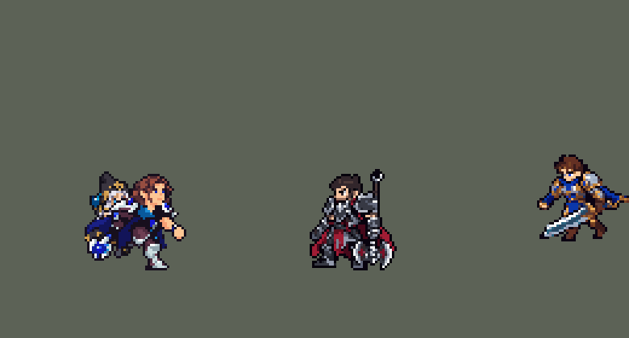

<!-- 本页上半部分由 tools/docs/gen_hero_docs.py 按仓库里现在的数据生成，手改会被覆盖；「开发记录」以下是手写的，生成时原样保留。 -->

# 塔里克 Taric


| 项目 | 内容 |
|---|---|
| id | `league_taric` |
| 所属的包 | 主包（mod_id `league`） |
| 分路 | 辅助 |
| 分类 / 标签 | 功能型（Util） · AP / Magic / Melee / Tank / CC / Heal / Shield |
| 高清帧 | 1 倍像素（无高清帧） |
| 附加包 | 无 |



其他预览：[逐帧预览](../preview/league_taric_frames.png)、[特效表](../preview/league_taric_effects.png)

## 现在的技能

下面是游戏里显示的技能说明（`league/text/champion.i18n` 的简体中文，去掉了颜色和图标），冷却、距离来自 `league/champion/league_taric.data_champion`；1 秒 = 60 tick。

### 普攻 / 被动（被动「正气凌人」）

*攻击间隔 1.33 秒 · 攻击距离 25000*

普攻造成100% 攻击力的物理伤害。被动 正气凌人：施放技能后4秒内的下2次普攻攻速+100%，额外造成30 + 20% 法强 + 3% 最大生命值的魔法伤害，缩短基础技能冷却，并为星光之触充能1层。

### 技能1 · 炫光

*冷却 7 秒 · 施放距离 60000 · 施放：指定目标 · 敌人（不含防御塔）*

朝敌人投射一道星光，0.75秒后沿直线爆裂，造成95 + 60% 法强 + 2% 最大生命值的魔法伤害并晕眩1.25秒。

### 技能2 · 星光之触

*冷却 6 秒 · 施放距离 30000 · 施放：无目标 · 敌人（不含防御塔）*

消耗全部层数（最多3层），每层为自己和附近友方英雄回复40 + 12% 法强的生命值。坚毅壁垒（12秒）：给身边队友80 + 40% 法强的护盾和15护甲并相连，技能也会在他身边施放。

### 大招 · 宇宙之辉

*冷却 60 秒 · 施放距离 60000 · 施放：无目标 · 敌方英雄*

团战开始时召唤星光，2.5秒后自己和附近的友方英雄（相连的队友身边也算）免疫伤害2.5秒。

### 数值

攻击力 75（每级 +6）、法强 30（每级 +15）、生命 1080（每级 +110）、护甲 36（每级 +9）、魔抗 26（每级 +4）、移速 1000（每级 +10）。

## 相关脚本和素材

- [`tools/lol/extract_taric.py`](../../tools/lol/extract_taric.py)
- [`tools/art/preview_taric.py`](../../tools/art/preview_taric.py)
- [`tools/art/import_taric.py`](../../tools/art/import_taric.py)
- [`assets/source/taric/`](../../assets/source/taric)

## 开发记录

> 下面是原来 README 里「英雄：塔里克」一节，原样搬过来（只改了相对链接）。

| 部分 | 内容 |
|---|---|
| 定位 | 辅助（Util），第七组的辅助；本包第七个辅助（索拉卡、蕾欧娜、迦娜、锤石、莫甘娜、娜美之后），第一个把自己的技能通过灵链在队友身边再放一次的辅助 |
| 普攻 | 挥斧锤砸，100% 攻击力的物理伤害，射程 25000，攻击间隔 80 tick（1.33 秒），第 10 tick 命中（动作第 3 帧） |
| 被动 | 「正气凌人」（用户选的 A：英雄联盟原版的循环）：每放一个技能（E、Q/W、R 起手），接下来 4 秒内的两次普攻攻速 +100%，改播强化挥击（第 9 tick 命中），额外造成 30 + 20% 法术强度 + 3% 最大生命值的魔法伤害（英雄联盟按护甲加伤害，这个游戏读不到护甲，换成最大生命值），加一层星光之触，并把基础技能的冷却缩短约 1 秒。这个游戏没有"减少冷却"的效果：`skill_cooldown_mult` 只是在生效时把剩余冷却压到上限 冷却 × 100 / (100 + mult)，而第一次强化普攻在放技能后 70–120 tick 才打出来，每下 +20 的话一整局模拟里只缩短过一次。改成两下分别加 2 tick 的 55 和 145（E 冷却 420 tick：第一下 337 → 270，第二下 228 → 171），同一个 buff 带相反数的 `ult_cooldown_mult`，大招不受影响；冷却缩短生效后同一批模拟从 +0.97 到 +1.68 |
| 技能1 | E「炫光」（用户选的 A：现版的延迟光束）：60000 内有敌人时放（小兵和野怪也算，清线、打野也用；射程内有敌方英雄时朝英雄放，莫甘娜 Q 的做法），冷却 7 秒。第 12 tick 在地上射出一道长 80000、宽 18000 的星光，0.75 秒后整条线爆开：95 + 60% 法术强度 + 2% 最大生命值的魔法伤害，晕眩 1.25 秒。英雄联盟是 1 秒后爆开、宽 12000：这个游戏的英雄一秒就走出线，改成 0.75 秒、宽 18000（当时的统计：瞄准英雄的 E 从 24% 到 65%）。光束原来长 62000，用户试玩时对线一次都晕不到（"AI判定都躲了"）：AI 在射程 60000 加两人身体的距离上就放（中位 73000，已经在光束尽头外），被瞄准的英雄在蓄力的 0.75 秒里往后退约 23000（放之前的 0.75 秒里基本不动），从光束尽头走出去，几乎没有往旁边躲的；逐次核对被瞄准的那个英雄，对线期（前 3 分钟）只晕到 29%，整局 34%。加长到 80000（够到 AI 放 E 的距离）后对线期 63%、整局 59%（中路 68% / 59%）；同一批里 72000 是 48% / 48%，加宽到 30000 是 58% / 58%，0.5 秒爆开是 59% / 60%。判定是离这条线段"宽度 + 约 15000"以内的英雄（两头是圆的），所以宽度管的是半边，画面比判定窄；加长只改判定和光束画面，说明文字不用改 |
| 技能2 | Q「星光之触」，合并 W「坚毅壁垒」（用户选的 A：带灵链）。Q：30000 内有敌人时放，冷却 6 秒。离上次加层每过 5 秒攒一层（最多 3 层，在他行动时结算），强化普攻每下也加一层；Q 用掉全部层数，给自己和 30000 内的友方英雄每层回复 40 + 12% 法术强度的生命。它只回血，按对英雄放（45000）AI 每局只放 6 次，改成附近有敌人就放后每局约 21 次。W：同一次施放里、W 自己的 12 秒冷却好了时，给 60000 内随机一名友方英雄飞一颗宝石：护盾 80 + 40% 法术强度（2.5 秒），12 秒内护甲 +15，和塔里克连上灵链。灵链期间塔里克的 Q 回血、E 爆开和 R 无敌也在那名队友身边放一次（两人相距 30000–110000 时：英雄联盟的灵链 1300 码断开；队友贴着他时已经在他自己的范围里）。模拟每局英雄治疗约 31.7 次来自 Q 本身、8.4 次来自灵链，灵链的 E 每局爆开约 1.6 次 |
| 大招 | R「宇宙之辉」（用户选的 A：原版的 2.5 秒召唤加 2.5 秒无敌）：冷却 60 秒。60000 内有敌方英雄时先"待发"10 秒（锐雯 R 的做法：大招格子是 3 tick 的空动作，加一个待发标记；没放出去就退回冷却）；待发期间他每次行动和每 0.5 秒数一次 45000 内的敌方英雄、看有没有被控的友方英雄（凯尔 R 的数法）：两名敌方英雄或一名被控的队友就放。举锤召唤星光，2.5 秒后自己和 40000 内的友方英雄（灵链队友身边也算）无敌 2.5 秒（受到的每下伤害只剩 1；两个无敌 buff 叠在一起也是 1）。每局约放 1.25 次，每次护住约 2.1 名英雄 |
| 附加包（站桩） | 可选的附加包 [`addons/league_ult_press`](../../addons/league_ult_press/README.md)（在附加包合集里，原生代码，主包不装它也完整）：游戏 0.6.4 的 AI 常让这位英雄在敌方英雄跟前站着不打——只读观察包里（75 局）身边 50000 内有敌方英雄时站着不动 18.9%，这些时候 AI 下令「走到自己脚下」占 0.4%、什么命令都没下占 93.8%（盖伦 2.8%，所有英雄的中位数 8.8%）。照卡蜜尔等十位的办法（用户：「李青、泰达米尔、塔里克照卡蜜尔的规则加进站桩名单，做完开 PR」）：原地站了 15 tick、普攻好了、AI 还让他原地站时，35000 内最近的敌方英雄——他生命不低于一半、目标离敌方塔 75000 以外、目标身边 60000 内的敌方英雄不多于他身边的我方英雄（含他）——就普攻他，打出一下或 1.5 秒后重新算 |
| 数值 | 攻击 75（+6）、法术强度 30（+15）、生命 1080（+110）、护甲 36（+9）、魔抗 26（+4）、移速 1000（+10），攻击间隔 1.33 秒。数值是自己设计的，用 SDK 对战模拟调：打辅助，对 5 个原版辅助（`priest`、`bard`、`enchanter`、`monk`、`taoist`），两边、三套队友阵容各 24 局，一批 720 局。初稿 −0.80；E 的延迟和宽度、Q 的施放条件改好后 +0.97；正气凌人真正缩短冷却后 +1.68，数值削回后两批 +0.77 / +0.80（同两批娜美 +0.96 / +0.60）。塔里克每局放 E 约 49 次（瞄准英雄约 19 次）、Q 约 21 次 |
| 亚索联动 | E 的晕眩是亚索大招要的硬控：塔里克在队里时亚索每局 R 到被控英雄 1.02 次（同一批娜美 1.90、蕾欧娜 1.88）。E 是 0.75 秒后才爆开的一条线，控到的英雄比击飞和范围晕少，亚索不用调 |
| 精灵图 | 9 个动作 55 帧：待机、移动、普攻、强化普攻（正气凌人）、E、Q/W、R、受击、死亡。造型是用户定稿的 Codex 原画：棕色中分长卷发、蓝眼睛，银白肩甲嵌蓝宝石，深褐色胸甲，蓝色领巾和胸前的宝石吊坠，深蓝披风，蓝宝石锤头的斧锤垂在身侧。发顶到脚底 40 px、33 px 宽，29 色 |
| 特效 | 普攻的银紫斩光，正气凌人命中的四角星和紫晶碎片、强化期间腰间和手边的星点，E 地上的星光（蓄力 0.75 秒后爆开）、灵链队友身边的爆开光圈、被晕敌人身上的星环，Q 脚下的星光圈和升起的回血星光，W 飞向队友的宝石、队友身上的晶体护盾和脚下的灵链印记，R 头顶的日冕光环和降下的金色光柱、无敌生效的金光和无敌期间的金色光罩 |
| 图标 | 官方技能图标（E / Q / R），64×64 |
| 音频 | 从本地客户端提取的 12 条技能音效和 4 条中文语音（Q、W、E、R）。不提交到仓库，按下面的命令在本地生成 |

```bash
python tools/lol/extract_taric.py --lol "D:\WeGameApps\lol" --vgmstream "<vgmstream-cli.exe 路径>"
python tools/lol/native_pose.py assets/source/taric/poses.json --out <渲染文件夹>   # 动作参考帧
python tools/art/export_taric.py <Codex 的定稿原画 taric-approved.png> <Codex 的动作交付 taric-approved-animations>
python tools/art/tidy_taric.py --write   # 清黑边和跑步只闪一帧的像素（之后 Codex 又给跑步的腿重新上色，不要再跑）
python tools/art/import_native.py --hero taric
python tools/art/import_taric.py      # 特效；--raw <Codex 的特效交付文件夹> 先把 8 倍图切成原尺寸条
python tools/art/preview_taric.py
```

美术（原画的提示词见 [`assets/source/taric/PICTURE_PROMPT.md`](../../assets/source/taric/PICTURE_PROMPT.md)，造型的见 [`MODEL_PROMPTS.md`](../../assets/source/taric/MODEL_PROMPTS.md)，重画头的见 [`HEAD_REDO.md`](../../assets/source/taric/HEAD_REDO.md)，9 条动作的见 [`MODEL_STRIPS.md`](../../assets/source/taric/MODEL_STRIPS.md)，跑步两次只改腿的见 [`MODEL_RUN_LEGS.md`](../../assets/source/taric/MODEL_RUN_LEGS.md)、[`MODEL_RUN_LEGS2.md`](../../assets/source/taric/MODEL_RUN_LEGS2.md)，特效的见 [`PROMPTS.md`](../../assets/source/taric/PROMPTS.md)；Codex 的交接说明在 [`codex_model/`](../../assets/source/taric/codex_model)、[`codex_strips/`](../../assets/source/taric/codex_strips)、[`codex_run_legs/`](../../assets/source/taric/codex_run_legs)、[`codex_run_legs2/`](../../assets/source/taric/codex_run_legs2)、[`codex_fx/`](../../assets/source/taric/codex_fx)）：
- 分工：模型和特效都由 Codex 画，Claude 写提示词包、整理和导入，按"原画 → 造型 → 动作 → 特效"分四步。
- 原画和造型：先写原画提示词包，Codex 画了 A、B 两张，用户选 A（斧锤垂在身侧）。照主线卢锡安的做法让 Codex 直接按游戏尺寸画造型，两版用户都不满意（"都不行"，"脸和头发不像"），只重画头，用户选 B2（头大一点）。Codex 再把 B2 的头画成一整块（中分、带眼睑的小蓝眼、闭着的嘴、有手掌手指的空手），用户定稿（"这个很完美"），Codex 照这张画了 9 条动作：高细节像素画，约 70 格高，不在游戏的格子上。用户选用这一套（"用 Codex 的 approved 版"），代替游戏尺寸的 B2 和第一版动作。
- 动作参考（`poses.json`）：镜头 yaw 40、pitch 25，不镜像，头 2.2、腿 0.8、头发 0.7、护肩 1.2，高度 39，96×96 的格子。待机 `taric_idle1`，移动 `taric_run`（8 帧 × 150 ms，头保持待机的样子），普攻 `taric_attack2`，强化普攻 `taric_passiveattack1`，E `taric_spell3_0`，Q/W `taric_spell1`，R `taric_spell4`，受击取 `taric_death` 开头，死亡 `taric_death`。
- 缩到游戏尺寸（`export_taric.py`）：颜色取定稿原画按它自己的格子读回后的 28 色；每条动作按它站姿那一帧的高度定取样间距（大招和强化普攻画得小约 6%，按各自的站姿帧），每个游戏像素取多数色，格子对齐脚底线。眼睛在这个大小会被周围的皮肤投掉，在原图里找一对眼（同一行或随头歪斜、相距约 30 px、中间是鼻梁的皮肤；远侧那只贴着脸边，抬头时画成浅紫蓝），标成眼睛色 `#182CB0`（只用在眼睛上）。
- 头（用户看待机和动图时指出三处）：第一版待机是定稿原画删行删列缩到 40 行（锐雯、阿卡丽的做法，脸那几行不删），头有 16 行，Codex 画的动作整体等比缩小后头只有 11–12 行，一放技能头就变大小（"塔里克放技能头还会变大？"）：待机改用 Codex 自己的待机帧、和动作同一比例缩。多数色把 1–3 px 的眉毛、眼睑和嘴线投掉，耳前垂下的一缕头发缩成最深的颜色、像一道黑线劈开脸（"待机帧的这个头就很奇怪"）：照 Codex 的待机帧逐格定脸（`FACE_EDITS`：每只眼睛上一格眼睑、两眼间的鼻梁留肤色、鼻尖一格阴影、嘴两格浅阴影、下巴一道轮廓，那缕头发用中间的棕色）。每帧的头各自缩，头发和下巴线帧帧不同，动起来像在变形（"gif图里看脸怎么还会变形"）：头是正的帧（两眼同一行、相距 2–4 格）先清掉自己的头，再按近侧那只眼睛贴上待机的整个头（头顶到下巴），删掉原来头发留下的 12 格以下的碎块。55 帧里 44 帧是同一个头，死亡第 2、3 帧仰倒时用自己的；代价是跑步时头发不再往后飘。
- 跑步的交叉步和黑边（用户在游戏里看）：Codex 画的跑步 8 帧一直是近腿在前，两腿从不交替（"塔里克的走路姿势没有交叉步"）。先试过给跑步换它自己的前倾头、8 帧共用一个上半身、让 Codex 在游戏尺寸上整体精修，用户都不满意（"改的都不像塔里克了 和英雄联盟里面也不像 还没之前好"），退回这一版后选了"只修交叉步"：Codex 只在腿的范围里改（站位点下 1 行到鞋底、站位点后 12 格往前，锤头下面 +8 行往下；其余一格不许动，交回后逐格核对为 0），照英雄联盟原版重排：第 8、1、2 帧近腿着地，第 4、5、6 帧远腿着地，第 3、7 帧交叉。两条腿同色时看不出交叉（"怎么感觉交叉步不是很明显？"），第二次只给腿重新上色：远腿 8 帧都压暗（最深的褐色裤子、暗灰护腿和靴子），近腿保持银白、留一两格高光，外形一格不变。黑边（"最后去除黑边 弄干净一点"，"跑动时不干净啊 多余的像素不清理吗"）：`tidy_taric.py` 把和描边同色、贴在外轮廓里面的第二层黑线换成里面的颜色，四周没有同色的单点换成周围最多的颜色（每帧 17–53 格）；跑步再按头的位置对齐相邻帧，前后两帧一样、只有这一帧不同的格子换成前后帧的颜色（腰以上每帧 80–120 格，持续两帧以上的晃动保留）；外轮廓、脸、宝石和领巾不碰。
- 导入：待机 6 帧用同一帧，第 3–5 帧从第 8 行往下沉一格呼吸（`BOB` 8：缝在靴子上，那两行只差 3 格描边和 12 格颜色，靴子最下面两行不动）；按眼睛色定头的位置（`EYES`），移动 8 帧的头稳在同一列（只挪了 1 帧 1 格）；`COMPLETE` 补描边（导出时已补过，这一步补 84 格）。头像截取点 (−3, −38)，在发顶；待机最高点 −28，选人卡片装得下，不设 `banpick_center`。
- 特效用 Codex 画的 14 张（93 帧）：这次 Codex 直接按游戏尺寸画，每张是 1 倍图放大 8 倍的纯色方块、只用包里的色板（星光蓝白、宝石紫、R 的金色、治疗的薄荷绿）、没有半透明，E 光束和 W 宝石上下严格对称；强化星点 Codex 自己改过一版，只在腰间和手边、不挡身体（`p_glow_correction.txt`）。`import_taric.py --raw` 按格子切帧，不缩放、不换颜色。锚点：命中放在上半身，围着人的画面（强化星点、晕眩、回血、护盾、R 的闪光和光罩）把人形空位的底行放在脚底线，地面圈（Q 的星光圈、E 在队友身边的爆开、灵链印记）的椭圆中心放在脚底线上 2 格，E 光束是 `LineRangeProjectile` 的画面（画面中心在长 80000 的矩形中点、随施法方向转，左端在塔里克身上；Codex 按 62000 画，`import_taric.py` 沿光束方向拉长到 `E_LENGTH`，每列取最近的原列），W 宝石按紫色宝石定点，R 的召唤按格子底边中点放在脚底线。时长按技能：E 光束前 8 帧撑满命中前的 44 tick、第 9 帧在命中那一刻爆开；灵链队友身边的圈晚 2 tick 出现、同一 tick 爆开；晕眩星环 75 tick；R 的召唤前 8 帧撑满生效前的 150 tick，第 9–10 帧落光。E 光束、Q 星光圈、队友身边的圈和灵链印记画在人物下层。
- 出手时刻和动画对齐：普攻第 3 帧（第 10 tick），强化普攻第 3 帧（第 9 tick），E 第 3 帧（第 12 tick）射出光束，Q/W 第 3 帧（第 12 tick），R 的 7 帧正好 40 tick（召唤光在第 0 tick 开始）。
- 结果：29 色，和右边像素同色的比例 36%（原版英雄 18%–46%）。待机每帧 907 个不透明像素，和维迦（798）、娜美（949）之间。

逐帧预览：[`docs/preview/league_taric_frames.png`](../preview/league_taric_frames.png?v=1014g)，特效：[`docs/preview/league_taric_effects.png`](../preview/league_taric_effects.png?v=1014g)。
