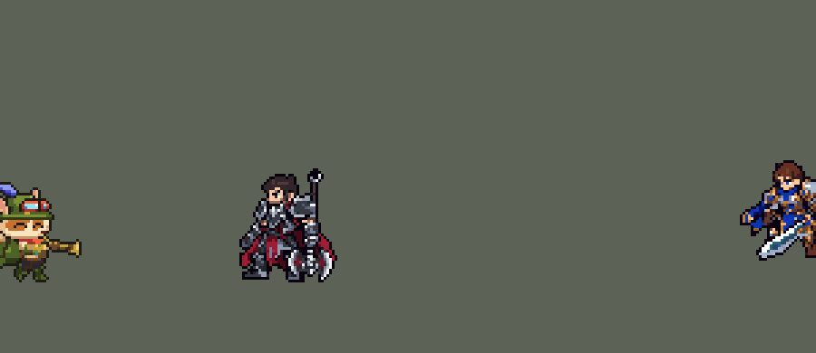

<!-- 本页上半部分由 tools/docs/gen_hero_docs.py 按仓库里现在的数据生成，手改会被覆盖；「开发记录」以下是手写的，生成时原样保留。 -->

# 提莫 Teemo


| 项目 | 内容 |
|---|---|
| id | `league_teemo` |
| 所属的包 | 主包（mod_id `league`） |
| 分路 | 上单 |
| 分类 / 标签 | 法师（Magician） · AP / Magic / Dot / CC |
| 高清帧 | 1 倍像素（无高清帧） |
| 附加包 | [提莫蘑菇附加包](#附加包)（`league_teemo_shrooms`） |



其他预览：[逐帧预览](../preview/league_teemo_frames.png)、[特效表](../preview/league_teemo_effects.png)

## 现在的技能

下面是游戏里显示的技能说明（`league/text/champion.i18n` 的简体中文，去掉了颜色和图标），冷却、距离来自 `league/champion/league_teemo.data_champion`；1 秒 = 60 tick。

### 普攻 / 被动（被动「毒性射击」）

*攻击间隔 1 秒 · 攻击距离 50000*

普攻吹出毒镖，造成100% 攻击力的物理伤害。被动 毒性射击：额外造成20 + 30% 法术强度的魔法伤害，并使目标中毒4秒，每秒受到10 + 10% 法术强度的魔法伤害，每次命中各叠一层。

### 技能1 · 致盲吹箭

*冷却 7 秒 · 施放距离 65000 · 施放：指定目标 · 敌人（不含防御塔）*

吹出致盲飞镖，造成80 + 70% 法术强度的魔法伤害，并致盲目标1.5秒，期间无法普攻。

### 技能2 · 小莫快跑

*冷却 12 秒 · 施放距离 30000 · 施放：无目标 · 敌方英雄*

敌方英雄靠近时拔腿就跑：移动速度提高40%，持续3秒，并伪装（隐身）1.5秒。被动 游击队军备：同时获得出奇制胜，攻击速度提高40%，持续4.5秒。

### 大招 · 种蘑菇

*冷却 60 秒 · 可存 3 次 · 施放距离 75000 · 施放：地点 · 敌方英雄*

向敌方英雄脚下扔出蘑菇，1秒后布好并潜伏12秒。敌人踩中时爆出毒云，使周围敌人中毒4秒，共受到100 + 48% 法术强度的魔法伤害，并减速40%，持续2秒。可储存3个蘑菇。

### 数值

攻击力 80（每级 +6）、法强 40（每级 +20）、生命 950（每级 +100）、护甲 25（每级 +7）、魔抗 25（每级 +3）、移速 1000（每级 +9）。

## 附加包

附加包是可选的原生代码 mod（都在附加包合集 `league_addons` 里），**不装主包里的英雄也是完整的**。

### 提莫蘑菇附加包

[提莫蘑菇附加包](../../addons/league_teemo_shrooms/README.md)：`league_teemo_shrooms` v0.2.2

|  | 主包（纯数据） | 装了附加包 |
|---|---|---|
| 蘑菇在地上多久 | 最多 12 秒 | 3 分钟（10800 tick），提莫阵亡也在；最多 9 个，再多收掉最早的 |
| 扔、布好、踩发距离 8000、毒云 30000 内中毒 4 秒共 100 + 48% 法强、减速 40% 2 秒、画面 | 主包 | 一样 |
| 往哪扔 | AI 往敌方英雄脚下扔 | 打架时一样；**不打架时往身边最近的草丛里种**（0.2.0：R 留一次充能给打架，没埋过的草丛、不在自家基地） |

## 相关脚本和素材

- [`tools/lol/extract_teemo.py`](../../tools/lol/extract_teemo.py)
- [`tools/art/preview_teemo.py`](../../tools/art/preview_teemo.py)
- [`tools/art/import_teemo.py`](../../tools/art/import_teemo.py)
- [`assets/source/teemo/`](../../assets/source/teemo)

## 开发记录

> 下面是原来 README 里「英雄：提莫」一节，原样搬过来（只改了相对链接）。

| 部分 | 内容 |
|---|---|
| 定位 | 法师（Magician），第三组的上单，本包第二个法师 |
| 普攻 | 吹箭，100% 攻击力的物理伤害。被动 E「毒性射击」：命中时额外造成 20 + 30% 法术强度的魔法伤害，并让目标中毒 4 秒，每秒 10 + 10% 法术强度的魔法伤害（和英雄联盟的 E 一样是 4 秒、共 40% 法术强度）。英雄联盟里中毒不叠加、只刷新时间；数据里的持续伤害（`AddCasted`）每次命中各加一层、各自计时，数值按这个设计 |
| 技能1 | Q「致盲吹箭」：追踪飞镖，80 + 70% 法术强度的魔法伤害，致盲 1.5 秒（`BlockAttack`：目标不能普攻，游戏里显示缴械图标）。射程 65000，冷却 7 秒，也对小兵和野怪放 |
| 技能2 | W「小莫快跑」：敌方英雄靠近到 30000 以内时施放，移速提高 40%，持续 3 秒。合并被动「游击队军备」：同时伪装 1.5 秒（`CasterInvisible`：期间攻击也不会显形，敌人基本不再选他当目标），并获得「出奇制胜」，攻速提高 40%，持续 4.5 秒。英雄联盟里要站着不动才会隐身，引擎判断不了「静止」，改成随 W 触发。W 的被动加速算进了基础移速（1000，原版法师 900）。冷却 12 秒 |
| 大招 | R「种蘑菇」：往敌方英雄脚下扔蘑菇（射程 75000，0.33 秒落地），1 秒后布置好、藏进草里，最多潜伏 12 秒；敌人（英雄、小兵、野怪都算）走到 8000 以内就爆出毒云：半径 30000 内的敌人中毒 4 秒，共 100 + 48% 法术强度的魔法伤害，并减速 40%，持续 2 秒。3 层充能，每层 20 秒（英雄联盟满级 R 也是 20 秒一层）；AI 一般会在几秒内把 3 个蘑菇扔在不同的位置 |
| 附加包 | 可选的附加包 [`addons/league_teemo_shrooms`](../../addons/league_teemo_shrooms/README.md)（在附加包合集里，原生代码，主包不装它也完整）：蘑菇照英雄联盟埋在地上 3 分钟（最多 9 个），提莫阵亡也在，敌人踩上才炸；毒云、减速、画面照主包（主包最多潜伏 12 秒） |
| 蘑菇的做法 | 金克丝 E 的手雷是投射物一层套一层，JSON 已经嵌套 119 层，离 serde 的上限 128 层很近，撑不了 12 秒。提莫的蘑菇全部挂在大招本身的延时效果上（`Position` 施法的效果都落在施法点）：每个蘑菇一个每 tick 检测的触发区、一个每 2 tick 检测的伤害区，再加每 0.25 秒一段画面（潜伏的蘑菇，或爆开的毒云）。三个槽位各用自己的 buff，三个蘑菇可以同时潜伏。数据文件 292 KB，嵌套 19 层 |
| 数值 | 攻击 80（+6）、法术强度 40（+20）、生命 950（+100）、护甲 25（+7）、魔抗 25（+3）、移速 1000（+9）、射程 50000（原版法师 60000；英雄联盟里提莫的 500 也比拉克丝的 550 短）、攻击间隔 60 tick。LoL Reborn 里没有提莫，数值是自己设计的，用 SDK 对战模拟调：打上路、对 6 个原版上单（`fighter`、`executioner`、`lancer`、`pole_warrior`、`knight`、`berserker`），三套队友阵容平均团队击杀差 +1.0，和原版 `fighter`（+0.97）、本包德莱厄斯（+0.98）持平；初版（生命 900、攻击间隔 70、毒伤低一档）是 −2.1。提莫没有硬控（致盲和减速都不算亚索大招要的控制），亚索不用调 |
| 精灵图 | 8 个动作 42 帧：待机、跑步、普攻、Q、W、R、受击、死亡。帽顶到脚底 34 px（羽毛另算），24 色，动作全部取自英雄联盟原版动画 |
| 特效 | 毒镖、毒液命中、致盲飞镖、紫墨命中、致盲紫烟、起跑烟尘、伪装叶旋、中毒、飞在空中的蘑菇、蘑菇落地布置、潜伏的蘑菇、蘑菇毒云 |
| 图标 | 官方技能图标（Q / W / R），64×64 |
| 音频 | 从本地客户端提取的 10 条技能音效和 3 条中文语音（Q、W 借被动伪装的台词、R）。不提交到仓库，按下面的命令在本地生成 |

```bash
python tools/lol/extract_teemo.py --lol "D:\WeGameApps\lol" --vgmstream "<vgmstream-cli.exe 路径>"
python tools/lol/native_pose.py assets/source/teemo/poses.json --out <渲染文件夹> --alpha --parts
python tools/art/restyle_native.py assets/source/teemo/poses.json --renders <渲染文件夹>   # 角色图
python tools/art/import_native.py --hero teemo
python tools/art/import_teemo.py      # 特效；--raw <Codex 的交付文件夹> 先把原始图转成原尺寸条
python tools/art/preview_teemo.py
```

美术（提示词见 [`assets/source/teemo/PROMPTS.md`](../../assets/source/teemo/PROMPTS.md)）：
- 分工：角色图由 Claude 画，Codex 只画特效。
- 贴图：提莫的皮肤有三张颜色贴图（身体、口琴、蘑菇），按名字排序会先选中口琴那张，整个模型变成黄铜色。`pose_ref` 现在取皮肤 bin 里紧跟在网格后面的那张（其他英雄选到的贴图不变），`hide_submeshes` 去掉皮肤默认隐藏的蘑菇和口琴。
- 比例和镜头：镜头 yaw 55、pitch 25，镜像。约德尔人本身就是 Q 版：按英雄联盟原比例，头（含帽子和耳朵）占身高 56%（原版英雄约 36%，阿木木 63%），不再放大。羽毛缩到 0.6 倍、背包缩到 0.7 倍（原大在游戏里像一对翅膀）。按帽顶量头顶（`crown` 115），羽毛立在上面。
- 造型图：待机第 1 帧按材质投色，头部（帽子、护目镜、羽毛、耳朵、脸）逐格画。脸在三个方案里用户选了 A：英雄联盟原版的眯眼笑（两道弯眼）和一道暗红小嘴。
- 动作图：身体按英雄联盟动画投色；头部是造型图的头，贴在每一帧英雄联盟头部关节的位置（和阿木木、德莱厄斯一样），只在死亡躺下时转 90°。R 里原版有一个后仰翻身，挑帧时跳过；死亡时他被弹飞 320 个单位，用新的 `travel` 只保留 30% 的位移，也跳过了空中翻滚。待机 6 帧都用第 1 帧，第 3–5 帧膝盖以上下移 1 格呼吸。
- 跑步：英雄联盟的跑步是往前扑的冲刺，上身和脖子都往前探，腿往身后蹬，镜头俯视后脚离地 1–8 格；贴上去的头一直正立，用户在游戏里看到跑步时头和身体不像长在一起。三个方案里选了 B：跑步姿势往待机姿势混合 40%（`Run@t>Idle@0:0.4`），上身直起来，头坐在肩上；`flat` 让每帧的脚落回地面；为了头不晃，身子在头下的左右挪动也从最多 3 格降到 2 格。展示动图开头加了一段小跑入场。
- 死亡躺下的两帧，头起初贴到了脖子左上方 3 格、2 格的地方（`restyle_native` 在头转过去之后才按屏幕方向加 `dx` / `dy`），用户在动图里看出头和身体分开了；现在偏移在旋转前就折进关节位置。
- 特效用 Codex 画的 12 张（生图原稿）：`import_teemo.py --raw` 按交付的 manifest 切帧（毒云那张帧距不均），按技能范围定大小：毒镖 16 px，致盲飞镖 20 px，毒云的地面圈 60 px（半径 30000，画一半大再放大 2 倍），布置好的蘑菇 14 px 宽，潜伏的蘑菇和布置的最后一帧一样宽。紫墨和致盲紫烟在眼睛高度，烟尘、叶旋、中毒和蘑菇都落在脚下的地面线上，烟尘在身后。
- 出手时刻和动画对齐：普攻、Q 第 12 tick 吹出，R 第 15 tick（跳起扔出那一帧）扔出，R 动作 26 tick。
- 结果：24 色，和右边像素同色的比例 46%（原版英雄 18%–46%）。头像截取点 (0, −27)：头顶下 7 格，卡片上能看到眼睛。

逐帧预览：[`docs/preview/league_teemo_frames.png`](../preview/league_teemo_frames.png?v=1014g)，特效：[`docs/preview/league_teemo_effects.png`](../preview/league_teemo_effects.png?v=1014g)。
