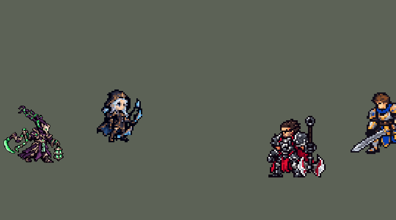

<!-- 本页上半部分由 tools/docs/gen_hero_docs.py 按仓库里现在的数据生成，手改会被覆盖；「开发记录」以下是手写的，生成时原样保留。 -->

# 锤石 Thresh


| 项目 | 内容 |
|---|---|
| id | `league_thresh` |
| 所属的包 | 主包（mod_id `league`） |
| 分路 | 辅助 |
| 分类 / 标签 | 功能型（Util） · AP / Magic / CC / Shield / Tank |
| 高清帧 | PPU 2.48 |
| 附加包 | [锤石灯笼附加包](#附加包)（`league_thresh_lantern`） |



其他预览：[逐帧预览](../preview/league_thresh_frames.png)、[特效表](../preview/league_thresh_effects.png)

## 现在的技能

下面是游戏里显示的技能说明（`league/text/champion.i18n` 的简体中文，去掉了颜色和图标），冷却、距离来自 `league/champion/league_thresh.data_champion`；1 秒 = 60 tick。

### 普攻 / 被动（被动「厄运钟摆」）

*攻击间隔 1.5 秒 · 攻击距离 48000*

普攻甩出锁链，造成100% 攻击力的物理伤害。被动 厄运钟摆：超过2秒没有普攻时，下一次普攻额外造成40 + 50% 法术强度的魔法伤害。地狱诅咒：收割的灵魂化为每级成长的护甲与法术强度。

### 技能1 · 死亡判决

*冷却 8 秒 · 施放距离 65000 · 施放：方向 · 敌方英雄*

掷出镰刀，钩住直线上第一个敌方英雄（穿过小兵），造成80 + 60% 法术强度的魔法伤害，眩晕1秒并把它拉到身前。魂引之灯：每14秒同时掷出灯笼，为自己和身边一名友方英雄提供60 + 40% 法术强度的护盾，持续2.5秒。

### 技能2 · 厄运钟摆

*冷却 6 秒 · 施放距离 30000 · 施放：指定目标 · 敌人（不含防御塔）*

挥动锁链横扫身边，对敌人造成60 + 40% 法术强度的魔法伤害并减速40%，持续1秒。刚钩中英雄或没有敌方英雄贴身时，把敌人拉向并越过锤石；有敌方英雄贴身时把敌人推开。

### 大招 · 幽冥监牢

*冷却 60 秒 · 施放距离 30000 · 施放：指定目标 · 敌方英雄*

在脚下立起幽冥监牢，持续5秒。第一个碰到监牢的敌方英雄受到150 + 80% 法术强度的魔法伤害并被减速99%，持续2秒；之后碰到的敌方英雄不受伤害，减速时间减半。

### 数值

攻击力 75（每级 +6）、法强 25（每级 +18）、生命 1000（每级 +110）、护甲 24（每级 +10）、魔抗 25（每级 +4）、移速 1000（每级 +10）。

## 附加包

附加包是可选的原生代码 mod（都在附加包合集 `league_addons` 里），**不装主包里的英雄也是完整的**。

### 锤石灯笼附加包

[锤石灯笼附加包](../../addons/league_thresh_lantern/README.md)：`league_thresh_lantern` v0.1.0

|  | 主包（纯数据） | 装了附加包 |
|---|---|---|
| 灯笼给谁 | 50000 内随机一名友方英雄 | 50000 内有危险的友方英雄（生命不高于 45%，或身边 25000 内有 2 个以上敌方英雄），几个时挑生命比例最低的；都没危险就给最近的 |
| 护盾 | 自己和那名队友各 60 + 40% 法强，2.5 秒 | 一样 |
| 拉回来 | 没有 | 有危险的队友离锤石超过 15000、没被硬控时，拉到锤石身边（每 tick 3000） |

## 相关脚本和素材

- [`tools/lol/extract_thresh.py`](../../tools/lol/extract_thresh.py)
- [`tools/art/preview_thresh.py`](../../tools/art/preview_thresh.py)
- [`tools/art/import_thresh.py`](../../tools/art/import_thresh.py)
- [`assets/source/thresh/`](../../assets/source/thresh)

## 开发记录

> 下面是原来 README 里「英雄：锤石」一节，原样搬过来（只改了相对链接）。

| 部分 | 内容 |
|---|---|
| 定位 | 辅助（Util），第四组的辅助，本包第四个辅助（索拉卡、蕾欧娜、迦娜之后），第一个钩子开团的辅助 |
| 普攻 | 甩出锁链，100% 攻击力的物理伤害，射程 48000，攻击间隔 1.5 秒 |
| 被动 | E「厄运钟摆」的被动：超过 2 秒没有普攻，下一次普攻换成强化的锁链，额外造成 40 + 50% 法术强度的魔法伤害（每次普攻重新挂一个 2 秒的标记，没有标记时这一下是强化的）。「地狱诅咒」：英雄联盟里靠收集灵魂成长护甲和法强；引擎里没有灵魂可捡，改成每级成长的护甲（+10）和法强（+18） |
| 技能1 | Q「死亡判决」：朝目标方向掷出镰刀（半径 6000，飞 72000），钩住直线上第一个敌方英雄（穿过小兵），造成 80 + 60% 法术强度的魔法伤害，眩晕 1 秒，同时把他一路拉到锤石身前（每 tick 1500）。英雄联盟里是再按一次 Q 飞过去；这里不飞，改成把人拉回来（眩晕和拉拽叠在同一个目标上时，他被眩晕着拖过来）。钩到带莫甘娜黑盾（免疫控制）的英雄时不眩晕、不拉回（模拟 48 局：23 次全挡住），锁链缠身的画面和 E 顺势往回拉的判定也只在真钩住时才有（放在一个看不见、只打"被控制中的英雄"的同路径孪生弹上）。射程 65000，冷却 8 秒，只对英雄放。合并 W「魂引之灯」（单独冷却 14 秒）：同时掷出灯笼，给自己和 50000 内一名随机友方英雄各 60 + 40% 法术强度的护盾，持续 2.5 秒。英雄联盟里队友点灯笼才会被拉过来；引擎做不了"点灯笼"，只保留护盾 |
| 技能2 | E「厄运钟摆」：挥动锁链横扫身边（半径 32000），造成 60 + 40% 法术强度的魔法伤害，减速 40% 持续 1 秒，并把敌人推开或拉近（每 tick 2500，12 tick，约 30 px）。英雄联盟里玩家自己选方向；这里由 AI 放，按规则选：钩中英雄后 2 秒内一律往里拉，把人拉过锤石身后（原版钩子接 E 的连招）；否则看命中那一刻有没有敌方英雄贴身（16000 内，算上对方的身体）：有就往外推（`Knockback`，把扑上来的人推开），没有就往里拉（`Pull`，把站在边缘的人拉进来，离得近的会被拉过他身后），清线、打野时也是拉，把兵和野怪聚到一起。贴身的判断用一个 `RandomTarget` 在命中前挂 2 tick 的标记，`SwitchByBuff` 读它。射程 30000，冷却 6 秒，也对小兵和野怪放 |
| 大招 | R「幽冥监牢」：30000 内有敌方英雄时放，冷却 60 秒。在脚下立起五面灵魂墙，持续 5 秒（半径 40000）：第一个碰到的敌方英雄受到 150 + 80% 法术强度的魔法伤害并减速 99% 持续 2 秒，之后碰到的敌方英雄不受伤害，只减速 1 秒，每个英雄只触发一次。英雄联盟里是五面单独的墙，撞碎的那面伤害最重，其余的墙只减速；引擎的直线形状用的是地图的绝对坐标，摆不出围着施法位置的墙，所以整圈做成一个区域（`ApplyInProjectile`，同一个投射物对每个单位只生效一次），"第一个"用施法者身上的标记记住。区域放在一个射程 1 的直线投射物的结束效果里，落在他站的地方；监牢的画面是施法时在他身上播放、不跟随的施法者特效（`CasterViewEffect`）。第一版把画面也放在那个结束效果里（坐标上的 `ViewEffect`，坐标就是他自己脚下），游戏里看不见（用户实测）；模拟里这个事件是有的，推测是画面层会把坐标上的画面转向"施法者到坐标"的方向，距离为 0 时方向算不出来 |
| 附加包 | 可选的附加包 [`addons/league_thresh_lantern`](../../addons/league_thresh_lantern/README.md)（在附加包合集里，原生代码，主包不装它也完整）：魂引之灯照英雄联盟扔给最危险的队友（生命不高于 45% 或身边有 2 个以上敌方英雄，几个时挑生命比例最低的），护盾照旧，有危险的队友被拉到锤石身边（主包给 50000 内一名随机队友护盾） |
| 连招 | 用户要求：「有连招要做连招」「都要帮我补」。英雄联盟的 **Q→E**：镰刀真钩住敌方英雄时（只打被控制英雄的同路径孪生弹）原来就挂 120 tick（2 秒）的 `league_thresh_q_hooked`，窗口里的 E 一律往里拉；现在窗口里放 E 不再抬手，第 1 tick 就横扫、往里拉（平时第 8 tick 起扫、第 13 tick 命中），趁 Q 的 1 秒眩晕还在把人拉过他身后。窗口外的 E 照旧（推还是拉按原来的规则）。伤害、减速、冷却都不变；E 在冷却就不接（`skill_cooldown_mult` 会把 Q 刚开始的 8 秒冷却一起返还，所以不做返还）。英雄联盟再按 Q 飞过去没有加：这里的钩子本来就把人拉回来。数据由 [`tools/fix/combo_thresh.py`](../../tools/fix/combo_thresh.py) 改 |
| 数值 | 攻击 75（+6）、法强 25（+18）、生命 1000（+110）、护甲 24（+10）、魔抗 25（+4）、移速 1000（+10）。数值是自己设计的，用 SDK 对战模拟调：打辅助，对 5 个原版辅助（`priest`、`bard`、`enchanter`、`monk`、`taoist`），两边、三套队友阵容各 24 局，一批 720 局。团队击杀差：初版（出手时刻还是估的：普攻第 13 tick、E 第 12 tick、R 第 14 tick）+0.04；按美术定下的出手帧重跑（普攻第 14 tick，E 第 8 tick 起扫、第 13 tick 命中，R 第 17 tick），两批种子 +0.39 / +0.34。游戏内测试后 E 改成推拉两种模式、位移从 15000 加到 30000：+0.80 / +0.34，仍在本包辅助中间，数值没再改。同样两批里：迦娜 +0.11 / +0.31、蕾欧娜 +0.78 / +1.23、索拉卡 −0.07 / −0.28，原版 `priest` +1.10 / +1.12。锤石每局放 Q 约 15 次、E 22 次（对英雄约 4 次，其余在清线、打野）、R 2.3 次 |
| 亚索联动 | Q 的眩晕算亚索大招要的控制（监牢的 99% 减速不算）。亚索打上路、锤石打辅助时，亚索每局放 R 0.92 次（E 改成推拉之前是 1.25；同一批 48 局里辅助换成蕾欧娜是 1.88 次，之前测过迦娜 0.92、索拉卡 0.54、原版 `priest` 0.48）。锤石和迦娜一样，亚索不用调 |
| 精灵图 | 8 个动作 55 帧：待机、移动（英雄联盟的走路动作）、普攻、Q、E、R、受击、死亡。连头上的锁链 39 px，35 色，动作全部取自英雄联盟原版动画 |
| 高清帧（PPU 2.48） | 2026-10-31 用 PPU 重做，和泰隆在同一个 PR（用户：「锤石和女枪在这个pr里一起重做二轮」「都用中间档」「动作通过」）。设计图：Codex 照他的旧精灵描密的原图（两版，用 A 版：修过一遍的那张）；原图的描边约 9.75 像素一格（下面还有一层约 14.75 像素的粗格），按原图自己的格子读回（90 × 99 格；锁链尖到脚底 99 行 / 2.48 = 原来的 40 像素；调色板 64 色，`design_thresh_hd.py`，`--pitch` 是另外两种读法：14.75 / 6.5 像素是 1.65 / 3.73）；脸那一块按均匀格子读。英雄联盟里他头顶上竖着的是锁链，不是兜帽，提示词照这个写。动作：Codex 照旧版同一帧用设计图整帧重画（`pack_thresh_actions.py`，七个动作 49 帧，旧版没有和待机一样的帧；镰刀在远侧手，普攻、Q、E 甩出去的锁链照旧帧的长度一节一节画出来，灯笼在近侧手，R 举过头顶；走路逐帧写明哪只脚在前）。读回（`casts_thresh_hd.py`）：骷髅脸的骨白色和盔甲的高光是同一种颜色，没法按颜色量头，所以每张的缩放按每帧和旧帧的身高定；趴着的死亡帧、R、受击第 2 帧、普攻第 4/6/7 帧和 Q 第 1–3 帧（Codex 把灯笼或锁链画得比旧帧低，按身高量会把人放大一两成）按整个人的面积定；对齐点按设计图和旧待机剪影重叠最多的那列（第 53 列）。待机不上下起伏（待机和选人卡是从动作里剪的随机片段）；没有烤进动作的特效（`rig_thresh_hd.py`）。高 40 像素和原来一样，没有 SIZES 行；头像点不变；选人卡片 −10 不变 |
| 特效 | 普攻的锁链和命中、强化普攻的锁链和命中、Q 镰刀（锁链随飞行变长）、钩中后缠身的锁链、拉回时的镰刀（锁链随距离变短）、魂引之灯、灯笼护盾、E 横扫和命中、R 幽冥监牢（升起、立 5 秒、碎裂）、R 命中、减速时脚下的灵魂镣铐 |
| 图标 | 官方技能图标（Q / E / R），64×64 |
| 音频 | 从本地客户端提取的 12 条技能音效和 4 条中文语音（Q、W、E、R）。不提交到仓库，按下面的命令在本地生成 |

```bash
python tools/lol/extract_thresh.py --lol "D:\WeGameApps\lol" --vgmstream "<vgmstream-cli.exe 路径>"
python tools/lol/native_pose.py assets/source/thresh/poses.json --out <渲染文件夹> --alpha --parts
python tools/art/restyle_native.py assets/source/thresh/poses.json --renders <渲染文件夹>   # 角色图
python tools/art/import_native.py --hero thresh
python tools/art/import_thresh.py      # 特效；--raw <Codex 的交付文件夹> 先把原始图转成原尺寸条
python tools/art/preview_thresh.py
# PPU 2.48 重做（2026-10-31）：
python tools/art/pack_thresh_ppu.py --out <文件夹>          # 给 Codex 的设计图包（照他的旧精灵描密）
python tools/art/design_thresh_hd.py                      # Codex 的原图（hd/raw/thresh-A.png）按约 9.75 像素一格读回 -> hd/design.png
python tools/art/pack_thresh_actions.py --out <文件夹>      # 给 Codex 的动作包（照旧版同一帧整帧重画）
python tools/art/casts_thresh_hd.py --heights             # 每帧按身高的缩放；--area 按面积（定 ZOOM）
python tools/art/rig_thresh_hd.py                         # 读回 -> 原始条和 1 倍图
python tools/art/ppu_restyle.py --hero thresh && python tools/art/ppu_hd.py --hero thresh
python tools/art/ppu_one.py --hero thresh && python tools/art/rig_thresh_hd.py --one-ground && python tools/art/hero_reels.py --hero thresh
python tools/art/review_thresh_actions.py --out <文件夹>    # 旧版 / 新版对照动图
```

美术（提示词见 [`assets/source/thresh/PROMPTS.md`](../../assets/source/thresh/PROMPTS.md)）：
- 分工：角色图由 Claude 画，Codex 只画特效。
- 比例和镜头：镜头 yaw 45、pitch 25，镜像，头 2.0、腿 0.8、头发 0.5，高度 30（A / B / C 三种比例、30 / 34 两种高度里用户选了 C30）。灯笼是单独的部件（玻璃按色相投成黄绿色的魂火），腿是单独的部件（深紫色，走路时和长袍分得开），镰刀和锁链是武器。
- 头部：逐格手画后贴到每一帧英雄联盟头部关节的位置，每帧保持竖直（`"turn": 180`）。第一轮三张从零画的脸用户都不认可（"A 前面那张最帅"）；照英雄联盟的头按材质投色，游戏尺寸下糊成一团（"头部好模糊"），加细节也还是糊。最后照原版的结构逐格画了三版，用户选了 C：暗紫色骷髅，V 字怒眉下两只发光的绿眼，三颗尖牙（外侧两颗长），两股带青色骨节的锁链从头顶往后弯到钩子。
- 动作：移动用英雄联盟里锤石平时移动的动作：动画图里 `Run` 在基础移速下播的是 `run_base` = `Thresh_run`（走路，移速 375 以上才换成 `run_fast`；`python tools/lol/anim_graph.py Thresh --grep run`），2 秒的动作里是两遍相同的 1 秒循环。最初那一版看起来像在跑，用户要"一模一样在游戏里的走路姿势"，定了 8 帧 × 125 ms：一圈 1 秒，正是英雄联盟的节奏，不往待机混合。待机 6 帧都用第 1 帧，第 3–5 帧长袍下摆以上下移一格呼吸（靴子不动）。Q 用 `Spell1_in` 接 `Attack1_mid` 甩出镰刀、`Spell1_grab` 收链、`Spell1_out` 收尾，E 用 `Spell3` 横扫，R 用 `Spell4` 举灯。
- 特效用 Codex 画的 14 张（生图原稿，真透明）：`import_thresh.py --raw` 按交付清单的 `rect` 切帧，每张 16 色、硬透明，按技能范围定大小：普攻锁链 16 px、强化 22 px、命中 14 / 22 px、Q 镰刀 20 px 高、钩中的锁链 22 px 宽、灯笼 24 px、灯笼护盾 42 px 高（包住他 39 px 的身体）、E 横扫 66 px 宽（半径 32000）、E 命中 20 px、监牢 84 px 宽（半径 40000，墙立在圈上；地面从原稿的 1.6:1 压到接近游戏的 2:1）、R 命中 24 px、镣铐 24 px。
- 锁链：投射物的画面长度是固定的，Codex 画的 48 px 锁链刚出手时会从锤石背后穿出来。所以 Q 的锁链逐节重画（深铁色的链环，每 4 节一节发绿光，光往镰刀方向走）：镰刀每 tick 飞 5.5 px，每 2 tick 一帧，锁链长 11k − 3 px，末端正好在出手的地方；拉回时镰刀以拉拽的速度（每 tick 1.5 px）飞回他身上，锁链每 4 tick 短 6 px。模拟里钩中时镰刀离他多在 45–70 px（一次 12 px），锁链按 55 px 画，远了留一点空、近了多出一点。
- 灯笼：投射物的画面按飞行方向旋转，往左扔时竖着的灯笼会倒过来，所以把灯笼横过来（提环朝后、朝着拖尾），再上下镜像成对称，往哪个方向飞都一样。普攻和 Q 的镰刀也上下镜像成对称。
- 出手时刻和动画对齐：普攻第 14 tick（锁链甩出的那一帧）、Q 第 16 tick（镰刀出手）、E 第 8 tick 开始横扫的画面，5 tick 后（锁链扫过身前）才命中、R 第 17 tick（举灯那一帧）立起监牢。
- 结果：35 色，和右边像素同色的比例 34%（原版英雄 18%–46%）。头像截取点 (−4, −33)：落在骷髅脸上，头上的锁链往后弯，工具按整个头算出的中心偏后。

逐帧预览：[`docs/preview/league_thresh_frames.png`](../preview/league_thresh_frames.png?v=1031hd)，特效：[`docs/preview/league_thresh_effects.png`](../preview/league_thresh_effects.png?v=1014g)。
