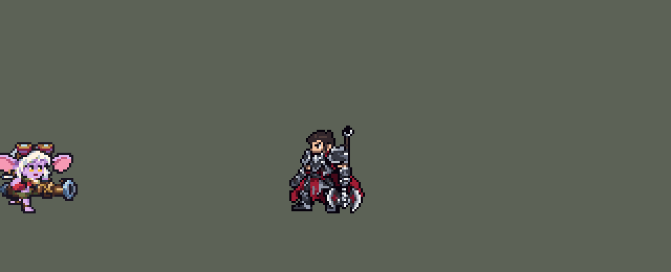

<!-- 本页上半部分由 tools/docs/gen_hero_docs.py 按仓库里现在的数据生成，手改会被覆盖；「开发记录」以下是手写的，生成时原样保留。 -->

# 崔丝塔娜 Tristana


| 项目 | 内容 |
|---|---|
| id | `league_tristana` |
| 所属的包 | 主包（mod_id `league`） |
| 分路 | ADC |
| 分类 / 标签 | 射手（Range） · AD / Range / CC |
| 高清帧 | PPU 2.56 |
| 附加包 | [参与击杀附加包：金克丝、崔丝塔娜、易、图奇](#附加包)（`league_takedowns`） |



其他预览：[逐帧预览](../preview/league_tristana_frames.png)、[特效表](../preview/league_tristana_effects.png)

## 现在的技能

下面是游戏里显示的技能说明（`league/text/champion.i18n` 的简体中文，去掉了颜色和图标），冷却、距离来自 `league/champion/league_tristana.data_champion`；1 秒 = 60 tick。

### 普攻 / 被动（被动「瞄准」）

*攻击间隔 1 秒 · 攻击距离 55000*

普攻发射炮弹，造成100% 攻击力的物理伤害。被动 瞄准：3/6/9/12级时射程各提高4.5%。爆炸火花：普攻击杀的敌人会爆炸，对周围敌人造成30 + 30% 攻击力的物理伤害。

### 技能1 · 爆炸火花

*冷却 8 秒 · 施放距离 60000 · 施放：指定目标 · 敌人（不含防御塔）*

向目标投掷炸弹，4秒后爆炸，对周围敌人造成70 + 80% 攻击力的物理伤害；她每命中一次伤害 +25%，第4次立即引爆。同时急速射击：攻速+80%，持续7秒。

### 技能2 · 火箭跳跃

*冷却 10 秒 · 施放距离 80000 · 施放：指定目标 · 敌方英雄*

炮弹打中炸弹已叠2层以上的敌方英雄时跳到他身边；开炮时有敌方英雄贴身则向后跳开。落地对周围敌人造成50 + 60% 攻击力的物理伤害并减速40%，持续2秒。冷却18秒；她击杀敌方英雄或满层引爆英雄身上的炸弹时刷新。

### 大招 · 毁灭射击

*冷却 50 秒 · 施放距离 60000 · 施放：指定目标 · 敌方英雄*

对敌方英雄发射巨型炮弹（优先贴身的），对目标及周围敌人造成200 + 120% 攻击力的物理伤害，将他们击退，落地后眩晕0.5秒。

### 数值

攻击力 100（每级 +20）、生命 900（每级 +90）、护甲 20（每级 +7）、魔抗 15（每级 +3）、移速 900（每级 +9）。

## 附加包

附加包是可选的原生代码 mod（都在附加包合集 `league_addons` 里），**不装主包里的英雄也是完整的**。

### 参与击杀附加包：金克丝、崔丝塔娜、易、图奇

[参与击杀附加包：金克丝、崔丝塔娜、易、图奇](../../addons/league_takedowns/README.md)：`league_takedowns` v0.3.3

| 英雄 | 主包（纯数据） | 装了附加包 |
|---|---|---|
| 崔丝塔娜 | 火箭跳跃：她击杀敌方英雄（或满层引爆炸弹）时刷新 | 每一次英雄击杀和助攻都刷新（满层引爆照旧） |

## 相关脚本和素材

- [`tools/lol/extract_tristana.py`](../../tools/lol/extract_tristana.py)
- [`tools/art/preview_tristana.py`](../../tools/art/preview_tristana.py)
- [`tools/art/import_tristana.py`](../../tools/art/import_tristana.py)
- [`assets/source/tristana/`](../../assets/source/tristana)

## 开发记录

> 下面是原来 README 里「英雄：崔丝塔娜」一节，原样搬过来（只改了相对链接）。

| 部分 | 内容 |
|---|---|
| 定位 | ADC（Range），第七组的下路，本包第七个射手（艾希、金克丝、厄运小姐、伊泽瑞尔、卢锡安、薇恩之后） |
| 普攻 | 大炮打出铁炮弹（速度 6000），100% 攻击力的物理伤害，射程 55000，攻击间隔 1 秒，第 8 tick（动作第 3 帧）出弹 |
| 被动 | 「瞄准」：3、6、9、12 级时射程各 +2500（+4.5%，12 级 65000）。引擎只读得出 3 级（`SwitchByLevel3`），6、9、12 级用凯尔的生命探测：给自己一个护盾再打自己一下，护盾被打破就说明到级了（见下面「等级探测」）。「爆炸火花」的被动：普攻击杀的单位原地爆炸，对 20000 内的敌人造成 30 + 30% 攻击力的物理伤害 |
| 技能1 | E「爆炸火花」，合并 Q「急速射击」（用户选的「E+Q 合一」）：60000 内有敌人时放（小兵和野怪也算），冷却 8 秒。急速射击：攻速 +80%，持续 7 秒，炮管冒蒸汽。炸弹（速度 4500）粘在目标身上，4 秒后爆炸，对 25000 内的敌人造成 70 + 80% 攻击力的物理伤害；她每命中一次（普攻、W 落地、R 冲击波）加一层、伤害 +25%，第 4 层立刻引爆（炸弹上的红灯数就是层数）；满层引爆在英雄身上时 W 刷新。引擎分不出她打中的是谁，所以她打别的单位也加层（和薇恩的圣银弩箭一样） |
| 技能2 | W「火箭跳跃」（用户选的「逃跑 + 进场」）：由普攻触发。她的炮弹打中英雄时，这个英雄身上的炸弹已经有 2～3 层，就跳到他身边（先蹲 7 tick，每 tick 4000）；开炮时有敌方英雄贴身（25000 内），就往远离他的方向跳 38500（每 tick 3500，11 tick；原版是被包围才跳，按两名英雄贴身判断时一局一次都没跳）。落地对 22000 内的敌人造成 50 + 60% 攻击力的物理伤害，减速 40% 2 秒，并给炸弹加一层。冷却 18 秒，她击杀敌方英雄或在英雄身上满层引爆炸弹时刷新（头顶一个小火箭金光；贴在小兵身上的炸弹满层引爆不算，击杀判定按普攻、E、W、R 分开记，不会串），所以常见的是「跳进去 → 引爆 → 刷新 → 跳出来」。模拟的四局里每局跳 5～11 次，共 19 次进场、10 次逃跑，刷新 18 次。W 按钮每 10 秒对 80000 内的敌方英雄放一次，做同样的判断和「瞄准」的等级探测（单独靠按钮时，一局 10 分钟只跳 0～1 次：每 10 秒看一次，很少碰上炸弹正好 2～3 层） |
| 大招 | R「毁灭射击」：对 60000 内的敌方英雄施放（30000 内有英雄时先打最近的），冷却 50 秒。第 9 tick（动作第 3 帧）打出大炮弹（速度 7000），对目标和它 20000 内的敌人造成 200 + 120% 攻击力的物理伤害，击退 30000（每 tick 3000，10 tick），落地眩晕 0.5 秒 |
| 附加包 | 可选的附加包 [`addons/league_takedowns`](../../addons/league_takedowns/README.md)（在附加包合集里，原生代码，主包不装它也完整）：火箭跳跃照英雄联盟在她的每一次英雄击杀和**助攻**时刷新（主包只认她自己的击杀） |
| 数值 | 攻击 100（+20）、生命 900（+90）、护甲 20（+7）、魔抗 15（+3）、移速 900（+9），攻击间隔 1 秒，和原版射手一样。数值是自己设计的，用 SDK 对战模拟调：打下路，对 4 个原版射手（`gunner`、`soldier`、`archer`、`gambler`），两边、三套队友阵容各 24 局，一批 576 局。初稿（E 60 + 70%、冷却 10 秒，R 150 + 100%，W 按钮每 1.5 秒判断一次）−0.38。那时「瞄准」的探测放在普攻里、会暴击（见下面「等级探测」）；修好后 E 冷却 8 秒、W 按钮改成每 10 秒一次 +0.74，再加 E 70 + 80%、R 200 + 120% 后 +2.63（这两组各 8 局种子）；去掉 W 结果一样（+2.55），因为按钮每 10 秒才判断一次，W 一局只跳 0～1 次。同一批 24 局种子上：定下探测规则和炮口高度后 +1.31（同批本包金克丝 +2.99、薇恩 +2.11）；W 改成由普攻触发后 +1.86（逃跑要两名英雄贴身，一次都没跳）、+2.11（一名英雄贴身就跳），用这版，第二批种子 +1.94，和薇恩（+2.15 / +2.08）、卢锡安（+2.15 / +2.12）同一档；修掉 W 的两处误刷新后同一批 +2.06。崔丝塔娜每局放 E 约 32 次（对英雄约 9 次）、R 约 5 次，W 跳 5～11 次 |
| 亚索联动 | 毁灭射击的击退和眩晕算亚索大招要的控制。亚索打上路、崔丝塔娜在他队里打下路时，亚索每局 R 到被控英雄 1.12 次；同一批里薇恩 1.92、原版 `archer` 0.65（之前测过的阿狸 1.27、艾克 1.12）。在已有英雄的范围内，亚索不用调 |
| 精灵图 | 8 个动作 49 帧：待机、移动、普攻、E+Q、W、R、受击、死亡。造型按 Codex 画的原画（用户选的 B：炮身朝右）由 Codex 直接按游戏尺寸画（用户选的 A：护目镜的镜筒高）：淡紫色皮肤的约德尔人，白发，粉色的大耳朵，头顶推着一副护目镜（红铜框、浅蓝镜片），琥珀色眼睛，橄榄绿的上衣和短裤、棕色皮带，红色护手，腰间抱着一门短粗的铜炮（X 形铜箍，钢蓝色的炮口和炮尾）。护目镜顶到脚底 34 px，连炮 46 px 宽，26 色（定稿 41 行、56 宽，比盖伦还高，按用户的意见缩小，见下）。每帧的时机和站位照英雄联盟原版动画渲染的参考帧 |
| 特效 | 普攻的铁炮弹、炮口火光和命中火花；E 炮口朝下的火光、飞出去的炸弹、粘在目标身上的炸弹（0～3 盏红灯，亮边随红灯闪）、加层的红白火花、4 秒的爆炸和满层的大爆炸；急速射击开始时炮口的火星和蒸汽、之后每秒一缕蒸汽；W 落地的火环和刷新时头顶的小火箭；R 的炮口爆风、裹着火焰的大炮弹、命中的火光、地面冲击波和头顶的眩晕星；普攻击杀的爆炸 |
| 图标 | 官方技能图标（E / W / R），64×64 |
| 高清帧（PPU 2.56） | 2026-10-28 用 PPU 重做（用户：「下一个英雄重做崔丝塔娜」「通过，用 2.56」）。设计图：Codex 照她的旧精灵描密、「更像英雄联盟」的原图（它自己缩到 11 像素一格的导出图糊了，不用），按原图的格子读回：格子有漂移，用辛德拉的读法，格线吸附到颜色边界（103 × 87 格；87 行 / 2.56 = 原来的 34 像素，`design_tristana_hd.py`）。动作：Codex 照旧版同一帧用设计图整帧重画（`pack_tristana_actions.py`，38 帧；大炮跟着旧版那一帧走，跑步一开始就逐帧写清腿怎么摆），每张按设计图的头原大小找缩放读回（`casts_tristana_hd.py`；头歪着、倒着、躺着的帧对着设计图的头并排定缩放）；和待机一模一样的旧帧直接用设计图；待机不再上下起伏（待机是从动作里剪的随机片段）；普攻、E/Q、R 的炮口特效照旧烤进动作帧（`rig_tristana_hd.py`）。高 34 像素和原来一样，没有 SIZES 行；头像点、选人卡片（不用设值）不变 |
| 音频 | 从本地客户端提取的 13 条技能音效和 4 条中文语音（Q、E、W、R）。不提交到仓库，按下面的命令在本地生成 |

```bash
python tools/lol/extract_tristana.py --lol "D:\WeGameApps\lol" --vgmstream "<vgmstream-cli.exe 路径>"
python tools/lol/native_pose.py assets/source/tristana/poses.json --out <渲染文件夹>   # 动作参考帧
python tools/art/import_native.py --hero tristana
python tools/art/fix_tristana_dead.py <Codex 的动作交付文件夹>   # 死亡第 5-8 帧：整个身体跟着头转（41 行）
python tools/art/shrink_tristana.py   # 缩到 34 行：整行整列删，头不动（从 assets/source/tristana/native41/ 开始）；普攻由待机整块按原版的头部轨迹生成
python tools/art/import_tristana.py   # 特效；--raw <Codex 的特效交付文件夹> 先把生图原稿转成原尺寸条
python tools/art/preview_tristana.py
# PPU 2.56 重做（2026-10-28）：
python tools/art/pack_tristana_ppu.py --out <文件夹>          # 给 Codex 的设计图包（照她的旧精灵描密）
python tools/art/design_tristana_hd.py                      # Codex 的原图（hd/raw/tristana-A.png）按自己的格子读回 -> hd/design.png
python tools/art/pack_tristana_actions.py --out <文件夹>      # 给 Codex 的动作包（照旧版同一帧整帧重画）
python tools/art/casts_tristana_hd.py --measure             # 每帧按头量的放大倍数
python tools/art/rig_tristana_hd.py                         # 读回、烤特效 -> 原始条和 1 倍图
python tools/art/ppu_restyle.py --hero tristana && python tools/art/ppu_hd.py --hero tristana
python tools/art/ppu_one.py --hero tristana && python tools/art/rig_tristana_hd.py --one-ground && python tools/art/hero_reels.py --hero tristana
python tools/art/review_tristana_actions.py --out <文件夹>    # 旧版 / 新版对照动图
```

美术（原画的提示词见 [`assets/source/tristana/PICTURE_PROMPT.md`](../../assets/source/tristana/PICTURE_PROMPT.md)，造型的见 [`MODEL_PROMPTS.md`](../../assets/source/tristana/MODEL_PROMPTS.md)，8 条动作的见 [`MODEL_STRIPS.md`](../../assets/source/tristana/MODEL_STRIPS.md)，特效的见 [`PROMPTS.md`](../../assets/source/tristana/PROMPTS.md)；Codex 的交接说明在 [`codex_model/`](../../assets/source/tristana/codex_model)、[`codex_strips/`](../../assets/source/tristana/codex_strips)、[`codex_fx/`](../../assets/source/tristana/codex_fx)）：
- 分工：模型和特效都由 Codex 画，Claude 写提示词包、整理和导入，按"原画 → 造型 → 动作 → 特效"分四步。
- 原画和造型：先写原画提示词包，Codex 画了 A、B 两张，用户选 B（炮身朝右）。再让 Codex 直接按游戏尺寸画两版造型（不缩小）：A 护目镜的镜筒高、41 格，B 矮、40 格，都是 26 色；用户选 A。Codex 按用户的意见把长炮改成了短粗的炮。
- 动作参考（`poses.json`）：镜头 yaw 60、pitch 15，镜像（炮在画面右边，和原画一样），高度 41，96×96 的格子。待机 `Tristana_Idle01`，移动照英雄联盟的 `Tristana_Run`（8 帧 × 117 ms），普攻 `Attack1`，E `Spell3`，W `Spell2_IN` 接 `Spell2_MID`（原版是倒立着飞，这里改成整个身体转 90°/45° 的起跳和落下），R `Spell4`，受击 2 帧，死亡 `Death`。
- 动作：Codex 用生图画 7 条（43 帧），每帧把定稿的头原样贴回去（倾斜的帧整体转），待机 6 帧用定稿；受击第 1 帧在定稿头上画闭眼。死亡第 5–8 帧 Codex 只把头转了四分之一，下面的身体画得又细又小（一条腿或一只手），看起来头单独躺在地上（用户：「死亡后头和身体分离了看起来」）：`fix_tristana_dead.py` 拿第 3 帧完整的身体（贴上受击第 1 帧的闭眼）整体转 45°（第 5 帧，往后倒）和 90°（第 6–8 帧，仰面躺下），第 5 帧在空中、第 6 帧离地 2 行、第 7–8 帧落地；地上的炮不动。
- 缩到 34 行（`shrink_tristana.py`）：用户在游戏里看了说「小炮的定位是约德尔人 现在在游戏里体型过大了吧？」——41 行时她比盖伦（37）还高、比提莫（38，连帽子）大一圈，面积是全包最大（1251 像素）。在 36 / 34 / 32 行的预览里用户选了 34 行，头整个保留（约德尔人的头占了大半个人）；看了第一版又说「炮可以调小一点」，在「炮只收窄炮口」和「炮身变矮、炮口更小」里选了后者。做法照阿卡丽当初缩到 40 行的办法（`shrink_akali.py`，阿卡丽重做时删掉了）：不重画、不重采样，整行整列删，留下的每个像素都是原图的。定稿删 7 行：护目镜镜框的上下沿 2 行、腰 4 行（穿过炮身，炮跟着变矮）、靴筒 1 行；删 10 列：左耳尖 2 列、铜炮管 4 列、炮口钢圈里面 4 列（钢圈两边的边沿不删）。头部（发顶到脖子）、眼睛和脚的行不删，最外圈的行列也不删（删了描边会在新边上补回来，等于没删）。每帧找到贴进去的定稿头，删和定稿一样的头部行列，所以每帧的头都和定稿一样；头以下按定稿的比例分区删，炮举过头顶、甩到身后的部分按 10/56 删。大腿和膝盖那几行不删（第一次删了一行大腿，左腿从大腿到靴子的斜线断成台阶，用户：「小炮缩放后左腿看起来像少了一块？」），腿上只删靴筒一行。脖子、领口、肩膀和上臂（定稿第 18–24 行）也不删：删了其中第 22、24 行时，两边肩膀和上臂挤到下巴下面同一行，选人卡片上是一条浅色横线压着一条描边（用户：「模型出问题了吧 脖子下面一条横线是什么」），这两行改删护目镜镜框的下沿和腰。蹲下的帧（W 起跳前、R 开炮、普攻后坐、死亡第 1 帧）头离脚近，保住肩膀和大腿就不够按比例删，这时先删大腿那几行（深蹲时膝盖抬到肩膀的高度，那几行算大腿的）：少删一两行时，蹲姿比待机高 1–2 格，炮也粗一圈。W 第 4、5 帧是第 3 帧整体顺时针转 90° 和 45°（Codex 的做法），死亡第 5–8 帧是第 3 帧的身体转的（`fix_tristana_dead.py`），都用缩好的帧重新转；R 第 5 帧和死亡第 4 帧被 Codex 整体转了约 24°，保住脸、按比例删。地上的炮在死亡第 2–8 帧用同一块，不会抖。41 行的定稿和动作留在 `assets/source/tristana/native41/`。
- 跑步重画（34 行）：用户说「跑动的时候头和身体不协调」——第一轮动作包要求跑步时头每帧都在待机的位置，参考也按待机的头渲染（`poses.json` 的 `head_like`），可英雄联盟的跑步是整个人前倾、一蹦一蹦，头比待机靠前约 10 格；缩到 34 行后身子更短，头像在身体上滑。重画包（[`RUN_REDO.md`](../../assets/source/tristana/RUN_REDO.md)）去掉 `head_like` 按 34 行重新渲染原版跑步，要求头和躯干当一个整体：Codex 把头、躯干、手臂和炮做成一块，每帧整体平移（上下起伏 4 格，头在臀部前 3 格），腿按步伐另画；不再经过 `shrink_tristana.py`（交接说明在 [`codex_run_redo/`](../../assets/source/tristana/codex_run_redo)）。用户接着说「走路有点怪 没明显的交叉步」：第 1、5 帧和第 4、8 帧的腿一样，总是同一条腿落地。交叉步包（[`RUN_LEGS.md`](../../assets/source/tristana/RUN_LEGS.md)）只让 Codex 重画腿，每半个周期换一条腿：第 1 帧近腿踩在身下、第 4 帧远腿在前落地、第 5 帧远腿踩在身下、第 8 帧近腿在前落地，第 2–3、6–7 帧两个膝盖在身下交错（交接说明和原稿在 [`codex_run_legs/`](../../assets/source/tristana/codex_run_legs)）。提示词要近腿浅一档、远腿深一档，Codex 把两条腿都画成棕色皮裤（近腿浅棕、远腿深棕），跑起来画面左边那条腿浅棕、深棕来回变，也和待机的腿对不上；脚踝还有整行黑线把脚和小腿隔开，第 1、5、6 帧被挡住的腿画成了黑块（用户：「走路的时候左腿和待机的不一样」「清理一下黑边也别忘了 弄干净一点」）。`fix_tristana_run.py` 照 Codex 的落脚和膝盖位置把 8 帧的腿重画成待机的材质：淡紫大腿、深棕绑腿（中间一格浅棕）、淡紫光脚，两条腿同色，前后只看谁的描边压在上面；描边是腿和短裤外面一圈（脚底两角补上），髋部那一行以上不动。
- 普攻（34 行）：用户说「平A的时候头和身体不太协调」。量下来 Codex 的 6 帧每帧都把定稿的头贴在同一列（眼睛一直在站位点左 4 格），只上下动；下面的身体每帧换一幅画：两只脚每帧滑 8–12 格，头陷进肩膀没了脖子，炮在第 2–5 帧粗了将近一倍、第 3–4 帧炮口翻成朝上、朝镜头。三个独立的看图审查给出同一个改法，和跑步一样把头和躯干当一个整体：`shrink_tristana.py` 的 `attack_from_idle` 用缩好的待机帧，把头、脖子、上衣、手臂和炮（腿以上，加上腿那几行里的炮口）当一整块，按英雄联盟原版的头部轨迹逐帧移动（右、下：0/0、+2/+1、+3/+2 出弹、+2/+2 后坐、0/−1 收势上弹、0/0；原版是 +1.6/+0.7、+2.8/+3.7、+2.4/+4.5、−0.1/−1.5、−0.4/−2.0，下沉限在 2 行，再深腿只剩一截），脚始终踩在待机的位置，腿用待机自己的几行：下沉一行去掉靴口那行、两行再去掉膝盖那行，上弹把靴口那行复制一行，再从大腿到靴子逐行往前斜。炮一直是定稿那门炮。炮弹画面晚 30 ms 出现（从站位点飞到炮口 5 tick）；炮弹的 `y_offset` 2000 没动，强度不变。代价是原版那样大幅的后坐和转身没有了：贴上去的头不能跟着转，要的话得让 Codex 把头画进每一帧重画。这一版用户又说「腿部看起来怪异」「腿部看起来和身体不一致 不像一个部位 非常违和感」：下沉靠删掉腿的行、上弹靠复制一行，腿每帧长短都在变。现在每帧都是待机整条腿，只从大腿往下往前斜，身体最多下沉一行、盖住大腿最上面那行，不上弹：0/0、+1/0、+2/+1 出弹、+2/+1、0/0、0/0，出弹帧和下一帧炮口不动（见下一条）。
- 炮口火光跟着炮口（用户：「枪口的火还是没跟着枪的方向 固定住了」）：挂在她身上的火光只跟着她转身，不跟着精灵图里的炮走，炮一动火就留在原地——R 的火焰在后坐把炮甩到头顶之后还在原处烧了将近 300 ms。现在每段火焰只在炮口还在那里的帧里烧：普攻出弹帧和下一帧炮口都在 (27, 3)，火焰 90 ms；E 的火焰在第 4 帧跟着炮口退一格到 (19, 8)；R 的火焰在 90 ms 的出弹帧里烧完。之后的烟留在原处（`import_tristana.py` 的 `MUZZLE_ATTACK`、`MUZZLE_E4` 和三条火光的帧时长）。
- 导入：待机 6 帧都用定稿，第 3–5 帧从小腿往上下沉一格呼吸（`BOB`，缝在脚底上方 3 行），脚不动；按琥珀色的眼睛定头的位置（`EYES`），移动时头稳在同一列；`COMPLETE` 补齐外轮廓的黑边（49 帧补 563 格）。头像截取点 (−3, −28)，在护目镜下面的头发顶（提莫 −27）；待机最高点 −22，选人卡片装得下，不设 `banpick_center`（41 行时设过 −10）。
- 特效用 Codex 画的 19 张（102 帧），交的是生图原稿（半透明边、颜色没锁色板），多数排成两三行的等宽格子，交付清单写了每帧的区域和挂点：`import_tristana.py --raw` 按清单切帧，每个游戏像素取它覆盖的原图像素的多数色、有三分之一不透明才画，颜色吸到提示词包的 22 色（火焰、烟尘、铁、铜、红灯）。按技能范围和炮口大小定大小（缩到 34 行后炮口钢圈约 11 行，挂在炮上的特效跟着乘 0.8）：炮弹连火尾 12 px（弹 4 px）、炸弹连引信 10 px、大炮弹 16 px；炮口火光 14 / 11 / 24 px；命中 14、加层火花 10、R 命中 24；目标身上的炸弹 13 px（10 px 在 35 px 的身体上看不清）；爆炸 48 px（半径 25000）、满层 58、击杀爆炸 34；W 落地 44 px（半径 22000）、R 冲击波 40（20000）；急速射击的蒸汽 13 px 宽、每秒那一缕 10 px 高；刷新的小火箭 12 px 高、眩晕星 16 px 宽。要固定不动的每帧自己量：三种飞弹量铁球的中心（上下镜像成严格对称，游戏会转到飞行方向），炸弹量弹身，普攻和 R 的炮口火光量左边中点（炮口），E 的量左上角（朝右下喷）；地面的量火环中心。会动的保留原图的动作：命中、火花、小火箭（往上一跳）、眩晕星（绕圈）按交付清单的挂点，蒸汽按第一帧的火星。黑铁炸弹贴在德莱厄斯的黑盔甲上只看得见铜箍，所以加了一圈 1 格的亮边，暗帧橙色、亮帧金色，跟着红灯闪。
- 出手时刻和动画对齐：普攻、E、R 都在动作第 3 帧出手（第 8、8、9 tick）。炮弹从她的站位点出发、`y_offset` 只抬高画面，所以三种飞弹抬到出手帧炮口附近（`y_offset` 普攻 2000：站位点上 3 px；E 9000：下 4 px；R 6000：下 1 px；缩到 34 行后比炮口中心高 3–4 px，还在钢圈里），画面开头空几 tick（从站位点飞到炮口的时间：5、5、3 tick）。`y_offset` 不只是画面：按 34 行的炮口改成 5000 / 13000 / 9000 后，炮弹多飞 1–2 tick，24 局强度从 +2.06 掉到 +1.33，所以留用测过的值，不会从她肚子里冒出来；炮口火光在同一 tick 放在炮口，跟着她（`is_follow`）：不跟随时火光留在放出的那一边，她转身后就在她身后（用户：「小炮转身了那个火就在小炮的身后」）。急速射击的火星和蒸汽等 E 的动作放完、炮口端平时才从炮口冒出，之后每秒一缕蒸汽（不用 buff 画面：buff 的画面会留在尸体上，也不一定跟着她转向）。
- 结果：26 色，和右边像素同色的比例 40%（原版英雄 18%–46%）。待机每帧 991 个不透明像素（连炮；41 行时 1251，盖伦 722、提莫 709）。
- 耳朵（用户：「小炮也有这问题左右耳朵做的不一样」）：定稿的右耳比左耳小、没有里面的深玫红。给用户看了 A（都用左边的大耳朵）、B（都用右边的小耳朵），用户选 A。`tristana_ears.py` 把左耳（粉色、深玫红、淡紫的边和外面一圈描边；耳朵下面那格棕色系带在右边变成描边，把耳垂封口）以头的中线镜像到右边，先擦掉旧的右耳，不盖住头发、脸、手和炮。`shrink_tristana.py` 最后一步对每一帧做（由别的帧转出来的帧身体保持原样：转 90° 的帧转回来换完再转回去，转 45° 的和 Codex 自己转了约 22° 的两帧把待机的新耳朵用 RotSprite 转同样的角度贴上），`fix_tristana_run.py` 对移动做。
- 炮口（用户：「还有小炮的枪口有点歪？」）：缩到 34 行时从喇叭口里面删了 4 列，喇叭口上半比下半窄一列，口里的暗线和外沿差一行，看起来是歪的。`tristana_bell.py` 按原来的大小重画（7 × 11 格，炮管的中线穿过中间一行）：下半的轮廓镜像到上半，暗色炮口、深蓝内壁和灰色外沿都对齐中线，光还是从左上照。给用户看了现在和对称版，用户：「小炮没问题 提交吧」。`shrink_tristana.py` 在耳朵之后给所有带待机炮口的帧换上（逐格找到的：待机、普攻、Q / W / R 的最后一帧、受击第 2 帧），受击第 1 帧那个更高的炮口按它自己的炮管中线换；`fix_tristana_run.py` 给移动的 8 帧换（Codex 画的较小、斜着的炮口，跟着起伏移动）。炮转了方向的帧（Q、W、R 的出手，死亡）和 R 蓄力时放低的炮保持原样。

**等级探测（「瞄准」的 6、9、12 级）。** 凯尔的做法（给自己一个 3 tick 的护盾，再用 `FixedAttack` 按最大生命的比例打自己，护盾被打破就说明到级了）用在射手身上有三个问题：普攻（`BaseAttack`）里的 `FixedAttack` 会按她的暴击率暴击，暴击时任何等级都能打破护盾（出了暴击装后 4 级就加了 12 级的射程），所以探测只放在 E 和 W 按钮里，普攻只加 3 级那一段；探测那 2 tick 里挨到敌人的攻击也会打破护盾，所以探测期间她受到的伤害减少 99%，打自己的那一下放大 100 倍；塔的攻击不吃这个减伤，所以打架时要连续两次通过（60 秒内）才加射程，复活后的第一个动作（在泉水边、没人打她）一次就够。凯尔防伤害加深的 99 对 100 检查去掉了：打架时敌人的攻击老是打破它，射程要晚好几分钟才加。模拟的四局里没有一段提前加：3 级那段一秒内加上，6 级晚 10–36 秒，9 级晚 18–43 秒，12 级（只有一局打到）晚 18 秒。自测不扣血（2026-10-05，用户：「小炮和天使一起修」，卡莎的同一个问题）：打破护盾时多出来的伤害原来落到血上，现在护盾后面紧跟一层 1 tick 的吸收盾吃掉它；自测的一击缩到最大生命的 2%（护盾 27 / 32 / 37），每 15 秒最多一次（原来 5 秒）。两局 18 分钟模拟：自测掉血 0 次（原来 7 次、4 次），头上的自测数字从 216–360 降到 21–36，加射程的等级不变。

逐帧预览：[`docs/preview/league_tristana_frames.png`](../preview/league_tristana_frames.png?v=1028hd)，特效：[`docs/preview/league_tristana_effects.png`](../preview/league_tristana_effects.png?v=1014g)。
