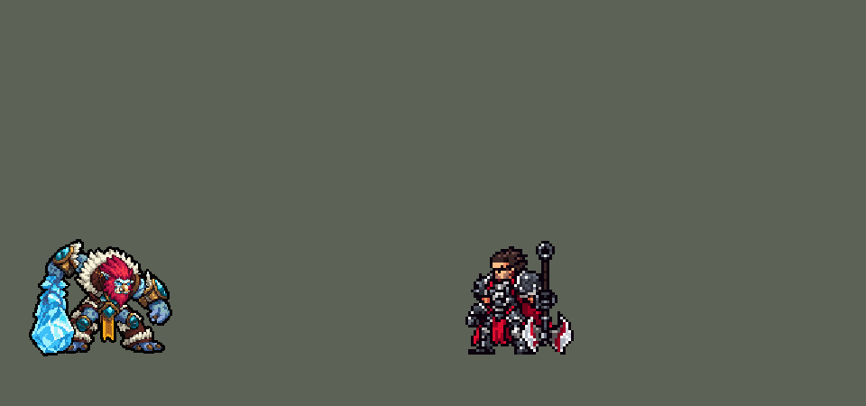

<!-- 本页上半部分由 tools/docs/gen_hero_docs.py 按仓库里现在的数据生成，手改会被覆盖；「开发记录」以下是手写的，生成时原样保留。 -->

# 特朗德尔 Trundle


| 项目 | 内容 |
|---|---|
| id | `league_trundle` |
| 所属的包 | 主包（mod_id `league`） |
| 分路 | 打野 |
| 分类 / 标签 | 近战（Melee） · AD / Melee / Tank |
| 高清帧 | PPU 2 |
| 附加包 | [特朗德尔附加包](#附加包)（`league_trundle`） |



其他预览：[skills](../preview/league_trundle_skills.gif)、[逐帧预览](../preview/league_trundle_frames.png)、[特效表](../preview/league_trundle_effects.png)

## 现在的技能

下面是游戏里显示的技能说明（`league/text/champion.i18n` 的简体中文，去掉了颜色和图标），冷却、距离来自 `league/champion/league_trundle.data_champion`；1 秒 = 60 tick。

### 普攻 / 被动

*攻击间隔 1.2 秒 · 攻击距离 25000*

抡冰棒。国王的贡品：打死单位回复12 + 8% 攻击力生命，冰面上双倍。冰封领域：利齿撕咬咬中英雄时冻住地面8秒（每12秒一次），其间攻速+50%、移速+15%。

### 技能1 · 利齿撕咬

*冷却 1 秒 · 施放距离 25000 · 施放：指定目标 · 敌人（不含防御塔）*

咬一口造成40 + 130% 攻击力物理伤害并减速60%；4秒内对方攻击力-15%，自己+20%。

### 技能2 · 寒冰之柱

*冷却 1 秒 · 施放距离 50000 · 施放：指定目标 · 敌方英雄*

在敌方英雄处立起寒冰之柱4秒，周围敌人减速25%。

### 大招 · 强权至上

*冷却 80 秒 · 施放距离 40000 · 施放：指定目标 · 敌方英雄*

吸取敌方英雄：立刻造成最大生命10%真实伤害，4秒内每秒再3%，每次回复20 + 10% 攻击力生命；偷走25%护甲和魔抗8秒。

### 数值

攻击力 84（每级 +13）、法强 10（每级 +5）、生命 1160（每级 +110）、护甲 34（每级 +9）、魔抗 28（每级 +4）、移速 1000（每级 +11）、生命回复 2（每级 +1）。

## 附加包

附加包是可选的原生代码 mod（都在附加包合集 `league_addons` 里），**不装主包里的英雄也是完整的**。

### 特朗德尔附加包

[特朗德尔附加包](../../addons/league_trundle/README.md)：`league_trundle` v0.1.0

| 机制 | 主包（纯数据） | 附加包 |
|---|---|---|
| 国王的贡品 | 只有**他自己打死**的单位回一口血，回固定的数（`p_heal` + `p_heal_r`% 攻击力），冰面上翻倍 | 他身边 `p_r` 内**任何敌方单位倒下**（谁打死的都算）都回它**最大生命 `p_pct`%** 的血，冰面上翻倍 |
| 冰封领域 | 冰面**跟着他走**：一个加攻速、移速、回血的 buff | 冰面**留在冻住的地方**（半径 `w_r` = 40000，和画面一样大，冰面的画面每秒在那里播一次），他站在里面才有攻速、移速、回血，并且受到的治疗多 `w_amp`% |
| 寒冰之柱 | 冰柱只是一圈减速 | 冰柱是**地形**（用户：「你要确认e真的能卡住人 而不是假的贴图」）：立在被冰柱打中的英雄**身后**（背对特朗德尔、紧贴着它），半径 `e_wall`，立 `e_t` 拍；两边的英雄、小兵、野怪、召唤物（特朗德尔自己也算）**都走不进去** |
| 利齿撕咬 | 双方攻击力按百分比改（他 +`q_gain`%，对方 -`q_sap`%） | 按**被咬者当时的攻击力**偷：他加它的 `q_flat`%，它减一半，各 `q_t` 拍 |
| 强权至上 | 双方护甲魔抗按百分比改，伤害是真实伤害，回固定的血 | 偷走目标**自己护甲、魔抗的 `r_steal`%**（`r_t + r_keep` 拍），伤害是**魔法伤害**（立刻 `r_pct0`%、之后每 `r_p` 拍 `r_pct`% 最大生命），**打掉多少血就回多少**（冰面上再放大） |

装上附加包后游戏里显示的说明（和主包不同的部分）：

- **普攻 / 被动**：【附加包】抡冰棒。国王的贡品：身边敌方单位倒下时回复它最大生命5%，冰面上双倍。冰封领域：利齿撕咬咬中英雄时在原地冻出冰面8秒（每12秒一次），站在上面攻速+50%、移速+15%，受到的治疗+25%。
- **技能1 · 利齿撕咬**：【附加包】咬一口造成40 + 130% 攻击力物理伤害并减速60%；4秒内偷走对方攻击力的20%（对方少一半）。
- **技能2 · 寒冰之柱**：【附加包】在敌方英雄身后立起寒冰之柱4秒：冰柱是地形，谁都过不去；周围敌人减速25%。
- **大招 · 强权至上**：【附加包】吸取敌方英雄：立刻造成最大生命10%魔法伤害，4秒内每秒再3%，吸多少回多少；偷走它40%护甲和魔抗8秒。

## 相关脚本和素材

- [`tools/kit/build_trundle.py`](../../tools/kit/build_trundle.py)
- [`tools/kit/setup_trundle.py`](../../tools/kit/setup_trundle.py)
- [`tools/lol/extract_trundle.py`](../../tools/lol/extract_trundle.py)
- [`tools/art/preview_trundle.py`](../../tools/art/preview_trundle.py)
- [`tools/art/rig_trundle.py`](../../tools/art/rig_trundle.py)
- [`assets/source/trundle/`](../../assets/source/trundle)

## 开发记录

> 下面是原来 README 里「英雄：特朗德尔」一节，原样搬过来（只改了相对链接）。

| 部分 | 内容 |
|---|---|
| 定位 | 打野（Melee，标签 AD / Melee / Tank），第 170 位英雄（J 组第五位）。巨魔之王 特朗德尔：弗雷尔卓德的冰霜巨魔，炸开的深红头发连着大红胡子，骨头一样的大鼻子、两颗獠牙、亮蓝眼睛，一圈白毛皮领子、青绿宝石金铜边的大肩甲，驼着背，右手拖着一根和他身子差不多长的寒冰狼牙棒 |
| 普攻 / 被动 | 抡冰棒（射程 25000，每 72 tick 一下，84 攻击 +13/级）。**国王的贡品**：他打死的单位回复 12 + 8% 攻击 的生命，站在冰面上双倍。**冰封领域**（并入被动）：利齿撕咬咬中敌方英雄时跳起冻住地面 8 秒（每 12 秒一次），其间攻速 +50%、移速 +15%、回血 +6 |
| 技能1 | **利齿撕咬**（冷却 5 秒，近战）：咬一口 40 + 130% 攻击 物理伤害，减速 60%；4 秒内对方攻击力 −15%，自己 +20% |
| 技能2 | **寒冰之柱**（冷却 9 秒，射程 50000，对敌方英雄）：在目标处立起冰柱 4 秒，16000 内的敌人减速 25%（主包里冰柱只减速，挡路在附加包里） |
| 大招 | **强权至上**（冷却 80 秒，射程 40000，对敌方英雄）：吸取敌方英雄——立刻造成最大生命 10% 真实伤害，之后 4 秒每秒 3%，每下回复 20 + 10% 攻击 的生命；对方护甲、魔抗 −25%、自己 +25%，持续 8 秒 |
| 连招 | 「有连招要做连招」：**冰柱 → 利齿撕咬马上好**：冰柱罩住敌方英雄时 Q 冷却清零，控制器马上咬够得着的英雄；**咬中英雄 → 冰封领域**：Q 咬中英雄、领域好着时，咬完立刻跳起冻地；**强权至上 → 利齿撕咬刷新 + 冰柱**：大招吸住英雄时 Q 冷却清零，并在他那里顺带冒一根冰柱（不占 E 的冷却）；**冰面上击杀 → 贡品双倍**：站在冰面上时打死单位回双倍血 |
| 数值 | 攻击 84（+13）、生命 1160（+110）、护甲 34（+9）、魔抗 28（+4）、移速 1000（+11）、射程 25000 |
| 平衡 | 经典引擎模拟（打野，对忍者、恶魔、猎人、狼人、吸血鬼，两边三套阵容；狼人同一批对局 +0.57 / +0.52）：草稿（生命 1150、攻击 88、冰柱减速 40% 6 秒、定身 0.5 秒）+9.46——冰柱的减速区每 10 tick 挂一次 20 tick 的减速，两层叠成 80%，改成一次一层；还是 +5.29；冰柱减速 25% 4 秒、范围 16000、冷却 9 秒、定身 20 tick +3.02；生命 1080、攻击 82、护甲 34、大招偷 25%、回血都削（贡品 12 + 8%、大招 20 + 10%、冰面回血 6）+1.60；再去掉定身 +0.05，定身 10 tick +0.12；不定身、生命 1120 +0.70 / +0.51（1–8 / 9–16 组种子，平均 +0.61）；接入时检查发现贡品的血回了两次（WithSelf 里的治疗在死掉的单位那边也执行了），改成控制器回血后 +0.20；**定稿：生命 1160、攻击 84** +0.51（16 组种子，狼人 +0.55） |
| 附加包 | `league_trundle`（在 `league_addons` 合集里，[`addons/league_trundle/README.md`](../../addons/league_trundle/README.md)）：用户「和英雄联盟不一样的地方要做附加包」——**贡品照英雄联盟**（身边任何敌方单位倒下都回它最大生命 5%）；**冰面留在地上**（半径 40000，站在里面才有加成，治疗 +25%）；**冰柱是真的地形**（用户：「你要确认e真的能卡住人 而不是假的贴图」——立在目标身后，两边谁都走不进去，奥恩岩柱、塔莉垭墙的挡路办法）；**利齿撕咬偷固定的攻击力**；**强权至上偷对方自己 40% 的护甲魔抗**，伤害是魔法伤害，吸多少回多少 |
| 精灵图（高清帧 PPU 2.0） | Codex 第 0 步画了 A（驼背待机，两稿）和 B（站直的大招姿势，两稿）（[`tools/art/pack_trundle_picture.py`](../../tools/art/pack_trundle_picture.py)），[`tools/art/design_trundle_hd.py`](../../tools/art/design_trundle_hd.py) 按原图自己的格子读回；用户定 A-1 原样（104×85，头发到脚底 42.5 游戏像素，PPU 2.0，[`tools/art/design_trundle_model.py`](../../tools/art/design_trundle_model.py) 只把远处的眼睛补成 2×1）。姿势包照英雄联盟原版的帧摆骨架（[`tools/art/pack_trundle_poses.py`](../../tools/art/pack_trundle_poses.py)，冰棒太长，用 9 px 的格子），Codex 画 16 个姿势，[`tools/art/design_trundle_poses.py`](../../tools/art/design_trundle_poses.py) 读回、贴回定稿的头（run1 的原稿被缩小过，按头的比例从原稿重读；吼叫的头按鬃毛对齐，剩下的鬃毛补掉），[`tools/art/rig_trundle.py`](../../tools/art/rig_trundle.py) 拼成待机、跑、普攻、Q、冰封领域的跳（`w`）、E、R、受击、阵亡 |
| 特效 | 15 张（[`tools/art/pack_trundle_fx.py`](../../tools/art/pack_trundle_fx.py) 的提示词，参考是英雄联盟里特朗德尔自己的贴图，[`tools/lol/fx_ref_trundle.py`](../../tools/lol/fx_ref_trundle.py)），Codex 画回来，[`tools/art/import_trundle_fx.py`](../../tools/art/import_trundle_fx.py) 切成 `league_trundle_fx` / `league_trundle_big`：冰棒砸中、贡品回血、咬、獠牙标记、减速霜、跳地冲击、冻地、脚下冰面、冰柱（立着那一帧停到 4 秒）、冰刺、吸取、锁链、碎盾。冰面用户嫌小（「那gif图的冰面那么小？」），冻地和脚下冰面按 80×26 格重画（`codex_fx/trundle_fx_redo`） |
| 音效 | 英雄联盟的音效和配音（[`tools/lol/extract_trundle.py`](../../tools/lol/extract_trundle.py)，15 段）：普攻的出手和打中，咬的出手和咬中，冰封领域，冰柱的出手、升起和罩住，大招的出手和吸取，贡品回血；配音：Q、W、E、R |
| 图标 | 官方技能图标（利齿撕咬、寒冰之柱、强权至上，另有冰封领域、国王的贡品），从本地客户端取 |
| 选人卡片 | 头发到脚底 42.5 游戏像素、连冰棒 52 宽：界面缩到 0.82（`league.dll` 的 UI_SIZES），脸 (5, −27)、`banpick_center` −12（`tools/art/bp_card_audit.py`）。待机按 `tools/art/hero_reels.py` 剪进蹲身蓄力和挥棒各一帧 |
| 俄洛伊的灵魂 | `tools/art/illaoi_souls.py` 加上特朗德尔（170 个），`league_illaoi` 0.2.7 |

重新生成（素材来自本机的英雄联盟客户端，音频不进仓库）：

```bash
python tools/lol/extract_trundle.py --lol "D:\WeGameApps\lol" --vgmstream <vgmstream-cli.exe>
python tools/kit/build_trundle.py                # 技能数据，数字都在脚本的参数表 P 里
python tools/kit/setup_trundle.py                # 五种语言的文字、音效配置、共享文件里他的键（脸 5,-27，卡片 -12）
python tools/art/design_trundle_hd.py            # Codex 第 0 步的原图读回（A-1 / A-2 / B-1 / B-2）
python tools/art/design_trundle_model.py         # 定稿 A-1 原样（远处的眼睛补成 2×1）
python tools/art/design_trundle_poses.py         # Codex 的姿势读回（贴回定稿的头）
python tools/art/import_trundle_fx.py            # 特效 -> league_trundle_fx / league_trundle_big（重画的冰面优先）
python tools/art/rig_trundle.py                  # 1 倍帧和 2.0 的原帧
python tools/art/ppu_restyle.py --hero trundle   # 外描边、脸的位置
python tools/art/ppu_hd.py --hero trundle        # hd_ / lo_ 帧（要在 hero_reels 之前）
python tools/art/hero_reels.py --hero trundle    # 待机和选人卡片的小动作
python tools/art/preview_trundle.py              # 预览、演示 GIF 和每个技能单独的 GIF
python tools/art/illaoi_souls.py                 # 俄洛伊的灵魂（加了英雄或改了待机都要重跑），再跑 addons/league_illaoi/make_override.py
python addons/league_trundle/make_override.py    # 附加包的特朗德尔副本（主包的特朗德尔改了以后要重跑）
```
