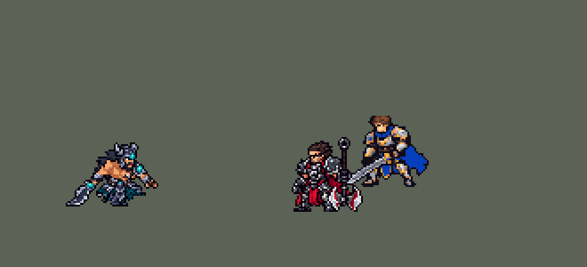

<!-- 本页上半部分由 tools/docs/gen_hero_docs.py 按仓库里现在的数据生成，手改会被覆盖；「开发记录」以下是手写的，生成时原样保留。 -->

# 泰达米尔 Tryndamere


| 项目 | 内容 |
|---|---|
| id | `league_tryndamere` |
| 所属的包 | 主包（mod_id `league`） |
| 分路 | 上单 |
| 分类 / 标签 | 近战（Melee） · AD / Melee |
| 高清帧 | 1 倍像素（无高清帧） |
| 附加包 | [蛮王残血开大附加包](#附加包)（`league_tryndamere_rage`） |



其他预览：[逐帧预览](../preview/league_tryndamere_frames.png)、[特效表](../preview/league_tryndamere_effects.png)

## 现在的技能

下面是游戏里显示的技能说明（`league/text/champion.i18n` 的简体中文，去掉了颜色和图标），冷却、距离来自 `league/champion/league_tryndamere.data_champion`；1 秒 = 60 tick。

### 普攻 / 被动（被动「战斗狂怒」）

*攻击间隔 1.03 秒 · 攻击距离 25000*

挥剑攻击。被动战斗狂怒：普攻和旋风斩每命中一个敌人得1层怒气，击杀得2层，最多5层，每层暴击率+8%（暴击造成2倍伤害）；停手5秒后每秒掉一层。

### 技能1 · 旋风斩

*冷却 8 秒 · 施放距离 45000 · 施放：指定目标 · 敌人（不含防御塔）*

旋转着冲过目标，对路径上的所有敌人造成100 + 160% 攻击力物理伤害，每命中一个敌人得1层怒气。

### 技能2 · 蔑视

*冷却 14 秒 · 施放距离 40000 · 施放：无目标 · 敌方英雄*

向周围的敌方英雄发出蔑视的怒吼，攻击力降低25%，持续4秒；离他较远、正要逃开的敌人还会减速40%，持续2秒。

### 大招 · 无尽怒火

*冷却 50 秒 · 施放距离 60000 · 施放：无目标 · 敌方英雄*

被两名以上敌方英雄贴身或连续挨打时爆发：怒气全满，5秒内生命不会降到1以下。结束时施放嗜血杀戮，消耗怒气回复60 + 30% 攻击力生命，每层怒气再加50 + 10% 攻击力。

### 数值

攻击力 86（每级 +17）、生命 1050（每级 +105）、护甲 30（每级 +8）、魔抗 25（每级 +4）、移速 1000（每级 +11）、生命回复 2（每级 +1）。

## 附加包

附加包是可选的原生代码 mod（都在附加包合集 `league_addons` 里），**不装主包里的英雄也是完整的**。

### 蛮王残血开大附加包

[蛮王残血开大附加包](../../addons/league_tryndamere_rage/README.md)：`league_tryndamere_rage` v0.2.1

主包 `league` 保持纯数据。数据读不到当前生命，主包里蛮王的 R 由 AI 在敌方英雄 60000 内时放出、**待命** 900 tick
（没用上就退还冷却）；待命期间他每次普攻查一次：被**两名以上**敌方英雄贴身、或**连续 5 次**检查都挨了打，才爆发「无尽怒火」。
SDK 模拟里这样开大时他的生命中位数是 75%，一半的阵亡发生在大招待命却没认出危险的时候。用户：「大招快没血的时候设置开也行」——
这个附加包用原生代码读生命，做成 League 玩家的按法：

- **快没血才开**：普攻里那段检查去掉，改由被动 `league_tryndamere_rage:guard`（挂在 `passive` 上，每 tick 运行，挨打时当场再看一次）决定：
  R 待命、没被控住、**身边 50000 内有敌方英雄**，而且**生命低于 15%**，或 **1 秒（60 tick）内被打掉 35% 以上、只剩 40% 以下**——
  爆发：怒气加满，5 秒内生命不会降到 1 以下，播主包 R 的动作、画面和声音；第 290 tick 喝嗜血杀戮，按怒气回血。
- **残血才按 R**（v0.2.0，用户：「再检查一下蛮王总是满血开大的问题」）：主包的 R 一看到敌方英雄就放出、待命 15 秒，
  游戏里每次放出都显示成「开大」，满血时一次次放（没用上退还冷却，过一会儿又放）。本包的 AI 钩子 `league_tryndamere_rage:ult`
  拦下 AI 的 R，改成普攻（打不到就走过去）；到了上面的残血条件、R 冷却好、身边有敌方英雄时由它按下 R，下一 tick 被动就爆发——
  显示的「开大」就是爆发那一刻。
- **大招没好时喝 Q**：R 在冷却（或 5 级以前）、身上有怒气、身边有敌方英雄、生命低于 30% 时喝嗜血杀戮（12 秒一次）；
  R 冷却好时留给 R，不喝。
  主包只在 R 结束时喝（数据版按「危险」喝会在满血时喝掉）。
- 数字都写在英雄数据的 `passive.params` 里，由 `make_override.py` 从 `tools/kit/build_tryndamere.py` 的参数表 `P` 写入（`n_*` 是本包的阈值），
  本包不另记一份。

## 相关脚本和素材

- [`tools/kit/build_tryndamere.py`](../../tools/kit/build_tryndamere.py)
- [`tools/kit/setup_tryndamere.py`](../../tools/kit/setup_tryndamere.py)
- [`tools/lol/extract_tryndamere.py`](../../tools/lol/extract_tryndamere.py)
- [`tools/art/preview_tryndamere.py`](../../tools/art/preview_tryndamere.py)
- [`tools/art/rig_tryndamere.py`](../../tools/art/rig_tryndamere.py)
- [`tools/art/import_tryndamere.py`](../../tools/art/import_tryndamere.py)
- [`tools/art/design_tryndamere.py`](../../tools/art/design_tryndamere.py)
- [`assets/source/tryndamere/`](../../assets/source/tryndamere)

## 开发记录

> 下面是原来 README 里「英雄：蛮王」一节，原样搬过来（只改了相对链接）。

| 部分 | 内容 |
|---|---|
| 定位 | 上单（战士，分类 Melee），用户排的第十三组的上单（同组：赵信、泽拉斯、莎弥拉、派克）。蛮族之王 泰达米尔：普攻、旋风斩叠怒气加暴击，W 怒吼削弱附近的敌人，R 在危险时让他 5 秒内死不了，结束时喝 Q 回血。四个选择都按推荐的来（用户选的）：E / W / R 三个技能位、Q 并进 R 的结尾，R 平时「待命等危险」，怒气 5 层 |
| 普攻 / 被动 | 普攻是近战挥剑，100% 攻击力的物理伤害，射程 25000，攻击间隔 62 tick（第 12 tick 砍中），会暴击（引擎的暴击：普攻 2 倍）。被动「战斗狂怒」：普攻每打中一次得 1 层怒气，E 每扫到一个敌人得 1 层，击杀（金克丝那套击杀检测）得 2 层，最多 5 层，每层暴击率 +8%（满层 40%，同英雄联盟 100 点怒气）。怒气同贾克斯的被动那样一层一层掉：最后一次命中后 300 tick 开始掉，之后每 60 tick 掉一层。满层时脚下和身边烧着一层红光。Q「嗜血杀戮」的被动（按已损生命加攻击力）读不到生命，并进了基础攻击力 |
| 技能1 | E「旋风斩」：冷却 480 tick（8 秒），射程 45000，也对小兵和野怪放。旋转着朝目标冲 48000（RushTime，穿过目标），路上半径 15000 内的敌人都受到 100 + 160% 攻击力的物理伤害，每砍到一个得 1 层怒气（不会暴击）；英雄联盟暴击减冷却并进了冷却时间 |
| 技能2 | W「蔑视」：冷却 840 tick（14 秒），身边 40000 内有敌方英雄时放。怒吼：40000 内的敌方英雄攻击力降低 25%，持续 4 秒；离他 12000 以外的（英雄联盟是背对他的，这里读不到朝向，远一点的就是正要跑开的）再减速 40%，持续 2 秒 |
| 大招 | R「无尽怒火」：冷却 50 秒，凯尔那样「待命」：敌方英雄进到 60000 内时放出，待命 900 tick（15 秒），没用上就退还冷却。待命期间他每次普攻查一次危险：被两名以上敌方英雄贴身（30000 内），或连续 5 次检查都挨了打（瑟提那样用 1 点护盾感知挨打）——就爆发：怒气加满，300 tick（5 秒）内生命不会降到 1 以下（`undying`），播 R 的动作、火焰和配音；第 290 tick 喝 Q「嗜血杀戮」：回 60 + 30% 攻击力的生命，每层怒气再加 50 + 10%，然后清空怒气 |
| 附加包（站桩） | 可选的附加包 [`addons/league_ult_press`](../../addons/league_ult_press/README.md)（在附加包合集里，原生代码，主包不装它也完整）：游戏 0.6.4 的 AI 常让这位英雄在敌方英雄跟前站着不打——只读观察包里（148 局）身边 50000 内有敌方英雄时站着不动 18.4%，这些时候 AI 下令「走到自己脚下」占 9.6%、什么命令都没下占 81.7%（盖伦 2.8%，所有英雄的中位数 8.8%）。照卡蜜尔等十位的办法（用户：「李青、泰达米尔、塔里克照卡蜜尔的规则加进站桩名单，做完开 PR」）：原地站了 15 tick、普攻好了、AI 还让他原地站时，35000 内最近的敌方英雄——他生命不低于一半、目标离敌方塔 75000 以外、目标身边 60000 内的敌方英雄不多于他身边的我方英雄（含他）——就普攻他，打出一下或 1.5 秒后重新算。怒气附加包 league_tryndamere_rage 挡下 AI 自己的 R、快死时才放 R；这条不碰 R 命令，游戏按 priority 从低到高依次跑钩子、后跑的可以改前面的结果，谁先谁后保命的 R 都照放 |
| 残血开大附加包 | 用户：「大招快没血的时候设置开也行」。数据读不到当前生命，主包只能按上面的「危险」开（SDK 模拟里开大时生命中位数 75%）。附加包 [`addons/league_tryndamere_rage`](../../addons/league_tryndamere_rage/README.md) 用原生代码读生命：身边 50000 内有敌方英雄、生命低于 15%（或 1 秒内被打掉 35% 以上、只剩 40% 以下）才开；0.2.0 起 AI 也只在这时按 R（之前 AI 一看到敌人就放出 R 待命，游戏里显示成满血开大，用户：「蛮王总是满血开大」）；R 没好时生命低于 30% 喝 Q（12 秒一次）。主包不装附加包也完整可玩；附加包只做了单元测试，开大时机要在游戏里看日志确认 |
| 数值 | 攻击 86（+17）、生命 1050（+105）、护甲 30（+8）、魔抗 25（+4）、移速 1000（+11）、生命回复 2（+1）。英雄联盟的蛮王攻击没有成长（嗜血的被动），这里按 Melee 的基础调低一点。数值是自己设计的，用 SDK 对战模拟调：上路，对 6 个原版上单（`fighter`、`executioner`、`lancer`、`pole_warrior`、`knight`、`berserker`），3 套阵容、两边各打，10 分钟。初稿 −0.62（按危险喝 Q 会在满血时喝掉）；Q 只在 R 结束时喝 −0.03；E 70 + 120% → 100 + 160%、冷却 9 → 8 秒、生命 1000 → 1050 后种子 1–12 +1.34、13–24 +1.24（原版斗士 +1.14 / +0.72，本包的瑟提 +1.08 / +1.24）。每层暴击 10% 差不多，用 8% 保持英雄联盟满怒气 40% |
| 亚索联动 | 蛮王没有击飞或控制，W 只是减速，不算亚索大招要的控制，不用调 |
| 精灵图 | 9 个动作 53 帧：待机、移动、普攻、E（`skill`）、W（`skill2`）、Q（`skill_q`）、R（`ult`）、受击、死亡。造型 53 × 37 px（含拖在身后的大剑；原来 57 × 40，用户在游戏里看：「蛮王还可以缩小点吧 在局内有点大 略微缩小就行了」），24 色。待机 6 帧同一张、不呼吸；头像截取点 (9, −35)，待机最高点 −25，不用选人卡片位置 |
| 特效 | Codex 生图的 11 张（`import_tryndamere.py` 缩成游戏像素）：`league_tryndamere_fx` 普攻、E、W 的命中，Q 的回血红光，满怒气的红光，W 的减攻标记（头顶的断剑）和减速标记；`league_tryndamere_big` E 绕身转的刀光、W 的怒吼冲击波、R 爆发的火焰和不死期间身上的火 |
| 音效 | 英雄联盟的音效和配音（`tools/lol/extract_tryndamere.py`）：普攻挥剑、命中，E、W、Q、R；E、W、R 各一句中文配音。版权属于 Riot Games，**不提交到仓库**，按下面的命令在本地生成 |
| 图标 | 官方技能图标（E / W / R），从本地客户端提取，缩到 64×64 |

重新生成（素材来自本机的英雄联盟客户端，音频不进仓库）：

```bash
python tools/lol/extract_tryndamere.py --lol "D:\WeGameApps\lol" --vgmstream "<vgmstream-cli.exe 路径>"
python tools/kit/build_tryndamere.py        # 技能数据，数字都在脚本的参数表 P 里；--nodes 看每棵技能树的节点数
python tools/kit/setup_tryndamere.py --face 9,-35   # 五种语言的文字、音效配置、共享文件里他的键
python tools/art/design_tryndamere.py       # 造型：Codex 原稿 A_retry 按格子读回、整行整列删到 40 行（脸不动），再删到 37 行
python tools/lol/native_pose.py assets/source/tryndamere/poses.json --out <渲染文件夹>   # 动作参考帧
python tools/art/rig_tryndamere.py          # 动作：每帧都是造型本身，手臂连剑整块转；--review <文件夹> 先看
python tools/art/import_native.py --hero tryndamere
python tools/art/import_tryndamere.py       # 特效；--raw <Codex 的特效交付文件夹> 先把生图原稿缩成游戏尺寸的原尺寸条
python tools/art/preview_tryndamere.py
python addons/league_tryndamere_rage/make_override.py   # 附加包的英雄数据和文字（主包的蛮王改了以后重跑）
```

美术（原画的提示词见 [`assets/source/tryndamere/PICTURE_PROMPT.md`](../../assets/source/tryndamere/PICTURE_PROMPT.md)，造型的见 [`MODEL_PROMPTS.md`](../../assets/source/tryndamere/MODEL_PROMPTS.md)，动作的见 [`MODEL_STRIPS.md`](../../assets/source/tryndamere/MODEL_STRIPS.md)，特效的见 [`PROMPTS_FX.md`](../../assets/source/tryndamere/PROMPTS_FX.md)；Codex 的交付说明在 [`codex_picture/`](../../assets/source/tryndamere/codex_picture)、[`codex_model/`](../../assets/source/tryndamere/codex_model)、[`codex_strips/`](../../assets/source/tryndamere/codex_strips)、[`codex_fx/`](../../assets/source/tryndamere/codex_fx)）：

- 原画：Codex 画了 A（英雄联盟的待机：大剑拖在身后）、B，用户选 A。
- 造型：Codex 按游戏尺寸画的 40 行是隔列删出来的，碎成杂点；它重画的原稿 A_retry 按自己的格子读回是 80 × 56。按面积投票缩（眼睛没了）、贴大头再手画脸都被否了（「眼睛都看不到」「这是做的什么啊」）；改成薇恩、锐雯那样整行整列地删：原稿颜色先归成 24 色，每组里和邻行最像的那行删掉，眼睛、脸、胡子、嘴那几行几列和角尖那一行不删，删到 40 行，删掉描边的地方补描边。用户从四个版本里选「40 行原样」——每一格都是原稿自己的。之后在游戏里嫌大（「略微缩小就行了」），照锐雯缩小的办法在 40 行上再整行整列删到 37 行（删 40 行造型的第 80、87、96 行和第 44、55、66、90 列，脸和角尖不删，描边补齐），宽 57 → 53；动作的部件、关节和行号仍按 40 行写，`rig_tryndamere.py` 按保留的行列自动换算到 37 行。大剑单独缩：删同样两行，列改成剑身在这两行的中间一列（照身体删的列会在剑身上斜错两行，转起来像折了：「蛮王缩小后 攻击的时候模型有点变形？」）；放技能时上身前倾、后仰最多 0.10（肩膀错开 1 格），0.20 在 37 行上看着身体歪了。
- 动作参考（`poses.json`）：镜头 yaw 60、pitch 20，镜像（yaw 45 看到的是背）；头 2.6 倍、腿 0.85、头发 0.5（长马尾不挡人）；高度 40。普攻第 5 帧（第 12 tick）砍中，W 第 4 帧（第 10 tick）怒吼，和技能数据一致。
- 动作：Codex 的动作条（[`codex_strips/`](../../assets/source/tryndamere/codex_strips)，它自己的交接写着「未通过视觉验收」）举剑时手臂是细木板、E 是一根棍、死亡时身体碎开。用户：「codex实在太笨了 ... 我们自己来修复」。改成全部用造型自己的像素摆（`rig_tryndamere.py`，通用的部分做成了 [`tools/art/rigkit.py`](../../tools/art/rigkit.py)，以后的英雄可以直接用）：握剑的手臂连同大剑从造型上整块切下，绕肩膀只做 90° 的整数倍旋转（举到身后、举过头顶、劈到身前；E 转一整圈）；另一只手臂也是造型自己的，Q、W、R 转上去举拳、W 翻过来往前伸；身体、头、腿每帧和待机一格不差，位移都是整个人一起动。先后被否的做法：镜像的剑（弧度反了）、只挪上半身（腰错位，「刀和身体 有点变形吧」「放技能还是受击打的时候变形」）、沿骨骼画的手臂和错切拉平的手臂（「左手右手释放技能都变形」）、死亡时删 7 行腿再左右平移（「死亡动画整个模型变形」）。现在的死亡：整个人后退一格，剑先甩到身后再脱手插在地上，膝盖只弯 4 行。跑步两腿从胯部交替迈步，脚收到胯下。之后用户在游戏里看：「蛮王在游戏里有点僵硬 和之前希维尔一个问题」——放技能时身体和待机一模一样。改成希维尔那样身体跟着动：上身沿胯部前倾、后仰（每行按离胯的高度错开，腰不断开；头整块跟着下巴那一行移，不错切），两只手臂跟着肩膀走，整个人前后挪步、离地起跳：普攻先后仰收剑、劈下时扑出两格，E 前倾着转、中间离地，W 先后仰再往前吼，Q、R 挺胸后仰。
- 特效用 Codex 画的 11 张（生图原稿，`import_tryndamere.py --raw`：每张按格子等分，每个游戏像素取覆盖的原稿像素里最多的颜色，颜色归到包里给每张的色阶——血红、余烬橙、暗红，断剑标记和灰烬保留描边、光效外圈最暗的一档去掉）。位置：E 的刀光以腰为中心（(7, −2)，跟着他冲过去），Q 的红光在胸口（(6, −8)），W 的冲击波、R 的火、满怒气的光按地上椭圆最宽的一行对在脚下，减攻的断剑在头顶。游戏里看（「特效盖不住身体」）：他连拖着的大剑约 57 格宽，火焰只有 35 格——不死的火焰、满怒气的光、R 的爆发按原高度画、横向拉宽 1.7–1.75 倍，盖住整个人；R 的爆发和 W 的冲击波对准躯干（站位点往前 6 格：他前倾，躯干在两脚中间的前面）。不死的火焰和满怒气的光是 buff 的画面，游戏不按朝向翻转，只能以站位点为中心左右对称。

逐帧预览：[`docs/preview/league_tryndamere_frames.png`](../preview/league_tryndamere_frames.png?v=1014g)，特效：[`docs/preview/league_tryndamere_effects.png`](../preview/league_tryndamere_effects.png?v=1014g)。
