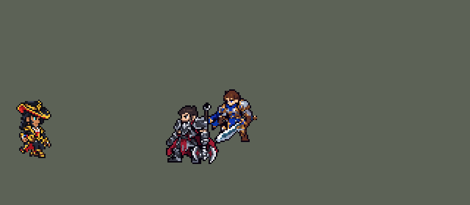

<!-- 本页上半部分由 tools/docs/gen_hero_docs.py 按仓库里现在的数据生成，手改会被覆盖；「开发记录」以下是手写的，生成时原样保留。 -->

# 崔斯特 Twisted Fate


| 项目 | 内容 |
|---|---|
| id | `league_twistedfate` |
| 所属的包 | 主包（mod_id `league`） |
| 分路 | 中单 |
| 分类 / 标签 | 法师（Magician） · AP / Magic / CC |
| 高清帧 | 1 倍像素（无高清帧） |
| 附加包 | [游戏 AI 不按的技能替它按](#附加包)（`league_ult_press`） |



其他预览：[逐帧预览](../preview/league_twistedfate_frames.png)、[特效表](../preview/league_twistedfate_effects.png)

## 现在的技能

下面是游戏里显示的技能说明（`league/text/champion.i18n` 的简体中文，去掉了颜色和图标），冷却、距离来自 `league/champion/league_twistedfate.data_champion`；1 秒 = 60 tick。

### 普攻 / 被动（被动「灌铅骰子」）

*攻击间隔 1.1 秒 · 攻击距离 57500*

扔牌攻击。被动灌铅骰子：普攻或万能牌击杀单位时掷骰子，按点数获得少量法强，死亡清空。卡牌骗术：每第4次攻击额外造成80 + 60% 法强魔法伤害。

### 技能1 · 万能牌

*冷却 4 秒 · 施放距离 95000 · 施放：方向 · 敌人（不含防御塔）*

扔出三张牌，沿途每个敌人受到120 + 100% 法强魔法伤害。出手前方向就已锁定，可以躲开。

### 技能2 · 选牌

*冷却 5 秒 · 施放距离 75000 · 施放：无目标 · 敌人（不含防御塔）*

头顶蓝、红、金牌轮换，转到想要的就锁定，下次普攻扔出（另加100% 攻击力）：蓝牌60 + 100% 法强，技能冷却减半；红牌目标周围50 + 70% 法强并减速；金牌30 + 60% 法强并眩晕1.67秒。

### 大招 · 命运

*冷却 90 秒 · 施放距离 960000 · 施放：无目标 · 敌方英雄*

所有敌方英雄头顶出现标记。传送之门：引导1.5秒（被控打断）后传到远处队友正在打的敌方英雄身边，落地锁定金牌。身边没有敌人时才会用。

### 数值

攻击力 90（每级 +8）、法强 42（每级 +21）、生命 975（每级 +106）、护甲 24（每级 +7）、魔抗 22（每级 +3）、移速 920（每级 +10）。

## 附加包

附加包是可选的原生代码 mod（都在附加包合集 `league_addons` 里），**不装主包里的英雄也是完整的**。

### 游戏 AI 不按的技能替它按

[游戏 AI 不按的技能替它按](../../addons/league_ult_press/README.md)：`league_ult_press` v0.5.6（通用附加包，下面只列和崔斯特有关的部分）

|  | 装了附加包，什么时候按 |
|---|---|
| 崔斯特 R | 只在主包会传送的局面按：**他身边 75000 内没有敌方英雄**、生命不低于 **40%**，而且离他 **100000–340000** 有队友 **50000 内贴着敌方英雄**（在打架）。之后揭示、引导、传送全按主包的数据（主包的门槛：身边 70000 内没敌人、360000 内有被我方打过的敌方英雄、那人 60000 内有队友） |

## 相关脚本和素材

- [`tools/lol/extract_twistedfate.py`](../../tools/lol/extract_twistedfate.py)
- [`tools/art/preview_twistedfate.py`](../../tools/art/preview_twistedfate.py)
- [`tools/art/rig_twistedfate.py`](../../tools/art/rig_twistedfate.py)
- [`tools/art/import_twistedfate.py`](../../tools/art/import_twistedfate.py)
- [`tools/art/design_twistedfate.py`](../../tools/art/design_twistedfate.py)
- [`assets/source/twistedfate/`](../../assets/source/twistedfate)

## 开发记录

> 下面是原来 README 里「英雄：崔斯特」一节，原样搬过来（只改了相对链接）。

| 部分 | 内容 |
|---|---|
| 定位 | 中单（远程法师，分类 Magician），用户 10 月 2 日排的第十一组的中单。卡牌大师：W 选牌（蓝、红、金三张牌真的在头顶轮换），Q 万能牌，R 命运 + 传送之门去支援队友 |
| 普攻 / 被动 | 扔牌普攻，射程 57500，攻击间隔 66 tick（比包里其他法师短：E 和 W 的牌都靠普攻扔出）。E「卡牌骗术」并入普攻：每第 4 次攻击（选牌扔出的牌也算）额外造成 80 + 60% 法强的魔法伤害，出手时手上一闪洋红光。被动「灌铅骰子」：普攻或万能牌击杀单位时头顶掷一颗骰子，点数按固定的乱序出（4、1、6、3、5、2），3 点以上加一点法强，6 点加两点，死亡清空（英雄联盟里给金币，团战经理的数据改不了金币，换成法强） |
| 技能1 | Q「万能牌」：冷却 4 秒，射程 95000。扔出一条穿透的牌带（画面是三张牌飞着散开），沿途每个敌人受到 120 + 100% 法强的魔法伤害；附近有敌方英雄时朝他扔（出手前锁定方向，可以躲开），否则朝施法方向扔（清线、打野） |
| 技能2 | W「选牌」：冷却 5 秒。头顶的蓝、红、金三张牌按英雄联盟的节奏轮换（每 0.5 秒一张），AI 转到想要的那张就锁定（攻击范围内有敌方英雄 → 金牌，扔向他；目标周围有一群小兵或野怪 → 红牌；单个目标 → 蓝牌），下一次普攻扔出（另加 100% 攻击力）：蓝牌 60 + 100% 法强并返还 Q、W 的冷却（他胸口一闪蓝光）；红牌在目标周围 25 格内造成 50 + 70% 法强伤害，并减速 30%，持续 2 秒；金牌 30 + 60% 法强并眩晕 1.67 秒（被眩晕的人头顶金星转圈） |
| 大招 | R「命运」+「传送之门」：冷却 90 秒。所有敌方英雄头顶出现命运之眼（只是标记：团战经理没有能改视野的接口）；他身边没有敌人、远处有队友正在打敌方英雄时，引导 1.5 秒（被控制打断），然后传送到那个敌人身边（停在 25 格外），落地锁定金牌。**10 月 18 日**用户：「卡牌和流浪推水晶的时候会往泉水里传送」——找人的那条隐形直线每 tick 走 120000、判定圈只有 25000，只在每 tick 停下的地方看碰没碰到人，离他 145000–215000、265000–335000 的人都碰不到，于是飞满 360000，越过那个敌人和水晶落进泉水（地图边上截住），落地 2 秒内就死（模拟 24 局：约 75 次传送里 27 次飞满，5 次落在敌方泉水 70000 内）；现在每 tick 走 50000（不超过判定圈的宽度，不漏人），只有碰到敌方英雄才开目的地的门、传送过去，碰不到就不传（`tools/fix/warp_beacon.py`）。改后 26 局没有一次落在敌方泉水 120000 内；中路对 5 个原版法师 16 局种子：+0.96 → +1.23，每局阵亡 2.6 → 2.5 |
| 连招 | 用户要求：「有连招要做连招」「都要帮我补」。英雄联盟的 **金牌→Q**：金牌（普通的和带卡牌骗术的两张）打中英雄时给他挂 100 tick 的连招窗口（= 金牌的眩晕时长）；窗口里放 Q，先找 105000 内被控制的敌方英雄（通常就是刚被晕住的那个），找到就在第 1 tick 朝他扔出万能牌（平时第 12 tick、朝附近随便一个英雄），窗口随之用掉；没找到（被免控挡下、眩晕已经过了）就和原来一样。伤害、冷却都不变；Q 在冷却就不接（返还会把 W 的冷却一起压掉，多一次选牌，所以不做返还）。数据由 [`tools/fix/combo_twistedfate.py`](../../tools/fix/combo_twistedfate.py) 改。窗口里这发 Q 一定打中被晕的人，满伤害时模拟两批 +1.27 / +0.71 → +2.52 / +2.02（远超同路），改成 60% 伤害（72 + 60% 法强）后 → +2.06 / +1.10 |
| 附加包 | 可选的附加包 [`addons/league_ult_press`](../../addons/league_ult_press/README.md)（在附加包合集里，原生代码，主包不装它也完整）：游戏 0.6.4 的 AI 几乎不按他「备好」的命运（每 10 分钟 0.7 次）。附加包只在主包会传送的局面替 AI 按（用户：「莎弥拉和卡牌用附加包在合适时机替AI按R，主包保持现在这样」）：他身边 75000 内没有敌方英雄、生命不低于 40%，而且离他 100000–340000 有队友 50000 内贴着敌方英雄；之后揭示、引导、传送全是主包的数据 |
| 数值 | 攻击 85（+8）、法强 40（+20）、生命 920（+100）、护甲 24（+7）、魔抗 22（+3）、移速 920（+10）。数值是自己设计的，用 SDK 对战模拟调：中路，对 5 个原版法师（`pyromancer`、`ice_mage`、`lightning_mage`、`wind_mage`、`white_mage`），每批两边各 12 局。第一版 −3.2（Q 只有 15% 打到英雄，金牌扔到小兵身上，R 传进去送死）；Q 先锁定附近的英雄、金牌只留给英雄、红牌只在成群时选：−1.3；Q 120 + 100%、冷却 4 秒，牌和 E 加强：+0.6；R 落在战场 25 格外、冷却 90 秒（之前每局因为传送多死 0.9 次）：+0.4；再加生命和护甲、金牌眩晕加长、W 冷却 5 秒：三批 +1.36 / +1.85 / +1.30，和包里的中单持平（瑞兹 +1.50、安妮 +2.03），定下这版。亚索和他同队时，大招每局对英雄放 1.23 次（阿狸 1.27），亚索不用改 |
| 精灵图 | 10 个动作 51 帧：待机、移动、普攻、Q、W、R 命运、R 传送引导、R 落地、受击、死亡。造型按用户在 Codex 里挑的原画 A（英雄联盟的待机，三色牌扇拿在腰间），Codex 的生图草稿按自己的格子读回、删到 40 行（`design_twistedfate.py`，用户：「4 原稿删到40行」）；每个动作都用造型自己的部件摆出（`rig_twistedfate.py`）。24 × 41 px，21 色；待机 6 帧同一张（不呼吸）；待机最高点 −29，`banpick_center` 设 −10；头像截取点 (−4, −40) |
| 音效 | 英雄联盟的音效和语音（`tools/lol/extract_twistedfate.py`）：扔牌和命中、E、Q、W 翻牌，锁定蓝 / 红 / 金牌（带语音），三色牌扔出和命中，R 施放和传送（带语音），落地，骰子 |
| 修正（0.170.2） | 用户让查附加包日志时在芸阿娜身上发现：引擎给大招冷却封顶时，把 `skill_cooldown_mult` 也算进去（技能冷却削减同时压大招）。蓝牌返还 Q、W 冷却时把 90 秒的大招冷却也压到一半。同一个 buff 加上相同大小的负 `ult_cooldown_mult` 抵掉（[`tools/fix/ult_cooldown_offset.py`](../../tools/fix/ult_cooldown_offset.py) / 生成脚本），只减原本要减的技能。经典模拟（8 个种子，三套阵容两边各打） +0.60 → +1.41（误差），每局按大 5.6 → 5.4 次 |

重新生成（素材来自本机的英雄联盟客户端，音频不进仓库）：

```bash
python tools/lol/extract_twistedfate.py --lol "D:\WeGameApps\lol" --vgmstream "<vgmstream-cli.exe 路径>"
python tools/art/design_twistedfate.py      # 造型：Codex 的生图草稿按自己的格子读回，删到 40 行
python tools/art/rig_twistedfate.py         # 动作：全部用造型的部件摆出
python tools/art/import_native.py --hero twistedfate
python tools/art/import_twistedfate.py      # 特效；--raw <Codex 的特效交付文件夹> 先把生图原稿缩成游戏尺寸的原尺寸条
python tools/art/preview_twistedfate.py
```

美术（原画的提示词见 [`assets/source/twistedfate/PICTURE_PROMPT.md`](../../assets/source/twistedfate/PICTURE_PROMPT.md)，造型的见 [`MODEL_PROMPTS.md`](../../assets/source/twistedfate/MODEL_PROMPTS.md)，动作的见 [`MODEL_STRIPS.md`](../../assets/source/twistedfate/MODEL_STRIPS.md)，特效的见 [`PROMPTS_FX.md`](../../assets/source/twistedfate/PROMPTS_FX.md)；Codex 的交接说明在 [`codex_picture/`](../../assets/source/twistedfate/codex_picture)、[`codex_model/`](../../assets/source/twistedfate/codex_model)、[`codex_strips/`](../../assets/source/twistedfate/codex_strips)、[`codex_fx/`](../../assets/source/twistedfate/codex_fx)）：

- 原画和造型：Codex 画了 A、B 两张原画，用户选 A（「崔斯特原图选A」）。造型 Codex 交了用脚本拼的 A、B 和三张生图草稿，用户选了生图草稿删到 40 行：按自己的格子读回是 32 × 59，颜色按 CIELAB 归到 Codex 的 25 色，整行整列删到 40 行（脸、青色眼睛所在的行列和三行鞋底不删）。帽檐挡住一只眼，只露一只青色的眼睛。
- 动作：Codex 的动作条是用脚本拼的：头、躯干、小腿贴造型，会动的手臂和走路的腿都画成 3 格粗的线（普攻和 Q 是一条横在胸前的木板手臂，W、受击、R、传送是一根管子手臂加一块方块手，走路、Q 的下蹲、传送和倒下是火柴腿）。用户：「奇怪的地方你帮我修复 不再让codex返工了」。现在每一帧都是造型本身，只动这个动作要动的地方：右臂（远侧那只手，英雄联盟里扔牌的手）照瑞兹的做法拆成大臂和小臂两段，每段都是造型自己的格子，45° 以内逐行错开，往前伸时整段转 90°（外侧朝上），接近 45° 时加宽一格，往前伸时大臂少一行（伸向镜头），画在身体后面；牌扇一直在左手腰间（扔出去的牌是特效）。普攻和 Q：第 2–3 帧上身后仰一格蓄力，第 4 帧（第 12 tick）手往前上方甩出、上身前倾一格；Q 第 2–3 帧小跳一格。走路按英雄联盟的速度，一个步态 868 毫秒（8 帧），两条腿从胯部整条摆，一步换一次脚，两脚最远 11 格，着地时上身低一格，右臂和右腿反着摆；腿离开外套开口时露出外套的红色内衬。R 传送引导和落地：外套整体压低两格盖住靴子，头再低一格（腿不画成弯的）。受击上身后仰一格。死亡以后脚跟为轴往后倒，最后仰面躺着。右臂用户审了三次：先是我按造型的颜色重画的一条直臂（「走路时右手这里有点奇怪」「放技能的时候右手臂应该也不对 要改全都改了」：粗直的棍子，手是尖的），再是把造型的整只手臂用 RotSprite 转（「怎么后面释放技能手臂变形了啊」），最后是两段的做法（「可以」）。
- 导入：待机 6 帧同一张，不呼吸（同希维尔：选人卡片不晃）；按青色的眼睛定头的位置（`EYES`）；描边补齐（`COMPLETE`）。
- 特效用 Codex 画的 29 张（135 帧生图原稿，`import_twistedfate.py --raw` 同希维尔：每个游戏像素取覆盖的原稿像素里最多的颜色，颜色归到包里给每张的色阶——蓝牌、红牌的火、金色、紫色牌背、牌面纸色和牌的墨色描边——光效外圈最暗的一档去掉，牌和骰子保留描边）。飞行的牌定在牌身上（不在拖尾上），E 和 Q 出手的闪光在扔牌的手上 (11, −12) / (11, −8)，选牌的三色牌、锁定的牌、骰子和命运之眼在帽子上方 2 格，红牌爆炸、传送门和目的地的圈心在脚下；传送门和目的地的循环帧排满 1.5 秒引导。骰子 2–6 点缩小后点糊在一起：骰子正面高一行，点按 3 × 3 的格子重新点上（每点 1 格，点间空 1 格，1 点是红色十字）。审核时用户问「卡牌眩晕后没记号的吗？敌方英雄」「蓝牌也没特效」：补了金牌眩晕的标记（三颗金星在被眩晕的人头顶转圈，持续 100 tick，按包里的金色画在导入脚本里）和蓝牌返还冷却时他胸口的蓝光（蓝牌命中水花的后几帧）。

逐帧预览：[`docs/preview/league_twistedfate_frames.png`](../preview/league_twistedfate_frames.png?v=1014g)，特效：[`docs/preview/league_twistedfate_effects.png`](../preview/league_twistedfate_effects.png?v=1014g)。
