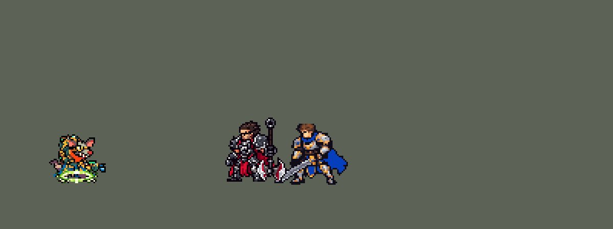

<!-- 本页上半部分由 tools/docs/gen_hero_docs.py 按仓库里现在的数据生成，手改会被覆盖；「开发记录」以下是手写的，生成时原样保留。 -->

# 图奇 Twitch


| 项目 | 内容 |
|---|---|
| id | `league_twitch` |
| 所属的包 | 主包（mod_id `league`） |
| 分路 | ADC |
| 分类 / 标签 | 射手（Range） · AD / Range / Dot |
| 高清帧 | PPU 2.2 |
| 附加包 | [参与击杀附加包：金克丝、崔丝塔娜、易、图奇](#附加包)（`league_takedowns`） |



其他预览：[skills](../preview/league_twitch_skills.gif)、[逐帧预览](../preview/league_twitch_frames.png)、[特效表](../preview/league_twitch_effects.png)

## 现在的技能

下面是游戏里显示的技能说明（`league/text/champion.i18n` 的简体中文，去掉了颜色和图标），冷却、距离来自 `league/champion/league_twitch.data_champion`；1 秒 = 60 tick。

### 普攻 / 被动（被动「死亡毒液」）

*攻击间隔 0.9 秒 · 攻击距离 55000*

弩箭攻击。被动死亡毒液：普攻、毒桶和大招的箭每次挂一层毒，每层6秒内每秒造成1 + 2% 攻击力真实伤害。

### 技能1 · 埋伏

*冷却 15 秒 · 施放距离 90000 · 施放：指定目标 · 敌方英雄*

伪装隐身最多5秒并加速20%，出手即现形，之后6秒攻速+35%。击杀敌方英雄时刷新冷却。

### 技能2 · 剧毒之桶

*冷却 11 秒 · 施放距离 90000 · 施放：指定目标 · 敌人（不含防御塔）*

扔出毒桶：范围内敌人挂一层毒并减速30%，毒池持续3秒。随后接毒性爆发：每层毒造成6 + 16% 攻击力物理伤害。

### 大招 · 火力全开

*冷却 60 秒 · 施放距离 70000 · 施放：指定目标 · 敌方英雄*

6秒内射程+300、攻击力+15，弩箭穿透一条直线，每多穿一个少10%（最低60%）。两名敌方英雄在附近时施放。

### 数值

攻击力 94（每级 +19）、生命 900（每级 +88）、护甲 20（每级 +7）、魔抗 15（每级 +3）、移速 900（每级 +9）。

## 附加包

附加包是可选的原生代码 mod（都在附加包合集 `league_addons` 里），**不装主包里的英雄也是完整的**。

### 参与击杀附加包：金克丝、崔丝塔娜、易、图奇

[参与击杀附加包：金克丝、崔丝塔娜、易、图奇](../../addons/league_takedowns/README.md)：`league_takedowns` v0.3.3

| 英雄 | 主包（纯数据） | 装了附加包 |
|---|---|---|
| 图奇 | 埋伏：他击杀敌方英雄时刷新；E 毒性爆发：最近打中英雄 3 次后、或毒桶落地后就引爆 | 埋伏助攻也刷新；E 等到有人满 6 层毒、或这一爆能毒死人才引爆（v0.3.0），条件一满足下一箭就爆（v0.3.1） |

## 相关脚本和素材

- [`tools/kit/build_twitch.py`](../../tools/kit/build_twitch.py)
- [`tools/kit/setup_twitch.py`](../../tools/kit/setup_twitch.py)
- [`tools/lol/extract_twitch.py`](../../tools/lol/extract_twitch.py)
- [`tools/art/preview_twitch.py`](../../tools/art/preview_twitch.py)
- [`tools/art/import_twitch.py`](../../tools/art/import_twitch.py)
- [`tools/art/design_twitch.py`](../../tools/art/design_twitch.py)
- [`assets/source/twitch/`](../../assets/source/twitch)

## 开发记录

> 下面是原来 README 里「英雄：图奇」一节，原样搬过来（只改了相对链接）。

| 部分 | 内容 |
|---|---|
| 定位 | ADC（射手，分类 Range），用户排的第十四组的 ADC（同组：上单格温、打野卡兹克、中单布兰德已做，辅助萨勒芬妮后来做了），第 69 位英雄。瘟疫之源 图奇：每一箭给目标挂一层毒，Q 隐身摸过去、出手后攻速大涨，W 毒桶减速上毒，E 引爆所有中毒敌人身上的毒，R 射程变长、弩箭穿透一条线。四个选择都按推荐的来（用户选的）：技能位「Q / W→E 连招」，毒层「每层挂在敌人身上」，Q「伊芙琳式：打出第一下才现形」，R「直线穿透箭 + 等有利时机」；另外「加入高手的连招」 |
| 普攻 / 被动 | 弩箭，射程 55000，攻击间隔 54 tick，第 7 tick 出箭（弩尖在站位点前 19 px、和站位点同高，箭就在这个高度飞；PPU 重做后弩更长，弩尖在前 25 px、高 1–2 px，`y_offset` 0 照旧）。被动「死亡毒液」：普攻、毒桶和它的毒池、大招的箭每打中一次，就在目标身上挂一层毒（6 秒，每秒 1 + 2% 攻击力的真实伤害，游戏自带的中毒图标）。每层是目标身上自己的一份（`AddCasted Poison`），所以每个敌人的层数各算各的；数据里封顶不了 6 层，攻速很高时能叠到 8–9 层，数值按模拟压 |
| 技能1 | Q「埋伏」：冷却 900 tick（15 秒），90000 内有敌方英雄时放。隐身最多 5 秒、移速 +20%（每 6 tick 续一次隐身，伊芙琳的做法）；他打出下一箭或放技能就现形，之后 6 秒攻速 +35%（时间到自己现形也给）。他参与击杀敌方英雄时埋伏刷新（金克丝的击杀检测，挂在普攻、大招的箭和毒性爆发上） |
| 技能2 | W「剧毒之桶」→ E「毒性爆发」：W 冷却 660 tick（11 秒），射程 90000，也对小兵和野怪放。毒桶抛向目标站的地方（14 tick 落地，能躲）：半径 28000 内的敌人挂一层毒、减速 30%，地上留下 3 秒毒池（站在里面一直减速、每秒再挂一层）；落地 45 tick 后 E 好了就接毒性爆发（冷却 600 tick）：**每个中毒的敌人身上每一层毒**各结算一次 6 + 16% 攻击力的物理伤害——每层毒都是挂在敌人身上的一份，各自等一个 3 tick 的「引爆」标记（瑞兹 E 印记的做法），所以每个敌人按自己身上的层数吃伤害；模拟里统计过每次引爆的次数正好等于当时活着的层数 |
| 大招 | R「火力全开」：冷却 3600 tick（60 秒）。AI 一遇到英雄就会放大招技能位，所以技能位只是让它「待命」10 秒（伊芙琳 R、莎弥拉 R 的做法）：85000 内有两名敌方英雄就立刻开；只有一名时，待命满 3 秒后他打的英雄还在射程里也开；没开成就退还冷却。开了以后 6 秒内射程 +30000、攻击力 +15，每一箭改成沿目标方向飞的直线穿透箭：第一个单位全额，之后每多穿一个少 10%，最低 60%，每支箭都上毒；打防御塔时还是普通弩箭 |
| 附加包 | 可选的附加包 [`addons/league_takedowns`](../../addons/league_takedowns/README.md)（在附加包合集里，原生代码，主包不装它也完整）：埋伏照英雄联盟在助攻时也刷新（主包只认他自己的击杀）；v0.3.0 起 E 毒性爆发等到有人满 6 层毒、或这一爆能毒死人才引爆（主包打中英雄 3 次后就爆），v0.3.1 起条件一满足下一箭就爆 |
| 连招 | 用户：「加入高手的连招」。**Q→W**：埋伏现形的那一箭射完，W 好了就朝那个目标扔毒桶；**R→W→箭**：大招从技能位开时，W 好了先扔桶再射穿透箭；**R 收尾的 E**：大招结束前 0.5 秒，E 好了、最近打中英雄 3 次以上，就毒性爆发收尾。W 的冷却记在他身上（技能位的冷却也是 W 的），连招扔过桶后技能位只剩 E 可放 |
| 数值 | 攻击 94（+19）、生命 900（+88）、护甲 20（+7）、魔抗 15（+3）、移速 900（+9）。数值是自己设计的，用 SDK 对战模拟调：下路，对 4 个原版射手（`gunner`、`soldier`、`archer`、`gambler`），3 套阵容、两边各打，10 分钟。初稿 +3.41（明显太强）；削 E 和毒几乎没变化，毒桶的减速才是大开关（35% 降到 20% 直接掉到 +0.08）：攻击 98 → 94、Q 攻速 45% → 35%、R 攻击力 +25 → +15、E 每层 12 + 28% → 6 + 16%、毒 2 → 1 + 2%、减速 35% → 30%，+1.59 / +1.59；配上动作条的出手时间后 +1.62 / +1.35（同批种子莎弥拉 +1.36 / +1.19、韦鲁斯 +1.63 / +1.91） |
| 亚索联动 | 图奇只有减速，没有击飞和眩晕，亚索大招不受影响，不用调 |
| 精灵图（旧版 1 倍） | 9 个动作 44 帧：待机、移动、普攻、Q（`skill`）、W 扔桶（`skill2`）、E 毒爆（`skill2_e`）、R（`ult`）、受击、死亡。造型 44 × 38 px（背包顶到脚底 38 行，和德莱厄斯差不多高），24 色。待机 6 帧同一张，呼吸的缝在斗篷下摆下面；头像截取点 (4, −22)（耳朵尖、头的中间那列；工具按最高处建议的 −36 是背包顶），选人卡片装得下，不设 `banpick_center` |
| 高清帧（PPU 2.2） | 2026-10-24 用 PPU 重做（用户：「我们利用PPU可以重做一下图奇 有不少英雄已经重做过了 可以参考一下经验」）。设计图是用户给的原图（[`assets/source/twitch/hd/raw/twitch-user.png`](../../assets/source/twitch/hd/raw/twitch-user.png)，原本备了 Codex 的设计图包 [`tools/art/pack_twitch_ppu.py`](../../tools/art/pack_twitch_ppu.py)，用户：「用这一张就行了」）按自己约 8 px 的格子读回，1.534 格合成一格，109 × 71 格（[`tools/art/design_twitch_hd.py`](../../tools/art/design_twitch_hd.py)），游戏里还是 32 px 高、约 49 px 宽（弩和尾巴伸得更开）；用户在 2.2 / 2.5 / 3.0 里选了 2.2，护目镜、牙齿、獠牙和鼻头逐格手修（「牙齿和脸手修清楚」）。八个动作（跑步、普攻、Q、W、E、R、受击、死亡，41 帧）都是 Codex 照旧版同一帧整帧重画（[`tools/art/pack_twitch_actions.py`](../../tools/art/pack_twitch_actions.py) / [`ACTIONS_PROMPT_PPU.md`](../../assets/source/twitch/ACTIONS_PROMPT_PPU.md)，参考英雄联盟同一动作），再由 [`tools/art/casts_twitch_hd.py`](../../tools/art/casts_twitch_hd.py) 修到设计图上：按身体面积定大小，换上设计图的头（对准护目镜，Codex 多出的耳朵、鼻子清掉；被打飞、倒地时保留 Codex 自己的头），脚踩地面线，跑步时头稳住，出招时后脚钉住，跳起按旧版的离地高度。[`tools/art/rig_twitch_hd.py`](../../tools/art/rig_twitch_hd.py) 再修：W 扔桶 Codex 画成近侧手握弩、另一只手从背包后面长出来（用户：「这不就是第三只手吗」），改成远侧的手从头后把毒桶举过头顶甩出、第 4 帧收回，近侧手一直握弩；每张两格模板 Codex 右格的尾巴都甩上去，连起来一帧一跳，换成左格的尾巴、按衣摆后半的位置接回衣摆下面（「放大时尾巴断开了？」：第一次按尾根对齐，几帧尾巴掉到脚边，已改）；死亡改成被打飞 → 继续飞 → 落地 → 弹一下 → 躺平。待机和选人卡片的小动作由 `hero_reels` 从 Q 和 E 里剪。头像截取点 (5, −24)（护目镜），选人卡片待机最高 −25.3，仍不设 `banpick_center`。佛耶戈附身的动作表（souls.rs）带上 hd_ / lo_；数据没改（弩箭 `y_offset` 0、毒桶抛物线从身上起、出手 tick 和新帧对得上），塞拉斯、参与击杀附加包的副本不变 |
| 特效 | Codex 画的 17 张，按游戏尺寸交付，两张表 `league_twitch_fx` / `league_twitch_big`：弩箭、穿透箭、毒桶（飞行，严格上下对称），普攻、毒桶、穿透箭的命中，每层毒引爆的毒刺爆炸，毒池、减速，Q 的隐身烟、现形、攻速毒火、刷新，E 身边炸开的毒云，R 开大的冲击波和光丝；弩口的毒烟画进普攻出手帧里 |
| 音效 | 英雄联盟的音效和配音（`tools/lol/extract_twitch.py`）：弩箭出手、命中，Q 隐身、现形、刷新，W 出手、飞出、落地，E 施放、爆发，R 开大、穿透箭出手、命中；Q、W、E、R 的中文配音。版权属于 Riot Games，**不提交到仓库**，按下面的命令在本地生成 |
| 图标 | 官方技能图标（Q / W / R），从本地客户端提取，缩到 64×64 |

重新生成（素材来自本机的英雄联盟客户端，音频不进仓库）：

```bash
python tools/lol/extract_twitch.py --lol "D:\WeGameApps\lol" --vgmstream "<vgmstream-cli.exe 路径>"
python tools/kit/build_twitch.py          # 技能数据，数字都在脚本的参数表 P 里；--nodes 看每棵技能树的节点数
python tools/kit/setup_twitch.py          # 五种语言的文字、音效配置、共享文件里他的键（头像点在脚本的 VIEW 里）
python tools/art/design_twitch.py         # 造型：Codex 原稿 B 按自己的格子读回，整行整列删到 38 行
python tools/lol/native_pose.py assets/source/twitch/poses.json --out <渲染文件夹>   # 动作参考帧
python tools/art/fix_twitch_strips.py     # 动作：Codex 的动作条，W / E / R 的手臂和跑步的远侧腿按造型修
python tools/art/import_twitch.py         # 特效
python tools/art/import_native.py --hero twitch   # 精灵（弩口的毒烟按 twitch_bake.json 画进普攻）
python tools/art/preview_twitch.py        # 逐帧预览（高清帧）、特效预览、演示 GIF、带中文说明的技能 GIF（--only skills）
# PPU 2.2 重做（2026-10-24）：
python tools/art/design_twitch_hd.py      # 用户的原图按自己的格子读回成 109 × 71 格，脸逐格手修 -> hd/design.png
python tools/art/pack_twitch_actions.py --out <文件夹>   # 给 Codex 的动作包（照旧版同一帧整帧重画）
python tools/art/rig_twitch_hd.py         # Codex 的交付（hd/casts）修到设计图上 -> 原始条和 1 倍图（--review <文件夹> 只看）
python tools/art/ppu_restyle.py --hero twitch && python tools/art/ppu_hd.py --hero twitch && python tools/art/hero_reels.py --hero twitch
python tools/art/review_twitch_actions.py --out <文件夹>  # 全部动作和英雄联盟并排的 GIF
```

美术（原画的提示词见 [`assets/source/twitch/PICTURE_PROMPT.md`](../../assets/source/twitch/PICTURE_PROMPT.md)，造型的见 [`MODEL_PROMPTS.md`](../../assets/source/twitch/MODEL_PROMPTS.md)，动作的见 [`MODEL_STRIPS.md`](../../assets/source/twitch/MODEL_STRIPS.md)，特效的见 [`PROMPTS_FX.md`](../../assets/source/twitch/PROMPTS_FX.md)；Codex 的交付在 [`codex_picture/`](../../assets/source/twitch/codex_picture)、[`codex_model/`](../../assets/source/twitch/codex_model)、[`codex_strips/`](../../assets/source/twitch/codex_strips)、[`codex_fx/`](../../assets/source/twitch/codex_fx)；附图包由 `tools/art/pack_twitch_*.py` 在本地生成，英雄联盟的渲染不进仓库）：

- 原画：A 是英雄联盟的待机（单手端弩、另一只爪子垂着），B 是普攻起手的站姿（两手横端弩、尾巴卷起）。用户选 B（身形紧凑，两只手都在弩上，做动作时手臂和弩能整块转）。
- 造型：一开始就按德莱厄斯 36 行左右的个子要（卡兹克 45 行做出来后用户嫌大）。Codex 自己从生图原稿删到 36 / 38 行，B 删掉 13 行后腿被压在斗篷下面；我按原稿自己的格子读回（58 × 51 格），脸和护目镜那几行几列不删，整行整列删到 38 行。用户选「B 38（我读回的）」。
- 动作：英雄联盟的 W 是空翻扔桶、E 是跳起来喷毒、死亡是翻跟头，和「放技能时的身体 = 待机的身体」冲突，包里都改成站着做：扔桶站着单手扔，E 小跳 3 行、手臂甩开，死亡照希维尔（受击、后退、整个人转 45°、再转 90° 仰躺）。Codex 第 2 步用造型自己的零件摆（头每帧贴回、鼠腿是造型自己的），待机、普攻、Q、受击、死亡照用。用户：「完成下一步 有不对的地方你帮忙修改 灵活利用工具」，`fix_twitch_strips.py` 修了这几处：W / E / R 里手臂抬走时，Codex 把 12 × 12 格一整块（连背包下沿、腰包、斗篷）切走，再用平涂的条纹补，身上一块蓝色方块；造型里的近侧手臂只是一条上臂加一团手，连不成一块，所以按造型自己的手臂颜色做了一条整块的手臂（3 格宽、绿 / 深青两档、绿爪子、一圈描边），从肩膀外侧长出来、整块按 45° 转，手臂离开的地方只补躯干自己的青 / 绿 / 蓝；扔桶那两帧手里是一个带描边的小毒桶。R 的弩原来往右上挪 8 格、和身体断开，改成抬 4 格、往前 2 格，弩托还贴着胸口。跑步的远侧腿原来被换成腰带的深棕色（两脚之间一坨棕色），改成腿自己灰紫色暗一档。
- 缩小（10 月 9 日，用户：「老鼠模型有点大」）：待机 38 × 44、977 个像素，是射手里最大的之一（金克丝 725、提莫 709）。三档里用户选了 85%：`import_native.py` 的 `SHRINK` 在导入时只删整行整列（`shrink_frames.py`，不重新采样），每个动作删 6–7 行、6–7 列；待机变成 32 × 38、711 个像素。头像点 (1, −30)（`setup_twitch.py` 的 `VIEW`）。第一版保护色用了眼白 #FBFDF7 的整框，可它在头顶也有一格，整颗头都不许删，6 行全挤到躯干和腿上，腿被压扁，用户：「老鼠上下摇摆模型变形」。现在只护眼白那 4 格本身和"眼睛到嘴"一框（嘴和围巾的橙红 #F94714 往上扩 3 行），删的行分到头上 2 行（耳朵、额头）、躯干 2 行、腿 2 行；眼白仍用来逐帧对齐删的位置。和 main 逐帧比，没有一帧多出碎块、小洞或孤立描边。
- 特效：Codex 第 3 步把 17 张都按游戏尺寸画了一份（[`codex_fx/twitch-fx/pixel_1x/`](../../assets/source/twitch/codex_fx/twitch-fx/pixel_1x)），`tools/art/import_twitch.py` 每格切出、按锚点（中心、箭尖、脚底、喷口）放好，导入时逐格检查对称。
- 红色方：飞出去的弩箭、穿透箭、毒桶严格上下对称；晚于动作第一 tick 播放的（现形、刷新、毒云、开大）不跟随、严格左右对称；挂在他身上、脚下循环的（攻速毒火、大招光丝、减速）和 Q 的隐身烟也左右对称，毒池上下左右都对称；挂在他身上的画面都在站位点那一列。只有弩口的毒烟有朝向，画进普攻的出手帧里（`twitch_bake.json`），跟着他一起翻转。演示 GIF 后半段他转身朝左开大，就是红色方的样子。

逐帧预览：[`docs/preview/league_twitch_frames.png`](../preview/league_twitch_frames.png?v=1024p)，特效：[`docs/preview/league_twitch_effects.png`](../preview/league_twitch_effects.png?v=1024p)，每个技能单独带特效：[`docs/preview/league_twitch_skills.gif`](../preview/league_twitch_skills.gif?v=1024p)。
