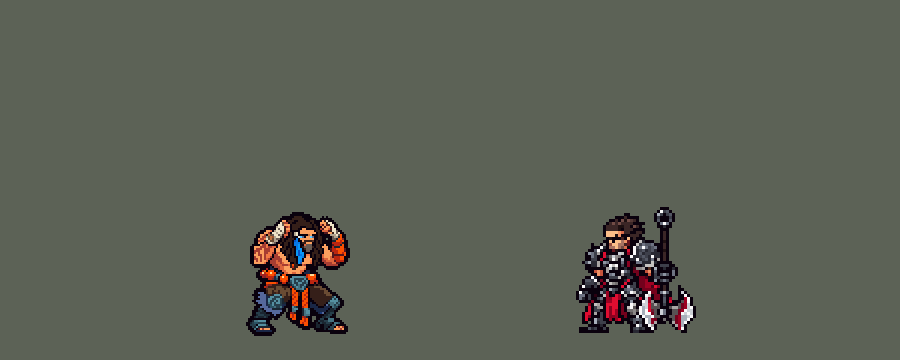

<!-- 本页上半部分由 tools/docs/gen_hero_docs.py 按仓库里现在的数据生成，手改会被覆盖；「开发记录」以下是手写的，生成时原样保留。 -->

# 乌迪尔 Udyr


| 项目 | 内容 |
|---|---|
| id | `league_udyr` |
| 所属的包 | 主包（mod_id `league`） |
| 分路 | 打野 |
| 分类 / 标签 | 近战（Melee） · AD / Melee / Tank / Shield / CC |
| 高清帧 | PPU 1.5 |
| 附加包 | [乌迪尔附加包](#附加包)（`league_udyr`） |



其他预览：[逐帧预览](../preview/league_udyr_frames.png)、[特效表](../preview/league_udyr_effects.png)

## 现在的技能

下面是游戏里显示的技能说明（`league/text/champion.i18n` 的简体中文，去掉了颜色和图标），冷却、距离来自 `league/champion/league_udyr.data_champion`；1 秒 = 60 tick。

### 普攻 / 被动

*攻击间隔 1.07 秒 · 攻击距离 25000*

拳击目标。众灵纽带：放技能后两次攻击攻速+30%。坚铁甲胄：每12秒首个技能附带70 + 40% 攻击力护盾，之后两次攻击各回复15 + 20% 攻击力生命。

### 技能1 · 狂暴爪击

*冷却 6 秒 · 施放距离 30000 · 施放：指定目标 · 敌人（不含防御塔）*

熊姿态：攻速+30%持续4秒，下两次攻击额外造成15 + 35% 攻击力+目标4%最大生命值。觉醒（熊姿态再放）：攻速+60%，两次攻击引来闪电，造成25 + 35% 攻击力魔法伤害。

### 技能2 · 踏火蛮冲

*冷却 10 秒 · 施放距离 50000 · 施放：指定目标 · 敌方英雄*

公羊姿态：移速+35%，冲向敌方英雄，撞击造成25 + 100% 攻击力物理伤害并晕眩0.75秒。觉醒（公羊姿态再放）：移速+60%，1.5秒免疫控制。

### 大招 · 极凌飓风

*冷却 40 秒 · 施放距离 35000 · 施放：指定目标 · 敌方英雄*

凤凰姿态：冰风暴环绕自身4秒，每0.5秒对周围敌人造成18 + 22% 攻击力魔法伤害并减速25%；结束时风暴飞向一名敌方英雄，造成60 + 60% 攻击力魔法伤害并减速40%。

### 数值

攻击力 86（每级 +16）、生命 1120（每级 +100）、护甲 36（每级 +7）、魔抗 25（每级 +4）、移速 1050（每级 +12）。

## 附加包

附加包是可选的原生代码 mod（都在附加包合集 `league_addons` 里），**不装主包里的英雄也是完整的**。

### 乌迪尔附加包

[乌迪尔附加包](../../addons/league_udyr/README.md)：`league_udyr` v0.1.0

Native add-on for **Udyr** in *League of Legends Heroes* (`league`). It replaces the main pack's Udyr with a copy
(`override/league_udyr.data_champion`, made by `make_override.py` from `tools/kit/build_udyr.py` with `native`) and adds
what the data cannot do:

- **Iron Mantle by health** (passive `league_udyr:mantle`): League's W is cast when Udyr is hurt. When his health falls
  under 50% (at most once every 12 s) he gets a shield of 70 + 40% attack for 4 s and his next two attacks heal him
  (the main pack's own healing attacks, `league_udyr_w2`); the jade shell shows while the shield holds. In the main pack
  his first ability every 12 s lays it instead.
- **Whole-body stances** (`src/view.rs`): in the Bear, Ram or Phoenix stance he also stands, runs, flinches and falls in
  that stance (`q_idle`, `e_run`, `r_dead` ...), the way league_gnar shows Mega Gnar. Without the add-on only his attacks
  and casts show the stance.

## 相关脚本和素材

- [`tools/kit/build_udyr.py`](../../tools/kit/build_udyr.py)
- [`tools/kit/setup_udyr.py`](../../tools/kit/setup_udyr.py)
- [`tools/lol/extract_udyr.py`](../../tools/lol/extract_udyr.py)
- [`tools/art/preview_udyr.py`](../../tools/art/preview_udyr.py)
- [`tools/art/rig_udyr.py`](../../tools/art/rig_udyr.py)
- [`assets/source/udyr/`](../../assets/source/udyr)

## 开发记录

> 下面是原来 README 里「英雄：乌迪尔」一节，原样搬过来（只改了相对链接）。

| 部分 | 内容 |
|---|---|
| 定位 | 打野（Melee，标签 AD / Melee / Tank / Shield / CC），第 152 位英雄（G 组；用户选了打野）。兽灵行者 乌迪尔：光着膀子的魁梧武僧，晒黑的皮肤上满是暗红色的部落纹身，深色长脏辫和络腮胡，脸左边一根亮蓝色的羽毛发辫，两只拳头缠着白绷带、橙色护腕，腰上一圈大颗橙红念珠和青灰石腰牌，深棕宽裤子、青灰石护膝、灰蓝毛皮、深青绑腿和凉鞋。技能方案 A（用户选）：Q / E / R 三个姿态做技能，W 并进被动 |
| 姿态 | 英雄联盟的四个兽灵姿态。放 Q 进入**熊**、E 进入**公羊**、R 进入**凤凰**，换姿态时换掉上一个（姿态 buff 永久，阵亡清掉）；平常护头的姿势就是**野猪**。**每个姿态一套动作**（用户：「每个用到的姿态一套」）：平常的 idle / run / attack / hit / dead，熊的 `q_*`、公羊的 `e_*`、凤凰的 `r_*`；普攻按姿态直接播那个姿态的挥击（`CasterAnimation`），站着、跑、挨打、倒下按姿态换图在附加包里。**觉醒**（英雄联盟的同一技能再放）：已经在那个姿态时再放就是觉醒版 |
| 普攻 / 被动 | 一拳（100% 攻击；熊、公羊、凤凰姿态是熊爪、勾拳、羽刃掌击）。**众灵纽带**：每放一个技能，接下来两下普攻攻速 +30%。**坚铁甲胄**（W，野猪）：每 12 秒第一个技能附带 70 + 40% 攻击的护盾 4 秒，接下来两下普攻各回 15 + 20% 攻击的生命（玉绿色的护罩） |
| 技能1 | **狂暴爪击**（熊，冷却 6 秒，射程 30000，对 `EnemyWithoutTower`，野怪兵线也打）：攻速 +30% 4 秒，下两下普攻额外 15 + 35% 攻击 + 目标 4% 最大生命；**觉醒**：攻速 +60%，两下普攻都召来闪电，目标周围 25 + 35% 攻击 魔法伤害 |
| 技能2 | **踏火蛮冲**（公羊，冷却 10 秒，射程 50000，只对敌方英雄）：移速 +35% 3 秒，冲到英雄面前（脚下拖着火的冲锋 `e_charge`）撞上去 25 + 100% 攻击、晕眩 0.75 秒（英雄联盟：对每个目标的第一下普攻晕眩）；**觉醒**：移速 +60%、1.5 秒免控 |
| 大招 | **极凌飓风**（凤凰，冷却 40 秒，射程 35000，只对敌方英雄）：冰风暴绕身 4 秒，每 0.5 秒对周围 17000 内的敌人 18 + 22% 攻击 魔法伤害、减速 25%；结束时风暴放出去（英雄联盟的觉醒 R），飞向一名敌方英雄炸开 60 + 60% 攻击、减速 40% |
| 连招 | 「有连招要做连招」：**E → Q**：撞晕英雄后 5 秒内放 Q 直接是觉醒（晕住再召雷）；**Q → R**：熊爪打中英雄后 4 秒内放 R，风暴每 0.33 秒刮一次（更快）；同一姿态连放两次就是觉醒（Q → Q、E → E）；每个技能都让接下来两拳加速 |
| 附加包 | [`addons/league_udyr`](../../addons/league_udyr/README.md)（在附加包合集里，原生代码，主包不装它也完整；用户：「W 坚铁甲胄（野猪）变成低血时自动护盾 + 下两次攻击回血」）：**坚铁甲胄按生命**（英雄联盟的 W 是残血时按的：生命低于 50% 时罩上护盾、接下来两拳回血，至多每 12 秒一次；主包是每 12 秒第一个技能附带），**每个姿态整身**（纳尔的整身巨型那样：熊、公羊、凤凰姿态时站着、跑、挨打、倒下也是那个姿态） |
| 数值 | 攻击 86（+16）、生命 1120（+100）、护甲 36（+7）、魔抗 25（+4）、移速 1050（+12）、射程 25000 |
| 平衡 | 经典引擎模拟（打野，对忍者、恶魔、猎人、狼人、吸血鬼，两边三套阵容，种子 1-8）：草稿 +0.94，大招射程 20000 太近、每局只放 2.1 次，改 35000 后每局 3.2 次、+0.78（同一天沃里克 +0.57） |
| 精灵图（高清帧 PPU 1.5） | Codex 第 0 步画了平常（3/4 和侧面）和熊、公羊、凤凰三个姿态，按它自己约 8 px 的格子读回；用户选「平常姿态 40 游戏像素，PPU 1.5，只做四分之三侧面」：平常 60 行（拳头顶到脚底），三个姿态按第 0 步的比例 61 / 69 / 73 行。第 1 步每个姿态两稿，用户选 A-1 / Q-1 / E-1 / R-1（[`tools/art/design_udyr_model.py`](../../tools/art/design_udyr_model.py)：四张一套颜色，眼睛按格子重画）。第一版动作是用造型自己的部件平移、转 90° 拼的，用户：「好多地方都很奇怪啊」「我看到了很多手臂变形的地方」，选「Codex 照骨架画姿势」——英雄联盟那一帧按造型大小放在格子上当参考，画了 29 个关键姿势（[`tools/art/pack_udyr_poses.py`](../../tools/art/pack_udyr_poses.py)）：每个姿态的四帧跑步、出拳 / 熊爪蓄力和横扫 / 公羊勾拳 / 凤凰掌击、熊之怒吼、跺脚、跃起和砸下、蹲下和振翅腾空、中招后仰和跪倒。[`tools/art/design_udyr_poses.py`](../../tools/art/design_udyr_poses.py) 读回：Codex 的头比身体小 10-25%，所以按定稿造型的面积定格子大小（不按头、也不按身高），用蓝羽毛发辫找到头，贴上定稿的头（一张脸用在所有帧；低头、仰头的几张留 Codex 自己的头）；[`tools/art/rig_udyr.py`](../../tools/art/rig_udyr.py) 按英雄联盟的节奏拼成 25 个动作，熊爪的三道爪痕和公羊冲锋的火尾画进他自己的帧（[`assets/source/native/udyr_bake.json`](../../assets/source/native/udyr_bake.json)，红色方跟着翻）。死亡四个姿态共用跪倒（兽灵离身）。待机和选人卡片的小动作按姿态挑（熊蓄力和怒吼、公羊勾拳和跺脚、凤凰掌击和蹲下） |
| 特效 | 24 张特效（[`tools/art/pack_udyr_fx.py`](../../tools/art/pack_udyr_fx.py) 的提示词，参考是英雄联盟里乌迪尔自己的贴图）：四个兽灵图腾、熊的紫蓝闪电、公羊的火、凤凰的冰风暴和冰凤凰、野猪的玉绿护罩，Codex 画的，[`tools/art/import_udyr_fx.py`](../../tools/art/import_udyr_fx.py) 按清单切帧、逐帧查对称（闪电球和放出去的风暴上下对称，其余左右对称、偶数宽补成奇数），按技能放好；每张进哪张表直接读技能数据 |
| 音效 | 英雄联盟的音效和配音（[`tools/lol/extract_udyr.py`](../../tools/lol/extract_udyr.py)）：每个姿态的施放、挥击和命中，熊的闪电、公羊的撞击、凤凰的风暴和放出去，三句台词 |
| 图标 | 官方技能图标（狂暴爪击、踏火蛮冲、极凌飓风），从本地客户端取 |

重新生成（素材来自本机的英雄联盟客户端，音频不进仓库）：

```bash
python tools/lol/extract_udyr.py --lol "D:\WeGameApps\lol" --vgmstream <vgmstream-cli.exe>
python tools/kit/build_udyr.py                      # 技能数据，数字都在脚本的参数表 P 里
python tools/kit/setup_udyr.py                      # 五种语言的文字、音效配置、共享文件里他的键（脸 2,-33，卡片 -10）
python addons/league_udyr/make_override.py          # 附加包的副本（坚铁甲胄按生命）
python tools/art/design_udyr_model.py               # Codex 第 1 步的造型读回（A-1 / Q-1 / E-1 / R-1）
python tools/art/design_udyr_poses.py               # Codex 的 29 个姿势读回（--rematch 重新找头）
python tools/art/import_udyr_fx.py                  # 特效 -> league_udyr_fx / league_udyr_big
python tools/art/rig_udyr.py                        # 1 倍帧和 1.5 的原帧（--review DIR 先看）
python tools/art/ppu_restyle.py --hero udyr         # 外描边、脸的位置
python tools/art/ppu_hd.py --hero udyr              # hd_ / lo_ 帧
python tools/art/hero_reels.py --hero udyr          # 待机和选人卡片的小动作
python tools/art/preview_udyr.py                    # 预览和演示 GIF
```
