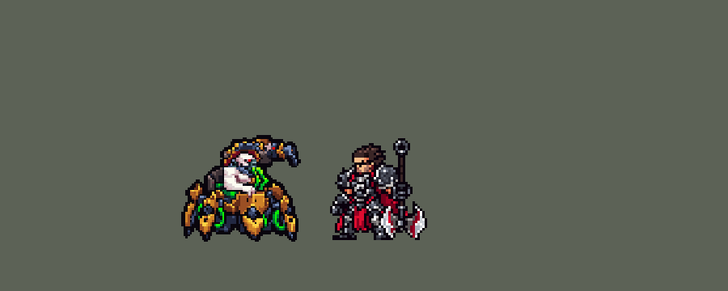

<!-- 本页上半部分由 tools/docs/gen_hero_docs.py 按仓库里现在的数据生成，手改会被覆盖；「开发记录」以下是手写的，生成时原样保留。 -->

# 厄加特 Urgot


| 项目 | 内容 |
|---|---|
| id | `league_urgot` |
| 所属的包 | 主包（mod_id `league`） |
| 分路 | 上单 |
| 分类 / 标签 | 近战（Melee） · AD / Melee / CC |
| 高清帧 | PPU 1.2 |
| 附加包 | [厄加特附加包](#附加包)（`league_urgot`） |



其他预览：[逐帧预览](../preview/league_urgot_frames.png)、[特效表](../preview/league_urgot_effects.png)

## 现在的技能

下面是游戏里显示的技能说明（`league/text/champion.i18n` 的简体中文，去掉了颜色和图标），冷却、距离来自 `league/champion/league_urgot.data_champion`；1 秒 = 60 tick。

### 普攻 / 被动

*攻击间隔 1.2 秒 · 攻击距离 38000*

炮臂霰弹。回响烈焰：普攻和净除的子弹会让腿上的霰弹轮流朝目标喷扇形火焰，造成40%攻击力+目标1%最大生命的物理伤害（每3秒一次，3级前8秒）。

### 技能1 · 腐蚀电荷

*冷却 8 秒 · 施放距离 75000 · 施放：指定目标 · 敌人（不含防御塔）*

抛出电荷，落地后爆炸，造成50 + 55% 攻击力物理伤害并减速45%。命中后开启净除4秒：普攻换成机枪连射，每发14 + 45% 攻击力。

### 技能2 · 鄙弃

*冷却 16 秒 · 施放距离 46000 · 施放：指定目标 · 敌方英雄*

获得60 + 40% 攻击力护盾，冲向敌方英雄，撞上后造成40 + 80% 攻击力物理伤害、晕眩1秒并把他甩到身后，开启净除。

### 大招 · 超越死亡的恐惧

*冷却 50 秒 · 施放距离 960000 · 施放：无目标 · 敌方英雄*

缠斗中连续打中英雄4下时，朝他发射钻头钉住第一个敌方英雄，造成250 + 50% 攻击力物理伤害并减速，4秒后拽回来处决：造成其25%最大生命的真实伤害；处决成功时周围敌人恐惧1.5秒。

### 数值

攻击力 86（每级 +17）、生命 960（每级 +108）、护甲 32（每级 +8）、魔抗 28（每级 +4）、移速 980（每级 +10）。

## 附加包

附加包是可选的原生代码 mod（都在附加包合集 `league_addons` 里），**不装主包里的英雄也是完整的**。

### 厄加特附加包

[厄加特附加包](../../addons/league_urgot/README.md)：`league_urgot` v0.2.1

|  | 主包（纯数据） | 装了附加包 |
|---|---|---|
| 回响烈焰 | 六条腿共用一个冷却（3 级起 3 秒、3 级前 8 秒），轮流喷 | **六条腿各朝一个方向（每条 60°）、各自冷却**：子弹落在哪边，就由朝那边的两条腿里冷却好的那条喷（英雄联盟：普攻落在哪条腿的扇形里就是哪条）；每条腿冷却是主包的 2 倍，朝着目标的两条轮流，平均下来和主包一样快 |
| 超越死亡的恐惧 | 拴满 4 秒就拽回来，造成目标最大生命 25% 的真实伤害（生命低于 25% 的必死，多的也吃这一下） | **只处决生命低于 25% 的**（英雄联盟的处决线）：拴满时读目标当前生命，低于 25% 才拽回来处决；血多的只吃钻头的伤害和减速 |
| 鄙弃 | 抓住后一下快拉穿过他（冲刺落在目标身上时两人重叠，引擎往随机方向推开，大约一半甩错边） | **一定甩到他身后、朝他冲过来的那一边**：出手时记下起跳的位置，抓住 0.25 秒后 3 tick 内把目标挪到他身后 15000 处（英雄联盟：从头顶甩到背后，拖回自己这边）（用户 2026-10-24「厄加特的E是不是有bug啊 不能把人背回来」） |

装上附加包后游戏里显示的说明（和主包不同的部分）：

- **普攻 / 被动**：【附加包】炮臂霰弹。回响烈焰：六条腿各朝一个方向，普攻和净除的子弹落在哪边，就由朝那边的腿喷扇形火焰，造成40%攻击力+目标1%最大生命的物理伤害，每条腿各自冷却。
- **大招 · 超越死亡的恐惧**：【附加包】缠斗中连续打中英雄4下时，朝他发射钻头钉住第一个敌方英雄，造成250 + 50% 攻击力物理伤害并减速；4秒时目标生命低于25%就拽回来处决；处决成功时周围敌人恐惧1.5秒。

## 相关脚本和素材

- [`tools/kit/build_urgot.py`](../../tools/kit/build_urgot.py)
- [`tools/kit/setup_urgot.py`](../../tools/kit/setup_urgot.py)
- [`tools/lol/extract_urgot.py`](../../tools/lol/extract_urgot.py)
- [`tools/art/preview_urgot.py`](../../tools/art/preview_urgot.py)
- [`tools/art/rig_urgot.py`](../../tools/art/rig_urgot.py)
- [`assets/source/urgot/`](../../assets/source/urgot)

## 开发记录

> 下面是原来 README 里「英雄：厄加特」一节，原样搬过来（只改了相对链接）。

| 部分 | 内容 |
|---|---|
| 定位 | 上单（Melee，标签 AD / Melee / CC），第 116 位英雄。无畏战车 厄加特：苍白光头、戴防毒面具的人身装在六条腿的青铜战车上，头顶举着霰弹炮臂。用户的选择：「方案可以，全按推荐做（上单，W 并进 Q/E，做附加包，PPU 1.5）」——技能 1 = Q 腐蚀电荷，技能 2 = E 鄙弃，W 净除没有自己的格子，由 Q、E 打中时自动开 |
| 普攻 / 被动 | 炮臂霰弹，射程 38000（比近战远、比射手近；英雄联盟他是 350），攻击间隔 72 tick；子弹从炮口高度飞出，炮口火光画在他自己的帧里（红色方不反）。**回响烈焰**：普攻和净除的每一发打中时，腿上的霰弹轮流朝目标喷一道 60° 扇形火焰（52000 长），40% 攻击力 + 目标 1% 最大生命的物理伤害；六条腿共用一个冷却，3 级起 3 秒、3 级前 8 秒（数据只认得 3 级） |
| 技能1 | **Q 腐蚀电荷**：对 75000 内的敌人放（小兵、野怪也打），出手时锁定落点抛出电荷罐（走开就躲得掉），落地 0.2 秒后炸开，21000 内 50 + 55% 攻击力物理伤害、减速 45% 1.25 秒。打中任何敌人都会开 **W 净除**（最多每 6 秒一次）：4 秒内普攻换成机枪连射（攻速 +180%，每发 14 + 45% 攻击力，也触发腿），自己减速 15% |
| 技能2 | **E 鄙弃**（3 级起）：对 46000 内的敌方英雄（不做成方向冲锋，免得 AI 没人时也冲），获得 60 + 40% 攻击力护盾 4 秒，冲到英雄身上，40 + 80% 攻击力物理伤害、晕眩 1 秒，0.25 秒后把他从头顶甩到身后（强制位移，算亚索大招要的控制；甩完前厄加特站定不走，一下快拉 27000），也开净除。装了附加包时目标一定落在他身后、朝他冲来的那一边（用户 2026-10-24「厄加特的E是不是有bug啊 不能把人背回来」：AI 让他抓住人后往回走，慢拉只把人拉回他身前；冲刺落在目标身上两人重叠，引擎随机推开，主包的快拉大约一半甩对边） |
| 大招 | **R 超越死亡的恐惧**，**看时机**（用户：「大招释放逻辑是什么 不会乱放吧」）：冷却好了先待命 20 秒；待命期间厄加特自己连续打中英雄满 4 下（普攻、机枪、Q、E 都算，每两下间隔不超过 3 秒）才放，钻头朝第 4 下打中的那个英雄（他正在磨血的人）发射，提前锁定方向（走开躲得掉），只停在第一个英雄身上（小兵挡不住）：250 + 50% 攻击力物理伤害、拴住减速 40% 4 秒，之后拽回来处决——造成最大生命 25% 的真实伤害（英雄联盟的处决线：生命低于 25% 的必死）；处决杀死了人，40000 内的敌方英雄恐惧 1.5 秒。20 秒内没放出去就把冷却还回来。原来是冷却一好、射程里有被打过的英雄就放：96 局里钻头钉中时目标 40% 在 75% 生命以上；现在 22%，50% 以下的从 23% 升到 45%；每局发射 2.4 次、钉中 1.6 次（原来 5.6 次） |
| 附加包 | 可选的附加包 [`addons/league_urgot`](../../addons/league_urgot/README.md)（在附加包合集里，原生代码，主包不装它也完整）：**回响烈焰按方向**（六条腿各朝 60°、各自冷却，由朝目标的两条腿轮流喷，平均快慢和主包一样）；**真处决**（拴满 4 秒时读当前生命，低于 25% 才拽回来处决，血多的只吃钻头伤害和减速） |
| 数值 | 攻击 86（+17）、生命 960（+108）、护甲 32（+8）、魔抗 28（+4）、移速 980（+10）、射程 38000 |
| 平衡 | 上单对六个基础上单（fighter / executioner / lancer / pole_warrior / knight / berserker），三套阵容、两边各打，10 分钟经典引擎模拟：草案 +5.16（种子 1–12；德莱厄斯 +1.71、潘森 +1.40），逐项拆开看：去掉腿 +3.00、去掉 E +2.47、去掉 R 伤害 +4.93、射程 30000 +5.24、去掉 W 反而 +5.90（机枪模式本身不赚）；腿、E、Q 和属性一步步削到 +1.74 / +1.99（种子 1–12 / 13–24，德莱厄斯 +1.71 / +1.75）。大招改成「待命 + 连续命中」后掉到 +0.70（每局 R 从 5.6 次降到 1.8 次），触发要求 5 下改 4 下、钻头 150 改 250：+1.53 / +1.25（种子 1–12 / 13–24，德莱厄斯 +1.71 / +1.75），定下这版。亚索联动（厄加特放在打野位、和上路亚索同队，12 个种子两边各打）：亚索每局对英雄放 2.46 次大招（德莱厄斯 1.50、原版战士 2.33），亚索不用调 |
| 精灵图（高清帧 PPU 1.2） | Codex 第 0 步画了两张原画（[`tools/art/pack_urgot_picture.py`](../../tools/art/pack_urgot_picture.py)；pose_ref 原来把他的特效贴图当成身体贴图，渲染成亮绿色，已改），用户：「选 A，炮顶到腿尖 42 px，PPU 1.5，第 1 步按游戏格子重画」（头放大到约 9 格）。第 1 步 Codex 画了两稿，[`tools/art/design_urgot_cut.py`](../../tools/art/design_urgot_cut.py) 读回成 63 行，用户：「造型用第 2 稿删行列的版本」。动作帧由 [`tools/art/rig_urgot.py`](../../tools/art/rig_urgot.py) 用造型自己的部件无损摆（炮臂、上身、底盘、六条腿；跑步是两组三条腿交替抬起；R 是上身沿画出来的钢柱升起），用户第一次看：「上下摆动模型变形」——改成上身、炮臂、底盘一整块往腿上沉，不再分开动。装进游戏后用户：「现在像素太高 要降低点」，从 1.5 / 1.3 / 1.2 / 1.0 的对比里选了「1.2」：造型一次缩到 1.2 的格子（每个粗格子归它大多数细格子所在的部件），所有动作在这个格子上整块平移（每帧单独缩小时，身体下沉半格会让软管、炮臂边缘每帧采样不一样，也算变形）。2026-10-19 补帧（对照英雄联盟的动作）：跑步、普攻、Q、E、R 原来只动设计图的 1–2 格（不到一个游戏像素），步子和前倾、后坐都加宽到约三倍，普攻 6 帧、Q 5 帧；E 改成英雄联盟 Spell3 → GrabThrow 的冲刺、抓住、往后甩 6 帧；R 的升柱升到 12 行、钻头射出时后坐；死亡 8 帧（腿往外往下挪会变成一圈竖着的爪子，所以腿不动、身体分几步坐下去） |
| 特效 | 第 3 步 22 张特效（[`tools/art/pack_urgot_fx.py`](../../tools/art/pack_urgot_fx.py)，颜色照英雄联盟：霰弹橙黄、化学药剂毒绿、电荷罐和钻头钢灰、处决和恐惧深紫），Codex 画并读回成游戏大小（`assets/source/urgot/codex_fx`）。[`tools/art/import_urgot_fx.py`](../../tools/art/import_urgot_fx.py) 按清单切格、检查对称（飞出去的和腿上的扇形上下对称，其余左右对称），Q 的爆炸画在落点（地面区域自己的画面朝左会转半圈） |
| 音效 | 英雄联盟的音效和配音（[`tools/lol/extract_urgot.py`](../../tools/lol/extract_urgot.py)，18 段）：霰弹开火 / 打中、腿上的霰弹、净除开火和机枪、电荷抛出 / 爆炸、冲锋和甩人、大招发射 / 钉中 / 碾碎 / 恐惧，配音是他的 Q / E / R / 处决台词（中文） |
| 图标 | 官方技能图标（腐蚀电荷、鄙弃、超越死亡的恐惧，另有净除和被动），从本地客户端取 |

重新生成（素材来自本机的英雄联盟客户端，音频不进仓库）：

```bash
python tools/lol/extract_urgot.py --lol "D:\WeGameApps\lol" --vgmstream <vgmstream-cli.exe>
python tools/kit/build_urgot.py                    # 技能数据，数字都在脚本的参数表 P 里
python tools/kit/setup_urgot.py                    # 五种语言的文字、音效配置、共享文件里他的键（头像点、卡片位置在 VIEW）
python tools/art/design_urgot_cut.py               # 第 1 步的造型读回到 63 行（删行列 / 按面积缩小，PPU 1.5）
python tools/art/rig_urgot.py                      # 1 倍帧和 1.2 的原帧（造型缩到 1.2 后无损摆姿，炮口火光另存 .over.png）
python tools/art/ppu_restyle.py --hero urgot       # 描边（不要加 --preview）
python tools/art/ppu_hd.py --hero urgot            # hd_ / lo_ 帧
python tools/art/import_urgot_fx.py                # 特效
python tools/art/preview_urgot.py                  # 预览和演示 GIF
python addons/league_urgot/make_override.py        # 附加包的副本（主包的厄加特改了就重跑）
```

美术提示词见 [`assets/source/urgot/`](../../assets/source/urgot) 里的 `PICTURE_PROMPT.md`、`MODEL_PROMPTS.md`、`PROMPTS_FX.md`；Codex 的交付在 `codex_picture/`、`codex_model/`、`codex_fx/`。

逐帧预览：[`docs/preview/league_urgot_frames.png`](../preview/league_urgot_frames.png?v=1017a)，特效：[`docs/preview/league_urgot_effects.png`](../preview/league_urgot_effects.png?v=1017a)。
