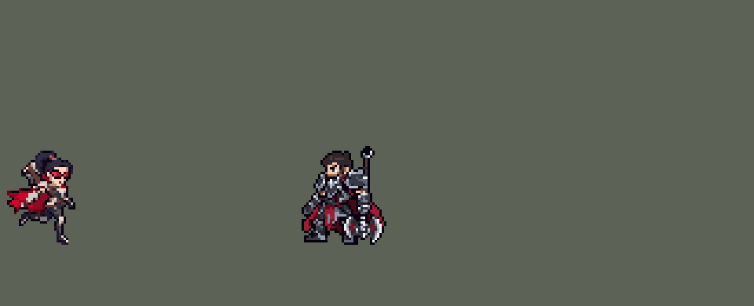

<!-- 本页上半部分由 tools/docs/gen_hero_docs.py 按仓库里现在的数据生成，手改会被覆盖；「开发记录」以下是手写的，生成时原样保留。 -->

# 薇恩 Vayne


| 项目 | 内容 |
|---|---|
| id | `league_vayne` |
| 所属的包 | 主包（mod_id `league`） |
| 分路 | ADC |
| 分类 / 标签 | 射手（Range） · AD / Range / CC |
| 高清帧 | PPU 2.2 |
| 附加包 | [薇恩附加包：圣银弩箭、恶魔审判撞墙](#附加包)（`league_vayne_bolts`） |



其他预览：[逐帧预览](../preview/league_vayne_frames.png)、[特效表](../preview/league_vayne_effects.png)

## 现在的技能

下面是游戏里显示的技能说明（`league/text/champion.i18n` 的简体中文，去掉了颜色和图标），冷却、距离来自 `league/champion/league_vayne.data_champion`；1 秒 = 60 tick。

### 普攻 / 被动（被动「暗夜猎手」）

*攻击间隔 1 秒 · 攻击距离 55000*

普攻造成100% 攻击力的物理伤害。被动 暗夜猎手：附近有敌方英雄时移动速度+8%。圣银弩箭：3.5秒内连续第3次命中（普攻、技能都算）额外造成50的真实伤害，对英雄再加7%最大生命值。

### 技能1 · 闪避突袭

*冷却 5 秒 · 施放距离 75000 · 施放：指定目标 · 敌人（不含防御塔）*

翻滚：敌方英雄贴近时往后滚，射程内有敌人时后跳，否则滚进射程。7秒内的下一次普攻额外造成25 + 80% 攻击力的物理伤害。

### 技能2 · 恶魔审判

*冷却 10 秒 · 施放距离 55000 · 施放：指定目标 · 敌方英雄*

用大弩射出重箭，对敌方英雄造成60 + 70% 攻击力的物理伤害并击退，落地时再受到30 + 35% 攻击力的物理伤害并眩晕1秒。

### 大招 · 终极时刻

*冷却 50 秒 · 施放距离 60000 · 施放：无目标 · 敌方英雄*

8秒内攻击力+25%，技能冷却缩短50%，闪避突袭附带1秒隐身，暗夜猎手的移速变为3倍。期间她亲手击杀英雄时，终极时刻刷新为8秒。

### 数值

攻击力 100（每级 +20）、生命 900（每级 +90）、护甲 20（每级 +7）、魔抗 15（每级 +3）、移速 900（每级 +9）。

## 附加包

附加包是可选的原生代码 mod（都在附加包合集 `league_addons` 里），**不装主包里的英雄也是完整的**。

### 薇恩附加包：圣银弩箭、恶魔审判撞墙

[薇恩附加包：圣银弩箭、恶魔审判撞墙](../../addons/league_vayne_bolts/README.md)：`league_vayne_bolts` v0.2.0

|  | 主包（纯数据） | 附加包 |
|---|---|---|
| 圣银弩箭 | 两层记在薇恩自己身上：她轮流打两个人也会凑满 3 下，在第三个被打中的人身上爆 | **同一个目标**连续挨 3 下才爆 |
| 恶魔审判 | 每一箭推完都晕一下（数据看不到墙） | 被推到**墙上**（地图的墙格、5v5 地图的四边）才再受 30 + 35% 攻击力的伤害并眩晕 1 秒；没撞墙只击退 |

## 相关脚本和素材

- [`tools/lol/extract_vayne.py`](../../tools/lol/extract_vayne.py)
- [`tools/art/preview_vayne.py`](../../tools/art/preview_vayne.py)
- [`tools/art/import_vayne.py`](../../tools/art/import_vayne.py)
- [`assets/source/vayne/`](../../assets/source/vayne)

## 开发记录

> 下面是原来 README 里「英雄：薇恩」一节，原样搬过来（只改了相对链接）。

| 部分 | 内容 |
|---|---|
| 定位 | ADC（Range），第六组的下路，本包第六个射手（艾希、金克丝、厄运小姐、伊泽瑞尔、卢锡安之后） |
| 普攻 | 右前臂的腕弩射出弩箭，100% 攻击力的物理伤害，射程 55000，攻击间隔 1 秒，第 8 tick 出箭。翻滚后的那一下强化普攻播自己的动作（英雄联盟的 `tumble_attack1`：低蹲着射），所以普攻在第 1 tick 先判断、播动作，两种箭都在第 8 tick 从 `Delayed` 射出（卢锡安连开两枪的做法） |
| 被动 | 「暗夜猎手」：每次行动时 70000 内有敌方英雄，移动速度 +8%，持续 1.5 秒（刷新，不叠加）；终极时刻期间变成 3 倍（+24%）。英雄联盟里是朝敌方英雄移动时加速，引擎读不到移动方向，这里按附近有没有敌方英雄。W「圣银弩箭」（并进普攻）：她的命中（普攻、闪避突袭的强化箭、恶魔审判）在自己身上叠两层 3.5 秒的计数，第 3 次命中造成 50 点真实伤害，打的是英雄时再加目标 7% 最大生命值的真实伤害（旁边同时飞一发只打英雄、看不见的影子弩箭，读真弩箭留下的 2 tick 标记，晚 1 tick 结算）。英雄联盟里对野怪有伤害上限，这里百分比部分只对英雄，小兵和野怪只吃 50（大龙有上万血）。英雄联盟要求连续打同一个目标，引擎分不清是不是同一个目标，这里只数她自己的命中（艾克的被动也是这样） |
| 技能1 | Q「闪避突袭」（用户选的 A）：75000 内有敌人时放，冷却 5 秒，也对小兵和野怪放。按情况翻滚：敌方英雄贴身（30000 内）时往远离他的方向滚 30000；普攻射程内有敌人时往后跳 30000；都没有时朝目标往前滚 30000 进射程（和卢锡安的 E 一样的三种判断，往前是固定距离的翻滚，不会滚到目标身上；三种都是英雄联盟翻滚的比例，约为普攻射程的 0.55 倍）。之后 7 秒内的下一次普攻是强化箭，额外造成 25 + 80% 攻击力的物理伤害（共 25 + 180%） |
| 技能2 | E「恶魔审判」（用户选的 A）：55000 内有敌方英雄时放，只对英雄放，冷却 10 秒。用背后的大弩射出重箭（速度 7000），命中造成 60 + 70% 攻击力的物理伤害并击退 24000（每 tick 3000，8 tick），落地时再受到 30 + 35% 攻击力的物理伤害并眩晕 1 秒。英雄联盟里要撞到墙才眩晕和追加伤害，团战经理2 没有墙，当作每次都撞上了 |
| 大招 | R「终极时刻」（用户选的 A）：60000 内有敌方英雄时施放，冷却 50 秒。8 秒内攻击力 +25%，技能冷却缩短 50%（引擎的冷却加速对两个技能一起生效，所以恶魔审判也会变快），闪避突袭附带 1 秒隐身，暗夜猎手的移速变成 3 倍，普攻换成终极时刻的射击音效。期间她亲手击杀英雄时（金克丝的击杀检测，助攻看不出来），终极时刻刷新为 8 秒（英雄联盟是每次参与击杀延长 4 秒） |
| 圣银弩箭附加包 | 数据分不清一次攻击打中的是谁，主包的圣银弩箭两层记在薇恩自己身上：她轮流打两个人也会凑满 3 下。附加包 [`addons/league_vayne_bolts`](../../addons/league_vayne_bolts/README.md)（在附加包合集里）用原生代码在**被打中的单位身上**数层数，同一个目标连续挨 3 下才爆（英雄联盟的样子）；一环、两环的画面和爆发的伤害照旧由数据打出。主包不装附加包也完整可玩；附加包只做了单元测试，要在游戏里看日志确认 |
| 数值 | 攻击 100（+20）、生命 900（+90）、护甲 20（+7）、魔抗 15（+3）、移速 900（+9），攻击间隔 1 秒，和原版射手一样。数值是自己设计的，用 SDK 对战模拟调：打下路，对 4 个原版射手（`gunner`、`soldier`、`archer`、`gambler`），两边、三套队友阵容各 24 局，一批 576 局。初稿（Q 射程内后跳 15000、E 击退 36000，Q 20 + 60%，E 50 + 60% / 25 + 30%）+0.65，同一批里本包射手卢锡安 +2.37、艾希 +2.40、厄运小姐 +2.77、伊泽瑞尔 +2.96、金克丝 +2.99，原版 `gunner` +0.70。逐项试（每组 12 局种子）：击退太远会把目标推出她的射程，她要走过去追（放 E 后中位 77 tick 才能再普攻），缩到 24000 后 +2.08；去掉射程内的后跳 +1.49（用户选的方案里有后跳，所以只缩到 10000）；Q、E、圣银弩箭分别加强 +1.99 / +2.34 / +1.42。最终：后跳 10000、击退 24000、Q 25 + 80%、E 60 + 70% / 30 + 35%，圣银弩箭 40 + 6%：两批种子 +2.56 / +2.85（占位的出手时机）。按动作帧定下出手时机后（普攻和强化普攻 26 tick、第 8 tick 出箭，Q 25 tick，E 31 tick、第 12 tick 出重箭，R 34 tick、第 8 tick 生效）降到 +1.99 / +1.81：强化普攻要先播自己的动作，出箭改从 `Delayed` 走，攻速缩短不了它；圣银弩箭提到 50 + 7% 后 +2.48 / +1.97，和卢锡安定稿时（+2.15 / +2.12）相当，用这套。薇恩每局放 Q 约 51 次（对英雄约 14 次）、E 约 14 次、R 约 2.9 次。玩家反馈位移太短（2026-09-30）：最常出现的是射程内的后跳，原来只有 10000（后跳越远越吃亏，当时缩短了），往后、往前也只有 24000 / 25000；三种都改成 30000 后，同样的下路对局两批 12 局种子 +2.15 / +2.08（同批改前 +2.57 / +2.39），后跳常把她带出射程、要走回来再射，强度降了约 0.35，仍是本包最强的射手之一 |
| 亚索联动 | 恶魔审判的击退和眩晕算亚索大招要的控制。亚索打上路、薇恩在他队里打下路时，亚索每局 R 到被控英雄 1.75 次；同一批里原版 `archer` 0.65、艾希 0.65、卢锡安 0.44（之前测过的贝蕾亚 2.27、蕾欧娜 1.85）。在已有英雄的范围内，亚索不用调 |
| 精灵图 | 10 个动作 63 帧：待机、移动、普攻、翻滚后的强化普攻、Q 往前滚、Q 往后滚、E、R、受击、死亡。造型按用户给的图由 Codex 直接在游戏尺寸画（B，缩到 48 行）：黑紫色高马尾和红白发夹，红色墨镜，黑色立领红内衬，黑蓝紧身衣配银甲和棕色皮带，撕破的红披风，右前臂的银色腕弩，背后的银色大弩。马尾顶到脚底 40 px、30 px 宽，26 色（用户在游戏里觉得 48 行太大，缩到 40 行，和锐雯一样高）。每帧的时机和站位照英雄联盟原版动画渲染的参考帧 |
| 高清帧（PPU 2.2） | 2026-10-26 用 PPU 重做（用户：「下一个英雄重做薇恩」）。设计图：Codex 照她现在的精灵描密画了两轮（第一张约 8 像素一格、头只占身高 1/5；重画的那张格子大小不一），用户最后给了自己的一张（「就用这个啊」，轮廓同第一张、格子更粗），按它自己约 10.4 × 10.85 像素一格读回（`design_vayne_hd.py`，85 × 102 格：102 行 / 2.55 = 原来的 40 像素），两张 Codex 的留在 `hd/raw` 里作参考。密度表上用户选了 2.2（「通过，用 2.2」；1.8、1.5 时墨镜和嘴糊掉）：画在 2.55（ORIG_PPU），`ppu_restyle.py` 降到每个游戏像素 2.2 格，和金克丝、拉克丝、德莱文一样。动作：Codex 照旧版每一帧整帧重画（`pack_vayne_actions.py`，38 张 49 帧；和待机一模一样的帧——普攻第 5–6 帧、强化普攻第 6 帧、两种翻滚和 E 的最后一帧、R 第 6 帧、受击第 2 帧——直接用设计图；腕弩每帧都在近侧前臂，E 和 R 端大弩时背上没有），交回的是近白底、带抗锯齿、每张放大倍数不同的成图。`casts_vayne_hd.py` 抠掉白底，每张图的放大倍数按她的头量：墨镜的红和披风的红是同一套颜色，没法拿墨镜当锚点，所以把设计图的头（头顶到下巴）按 5–14 倍逐档缩放后在整帧上滑着比（FFT），比得上的取其中；翻滚、倒地、受击头是歪的，用同一个动作或整套的中位数（7.85）；颜色换回设计图的色板，摆回旧版同一帧的位置。跑步：Codex 的第 7 帧相位反了（前脚踩地、后脚抬起，旧版第 7 帧和第 3 帧是一对），头左右晃了 10 格（旧版不到 1 像素）——每帧按头对齐到同一列，后半圈用前半圈的 4 帧（两条腿同色，半圈后的那帧本来就是同一张画）。死亡第 2 帧 Codex 画成已经趴在地上（旧版这帧还站着），用第 1 帧。出箭帧的弩尖和旧版差不到 2 像素，弩箭的 `y_offset` 不用改。头像点 (0,−32)（两片镜片中间），选人卡仍是 −10（最高点是 E 第 6 帧举起的大弩尖，被卡片上沿裁掉，头顶贴着上沿）；身高 40 像素和原来一样，没有尺寸表行。俄洛伊的灵魂、佛耶戈附身用的帧表跟着更新 |
| 特效 | 银色弩箭、翻滚后的强化箭（裹着银光、拖着夜紫色烟尾）、恶魔审判的重箭（猩红箭尖）；普攻火花、强化箭的四角星和烟团、重箭的冲击波；圣银弩箭目标胸口的第 1 环、第 2 环和第 3 下的收拢爆开（猩红碎片）；翻滚留在原地的烟；落地撞击的尘土和头顶的眩晕星；终极时刻发动时身后的四角星光芒和飞散的蝙蝠、脚下的四角星地纹和两侧上升的银光点（持续 8 秒）、击杀刷新时的猩红光环 |
| 图标 | 官方技能图标（Q / E / R），64×64 |
| 音频 | 从本地客户端提取的 13 条技能音效和 2 条中文语音（E、R）。不提交到仓库，按下面的命令在本地生成 |
| 修正（0.170.2） | 用户让查附加包日志时在芸阿娜身上发现：引擎给大招冷却封顶时，把 `skill_cooldown_mult` 也算进去（技能冷却削减同时压大招）。终极时刻期间两个技能冷却缩短 50%，大招自己的冷却也被压到一半。同一个 buff 加上相同大小的负 `ult_cooldown_mult` 抵掉（[`tools/fix/ult_cooldown_offset.py`](../../tools/fix/ult_cooldown_offset.py) / 生成脚本），只减原本要减的技能。经典模拟（8 个种子，三套阵容两边各打） +2.49 → +2.13，每局开大 2.8 → 2.4 次 |
| 恶魔审判撞墙（附加包 0.2.0） | 2026-11-02 用户：「薇恩要改成不E到墙壁不能眩晕 你看看能不能通过附加包的形式改」。主包保持纯数据（每一箭推完都晕），改在圣银弩箭附加包里（主包的薇恩只能被一个附加包替换）：副本把重箭的击退换成原生效果 `league_vayne_bolts:condemn`，沿击退的方向查墙（卡蜜尔附加包的内置墙格，5v5 地图另加四边，和波比的英勇冲锋同一套）。碰到墙就推到墙边、到墙那一刻按住（`league_vayne_bolts:pin`），主包第 8 tick 的撞墙伤害、眩晕、画面只在薇恩身上有 `league_vayne_e_wall` 时打出；没墙照主包击退，不伤不晕。游戏的 AI 不会特意找墙放 E：同样规则的波比在 11-01 的日志里大多数冲锋没碰到墙，所以又加了找墙放 E 的 AI 钩子 `league_vayne_bolts:condemn`（用户：「找墙放E要智能一点」「参考卡密尔多智能」）：照卡蜜尔附加包钩墙的做法记下敌方英雄的速度、预判重箭打到那一刻他在哪，现在和预判的位置身后都有墙才放（AI 正在打的人优先，再挑残血、墙近的）；没墙时只在贴脸自保（AI 要放或她血量低于 40%）、一箭打得死人时放，别的时候 AI 想放 E 就留着改普攻。没墙时亚索的 R 只接得上那 8 tick 的击退 |

```bash
python tools/lol/extract_vayne.py --lol "D:\WeGameApps\lol" --vgmstream "<vgmstream-cli.exe 路径>"
python tools/lol/native_pose.py assets/source/vayne/poses.json --out <渲染文件夹>   # 动作参考帧
python tools/art/shrink_vayne.py      # 定稿：48 行的定稿整行整列删减到 40 行，脸不动
python tools/art/export_vayne.py <Codex 的原稿文件夹> <Codex 的动作交付文件夹> <输出文件夹>   # 从原稿按定稿的行数重新导出：保留 Codex 画的头，只贴定稿的脸（跑步用重画的原稿和墨镜坐标）
python tools/art/tidy_vayne.py <输出文件夹>   # 角色图：清描边和散点、站位对齐，写进 assets/source/native/
python tools/art/import_native.py --hero vayne
python tools/art/import_vayne.py      # 特效；--raw <Codex 的特效交付文件夹> 先把生图原稿按技能范围转成原尺寸条
python tools/art/preview_vayne.py                  # 逐帧图（高清帧）、特效图、演示
# PPU 2.2 重做（2026-10-26）：
python tools/art/pack_vayne_ppu.py --out <文件夹> [--redo]   # 给 Codex 的设计图包（照她现在的精灵描密；--redo 是 Q 版大头、PPU 1.5 的重画包）
python tools/art/design_vayne_hd.py                    # 用户的图（hd/raw/vayne-user.webp）按自己的格子读回 -> hd/design.png
python tools/art/pack_vayne_actions.py --out <文件夹>    # 给 Codex 的动作包（照旧版同一帧整帧重画）
python tools/art/casts_vayne_hd.py --measure           # 每张图的放大倍数（按头量）
python tools/art/rig_vayne_hd.py                       # 交付（hd/casts）读回到设计图上 -> 原始条和 1 倍图（PPU 2.55）
python tools/art/ppu_restyle.py --hero vayne && python tools/art/ppu_hd.py --hero vayne && python tools/art/hero_reels.py --hero vayne
```

美术（造型的提示词见 [`assets/source/vayne/MODEL_PROMPTS.md`](../../assets/source/vayne/MODEL_PROMPTS.md)，9 条动作的见 [`MODEL_STRIPS.md`](../../assets/source/vayne/MODEL_STRIPS.md)，重画跑步的见 [`MODEL_RUN_REDO.md`](../../assets/source/vayne/MODEL_RUN_REDO.md)，特效的见 [`PROMPTS.md`](../../assets/source/vayne/PROMPTS.md)）：
- 造型：用户的图是约 3 像素一格的像素风插画（约 500 格高），不能直接缩。第一版包让 Codex 画成约 1.7 倍（要 72 格），它画了 96 格和 76 格，再缩到游戏尺寸时墨镜、银边和护甲都碎成了点；用户要求照 main 上卢锡安重做成功的方式重做（细节好、不模糊）：第二版包让 Codex 直接在游戏尺寸画（头顶到脚底约 38 格，最多 24 色），交回的图按它自己的格子读回像素（`.claude/skills/tfm2-hero-mod/scripts/regrid.py`），不缩小。这套做法写进了 skill 的 art-spec（"A design drawn at game size"）。A 读回 63×50、B 53×40，都比包里的英雄大；用户在「原样 / 缩到 48 行」四版里选了 B 缩到 48 行：只在脸以外删了 5 行 4 列，脸原样保留（清杂点时被当成孤立色的一格嘴补回来），两片镜片换成只在镜片上用的两种红（`#F8303C`、`#B0102A`）。装进游戏后用户觉得太大（"薇恩游戏里尺寸太大了"：48 行比盖伦的 37 行高出一个头），在 40 / 42 / 44 行里选了 40 行：`shrink_vayne.py` 照锐雯的做法（`design_riven.py` 第 7 步）整行整列删减，删的是和邻行最像的行列，脸所在的第 10–17 行、第 21–29 列（墨镜、脸、嘴）一格不动，再补上被删掉的描边，30×40 px、26 色；48 行的定稿留在 [`vayne_native48.png`](../../assets/source/native/vayne_native48.png)。
- 动作参考（`poses.json`）：镜头 yaw 40、pitch 25，不镜像（背后的大弩和披风在画面左边，和用户的图一样），头 2.3、腿 0.8、头发 0.6，高度 42。待机 `Vayne_idle1`；移动照英雄联盟的 `Vayne_run`（2 秒的文件里是两圈一样的 1 秒，8 帧 × 125 ms）；普攻 `Vayne_attack1`，强化普攻 `Vayne_tumble_attack1`，Q 往前 `Vayne_spell1`（原版是前空翻，这里头最多转四分之一），Q 往后是同一段倒着放，E `Vayne_spell3`（从背后抽出大弩平端发射），R 没有施法动画，用 E 的抽弩接终极时刻的持弩站姿 `Vayne_ult_idle1`。
- 导出（`export_vayne.py`）：Codex 按定稿画了 9 条（57 帧）。它自己的导出脚本（`VayneExport.cs`）在贴定稿的整颗头之前，先把原稿里眼睛周围的头发、皮肤、紧身衣颜色全清掉（眼睛上方 30 行、下方 6 行，连下巴下面的脖子和立领），头像贴纸一样浮在身上（用户：「头和身体有点分离」「不协调」）；它标的眼睛位置有几帧偏了最多 10 格（E 出箭那帧、死亡），头贴到了身体别处，清除范围还切掉了脸前面的前臂（强化普攻出箭那帧的腕弩像飞出了手）。按它的脚本从原稿重新导出：采样、位置、格子、色板全一样（头以外逐格对过，每帧差 0–2 格），但什么都不清，只把定稿的脸（墨镜、脸、侧脸轮廓、嘴，9×8 格）贴在原稿自己画的脸上（在标记附近 10 格内按颜色找，直接贴在标记处会在旁边留下原稿的第二张脸）；往后仰倒的死亡第 1 帧保留原稿的脸。头发、马尾、脖子和立领都是原稿的，跟着身体动。
- 整理（`tidy_vayne.py`）：比定稿噪的地方在游戏像素上修：离开身体的散点（最多 4 格、只斜角相连）去掉，身体里最多 6 格的小透明洞补上，轮廓上亮的格子（银、皮肤、亮红、棕，Codex 每帧 17–40%，定稿 5%）改成描边色（在剪影里面改，不变胖；头发和紧身衣的深色边照定稿留着），描边里面第二圈黑换成材质自己的暗色，孤立杂色格换成周围的颜色；跑步整体比地面高 1–2 行，按帧放回脚底线。贴上的脸和定稿帧不动。站位：动作包的待机条是按和英雄联盟待机轮廓重叠最多摆的，她的披风和背后的大弩把人往左拉了 9 格（Codex 的交接里也指出镜片比英雄联盟的头关节偏左 9 格），所有帧的站位点一起挪 9 格，让双脚中点踩在站位点上。
- 导入：待机 6 帧是同一张，第 3–5 帧从站位点下 5 行（40 行时在膝盖和披风下摆，上下两行只差 11 格；腿不会断开）往上下沉一格呼吸（`BOB`），靴子不动；背后的大弩是每帧的最高处，所以按镜片对齐头的位置（`EYES`，镜片红只用在镜片上），待机和移动每帧镜片都在站位点那一列。头像截取点 (1, −36)，在头顶、镜片上方 6.6 格（48 行时是 (2, −42)，同样的相对位置；马尾更高，`tfm2_ase.py face` 按最高点建议的 (−4, −38) 落在马尾尖上，不用）。
- 缩到 40 行时动作不用重画：`export_vayne.py` 每张原稿的格距是站姿帧高除以定稿的行数，所以直接按 Codex 原稿自己的格子在 40 行重新取样；脸、脸周围的框和定稿在画布上的位置都从定稿的镜片量出来，待机条是新定稿放在原来待机的脚底和中心上（换回 48 行定稿重跑，写出来的和之前逐字节一样）。原稿里画的头按 40 行变小了，贴上的定稿脸不变，脸的匹配距离从 14–97 升到 52–127；死亡第 4 帧（低头倒下）134 超过阈值，保留原稿的脸。弩箭的高度（腕弩出箭时在站位点上 10–16 格、重箭 12–16 格）和技能数据里的 12 格还对得上，技能数据和平衡不用改。
- 结果：26 色，和右边像素同色的比例 25%（原版英雄 18%–46%）。待机每帧 835 个不透明像素（48 行时 1133；卢锡安 983、贝蕾亚 930）。
- 移动（重画）：第一版 8 帧的腿一模一样——近腿踩地、远腿后踢，两条腿从不交换（用户：「走路没有交叉步」）；英雄联盟的跑步每半圈换一次腿，中间两个膝盖在身体下面交叉。动作包的跑步参考只有站位点和脚底线，提示词只写了"1–4 帧一步、5–8 帧另一步"。重画包（提示词见 [`MODEL_RUN_REDO.md`](../../assets/source/vayne/MODEL_RUN_REDO.md)）用 `native_pose.py --parts` 把英雄联盟跑步的左右腿分开上色渲染（`"parts"` 选 `l_thigh`、`r_thigh` 两条骨骼链：近腿橙、远腿蓝），8 倍和游戏尺寸各一张，逐帧写明哪条腿踩地、哪帧交叉；胯以上照导入后的版本（头和脖子连着的那版），不清头、不贴头。Codex 交回：第 8、1、2 帧近腿踩地，第 4、5、6 帧远腿踩地，第 2–3、6–7 帧两腿交叉换位，和英雄联盟逐帧对得上。导出用它的原稿和墨镜坐标（其他 8 条仍是第一次交付的原稿），跑步改成和其他动作一样按脚底定位：重画后头比鞋底高 1–2 格，按眼睛的行定位时鞋底落到脚底线下面。头的横向位置 8 帧一样，上下起伏 1 格。
- 特效用 Codex 画的 14 张（77 帧，提示词见 [`PROMPTS.md`](../../assets/source/vayne/PROMPTS.md)；形状参考英雄联盟原皮自己的特效贴图——圣银弩箭的三个环、终极时刻的四角星地纹、蝙蝠——只在本地用；颜色取她的造型：银光、夜紫烟、猩红、尘土四套）。Codex 交了三种：它自己按排版画布导出的 8×8 方块图、1/8 的原尺寸图、生图原稿（带真实透明度，清单里有每帧的 `rawRect`）。它的导出把排版画布的一格当一个游戏像素，普攻箭有 29 px 长、命中 20 px（要 12），终极时刻三张还在每格中间清出一块矩形（x 22.5%–77.5%、y 17%–89%）给她的身体让位，四角星的光芒、刷新的光环和光环的大部分光点都被清掉了。所以 `import_vayne.py --raw` 从原稿开始，按贝蕾亚那套做法取样（每个游戏像素取它覆盖的原稿像素里最多的颜色，覆盖三分之一才不透明），颜色吸到包里那四套色阶的 16 色；按技能范围定大小：普攻箭连烟尾 16 px（12 px 时箭只剩 4 px）、强化箭 18 px、重箭 24 px，命中 12 / 20 / 24 px，圣银环 16、18 px，爆开 26 px，翻滚烟 28 px 宽，撞击 20 px、眩晕星 16 px。三支箭上下镜像成严格对称（游戏按飞行方向转）。终极时刻的三张不清中间，改成画在单位下面（`z` −1，翻滚的烟也是），中间被她自己的身体挡住；生图工具把它们的 7 帧和 5 帧挤进固定宽度的画布（每帧宽高比 0.40、0.56，包里要的是 0.75），按 3:4 的格子横竖分开缩放回来：发动和光环 40×53 格、刷新 35×47（跟着她 40 行的身高；48 行时是 48×64、42×56），格子 92% 高处（包里定的脚底）放在脚底线上。锚点量在图上：箭量白色亮核（箭头），命中和爆开量亮核或第一张完整帧的中心，圣银环放在胸口，烟量最低一行（贴地），眩晕星放在头顶。恶魔审判落地后撞击 4 帧、眩晕星循环到 1 秒（眩晕时长），光环是 buff 的循环画面。

逐帧预览：[`docs/preview/league_vayne_frames.png`](../preview/league_vayne_frames.png?v=1026hd)，特效：[`docs/preview/league_vayne_effects.png`](../preview/league_vayne_effects.png?v=1014g)。
