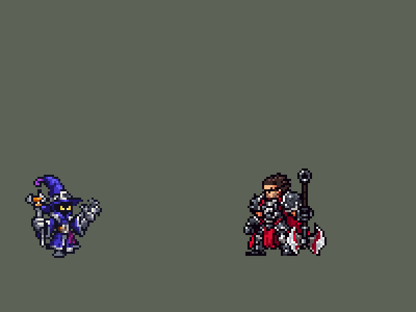

<!-- 本页上半部分由 tools/docs/gen_hero_docs.py 按仓库里现在的数据生成，手改会被覆盖；「开发记录」以下是手写的，生成时原样保留。 -->

# 维迦 Veigar


| 项目 | 内容 |
|---|---|
| id | `league_veigar` |
| 所属的包 | 主包（mod_id `league`） |
| 分路 | 中单 |
| 分类 / 标签 | 法师（Magician） · AP / Magic / Range / CC |
| 高清帧 | 1 倍像素（无高清帧） |
| 附加包 | [维迦法强常驻附加包](#附加包)（`league_veigar_power`） |



其他预览：[逐帧预览](../preview/league_veigar_frames.png)、[特效表](../preview/league_veigar_effects.png)

## 现在的技能

下面是游戏里显示的技能说明（`league/text/champion.i18n` 的简体中文，去掉了颜色和图标），冷却、距离来自 `league/champion/league_veigar.data_champion`；1 秒 = 60 tick。

### 普攻 / 被动（被动「超凡邪力」）

*攻击间隔 1.5 秒 · 攻击距离 55000*

普攻射出暗能量弹，造成100% 攻击力的物理伤害。被动 超凡邪力：技能每命中一名敌方英雄，永久获得1 点法术强度；黑暗祭祀每击杀一个单位 +1，击杀敌方英雄 +5。死亡时清空。

### 技能1 · 黑暗祭祀

*冷却 4 秒 · 施放距离 75000 · 施放：方向 · 敌人（不含防御塔）*

射出一束黑暗能量，对最先命中的两个敌人造成70 + 60% 法术强度的魔法伤害。

### 技能2 · 扭曲空间

*冷却 13 秒 · 施放距离 65000 · 施放：指定目标 · 敌方英雄*

在敌方英雄处扭曲空间，0.4秒后形成持续3秒的牢笼，碰到它的敌人眩晕1秒（每人一次）。随后 黑暗物质 砸向牢笼中心，造成90 + 80% 法术强度的魔法伤害。

### 大招 · 能量爆裂

*冷却 50 秒 · 施放距离 65000 · 施放：指定目标 · 敌方英雄*

向敌方英雄发射原始魔法，造成160 + 70% 法术强度的魔法伤害。此前技能每连续命中英雄一次（间隔不超过4秒），伤害提高25%，最多100%。

### 数值

攻击力 75（每级 +6）、法强 30（每级 +18）、生命 850（每级 +95）、护甲 20（每级 +7）、魔抗 20（每级 +3）、移速 900（每级 +9）。

## 附加包

附加包是可选的原生代码 mod（都在附加包合集 `league_addons` 里），**不装主包里的英雄也是完整的**。

### 维迦法强常驻附加包

[维迦法强常驻附加包](../../addons/league_veigar_power/README.md)：`league_veigar_power` v0.1.0

这个附加包把主包的维迦换成 `override/` 里的副本（`make_override.py` 生成：技能一字不改，只加被动 `league_veigar_power:keep`，
普攻说明里的「死亡时清空」换成「【扩展包】死后保留」），被动每 tick 看一次：

- 活着时把身上每一层 `league_veigar_p_stack` 原样记下来（记在被动里，被动在玩家身上，死了不丢）；
- 身上比记下的少了（死亡或复活时引擎清掉）就把缺的层原样补回，死着的时候也补，倒下时数值不掉。

## 相关脚本和素材

- [`tools/lol/extract_veigar.py`](../../tools/lol/extract_veigar.py)
- [`tools/art/preview_veigar.py`](../../tools/art/preview_veigar.py)
- [`tools/art/rig_veigar.py`](../../tools/art/rig_veigar.py)
- [`tools/art/import_veigar.py`](../../tools/art/import_veigar.py)
- [`assets/source/veigar/`](../../assets/source/veigar)

## 开发记录

> 下面是原来 README 里「英雄：维迦」一节，原样搬过来（只改了相对链接）。

| 部分 | 内容 |
|---|---|
| 定位 | 中单（Magician），第七组的中单，本包第七个中单（拉克丝、亚索、安妮、永恩、阿狸、阿卡丽之后）。越打越强的法师：技能每命中一次英雄都永久加法术强度 |
| 普攻 | 法杖射出一颗暗能量弹（速度 4500），100% 攻击力的物理伤害，射程 55000，攻击间隔 1.5 秒 |
| 被动 | 「超凡邪力」：技能每命中一名敌方英雄 +1 法术强度（Q、E 的牢笼、W、R 各算一次），Q 每击杀一个单位 +1，击杀敌方英雄 +5（普攻、Q、W、R 的最后一击都算），一直留到他死亡。游戏 0.6 没有叠法术强度的原生被动，每一层是一个永久的施法者 buff（法术强度 1），叠几层就有几个。模拟的一局里 7.8 分钟时叠到 92 层，7.9 分钟死亡后清零 |
| 法强常驻附加包 | 用户：「顺便帮小法做一个 永久叠法强的」。主包里每一层被动是他身上一个永久 buff，引擎在他死亡时清掉全部 buff，所以法强每条命从零叠起（说明里写着「死亡时清空」）。可选的附加包 [`addons/league_veigar_power`](../../addons/league_veigar_power/README.md)（在附加包合集里，原生代码，主包不装它也完整）每 tick 记下他身上的层数，死亡清掉后原样补回：叠的法强和英雄联盟一样永久 |
| 技能1 | Q「黑暗祭祀」：朝 75000 内的敌人施放（小兵和野怪也算，清兵、打野时也用），冷却 4 秒。第 12 tick 射出一束暗能量（速度 7000、飞 95000、半径 7000），穿透，对最先打中的两个敌人造成 70 + 60% 法术强度的魔法伤害（两个施法者标记数命中次数）。英雄联盟里 Q 击杀才叠层，这里打中英雄就叠（被动），击杀单位再 +1 |
| 技能2 | E「扭曲空间」，合并 W「黑暗物质」（用户选的 A）：对 65000 内的敌方英雄施放，冷却 13 秒。出手（第 12 tick）0.4 秒后在他站的位置立起半径 34000 的牢笼，持续 3 秒（用户选的 A），碰到牢笼的敌人（小兵、野怪也算）眩晕 1 秒，每人一次。英雄联盟只晕穿过边缘的人；这个游戏的区域是实心的圆，成形时站在里面的人立刻被晕。牢笼成形 0.75 秒后黑暗物质砸进中心：半径 22000 内 90 + 80% 法术强度的魔法伤害，正好落在眩晕里 |
| 大招 | R「能量爆裂」：对 65000 内的敌方英雄施放，冷却 50 秒。起跳时（第 2 tick）原始魔法在举起的法杖尖上聚成光球，第 12 tick 跳到最高点时射出（速度 5000），造成 160 + 70% 法术强度的魔法伤害；之前技能每连续命中英雄一次（每次间隔不超过 4 秒）+25%，最多 +100%（用户选的 A：数自己的命中）。英雄联盟按目标损失的生命加伤害，这个游戏读不到血量 |
| 数值 | 攻击 75（+6）、法术强度 30（+18）、生命 850（+95）、护甲 20（+7）、魔抗 20（+3）、移速 900（+9），攻击间隔 1.5 秒。数值是自己设计的，用 SDK 对战模拟调：中路，对 5 个原版法师（`pyromancer`、`ice_mage`、`lightning_mage`、`wind_mage`、`white_mage`），两边、三套队友阵容各 24 局，一批 720 局。初稿 +5.74，太强；一项一项拆开试，眩晕时长和伤害影响最大（眩晕 1.5 秒改 1 秒 +3.84，伤害 −25% +3.82，E 冷却 11 秒改 15 秒 +4.78，去掉被动 +5.43，牢笼半径改 20000 +5.88）；眩晕 1 秒、E 冷却 13 秒、伤害约 −15% 后两批 +1.98 / +2.10；按动作帧定下出手时机（普攻、Q、E、R 都在第 12 tick）后 +2.73 / +2.05，和永恩（+2.20 / +2.34）、阿狸（+3.04 / +2.27）同一档；R 改成第 2 tick 起手、魔法球延后到第 12 tick 射出（为了聚能的画面）后一批 +2.38，射出时刻没变。维迦每局放 Q 约 68 次、E 约 16 次、R 约 6 次 |
| 亚索联动 | E 牢笼的眩晕算亚索大招要的控制：维迦在队里时亚索每局 R 到被控英雄 2.40 次（同一批原版闪电法师 3.19、火法 0.65），亚索不用调 |
| 精灵图 | 8 个动作 50 帧：待机、移动、普攻、Q、E、R、受击、死亡。造型按 Codex 画的原画、由 Codex 直接按游戏尺寸画（用户选的 B）：高高的紫蓝尖顶巫师帽（帽尖是品红色，往左卷，帽上有银扣），帽檐下一团黑影里两只黄眼睛；深蓝长袍、银灰的领口和护肩，锯齿状的袍摆，品红的腰带垂布；远侧手举着银色爪形护手，近侧手拄着法杖（灰色爪头抓着橙色水晶）。帽尖到脚底 40 px、37 px 宽，23 色。每帧的时机和站位照英雄联盟原版动画渲染的参考帧 |
| 特效 | 普攻的暗能量弹和命中、超凡邪力叠层时汇入他身上的紫光和金色火花、Q 的暗能量束和命中、E 的牢笼（地面椭圆立起一圈能量柱、柱上闪金色符文，3 秒）、被晕敌人头顶的紫色星环、W 黑暗物质（落点圈、从天而降的黑紫色球、砸地的闪光和冲击波、焦痕）和砸中敌人的碎块、R 法杖尖聚能的光球、原始魔法球、目标身上的爆炸 |
| 图标 | 官方技能图标（Q / E / R），64×64 |
| 音频 | 从本地客户端提取的 13 条技能音效和 2 条中文语音（E 用最短的一句攻击台词，R 用他的笑声：基础皮肤的语音库里没有技能台词）。不提交到仓库，按下面的命令在本地生成 |

```bash
python tools/lol/extract_veigar.py --lol "D:\WeGameApps\lol" --vgmstream "<vgmstream-cli.exe 路径>"
python tools/lol/native_pose.py assets/source/veigar/poses.json --out <渲染文件夹>   # 动作参考帧
python tools/art/rig_veigar.py        # 动作：用定稿自己的像素按 Codex 的分件骨架摆姿势（法杖单独一层）
python tools/art/import_native.py --hero veigar
python tools/art/import_veigar.py     # 特效；--raw <Codex 的特效交付文件夹> 先把生图原稿转成原尺寸条
python tools/art/preview_veigar.py
```

美术（原画的提示词见 [`assets/source/veigar/PICTURE_PROMPT.md`](../../assets/source/veigar/PICTURE_PROMPT.md)，造型的见 [`MODEL_PROMPTS.md`](../../assets/source/veigar/MODEL_PROMPTS.md)，8 条动作的见 [`MODEL_STRIPS.md`](../../assets/source/veigar/MODEL_STRIPS.md)，特效的见 [`PROMPTS.md`](../../assets/source/veigar/PROMPTS.md)；Codex 的交接说明在 [`codex_model/`](../../assets/source/veigar/codex_model)、[`codex_strips/`](../../assets/source/veigar/codex_strips)、[`codex_fx/`](../../assets/source/veigar/codex_fx)）：
- 分工：模型和特效都由 Codex 画，Claude 写提示词包、整理和导入，按"原画 → 造型 → 动作 → 特效"分四步。
- 原画和造型：Codex 的输出里还没有维迦的图，先写原画提示词包，Codex 画了 A、B 两张，用户选 A（待机姿势）。再照主线卢锡安的做法让 Codex 直接按游戏尺寸画两版造型：A、B 都是帽尖到脚底 40 格、37 格宽、23 色，A 的帽子占 18 行，B 占 14 行、把行数留给脸和身体，用户选 B（"帽子小一点"）。用户看动作时说法杖不对（"法杖有点歪"，"法杖末尾多了一截"）：定稿里杖身最下面一段（第 34–37 行，7 格）比杖身偏右一列，只删掉这一段，别的不动（用户："用下面这个就可以"），见 [`veigar_native.png`](../../assets/source/native/veigar_native.png)。
- 动作参考（`poses.json`）：镜头 yaw 40、pitch 25，不镜像，高度 40，96×96 的格子。待机 `Idle1`，移动照英雄联盟的 `Run`（8 帧 × 104 ms，头保持待机时的样子），普攻 `Attack1`，Q `Attack2`，E `Spell3`，R 用 W 的 `Spell2`（跳起举杖，用户选的 B），受击取 `Death` 开头，死亡 `Death`。
- 动作：Codex 先用生图画了 7 条，发现把他画变了（身体变胖、左右手对调、每帧换一个头），改为用定稿的像素分件摆姿势交付：定稿切成头、身体、两条腿、远侧手臂和护手、近侧袖子、法杖和近侧手，每帧按姿势移动、旋转（最近邻，只用定稿的颜色）。法杖的问题出在这里：它那一层带着长袍的左边，转到 6°、18°、84° 这类角度时杆上会错出一格。`rig_veigar.py` 用 Codex 的姿势重新摆一遍：法杖（爪头、水晶、箍、杖身）单独一层，只转到 45° 的整数倍（竖直、水平原样；45°、135° 先 Scale2x 放大三次再转，按多数色缩回每格一个像素），护手跟着手移动但不转，长袍留在身体上；E 第 2 帧的法杖改成竖直（26° 取整到 45° 时爪头会藏到帽子后面）；站位点左移 10 列（Codex 按和英雄联盟待机的重叠放的站位，原版的法杖高过帽子，脚落在站位点左边 10 px）。
- 导入：待机 6 帧都用定稿，第 3–5 帧从袍摆上方下沉一格呼吸（`BOB` 5，缝在锯齿袍摆上面，那两行只差 2 格描边和 5 格颜色；袍摆、短腿和靴子不动）；帽尖随姿势摆动，所以按黄色的眼睛定头的位置（`EYES`），移动时头稳在同一列。`COMPLETE` 补齐外轮廓的黑边（50 帧共补 1429 格）。头像截取点 (−2, −31)，在脸上；待机最高点 −28，选人卡片装得下，不设 `banpick_center`。
- 特效用 Codex 画的 12 张（67 帧），交的是生图原稿（半透明边、颜色没锁色板）：`import_veigar.py --raw` 按交付清单切帧，每个游戏像素取它覆盖的原图像素的多数色、有三分之一不透明才画，颜色吸到提示词包的 13 色（紫色能量的渐变、虚空暗色、邪恶的金黄）。按技能范围定大小：普攻弹 12 px 长、命中 12 px，Q 的暗能量束 22 px 长、命中 16 px，叠层紫光的格子 48 px 宽（绕着他 37×40 的身体），牢笼 78 px 宽（半径 34000），眩晕星环 16 px，黑暗物质 48 px 宽（半径 22000，球从地面上约 110 px 落下），砸中 16 px，R 聚能 20 px，魔法球 20 px 长，爆炸 30 px；三种飞弹上下镜像成严格对称（游戏会把它们转到飞行方向）。Codex 把牢笼的柱子画得和圈一样宽（按圈宽缩到 78 px 时柱子有 73 px 高，比德莱厄斯还高），圈后沿以上的行按 0.37 倍取样，墙高约 20 px（提示词包要的高度）。黑暗物质拆成两层同时播：地上的部分（落点圈、冲击波、焦痕）画在人物下面，球、闪光和碎块画在人物上面。锚点量在图上：命中和聚能量白色亮核，飞弹量亮核（飞弹所在的点），牢笼量第 1 帧的椭圆中心、放在脚下，黑暗物质量前 4 帧的落点圈（第 5 帧球已经碰到圈），星环和叠层紫光量格子中间。时长按技能：牢笼 3 秒（1–3 帧立起，4–7 帧循环 6 次，8–10 帧散去），黑暗物质 5 帧各 150 ms 落下、正好在第 45 tick 砸地，星环循环 1 秒（眩晕时长）。
- 出手时刻和动画对齐：普攻第 4 帧（第 12 tick）射出，Q 第 4 帧（第 12 tick），E 第 4 帧（第 12 tick），R 第 2 tick 起跳时开始聚能、第 4 帧跳到最高点（第 12 tick）射出：R 从第 2 tick 开始，魔法球由延迟 10 tick 的 `Delayed` 射出（阿卡丽 E 的手里剑的做法），聚能光球的闪光正好在出手那一刻；魔法球的 `y_offset` 设 −15000，画面比站位点高 20 px，和举起的法杖差不多高，不从腰部飞出；爆炸放在胸口。
- 结果：23 色，和右边像素同色的比例 33%（原版英雄 18%–46%）。待机每帧 798 个不透明像素（补描边前 778），和阿卡丽（787）相近。

逐帧预览：[`docs/preview/league_veigar_frames.png`](../preview/league_veigar_frames.png?v=1014g)，特效：[`docs/preview/league_veigar_effects.png`](../preview/league_veigar_effects.png?v=1014g)。
