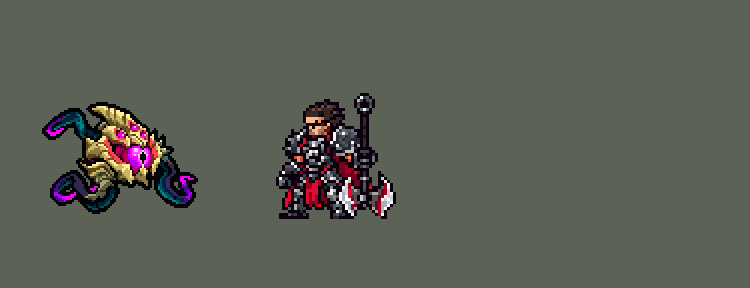

<!-- 本页上半部分由 tools/docs/gen_hero_docs.py 按仓库里现在的数据生成，手改会被覆盖；「开发记录」以下是手写的，生成时原样保留。 -->

# 维克兹 Vel'Koz


| 项目 | 内容 |
|---|---|
| id | `league_velkoz` |
| 所属的包 | 主包（mod_id `league`） |
| 分路 | 中单 |
| 分类 / 标签 | 法师（Magician） · AP / Magic / Range / CC |
| 高清帧 | PPU 1.5 |
| 附加包 | [维克兹附加包](#附加包)（`league_velkoz`） |



其他预览：[逐帧预览](../preview/league_velkoz_frames.png)、[特效表](../preview/league_velkoz_effects.png)

## 现在的技能

下面是游戏里显示的技能说明（`league/text/champion.i18n` 的简体中文，去掉了颜色和图标），冷却、距离来自 `league/champion/league_velkoz.data_champion`；1 秒 = 60 tick。

### 普攻 / 被动

*攻击间隔 1.43 秒 · 攻击距离 55000*

发射虚空能量。每第3次普攻打开虚空裂隙，造成35 + 20% 法强魔法伤害，随后爆炸再造成55 + 25% 法强。有机体解构：技能命中英雄叠层，3层时造成45 + 45% 法强真实伤害。

### 技能1 · 等离子裂变

*冷却 7 秒 · 施放距离 85000 · 施放：指定目标 · 敌人（不含防御塔）*

发射一束等离子，造成85 + 65% 法强魔法伤害并减速50%，持续1.25秒。命中后一分为二，对周围敌人造成45 + 35% 法强魔法伤害和减速。

### 技能2 · 构造分解

*冷却 11 秒 · 施放距离 75000 · 施放：指定目标 · 敌人（不含防御塔）*

让目标区域爆炸，造成75 + 40% 法强魔法伤害并击飞敌人0.75秒。

### 大招 · 生命形态瓦解射线

*冷却 35 秒 · 施放距离 95000 · 施放：指定目标 · 敌方英雄*

引导一束射线2.5秒，共造成320 + 105% 法强魔法伤害。对被有机体解构研究过的英雄改为真实伤害。

### 数值

攻击力 72（每级 +6）、法强 40（每级 +20）、生命 880（每级 +92）、护甲 18（每级 +7）、魔抗 22（每级 +4）、移速 900（每级 +9）。

## 附加包

附加包是可选的原生代码 mod（都在附加包合集 `league_addons` 里），**不装主包里的英雄也是完整的**。

### 维克兹附加包

[维克兹附加包](../../addons/league_velkoz/README.md)：`league_velkoz` v0.1.1

|  | 主包（纯数据） | 装了附加包 |
|---|---|---|
| 有机体解构 | 层数记在维克兹身上，第 3 下打中的英雄受到真实伤害 | **层数记在每个敌方英雄身上**（每层 7 秒，再中一下全部刷新），第 3 层对那个英雄造成真实伤害；每叠一层都「研究」他 7 秒 |
| Q 等离子裂变 | 命中点周围 26000 内的敌人受到分裂伤害和减速 | 命中点的**左右两边各射出一颗分裂弹**（垂直于飞行方向，从命中点旁 12000 起飞 55000 远），打中第一个敌人：伤害、减速，英雄还叠层并打开 Q -> W 的窗口 |
| R 生命形态瓦解射线 | 他身上有研究标记（任何英雄被研究）时，射线对谁都是真实伤害 | 只有**被他研究过的英雄**受到真实伤害，其他敌人魔法伤害；每 3 波叠一层 |
| 连招 | 数据里的窗口：E 击飞英雄后 Q 快速飞向被控的英雄、普攻马上开裂隙；Q 打中英雄后普攻开两道裂隙；没研究任何英雄时 R 不放 | AI 钩子按顺序：**E -> Q**（AI 要 Q 英雄时先 E）、**击飞后马上 Q**、**窗口里的普攻打英雄**（裂隙打在他身上）、**两层的英雄在射程里就放 R**、R 先射被研究的英雄 |

装上附加包后游戏里显示的说明（和主包不同的部分）：

- **普攻 / 被动**：【扩展包】发射虚空能量。每第3次普攻打开虚空裂隙，造成35 + 20% 法强魔法伤害，随后爆炸再造成55 + 25% 法强。有机体解构：技能命中英雄时在他身上叠层，3层时造成45 + 45% 法强真实伤害。
- **技能1 · 等离子裂变**：【扩展包】发射一束等离子，造成85 + 65% 法强魔法伤害并减速50%。命中后向左右两边分裂，分裂弹造成45 + 35% 法强魔法伤害和减速。
- **大招 · 生命形态瓦解射线**：【扩展包】引导一束射线2.5秒，共造成320 + 105% 法强魔法伤害。被他有机体解构研究过的英雄受到真实伤害。

## 相关脚本和素材

- [`tools/kit/build_velkoz.py`](../../tools/kit/build_velkoz.py)
- [`tools/kit/setup_velkoz.py`](../../tools/kit/setup_velkoz.py)
- [`tools/lol/extract_velkoz.py`](../../tools/lol/extract_velkoz.py)
- [`tools/art/preview_velkoz.py`](../../tools/art/preview_velkoz.py)
- [`tools/art/rig_velkoz.py`](../../tools/art/rig_velkoz.py)
- [`assets/source/velkoz/`](../../assets/source/velkoz)

## 开发记录

> 下面是原来 README 里「英雄：维克兹」一节，原样搬过来（只改了相对链接）。

| 部分 | 内容 |
|---|---|
| 定位 | 中单（Magician，标签 AP / Magic / Range / CC），第 145 位英雄。虚空之眼 维克兹：飘在空中、没有腿的虚空之眼——卡其金色的甲壳里一只发光的品红色大眼睛，上面三只小眼睛，三条深青黑色、尖端品红的触手（10-17 之后分组的 E 组；计划里是辅助位替补，用户改成中单）。用户的选择：「中路」「技能方案 A（Q / E / R，W 进普攻）」「附加包要」「只做四分之三面」「有连招要做连招」。团战经理只有三个主动技能位：技能 1 = Q 等离子裂变，技能 2 = E 构造分解，大招 = R 生命形态瓦解射线；W 虚空裂隙放在普攻里（每第 3 下），被动有机体解构挂在所有技能上。技能名照英雄联盟 16.20.1 的 Data Dragon（五种语言） |
| 被动 | **有机体解构**：技能（Q、Q 的分裂、裂隙的两段、E、R）打中敌方英雄叠一层，第 3 层造成 45 + 45% 法强的**真实伤害**，层数清零；头上亮出研究标记的 1、2 瓣，第 3 层爆开。每叠一层都「研究」他 7 秒（R 读它）。数据只读得到施法者自己身上的 buff，所以主包把层数记在维克兹身上（布兰德的做法），附加包按每个英雄分开记 |
| 普攻 / W 虚空裂隙 | 从大眼睛发射虚空能量（100% 攻击）。**每第 3 下普攻**同时朝目标撕开一道 75000 长的**虚空裂隙**：当场 35 + 20% 法强的魔法伤害，0.3 秒后爆开再 55 + 30% 法强，两段各叠一层被动 |
| 技能1 | **等离子裂变**（射程 85000，冷却 7 秒）：等离子弹打中第一个敌人，85 + 65% 法强的魔法伤害并减速 50% 1.25 秒；打中就在命中点**分裂**——主包里是命中点周围 26000 内的敌人受到 45 + 35% 法强和减速（数据不能让弹道拐弯），附加包里是**往左右两边各射出一颗分裂弹** |
| 技能2 | **构造分解**（射程 75000，冷却 11 秒）：目标点地面先裂开，0.55 秒后爆开，22000 内 75 + 40% 法强的魔法伤害并**击飞** 0.75 秒 |
| 大招 | **生命形态瓦解射线**（射程 95000，冷却 35 秒）：从大眼睛射出射线引导 2.5 秒，**跟着目标**每 0.25 秒烧一波（射线长 120000），共 320 + 105% 法强的魔法伤害；他研究着英雄时（被动叠过层）改为**真实伤害**，每 3 波叠一层被动。只在研究着英雄时放（照英雄联盟：先叠层再开大）；被控制或阵亡就断 |
| 连招 | 用户要求：「有连招要做连招」。主包数据里有连招窗口：**E → Q**（击飞英雄后 1.25 秒内放的 Q 快速飞向被控的英雄），**E → W**（击飞后的下一下普攻马上开裂隙），**Q → W W**（Q 打中英雄后的下一下普攻开两道裂隙，英雄联盟的两次充能），**层数 → R**（没研究任何英雄时大招不放） |
| 附加包 | 可选的附加包 [`addons/league_velkoz`](../../addons/league_velkoz/README.md)（在附加包合集里，原生代码，主包不装它也完整），照英雄联盟：**层数记在每个敌方英雄身上**（第 3 层只炸那个英雄），**Q 命中后往左右两边射出分裂弹**，**射线只对被他研究过的英雄造成真实伤害**；**AI 连招**：AI 要 Q 英雄时先 E、击飞后马上 Q、窗口里的普攻打英雄（裂隙落在英雄身上）、射程里有两层的英雄就开大、大招先射被研究的英雄。日志 `league_velkoz.log`（STACK、BURST、SPLIT、RAY、连招） |
| 数值 | 攻击 72（+6）、法强 40（+20）、生命 880（+92）、护甲 18（+7）、魔抗 22（+4）、移速 900（+9）、射程 55000、攻击间隔 86 tick |
| 平衡 | 10 分钟经典引擎模拟，中路对五个原版法师（pyromancer / ice_mage / lightning_mage / wind_mage / white_mage），三套阵容两边各打，两批种子（1–16、17–32）：初稿 -0.47 / -0.34（婕拉同批 +2.12 / +1.47），大招改成跟着目标的引导，全加强 +2.07 / +1.63，折中（Q 85 + 65%、分裂 45 + 35%、E 75 + 40%、裂隙 35 + 20% / 55 + 30%、R 320 + 105%、被动 45 + 45%）+1.22 / +1.31，按帧对时机和眼睛高度（定稿）**+1.26 / +1.35**。附加包（原生代码）经典引擎跑不了，只有单元测试 |
| 精灵图（高清帧 PPU 1.5） | Codex 第 0 步画了 A（触手向两边卷开，英雄联盟的待机）和 B（紧凑），用户选 A、「36」游戏像素、PPU 1.5（54 行）；第 1 步 Codex 照格子画三稿，用户选 A-2（76 × 54，原样读回，眼睛是 Codex 自己画的）。只做 3/4 面，九个动作我照英雄联盟的动画一帧帧摆（[`tools/art/rig_velkoz.py`](../../tools/art/rig_velkoz.py)）：他飘在离地 4 格的地方；触手按整格平移，远侧的触手绕根部转四分之一圈（甩到前面 = 普攻，转到身后举起 = Q、E、R）；Q 和 R 的大眼睛和周围的肉发光，死亡时甲壳合上、眼睛变暗。8 倍逐帧自查时去掉的做法：把甲壳上下拉开（缝像一道横切的线）、代码画的红色褶边（像一圈光晕）、远侧触手往右下平移（会从根部断开）、上方触手转上去（被头冠挡住） |
| 特效 | 17 张特效（[`tools/art/pack_velkoz_fx.py`](../../tools/art/pack_velkoz_fx.py) 的提示词，参考是英雄联盟里维克兹自己的贴图），Codex 画好按格子交回，[`tools/art/import_velkoz_fx.py`](../../tools/art/import_velkoz_fx.py) 导入并逐张核对对称：虚空能量是紫色的、芯是白的，Q 的等离子是品红色的，被动的研究标记是品红色的三瓣眼睛符号。弹道和线朝右画、上下对称；裂隙的爆开帧落在第二段伤害那一 tick；**射线照 league_lucian Q 的做法从一整条光束切成每 tick 一帧**——它挂在每一波从站位点出发、每 tick 往前 1 像素的弹道上，每帧往回挪 1 像素，光束的起点一直停在他的大眼睛上 |
| 音效 | 英雄联盟的音效和配音（[`tools/lol/extract_velkoz.py`](../../tools/lol/extract_velkoz.py)）：普攻、等离子弹 / 分裂、裂隙两段、构造分解的爆开和击飞、射线的开始 / 持续 / 打中 / 研究后打中 / 结束、被动 1、2 层和引爆，三句台词 |
| 图标 | 官方技能图标（等离子裂变、构造分解、生命形态瓦解射线），从本地客户端取 |

重新生成（素材来自本机的英雄联盟客户端，音频不进仓库）：

```bash
python tools/lol/extract_velkoz.py --lol "D:\WeGameApps\lol" --vgmstream <vgmstream-cli.exe>
python tools/kit/build_velkoz.py                    # 技能数据，数字都在脚本的参数表 P 里
python tools/kit/setup_velkoz.py --banpick -10      # 五种语言的文字、音效配置、共享文件里他的键（脸 7,-21）
python tools/art/design_velkoz_model.py             # Codex 第 1 步的造型读回（A-2）
python tools/art/rig_velkoz.py                      # 1 倍帧和 1.5 的原帧
python tools/art/ppu_restyle.py --hero velkoz       # 外描边、脸的位置
python tools/art/ppu_hd.py --hero velkoz            # hd_ / lo_ 帧
python tools/art/import_velkoz_fx.py                # Codex 的特效 -> league_velkoz_fx / league_velkoz_big
python tools/art/preview_velkoz.py                  # 逐帧预览、特效、演示
python addons/league_velkoz/make_override.py        # 附加包的副本（主包的维克兹改了就重跑）
```

逐帧预览：[`docs/preview/league_velkoz_frames.png`](../preview/league_velkoz_frames.png?v=1020a)，特效：[`docs/preview/league_velkoz_effects.png`](../preview/league_velkoz_effects.png?v=1020a)
