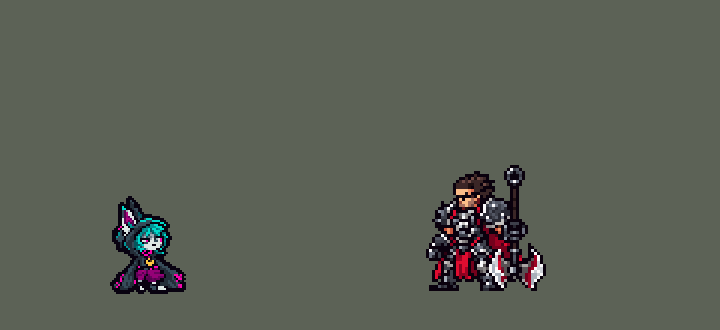

<!-- 本页上半部分由 tools/docs/gen_hero_docs.py 按仓库里现在的数据生成，手改会被覆盖；「开发记录」以下是手写的，生成时原样保留。 -->

# 薇古丝 Vex


| 项目 | 内容 |
|---|---|
| id | `league_vex` |
| 所属的包 | 主包（mod_id `league`） |
| 分路 | 中单 |
| 分类 / 标签 | 法师（Magician） · AP / Magic / Range / CC / Shield |
| 高清帧 | PPU 1.5 |
| 附加包 | [薇古丝附加包](#附加包)（`league_vex`） |



其他预览：[逐帧预览](../preview/league_vex_frames.png)、[特效表](../preview/league_vex_effects.png)

## 现在的技能

下面是游戏里显示的技能说明（`league/text/champion.i18n` 的简体中文，去掉了颜色和图标），冷却、距离来自 `league/champion/league_vex.data_champion`；1 秒 = 60 tick。

### 普攻 / 被动

*攻击间隔 1.43 秒 · 攻击距离 55000*

射出暗影弹。终焉暮气：每15秒下一个技能恐惧命中的敌人0.75秒。生人勿近：敌方英雄靠近时改为获得60 + 60% 法强护盾并震伤周围70 + 40% 法强（每12秒）。

### 技能1 · 寒心波云

*冷却 6 秒 · 施放距离 80000 · 施放：指定目标 · 敌人（不含防御塔）*

射出一道暗风，穿过路径上的所有敌人，造成105 + 70% 法强魔法伤害。

### 技能2 · 溟濛渐染

*冷却 10 秒 · 施放距离 70000 · 施放：指定目标 · 敌人（不含防御塔）*

影子飞到目标处扩散，造成80 + 60% 法强魔法伤害、减速35%2秒，并施加暮气：她下一次技能打中带暮气的英雄额外造成60 + 30% 法强魔法伤害。

### 大招 · 愁煞

*冷却 35 秒 · 施放距离 110000 · 施放：指定目标 · 敌方英雄*

射出飞弹标记一名敌方英雄，造成80 + 20% 法强魔法伤害，随后冲到他身边再造成225 + 70% 法强魔法伤害。

### 数值

攻击力 72（每级 +6）、法强 40（每级 +20）、生命 960（每级 +95）、护甲 18（每级 +7）、魔抗 22（每级 +4）、移速 910（每级 +9）。

## 附加包

附加包是可选的原生代码 mod（都在附加包合集 `league_addons` 里），**不装主包里的英雄也是完整的**。

### 薇古丝附加包

[薇古丝附加包](../../addons/league_vex/README.md)：`league_vex` v0.1.0

|  | 主包（纯数据） | 装了附加包 |
|---|---|---|
| 暮气 | E 打中英雄后的一段时间里，她下一次技能（Q、W、R）打中英雄补一次暮气伤害 | **照英雄联盟**：暮气挂在每个被 E 打中的敌人身上（小兵、野怪也算），**她身边突进的敌方英雄也被挂上**；她之后打中带暮气的敌人（普攻也算）就引爆：补暮气伤害，**终焉的等待缩短 25%** |
| 终焉 | 固定每 15 秒一次 | 同上，引爆暮气会缩短等待 |
| 愁煞 | 冷却照常 | **被愁煞打中的英雄 6 秒内阵亡就刷新愁煞**（谁杀的都算） |

装上附加包后游戏里显示的说明（和主包不同的部分）：

- **普攻 / 被动**：【扩展包】射出暗影弹。终焉暮气：每15秒下一个技能恐惧命中的敌人0.75秒；她身边突进的敌方英雄被施加暮气。生人勿近：敌方英雄靠近时改为获得60 + 60% 法强护盾并震伤周围70 + 40% 法强。
- **技能2 · 溟濛渐染**：【扩展包】影子飞到目标处扩散，造成80 + 60% 法强魔法伤害、减速35%，并施加暮气：她再打中带暮气的敌人就引爆，造成60 + 30% 法强魔法伤害，终焉的等待缩短25%。
- **大招 · 愁煞**：【扩展包】射出飞弹标记一名敌方英雄，造成80 + 20% 法强魔法伤害，随后冲向他再造成225 + 70% 法强魔法伤害。被标记的英雄6秒内阵亡就刷新愁煞。

## 相关脚本和素材

- [`tools/kit/build_vex.py`](../../tools/kit/build_vex.py)
- [`tools/kit/setup_vex.py`](../../tools/kit/setup_vex.py)
- [`tools/lol/extract_vex.py`](../../tools/lol/extract_vex.py)
- [`tools/art/preview_vex.py`](../../tools/art/preview_vex.py)
- [`tools/art/rig_vex.py`](../../tools/art/rig_vex.py)
- [`assets/source/vex/`](../../assets/source/vex)

## 开发记录

> 下面是原来 README 里「英雄：薇古丝」一节，原样搬过来（只改了相对链接）。

| 部分 | 内容 |
|---|---|
| 定位 | 中单（Magician，标签 AP / Magic / Range / CC / Shield），第 138 位英雄。愁云使者 薇古丝：闷闷不乐的约德尔小女孩，深青黑色的大兜帽衫、兜帽上两只尖耳朵，青绿色头发、灰白皮肤、品红色的眼睛，袖子长到小腿（10-17 的分组计划 D 组的中单）。用户的选择：「技能方案 A（Q / E / R，W 进普攻）」「做附加包」。团战经理只有三个主动技能位：技能 1 = Q 寒心波云，技能 2 = E 溟濛渐染，大招 = R 愁煞；W 生人勿近和被动终焉暮气在普攻里。技能名照英雄联盟 16.20.1 的 Data Dragon（五种语言） |
| 普攻 / 被动 / W | 甩出一团暗影弹（射程 55000，100% 攻击）。**生人勿近**：她普攻时 40000 内有敌方英雄、且 12 秒的冷却好了，这一下换成 `skill_w`：得到 60 + 60% 法强的护盾（2.5 秒），身边 40000 内的敌人受 70 + 40% 法强魔法伤害。**终焉暮气**：每 15 秒她的下一个 Q、E 或生人勿近附带恐惧 0.75 秒；**暮气**：溟濛渐染打中的敌人挂上暮气（6 秒，主包里她身上记一个窗口），她下一次 Q、W、R 打中英雄就补 60 + 30% 法强魔法伤害（数据读不到敌人身上的 buff；附加包照英雄联盟做） |
| 技能1 | **Q 寒心波云**（对小兵、野怪也放，射程 80000）：一道暗风波直线飞出 95000，穿过路上所有敌人：105 + 70% 法强魔法伤害。冷却 6 秒（英雄联盟的波先慢后快；这里一个速度） |
| 技能2 | **E 溟濛渐染**（对小兵、野怪也放，射程 70000）：影子飞到目标点（0.3 秒）扩散，半径 22000 内 80 + 60% 法强魔法伤害、减速 35% 2 秒并施加暮气。冷却 10 秒 |
| 大招 | **R 愁煞**（只对敌方英雄，射程 110000）：扔出影子飞弹追着英雄打：80 + 20% 法强魔法伤害并标记，随后她冲过去、**停在他 48000 外**（佐伊大招的做法：一条看不见的线碰到第一个英雄就停、终点传送），再造成 225 + 70% 法强魔法伤害；生人勿近好了就落地时放一次（英雄联盟的 R → W）。冷却 35 秒 |
| 附加包 | 可选的附加包 [`addons/league_vex`](../../addons/league_vex/README.md)（在附加包合集里，原生代码，主包不装它也完整），照英雄联盟：**暮气挂在每个敌人身上**（E 打中的，还有在她身边突进的敌方英雄），她之后**打中带暮气的敌人就引爆**、终焉的等待缩短 25%；**愁煞打中的英雄 6 秒内阵亡就刷新愁煞**。日志 `league_vex.log`（GLOOM、DASH、DOOM、RESET） |
| 数值 | 攻击 72（+6）、法强 40（+20）、生命 960（+95）、护甲 18（+7）、魔抗 22（+4）、移速 910（+9）、射程 55000 |
| 平衡 | 10 分钟经典引擎模拟，中路对五个原版法师（pyromancer / ice_mage / lightning_mage / wind_mage / white_mage），三套阵容两边各打：初稿（R 冲到英雄身上）-4.69（同批佐伊 +1.17）——冲进人堆，每局死 3.7 次；不冲 -1.56。R 落地放生人勿近、Q / E / R 加伤 -1.47；冲刺停在 40000 外 +0.36、48000 外 +0.77；暮气 60 + 30%、E 每 10 秒 +0.65 / -0.02（种子 1–8 / 9–16）；R 每 35 秒 +1.44 / +0.97；按动作条的时间（普攻第 2 帧、Q 第 3 帧、生人勿近第 3 帧砸下、E 第 2 帧、R 第 3 帧出手）+0.40 / +0.87；Q 105、冲击 225 定稿 **+0.97 / +1.17**（约 +1.1，佐伊 +1.17） |
| 精灵图（高清帧 PPU 1.5） | Codex 第 0 步画了 3/4 正面和正侧面两种角度，影子站起来（A）或躺在地上（B）（[`tools/art/pack_vex_picture.py`](../../tools/art/pack_vex_picture.py)，读回 [`design_vex_hd.py`](../../tools/art/design_vex_hd.py)，大小对比 [`review_vex_size.py`](../../tools/art/review_vex_size.py)），用户：「A 影子站起来」「34 像素」「PPU 1.5」。第 1 步 Codex 在游戏格子上画 A / SA 各两稿（[`pack_vex_model.py`](../../tools/art/pack_vex_model.py) / [`design_vex_model.py`](../../tools/art/design_vex_model.py)：整行整列删到 63 行，只保护眼睛的行列；脸和影子的螺旋眼逐格重画）。动作不靠 Codex（用户：「动作帧不用依赖codex参考其他英雄怎么做的 做完美了喊我review 对照英雄联盟的动作帧来做」）：[`rig_vex.py`](../../tools/art/rig_vex.py) 用造型自己的像素无损摆——影子按颜色分成单独一层，近侧的长袖绕肩整块转（往前时放低 4 行，不挡下巴），袖子一甩开身后那截披风下摆去掉；待机（3/4 正面，身子坐下一行再起来）、跑（英雄联盟那种小碎步，鞋整块前后迈）、普攻（袖子往前甩）、Q（弓步前推）、生人勿近（跳起、落地砸开）、E（跳起甩袖）、R 扔 / 冲（前倾腾空）/ 落地一击、挨打、阵亡（往后倒、躺下），每个动作对照英雄联盟的动画（[`review_vex_actions.py`](../../tools/art/review_vex_actions.py) 一张 GIF 左右对比）。审查时用户：「感觉背后的宠物不需要啊」——所有帧都不带影子（影子只在技能特效里）；「待机时头有点大」——待机的兜帽和耳朵整行整列删掉 5 行 7 列（脸不动）；「动作可以」。装进游戏后：「脸还会一大一小」「这个脸不是最好的吗 为什么不用啊」——待机和动作原来是两张不同大小的脸，现在所有帧都用侧面造型原本那张脸（待机换上侧面的头，下巴对在脖子上）；1 倍帧（没有 league.dll 时、选人卡片）待机的呼吸改成整像素下移、缩小时保留眼睛的品红色（「下面的眼睛怎么变色了」） |
| 特效 | 第 3 步 16 张特效（[`tools/art/pack_vex_fx.py`](../../tools/art/pack_vex_fx.py)，颜色照英雄联盟：她的魔法是薄荷青绿色的光——暗影弹、寒心波云的前缘、暮气的眼睛符印；影子是墨一样的靛紫色，带尖耳朵和螺旋眼，只在技能里出现：E 影子从她身上飞走、扑到目标点化成一片暗影地面，生人勿近时影子升起来护住她、脚下炸开一圈冲击环，愁煞的飞弹是影子的头，被标记的人头上有一对影子的眼睛，终焉好了时她头上睁开影子的眼睛）。弹道图（暗影弹、风波、影子飞弹）朝右画、上下对称（游戏按飞行方向转），其余全部左右对称（游戏不镜像特效图）。[`tools/art/import_vex_fx.py`](../../tools/art/import_vex_fx.py) 按清单的帧大小切开、照技能播放的位置摆好（再查一遍对称），写成 `league_vex_fx` 和 `league_vex_big`（冲击环、影子落地） |
| 音效 | 英雄联盟的音效和配音（[`tools/lol/extract_vex.py`](../../tools/lol/extract_vex.py)，22 段）：普攻出手 / 打中，生人勿近 / 打中，Q 出手 / 飞行 / 打中，E 出手 / 落地 / 暮气，暮气引爆，终焉好了，恐惧，R 出手 / 飞行 / 标记 / 冲刺 / 一击；Q、E、W、R 的配音（片段名 `league_vex_sfx_*`，和声音名不同） |
| 图标 | 官方技能图标（寒心波云、溟濛渐染、愁煞，另有生人勿近和终焉暮气），从本地客户端取 |

重新生成（素材来自本机的英雄联盟客户端，音频不进仓库）：

```bash
python tools/lol/extract_vex.py --lol "D:\WeGameApps\lol" --vgmstream <vgmstream-cli.exe>
python tools/kit/build_vex.py                       # 技能数据，数字都在脚本的参数表 P 里
python tools/kit/setup_vex.py                       # 五种语言的文字、音效配置、共享文件里她的键
python tools/art/design_vex_model.py                # Codex 第 1 步的造型读回（待机 A-2、侧面 SA-2）
python tools/art/rig_vex.py                         # 1 倍帧和 1.5 的原帧（整块摆）
python tools/art/ppu_restyle.py --hero vex          # 外描边（不要加 --preview）
python tools/art/ppu_hd.py --hero vex               # hd_ / lo_ 帧
python tools/art/import_vex_fx.py                   # 特效
python tools/art/preview_vex.py                     # 预览和演示 GIF
python addons/league_vex/make_override.py           # 附加包的副本（主包的薇古丝改了就重跑）
```

美术提示词见 [`assets/source/vex/`](../../assets/source/vex) 里的 `PICTURE_PROMPT.md`、`MODEL_PROMPTS.md`、`PROMPTS_FX.md`；Codex 的交付在 `codex_picture/`、`codex_model/`、`codex_fx/`。

逐帧预览：[`docs/preview/league_vex_frames.png`](../preview/league_vex_frames.png?v=1020b)，特效：[`docs/preview/league_vex_effects.png`](../preview/league_vex_effects.png?v=1020a)。
