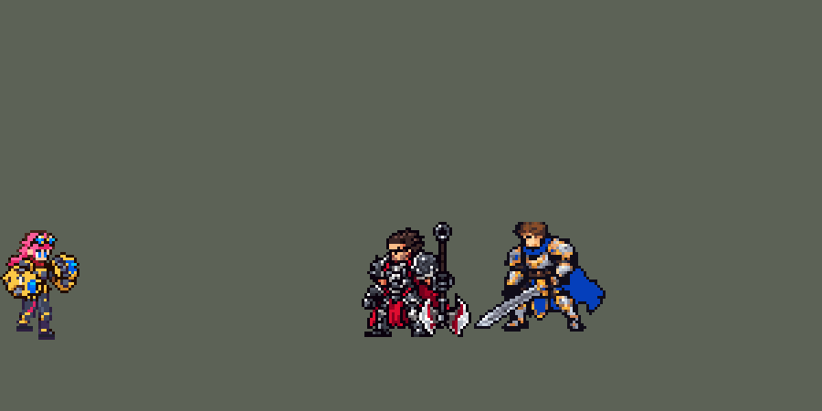

<!-- 本页上半部分由 tools/docs/gen_hero_docs.py 按仓库里现在的数据生成，手改会被覆盖；「开发记录」以下是手写的，生成时原样保留。 -->

# 蔚 Vi


| 项目 | 内容 |
|---|---|
| id | `league_vi` |
| 所属的包 | 主包（mod_id `league`） |
| 分路 | 打野 |
| 分类 / 标签 | 近战（Melee） · AD / Melee / CC / Shield |
| 高清帧 | 1 倍像素（无高清帧） |
| 附加包 | 无 |



其他预览：[逐帧预览](../preview/league_vi_frames.png)、[特效表](../preview/league_vi_effects.png)

## 现在的技能

下面是游戏里显示的技能说明（`league/text/champion.i18n` 的简体中文，去掉了颜色和图标），冷却、距离来自 `league/champion/league_vi.data_champion`；1 秒 = 60 tick。

### 普攻 / 被动

*攻击间隔 1 秒 · 攻击距离 24000*

普攻造成100% 攻击力物理伤害。爆弹重拳：每第3次普攻额外造成20物理伤害（对英雄再加5%最大生命），减护甲20%，自身攻速+30%，均4秒。爆裂护盾：技能命中敌人获得100+60% 攻击力护盾3秒，冷却12秒，第3次普攻减3秒。

### 技能1 · 强能冲拳

*冷却 8 秒 · 施放距离 45000 · 施放：方向 · 敌人（不含防御塔）*

蓄力0.5秒（开始蓄力时锁定方向）后向前冲刺，对路上的敌人造成60+100% 攻击力物理伤害；撞到第一个英雄时停下并击退他，叠1层爆弹重拳，之后1.5秒内施放透体之劲会立刻出拳。

### 技能2 · 透体之劲

*冷却 16 秒 · 可存 2 次 · 施放距离 26000 · 施放：指定目标 · 敌人（不含防御塔）*

2层充能（每层8秒）。下一次普攻变为透体之劲，对目标和其身后扇形内的敌人造成30+110% 攻击力物理伤害。

### 大招 · 天霸横空烈轰

*冷却 50 秒 · 施放距离 80000 · 施放：指定目标 · 敌方英雄*

锁定一名敌方英雄冲过去，期间免疫控制；撞开路上的敌人，造成75+60% 攻击力物理伤害并眩晕0.75秒；到达后将目标击飞1.25秒并造成150+120% 攻击力物理伤害，下一拳自带透体之劲。

### 数值

攻击力 95（每级 +20）、生命 1000（每级 +100）、护甲 30（每级 +8）、魔抗 22（每级 +4）、移速 1050（每级 +11）。

## 相关脚本和素材

- [`tools/lol/extract_vi.py`](../../tools/lol/extract_vi.py)
- [`tools/art/preview_vi.py`](../../tools/art/preview_vi.py)
- [`tools/art/import_vi.py`](../../tools/art/import_vi.py)
- [`tools/art/design_vi.py`](../../tools/art/design_vi.py)
- [`assets/source/vi/`](../../assets/source/vi)

## 开发记录

> 下面是原来 README 里「英雄：蔚」一节，原样搬过来（只改了相对链接）。

| 部分 | 内容 |
|---|---|
| 定位 | 打野（近战，分类 Melee），用户 10 月 2 日排的第十组的打野；本包第十个打野（李青、阿木木、易、艾克、费德提克、贝蕾亚、黛安娜、萨科、魔腾之后）。皮城执法官：拳套打出护盾，Q 蓄力冲拳撞停第一个英雄，E 打穿目标身后的扇形，R 锁定一个英雄冲过去把他打飞。技能方案用户全选 A |
| 普攻 | 直拳，100% 攻击力的物理伤害，射程 24000，攻击间隔 60 tick（1 秒），第 10 tick 打中（动作第 3 帧）。W「爆弹重拳」并入普攻：每第 3 下额外 20 点物理伤害，对英雄再加目标 5% 最大生命（只对英雄生效的影子弹，英雄联盟对野怪有上限），减护甲 20%、自己攻速 +30%，都是 4 秒，并把爆裂护盾的冷却缩短 3 秒。游戏读不到目标身上的层数，层数记在她自己身上（两个状态标记，3.5 秒不打就清零）；Q 打中英雄也叠一层（不会直接变成第三下） |
| 被动 | 「爆裂护盾」：Q、E、R 打中敌人时获得 100 + 60% 攻击力的护盾，3 秒；冷却 12 秒，做成四段 3 秒的状态，第三下爆弹重拳去掉剩下最长的一段（−3 秒） |
| 技能1 | Q「强能冲拳」：朝 45000 内的敌人施放（小兵和野怪也算，清线、打野也用），冷却 8 秒。原地蓄力 30 tick（0.5 秒，拉到身侧的拳套发光），方向在开始蓄力时锁定（用户选 A：看得见、躲得开），然后朝那个方向冲刺（每 tick 4000，最多 12 tick）：`RushTime` 打 `EnemyChampion` 且不穿透，撞到第一个英雄就停下（vi_sim 里量过），把他击退（每 tick 2000、10 tick）；跟着她走的判定区（`ApplyInProjectile`，`follow_caster`）打中经过的每个敌人一次：60 + 100% 攻击力的物理伤害。打中英雄后 1.5 秒内放 E 立刻出拳（连招 Q → E） |
| 技能2 | E「透体之劲」：2 层充能（每层 8 秒），对 26000 内的敌人施放。放一次，下一次普攻换成 E 的出拳动作，打中时变成穿过目标的扇形（长 40000），扇形里的敌人受到 30 + 110% 攻击力的物理伤害。引擎没有"重置普攻"，所以强化的是下一次普攻；Q 打中英雄后的 E 和 R 落地送的 E 立刻出拳 |
| 大招 | R「天霸横空烈轰」：朝 80000 内的敌方英雄施放，冷却 50 秒。起步 8 tick 后免疫控制地冲向他（`MoveToTarget`，每 tick 4000），跟着她的小判定区撞开路上别的敌人：75 + 60% 攻击力的物理伤害、眩晕 0.75 秒、短短一推（1500 × 4：判定区比她落地早约 10 tick 就碰到目标，2000 × 5 时把他推出 20000，落地又追了 10 tick）；到达后上勾拳砸地：150 + 120% 攻击力的物理伤害，击飞 1.25 秒，落地送一次透体之劲（连招 R → E） |
| 数值 | 攻击 95（+20）、生命 1000（+100）、护甲 30（+8）、魔抗 22（+4）、移速 1050（+11）。数值是自己设计的，用 SDK 对战模拟调：打野，对 5 个原版打野（`demon`、`circus_blade`、`hunter`、`inquisitor`、`ninja`），600 秒一局。定稿两批（各 8 个种子）+2.12 / +1.97，平均 +2.05（参考：更早一批里李青 +0.76、魔腾 +0.94）。削弱的几版（爆弹重拳 4% + 护盾 80、R 120 / 60、攻击 90、R 135 / 65、R 120 / 75、路上 50）在 +0.96 到 +2.39 之间，换一批种子就不稳（R 120 / 60 那批 +0.96，另一批的 R 120 / 75 是 +2.00），都在波动范围内，定下第一版 |
| 亚索联动 | R 的眩晕和击飞是亚索大招要的控制：蔚打野、亚索同队时，亚索每局 R 到被控英雄 2.59 次（同一批李青 1.88、阿木木 2.94、原版忍者 0.53），亚索不用调 |
| 精灵图 | 11 个动作 56 帧：待机、移动、普攻、E 出拳、Q 蓄力、Q 冲刺、R 起步、R 冲锋、R 上勾拳砸地、受击、死亡。造型照隔壁 oppi 模组里蔚的结构画我们自己的（3/4 侧面朝右的拳击架势、头发盖住后颈接到肩上、身体干净）：Codex 生图的主稿，用户认可后读成 40 行，眼睛和远侧脸颊按用户挑的改。粉色短发、护目镜推在头上、蓝眼睛、红围巾、钢蓝胸甲、深蓝紫腿甲、两只金色海克斯拳套（仪表盘、钢灰指节、蓝水晶）。30 × 40 px，26 色；待机最高点 −28，不设 `banpick_center` |
| 特效 | Codex 画的 15 张（85 帧）：普攻命中（白金星光、金色火花、一圈海克斯蓝）、爆弹重拳（两道蓝色冲击弧）、爆裂护盾（蓝色光环罩住全身，破碎）、Q 的蓄力光（拳套上的蓝白光球）、冲出的尘土和热橙火花、路过的命中、撞停的爆裂光环、E 的拳套充能、扇形冲击波、命中、R 起步的光柱、冲锋的蓝色尾迹、撞开的星光、上勾拳的光柱、砸地的裂纹 |
| 图标 | 官方技能图标（Q / E / R），64×64 |
| 音效 | 英雄联盟的音效和配音（`tools/lol/extract_vi.py`）：普攻命中、爆弹重拳、护盾、Q 蓄力 / 冲出 / 撞停 / 命中、E 充能 / 出拳 / 命中、R 起步 / 撞开 / 上勾拳；Q、E、R 带中文配音 |

重新生成（素材来自本机的英雄联盟客户端，音频不进仓库）：

```bash
python tools/lol/extract_vi.py --lol "D:\WeGameApps\lol" --vgmstream "<vgmstream-cli.exe 路径>"
python tools/lol/native_pose.py assets/source/vi/poses.json --out <渲染文件夹>   # 动作参考帧（英雄联盟的姿势）
python tools/art/design_vi.py      # 造型：主稿按方块读成 40 行，改眼睛和远侧脸颊
python tools/art/strips_vi.py      # 动作：Codex 的 50 帧按造型的格子读，竖着的头贴造型的头
python tools/art/import_native.py --hero vi
python tools/art/import_vi.py      # 特效：按技能需要的大小缩放，挂到拳头、目标、地面上
python tools/art/preview_vi.py
```

美术（原画的提示词见 [`assets/source/vi/PICTURE_PROMPT.md`](../../assets/source/vi/PICTURE_PROMPT.md)，造型的见 [`MODEL_V2.md`](../../assets/source/vi/MODEL_V2.md)，动作的见 [`STRIPS_V4.md`](../../assets/source/vi/STRIPS_V4.md)，特效的见 [`PROMPTS.md`](../../assets/source/vi/PROMPTS.md)；Codex 的交接说明在 [`codex_picture/`](../../assets/source/vi/codex_picture)、[`codex_model_v2/`](../../assets/source/vi/codex_model_v2)、[`codex_strips_v4/`](../../assets/source/vi/codex_strips_v4)、[`codex_fx/`](../../assets/source/vi/codex_fx)）：

- 第一版造型（A40：正面站、拳套垂在两边）和它的几轮动作都被否了：Codex 用代码拼的动作（「跑动姿势好怪 完全不像LOL里面的蔚」）、生图重画后压成满身金色碎点的一版（「你觉得这模型对吗 质量这么差」）、用代码逐像素画的一版（身体像方块机器人），我按英雄联盟骨骼重摆拳套也露出空洞。用户：「头不连接身体」「死亡的时候大规模模型丢失」「身体看起来很奇怪」「你可以参考隔壁oppi的蔚怎么做的」。
- 新造型（`MODEL_V2.md`）：照 oppi 的蔚的结构画我们自己的——3/4 侧面朝右的拳击架势（近侧拳套横在胸前，远侧拳头举在脸旁）、头发盖住后颈接到肩上、身体是大块的深色加钢色肩甲，金色只在拳套上；服装和配色照我们自己的原画 A，oppi 的图只给 Codex 看结构、不描。Codex 生图的主稿用户认可了，但读回有 59 行（「codex做了一版挺大的 需要你慢慢调到合适的尺寸」）。`shrink_vi.py` 不缩读回图，而是回到主稿原图，每个游戏像素读它覆盖的那块原图：颜色归到主稿的 27 色，眼睛和水晶的蓝占一块的 12%、白色占 36% 就保留，描边的深色占 40% 就保留，其余取最多的颜色，零星的单格并掉，最后补齐描边。给用户看了 42 / 40 / 38 行，选 40（「40 但是眼睛要修一下」）：眼睛改成两行高、上面一行睫毛，近侧眼白加瞳孔、远侧瞳孔往里收一格（第一版远侧瞳孔压在下巴的轮廓线上，「凸在外面的」），三个方案选 1；远侧脸颊戳进刘海的一列皮肤改成刘海、浅棕的轮廓改成下巴那种近黑（「方案1吧 但是这里有点奇怪」，两个修法选 A）。近侧瞳孔最上面一格用只有它有的 #006CFB（导入时按它找脸，水晶用别的蓝）。128 × 128 画布上脚底在第 99 行、两脚中间在第 64 列。
- 动作（`STRIPS_V4.md`）：Codex 照画主稿的方法，一帧一张 1254 px 的生图，和主稿一样大、脚踩主稿的地面线（y = 1189）、两脚中间在 x = 635，自己不读回、不缩小、不拼。`strips_vi.py` 用造型那套格子读每一帧（把主稿当成一帧读，结果和造型逐像素一样），脚踩进地面超过半格的整帧上移、站着悬空的下移（移动和 R 冲锋有腾空，不动）；头还竖着的帧都贴造型的头：按头发和皮肤的分布找到 Codex 画的头（逐格比颜色只有 0.2–0.6 对得上），先擦掉它（脸那一侧全擦，后脑只擦皮肤和眼睛，冲刺时往后飘的头发留着），再贴、补描边、去掉不到 8 格的碎块；死亡低头趴下，留 Codex 自己的头。动作照英雄联盟（`poses.json` 渲染的每帧姿势），都从拳击架势出发再回到架势；死亡整个人跪下趴在拳套上，每帧都画全。Codex 的 50 帧原图存成按主稿色板的索引色 PNG（19 MB → 1.2 MB，读出来逐像素不变）。
- 导入：待机 6 帧都是造型，第 3–5 帧小腿以上下沉一行呼吸（`BOB`，接缝在造型第 92 行：两条腿那里都是细斜线，拳套最低到第 85 行）；按 #006CFB 定头的位置（`EYES`）；描边补齐（`COMPLETE`）。头像截取点 (−1, −37)（`tfm2_ase.py face`）。
- 跑步的腿（2026-10-03，用户：「蔚走路的时候没有明显交叉步」）：v4 的跑步 8 帧里带粉色护膝的那条腿一直在后面，第 5–8 帧是第 1–4 帧的重画，第 4、8 帧两只鞋相距约 26 格。给 Codex 的包（`assets/source/vi/RUN_LEGS.md`）照英雄联盟跑步的关节排好每帧两只鞋的位置，后 4 帧两腿对调，只重画腰带以下；Codex 交回的 8 帧（`codex_run_legs/`：上半身逐像素不变、只用原图已有的颜色）换进 `codex_strips_v4/frames`，两只鞋最多相距 8 格，近腿在前和在后各半个周期。
- 特效（Codex 画的 15 张，`import_vi.py`）：原稿是 8 px 方块的像素画（每张约 30 格），按技能需要缩放（每个新像素取原稿那块里最亮的不透明像素，白芯和一格的线留得住）：命中类 0.7（缩一半时太小，用户：「命中类偏小恢复到0.7」）、拳头的光一半、爆弹重拳 0.7、撞停 0.8、护盾放大 1.5 倍（36 × 45，罩住 40 行的她）、砸地裂纹只横向拉 1.7 倍（约 75 px，原来被她砸地的身子挡住，用户：「往两边延伸出去就行」）。位置按新动作量拳套水晶：Q 蓄力在拉到身侧的近侧拳套 (−7, −5)，E 充能在脸旁的远侧拳头 (11, −15)（E 砸拳用这只手），冲击波从第 4 帧砸下的拳头往前 22–66 px，画在一条从她站位点朝目标的「只有画面的线」上（`league_vi_e_wave`，68000 长，和贝蕾亚 E 的声波一样）：原来是挂在她身上的特效，只会左右翻，目标在斜上斜下时和伤害的扇形对不上，红方还会朝反方向（用户：「蔚的E技能特效是歪的」「红方释放的释放是歪的」「之前剑姬的问题 E技能的特效没有跟随人物 反方向的」），现在冲击波总是朝着被打的人，朝左打时上下颠倒（Codex 的冲击波上下差不多，看不出来），R 尾迹的右端在她背后 (−4, −12)；命中在上半身 (0, −8)，上勾拳光柱、护盾、R 起步落在脚底，裂纹的中线在脚底上方 2 px。时长：Q 蓄力 5 × 100 ms（30 tick），护盾 3 秒（起、第 4–8 帧循环 5 次、碎），R 尾迹 6 × 70 ms 循环到落地。

逐帧预览：[`docs/preview/league_vi_frames.png`](../preview/league_vi_frames.png?v=1014g)，特效：[`docs/preview/league_vi_effects.png`](../preview/league_vi_effects.png?v=1014g)。
