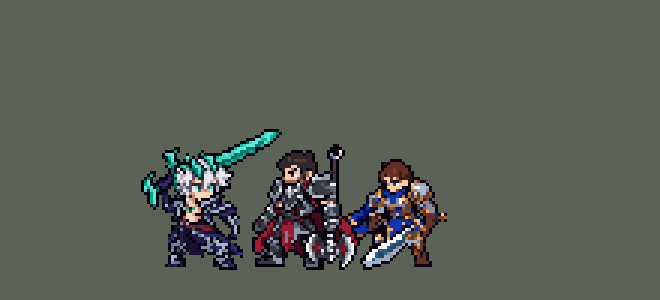

<!-- 本页上半部分由 tools/docs/gen_hero_docs.py 按仓库里现在的数据生成，手改会被覆盖；「开发记录」以下是手写的，生成时原样保留。 -->

# 佛耶戈 Viego


| 项目 | 内容 |
|---|---|
| id | `league_viego` |
| 所属的包 | 主包（mod_id `league`） |
| 分路 | 打野 |
| 分类 / 标签 | 近战（Melee） · AD / Melee / CC / Heal |
| 高清帧 | 1 倍像素（无高清帧） |
| 附加包 | [佛耶戈「君命已决」附加包](#附加包)（`league_viego_soul`）、[游戏 AI 不按的技能替它按](#附加包)（`league_ult_press`） |



其他预览：[逐帧预览](../preview/league_viego_frames.png)、[特效表](../preview/league_viego_effects.png)

## 现在的技能

下面是游戏里显示的技能说明（`league/text/champion.i18n` 的简体中文，去掉了颜色和图标），冷却、距离来自 `league/champion/league_viego.data_champion`；1 秒 = 60 tick。

### 普攻 / 被动

*攻击间隔 1.07 秒 · 攻击距离 26000*

君命已决：他伤过的敌方英雄3秒内阵亡则附身其灵魂10秒：1秒无敌，回复60 + 50% 攻击力，攻击+20%、攻速+30%、移速+15%，Q、W冷却减半。普攻附加英雄最大生命2%。

### 技能1 · 破败王剑

*冷却 5.5 秒 · 施放距离 36000 · 施放：指定目标 · 敌人（不含防御塔）*

向前刺出，造成50 + 70% 攻击力伤害。刺中的英雄被标记4秒，下次普攻对其斩两下：再造成20 + 60% 攻击力伤害并回复30 + 30% 攻击力。

### 技能2 · 千载幽咽

*冷却 10 秒 · 施放距离 46000 · 施放：指定目标 · 敌方英雄*

茫茫焦土：黑雾升起，5秒内移速+30%、攻速+40%，站在黑雾里（留2.5秒）时隐身。随后冲刺并吐出亡魂，第一个被击中的敌人受到90 + 70% 攻击力伤害并眩晕1.1秒。

### 大招 · 痛贯天灵

*冷却 50 秒 · 施放距离 42000 · 施放：指定目标 · 刚交过手的敌方英雄*

跃向队伍正在交手的敌方英雄并减速99%，落地刺穿它，造成120 + 120% 攻击力+其最大生命12%伤害，击退周围其他敌人。结束附身。

### 数值

攻击力 92（每级 +18）、生命 980（每级 +105）、护甲 30（每级 +8）、魔抗 26（每级 +4）、移速 1010（每级 +11）。

## 附加包

附加包是可选的原生代码 mod（都在附加包合集 `league_addons` 里），**不装主包里的英雄也是完整的**。

### 佛耶戈「君命已决」附加包

[佛耶戈「君命已决」附加包](../../addons/league_viego_soul/README.md)：`league_viego_soul` v0.2.16

|  | 主包（纯数据） | 装了附加包（照英雄联盟） |
|---|---|---|
| 什么时候附身 | 数据看不到谁死了：他打过的英雄身上挂一个每 tick 续命的计时，计时断了就当它死了；同一时间打过两个英雄，只看得到最后死的那个 | 读每个敌方英雄的死亡：他 3 秒内打过的英雄一死就算他的功劳，每个都算 |
| 灵魂在哪 | 当场附身（在他自己身上） | 尸体那里留下灵魂 8 秒，35000 以内直接附身，90000 以内他冲过去附身（照英雄联盟要去拿那个灵魂） |
| 附身后的样子 | 还是佛耶戈，身上裹一圈亡魂黑雾 | **整个身体变成被附身的那个英雄**：站、跑、出招、挨打都是那个英雄的图（只在游戏 0.6.4 上，别的版本退回左边那样） |
| 附身后的招式 | 佛耶戈自己的 Q、W、E，攻击 / 攻速 / 移速加成 | 按那个英雄的类别换成五套招式之一：**近战**（重斩、震地减速、冲锋眩晕）、**射手**（远程射击、穿透射击、三连射）、**法师**（法球、溅射爆发、定身）、**辅助**（远程射击、治疗周围友方英雄、减速周围敌人并加速）、**刺客**（快斩、闪到目标身边重击、隐身加速）；远程三类攻击距离 +25000 |

### 游戏 AI 不按的技能替它按

[游戏 AI 不按的技能替它按](../../addons/league_ult_press/README.md)：`league_ult_press` v0.5.5（通用附加包，下面只列和佛耶戈有关的部分）

|  | 装了附加包，什么时候按 |
|---|---|
| 劫 W、格温 E、佛耶戈 E、卡特琳娜 W（冲上去的） | 他生命 **≥ 40%**；射程内（劫 55000、格温 45000、佛耶戈 46000、卡特琳娜 55000，引擎只接最近被我方打过的）的敌方英雄，**不在敌方塔下**（75000 内；生命 25% 以下的除外）、**目标身边 60000 内的敌方英雄不比他身边的我方英雄（含他）多**，挑**生命比例最低**的。劫还要 **Q 好着**（主包标记 `league_zed_q_cd` 不在，W-E-Q 一起出手，主包最初的设计）。AI 正往远处撤（走路目的地比现在离目标远 10000 以上）时不按 |

## 相关脚本和素材

- [`tools/kit/build_viego.py`](../../tools/kit/build_viego.py)
- [`tools/kit/setup_viego.py`](../../tools/kit/setup_viego.py)
- [`tools/lol/extract_viego.py`](../../tools/lol/extract_viego.py)
- [`tools/art/preview_viego.py`](../../tools/art/preview_viego.py)
- [`tools/art/rig_viego.py`](../../tools/art/rig_viego.py)
- [`tools/art/import_viego.py`](../../tools/art/import_viego.py)
- [`tools/art/design_viego.py`](../../tools/art/design_viego.py)
- [`assets/source/viego/`](../../assets/source/viego)

## 开发记录

> 下面是原来 README 里「英雄：佛耶戈」一节，原样搬过来（只改了相对链接）。

| 部分 | 内容 |
|---|---|
| 定位 | 打野（战士，分类 Melee，标签 AD / Melee / CC / Heal），第 88 位英雄。破败之王 佛耶戈：大剑刺客，打过的英雄一死就夺取它的灵魂附身，Q、W 冷却减半接着收割，大招跳到残血英雄身上一剑刺穿。用户选 Q 单独、W+E 合并、主包近似 + 附加包（「附加包一起做了」）、大招打正在交手的英雄、Melee 战士 |
| 普攻 | 大剑挥砍，攻击距离 26000，攻击间隔 64 tick，第 14 tick 砍中（动作帧第 5 帧）。打英雄附加其最大生命 2%（英雄联盟是 Q 被动的当前生命 2–7%，数据读不到当前生命） |
| 被动 | 「君命已决」：他打过的敌方英雄 3 秒（180 tick）内阵亡（谁杀的都算），他就夺取灵魂、附身 10 秒：1 秒无敌免控、回复 60 + 50% 攻击力，攻击 +20%、攻速 +30%、移速 +15%，Q、W 冷却减半；身上裹一圈亡魂黑雾，放大招结束附身。数据看不到谁死了：他每次打中英雄，就在对方身上挂一个每 tick 续命的计时（`AddCasted`），计时断了就是死了（[champion-data.md](../../.claude/skills/tfm2-hero-mod/references/champion-data.md)「A takedown window」）；同一时间打过两个英雄只看得到最后死的那个 |
| 附身附加包 | 可选的附加包 [`addons/league_viego_soul`](../../addons/league_viego_soul/README.md)（在附加包合集里，原生代码，主包不装它也完整）照英雄联盟来：读每个敌方英雄的死亡，每次参与击杀都算；尸体处留下灵魂 8 秒，他走到 35000 以内才附身；附身时**整个身体变成那个英雄**（站、跑、出招、挨打都是那个英雄的图，只在游戏 0.6.4 上，和凯隐附加包共用同一个显示钩子），招式按那个英雄的类别换成五套之一（近战、射手、法师、辅助、刺客，远程三类攻击距离 +25000）。附加包里的佛耶戈是 `make_override.py` 从主包生成的副本 |
| 技能1 | Q「破败王剑」：冷却 330 tick（5.5 秒），对 36000 内的敌人放（小兵野怪也算），第 8 tick 往前刺出一道 40000 长的剑气，路上每个敌人 50 + 70% 攻击力；刺中的英雄被标记 4 秒，他下一次普攻打它斩两下：6 tick 后再 20 + 60% 攻击力，回复 30 + 30% 攻击力 |
| 技能2 | E「茫茫焦土」→ W「千载幽咽」：冷却 600 tick（10 秒），对 46000 内的敌方英雄放（开团）。先放黑雾：5 秒内移速 +30%、攻速 +40%；黑雾在原地留 2.5 秒（半径 30000，一整段画面），他站在雾里就隐身（用户：「第二个技能和LOL不一样 看不到迷雾隐身效果」「迷雾是一点看不到」——原来只有蓄力的 45 tick 隐身，黑雾画面只放 1.4 秒、正好在他隐身时；雾留 4 秒模拟每局多 0.6 个击杀，2.5 秒和原来持平）；第 24 tick 冲刺 18000，吐出黑雾巨口（直线飞 42000，打中第一个敌人）：90 + 70% 攻击力、眩晕 1.1 秒。**高手连招 W 接 Q**：巨口晕住英雄时 Q 好着，落地马上朝它刺出 Q |
| 大招 | R「痛贯天灵」：冷却 3000 tick（50 秒），对正在交手的敌方英雄放（`EnemyChampionRecentlyAttacked`，射程 42000，德莱厄斯 R 的做法，数据找不到「血最少的」），目标减速 99% 0.3 秒，他跳过去（`MoveToTarget`），第 18 tick 刺穿：120 + 120% 攻击力 + 目标最大生命 12%（英雄联盟是已损生命 12–20%），18000 内其他敌人被击退。放大招结束附身 |
| 附加包（替 AI 按） | 可选的附加包 [`addons/league_ult_press`](../../addons/league_ult_press/README.md)（在附加包合集里，原生代码，主包不装它也完整）：游戏 0.6.4 的 AI 从来不按他的 E（只读观察包：60 局 0 次）。附加包按局面替 AI 按（用户：「有问题的英雄全部改成rust」）：他生命不低于 40% 时，46000 内不在敌方塔下（生命 25% 以下的除外）、身边的敌方英雄不比他身边的我方英雄多的敌方英雄里，挑生命比例最低的放黑雾冲过去；AI 正往远处撤时不按 |
| 数值 | 攻击 92（+18）、生命 980（+105）、护甲 30（+8）、魔抗 26（+4）、移速 1010（+11）。数值是自己设计的，用 SDK 对战模拟调：打野，对 5 个原版打野（`demon`、`circus_blade`、`hunter`、`inquisitor`、`ninja`），3 套阵容、两边各打，10 分钟。初稿（二连击回血 40 + 40%、附身攻击 +25%、Q / W 冷却直接刷新）种子 1–12 +2.02、25–36 +1.92，太强；回血 30 + 30%、攻击 +20%、冷却减半后 +1.51 / +1.16（同一批凯隐 +1.76 / +1.23） |
| 精灵图 | 9 个动作 57 帧：待机 8（他自己的呼吸）、移动 8（身体前倾，大剑扛在肩上、剑尖朝后，两条腿在敞开的大衣两片衣摆之间照英雄联盟的跑步迈步）、普攻 6（第 5 帧砍中）、Q（`skill`）6、W+E（`skill2`）7、R（`ult`）8、吸魂（`possess`）4、受击 2、死亡 8（跪在插地的剑旁）。王冠到脚底 38 行（连剑 46 行；缩到 90%，用户「佛耶戈的模型在游戏里有点大了 稍微缩小一点」），27 色，待机时大剑扛在肩上、剑尖朝前。头像截取点 (4, −39)，选人卡片 −8 |
| 特效 | Codex 生图的 25 张（游戏尺寸版逐格切，`import_viego.py`；红色方的对称逐格检查）：`league_viego_fx` 普攻 X 形剑光、二连击、Q 剑气 / 刺中 / 王冠标记、W 黑雾巨口 / 咬中 / 晕眩、E 脚边黑雾、无敌外壳、附身结束、R 起跳 / 刺中，附加包的灵魂光弹、穿透射击、命中、减速、治疗、加速；`league_viego_big` E 的黑雾、夺魂、附身黑雾、R 刺中和落地冲击、附加包的灵魂爆裂和范围震荡。颜色照英雄联盟的破败黑雾：他剑上的青绿光（白芯），雾的深色只在里面、边缘是亮的，灵魂是苍白的青白色。地上的圈和两个爆裂 Codex 画满了整个格子（四四方方），按格子里的椭圆裁掉外面 |
| 音效 | 英雄联盟的音效和配音（`tools/lol/extract_viego.py`）：挥剑、砍中、二连击，Q 出手 / 刺中，W 蓄力 / 出手 / 咬中，E 黑雾，夺魂、附身结束，R 起跳 / 落地 / 刺中；Q、W、E、R、夺魂的配音（最多每 10 秒一句）。版权属于 Riot Games，**不提交到仓库**，按下面的命令在本地生成 |
| 图标 | 官方技能图标（Q 破败王剑 / W 千载幽咽 / R 痛贯天灵），从本地客户端提取，缩到 64×64 |
| 破败之雾自动升起（附加包 0.2.0） | 用户：「佛耶哥的二技能被ai当成点控用了，没法利用破败之雾抓人。把开雾写成一个有内置cd的靠近敌方英雄一定范围自动触发的隐身技能」。附加包 `league_viego_soul` 的副本里 W 只剩千载幽咽（冲刺吐魂眩晕），黑雾由被动自己升起：看得见的敌方英雄进到 90000 以内、每 10 秒最多一次、没在附身时，5 秒移速 +30%、攻速 +40%，隐身 2 秒，原地播黑雾的画面和声音。主包（不装附加包）的佛耶戈不变；经典模拟器跑不了附加包，要在游戏里看日志的 `MIST` 行（[`addons/league_viego_soul`](../../addons/league_viego_soul)） |

重新生成（素材来自本机的英雄联盟客户端，音频不进仓库）：

```bash
python tools/lol/extract_viego.py --lol "D:\WeGameApps\lol" --vgmstream "<vgmstream-cli.exe 路径>"
python tools/kit/build_viego.py        # 技能数据，数字都在脚本的参数表 P 里；--nodes 看每棵技能树的节点数
python tools/kit/setup_viego.py --face 4,-43 --banpick -8   # 五种语言的文字、音效配置、共享文件里他的键
python tools/art/design_viego.py --pick 42     # 造型：Codex 原稿按格读回、整行整列删到 42 行
python tools/art/rig_viego.py          # 动作：用定稿自己的部件摆出来（见下）
python tools/art/import_native.py --hero viego
python tools/art/import_viego.py       # 特效：游戏尺寸版逐格切，拼成特效表
python tools/art/preview_viego.py      # 预览和演示 GIF
python addons/league_viego_soul/make_override.py   # 附身附加包的副本（主包的佛耶戈改了就重跑）
```

美术（原画、造型、动作、特效的提示词见 [`assets/source/viego/`](../../assets/source/viego) 里的 `PICTURE_PROMPT.md`、`MODEL_PROMPTS.md`、`MODEL_STRIPS.md`、`PROMPTS_FX.md`；Codex 的交付在 `codex_picture/`、`codex_model/`、`codex_strips/`、`codex_fx/`）：

- 原画：Codex 画了剑扛肩（A）和剑拖地（B）两版，用户选 A。
- 造型：Codex 第 1 步交的成品脸糊成一块，用户：「按蛮王那种方法慢慢调吧 codex做的太差了」。改读它的第 2 张原稿（按自己的格子读回，王冠到脚底 65 行），整行整列删到几档（脸那几行几列不删），用户选 42 行。
- 动作：Codex 把定稿切成部件、按任意角度转（最近邻，剑出锯齿、大衣歪斜），用户：「有问题的地方你帮我修复 完美版了喊我review」。`rig_viego.py` 只用不失真的操作重摆：剑、手套和前臂一整块绕手肘转 90° 的倍数或翻转（8 种朝向），被挡住的剑身按看得见的两列补齐；前倾是整行平移，下蹲是除靴子以外整个往下沉（大衣盖住小腿，大衣和腰带不被压扁），跳跃是整体平移。用户：「走路姿势太怪了」「上下摆动造成模型变形」——跑步改成两只靴子各走各的道（落地、往后滑、抬起往前送，另一只差半个周期），身体只在落脚时低一行；「脚移动时看起来有点变形」——只有靴子动（衣摆不跟着扯），抬脚时靴子整只画在衣摆上面、形状不变，最后「下一步吧」。装进游戏后用户：「佛耶戈待机的姿势和走路时应该是不一样的 你想办法补一套的 现在的姿势走路太怪了」——跑步原来是待机的站姿、剑尖朝前扛着。剑的 8 种朝向都试了：拖在身后的剑会扎到地面以下（被地面线切掉，切口还随身体起伏变长变短），现在是身体前倾（腰带以上整行往前挪，头往前 3 格）、大剑反过来扛在肩上、剑尖朝后（握的位置和待机一样）。接着用户：「佛爷戈跑步时应该和待机时的腿部动作不一样 现在是一样的 所以看起来走路很怪 根据联盟的姿势改啊」——腿还是待机的宽站姿。现在腿照英雄联盟的跑步走（`tools/lol/pose_joints.py` 取出 8 帧的胯、膝、踝、脚尖，存在 `assets/source/viego/run_joints.json`）：他的大衣前面是敞开的，两条腿在两片衣摆之间迈开，每条腿用英雄联盟的大腿、小腿角度配我们自己的腿长，英雄联盟里踩在地上的那只脚平放在地面上（膝盖用两节反向运动学求），裤腿用定稿裤子的三个颜色画（`rigkit.bone_arm`），脚就是定稿自己的靴子（近侧的靴子翻成脚尖朝前，抬起的靴子随小腿转），两片衣摆随大腿前后摆，身体按英雄联盟的胯部高低起伏 0–2 行。
- 缩小：用户「佛耶戈的模型在游戏里有点大了 稍微缩小一点 你选一套最合适的」，缩到 90%（王冠到脚底 42 → 38 行，和赛娜、慎差不多高）：`rig_viego.py` 先把定稿（不含剑）整行整列删一次（`shrink_frames.py`，脸不删，靴子的行不删），再用缩好的身体摆所有动作，每个动作删的都是他身上同一批行列；剑不按行列删（1:2 的斜剑身会出现不均匀的台阶），而是在剑身被头挡住、按两列补出来的那段（每两列一行完全重复）整段去掉两节，剑短 10%、没有接缝。
- 特效：25 张用 Codex 的游戏尺寸版逐格切；地上的圈、两个爆裂裁成格子里的椭圆，E 的黑雾最后一帧是一整块，改成倒放自己的前两帧散去。

逐帧预览：[`docs/preview/league_viego_frames.png`](../preview/league_viego_frames.png?v=1014g)，特效：[`docs/preview/league_viego_effects.png`](../preview/league_viego_effects.png?v=1014g)。
