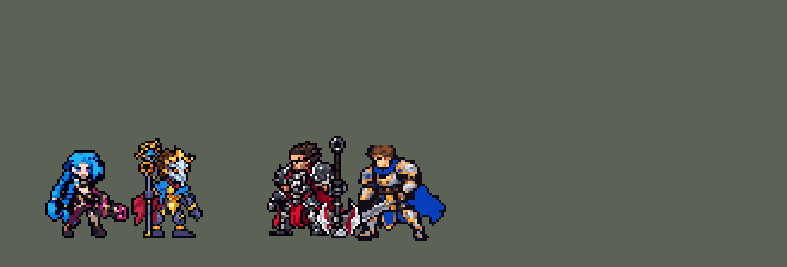

<!-- 本页上半部分由 tools/docs/gen_hero_docs.py 按仓库里现在的数据生成，手改会被覆盖；「开发记录」以下是手写的，生成时原样保留。 -->

# 维克托 Viktor


| 项目 | 内容 |
|---|---|
| id | `league_viktor` |
| 所属的包 | 主包（mod_id `league`） |
| 分路 | 中单 |
| 分类 / 标签 | 法师（Magician） · AP / Magic / CC / Shield |
| 高清帧 | 1 倍像素（无高清帧） |
| 附加包 | 无 |



其他预览：[逐帧预览](../preview/league_viktor_frames.png)、[特效表](../preview/league_viktor_effects.png)

## 现在的技能

下面是游戏里显示的技能说明（`league/text/champion.i18n` 的简体中文，去掉了颜色和图标），冷却、距离来自 `league/champion/league_viktor.data_champion`；1 秒 = 60 tick。

### 普攻 / 被动（被动「光荣进化」）

*攻击间隔 1.5 秒 · 攻击距离 55000*

被动光荣进化：3级E附带余波，5级Q护盾更强并加速30%，7级技能命中减速20%，9级风暴变大、转移后持续更久。

### 技能1 · 虹吸能量

*冷却 8 秒 · 施放距离 60000 · 施放：指定目标 · 敌人（不含防御塔）*

能量弹造成60 + 45% 法强魔法伤害，获得40 + 20% 法强护盾；4秒内下次普攻额外造成30 + 45% 法强魔法伤害。

### 技能2 · 海克斯射线

*冷却 10 秒 · 施放距离 75000 · 施放：指定目标 · 敌人（不含防御塔）*

先在敌方英雄脚下放重力场：减速35%，1.25秒后场内敌人晕眩1.25秒。再从目标处向后方射出海克斯射线，造成45 + 40% 法强魔法伤害。

### 大招 · 奥术风暴

*冷却 70 秒 · 施放距离 70000 · 施放：指定目标 · 敌方英雄*

风暴落在敌方英雄身上，造成80 + 40% 法强魔法伤害，之后6秒每秒对周围敌人造成25 + 15% 法强魔法伤害，目标阵亡就转移到附近英雄。

### 数值

攻击力 78（每级 +7）、法强 40（每级 +20）、生命 880（每级 +95）、护甲 20（每级 +7）、魔抗 20（每级 +4）、移速 920（每级 +9）。

## 相关脚本和素材

- [`tools/kit/build_viktor.py`](../../tools/kit/build_viktor.py)
- [`tools/kit/setup_viktor.py`](../../tools/kit/setup_viktor.py)
- [`tools/lol/extract_viktor.py`](../../tools/lol/extract_viktor.py)
- [`tools/art/preview_viktor.py`](../../tools/art/preview_viktor.py)
- [`tools/art/import_viktor.py`](../../tools/art/import_viktor.py)
- [`tools/art/design_viktor.py`](../../tools/art/design_viktor.py)
- [`assets/source/viktor/`](../../assets/source/viktor)

## 开发记录

> 下面是原来 README 里「英雄：维克托」一节，原样搬过来（只改了相对链接）。

| 部分 | 内容 |
|---|---|
| 定位 | 中单（法师，分类 Magician），用户排的第十五组的中单（同组：上单雷克顿、打野莉莉娅已做，其他英雄以后做），第 73 位英雄。奥术先驱 维克托（客户端里名字和称号两格是互换的）：海克斯科技发明家，Q 法杖射出光弹得护盾、下一次普攻强化，W 在敌人脚下放重力场减速、1.25 秒后晕眩，E 从目标身上往后扫一道海克斯射线，R 召唤奥术风暴跟着敌方英雄走、他阵亡就转到附近的英雄；被动「光荣进化」按等级依次升级技能。用户选的：技能位「Q 单独 + W→E 连招」并加高手连招，进化「按等级依次升级」，E「英雄联盟式：从目标旁起点扫过」，R「跟着英雄走 + 目标死后跳走」 |
| 普攻 / 被动 | 远程奥术光弹（追踪），100% 攻击力，射程 55000，攻击间隔 90 tick（第 10 tick 放出）。被动「光荣进化」：英雄联盟靠海克斯碎片升级，数据里跨死亡的计数存不住（死亡会清掉自定义增益），改成按等级：普攻顺带用护盾探针量他的攻击力（法师只买法强装，攻击力只随等级涨，卡兹克的做法），每条命开头静默重读。3 级 E 附带余波，5 级 Q 护盾 ×1.6 并加速 30%，7 级他的技能命中都减速 20% 1 秒，9 级风暴变大（半径 30000 → 38000）、转到下一个英雄后持续 5 秒（原来 2 秒） |
| 技能1 | Q「虹吸能量」：冷却 480 tick（8 秒），也对小兵和野怪放，射程 60000。第 9 tick 法杖射出追踪光弹：60 + 45% 法强的魔法伤害；打中后他得到 40 + 20% 法强的护盾 2.5 秒，4 秒内下一次普攻变成金色光弹，多 30 + 45% 法强的魔法伤害 |
| 技能2 | W「重力场」→ E「海克斯射线」：冷却 600 tick（10 秒，E 的），也对小兵和野怪放，射程 75000。W 冷却好、70000 内有敌方英雄时先放 W（冷却 16 秒）：第 9 tick 在他脚下放重力场（半径 30000，4 秒），里面的敌人每 6 tick 减速 35%，落下 1.25 秒时还在里面的敌人晕眩 1.25 秒；18 tick 后接 E。E：英雄联盟的射线从选定的点起扫，这里起点就是目标脚下：一道从目标往外（维克托→目标的方向）延伸 70000 的光束，45 + 40% 法强的魔法伤害（打中范围是落点上一个朝外张开约 10° 的锥形：落点处生成的线段在引擎里从施法者算起，没法用；画面是一条不打人的线，画在落点、跟着方向转）。W 冷却中或附近没有英雄时 E 单独打目标（也清兵）。3 级后 1 秒后同一条路径的余波 30 + 45% 法强。高手连招：重力场晕住人后 Q 好了就打被晕的英雄（下一下普攻就是强化光弹） |
| 大招 | R「奥术风暴」：冷却 4200 tick（70 秒），对英雄放。上膛（萨勒芬妮 R 的做法）：60000 内有两个敌方英雄就放，否则待命 10 秒，期间每 10 tick 看一次：有被控制的英雄（W 晕住的）立刻砸他，等 3 秒后攻击范围内一个英雄也放，没用上退还冷却。风暴落在那个英雄身上（安妮提伯斯的做法）：先炸一下 80 + 40% 法强，之后 6 秒每秒对他周围（半径 30000）的敌人 25 + 15% 法强，画面跟着他走；每秒落点留一个看守区，下一秒没续上标记就说明他死了，风暴转到看守区里的第一个敌方英雄身上再打 2 秒（9 级后 5 秒、范围更大），最多转两次 |
| 数值 | 攻击 78（+7）、法强 40（+20）、生命 880（+95）、护甲 20（+7）、魔抗 20（+4）、移速 920（+9）。数值是自己设计的，用 SDK 对战模拟调：中路，对 5 个原版法师（`pyromancer`、`ice_mage`、`lightning_mage`、`wind_mage`、`white_mage`），3 套阵容、两边各打，10 分钟。初稿 +2.89（同批布兰德 +1.01、泽拉斯 +1.51、瑞兹 +1.63）；E 60 + 50% → 45 + 40%、余波 40 + 60% → 30 + 45%、R 100 + 50% → 80 + 40%、每秒 35 + 20% → 25 + 15% 后三批种子 +1.44 / +1.31 / +1.89（第三批同批泽拉斯 +0.62），约 +1.57 |
| 亚索联动 | W 的晕眩算控制：维克托在亚索队里打中路时，亚索每局对英雄放 R 1.35 次（原版闪电法师 3.40、布兰德 1.58），不用调 |
| 精灵图 | 9 个动作 48 帧：待机、移动、普攻、Q（`skill`）、W（`skill2`）、E（`skill2_e`）、R（`ult`）、受击、死亡。造型 30 × 42 px（连收在肩后的机械臂金爪），29 色。待机 6 帧同一张；头像截取点 (−1, −38)，选人卡片中心 −8 |
| 特效 | Codex 画的 23 张，按游戏尺寸交付，两张表 `league_viktor_fx` / `league_viktor_big`：普攻的蓝紫光弹，Q 的金色海克斯光弹、命中、青色护盾泡、强化普攻的金色光点和光弹、升级后的加速圈，W 地上的引力场（持续 4 秒，往里收）、晕眩爆发、头顶的引力环、减速圈，E 的射线和余波（画在落点往外的半边）、命中，R 的落地爆发、跟着英雄的风暴（升级后的大风暴）、每秒的闪电，进化的金光和减速圈 |
| 音效 | 英雄联盟的音效和配音（`tools/lol/extract_viktor.py`）：光弹、命中，Q 施放、命中、护盾、强化普攻，W 施放、落地、晕眩，E 射线、余波，R 施放、爆发、每秒、风暴，进化；Q、W、E、R 的中文配音（片段名 `league_viktor_sfx_vo_*`，和声音名不同；W 自己的配音在这个版本没有媒体，用晕眩那句）。版权属于 Riot Games，**不提交到仓库**，按下面的命令在本地生成 |
| 图标 | 官方技能图标（Q / E / R），从本地客户端提取，缩到 64×64 |

重新生成（素材来自本机的英雄联盟客户端，音频不进仓库）：

```bash
python tools/lol/extract_viktor.py --lol "D:\WeGameApps\lol" --vgmstream "<vgmstream-cli.exe 路径>"
python tools/kit/build_viktor.py            # 技能数据，数字都在脚本的参数表 P 里；--nodes 看每棵技能树的节点数
python tools/kit/setup_viktor.py --face=-1,-38 --banpick=-8  # 五种语言的文字、音效配置、共享文件里他的键
python tools/art/design_viktor.py           # 造型：Codex 的 B，法杖扶直、去掉腰部黑线、补外描边
python tools/lol/native_pose.py assets/source/viktor/poses.json --out <渲染文件夹>   # 动作参考帧（英雄联盟原动作）
python tools/art/fix_viktor_strips.py       # 动作：Codex 的动作帧，法杖扶直，跑步用定稿的腿走 Codex 换腿包的步子
python tools/art/import_viktor.py           # 特效
python tools/art/import_native.py --hero viktor   # 精灵
python tools/art/preview_viktor.py          # 逐帧预览、特效预览、演示 GIF
```

美术（原画的提示词见 [`assets/source/viktor/PICTURE_PROMPT.md`](../../assets/source/viktor/PICTURE_PROMPT.md)，造型的见 [`MODEL_PROMPTS.md`](../../assets/source/viktor/MODEL_PROMPTS.md)，动作的见 [`MODEL_STRIPS.md`](../../assets/source/viktor/MODEL_STRIPS.md)，跑步换腿的见 [`RUN_SWAP.md`](../../assets/source/viktor/RUN_SWAP.md)，特效的见 [`PROMPTS_FX.md`](../../assets/source/viktor/PROMPTS_FX.md)；Codex 的交付在 [`codex_picture/`](../../assets/source/viktor/codex_picture)、[`codex_model/`](../../assets/source/viktor/codex_model)、[`codex_strips/`](../../assets/source/viktor/codex_strips)、[`codex_run/`](../../assets/source/viktor/codex_run)、[`codex_fx/`](../../assets/source/viktor/codex_fx)；附图包由 `tools/art/pack_viktor_*.py` 在本地生成，英雄联盟的渲染不进仓库）：

- 原画：A 是英雄联盟的待机（背后的机械臂高举过头），B 是机械臂收在肩后（更紧凑）。用户选「B 机械臂收在肩后」。
- 造型：Codex 第 1 步交了 A 30 × 40、B 30 × 42（从它最粗的原稿 02 读回再整行整列删）。用户选「Codex B 30×42 精修」，然后「法杖歪的 其他都挺好」（杖头画在杖身旁边、杖身上段接进机械臂的斜线：改成杖身同一列笔直到顶、钩环收在正上方）、「中间这个黑线也要处理」（金色胸甲和腰甲之间一整行黑线换成下面的颜色）。第一版顺手清掉了所有孤立的颜色格，用户：「你这个改的不如之前一版本啊 色素清太多了」——Codex 的两档交错明暗本来就有很多孤立格，清掉就平了；最后只扶法杖、去黑线、补外描边（「选中」）。之后「法杖这一段有点歪」：杖身下段从第 31 行起错了一列，左移对齐（`design_viktor.py` 第 1b 步）。
- 动作：Codex 第 2 步用造型自己的零件摆（头、机械臂、近侧手臂连法杖、远侧手臂、斗篷、两条腿）。`fix_viktor_strips.py`：每帧里找出杖身下段那段错位的像素按同样方式扶直（躺倒的帧转 90° 再找）；R 第 2–4 帧 Codex 把手臂连法杖绕肩膀转了 −10° / −15°，1 格宽的杖身转出不齐的台阶（「这里的法杖歪修了吗？」），改回竖直（英雄联盟放 R 也是竖着拿），擦掉后露出来的远侧腿用定稿的腿补上（「像素消失」）。跑步几经修改：Codex 把远近两条腿弄反、每半周期换层，循环里着地的脚往前滑（「走路交叉步是反的」）；照零件横移 6 格像螃蟹（「走路和螃蟹一样？」），小步踢腿又看不出交叉（「走路没有明显的交叉步感觉」「不行啊 还是看不出」）；于是照雷克顿的做法发了换腿包（骨架是英雄联盟维克托自己的走路，上半身定稿原样）。Codex 画的腿是写实长腿压进 12 行，成了细竹竿（「走路腿有点变形」），最后保留它每帧两只脚的位置和交叉时机，腿用定稿的粗腿和大脚、两胯收拢斜着伸出去，抬脚时脚和小腿整块抬起（「右脚失去像素了吧」），左右两条腿一模一样、颜色不压暗（「左右腿能不一样的啊 颜色也不一样」）。0.77.3：后腿的小腿原来是一截空的描边，照前腿画上同样的暗色和橙金关节（「这里是不是少色素了啊」「不是两条腿能不一样的啊？」，`fix_viktor_leg.py`）。跑步又改了一次（「没有明显交叉步的感觉 感觉像是平滑」）：原来着地的脚先停一帧、再一下退 6～7 格，两只脚在一帧之内换前后，游戏里看着像在滑；现在每只脚按英雄联盟原版走路每帧的位置摆（`tools/lol/pose_joints.py`，两条腿取平均、相差半个周期）：着地的脚每帧均匀后退约 2.4 格，另一只脚在身后踢起 3～4 格（按英雄联盟脚踝离地的高度折算到他的腿长），从着地的脚上方迈过去再落到前面，经过时两只大靴子之间留一行空隙不叠成一块；抬起的腿逐行相差不超过 1 格，膝盖下那格 1 像素的小腿加宽到 3 格，膝盖和小腿不再断开（「就是膝盖和腿感觉是脱节的」「感觉还是有点奇怪」）；腿还是原来那条腿。同时补回了腰甲那几行（原来腰上一条黑线）和法杖旁边斗篷内侧那一列（每帧一条透明的缝，「走2这里有点脱节吧」「还是老问题这里空出来了」），见 `fix_viktor_run.py`。
- 跑步的腿（10 月 10 日，用户：「维克托腿部走路好像有点变形的」）：原来两只脚走在同一条线上（胯部各往里收 3 格，脚都落在站立点前后同一列），两只 10 格宽的大靴子每次经过都叠成一团；抬脚时把大腿上半截折掉、靴子挂到膝盖下面，膝盖的橙色关节也被挡住。现在照劫的跑步摆腿（`fix_viktor_run.py` 的 `zleg`）：胯部不收，大腿从胯部往下逐行斜到膝盖，小腿接着斜，靴子整块平移不弯，抬脚时小腿和靴子一起抬起、藏在大腿后面；两条腿像钟摆一样前后摆，各自着地 4 帧、每帧往后退，靴子只抬 1 行，膝盖关节每帧都露着；近侧靴子抬起压在远侧靴子上时，远侧露在下面的那行靴底描边去掉。腿部不再有透明小洞，头的位置 8 帧不变。用户又说「有点怪啊走路」：这样的小步按原来每帧 133 毫秒放，慢吞吞地挪，脚像贴着地在滑；oppi 自己的维克托是 10 帧 × 65 毫秒、脚只抬 1–2 格的小碎步，所以跑步改成每帧 80 毫秒（一圈 0.64 秒，`RUN_MS`）。试过把脚抬高 2–3 行、脚跟往后踢，两只 10 格宽的大靴子会上下叠成两块，没用。用户：「小碎片 但是要有明显的前后交叉腿换位的感觉」——两条腿各走各的线时近侧靴子一直在前；现在两胯各往里收 2 格、每只靴子前后走 8 列：第 1–3、7–8 帧近侧在前，第 4–6 帧远侧靴子的鞋尖跑到近侧前面（最多领先 6 列）；两腿交叠处夹出的 1–2 格透明缝用周围的颜色补上。用户：「还是很奇怪 只有脚动上面的腿不动 不协调」——膝盖只跟着靴子挪一半，大腿几乎不动；而且原来那套还在腰下垫着定稿里静止的大腿顶端（为当初折掉的大腿补的），腿摆开时它就露在旁边。现在整条腿从胯部一起摆（膝盖和靴子走一样远，抬起时再靠前一格），不再垫静止的大腿；放回腰甲后先照导入的方式闭合描边，再把被围住的 1–2 格缝用周围的颜色补上，导入不会再围出小洞。用户：「走路的时候身体像是歪的」——他的大腿只有 5 行，整条腿从腰那一行开始斜，靴子挪 4 格时大腿斜到快 40°，上身像架在两根斜杆上。现在每一步的一半是整条腿在腰甲下面平移、另一半才靠斜，大腿斜度减半；两胯往里收从 2 格减到 1 格（第 5 帧远侧靴子领先 4 列，第 4、6 帧两只靴子并齐）。之后用户说「还是歪 整体看起来」「而且平移也太奇怪了」，三个方案里选了 C（两条腿各走各的道），又说「但是腿部模型变形问题没解决」。根子：腿零件最上面三行（大腿顶上的金色护甲，第 88–90 行）正好就是腰甲那三行，`seat()` 为了补身体往上颠时腰下裂开的缝，每帧都把待机的腰甲连同大腿顶端贴回去——每一帧最上面三行都是待机的大腿、下面才是动过的腿，两截对不上；逐行斜切又把护甲和膝盖环按行错开。现在腿分成三块整块移动（`zleg`）：大腿和待机一模一样、只跟着身体下沉，小腿连膝盖环、靴子各自平移，相邻两块最多错开 1 列；两条腿各在自己的位置前后走（`STEP3`，着地 4 帧每帧后退 1 列，抬脚时膝盖提起 1–2 行、画在大腿前面）；身体只往下颠（落脚的第 1、5 帧低 1 行，`BOB3`），大腿跟着沉、叠在小腿上，腰和腿之间不会裂开，不再贴腰甲（`SEAT = False`）。每帧在工具里先照导入的方式闭合描边、补上被围住的小缝，导入不再改动腿部。用户：「不还是变形吗 脚都穿模了」——远侧腿是复制的近侧腿，10 格长、鞋尖朝右的靴子伸到了近侧脚跟底下，近侧脚一抬，远侧鞋尖就从它下面露出来；又说「脚的方位是不是应该和头一个方向啊 这样看起来才不歪」，三种站姿里选了 B：远侧腿改成近侧腿的镜像（左腿本来就是右腿的镜像，`mirrored_leg`），小腿放在待机远侧小腿的位置（左移 8 列），两只脚尖朝外、远侧脚落在头下面，两只靴子只在脚跟处相碰；用户：「改的挺好的 右脚的模型走路时还是会穿模变形」——两条小腿相距 8 列时，两只靴子的脚跟之间只隔 1 列，一只脚抬起来往另一只那边挪就一定碰上（近侧脚抬 3 行去越过远侧脚跟，12 行的腿又被压扁）。现在远侧小腿离近侧 10 列（脚跟隔 3 列，两条大腿之间露一点缝），抬脚最多 2 行，逐帧算过：只要有一只脚抬着，两条腿膝盖以下就没有一格挨在一起；两只脚都着地时近侧在前挡住远侧。用户又圈出膝盖：「你是看不到这里有问题吗」——小腿那块比大腿往右错了 1 列，腿是一层层一行高的部件（灰色大腿、藏青护膝、1 格的小腿、橙色膝环、暗色脚踝环、靴子）叠起来的，任何两层左右错开 1 列都像膝盖断了。现在每条腿是一整块（`zleg`）：整条腿一起左右挪 1 列、一起抬起最多 2 行，腿里没有任何一处错位；两条腿都画在身体下面，抬腿时腿顶收进腰甲后面，腿变短，像从胯部抬起（`STEP4`）。用户：「你不觉得奇怪吗？看起来」，选了「我自己逐帧画腿」，又说「有点审美啊」。先按髋、膝、脚踝三个点画了两格宽的腿，比待机的腿细了一半（大腿 2 格，待机 3–4 格），用户：「这腿我怎么看的还这么抽象」。现在每一帧的腿都用待机腿自己的一行行像素拼出来（`viktor_walk_legs.py`），每一行原样不改，只在两处看不出错位的地方挪：大腿连护膝在腰甲下面挪 1 列（腰甲盖着这个接口），1 格宽的小腿在 3 格宽的护膝下面再挪 1 列；抬脚时少画大腿的一两行（大腿往前抬，看上去变短），护膝往前顶 1 列。远侧腿还是近侧腿的镜像、走自己的道；近侧脚在 −1～+2 列之间走，远侧脚在 −1～+1 列（再往后小腿就藏到法杖后面），两只靴子的脚跟每帧至少隔 1 列；第 1–4 帧远侧脚抬起，第 5–8 帧近侧脚抬起。斗篷内侧那条暗红挡在远侧大腿外侧，和待机一样（不挡的话远侧腿贴着法杖，看着像法杖的一部分），斗篷其余部分在腿后面；两块腰甲之间填暗色内衬。落脚时身体下沉 1 行，法杖下半截插在地上不动（手顺着杖滑一格，杖底不会戳到地面以下）。用户看了 BP 卡片：「所有动作都统一了吗 脚部 为啥BP界面还这样的」——别的动作还是原来藏在内衬后面的远侧腿。现在待机、普攻、Q、W、E、R、受击和死亡第 1 帧都站在走路的那双腿上（`fix_viktor_stand.py`：每帧找到原来的近侧腿，只替换还是原样的格子，手臂、法杖、特效挡在前面的不动；法杖被举走的帧里，远侧靴子补完整）；待机的呼吸也在这双腿上做（身体连腰甲往下沉 0-0-1-2-2-2-1-0 行、法杖插在地上不动，8 帧 × 140 毫秒），不再用导入时的统一呼吸（它会切掉小腿的一行、身体斜一列，在远侧靴子里切出一格橙色）。2026-10-21 步子加大（用户：「维克托的走路也可以改改」，选了「在现有基础上加大步子」而不是改成高清帧）：腿照旧用造型自己的一行行零件拼，近侧脚前后从 −1…+2 格加到 −2…+3 格，远侧脚 −1…+2（落地在 +1：落在 +2 时第 5 帧和抬在身后的近侧靴子连成一块），经过另一只脚时抬 2 行（`tools/art/viktor_walk_legs.py` 的 NEAR / FAR）。
- 特效：Codex 第 3 步把 23 张都按游戏尺寸画了一份（[`codex_fx/viktor-fx/pixel_1x/`](../../assets/source/viktor/codex_fx/viktor-fx/pixel_1x)），`tools/art/import_viktor.py` 每格切出、按锚点（中心、脚底、弹头、线的起点）放好，导入时逐格检查对称、射线的左半边为空。
- 红色方：飞行的光弹和射线 / 余波（线的画面跟着方向转）严格上下对称；命中、他身上的护盾和进化光、跟着英雄的风暴、挂着循环的强化光点 / 减速 / 加速都严格左右对称；地上的重力场、晕眩爆发、风暴落地上下左右都对称。没有特效画进动作帧。

逐帧预览：[`docs/preview/league_viktor_frames.png`](../preview/league_viktor_frames.png?v=1021r)，特效：[`docs/preview/league_viktor_effects.png`](../preview/league_viktor_effects.png?v=1014g)。
