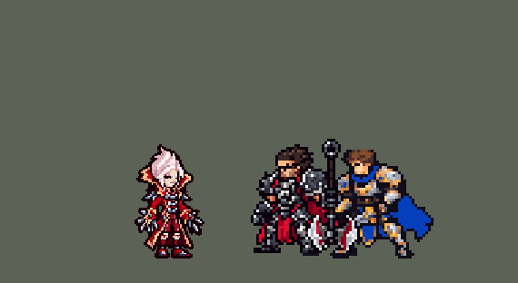

<!-- 本页上半部分由 tools/docs/gen_hero_docs.py 按仓库里现在的数据生成，手改会被覆盖；「开发记录」以下是手写的，生成时原样保留。 -->

# 弗拉基米尔 Vladimir


| 项目 | 内容 |
|---|---|
| id | `league_vladimir` |
| 所属的包 | 主包（mod_id `league`） |
| 分路 | 上单 |
| 分类 / 标签 | 法师（Magician） · AP / Magic / Heal |
| 高清帧 | PPU 1.8 |
| 附加包 | [弗拉基米尔残血血池附加包](#附加包)（`league_vladimir_pool`）、[游戏 AI 不按的技能替它按](#附加包)（`league_ult_press`） |



其他预览：[逐帧预览](../preview/league_vladimir_frames.png)、[特效表](../preview/league_vladimir_effects.png)

## 现在的技能

下面是游戏里显示的技能说明（`league/text/champion.i18n` 的简体中文，去掉了颜色和图标），冷却、距离来自 `league/champion/league_vladimir.data_champion`；1 秒 = 60 tick。

### 普攻 / 被动（被动「血色契约」）

*攻击间隔 1.42 秒 · 攻击距离 48000*

射出血弹攻击。被动血色契约：技能伤害附带最大生命值加成。血红之池（自动）：危急时化为血池2秒，不可选取，脚下敌人每次受到25 + 10% 法强 + 2% 最大生命伤害并减速40%，自己回复15 + 8% 法强；消耗5%最大生命值。

### 技能1 · 鲜血转换

*冷却 4 秒 · 施放距离 55000 · 施放：指定目标 · 敌人（不含防御塔）*

抽取目标的血，造成100 + 75% 法强 + 5% 最大生命魔法伤害，血回到身上时回复40 + 30% 法强生命。每第2次为猩红冲刺：伤害180%、回血翻倍、移速+30%。连招E→Q：潮汐命中英雄后2.5秒内的Q直接为猩红冲刺。

### 技能2 · 血之潮汐

*冷却 8 秒 · 施放距离 32000 · 施放：无目标 · 敌人（不含防御塔）*

蓄力0.97秒，向周围每个敌人射出血弹，造成90 + 70% 法强 + 5% 最大生命魔法伤害并减速40%。连招E-W：血池结束时若E已就绪，钻出时放出一圈70%伤害的潮汐。

### 大招 · 血之瘟疫

*冷却 60 秒 · 施放距离 60000 · 施放：指定目标 · 刚交过手的敌方英雄*

在敌方英雄中降下瘟疫：范围内敌人3秒内受到伤害+10%，随后爆发200 + 80% 法强 + 6% 最大生命魔法伤害，每命中一名英雄回复70 + 30% 法强生命。连招闪R E：若E已就绪，先化作血雾闪入敌群，再放出一圈70%伤害的潮汐。

### 数值

攻击力 72（每级 +5）、法强 40（每级 +20）、生命 1000（每级 +105）、护甲 22（每级 +7）、魔抗 22（每级 +3）、移速 910（每级 +10）。

## 附加包

附加包是可选的原生代码 mod（都在附加包合集 `league_addons` 里），**不装主包里的英雄也是完整的**。

### 弗拉基米尔残血血池附加包

[弗拉基米尔残血血池附加包](../../addons/league_vladimir_pool/README.md)：`league_vladimir_pool` v0.2.0

主包 `league` 保持纯数据。数据读不到当前生命，主包里弗拉基米尔的 W「血红之池」是自动的：他身上一直跑着一个每 3 tick 看一次的轮询，
看到 `league_vladimir_w_go` 就化成血池（2 秒不可选取、脚下敌人减速吸血、20 秒冷却）；`w_go` 由普攻里的**危险信号**加上——
**两名以上**敌方英雄贴身，或**连续两次**检查都挨了打。用户选了「危险信号 + 现在就做扩展包」：这个附加包用原生代码读生命，做成 League 玩家的按法：

- **快没血才开**：普攻里那段危险信号去掉，改由被动 `league_vladimir_pool:guard`（挂在 `passive` 上，每 tick 运行，挨打时当场再看一次）决定：
  活着、没被控住（击飞、眩晕、禁锢、嘲讽、恐惧、魅惑、沉默时放不了 W）、**身边 60000 内有敌方英雄**、血池不在冷却也不在池里，
  而且**生命低于 35%**——加上 `w_go`，数据的轮询最多 3 tick 后化成血池（血池本身、它的伤害、减速、回血、画面和声音全在数据里，和主包一样）。
- **代价按英雄联盟扣当前生命的 20%**（v0.2.0，用户：「改吧」）：主包的数据读不到当前生命，只能扣 5% 最大生命值，v0.1.0 的日志里 3% 血开池被扣到 1 点、6% 扣到 1%。
  本包的副本去掉数据里的那一下，改由被动在加上 `w_go` 的同一刻扣当前生命的 20%（还没进池，不受池里的减伤），永远扣不死。
- 数字都写在英雄数据的 `passive.params` 里，由 `make_override.py` 从 `tools/kit/build_vladimir.py` 的参数表 `P` 写入（`n_hp`、`n_near`），
  本包不另记一份。

### 游戏 AI 不按的技能替它按

[游戏 AI 不按的技能替它按](../../addons/league_ult_press/README.md)：`league_ult_press` v0.5.8（通用附加包，下面只列和弗拉基米尔有关的部分）

|  | 装了附加包，什么时候按 |
|---|---|
| 弗拉基米尔 R（v0.4.0） | 60000 内最近被我方打过的敌方英雄生命不到一半，或他身边 26000（血云半径）内有两个以上敌方英雄；生命比例最低的在前 |

## 相关脚本和素材

- [`tools/kit/build_vladimir.py`](../../tools/kit/build_vladimir.py)
- [`tools/kit/setup_vladimir.py`](../../tools/kit/setup_vladimir.py)
- [`tools/lol/extract_vladimir.py`](../../tools/lol/extract_vladimir.py)
- [`tools/art/preview_vladimir.py`](../../tools/art/preview_vladimir.py)
- [`tools/art/rig_vladimir.py`](../../tools/art/rig_vladimir.py)
- [`tools/art/import_vladimir.py`](../../tools/art/import_vladimir.py)
- [`tools/art/design_vladimir.py`](../../tools/art/design_vladimir.py)
- [`assets/source/vladimir/`](../../assets/source/vladimir)

## 开发记录

> 下面是原来 README 里「英雄：弗拉基米尔」一节，原样搬过来（只改了相对链接）。

| 部分 | 内容 |
|---|---|
| 定位 | 上单（法师，分类 Magician），第 76 位英雄，用户选的上单法师。猩红收割者 弗拉基米尔：靠吸血撑在战斗里，技能伤害随最大生命值提高。用户选的方案 A：被动「血色契约」、Q 指向性吸血（每第二次强化）、E 蓄力血潮、W 血池自动、R 群体瘟疫；W 的触发：「危险信号 + 现在就做扩展包」；用户：「还要加入高手的连招」「吸血鬼」 |
| 普攻 / 被动 | 普攻射出一颗追踪血弹，100% 攻击力的物理伤害，射程 48000，攻击间隔 85 tick（第 12 tick 出手）。被动「血色契约」：英雄联盟里额外生命值和法术强度互相加成；数据能读到的只有他自己的最大生命值，所以每个技能的魔法伤害都加上一份最大生命值（`hp_ratio`，Q 5%、E 5%、W 每跳 2%、R 6%） |
| 技能1 | Q「鲜血转换」：冷却 240 tick（4 秒），射程 55000，也对小兵和野怪放。第 11 tick 对目标造成 100 + 75% 法强 + 5% 最大生命值的魔法伤害；一个隐藏的抛射物落在目标脚下，从那里飞回一颗血球（`BackToCasterLinearProjectile`，霞的羽毛那样），回到他身上时回复 40 + 30% 法强。每第二次是「猩红冲刺」（英雄联盟两次攒满血槽）：伤害 180%、回血翻倍、移速 +30% 1 秒；半满时脚下有一圈血环 |
| 技能2 | E「血之潮汐」：冷却 480 tick（8 秒），身边 32000 内有敌人（小兵、野怪也算）时放。蓄力 58 tick（约 1 秒，身边绕着血珠），然后向 32000 内每个敌人各射一颗追踪血弹：90 + 70% 法强 + 5% 最大生命值的魔法伤害，减速 40% 0.5 秒（英雄联盟满蓄的效果） |
| W（自动） | 「血红之池」没有技能位，数据里自动：他身上整局跑着一个每 3 tick 看一次的轮询（`AddCasted`，普攻和技能会重新启动它），看到 `w_go` 就化成血池：先扣 5% 最大生命值（2 tick 不死，不会因此送命），然后 120 tick（2 秒）不可选取（霞的大招那样：隐身 + 100% 减伤 + 免控；给自己放放逐会让队友丢失视野），脚下 22000 内的敌人每 30 tick 受到 25 + 10% 法强 + 2% 最大生命值的魔法伤害并减速 40%，他每跳回复 15 + 8% 法强；冷却 20 秒。主包的 `w_go` 由普攻里的**危险信号**加上（蛮王的做法）：两名以上敌方英雄在 30000 内，或连续两次检查都挨了打。模拟里每局开 7 次 |
| 残血血池附加包 | 用户选「危险信号 + 现在就做扩展包」。附加包 [`addons/league_vladimir_pool`](../../addons/league_vladimir_pool/README.md) 用原生代码读生命：活着、没被控住、身边 60000 内有敌方英雄、血池不在冷却也不在池里、**生命低于 35%** 时加上 `w_go`，数据的轮询最多 3 tick 后开池（血池本身全在数据里，和主包一样）；普攻里的危险信号去掉。代价按英雄联盟扣**当前**生命的 20%（0.2.0：数据只能扣 5% 最大生命值，第一份日志里 3% 血开池被扣到 1 点）；游戏日志：开池时都在 35% 以下、1–3 tick 内入池、扣的正好是当前生命的 20%。主包不装附加包也完整可玩；附加包只做了单元测试，开池时机要在游戏里看日志确认。已编进附加包合集 `league_addons` |
| 大招 | R「血之瘟疫」：冷却 3600 tick（60 秒），只对正在交战的敌方英雄放（`EnemyChampionRecentlyAttacked`，60000 内，霞的「别乱放」）。第 11 tick 一个隐藏的抛射物落在目标脚下，血云在那里炸开：半径 26000 内的敌人 180 tick（3 秒）受到伤害 +10%（`damaged_amplify`），然后爆发 200 + 80% 法强 + 6% 最大生命值的魔法伤害；每命中一名英雄他回复 70 + 30% 法强 |
| 附加包（替 AI 按） | 可选的附加包 [`addons/league_ult_press`](../../addons/league_ult_press/README.md)（在附加包合集里，原生代码，主包不装它也完整）：游戏 0.6.4 的 AI 很少按他的 R（只读观察包：每 10 分钟 3.8 次，45 局）。附加包按局面替 AI 按（用户：「大招这种可能也是」）：60000 内最近被我方打过的敌方英雄生命不到一半，或他身边 26000（血云半径）内有两个以上敌方英雄（生命比例最低的在前） |
| 高手连招 | 用户：「还要加入高手的连招」。和李青、阿卡丽那样，每个连招只由它自己那个技能放出来，不占用别的技能的冷却：**E→Q**：潮汐的血弹打中英雄后 150 tick（2.5 秒）内的 Q 直接是猩红冲刺，血槽不变；**E-W**：血池结束时 E 已就绪，钻出来时直接甩出一圈 70% 伤害的潮汐（英雄联盟里先蓄 E 再开池）；**闪 R E**：R 放出时 E 已就绪，先化成血雾往目标闪最多 30000（一条隐藏的直线，停在第一个敌方英雄前 22000，再瞬移过去，英雄联盟的闪现），云落下 18 tick 后甩出一圈 70% 伤害的潮汐，吃瘟疫的 +10%。模拟里每局：E→Q 2.3 次、E-W 2.5 次、闪 R E 2.3 次（共 3 次大招） |
| 数值 | 攻击 72（+5）、法强 40（+20）、生命 1000（+105）、护甲 22（+7）、魔抗 22（+3）、移速 910（+10）。数值是自己设计的，用 SDK 对战模拟调：上路，对 6 个原版英雄（`fighter`、`executioner`、`knight`、`berserker`、`lancer`、`pole_warrior`），3 套阵容、两边各打，10 分钟。初稿 −2.63（同一批凯南 +1.43、提莫 +1.20）；Q、E、R 加伤害、缩冷却，生命 1000：种子 1–12 +1.24、25–36 +0.64；E→Q 的窗口 1.5 → 2.5 秒：种子 25–36 +1.44（同一批凯南 +1.47）。血池冷却 30 秒（+1.22）或要连续三次挨打（+1.31）差别不大；回血再加（+1.58）偏强 |
| 亚索联动 | 弗拉基米尔没有击飞或硬控，E、W 只是减速，不算亚索大招要的控制，不用调 |
| 精灵图 | 9 个动作 59 帧：待机 8、移动 8、普攻 6、Q（`skill`）6、E（`skill2`）7、W 血池（`skill_w`）8、R（`ult`）6、受击 2、死亡 8。造型 28 × 38 px，19 色。头像截取点 (0, −37)；待机最高 −26，不设 `banpick_center` |
| 高清帧（PPU 2，2026-10-13 画风统一后 PPU 1.8（见开头）） | Codex 照 49 × 82 格的高清造型（`assets/source/ppu/vladimir_codex.png`）逐帧重画，`import_ppu_strips.py` 读回。待机就是造型（静止）；头每帧和造型一格不差，Codex 贴头时没擦掉的旧头轮廓清掉（「吸血鬼走路有残影？没清理干净吧」）。移动用造型本身（Codex 的跑步身体每帧变宽、手变长：「吸血鬼走路时模型变形」）：靴子整块前后迈、小腿从膝盖摆，抬脚只在往前迈的时候，两只脚不碰；腿在大衣里面，前襟盖着；落脚时身体整块下沉 2 行，双手前后摆 1 格（「那走路时候脚也变形了啊」「有点僵硬啊」）。死亡最后三帧用第 5 帧的躺姿（Codex 另画的一张对不上） |
| 特效 | Codex 生图的 19 张（`import_vladimir.py` 缩成游戏像素）：`league_vladimir_fx` 普攻血弹、命中，Q 的抽血、血球、猩红冲刺的大血球、回血、半满的血环，E 的蓄力血珠、血弹、命中，W 的吸血，R 的瘟疫印记、爆发、回血，连招的血雾闪烁；`league_vladimir_big` E 的血浪、W 的溅血和血池、R 的血云 |
| 音效 | 英雄联盟的音效和配音（`tools/lol/extract_vladimir.py`）：普攻、Q 出手和命中、回血、猩红冲刺，E 蓄力和释放、命中，血池进出（也给连招的闪烁），R 出手、落地、爆发；Q、E、R 和血池结束各一句中文配音。版权属于 Riot Games，**不提交到仓库**，按下面的命令在本地生成 |
| 图标 | 官方技能图标（Q / E / R），从本地客户端提取，缩到 64×64；W 自动，没有技能位 |

重新生成（素材来自本机的英雄联盟客户端，音频不进仓库）：

```bash
python tools/lol/extract_vladimir.py --lol "D:\WeGameApps\lol" --vgmstream "<vgmstream-cli.exe 路径>"
python tools/kit/build_vladimir.py       # 技能数据，数字都在脚本的参数表 P 里；--nodes 看每棵技能树的节点数
python tools/kit/setup_vladimir.py --face -2,-38 --banpick -10   # 五种语言的文字、音效配置、共享文件里他的键
python addons/league_vladimir_pool/make_override.py   # 附加包的副本（普攻去掉危险信号，被动读生命）
python tools/art/design_vladimir.py --final   # 造型：40 行的字母格子 -> 8 倍原尺寸图
python tools/art/rig_vladimir.py         # 动作：造型自己的零件无损摆姿势（整格平移、90° 旋转、翻转、整行移动、叠放）
python tools/art/import_native.py --hero vladimir
python tools/art/import_vladimir.py      # 特效；--raw assets/source/vladimir/codex_fx 先把生图原稿缩成游戏尺寸的原尺寸条
python tools/art/import_ppu_strips.py --hero vladimir --delivery <Codex 交付的 vladimir-ppu-strips> --head-rows 35 --same dead:5=4 --same dead:6=4 --same dead:7=4 --design-run   # 高清帧
python tools/art/ppu_hd.py --hero vladimir
python tools/art/preview_vladimir.py
```

美术（动作的提示词见 [`assets/source/vladimir/MODEL_STRIPS.md`](../../assets/source/vladimir/MODEL_STRIPS.md)，特效的见 [`PROMPTS_FX.md`](../../assets/source/vladimir/PROMPTS_FX.md)；Codex 的交付在 [`codex_model/`](../../assets/source/vladimir/codex_model)、[`codex_strips/`](../../assets/source/vladimir/codex_strips)、[`codex_fx/`](../../assets/source/vladimir/codex_fx)）：

- 原画：Codex 画了 A（待机）和 B（Q 前冲），用户选 A。
- 造型：Codex 画的大图直接缩到 40 行全是碎点；用户先后说「你要参考之前的工具 还有另外一个账号怎么做的慢慢调整啊」「头太大了 身体细节太差了」「太模糊了」「尺寸有点大」。最后按参考格子手写身体（尖角肩甲、V 领、三颗扣子、带宝石的袖口、爪子、开衩下摆、条纹裤、护膝、钢头靴），再用无损的整行整列删减缩到 40 行（脸、扣子、袖口、膝盖、鞋子的行不删），存成字母格子 `vladimir_design_40.txt`；用户：「40 行 可以了」。之后用户：「吸血鬼的头可以缩小一点 现在太大了」——头部再删 2 行 2 列（`work/vl/head_shrink_vl.py` 的方案 B：发冠和脸颊各 1 行、左右发束和领子各 1 列，只删整行整列），头 13 → 11 行，全身 38 行。
- 头（10 月 9 日，用户：「最后改一下吸血鬼的头部 现在头部看起来像纸片人」）：原来是正面的宽脸，算上两侧立领 24 格宽，红色领子一直立到眼睛那么高，头和领子连成一块扁平的方块。英雄联盟的模型在游戏尺寸下头又高又窄，银白头发往上往后梳成尖顶，脸微微转向右，高领在下巴以下、在头后面。`vladimir_design_40.txt` 只重画第 56–72 行，第 73 行起一格没动。
- 眼睛（10 月 9 日，用户：「吸血鬼的眼睛不够有特色」，三个方案里选了 B）：原来一格红；现在近眼三格——眼窝一格暗色、红光一格、白高光一格，远眼一格红光，两眼上面各一行黑眉骨，下面各一格眼窝阴影。字母格 `vladimir_design_40.txt` 改 9 格，动作由 `rig_vladimir.py` 重新生成。模组版本 0.83.4。
  - 发冠：三种高度里用户选了 B（中等）：前面一道往上翘的发浪，后面再翘一小撮，头顶比原来高 3 行；后脑和下侧压暗，前上方亮。
  - 脸：转成 3/4 朝右，连头发 14 格宽。近处的眼睛两格（睫毛，红瞳加高光），远处的一格，远侧脸颊和下巴用阴影。嘴是一格暗红（用户：「嘴巴也改一改」，三种嘴型里选了这个），原来当鼻子的那一点去掉了。
  - 领子：缩到下巴两侧，退到头后面，领尖不高过第 68 行。
  - 动作：`rig_vladimir.py` 每一帧的头都取自造型，所有动作重新生成；和 main 逐帧比，没有一帧多出碎块、透明小洞或孤立描边。头顶到站立点 −29，超过 −28，所以选人卡片 `banpick_center` 设为 −10；头像点 (−2, −38)。
- 领口（10 月 10 日，用户：「吸血鬼这里是脖子？是不是中间缺失像素了呢」「你帮我处理一下？」）：领口这片（造型第 72 行往下）还是照换头前那颗头画的；换头（#179）后下巴往右移到第 61–65 列，领口中间近黑的 V 正好落在下巴正下方，像缺了一块。先补皮肤色脖子，用户：「不还是像素缺失」「按正常人物身体结构 中间两个柱子是什么意思？」（和左边白头发并排两根竖柱）；改成整片暗红横带（A），用户：「选A还是怪 想办法看起来自然点」。对照英雄联盟原模型（`native_pose.py` 游戏尺寸渲染：红色高立领，下巴下面是红内领，奶白翻领边呈 V 收到胸前）重画：金边从两侧领翼斜着往下接到原有的下半截翻领、在第一颗银扣处合拢；V 里紧贴下巴一行暗红 `b`（下巴的阴影）、往下中红 `c`；白头发在下巴处收住（原来伸进领子 2 格，「头发下面的两个」）；下巴右边领子里单独一格浅粉去掉；右边领翼下沿那条深色边比上下两行多往外伸 2 格，戳出身体外面（用户：「这里多出来的像素清理一下」），去掉。三种红里用户选了 V2（暗红→中红）。身上另清掉 10 个零散杂点（红衣服里的深色点、浅蓝点、异色点，改成四周的颜色；爪子高光、靴子银扣、右肩银片这些画好的细节保留；用户：「清楚身上多余的像素 干净一点」）。
- 嘴（10 月 10 日，用户：「吸血鬼的嘴吧可以做个性点 像一点吸血鬼」）：原来一格暗红。白獠牙直接挂在嘴线下面，和苍白的脸几乎同色、看不出来，所以改成张开的嘴：第 70 行嘴角两格近黑、中间上排两颗白獠牙夹一格近黑，右嘴角往上翘一格（第 69 行，邪笑），第 71 行三格近黑的口腔，下巴上一滴鲜红的血（第 72 行）；共 10 格（`work/vm/mouth_vm.py` 的 D，A 张嘴獠牙 / B 加血 / C 邪笑一起给用户看过）。每个露脸的帧只变这 10 格（倒地的几帧跟着头转，沉进血池那帧只露出 6 格），导出审计和改之前一样。
- 动作：Codex 第 2 步交回的动作条手和身体分离、肩甲和扣子丢了；用户：「有奇怪的地方直接帮我修复 我要完美的」。`rig_vladimir.py` 全部用造型自己的像素重摆（霞的做法）：两只手臂按格子精确切出，只做平移、90° 旋转、翻转和叠放；下摆整行摆动；血池是身体下沉、在脚下画一滩血；死亡是绕脚 90° 倒下；跑步用造型自己的小腿前后摆开、交替。待机是自动呼吸，爪子跟着手走（`WEAPON_CARRY`）。E 的蓄力和血池的时长按技能改过（蓄力 960 ms 出手，血池 2 秒）。
- 特效：Codex 第 3 步的 19 张（`import_vladimir.py --raw`：按交付的 `manifest.json` 切帧——有几张帧宽不一样——颜色归到包里给每张的色阶：血红、酒红、淡粉白）。
- 红色方：飞行的血弹、血球（画面跟着方向转）严格上下对称；命中、回血、血环、蓄力、血浪、血池、吸血、血云、瘟疫印记、闪烁严格左右对称，不需要画进动作帧。

逐帧预览：[`docs/preview/league_vladimir_frames.png`](../preview/league_vladimir_frames.png?v=1014g)，特效：[`docs/preview/league_vladimir_effects.png`](../preview/league_vladimir_effects.png?v=1014g)。
