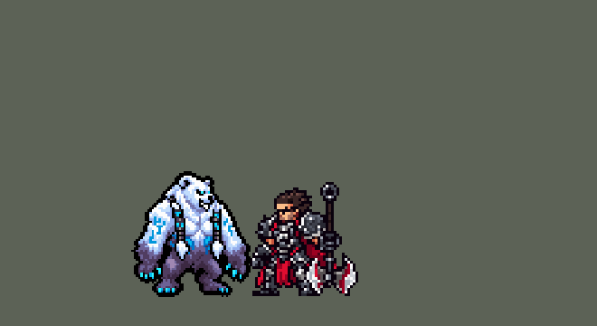

<!-- 本页上半部分由 tools/docs/gen_hero_docs.py 按仓库里现在的数据生成，手改会被覆盖；「开发记录」以下是手写的，生成时原样保留。 -->

# 沃利贝尔 Volibear


| 项目 | 内容 |
|---|---|
| id | `league_volibear` |
| 所属的包 | 主包（mod_id `league`） |
| 分路 | 上单 |
| 分类 / 标签 | 近战（Melee） · AD / Melee / Tank / CC |
| 高清帧 | PPU 1.2 |
| 附加包 | [沃利贝尔附加包](#附加包)（`league_volibear`） |



其他预览：[逐帧预览](../preview/league_volibear_frames.png)、[特效表](../preview/league_volibear_effects.png)

## 现在的技能

下面是游戏里显示的技能说明（`league/text/champion.i18n` 的简体中文，去掉了颜色和图标），冷却、距离来自 `league/champion/league_volibear.data_champion`；1 秒 = 60 tick。

### 普攻 / 被动

*攻击间隔 1.2 秒 · 攻击距离 25000*

狂雷渐起：攻击和技能叠攻速（每层6%，5层）；满层后攻击放出闪电，30 + 40% 法强魔法伤害。暴怒撕咬：每5秒攻击变成撕咬，造成30 + 140% 攻击力物理伤害并标记英雄，再咬时伤害+50%并回复40 + 50% 攻击力生命。

### 技能1 · 擂首一击

*冷却 12 秒 · 施放距离 60000 · 施放：指定目标 · 敌方英雄*

移速+40%冲向敌方英雄，扑上去造成40 + 160% 攻击力物理伤害并眩晕1秒。

### 技能2 · 霹天雳地

*冷却 15 秒 · 施放距离 100000 · 施放：地点 · 敌人（不含防御塔）*

召雷劈向目标区域，1.5秒后造成80 + 70% 法强魔法伤害（英雄另受6%最大生命），减速40%；自己在范围内时得到120 + 75% 法强护盾。

### 大招 · 天声震落

*冷却 60 秒 · 施放距离 70000 · 施放：指定目标 · 敌方英雄*

跃向敌方英雄砸地，周围敌人受200 + 120% 攻击力物理伤害并减速50%；之后12秒内生命+350、攻击距离增加。

### 数值

攻击力 88（每级 +14）、法强 20（每级 +8）、生命 1100（每级 +105）、护甲 32（每级 +7）、魔抗 26（每级 +4）、移速 1020（每级 +10）。

## 附加包

附加包是可选的原生代码 mod（都在附加包合集 `league_addons` 里），**不装主包里的英雄也是完整的**。

### 沃利贝尔附加包

[沃利贝尔附加包](../../addons/league_volibear/README.md)：`league_volibear` v0.2.0

|  | 主包（纯数据） | 附加包 |
|---|---|---|
| 狂雷渐起的闪电（满 5 层） | 一道飞向目标的闪电，路上和目标身边 22000 以内的敌人都受伤 | 打**目标和离它最近的 4 个敌人**（22000 以内，防御塔不算），每个身上闪一下 |
| 暴怒撕咬的标记 | 标记记在沃利贝尔自己身上：下一口咬**谁**都算第二口；第二口回固定值 + 攻击力加成 | 标记记在**被咬的那个英雄**身上（8 秒）：再咬**同一个人**才是第二口；第二口回复再加**已损失生命的 12%** |
| 天声震落 | 落地砸地、减速、加生命 | 另外让落点 55000 以内的**敌方防御塔 4 秒不能攻击**（塔身上缠着电光） |
| 天声震落后的 12 秒风暴形态 | 身后有雷云，他本身的颜色不变 | 他整个人变成**雷电蓝**：白毛变浅电蓝、腿变深蓝，符文和冰晶爪子发亮青光，外圈一道电蓝描边；形态结束或阵亡时变回来 |

装上附加包后游戏里显示的说明（和主包不同的部分）：

- **普攻 / 被动**：【扩展包】狂雷渐起：命中叠攻速，5层后攻击放闪电，目标和最近4个敌人受30 + 40% 法强魔法伤害。暴怒撕咬：每5秒攻击变撕咬，造成30 + 140% 攻击力物理伤害并标记；再咬同一人+50%，回复40 + 50% 攻击力+12%已损生命。
- **大招 · 天声震落**：【扩展包】跃向敌方英雄砸地，周围敌人受200 + 120% 攻击力物理伤害并减速50%，附近敌方防御塔失效4秒；之后12秒内生命+350、攻击距离增加。

## 相关脚本和素材

- [`tools/kit/build_volibear.py`](../../tools/kit/build_volibear.py)
- [`tools/kit/setup_volibear.py`](../../tools/kit/setup_volibear.py)
- [`tools/lol/extract_volibear.py`](../../tools/lol/extract_volibear.py)
- [`tools/art/preview_volibear.py`](../../tools/art/preview_volibear.py)
- [`tools/art/rig_volibear.py`](../../tools/art/rig_volibear.py)
- [`assets/source/volibear/`](../../assets/source/volibear)

## 开发记录

> 下面是原来 README 里「英雄：沃利贝尔」一节，原样搬过来（只改了相对链接）。

| 部分 | 内容 |
|---|---|
| 定位 | 上单（Melee，标签 AD / Melee / Tank / CC），第 131 位英雄。不灭狂雷 沃利贝尔：用后腿站立的白色雷霆巨熊，白毛带冰蓝、两条毛辫挂着刻符文的铁环、冰蓝水晶爪子。用户的选择：「上单」「技能映射 A：Q / E / R，W 进普攻」「做附加包」。团战经理只有三个主动技能位：技能 1 = Q 擂首一击，技能 2 = E 霹天雳地，大招 = R 天声震落；被动狂雷渐起和 W 暴怒撕咬在普攻里（英雄联盟的 W 冷却只有 5 秒、本来就是一下强化攻击）。技能名照英雄联盟 16.20 的 Data Dragon（五种语言） |
| 普攻 / 被动 | 熊掌往前下方抓（射程 25000）。**狂雷渐起**：攻击打中、Q 打中、放 E、R 落地各叠一层，每层 +6% 攻速、最多 5 层，6 秒内再叠就全部续上；满 5 层后他的攻击放出闪电，目标和它身边 22000 以内的敌人受 30 + 40% 法强魔法伤害 |
| W（在普攻里） | **暴怒撕咬**：每 5 秒他的下一次攻击变成撕咬（`attack_w` 动作，从攻击一开始就换），造成 30 + 140% 攻击力 + 2% 他最大生命的物理伤害；咬中英雄先**标记**（8 秒），标记期间再撕咬：多造成 50%，回复 40 + 50% 攻击力生命 |
| 技能1 | **Q 擂首一击**（只对敌方英雄，射程 60000）：移速 +40%，四脚着地冲过去，到了跟前直立跳起、往前扑砸：40 + 160% 攻击力物理伤害、**眩晕 1 秒**。冷却 12 秒 |
| 技能2 | **E 霹天雳地**（对小兵、野怪也放，射程 100000）：目标点先出现雷云预警，1.5 秒后一道大雷劈下（半径 30000）：80 + 70% 法强魔法伤害，英雄另受 6% 最大生命真实伤害，减速 40% 2 秒；他自己在雷里就得到 120 + 75% 法强的护盾 3 秒。冷却 15 秒 |
| 大招 | **R 天声震落**（射程 70000）：跳向敌方英雄（空中免控），落地砸地：半径 32000 内 200 + 120% 攻击力物理伤害、减速 50% 1 秒；之后 12 秒风暴形态：生命 +350、攻击距离 +5000。冷却 60 秒 |
| 连招 | 用户要求：「有连招要做连招」「都要帮我补」。英雄联盟的 **Q→W**：擂首一击砸中敌方英雄、晕住 1 秒的同时，去掉暴怒撕咬的 5 秒冷却标记（`w_cd`），所以接下来对被晕住的英雄的那一下攻击就是撕咬（从攻击第一 tick 换成 `attack_w`，第 10 tick 咬下；标记和第二口照旧）。撕咬本来就好了就什么都不变；每次 Q（冷却 12 秒）最多多一口撕咬。生成脚本 `tools/kit/build_volibear.py`，附加包用 `make_override.py` 重新生成 |
| 附加包 | 可选的附加包 [`addons/league_volibear`](../../addons/league_volibear/README.md)（在附加包合集里，原生代码，主包不装它也完整），照英雄联盟：**满层闪电跳到目标和最近的 4 个敌人**；**撕咬的标记记在被咬的那个英雄身上**（再咬同一个人才是第二口），第二口回复再加已损失生命的 12%；**天声震落让落点附近的敌方防御塔 4 秒不能攻击** |
| 数值 | 攻击 88（+14）、法强 20（+8）、生命 1100（+105）、护甲 32（+7）、魔抗 26（+4）、移速 1020（+10）、射程 25000，攻击间隔 72 tick |
| 平衡 | 10 分钟经典引擎模拟，上单位对原版六个上单（斗士、处刑人、枪骑兵、长柄战士、骑士、狂战士），三套阵容两边各打，两批种子（1–8、9–16）：草稿 +1.79 / +2.16；动作帧定下时间点后 **+1.31 / +1.47**（平均 +1.39；同期普朗克 +1.67、内瑟斯 +1.55、德莱厄斯 +1.99），不再调 |
| 精灵图（高清帧 PPU 1.2） | Codex 第 0 步画了英雄联盟的待机（A：两臂张开）和双臂下垂（B）两张原画，另有 A 的初稿（[`tools/art/pack_volibear_picture.py`](../../tools/art/pack_volibear_picture.py)，读回 [`design_volibear_hd.py`](../../tools/art/design_volibear_hd.py)，大小对比 [`review_volibear_size.py`](../../tools/art/review_volibear_size.py)），用户：「B，游戏里 44 像素高，PPU 1.2」。第 1 步 Codex 在游戏格子上画 3/4 正面和侧面（[`pack_volibear_model.py`](../../tools/art/pack_volibear_model.py)），用户选正面 B-2（51 × 54）和侧面 side-2（[`design_volibear_model.py`](../../tools/art/design_volibear_model.py)）。动作帧 [`rig_volibear.py`](../../tools/art/rig_volibear.py)：待机、挨打、死亡用造型自己的格子整块摆；手臂整块转动、平移、镜像都被用户否掉（「左手严重变形」「看了还是奇怪 你改不好就让codex帮忙」），改由 Codex 在造型的同一网格上**只重画手臂**的四个姿势（双手高举、单手高举、往前下抓、双爪前扑，[`pack_volibear_poses.py`](../../tools/art/pack_volibear_poses.py) / [`design_volibear_poses.py`](../../tools/art/design_volibear_poses.py)：头和腿换回造型自己的格子）；走路是 Codex 照 oppi 的牛头走路换皮的交叉步（「走路也没交叉换步」，[`design_volibear_run.py`](../../tools/art/design_volibear_run.py)，每帧换上造型的头）；Q 照英雄联盟四脚着地冲锋、直立跳起扑砸（「Q技能的释放技能姿势和英雄联盟不一样？」，[`pack_volibear_q.py`](../../tools/art/pack_volibear_q.py) / [`design_volibear_q.py`](../../tools/art/design_volibear_q.py)：冲锋拿奈德丽豹形态的跑步当骨架换皮，低头的几帧保留 Codex 自己画的头）。每个动作都对照英雄联盟的动画（[`review_volibear_actions.py`](../../tools/art/review_volibear_actions.py) 一张 GIF 左右对比），死亡 8 帧带落地回弹，挨打第 1 帧白闪后退 |
| 特效 | 第 3 步 18 张特效（[`tools/art/pack_volibear_fx.py`](../../tools/art/pack_volibear_fx.py)，颜色照英雄联盟：雷电是白芯青蓝的电光，雷云深蓝，护盾和爪子冰蓝）。弹道（满层闪电）画成朝右、上下对称，跟着飞行方向转；其余全部左右对称（游戏不镜像特效图）。Codex 的交付在 `codex_fx/`，[`import_volibear_fx.py`](../../tools/art/import_volibear_fx.py) 按清单的帧大小切开、照技能播放的位置摆好（再查一遍对称），得到 `league_volibear_fx`（小特效）和 `league_volibear_big`（治疗光柱、Q 移速电光、E 雷云 / 落雷 / 护盾、R 落地 / 风暴形态 / 塔失效）两张图 |
| 音效 | 英雄联盟的音效和配音（[`tools/lol/extract_volibear.py`](../../tools/lol/extract_volibear.py)，23 段）：抓击、满层闪电、撕咬 / 第二口、Q 冲锋 / 扑砸、E 召雷 / 落雷 / 护盾、R 起跳 / 落地 / 命中 / 塔失效，配音是他的 Q / W / E / R 台词（中文） |
| 图标 | 官方技能图标（擂首一击、霹天雳地、天声震落，另有暴怒撕咬和狂雷渐起），从本地客户端取 |
| 风暴形态变色（2026-10-30） | 用户：「沃利贝尔开大是不是得搞个变色啊」。天声震落落地后的 12 秒风暴形态里，原来只有身后的雷云，他本身和平时一样。英雄联盟里开大的他身体换成一张更蓝的贴图（Volibear_Base_R_Avatar_Blend_01）、头上一道闪电鬃毛。三份草稿（雷电蓝 / 雷电蓝 + 蓝色描边 / 深色风暴 + 蓝色描边）里用户选了「2 雷电蓝+描边」。[`tools/art/volibear_storm.py`](../../tools/art/volibear_storm.py)：每个能在形态里播的动作（待机、走、Q 的冲锋和扑砸、普攻、撕咬、E、R 的起跳和落地、挨打）在图里多一个 `r_` 双胞胎，他自己的帧逐格换颜色：身体按亮度映到深蓝到浅电蓝（明暗不变），符文、冰晶爪子和眼睛映到更亮的青色到白，描边和辫子上的铁环不动；外描边长出来之后，最外一圈换成电蓝（ppu_restyle 的 `rim`）。双胞胎和原帧帧数、时长、大小、画到的格子都一样（先收好描边再换色：描边只补在亮格旁边，他三种中等紫色换成深蓝后会少补几格），所以动作播到一半换也接得上；待机卷轴 `r_idle` 就是 `idle` 那一条（hero_reels.json `"r_idle": "idle"`）。换帧在[附加包](#附加包)（0.2.0，`src/view.rs`，照芸阿娜的超凡形态）：他身上有 `league_volibear_r_form` 时正在播的动作换成 `r_*`，落地砸地第一帧就换，形态结束或阵亡换回来。主包不变色（数据只换得了出招的动作，待机、走换不了，会出招蓝、站着白地来回闪）。league.dll 0.8.12（编进了他的帧表），主包 0.259.4，佛耶戈附身 0.2.25（他的新标签） |

重新生成（素材来自本机的英雄联盟客户端，音频不进仓库）：

```bash
python tools/lol/extract_volibear.py --lol "D:\WeGameApps\lol" --vgmstream <vgmstream-cli.exe>
python tools/kit/build_volibear.py                  # 技能数据，数字都在脚本的参数表 P 里
python tools/kit/setup_volibear.py                  # 五种语言的文字、音效配置、共享文件里他的键
python tools/art/design_volibear_model.py           # Codex 第 1 步的造型读回（正面 B-2、侧面 side-2）
python tools/art/design_volibear_poses.py           # Codex 重画的四个手臂姿势
python tools/art/design_volibear_run.py             # Codex 换皮的走路
python tools/art/design_volibear_q.py               # Codex 画的 Q 冲锋和扑砸
python tools/art/rig_volibear.py                    # 1.2 的原帧和 1 倍帧（连同风暴形态的 r_ 双胞胎，volibear_storm.py）
python tools/art/ppu_restyle.py --hero volibear     # 外描边（不要加 --preview）
python tools/art/ppu_hd.py --hero volibear          # hd_ / lo_ 帧
python tools/art/hero_reels.py --hero volibear      # 待机和选人卡片的卷轴（r_idle 照 idle 那一条）
python tools/art/import_volibear_fx.py              # 特效
python tools/art/preview_volibear.py                # 预览和演示 GIF
python addons/league_volibear/make_override.py      # 附加包的副本（主包的沃利贝尔改了就重跑）
```

美术提示词见 [`assets/source/volibear/`](../../assets/source/volibear) 里的 `PICTURE_PROMPT.md`、`MODEL_PROMPTS.md`、`POSE_PROMPTS.md`、`Q_PROMPTS.md`、`PROMPTS_FX.md`；Codex 的交付在 `codex_picture/`、`codex_model/`、`codex_poses/`、`codex_q/`、`codex_fx/`。

逐帧预览：[`docs/preview/league_volibear_frames.png`](../preview/league_volibear_frames.png?v=1030a)，特效：[`docs/preview/league_volibear_effects.png`](../preview/league_volibear_effects.png?v=1019a)。
