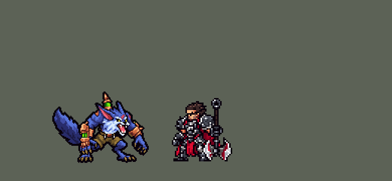

<!-- 本页上半部分由 tools/docs/gen_hero_docs.py 按仓库里现在的数据生成，手改会被覆盖；「开发记录」以下是手写的，生成时原样保留。 -->

# 沃里克 Warwick


| 项目 | 内容 |
|---|---|
| id | `league_warwick` |
| 所属的包 | 主包（mod_id `league`） |
| 分路 | 打野 |
| 分类 / 标签 | 近战（Melee） · AD / Melee / Heal / CC |
| 高清帧 | PPU 1.2（画成 90%） |
| 附加包 | [沃里克附加包](#附加包)（`league_warwick`） |



其他预览：[逐帧预览](../preview/league_warwick_frames.png)、[特效表](../preview/league_warwick_effects.png)

## 现在的技能

下面是游戏里显示的技能说明（`league/text/champion.i18n` 的简体中文，去掉了颜色和图标），冷却、距离来自 `league/champion/league_warwick.data_champion`；1 秒 = 60 tick。

### 普攻 / 被动

*攻击间隔 1 秒 · 攻击距离 25000*

挥爪。血之饥渴：普攻附带20魔法伤害并回复8生命。鲜血追猎：打中英雄后2秒内攻速+30%、移速+12%。

### 技能1 · 野兽之口

*冷却 6 秒 · 施放距离 40000 · 施放：指定目标 · 敌人（不含防御塔）*

扑向目标撕咬，造成30 + 110% 攻击力+5%目标最大生命值物理伤害，回复30 + 40% 攻击力生命。

### 技能2 · 远祖嗥叫

*冷却 12 秒 · 施放距离 35000 · 施放：指定目标 · 敌方英雄*

2.5秒内受到的伤害减少40%，结束时仰天嚎叫，让周围的敌人恐惧1秒。

### 大招 · 无尽束缚

*冷却 60 秒 · 施放距离 90000 · 施放：方向 · 敌方英雄*

朝前扑出，压制撞到的第一个敌方英雄1.5秒，期间连抓三下，每下50 + 55% 攻击力物理伤害并回复40生命。

### 数值

攻击力 92（每级 +18）、生命 1120（每级 +105）、护甲 36（每级 +7）、魔抗 25（每级 +4）、移速 1050（每级 +12）。

## 附加包

附加包是可选的原生代码 mod（都在附加包合集 `league_addons` 里），**不装主包里的英雄也是完整的**。

### 沃里克附加包

[沃里克附加包](../../addons/league_warwick/README.md)：`league_warwick` v0.1.1

主包 `league` 保持纯数据。用户选了「做附加包」，又要求「有连招要做连招」。主包的数据读不到当前生命，英雄联盟里沃里克最核心的两件事——**残血吸血**和**鲜血追猎**——都看生命，所以放在这个附加包里用原生代码做，外加连招：

- **血之饥渴**：英雄联盟里沃里克的普攻附带魔法伤害；他生命低于 50% 时回复同样多的生命，低于 25% 时回三倍。主包只能每下固定回一点；副本里每一下爪击（普攻、Q 的撕咬、R 的三下）打中时调 `league_warwick:hunger`：他生命低于 `p_half`%（50）时回 `p_dmg`（20，和这一下的魔法伤害一样），低于 `p_quarter`%（25）时回 `p_dmg` × `p_triple`（60）；生命高的时候不回（魔法伤害照旧在数据里）。
- **鲜血追猎**：英雄联盟里他嗅到生命低于 50% 的敌方英雄，朝他们跑得更快、打他们打得更快，低于 25% 时加成三倍。主包只能「打中英雄后加速 2 秒」；本包的被动 `league_warwick:hunt` 每 6 tick 看一次：`w_reach`（150000）内有看得见的、生命低于 `w_half`%（50）的敌方英雄，就给他挂 `league_warwick_w_hunt`（攻速 +`w_as`% 30、移速 +`w_ms`% 12，10 tick，下次看时续上，主包的红色光晕跟着亮），那人低于 `w_quarter`%（25）时三倍（攻速 +90%、移速 +36%）。
- **连招**（用户：「有连招要做连招」；`src/combo.rs`）：AI 钩子 `league_warwick:combo`（优先级 110，排在 league_ult_press 之后）替游戏的 AI 按 E、Q、R，像英雄联盟里会玩的人那样：
  - **E → Q**：AI 想用 Q 扑一个敌方英雄、E 好了、远祖嗥叫没开着、那名英雄在 E 的施放距离内：先替它按 E（减伤开着扑进去）。主包数据里 Q 咬中时远祖嗥叫开着就**立刻嚎叫**——恐惧落在他扑到的地方（英雄联盟里 E、Q、再按 E 的连招）。
  - **R → Q**：无尽束缚压住英雄、连抓三下（这期间他在压制的动作里，钩子不动），动作一结束、Q 好了，就替 AI 朝 Q 够得着的、生命比例最低的敌方英雄按 Q——压制完马上接一口撕咬。R 放出后 `r_dur` + `r_sup` + 40 tick 内算。
  - **鲜血追猎**：R 好了、`r_cast` 内有生命低于 25% 的敌方英雄、往他扑过去路上第一个英雄就是他：替 AI 按 R 追残血；AI 想用 Q 咬小兵 / 野怪，而 Q 够得着的地方有生命低于 50% 的敌方英雄：改成咬那名英雄。
  - 被控住、正在放技能（施法动作）或被强制位移时什么都不做；格子的冷却自己看（引擎的「输入合法」不看冷却）。

## 相关脚本和素材

- [`tools/kit/build_warwick.py`](../../tools/kit/build_warwick.py)
- [`tools/kit/setup_warwick.py`](../../tools/kit/setup_warwick.py)
- [`tools/lol/extract_warwick.py`](../../tools/lol/extract_warwick.py)
- [`tools/art/preview_warwick.py`](../../tools/art/preview_warwick.py)
- [`tools/art/rig_warwick.py`](../../tools/art/rig_warwick.py)
- [`assets/source/warwick/`](../../assets/source/warwick)

## 开发记录

> 下面是原来 README 里「英雄：沃里克」一节，原样搬过来（只改了相对链接）。

| 部分 | 内容 |
|---|---|
| 定位 | 打野（Melee，标签 AD / Melee / Heal / CC），第 142 位英雄。祖安怒兽 沃里克：弓着背的狼人，蓝紫色的毛、胸口和两颊的白鬃毛、一对大尖耳朵、张着嘴龇着牙，背上竖着绿药瓶和铜尖刺，两条胳膊戴铜护臂（近侧那只嵌着绿药剂），橄榄色短工装裤，一条翘起来的大尾巴（10-17 之后分组的 E 组的打野）。用户的选择：「技能方案 A（Q / E / R，被动和 W 进普攻）」「做附加包」「有连招要做连招」。团战经理只有三个主动技能位：技能 1 = Q 野兽之口，技能 2 = E 远祖嗥叫，大招 = R 无尽束缚；被动血之饥渴和 W 鲜血追猎在普攻里。技能名照英雄联盟 16.20.1 的 Data Dragon（五种语言） |
| 普攻 / 被动 / W | 挥爪（射程 25000，100% 攻击，隐形的追踪一击：打中时知道打的是不是英雄）。**血之饥渴**：每一下爪击（普攻、Q 的撕咬、R 的三下）附带 20 魔法伤害并回复 8 生命（英雄联盟里只在生命低于 50% 时回、低于 25% 时三倍；数据读不到当前生命，附加包照英雄联盟做）。**鲜血追猎**：普攻打中敌方英雄后 2 秒内攻速 +30%、移速 +12%，脚下亮起血红色的光晕（英雄联盟里是嗅到生命低于 50% 的英雄就加速；附加包照英雄联盟做） |
| 技能1 | **Q 野兽之口**（对小兵、野怪也放，射程 40000）：扑到目标身上（第 4 tick 起冲过去）一口咬下：30 + 110% 攻击 + 目标最大生命 5% 的物理伤害，回复 30 + 40% 攻击的生命。冷却 6 秒 |
| 技能2 | **E 远祖嗥叫**（只对敌方英雄，射程 35000）：2.5 秒内受到的伤害减少 40%（身上一层淡钢蓝色的护罩），结束时仰天嚎叫：40000 内的敌人恐惧 1 秒。冷却 12 秒 |
| 大招 | **R 无尽束缚**（只对敌方英雄，射程 90000）：朝前飞扑，一条看不见的线飞 95000、停在路上第一个敌方英雄身上，把他压制 1.5 秒（贝蕾亚 R 的做法：从线的打中处飞到他身上）；压住时连抓三下（间隔 0.5 秒），每下 50 + 55% 攻击的物理伤害、附带血之饥渴、回复 40 生命。路上没有英雄就不扑。冷却 60 秒 |
| 连招 | 用户要求：「有连招要做连招」。主包数据里：**E → Q**——远祖嗥叫的减伤开着时 Q 咬中，立刻嚎叫（英雄联盟里 E、Q、再按 E），恐惧落在他扑到的地方。附加包的 AI 钩子替游戏的 AI 按：Q 扑英雄前先按 E 开减伤（E → Q）；R 压制结束、Q 好了就接一口撕咬（R → Q）；R 好了、有生命低于 25% 的英雄、扑过去路上第一个就是他时按 R 追残血；AI 想用 Q 咬小兵 / 野怪而 Q 够得着的地方有生命低于 50% 的英雄时改咬英雄 |
| 附加包 | 可选的附加包 [`addons/league_warwick`](../../addons/league_warwick/README.md)（在附加包合集里，原生代码，主包不装它也完整），照英雄联盟：**血之饥渴按生命回血**（生命低于 50% 每下爪击回 20，低于 25% 回 60，生命高时不回）；**鲜血追猎**每 0.1 秒看一次 150000 内看得见的敌方英雄：有生命低于 50% 的就攻速 +30%、移速 +12%，低于 25% 时三倍；上面的**连招**。日志 `league_warwick.log`（SPAWN、HEAL、HUNT、E FIRST / R THEN Q / R HUNT / Q TO PREY） |
| 数值 | 攻击 92（+18）、生命 1120（+105）、护甲 36（+7）、魔抗 25（+4）、移速 1050（+12）、射程 25000 |
| 平衡 | 10 分钟经典引擎模拟，打野对五个原版打野（demon / circus_blade / hunter / inquisitor / ninja），三套阵容两边各打：初稿（生命 1050、护甲 32）+0.05 / +0.83（种子 1–8 / 9–16）；单项加强：攻击 100 +1.25 / +1.99、血之饥渴 30 +0.64 / +0.54、Q 130% + 6% +0.83 / +0.34、生命 1120 + 护甲 36（定稿）**+1.02 / +1.52**（约 +1.3，打野同行格雷福斯 +0.77 / +1.47）。附加包（原生代码）经典引擎跑不了，只有单元测试 |
| 精灵图（高清帧 PPU 1.2） | Codex 第 0 步画了 3/4 正面弓背（A）和站直紧凑（B）两张（用户：「不做侧面 只做四分之三的侧面」；[`tools/art/pack_warwick_picture.py`](../../tools/art/pack_warwick_picture.py)，读回 [`design_warwick_hd.py`](../../tools/art/design_warwick_hd.py)，大小对比 [`review_warwick_size.py`](../../tools/art/review_warwick_size.py)），用户：「A 弓背」「选大一号的那个」（46 像素，尖刺顶到脚底）「PPU 1.5」。第 1 步 Codex 在游戏格子上画了三稿（[`pack_warwick_model.py`](../../tools/art/pack_warwick_model.py) / [`design_warwick_model.py`](../../tools/art/design_warwick_model.py)），A-1 正好画在 69 × 94 格上、不用删行删列，脸是 Codex 原画的。动作（用户：「动作帧按照英雄联盟的自己做」）第一版只靠定稿部件整格挪动和远侧手臂转四分之一圈，用户：「怎么看起来只有挥手的动作啊？和英雄联盟狼人那么多动作一样吗」，于是选了「Codex 照骨架画关键姿势」：照英雄联盟的帧画 9 个全身姿势（[`pack_warwick_poses.py`](../../tools/art/pack_warwick_poses.py)：蹲伏、后仰张嘴、空中飞扑、落地撕咬、直立嚎叫、扑下抓、举爪、中招后仰、趴倒），[`design_warwick_poses.py`](../../tools/art/design_warwick_poses.py) 按身体的大小读回（眼距、铜件、毛和整体面积四个量的中位数）、颜色对到定稿、每个姿势换上定稿同一个头。[`rig_warwick.py`](../../tools/art/rig_warwick.py) 照英雄联盟的动画拼：待机（上身沉一行再起，尾巴慢半拍）、跑（布隆 / 加里奥那种大块头走法：定稿自己的腿轮流抬起、小步往前，身子起伏，尾巴摆）、普攻（蹲伏 → 扑下抓）、Q（后仰 → 飞扑 → 落地咬）、E（后仰护体）、嚎叫（蹲伏 → 直立嚎叫）、R（蹲伏 → 飞扑，压住时举爪 / 抓下交替三次）、挨打、阵亡（中招后仰 → 趴倒）；1 倍帧保住两只黄眼睛。审查时用户：「太高清了 降点像素」——高清帧从 1.5 降到 1.2（`ppu_restyle.py` 按每格最多的颜色缩，和沃利贝尔、内瑟斯这些野兽一样），缩没了的眼睛由 `rig_warwick.py --eyes` 照 1.5 的帧点回去。对照英雄联盟的动画（[`review_warwick_actions.py`](../../tools/art/review_warwick_actions.py) 一张 GIF 左右对比）。选人卡片缩到 0.88（league.dll 的 UI_SIZES：连尾巴 63 游戏像素宽），`banpick_center` −8 局内缩到 90%（用户 2026-10-23：「狼人局内模型有点大了」，48 → 44 游戏像素；`hd.rs` SIZES，帧低 2 格，头像点 (10, -25)） |
| 特效 | 10 张特效（[`tools/art/pack_warwick_fx.py`](../../tools/art/pack_warwick_fx.py) 的提示词，颜色照英雄联盟：爪子、撕咬、吸血、压制和鲜血追猎是血红色，远祖嗥叫的护体是淡钢蓝色的罩子，嚎叫的冲击波和声浪是淡紫灰色，恐惧是紫色的狼头；用户用 Gemini 画好给了 10 张 JPG）：[`process_warwick_fx.py`](../../tools/art/process_warwick_fx.py) 抠掉黑底 / 灰底 / 棋盘格底、按一排或格子切帧、缩到游戏大小、左右对称；[`import_warwick_fx.py`](../../tools/art/import_warwick_fx.py) 照技能播放的位置摆好，写成 `league_warwick_fx` 和 `league_warwick_big`（护体罩、嚎叫冲击波）。他自己身上的特效都以站位点为中心（游戏不镜像特效图） |
| 音效 | 英雄联盟的音效和配音（[`tools/lol/extract_warwick.py`](../../tools/lol/extract_warwick.py)，15 段）：挥爪 / 打中，Q 出手 / 落地 / 咬中，E 护体 / 嚎叫，R 出手 / 扑中 / 连抓；Q、E、R 的配音（片段名 `league_warwick_sfx_*`，和声音名不同） |
| 图标 | 官方技能图标（野兽之口、远祖嗥叫、无尽束缚，另有鲜血追猎和血之饥渴），从本地客户端取 |

重新生成（素材来自本机的英雄联盟客户端，音频不进仓库）：

```bash
python tools/lol/extract_warwick.py --lol "D:\WeGameApps\lol" --vgmstream <vgmstream-cli.exe>
python tools/kit/build_warwick.py                   # 技能数据，数字都在脚本的参数表 P 里
python tools/kit/setup_warwick.py                   # 五种语言的文字、音效配置、共享文件里他的键（脸 11,-28、选人卡片 -8）
python tools/art/design_warwick_model.py            # Codex 第 1 步的造型读回（A-1）
python tools/art/design_warwick_poses.py            # Codex 的九个骨架姿势读回（换上定稿的头）
python tools/art/rig_warwick.py                     # 1 倍帧和 1.5 的原帧
python tools/art/ppu_restyle.py --hero warwick      # 外描边，1.5 降到 1.2（不要加 --preview）
python tools/art/rig_warwick.py --eyes              # 缩没的眼睛点回去
python tools/art/ppu_hd.py --hero warwick           # hd_ / lo_ 帧
python tools/art/process_warwick_fx.py --src <10 张 JPG 的文件夹>   # Gemini 的特效 -> codex_fx/
python tools/art/import_warwick_fx.py               # 特效
python tools/art/preview_warwick.py                 # 预览和演示 GIF
python addons/league_warwick/make_override.py       # 附加包的副本（主包的沃里克改了就重跑）
```

美术提示词见 [`assets/source/warwick/`](../../assets/source/warwick) 里的 `PICTURE_PROMPT.md`、`MODEL_PROMPTS.md`、`POSE_PROMPTS.md`、`PROMPTS_FX.md`；Codex 的交付在 `codex_picture/`、`codex_model/`、`codex_poses/`，Gemini 的特效读回在 `codex_fx/`。

逐帧预览：[`docs/preview/league_warwick_frames.png`](../preview/league_warwick_frames.png?v=1020a)，特效：[`docs/preview/league_warwick_effects.png`](../preview/league_warwick_effects.png?v=1020a)。
