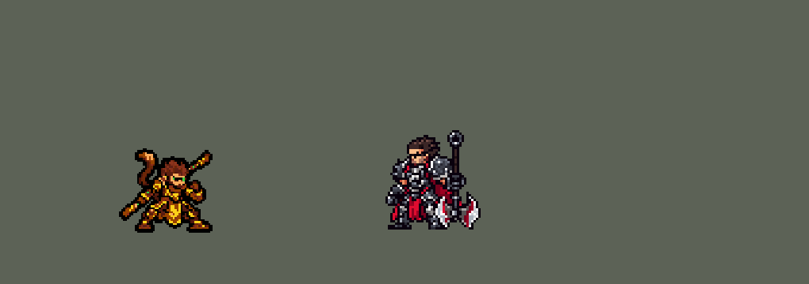

<!-- 本页上半部分由 tools/docs/gen_hero_docs.py 按仓库里现在的数据生成，手改会被覆盖；「开发记录」以下是手写的，生成时原样保留。 -->

# 孙悟空 Wukong


| 项目 | 内容 |
|---|---|
| id | `league_wukong` |
| 所属的包 | 主包（mod_id `league`） |
| 分路 | 打野 |
| 分类 / 标签 | 近战（Melee） · AD / Melee / CC |
| 高清帧 | PPU 1.53（画成 115%） |
| 附加包 | [悟空附加包](#附加包)（`league_wukong`） |



其他预览：[逐帧预览](../preview/league_wukong_frames.png)、[特效表](../preview/league_wukong_effects.png)

## 现在的技能

下面是游戏里显示的技能说明（`league/text/champion.i18n` 的简体中文，去掉了颜色和图标），冷却、距离来自 `league/champion/league_wukong.data_champion`；1 秒 = 60 tick。

### 普攻 / 被动

*攻击间隔 1 秒 · 攻击距离 26000*

金箍棒横扫。金刚不坏：打中英雄叠1层（最多5层）：每层护甲+4、每秒回复2生命。粉碎打击：每4秒下一次普攻伸长棒子，多造成30 + 50% 攻击力物理伤害，目标护甲-20%，持续3秒。

### 技能1 · 腾云突击

*冷却 8 秒 · 施放距离 50000 · 施放：指定目标 · 敌人（不含防御塔）*

腾云冲向目标，分身打中目标和附近最多2个敌人，各造成40 + 70% 攻击力物理伤害；之后攻击速度+40%，持续5秒。

### 技能2 · 真假猴王

*冷却 20 秒 · 施放距离 45000 · 施放：指定目标 · 敌方英雄*

隐身1秒冲到敌方英雄身后，原地留下分身4秒：每秒打身边一个敌人（英雄优先），造成50% 攻击力物理伤害；他放大招时分身也跟着转。

### 大招 · 大闹天宫

*冷却 60 秒 · 施放距离 60000 · 施放：指定目标 · 敌方英雄*

伸长金箍棒旋转2秒，每0.25秒造成10 + 35% 攻击力外加英雄2%最大生命的物理伤害，第一下击飞0.6秒；8秒内可再转一次。身边有敌方英雄时才放。

### 数值

攻击力 88（每级 +18）、生命 960（每级 +100）、护甲 36（每级 +9）、魔抗 25（每级 +4）、移速 1000（每级 +11）、生命回复 2（每级 +1）。

## 附加包

附加包是可选的原生代码 mod（都在附加包合集 `league_addons` 里），**不装主包里的英雄也是完整的**。

### 悟空附加包

[悟空附加包](../../addons/league_wukong/README.md)：`league_wukong` v0.1.4

|  | 主包（纯数据） | 附加包 |
|---|---|---|
| 金刚不坏的回血 | 每层每秒回固定 2 点生命（数据读不到生命） | 每 5 秒回复最大生命的 0.35%，每层再多 0.35%（叠满 5 层 2.1%，英雄联盟） |
| W 的分身 | 分身的伤害照常，但画面放在锚点弹道的 `end_effects` 里，游戏里不显示（玩家看不到分身） | 本包在分身站的地方每格画一次：站着、出手，他开大时跟着转 |
| 放 W | 游戏的 AI 几乎总先按 E，W 一局只放几次（模拟里 10 分钟 4 次，第一次在 4 分多） | W 好了、射程内有敌方英雄时替他按（英雄联盟里 W 开团、接大招） |

装上附加包后游戏里显示的说明（和主包不同的部分）：

- **普攻 / 被动**：【扩展包】金箍棒横扫。金刚不坏：打中英雄叠1层（最多5层），每层护甲+4；每5秒回复0.35%最大生命，每层再多0.35%（叠满2.1%）。粉碎打击：每4秒下一次普攻伸长棒子，多造成30 + 50% 攻击力物理伤害，目标护甲-20%，持续3秒。

## 相关脚本和素材

- [`tools/kit/build_wukong.py`](../../tools/kit/build_wukong.py)
- [`tools/kit/setup_wukong.py`](../../tools/kit/setup_wukong.py)
- [`tools/lol/extract_wukong.py`](../../tools/lol/extract_wukong.py)
- [`tools/art/preview_wukong.py`](../../tools/art/preview_wukong.py)
- [`tools/art/rig_wukong.py`](../../tools/art/rig_wukong.py)
- [`assets/source/wukong/`](../../assets/source/wukong)

## 开发记录

> 下面是原来 README 里「英雄：孙悟空」一节，原样搬过来（只改了相对链接）。

| 部分 | 内容 |
|---|---|
| 定位 | 打野（Jungle，标签 AD / Melee / CC），第 127 位英雄。齐天大圣 孙悟空：花果山的猴王，手持如意金箍棒（10-17 的分组计划 B 组的打野，用户：「沃里克先换成猴子了」）。用户的选择：「技能方案按 A 做（带扩展包 league_wukong）」。技能 1 = E 腾云突击，技能 2 = W 真假猴王，大招 = R 大闹天宫；Q 粉碎打击并进普攻，被动金刚不坏也在普攻里。技能名照英雄联盟 16.20 的官方中文 |
| 普攻 / 被动 / Q | 金箍棒横扫，射程 26000，攻击间隔 60 tick。**金刚不坏**：打中敌方英雄叠 1 层（最多 5 层，5 秒，叠满后停手一层一层掉，照贾克斯的层数做法），每层护甲 +4、每秒回复 2 点生命（英雄联盟按最大生命：在附加包里）。**粉碎打击**：每 4 秒下一次普攻变成伸长金箍棒的一戳，多造成 30 + 50% 攻击力的物理伤害，目标护甲 -20% 持续 3 秒；冷却快好时先加上攻击距离（AI 会从更远处出手，英雄联盟的 +135–175 射程）。英雄联盟里每打中一下冷却减 0.5 秒，数据做不到，用 4 秒的固定冷却代替 |
| 技能1 | **E 腾云突击**（对小兵、野怪也放，射程 50000）：踩着筋斗云冲到目标身边，分身打中身边 22000 内最多 3 个敌人（英雄优先，目标在里面就算一个），各 40 + 70% 攻击力的物理伤害（英雄联盟是法术伤害吃法强：他不出法强），之后攻击速度 +40% 持续 5 秒。冷却 8 秒 |
| 技能2 | **W 真假猴王**，**只在和英雄交手时放**（对 30000 内的敌方英雄）：隐身 1 秒，冲到目标身后（穿过他到背后 15000），原地留下一模一样的分身 4 秒——分身不会走（英雄联盟也一样），每秒打身边 30000 内的一个敌人（英雄优先）50% 攻击力；悟空放大招时分身也跟着转（同样击飞一次）。分身只是画面加伤害、不是真单位，敌人打不到它；隐身是全队视野：贴身的敌人还看得见他。冷却 20 秒 |
| 大招 | **R 大闹天宫**，**看时机才放**：按 R 只是待命 15 秒（经典引擎的 AI 常在接近时就按大招；游戏 0.6.x 的 AI 不按，由大招附加包 [`league_ult_press`](../../addons/league_ult_press/README.md) 在 40000 内有敌方英雄时替他按），之后每次普攻先看身边 28000 内有没有敌方英雄：有一个就够（用户 2026-10-24：「猴子开大不能把敌方英雄击飞？」；以前要两个以上、或被控制、或刚 E 到 / 分身在场），这一下普攻就变成转棒——伸长金箍棒转 2 秒，每 0.25 秒对身边的敌人造成 10 + 35% 攻击力外加英雄 2% 最大生命的物理伤害，第一下**击飞 0.6 秒**，身边 28000 内有敌方英雄就原地转，英雄都跑出去才冲到 45000 内一个英雄刚才站的地方（冲刺时画面上的转棒会停住，所以只在追人时冲，2026-10-30）；转完 8 秒内身边还有英雄就再转一次（英雄联盟的第二段）。15 秒没等到就退还冷却。冷却 60 秒 |
| 附加包 | 可选的附加包 [`addons/league_wukong`](../../addons/league_wukong/README.md)（在附加包合集里，原生代码，主包不装它也完整）：**金刚不坏按最大生命回血**：每 5 秒回复最大生命的 0.35%，每层再多 0.35%（叠满 2.1%，英雄联盟），代替主包每层每秒 2 点。日志 `league_wukong.log`（REGEN） |
| 数值 | 攻击 88（+18）、生命 960（+100）、护甲 36（+9）、魔抗 25（+4）、移速 1000（+11）、射程 26000 |
| 平衡 | 10 分钟经典引擎模拟，打野位对原版五个打野（恶魔、马戏团刀客、猎人、审判官、忍者），三套阵容两边各打：初稿 +0.07；只加大招的最大生命伤害 -0.16，只加攻击力 / Q / E +0.45，都加 +1.94；定稿攻击 88、Q 50%、E 70%、大招 2% 最大生命：种子 1–8 **+1.12**、9–16 **+1.15**（赵信 +1.10 / +1.29，凯隐 +1.12 / +1.72）。亚索联动：悟空打野时亚索的大招每局 1.62 次（李青 1.60、赵信 1.02、原版忍者 0.58），不用改 |
| 精灵图（高清帧 PPU 1.5） | Codex 第 0 步画了待机（A：半蹲、金箍棒斜向下）和备战（B：金箍棒竖在身边）两张原画（[`tools/art/pack_wukong_picture.py`](../../tools/art/pack_wukong_picture.py)），[`tools/art/review_wukong_size.py`](../../tools/art/review_wukong_size.py) 按游戏大小和 PPU 1.2 / 1.3 / 1.5 并排，用户：「用 A，游戏里 38 像素高」，看了 1.3 的草稿：「太模糊了 起码PPU1.5」。第 1 步 Codex 在游戏格子上重画（[`tools/art/pack_wukong_model.py`](../../tools/art/pack_wukong_model.py)），[`tools/art/design_wukong_cut.py`](../../tools/art/design_wukong_cut.py) 读回 A-1（11.5 px 一格，99×89）、整行整列删到头发尖到鞋底 57 行（脸的行列不删），眼睛按原稿补成两格绿。动作照塔姆的做法自己摆（用户：「动作帧你按照塔姆那种方式做吧 做到完美了喊我review 你还要自我review后确定没问题」）：[`tools/art/rig_wukong.py`](../../tools/art/rig_wukong.py) 按材质图把定稿切成金箍棒、近侧手臂、拳头、远侧手臂、尾巴、两条小腿（连护膝）和身体，只整格平移、直角转、镜像。改了两轮：腿没带上护膝、走路蹲下时小腿和护膝错开（「腿部也有变形的」）→ 按材质图重切、腿画在长袍下面；金箍棒被手挡住的一截缺着、转平后是斜的台阶、长度一帧一变（「武器有点变形吧」「怎么攻击的时候金箍棒还能缩没的？看起来穿越了整个手掌？武器做的也是歪的 不是直的」）→ 按原画的颜色和分段排成一根横平竖直的金箍棒（`STAFF_RUN`），竖着拿、端平都是同一根直角转，从拳心穿过，每个动作里长度不变（只有 Q 戳出去和大招转的时候按英雄联盟伸长）。动作：待机（呼吸、尾巴摆）、走路、普攻（举棒再横扫）、Q 粉碎打击（端平伸长戳出）、E 腾空前冲、W 下蹲冲刺、R 转棒循环（照盖伦的大风车人也转：朝右端平、棒竖起、整帧镜像朝左端平、再竖起，一圈 4 帧；用户：「我是要转的啊」）、R 待命、挨打、阵亡（照英雄联盟坐到地上）。2026-10-18 降到 PPU 1.2、缩小到 85%（用户：「船长猴子阿克尚波比蛇女像素太高需要降低 船长猴子局内太大」）：`ppu_restyle.py` 的 `ppu=1.2, grow=0.85`，头像点 (0, −21) 2026-10-19 补帧：受击加白闪后退（共享调色板不收白闪那一帧，`shared_palette_skip`，否则别的帧里有金色变灰）；死亡 8 帧（落地回弹）。2026-10-20 用户：「猴子现在太小了」→ 局内放大到 115%（league.dll 的 SIZES，从同比例的对照图选：36 → 41 游戏像素，和李青、潘森、盖伦一样高），帧整体上提 2 格、脚还踩在原来的地面上（`ppu_restyle.py` 的 `lift_sq`），头像点 (3, −33)，选人卡片 −8（`bp_card_audit.py`） |
| 特效 | 第 3 步 14 张特效（[`tools/art/pack_wukong_fx.py`](../../tools/art/pack_wukong_fx.py)，颜色照英雄联盟：金箍棒的打击和大招是橙金色的光，筋斗云是白云，真假猴王是灰白的烟，破甲是裂开的红盾，金刚不坏是灰色石片），全部左右对称（游戏不镜像特效图），三张分身图画成正面朝前（侧身的分身到了红色方会背对敌人）。[`tools/art/import_wukong_fx.py`](../../tools/art/import_wukong_fx.py)：打中的在身上，筋斗云跟着他，分身站在 W 的落点、每段 20 tick 换一张（站着 / 出手 / 转棒），破甲在头顶，旋风和石片绕着他。写成 `league_wukong_fx` 和 `league_wukong_big` |
| 音效 | 英雄联盟的音效和配音（[`tools/lol/extract_wukong.py`](../../tools/lol/extract_wukong.py)，15 段）：普攻出手 / 打中、Q 出手 / 打中、E 出手 / 打中、W 出手 / 分身打中、R 出手 / 转棒 / 击飞，配音是他的 E / W / R 台词（中文） |
| 图标 | 官方技能图标（腾云突击、真假猴王、大闹天宫，另有粉碎打击和金刚不坏），从本地客户端取 |
| 修正（跑步的金箍棒，2026-10-22） | 用户：「猴子跑步的时候感觉武器看起来是歪的」「这里金箍棒都断了吧」。现在的动作是 10-18 Codex 重画的（[`tools/art/rig_frames_1018.py`](../../tools/art/rig_frames_1018.py)），跑步 9 帧里他两只手都握着金箍棒（近侧拳头在脸前，远侧手在肩后），但棒子画成了对不上的三段：近侧拳头里出来的前段约 1:2，穿过远侧手的后段约 2:5，两手之间（身体后面）约 1:4，看着在他背后折断了。第一版（#446）留前段、用它转半圈当后端，把握不到棒子的远侧手去掉了——用户：「猴子手呢 断了？？」「这质量你能说改好了？」。现在两只手和身上的一切照原样，只去掉原来的前段、后段（远侧手左边的金箍和铁杆，手和身体之间露出的铁杆连同只挨着棒子或空白的描边）和它们留下的散点，画一根穿过两只手握点的直棒：近侧握点是前段铁杆出拳头的地方，远侧握点是远侧手在后段铁杆上留下的空当中间；斜率按前后帧 1-2-1 平滑（握点读回有一格的抖动，棒子离两个握点都不超过一格），画在一切后面（拳头握着它），两端各伸出握点 19 格（Codex 前段的长度），红色棒头、四道金箍、中间铁杆，颜色都是 Codex 的，描边，上亮下暗；帧左右各加宽 10 列（棒子平了，伸出了 Codex 的帧）；身上的绿色抠图点去掉（眼睛同色，只去第 22 行往下的）。帧按 Codex 原帧量的胯部摆放，身体位置不变（[`tools/art/wukong_run_staff.py`](../../tools/art/wukong_run_staff.py)）。其他动作的帧一个字节都没变。主包 0.189.18、`league.dll` 0.7.105 |
| 修正（大招、分身、眼睛，2026-10-29） | 用户：「猴子开大还是没分身啊 而且局内模型眼睛细节太差了」「而且开大后动画定格」「有分身的时候 分身会开大 没分身的时候本体开大 现在分身都看不见」「你不如调高一点PPU像素」「用 1.53」。**定格**：每一下旋转的冲刺会让强制动画失效，下一下又在冲刺的结束效果跑之前把它截断——现在每一下冲刺后都重新放 `spin`（盖伦 E 的做法）。**分身**：分身的画面放在锚点弹道的 `end_effects` 里，游戏里从不显示（锤石 R 的箱子同一个毛病）；附加包 0.1.2 在分身站的地方自己画（站着、出手、跟着转），上午那版「大招没分身时召一个」去掉；游戏的 AI 几乎总先按 E，W 一局只放几次（模拟 4 次），所以 W 也由附加包替 AI 按（射程内有敌方英雄就按，`src/trickster.rs`）；W 的射程 45000 留着，分身转的伤害回到 50%（模拟 +1.70 / +0.65）。**眼睛**：Codex 的眼睛是一格亮绿加一道粗黑眼线，1.2 的格子把那一格绿并掉了、眼线和远眼连成一条黑带；改回原画的 1.53（不并格子，`RESTYLE wukong`、`ppu_hd.PPU`、league.dll `hd.rs` HEROES），帧、hd_ / lo_ 和待机 / 选人卷轴重做（`hero_reels.py`）。 |
| 修正（待机的金箍棒，2026-10-29） | 用户在选人卡片上：「怎么感觉猴子后面的金箍棒又做歪了？」。Codex 画的待机七帧里，金箍棒被身子分成两截：身前一截在拳头里，头后一截比它的延长线低、斜得不一样，看着在背后折了一下（10-22 只拉直了跑步）。[`tools/art/wukong_idle_staff.py`](../../tools/art/wukong_idle_staff.py)：去掉两截旧棍子，按 Codex 自己的金箍棒（各动作里量的：红帽约 4.5 格、上沿一道橙光，金箍到约 10 格、中间一道深金色的凹槽，再往里是 2 格宽的灰钢）重画成一根穿过拳头的直棍，画在身子后面、拳头握着；七帧一样长、一样斜（3:4 的台阶，36.9°；用户在 32.6° / 36° / 39° 里挑了 36°：32.6° 时握棍的前臂约 39°，看着还是折的），轴线每帧都过格子中心，跟着拳头动不闪。旧棍子压住的头发只补被挖出的凹口，露出来的头发边补上描边，不另画头发（用户：「头发上缺失的像素补上」；第一版把头发往外补成了一堵直墙，被否掉）。中间一版用的是跑步那根的样子（长红帽、黄红相间的金箍），用户：「不行 太多地方都做错了 你这个金箍棒调整到完美后再喊我review」。顺带：第 0 帧原来偏离支点 1 格（奇数宽度的四舍五入），现在正好在支点上。只有第 0 帧在游戏里出现（待机和选人卷轴只用 idle[0]），Q 和 W 的第一帧本来就是直的，没动。 |
| 修正（转棒时本体不转，2026-10-30） | 用户：「猴子开大只有分身转 本体不转」。10-29 的修法（每一下冲刺后重新放 `spin`）没对上原因：冲刺本身就让画面上的强制动画停在当前那一帧，冲完才接着播。经典引擎模拟里转棒的 120 tick 有 84% 在冲刺（每一下都冲向目标，人就在身边也冲），所以本体一直停在 `spin` 的第一帧；分身是附加包画的特效，照常转。现在（[`tools/kit/build_wukong.py`](../../tools/kit/build_wukong.py) 的 `rings`）身边 28000 内有敌方英雄就原地转，没有才用 `MoveTo` 以 3000 的速度冲到 45000 内一个英雄刚才站的地方（一下之内冲完，不再一路追着跑的人），没有英雄时身边的小兵、野怪同样留住他；最后一下不冲；冲完、而且还在转时才重新放 `spin`，转完时去掉 `spin`（以前冲得晚的那一下会让他转完还多转一会儿）。同一局模拟里冲刺降到转棒时间的 10%，最长一次 19 tick。主包 0.268.0、附加包 0.1.3。 |

重新生成（素材来自本机的英雄联盟客户端，音频不进仓库）：

```bash
python tools/lol/extract_wukong.py --lol "D:\WeGameApps\lol" --vgmstream <vgmstream-cli.exe>
python tools/kit/build_wukong.py                    # 技能数据，数字都在脚本的参数表 P 里
python tools/kit/setup_wukong.py                    # 五种语言的文字、音效配置、共享文件里他的键
python tools/art/design_wukong_cut.py --hair 16 --face 30 44 44 64   # Codex 第 1 步的造型读回（PPU 1.5，A-1）
python tools/art/rig_frames_1018.py wukong          # 1 倍帧和原帧：10-18 Codex 重画的动作（rig_wukong.py 是之前那套；跑步的金箍棒拉直见 wukong_run_staff.py，待机的见 wukong_idle_staff.py）
python tools/art/ppu_restyle.py --hero wukong       # 外描边（不要加 --preview）
python tools/art/ppu_hd.py --hero wukong            # hd_ / lo_ 帧
python tools/art/import_wukong_fx.py                # 特效
python tools/art/preview_wukong.py                  # 预览和演示 GIF
python addons/league_wukong/make_override.py        # 附加包的副本（主包的悟空改了就重跑）
```

美术提示词见 [`assets/source/wukong/`](../../assets/source/wukong) 里的 `PICTURE_PROMPT.md`、`MODEL_PROMPTS.md`、`PROMPTS_FX.md`；Codex 的交付在 `codex_picture/`、`codex_model/`、`codex_fx/`。

逐帧预览：[`docs/preview/league_wukong_frames.png`](../preview/league_wukong_frames.png?v=1022x)，特效：[`docs/preview/league_wukong_effects.png`](../preview/league_wukong_effects.png?v=1018a)。
