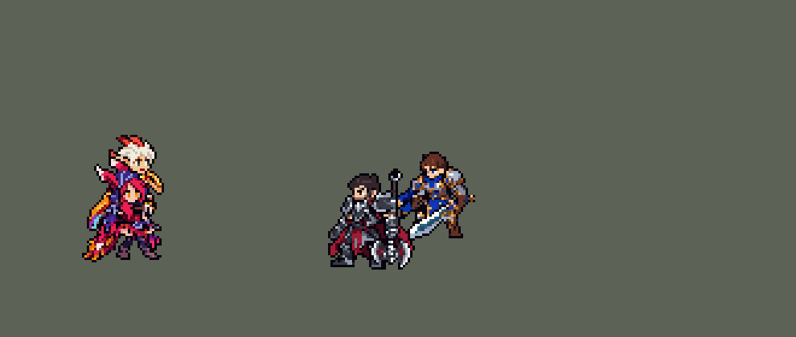

<!-- 本页上半部分由 tools/docs/gen_hero_docs.py 按仓库里现在的数据生成，手改会被覆盖；「开发记录」以下是手写的，生成时原样保留。 -->

# 霞 Xayah


| 项目 | 内容 |
|---|---|
| id | `league_xayah` |
| 所属的包 | 主包（mod_id `league`） |
| 分路 | ADC |
| 分类 / 标签 | 射手（Range） · AD / Range / CC |
| 高清帧 | 1 倍像素（无高清帧） |
| 附加包 | [霞羽毛附加包](#附加包)（`league_xayah_feathers`） |



其他预览：[逐帧预览](../preview/league_xayah_frames.png)、[特效表](../preview/league_xayah_effects.png)

## 现在的技能

下面是游戏里显示的技能说明（`league/text/champion.i18n` 的简体中文，去掉了颜色和图标），冷却、距离来自 `league/champion/league_xayah.data_champion`；1 秒 = 60 tick。

### 普攻 / 被动（被动「锐切」）

*攻击间隔 0.83 秒 · 攻击距离 57500*

甩出羽刃攻击。被动锐切：每放一个技能，之后3次普攻（最多存5次）穿透直线，其他目标受到50%伤害，并在目标身后留下一根羽毛（6秒）。

### 技能1 · 双刃·倒钩

*冷却 7 秒 · 施放距离 75000 · 施放：方向 · 敌人（不含防御塔）*

扔出两把穿透匕首，各造成60 + 80% 攻击力物理伤害（后续目标50%），各留一根羽毛；随后倒钩收回所有羽毛，每根对路过的敌人造成50 + 60% 攻击力伤害，一次收回命中英雄第3次起禁锢1.25秒。

### 技能2 · 致死羽衣

*冷却 8 秒 · 施放距离 57500 · 施放：无目标 · 敌人（不含防御塔）*

攻速+50%，持续4秒；期间每次普攻再甩出一片25%伤害的羽刃，命中英雄时移速+30%。洛在附近时，他也获得这些效果。

### 大招 · 暴风羽刃

*冷却 60 秒 · 施放距离 60000 · 施放：方向 · 刚交过手的敌方英雄*

跃向空中，1.1秒内不受伤害和控制，再向前方降下匕首雨，造成160 + 100% 攻击力物理伤害，留下一排羽毛并随即收回。

### 数值

攻击力 100（每级 +19）、生命 980（每级 +88）、护甲 24（每级 +7）、魔抗 15（每级 +3）、移速 910（每级 +9）。

## 附加包

附加包是可选的原生代码 mod（都在附加包合集 `league_addons` 里），**不装主包里的英雄也是完整的**。

### 霞羽毛附加包

[霞羽毛附加包](../../addons/league_xayah_feathers/README.md)：`league_xayah_feathers` v0.1.0

|  | 主包（纯数据） | 装了附加包 |
|---|---|---|
| 定身条件 | 一次收回打中英雄的第 3 次起（A 一根、B 两根，B 的第二根就定身） | 同一个英雄被 3 根羽毛打中（60 tick 内） |
| 定身时长、画面、伤害 | 1.25 秒，主包 | 一样 |

## 相关脚本和素材

- [`tools/kit/build_xayah.py`](../../tools/kit/build_xayah.py)
- [`tools/kit/setup_xayah.py`](../../tools/kit/setup_xayah.py)
- [`tools/lol/extract_xayah.py`](../../tools/lol/extract_xayah.py)
- [`tools/art/preview_xayah.py`](../../tools/art/preview_xayah.py)
- [`tools/art/rig_xayah.py`](../../tools/art/rig_xayah.py)
- [`tools/art/import_xayah.py`](../../tools/art/import_xayah.py)
- [`tools/art/design_xayah.py`](../../tools/art/design_xayah.py)
- [`assets/source/xayah/`](../../assets/source/xayah)

## 开发记录

> 下面是原来 README 里「英雄：霞」一节，原样搬过来（只改了相对链接）。

| 部分 | 内容 |
|---|---|
| 定位 | ADC（远程，分类 Range），用户排的第十五组的 ADC（同组：上单雷克顿、打野莉莉娅、中单维克托已做），第 74 位英雄。逆羽 霞：洛的搭档，技能都围绕羽毛——匕首和强化普攻在落点留下羽毛，收回时穿过路上的敌人，一次收回打中英雄三次就定身。用户选的方案 B：被动放在普攻上，Q 接自动收回（E），W 单独，R 是跃起加匕首雨 |
| 普攻 / 被动 | 普攻甩出一片追踪羽刃，100% 攻击力的物理伤害，射程 57500，攻击间隔 50 tick（第 8 tick 出手）。被动「锐切」：每放一个技能，之后 3 次普攻（最多存 5 次，8 秒）变成强化普攻：目标仍吃一片追踪羽刃的 100%，同时朝它射出一道穿透直线（72000），路上其他目标受到 50%，直线停下的地方（目标身后）留下一根羽毛，6 秒。英雄联盟里羽毛停在原地等她按 E；这个游戏没有「按需施放」的 E，所以收回是固定时机（见技能1） |
| 技能1 | Q「双刃」→ E「倒钩」（用户选的方案 B，Q 自带收回）：冷却 420 tick（7 秒），也对小兵和野怪放，射程 75000（射程内有敌方英雄时朝英雄）。第 8 tick 起相隔 6 tick 扔出两把穿透匕首（飞 95000，每 tick 6000），每把 60 + 80% 攻击力的物理伤害（第一个之后的目标 50%），各在尽头留下一根羽毛；出手 70 tick 后收回：摆出 E 的姿势，地上所有羽毛（Q 的、强化普攻留下的）一起飞回她身边（每 tick 4500），每根对路过的敌人造成 50 + 60% 攻击力的物理伤害。英雄联盟是一个敌人被三根羽毛打中才定身；这里数不了每个目标各被打了几次，改成一次收回里打中英雄的第 3 次起，被打中的英雄定身 1.25 秒 |
| 技能2 | W「致死羽衣」：冷却 480 tick（8 秒），攻击范围内有敌人（小兵、野怪也算）时放。4 秒内攻速 +50%，每次普攻 6 tick 后再甩出一片 25% 伤害的羽刃，这片羽刃打中英雄时她移速 +30%，1.5 秒；也给 3 次强化普攻 |
| 大招 | R「暴风羽刃」：冷却 3600 tick（60 秒），只对英雄放。用户：「霞的大招逻辑要注意 别乱放」——只在 60000 内有正在交战的敌方英雄（`EnemyChampionRecentlyAttacked`）时放，不再是 85000 内随便哪个英雄：模拟里每局 3.3 次，40 次里只有 1 次匕首雨下没有英雄（原来 58 次里 6 次），每次平均打中 1.5 个英雄。跃起 66 tick 内不受伤害和控制（易 Q 的做法：隐身 + 100% 减伤 + 免控；给自己放放逐会让队友丢失视野），第 48 tick 朝前方降下匕首雨（90000 × 40000 的扇形，160 + 100% 攻击力的物理伤害），沿施放方向留下一排 5 根羽毛；40 tick 后收回；也给 3 次强化普攻 |
| 附加包 | 可选的附加包 [`addons/league_xayah_feathers`](../../addons/league_xayah_feathers/README.md)（在附加包合集里，原生代码，主包不装它也完整）：倒钩照英雄联盟按每个敌方英雄被几根羽毛打中算，同一个人被一次收回的 3 根羽毛打中才定身 1.25 秒（主包是一次收回打中英雄的第 3 次起，不分是谁） |
| 洛联动 | 用户选的方案 1：W 共享、洛的 E 飞得更远、两人互相的配音。引擎里没有「按英雄挑队友」的条件，`SwitchByBuff` 只看自己身上的 buff；但别的英雄的技能挂在洛身上的 buff，洛自己的技能也读得到（探针验证：每局读到 50 次）。所以霞的每次普攻给 130000 内的友方挂上「霞在附近」，W 给 70000 内的友方挂上「致死羽衣」；洛的数据（`tools/fix/rakan_xayah_duo.py`，在主线的洛上就地补丁，不重新生成）读到它们时：普攻也获得 W 的攻速和移速，并多甩一根 25% 的羽毛；E「轻舞成双」三圈（25000、50000、90000）都没找到队友而霞在附近时，再找第四圈 130000（英雄联盟：对霞 700 → 1000 码）；E 飞向霞时说霞那句台词；霞拿到洛 E 的护盾时说洛那句（10 秒冷却）。没有霞时这些 buff 从来不会出现，洛自己的对局前后完全一样（模拟器对比验证） |
| 数值 | 攻击 100（+19）、生命 980（+88）、护甲 24（+7）、魔抗 15（+3）、移速 910（+9）。数值是自己设计的，用 SDK 对战模拟调：下路，对 3 个原版射手（`gunner`、`archer`、`boomerang_hunter`），3 套阵容、两边各打，10 分钟。初稿 −0.68：强化普攻只是一道直线，打不中走动的目标；改成追踪羽刃 + 穿透直线后 +0.85，再把攻击 100、攻击间隔 50、射程 57500，Q 60 + 80%，羽毛 50 + 60%，W 8 秒一次、攻速 50%，生命 980、护甲 24 定下来：种子 1–24 +1.81、25–48 +1.83（同一批韦鲁斯 +2.11 / +2.15、烬 +1.92 / +2.01）。R 改成只在交战时放以后 +2.12（种子 1–24） |
| 亚索联动 | E 的定身算控制：霞在亚索队里打下路时，亚索每局对英雄放 R 0.25 次（韦鲁斯 0.67、原版 `gunner` 0.35），不用调 |
| 精灵图 | 9 个动作 52 帧：待机 8、移动 8、普攻 6、Q（`skill`）4、E 收回（`skill_e`）4、W（`skill2`）4、R（`ult`）8、受击 2、死亡 8。造型 34 × 44 px，28 色。头像截取点 (1, −41)，选人卡片 `banpick_center` y −7 |
| 特效 | Codex 画的 21 张（`import_xayah.py` 缩成游戏像素），两张表：`league_xayah_fx` 普攻羽刃、强化普攻的穿透羽刃、命中，W 的第二片羽刃，Q 的匕首、出手闪光和命中，飞回的羽毛、落地和插在地上的羽毛，E 收回的光、命中、定身的羽刃和缠绕，W 的风暴、脚下的风暴圈、加速羽流，R 的羽翼和命中；`league_xayah_big` R 的匕首雨。被动的光在 `league_xayah_sym` |
| 音效 | 英雄联盟的音效和配音（`tools/lol/extract_xayah.py`）：普攻出手、命中，强化普攻，羽毛，Q、W、W 的羽刃、E、E 命中、定身，R 和匕首雨；Q、E、R、定身各一句中文配音，加上拿到洛护盾的那句（联动）。洛那边加了 E 飞向霞的那句（`tools/lol/extract_rakan.py`）。版权属于 Riot Games，**不提交到仓库**，按下面的命令在本地生成 |
| 图标 | 官方技能图标（Q / W / R），从本地客户端提取，缩到 64×64 |

重新生成（素材来自本机的英雄联盟客户端，音频不进仓库）：

```bash
python tools/lol/extract_xayah.py --lol "D:\WeGameApps\lol" --vgmstream "<vgmstream-cli.exe 路径>"
python tools/lol/extract_rakan.py --lol "D:\WeGameApps\lol" --vgmstream "<vgmstream-cli.exe 路径>"   # 洛那句联动配音
python tools/kit/build_xayah.py          # 技能数据，数字都在脚本的参数表 P 里；--nodes 看每棵技能树的节点数
python tools/kit/setup_xayah.py --face 1,-41 --banpick -7   # 五种语言的文字、音效配置、共享文件里她的键
python tools/fix/rakan_xayah_duo.py      # 洛那一半的联动（就地补丁主线的洛；--check 只看补没补）
python tools/art/design_xayah.py         # 造型：Codex 原稿按区域缩到 44 行，去掉头顶一大块黑线
python tools/art/rig_xayah.py            # 动作：造型自己的零件无损摆姿势（整格平移、90° 旋转、整行移动、叠放）
python tools/art/import_native.py --hero xayah
python tools/art/import_xayah.py         # 特效；--raw assets/source/xayah/codex_fx 先把生图原稿缩成游戏尺寸的原尺寸条
python tools/art/preview_xayah.py
```

美术（动作的提示词见 [`assets/source/xayah/MODEL_STRIPS.md`](../../assets/source/xayah/MODEL_STRIPS.md)，特效的见 [`PROMPTS_FX.md`](../../assets/source/xayah/PROMPTS_FX.md)；Codex 的交付说明在 [`codex_picture/`](../../assets/source/xayah/codex_picture)、[`codex_model/`](../../assets/source/xayah/codex_model)、[`codex_strips/`](../../assets/source/xayah/codex_strips)、[`codex_fx/`](../../assets/source/xayah/codex_fx)）：

- 原画：Codex 画了几版，用户选 A（英雄联盟的待机）。
- 造型：Codex 第 1 步的几种缩法用户都觉得「太模糊」，改成按区域分别缩（脸、身体、腿各自取舍行列，保住眼睛）到 44 行；用户选了没精修的那版：「用这个就行 头顶一大块黑线帮我处理了」，只去掉头顶的黑线、补两个缺口。
- 动作：Codex 第 2 步的动作条有平板手臂、斗篷横条、躺倒的身体上立着的头，跑步的腿转得变形。用户：「不要有任何模型变形的问题」「像素缺失也是」「腿部还有变形 还有多余的像素」。`rig_xayah.py` 全部用造型自己的像素重摆：手臂、刀刃、整个人按格子精确切出，只做平移、90° 旋转 / 翻转、整行移动和叠放，不做任意角度旋转、不删行；只在动过的部位 2 格以内补描边。每帧检查：一整块、没有洞、颜色是造型的子集、头和造型完全一样、脚底以下没有像素。待机是自己的呼吸（身体下沉一行、斗篷下摆贴地），不用 `idle_breathe` 的切小腿（条纹腿会被切短）；跑步用造型自己的近侧腿复制成远侧腿，前后摆开、交替抬脚。
- 特效：Codex 第 3 步的 21 张（`import_xayah.py --raw`：每张按格子等分，颜色归到包里给每张的色阶，飞行物锚在刀尖，命中锚在亮核，地上的东西锚在最低一行），按动作帧量出的手、胸口、脚底的位置放好，时长按技能。
- 红色方（用户：「蓝色方红色方特效不要颠倒」）：Q、W、E、R 出手时有前后之分的画面（Q 手上的闪光，E、W、R 胸前的光）画进她自己的动作帧，跟着她一起翻转（`bake_caster_fx.py`，`build_xayah.py` 每次生成都会重新套上）；W 第二片羽刃出手时手上的小闪光去掉了：它要在普攻中途插一段动作帧，模拟里这让她的击杀差两批都低了约 0.5（其余画进帧的画面对模拟没有任何影响）；被动的光在每个技能的五档层数里都会播，画进帧要复制太多动作，改成放在身体中间、左右对称；飞行的羽刃、匕首、羽毛和匕首雨（画面跟着方向转）严格上下对称；命中、插在地上的羽毛、定身、风暴圈、加速羽流严格左右对称。

逐帧预览：[`docs/preview/league_xayah_frames.png`](../preview/league_xayah_frames.png?v=1014g)，特效：[`docs/preview/league_xayah_effects.png`](../preview/league_xayah_effects.png?v=1014g)。
