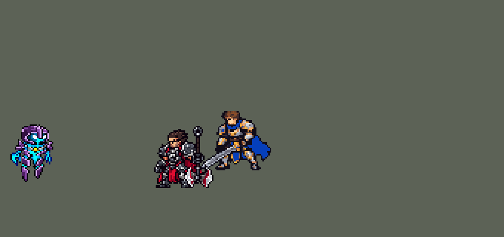

<!-- 本页上半部分由 tools/docs/gen_hero_docs.py 按仓库里现在的数据生成，手改会被覆盖；「开发记录」以下是手写的，生成时原样保留。 -->

# 泽拉斯 Xerath


| 项目 | 内容 |
|---|---|
| id | `league_xerath` |
| 所属的包 | 主包（mod_id `league`） |
| 分路 | 中单 |
| 分类 / 标签 | 法师（Magician） · AP / Magic / CC |
| 高清帧 | PPU 1.55 |
| 附加包 | [游戏 AI 不按的技能替它按](#附加包)（`league_ult_press`） |



其他预览：[shrink](../preview/league_xerath_shrink.gif)、[逐帧预览](../preview/league_xerath_frames.png)、[特效表](../preview/league_xerath_effects.png)

## 现在的技能

下面是游戏里显示的技能说明（`league/text/champion.i18n` 的简体中文，去掉了颜色和图标），冷却、距离来自 `league/champion/league_xerath.data_champion`；1 秒 = 60 tick。

### 普攻 / 被动（被动「法力澎湃」）

*攻击间隔 1.5 秒 · 攻击距离 55000*

发射奥术法球攻击。被动法力澎湃：每14秒下一次攻击额外造成40 + 40% 法强魔法伤害，并使小技能冷却缩短23%；他每击杀一个单位，等待缩短3.5秒。

### 技能1 · 奥能脉冲

*冷却 5 秒 · 施放距离 100000 · 施放：方向 · 敌人（不含防御塔）*

蓄力后射出贯穿光束，对直线上的敌人造成110 + 85% 法强魔法伤害。附近有敌方英雄时蓄满，射得更远；只打小兵时快速蓄力，伤害65%。

### 技能2 · 冲击法球

*冷却 10 秒 · 施放距离 95000 · 施放：指定目标 · 敌人（不含防御塔）*

命中第一个敌人造成60 + 45% 法强并晕眩0.75~2秒（飞得越远越久）。随后毁灭之眼落在敌方英雄头上，造成60 + 50% 法强并减速，中心伤害+67%。

### 大招 · 奥术仪式

*冷却 50 秒 · 施放距离 220000 · 施放：指定目标 · 敌方英雄*

飞升并原地引导，向远处的敌方英雄连发4次魔法炮击，落点预警后爆炸，每发造成120 + 45% 法强魔法伤害；每次命中英雄，之后的炮击伤害+20%。被控制会打断。

### 数值

攻击力 83（每级 +6）、法强 45（每级 +22）、生命 912（每级 +101）、护甲 18（每级 +7）、魔抗 20（每级 +4）、移速 900（每级 +9）。

## 附加包

附加包是可选的原生代码 mod（都在附加包合集 `league_addons` 里），**不装主包里的英雄也是完整的**。

### 游戏 AI 不按的技能替它按

[游戏 AI 不按的技能替它按](../../addons/league_ult_press/README.md)：`league_ult_press` v0.5.5（通用附加包，下面只列和泽拉斯有关的部分）

|  | 装了附加包，什么时候按 |
|---|---|
| 泽拉斯 R、烬 R（站着引导） | 自己身边 **45000 内没有敌方英雄**、生命 ≥ 40%；射程内（泽拉斯取 160000、烬取 140000）生命不到一半的，或我方有人 40000 内贴着的敌方英雄，挑生命比例最低的 |

## 相关脚本和素材

- [`tools/kit/build_xerath.py`](../../tools/kit/build_xerath.py)
- [`tools/kit/setup_xerath.py`](../../tools/kit/setup_xerath.py)
- [`tools/lol/extract_xerath.py`](../../tools/lol/extract_xerath.py)
- [`tools/art/preview_xerath.py`](../../tools/art/preview_xerath.py)
- [`tools/art/import_xerath.py`](../../tools/art/import_xerath.py)
- [`tools/art/design_xerath.py`](../../tools/art/design_xerath.py)
- [`assets/source/xerath/`](../../assets/source/xerath)

## 开发记录

> 下面是原来 README 里「英雄：泽拉斯」一节，原样搬过来（只改了相对链接）。

| 部分 | 内容 |
|---|---|
| 定位 | 中单（法师，分类 Magician），用户排的第十三组的中单（同组：上单蛮王、打野赵信、ADC 莎弥拉、辅助派克），第 62 位英雄。远古巫灵 泽拉斯：超远距离的炮台法师，Q 蓄力光束、E 眩晕接 W 法阵、R 站定连发炮击。四个选择都按推荐的来（用户选的）：Q / E→W / R 三个技能位，被动改成强化普攻减冷却 |
| 普攻 / 被动 | 普攻甩出奥术法球（追踪，100% 攻击力的物理伤害），射程 55000，攻击间隔 90 tick（第 10 tick 出手）。被动「法力澎湃」：团战经理没有蓝条，原版的回蓝改成回技能——每 14 秒下一次普攻是强化法球，额外 40 + 40% 法强的魔法伤害，打中时 Q 和 E→W 的剩余冷却压到 77%（2 tick 的 `skill_cooldown_mult` 30）。等待用 4 个同时加上的标记（210 / 420 / 630 / 840 tick），一个都不剩就好了；他的普攻或冲击法球每击杀一个单位（金克丝那套击杀检测），去掉最长的那个，下一次强化提前 3.5 秒（英雄联盟同样是每击杀 3.5 秒） |
| 技能1 | Q「奥能脉冲」：冷却 300 tick（5 秒），朝方向放（`Direction`），也对小兵和野怪放。韦鲁斯 Q 那样的智能蓄力：140000 内有敌方英雄就完整蓄力 54 tick（0.9 秒），光束射 150000；只有小兵野怪时快速蓄力 22 tick，伤害 65%、射 95000。出手时 145000 内有敌方英雄就朝他站的位置射（锁定方向，走开就躲掉），否则朝施法方向。光束贯穿直线上所有敌人：110 + 85% 法强的魔法伤害 |
| 技能2 | E「冲击法球」→ W「毁灭之眼」：冷却 600 tick（10 秒），对目标放（也对小兵和野怪）。第 10 tick 甩出冲击法球（直线、打中第一个敌人停下）：60 + 45% 法强，眩晕按飞行距离 0.75 / 1.33 / 2 秒（发射时加两个计时标记，命中时看还剩哪个——英雄联盟 0.75–2.25 秒）。同路径一颗只认英雄的隐形副本穿过小兵，打中第一个敌方英雄后，毁灭之眼落在他脚下（被眩晕的话正好在中心）；线上没有英雄时，30 tick 后落在目标脚下。法阵 30 tick 后炸开：半径 26000 内 60 + 50% 法强、减速 25%，中心 11000 内再加 67%（英雄联盟的 ×1.667）、再减速 35%，减速 2.5 秒 |
| 大招 | R「奥术仪式」：冷却 50 秒，对 220000 内的敌方英雄放（几乎整个战场）。烬 R 那样的站定引导：飞升 30 tick，然后引导最多 330 tick；每 6 tick 检查一次，被控制就中断；两发之间隔 54 tick，召唤一发炮击——优先打队友正在打的英雄，否则射程内随便一个：落点先出瞄准圈，36 tick（0.6 秒）后爆炸，半径 18000 内 120 + 45% 法强；这次引导里每有一发打中过英雄，之后的炮击伤害 +20%（英雄联盟的递增伤害）。打满 4 发结束 |
| 附加包（替 AI 按） | 可选的附加包 [`addons/league_ult_press`](../../addons/league_ult_press/README.md)（在附加包合集里，原生代码，主包不装它也完整）：游戏 0.6.4 的 AI 很少按他的 R（只读观察包：每 10 分钟 0.8 次，74 局）。附加包按局面替 AI 按（用户：「有问题的英雄全部改成rust」）：他身边 45000 内没有敌方英雄、生命不低于 40% 时，160000 内生命不到一半的或我方有人 40000 内贴着的敌方英雄（生命比例最低的在前） |
| 数值 | 攻击 78（+6）、法强 42（+21）、生命 860（+95）、护甲 18（+7）、魔抗 20（+4）、移速 900（+9）。英雄联盟的泽拉斯是生命少、射程远的炮台法师。数值是自己设计的，用 SDK 对战模拟调：中路，对 5 个原版中单（`pyromancer`、`ice_mage`、`lightning_mage`、`wind_mage`、`white_mage`），3 套阵容、两边各打，10 分钟。初稿（Q 95 + 75%、冷却 5.5 秒）种子 1–24 +1.05、25–48 +1.01；Q 110 + 85%、冷却 5 秒后 +1.48 / +1.60（本包的瑞兹 +1.63 / +1.61、阿狸 +1.55 / +1.76、安妮 +1.65 / +1.36）。Q、E、W、R 一起加强是 +2.78（12 个种子），太强 |
| 亚索联动 | 泽拉斯在中路时亚索大招每局对英雄放 0.94 次（同批闪电法师 3.40、丽桑卓 2.10；阿狸 1.27），只有 E 一个单体眩晕，不用调 |
| 精灵图 | 11 个动作 62 帧：待机、移动（悬浮滑行）、普攻、Q 完整蓄力（`skill`）、Q 快速蓄力（`skill_quick`）、E→W（`skill2`）、R 起手（`ult`）、R 引导（`ult_loop`）、R 每一发（`ult_shot`）、受击、死亡（铠甲散落一地）。造型 31 × 44 px（用户：「泽拉斯尺寸可以做大一点」「可以44px？」），23 色。待机 6 帧同一张、第 2–4 帧整体下沉一行（腿尖不动）；头像截取点 (1, −41)，选人卡片位置 −7 |
| 高清帧（PPU 1.55，2026-10-21） | 用户：「帮我使用PPU优化泽拉斯模型 大招动作帧之类的和英雄联盟都不一样」「主模型也要利用PPU重做吧 身材可以变细 头可以变小」「不是重做 是重新调整」。造型不换，Codex 原稿 B 按自己的格子整张读回（78 × 39；1 倍时删到了 44 行），兜帽删 3 行 4 列、身体删 7 列（`design_xerath_hd.py`，眼睛和兜帽开口的行列不删），两条腿尖修成一样长、尖下面拖的黑边去掉（「下面要做成一样长吧 黑边要去掉吧」）；三版里用户让我挑（「你选一个吧 反正游戏里别太大就行」），选最细的 32 × 73，PPU 1.75 = 游戏里 41.7 像素高（原来 44）。动作全部照英雄联盟的片段、用造型自己的部件重摆（`rig_xerath_hd.py`：两只爪子、两块肩甲、兜帽、两条腿的腿甲和尖刺、身体，只整格平移和 90° 翻转，不重画、不错切；前倾后仰时相邻部件最多错 1 列）：普攻后仰举爪、再前倾甩出；Q 先双手举成 V，再弯腰把前爪伸到脸前蓄力（蓄力光球正好在爪尖），最后前扑；E 后仰举爪再甩出，W 双手上举再收回胸前；R 起手蜷起再舒展、盔甲开始飞散，引导（英雄联盟的 Spell5）时兜帽、肩甲、胸甲、胯甲、腿甲、尖刺和双爪绕着发光的核心散成一圈，每块各自绕一格转（以前的引导是 Q 的张臂姿势），每一发从圈里伸出前爪；死亡先后仰往上浮，在空中炸开（核心和爪子闪白消散），盔甲各自落下、铺在地上。举起的爪子画在肩甲前面、手腕压着肩甲（藏到肩甲后面时手腕下露出地面，用户：「怎么有手臂断开？」），待机时爪子只往上不往下（低一行就和肩甲分开）；每只爪子在每个姿势里和身体接触的格数都不少于造型本身。出手闪光、Q 的蓄力和发射、E 的出手、R 每一发的出手照旧画进动作帧（`assets/source/native/xerath_bake.json`）。`ppu_restyle` 外描边加一格、头像截取点 (1, −37)；1 倍帧由高清帧按块取色生成（界面里和 DLL 不挂钩时用）。后来游戏里看着身体太长（用户：「泽拉斯在游戏里身体太长了吧？」「看着好奇怪 泽拉斯模型」——游戏里 19.5 × 43 像素，旁边的英雄宽 25–37），三种改短的方案里用户选 C（「改成这个 优先改这个 优先级最高 改完合并」）：身体少删 3 列（删 4 列不是 7 列），腰删 4 行、两条腿尖隔行删 7 行（都是整行整列、每段删和上一行最像的行，不重画），35 × 62，PPU 1.55 = 游戏里 40 像素高；动作照旧用 `rig_xerath_hd.py` 按新造型的部件重摆（部件的切法和关节换成新造型的行列），只改了两处：引导圈里的右肩甲往里、往上各挪 3 格，让开 R 每一发的光柱；右腿尖抬一行，不再陷进地面线；右肩甲底下一格只挨着爪子，划给爪子（爪子甩出去时它悬空）。头像截取点改成 (1, −34)。和英雄联盟逐帧对照：`python tools/art/review_xerath_actions.py --out <文件夹> --sheet`（一张 GIF，左边英雄联盟、右边游戏里画的帧） |
| 特效 | Codex 生图的 27 张（`import_xerath.py` 缩成游戏像素）：`league_xerath_fx` 普攻法球、强化法球、出手闪光、命中，Q 的蓄力、发射闪光、长短两种光束、命中，E 的出手、冲击法球、电爆、头顶的眩晕电光，W 的命中和减速，R 每一发的出手闪光、命中、结束；`league_xerath_big` W 的预警法阵和天降光柱，R 的飞升、引导时脚下的符文法阵、炮击的瞄准圈和天降光弹 |
| 音效 | 英雄联盟的音效和配音（`tools/lol/extract_xerath.py`）：普攻出手、命中，法力澎湃，Q 蓄力、发射、命中，E 出手、命中，W 法阵、爆炸，R 开始、每一发、爆炸、结束；Q、E、R 各一句中文配音。版权属于 Riot Games，**不提交到仓库**，按下面的命令在本地生成 |
| 图标 | 官方技能图标（Q / E / R），从本地客户端提取，缩到 64×64 |

重新生成（素材来自本机的英雄联盟客户端，音频不进仓库）：

```bash
python tools/lol/extract_xerath.py --lol "D:\WeGameApps\lol" --vgmstream "<vgmstream-cli.exe 路径>"
python tools/kit/build_xerath.py        # 技能数据，数字都在脚本的参数表 P 里；--nodes 看每棵技能树的节点数
python tools/kit/setup_xerath.py        # 五种语言的文字、音效配置、共享文件里他的键（头像点和选人卡片点在脚本的 VIEW 里）
python tools/art/design_xerath_hd.py    # 造型（PPU 1.55）：Codex 原稿 B 按格子整张读回（78 × 39），兜帽和身体删细、腿尖修齐，再删短腰和腿（35 × 62）
python tools/art/rig_xerath_hd.py       # 动作：照英雄联盟的片段用造型部件摆，写高清原帧和 1 倍图（--review <文件夹> 先看每个动作）
python tools/art/ppu_restyle.py --hero xerath
python tools/art/ppu_hd.py --hero xerath
python tools/art/import_xerath.py       # 特效；--raw assets/source/xerath/codex_fx 先把生图原稿缩成游戏尺寸的原尺寸条
python tools/art/preview_xerath.py
```

美术（原画的提示词见 [`assets/source/xerath/PICTURE_PROMPT.md`](../../assets/source/xerath/PICTURE_PROMPT.md)，造型的见 [`MODEL_PROMPTS.md`](../../assets/source/xerath/MODEL_PROMPTS.md)，动作的见 [`MODEL_STRIPS.md`](../../assets/source/xerath/MODEL_STRIPS.md)，特效的见 [`PROMPTS_FX.md`](../../assets/source/xerath/PROMPTS_FX.md)；Codex 的交付说明在 [`codex_picture/`](../../assets/source/xerath/codex_picture)、[`codex_model/`](../../assets/source/xerath/codex_model)、[`codex_strips/`](../../assets/source/xerath/codex_strips)、[`codex_fx/`](../../assets/source/xerath/codex_fx)）：

- 原画：Codex 画了 A（英雄联盟的待机：悬浮，两臂垂下）、B（Q 蓄力），用户选 A。
- 造型：Codex 自己删到 40 行的两版是隔行删出来的，碎成杂点；用户：「泽拉斯尺寸可以做大一点」「可以44px？」。改成把它的生图原稿按自己的格子读回（A 62 行、B 78 行），整行整列删到 44 行（兜帽和眼睛的行列不删），出了 A、B 宽窄几种和 B 50 行让用户挑，用户选「B44 宽」（31 × 44）。远侧的腿尖比近侧高两行，照原稿保留（悬浮、3/4 视角）。
- 动作参考（`poses.json`）：镜头 yaw 45、pitch 20，镜像；头 2.2 倍；高度 44。普攻第 4 帧（第 10 tick）出手，Q 完整蓄力第 6 帧（第 54 tick）、快速第 4 帧（第 22 tick）发射，E 第 3 帧（第 10 tick）甩出，和技能数据一致。
- 动作：Codex 这次没有重画身体，而是用造型自己的像素摆的（手臂拆成部件整块按 90° 转、平移，头逐格贴回），身体、肩甲、铁链、封印和腿每帧都是待机的。但施法时身体完全不动；按用户之前对蛮王、希维尔说的「僵硬」，`fix_xerath_strips.py` 照蛮王的做法加了前倾后仰：腰以上逐行最多挪 2 列（兜帽跟着下巴那一行整块平移，不错切），腿不动——甩法球和蓄力时后仰，出手时前倾，引导时略微前倾。死亡最后三帧旁边的几条孤立黑线（1–4 格的碎块）去掉了。
- 动作修正（10 月 6 日，用户：「泽拉斯 平A 放技能的时候模型有点变形」）：Codex 把「举起来」的爪子转到肩甲和头的后面，40 / 58 格里只露 14–20 格——蓄力、R 的引导、W 的举手时手像没了，肩上只剩一个蓝色小尖；再加上最多 0.12 的前倾后仰（下巴错开 2 格），细长的身子看着歪了。`fix_xerath_strips.py` 的 `POSES` 把普攻、Q、快速 Q、E → W、R 和它的引导、出手、受击都从造型重新摆：身体逐格照造型，站的位置和挪步照 Codex（按头找到的）；两只悬空的爪子从造型整块切下，Codex 摆得看得见的照原样（朝前伸、下垂、受击甩开，画进动作帧的出手闪光就落在这些位置），被藏起来的改成抬起 5 行、往外 2 列放在身体两侧（五种摆法里的 E）；倾斜减半，最多错开 1 格。跑步和死亡不变。
- 特效用 Codex 画的 27 张（生图原稿，`import_xerath.py --raw`：每张按格子等分，每个游戏像素取覆盖的原稿像素里最多的颜色，颜色归到包里给每张的色阶——奥术青蓝、深蓝紫，光效外圈最暗的一档去掉）。Codex 自己说没做到的对称按规则补齐：光束上下镜像（红方往左飞时引擎会上下翻），眩晕、减速、引导法阵、飞升、结束这些不随朝向翻转的画面左右镜像；飞升的光柱在他身体的位置挖空，不盖住人。位置：出手闪光和法球从前爪（站位点右 18、上 15）出，Q 蓄力聚在举起的前爪（右 10、上 20）；W 的光柱和 R 的光弹是竖直的，放在落点上播放，不随方向转（红方不会颠倒）。技能数据里光束和冲击法球的出手高度对到前爪（`y_offset` −10000），追踪的普攻法球 8 格高（从更高的地方追踪会飞歪）。

1 倍时代的 `design_xerath.py`（44 行的造型）、`fix_xerath_strips.py` 和 `import_native.py --hero xerath`（Codex 的动作条）不再跑：它们写的是 1 倍的图，会盖掉高清帧。

逐帧预览（高清帧）：[`docs/preview/league_xerath_frames.png`](../preview/league_xerath_frames.png?v=1021xs)，特效：[`docs/preview/league_xerath_effects.png`](../preview/league_xerath_effects.png?v=1021xs)。
