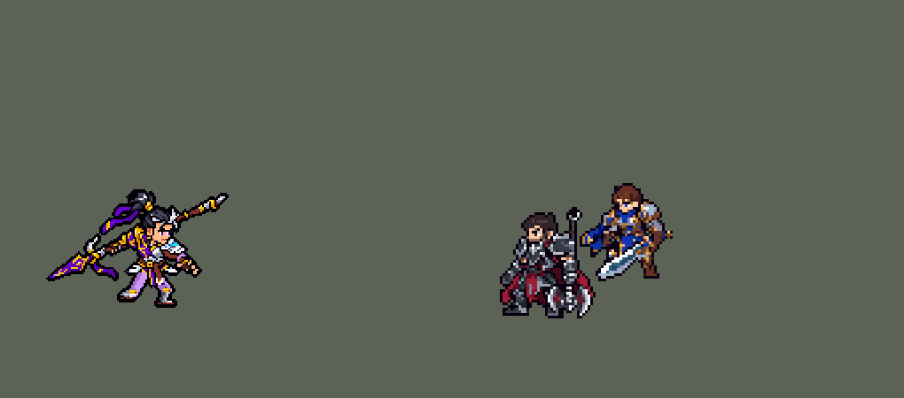

<!-- 本页上半部分由 tools/docs/gen_hero_docs.py 按仓库里现在的数据生成，手改会被覆盖；「开发记录」以下是手写的，生成时原样保留。 -->

# 赵信 Xin Zhao


| 项目 | 内容 |
|---|---|
| id | `league_xinzhao` |
| 所属的包 | 主包（mod_id `league`） |
| 分路 | 打野 |
| 分类 / 标签 | 近战（Melee） · AD / Melee / CC |
| 高清帧 | PPU 1.5 |
| 附加包 | [赵信大招远程免伤附加包](#附加包)（`league_xinzhao_guard`） |



其他预览：[shrink](../preview/league_xinzhao_shrink.gif)、[逐帧预览](../preview/league_xinzhao_frames.png)、[特效表](../preview/league_xinzhao_effects.png)

## 现在的技能

下面是游戏里显示的技能说明（`league/text/champion.i18n` 的简体中文，去掉了颜色和图标），冷却、距离来自 `league/champion/league_xinzhao.data_champion`；1 秒 = 60 tick。

### 普攻 / 被动（被动「果决」）

*攻击间隔 1 秒 · 攻击距离 26000*

长枪攻击。被动果决：每第三次攻击额外造成40% 攻击力物理伤害，并回复15 + 15% 攻击力生命。

### 技能1 · 无畏冲锋

*冷却 9 秒 · 施放距离 50000 · 施放：指定目标 · 敌人（不含防御塔）*

冲向目标，对周围敌人造成40 + 50% 攻击力物理伤害并减速30%，攻击速度+40%，持续5秒。随后三重爪击：接下来3次攻击各额外造成20 + 30% 攻击力，第三次击飞0.75秒。

### 技能2 · 风斩电刺

*冷却 10 秒 · 施放距离 60000 · 施放：指定目标 · 敌人（不含防御塔）*

先横扫面前，造成20 + 40% 攻击力物理伤害；再向前直刺，造成40 + 65% 攻击力物理伤害并减速50%，持续1.5秒。

### 大招 · 新月护卫

*冷却 50 秒 · 施放距离 30000 · 施放：指定目标 · 敌方英雄*

横扫周围，造成100 + 100% 攻击力加目标最大生命值10%的物理伤害，除被挑战的目标（施放对象）外全部击退。之后3秒内受到的伤害降低40%。

### 数值

攻击力 82（每级 +18）、生命 980（每级 +102）、护甲 32（每级 +8）、魔抗 25（每级 +4）、移速 1000（每级 +11）、生命回复 2（每级 +1）。

## 附加包

附加包是可选的原生代码 mod（都在附加包合集 `league_addons` 里），**不装主包里的英雄也是完整的**。

### 赵信大招远程免伤附加包

[赵信大招远程免伤附加包](../../addons/league_xinzhao_guard/README.md)：`league_xinzhao_guard` v0.1.0

主包 `league` 保持纯数据。英雄联盟里赵信的 R「新月护卫」之后，他免疫 450 码外敌人的伤害；数据读不到伤害来自多远，
所以主包里改成 R 之后 3 秒受到的伤害降低 40%（用户选的）。用户：「读不到多远就改rust源代码 看看能不能」——
这个附加包用原生代码读攻击者的位置，做成英雄联盟的样子：

- **远处的伤害挡掉**：主包的护卫 buff `league_xinzhao_r_guard`（R 之后 3 秒，身后的金色护卫光）在附加包里去掉 40% 减伤，只留画面和计时；
  被动 `league_xinzhao_guard:guard`（挂在 `passive` 上）在他每次挨打时（`on_damaged`）看：护卫还在，攻击者离他**超过 36000**
  （R 的横扫半径，英雄联盟的 450 码，中心到中心），这一下的伤害原样加回去（不超过最大生命）。
- **近身的照常吃**：被挑战的目标留在他身边，打他照常疼；36000 以内的敌人也一样。
- 数字写在英雄数据的 `passive.params`（`{"far": 36000}`）里，由 `make_override.py` 从 `tools/kit/build_xinzhao.py` 的参数表 `P`
  （`r_far`）写入，本包不另记一份。

## 相关脚本和素材

- [`tools/kit/build_xinzhao.py`](../../tools/kit/build_xinzhao.py)
- [`tools/kit/setup_xinzhao.py`](../../tools/kit/setup_xinzhao.py)
- [`tools/lol/extract_xinzhao.py`](../../tools/lol/extract_xinzhao.py)
- [`tools/art/preview_xinzhao.py`](../../tools/art/preview_xinzhao.py)
- [`tools/art/rig_xinzhao.py`](../../tools/art/rig_xinzhao.py)
- [`tools/art/import_xinzhao.py`](../../tools/art/import_xinzhao.py)
- [`tools/art/design_xinzhao.py`](../../tools/art/design_xinzhao.py)
- [`assets/source/xinzhao/`](../../assets/source/xinzhao)

## 开发记录

> 下面是原来 README 里「英雄：赵信」一节，原样搬过来（只改了相对链接）。

| 部分 | 内容 |
|---|---|
| 定位 | 打野（战士，分类 Melee），用户排的第十三组的打野（同组：上单蛮王、中单泽拉斯，ADC 莎弥拉、辅助派克以后做）。德邦总管 赵信：E 冲上去接 Q 三连击、第三下击飞，W 先横扫再直刺一道电光，R 绕身横扫、把眼前这个人留下单挑。技能位用户选的「E+Q / W / R」，R 选的「目标留身边 + 减伤」 |
| 普攻 / 被动 | 普攻是长枪突刺，100% 攻击力的物理伤害，射程 26000，攻击间隔 60 tick（第 11 tick 刺中；动作在第 1 tick 选好，命中放在 `Delayed` 里，黛安娜那样）。被动「果决」：每第三次攻击（两个 240 tick 的计数，英雄联盟停手就清零）换成双手大挥（`attack_p`，第 13 tick 打中），额外造成 40% 攻击力的物理伤害，并回复 15 + 15% 攻击力的生命；Q 的三下也算次数 |
| 技能1 | E「无畏冲锋」+ Q「三重爪击」（英雄联盟的 E→Q 连招）：冷却 540 tick（9 秒），射程 50000，也对小兵和野怪放。飞身冲到目标身上（每 tick 3500），落地时 20000 内的敌人受到 40 + 50% 攻击力的物理伤害（英雄联盟是 60% 法强的魔法伤害，他没有法强），减速 30%，持续 0.5 秒；自己攻击速度 +40%，持续 5 秒。然后接三重爪击：4 秒内接下来 3 次攻击各额外造成 20 + 30% 攻击力的物理伤害，第三下击飞 0.75 秒；头顶亮着还剩几下的金爪印。英雄联盟里 Q 打中会减其他技能 1 秒冷却，这里没做 |
| 技能2 | W「风斩电刺」：冷却 600 tick（10 秒），射程 60000，也对小兵和野怪放。第 13 tick 在身前横扫（半圆，半径 32000），20 + 40% 攻击力的物理伤害；第 17 tick 朝目标直刺一道电光（一条线，60000 长），40 + 65% 攻击力的物理伤害，减速 50%，持续 1.5 秒。英雄联盟的「挑战」标记会让 E 射程变远，引擎的施法距离不能随 buff 变，没做 |
| 大招 | R「新月护卫」：冷却 50 秒，只对英雄放（射程 30000，贴身才放）。第 10 tick 绕身横扫（半径 36000）：100 + 100% 攻击力的物理伤害，英雄再加最大生命值 10%（英雄联盟是当前生命 15%，读不到当前生命）；**被挑战的目标（施放对象）留在身边**，其余敌人全部击退（每 tick 2500，8 tick）——做法：横扫前给目标挂 3 tick 的 `cc_immune`，SDK 里核对过击退那一刻目标一格没动、周围的小兵和英雄都被推开；目标头顶挂金色挑战纹章。之后 3 秒受到的伤害降低 40%（英雄联盟是挡住 450 码外的伤害；数据读不到伤害来自多远，用户选的减伤），身后亮起金色护卫光 |
| 附加包（站桩） | 可选的附加包 [`addons/league_ult_press`](../../addons/league_ult_press/README.md)（在附加包合集里，原生代码，主包不装它也完整）：游戏 0.6.4 的 AI 常让这位英雄在敌方英雄跟前站着不打——只读观察包里身边 50000 内有敌方英雄时站着不动 23.6%，其中 8.8% 是 AI 下令「走到自己脚下」（盖伦 2.7% / 0.7%）。照卡蜜尔、瑟提、奥拉夫的办法（用户：「站桩的按照之前卡密尔那样改 然后合并」）：原地站了 15 tick、普攻好了、AI 还让他原地站时，35000 内最近的敌方英雄——他生命不低于一半、目标离敌方塔 75000 以外、目标身边 60000 内的敌方英雄不多于他身边的我方英雄（含他）——就普攻他，打出一下或 1.5 秒后重新算 |
| 数值 | 攻击 82（+18）、生命 980（+102）、护甲 32（+8）、魔抗 25（+4）、移速 1000（+11）、生命回复 2（+1）。数值是自己设计的，用 SDK 对战模拟调：打野，对 5 个原版打野（`demon`、`circus_blade`、`hunter`、`inquisitor`、`ninja`），3 套阵容、两边各打，每批 24 局 × 30，10 分钟。初稿 +2.01（同批凯隐 +1.12）；被动回血 20 + 25% → 15 + 15%、E 60% → 50%、Q 35% → 30%、攻击 90 → 86 是 +1.17。按动作条的出手帧重跑（W、R 出手变快）升到 +1.89 / +2.26（同两批凯隐 +1.12 / +1.72）；生命 1020 → 980、W 直刺 80% → 65%、攻击 86 → 82 后两批 +1.10 / +1.29，和凯隐持平 |
| 远程免伤附加包 | 用户：「读不到多远就改rust源代码 看看能不能」。附加包 [`addons/league_xinzhao_guard`](../../addons/league_xinzhao_guard/README.md) 用原生代码读攻击者的位置：R 之后 3 秒的护卫光还在时，离他超过 36000（R 的横扫半径，英雄联盟的 450 码）的敌人打来的伤害，一落下就原样加回（主包的 40% 减伤在附加包里去掉）；近身的伤害照常吃。主包不装附加包也完整可玩；附加包只做了单元测试，一下就致命的远程伤害可能来不及挡，要在游戏里看日志确认 |
| 亚索联动 | Q 第三下的击飞是亚索大招要的控制 |
| 精灵图 | 12 个动作 75 帧：待机、移动、普攻、被动第三下（`attack_p`）、Q 三下（`q1`、`q2`、`q3`）、E（`skill`）、W（`skill2`）、R（`ult`）、受击、死亡。造型 65 × 42 px（含斜架在身后的长枪），24 色，描边 99%；下巴以下瘦了 4 列（用户：「体型也有点胖」）。待机 6 帧同一张、不呼吸；头像截取点 (12, −36)（脸上，不在发髻上）；发髻顶在 −30，选人卡片 `banpick_center` −9 |
| 高清帧（PPU 1.5） | 2026-10-18 用 PPU 重做，还是 Q 版（用户：「用 PPU 重做赵信的模型，还是 Q 版」）。Codex 只画一张设计图（提示词包 [`tools/art/pack_xinzhao_ppu.py`](../../tools/art/pack_xinzhao_ppu.py) / [`assets/source/xinzhao/PICTURE_PROMPT_PPU.md`](../../assets/source/xinzhao/PICTURE_PROMPT_PPU.md)，交付存成 [`assets/source/xinzhao/hd/codex.png`](../../assets/source/xinzhao/hd/codex.png)）：它的格子实际是 12 px（要求 11），按自己的格子读回 123 × 77 格、归成 40 色，再每段均匀删一行 / 一列删到 63 行（101 × 63，脸的行列不删；一次性挑最省的行列会把枪刃、发髻和小腿压扁），两只眼睛逐格改成一样大、一样高（[`tools/art/design_xinzhao_hd.py`](../../tools/art/design_xinzhao_hd.py)，读回的 [`readback.png`](../../assets/source/xinzhao/hd/readback.png)、定稿 [`design.png`](../../assets/source/xinzhao/hd/design.png)）。动作不让 Codex 画，逐帧照英雄联盟原版动画的骨骼摆（[`tools/art/rig_xinzhao_hd.py`](../../tools/art/rig_xinzhao_hd.py)，[`tools/lol/league_joints.py`](../../tools/lol/league_joints.py) + `ppu_rig.Driver`）：长枪是一整根刚体（被身体挡住的那段补成直线），持枪的手臂和枪只做原样、镜像、直角转这 8 种无损变换，每帧取离英雄联盟角度最近的一种（第一版按任意角度重采样，用户：「还有武器变形？」）；枪顺着自己的方向在拳头里滑动，像英雄联盟里握着枪尾刺出；枪在身前时手也在身前，枪身不挡脸；其他动作两条腿照造型不转。移动逐帧照英雄联盟的 Runbase（用户：「跑步腿不对吧？这样跑步的？」「你参考原版赵兴怎么跑步的？」）：两髋并在腰正中，前襟剪短到第 53 行露出腿，身体前倾 3 格、起伏 1 行；大腿按英雄联盟的大腿角度画成造型的两档裤色，护胫按小腿角度画成造型的白钢色，膝盖一道金色护膝，脚踝处贴造型原样的靴子（不转、不错开；用户：「脚严重变形啊」之后改的，近腿那只左右镜像让脚尖朝前）。待机 8 帧上身连枪整行下沉 0–2 行呼吸；死亡最后几帧整体转 90° 躺下，枪平放在身下（斜的枪用直角转放不平，整列上下挪平，像素一个不少）。W 的斩击、R 的预警照旧画在帧里（`xinzhao_bake.json`），每个动作的帧数和时长和原来一样。头像点 (5, −36)，选人卡片 `banpick_center` −8（`bp_card_audit.py`）。 |
| 特效 | Codex 生图的 20 张（`import_xinzhao.py` 缩成游戏像素）：`league_xinzhao_fx` 普攻、被动第三下、Q、Q3 击飞、E、W 两下和 R 的命中，被动回血的金光，头顶 3/2/1 道金爪印（Q 剩几下），E 和 W 的减速标记，R 的挑战纹章；`league_xinzhao_big` E 的冲刺光痕和落地冲击圈，W 的横扫月牙和电刺，R 起手转枪的金光、绕身一圈的新月刃光和之后 3 秒的护卫光 |
| 音效 | 英雄联盟的音效和配音（`tools/lol/extract_xinzhao.py`）：普攻刺出、命中，被动第三下和回血，Q 起手和三下命中，E 冲锋和落地，W 起手、电刺射出、命中，R 横扫、击退、挑战、护卫和结束；Q 第三下、E、W、R 各一句中文配音。版权属于 Riot Games，**不提交到仓库**，按下面的命令在本地生成 |
| 图标 | 官方技能图标（E / W / R），从本地客户端提取，缩到 64×64 |

重新生成（素材来自本机的英雄联盟客户端，音频不进仓库）：

```bash
python tools/lol/extract_xinzhao.py --lol "D:\WeGameApps\lol" --vgmstream "<vgmstream-cli.exe 路径>"
python tools/kit/build_xinzhao.py        # 技能数据，数字都在脚本的参数表 P 里；--nodes 看每棵技能树的节点数
python tools/kit/setup_xinzhao.py --face=12,-36 --banpick -9   # 五种语言的文字、音效配置、共享文件里他的键
python tools/art/design_xinzhao.py       # 造型：Codex 原稿 03 按格子读回、整行整列删到 42 行（脸不动）
python tools/lol/native_pose.py assets/source/xinzhao/poses.json --out <渲染文件夹>   # 动作参考帧
python tools/art/rig_xinzhao.py          # 动作：每帧都是造型本身，长枪重建成一整杆、连手臂整块转；--review <文件夹> 先看
python tools/art/import_native.py --hero xinzhao
python tools/art/import_xinzhao.py       # 特效；--raw <Codex 的特效交付文件夹> 先把生图原稿缩成游戏尺寸的原尺寸条
python tools/art/pack_xinzhao_ppu.py --out <文件夹>   # 高清造型（PPU 1.5）：给 Codex 的重画包
python tools/art/design_xinzhao_hd.py   # Codex 的原图按 12 px 的格子读回、均匀删到 63 行、眼睛逐格改；--review <文件夹> 出大小对比
python tools/lol/league_joints.py assets/source/xinzhao/poses.json --out <关节文件夹>   # 英雄联盟每帧的关节位置
python tools/art/rig_xinzhao_hd.py --joints <关节文件夹>/xinzhao_joints.json   # 高清帧：照骨骼摆，写 assets/source/ppu/orig/；--review <文件夹> 先看
python tools/art/ppu_restyle.py --hero xinzhao
python tools/art/ppu_hd.py --hero xinzhao
python tools/art/preview_xinzhao.py      # --only red：整场镜像（红色方）
python addons/league_xinzhao_guard/make_override.py   # 附加包的英雄数据和文字（主包的赵信改了以后重跑）
```

美术（原画的提示词见 [`assets/source/xinzhao/PICTURE_PROMPT.md`](../../assets/source/xinzhao/PICTURE_PROMPT.md)，造型的见 [`MODEL_PROMPTS.md`](../../assets/source/xinzhao/MODEL_PROMPTS.md)，动作的见 [`MODEL_STRIPS.md`](../../assets/source/xinzhao/MODEL_STRIPS.md)，特效的见 [`PROMPTS_FX.md`](../../assets/source/xinzhao/PROMPTS_FX.md)；Codex 的交付在 [`codex_picture/`](../../assets/source/xinzhao/codex_picture)、[`codex_model/`](../../assets/source/xinzhao/codex_model)、[`codex_strips/`](../../assets/source/xinzhao/codex_strips)、[`codex_fx/`](../../assets/source/xinzhao/codex_fx)；附图包由 `tools/art/pack_xinzhao_picture.py`、`pack_xinzhao_model.py`、`pack_xinzhao_strips.py`、`pack_xinzhao_fx.py` 在本地生成，英雄联盟的渲染不进仓库）：

- 原画：Codex 画了 A（英雄联盟的待机：长枪斜架在身后）、B（Q 第三下之后长枪横举过头顶），横版 1536×1024（长枪竖版放不下），用户选 A，枪按 1.2 倍身高画造型。模型渲染里头顶的发髻和发带是一团坏掉的网格，发髻照官方加载画面画。
- 造型：Codex 自己整行整列删出来的 57 × 42 两版偏暗发糊；四张生图原稿按格子读回再按面积缩的选项里先选了原稿 2，可脸太方（「太方正了吧」），手画的三种脸也不行——用户：「不能用这个 参考刚刚蛮王怎么借助工具弄的」，指定原稿 03，照 `design_tryndamere.py` 做：按自己的格子读回（95 × 62，每格 11.5 px）、归成 26 色、整行整列删到 42 行（脸的第 15–26 行、第 61–72 列和发髻顶不删），每一格都是原稿的。用户从 40 / 42 / 44 行里选 42 行、枪保持原稿的长度。看过跑步后用户：「体型也有点胖」（肩甲到前手 22 列宽，原版在游戏尺寸约 12–14 列）——照韦鲁斯的 `SLIM`，下巴以下（第 75 行起）整列删掉和右边一列最像的 4 列（胸口、白衬、腰带、前手旁；用户从删 2 / 3 / 4 列里选 4 列），右边的前手、腰、右腿整块往里收，头、脸、长枪不动；删列后并在一起的描边和小洞换成旁边的颜色。
- 动作参考（`poses.json`）：镜头 yaw 60、pitch 20，镜像；头 2.4 倍、腿 0.85；高度 42；头发骨骼 `Hair1–8`（发髻和发带，渲染成一团黑）不画。普攻用英雄联盟的第 4 种（`Attack_AA_04`，第 1 种前摇转成背面），第 4 帧（第 11 tick）刺中；被动第三下 `Passive_AA_01`；Q 三下 `Spell1_AA_01–03`；E `Spell3` 飞扑；W `Spell2_b`；R `Spell4_v2`；死亡单膝拄枪再倒下。
- 动作：Codex 的动作条（[`codex_strips/`](../../assets/source/xinzhao/codex_strips)，它自己的交接写着「未达到可导入标准」）每个动作的面积是待机的 1.35–1.7 倍（一出招人就变大），头和腿是它自己画的，13 帧伸到脚底线下面。用户：「你学习蛮王刚才怎么修复的 使用了各种工具」——改成全部用造型自己的像素摆（`rig_xinzhao.py`，用 `rigkit.py`）：长枪在身后斜穿整个人，中间一大段被身体挡住，先重建成一整杆：枪头（紫刃、银月牙钩、飘带、金接口）和枪尾（金箍、尖锥）从造型上切下，原来露出来的短枪杆去掉，中间的枪杆按造型自己的颜色画成一条 1:2 的直线（每 2 列 1 行；第一版按真实斜率 0.38 画，台阶 2、3 交替，接口处还和残留的枪杆分叉——用户：「枪有变形的部分啊」）。整杆枪连着后手绕肩膀只做 90° 的整数倍旋转和左右翻转，刺出时枪在手里往前滑（手握在靠枪尾处，枪头伸到前面）；前手是造型自己的、可以举起或往前伸；出招时两条腿绕胯迈步（前腿跨出、后腿后蹬）、整个人前冲，E 离地飞扑，上身前倾后仰（蛮王那样按行错开，腰不断开）；跑步照英雄联盟原版 `Runbase` 逐帧（瑟提、希维尔的做法：上半身和长枪整块前倾，两条腿按原版的大腿、小腿角度、按原版的长度（胯到脚底约 15 行，比蹲着的待机高 2 行，用户：「这赵信走路姿势和LOL里面不像啊」「腿那里也严重不对」）用裤子的颜色画、配造型颜色的小靴子，前摆剪短到第 91 行，一前一后迈步、蹬地的那只脚踩在地上、起伏不超过 1 行，两个胯在腰的正中（相隔 4 格，和原版一样；第一版胯偏在腰后面，用户：「你要对齐 脚和腰 现在明显没对齐吧 脚走路前面空那么多」）；第一版只让马步的两条腿绕胯往里收再张开，用户：「这个赵信怎么是螃蟹步啊」，原版的关节位置在 `assets/source/xinzhao/lol_run_joints.json`）；死亡单膝拄枪下沉，再整个人往前扑倒（整个人旋转，不变形）、枪落在身旁。待机也用重建的直枪，出招前后枪尾不跳。
- 特效用 Codex 画的 20 张（生图原稿，`import_xinzhao.py --raw`：每张按格子等分，每个游戏像素取覆盖的原稿像素里最多的颜色，颜色归到包里给每张的色阶——德玛西亚金、电光蓝白、暗蓝紫，挑战纹章保留描边、光效外圈最暗的一档去掉）。Codex 画得比要求大（命中约 27 格，要 14 格），每张按技能范围定缩放：E 落地圈 40 格宽（半径 20000）、W 电刺 60 格长、R 横扫 76 格宽（半径 36000）。位置：命中在身体上部，被动回血和 R 起手在胸口，E 落地圈、R 横扫按地上椭圆最宽的一行对在脚下，E 冲刺光痕在腰的高度往后拖，金爪印和挑战纹章在头顶。
- 红色方：出招后才播放的施法者特效（被动回血、E 落地、W 横扫、R 横扫）都不跟随（`is_follow: false`），按朝向镜像；E 冲刺光痕、R 起手在动作第一 tick 播放、跟随。W 电刺是线状弹道的画面，按施法方向转动，做成严格上下对称（Codex 的差 4–12%，按中线镜像），朝左放时转半圈和左右翻转一模一样；R 之后的护卫光是 buff 的画面，游戏不按朝向翻转，做成严格左右对称。`lint_mod.py` 对赵信 0 错误、0 警告。

逐帧预览：[`docs/preview/league_xinzhao_frames.png`](../preview/league_xinzhao_frames.png?v=1018xz)，特效：[`docs/preview/league_xinzhao_effects.png`](../preview/league_xinzhao_effects.png?v=1018xz)。
