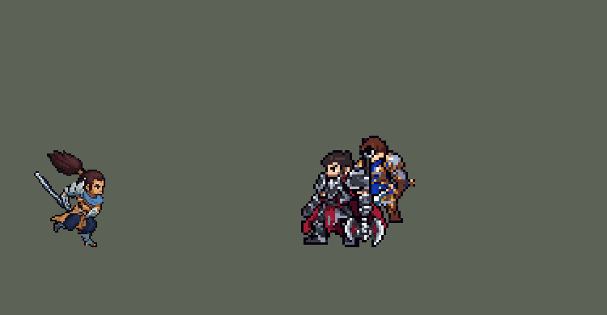

<!-- 本页上半部分由 tools/docs/gen_hero_docs.py 按仓库里现在的数据生成，手改会被覆盖；「开发记录」以下是手写的，生成时原样保留。 -->

# 亚索 Yasuo


| 项目 | 内容 |
|---|---|
| id | `league_yasuo` |
| 所属的包 | 主包（mod_id `league`） |
| 分路 | 中单 |
| 分类 / 标签 | 近战（Melee） · AD / Melee / CC / Shield |
| 高清帧 | PPU 2.2 |
| 附加包 | [亚索风之障壁附加包](#附加包)（`league_yasuo_wall`） |



其他预览：[combos](../preview/league_yasuo_combos.gif)、[逐帧预览](../preview/league_yasuo_frames.png)、[特效表](../preview/league_yasuo_effects.png)

## 现在的技能

下面是游戏里显示的技能说明（`league/text/champion.i18n` 的简体中文，去掉了颜色和图标），冷却、距离来自 `league/champion/league_yasuo.data_champion`；1 秒 = 60 tick。

### 普攻 / 被动（被动「浪客之道」）

*攻击间隔 0.92 秒 · 攻击距离 25000*

普攻造成100% 攻击力的物理伤害。被动 浪客之道：20%暴击几率，暴击造成双倍伤害。剑意每15秒充满一次，充满后下一次出手获得40 + 40% 攻击力的护盾，持续2秒。

### 技能1 · 斩钢闪

*冷却 4 秒 · 施放距离 45000 · 施放：方向 · 敌人（不含防御塔）*

向前突刺，对直线上的敌人造成30 + 100% 攻击力的物理伤害，视为普攻，可以暴击。命中后获得一层旋风烈斩，满2层时下一次改为放出旋风，击飞直线上的敌人1秒。在踏前斩突进中施放时改为环状出剑。

### 技能2 · 踏前斩

*冷却 5 秒 · 施放距离 40000 · 施放：指定目标 · 敌人（不含防御塔）*

冲刺穿过一名敌人，造成40 + 60% 攻击力的物理伤害。6秒内再次施放，伤害提高25%，最多提高50%。连招 Q3 E Q：旋风击飞英雄后2.5秒内施放，冲刺途中自动环状出剑。

### 大招 · 狂风绝息斩

*冷却 40 秒 · 施放距离 100000 · 施放：指定目标 · 被控制的敌方英雄*

闪到一名被控制（击飞、眩晕、禁锢等）的敌方英雄身边，对附近所有被控制的敌方英雄造成150 + 150% 攻击力的物理伤害并再击飞1秒。之后10秒内无视目标30%护甲，剑意立即充满。连招 R Q：斩击后接一记较轻的环状出剑（15 + 50% 攻击力）。

### 数值

攻击力 110（每级 +24）、生命 900（每级 +90）、护甲 25（每级 +8）、魔抗 15（每级 +4）、移速 1100（每级 +12）、暴击 20（每级 +0）。

## 附加包

附加包是可选的原生代码 mod（都在附加包合集 `league_addons` 里），**不装主包里的英雄也是完整的**。

### 亚索风之障壁附加包

[亚索风之障壁附加包](../../addons/league_yasuo_wall/README.md)：`league_yasuo_wall` v0.1.0

主包没有 W：游戏里没有能挡掉飞行物的效果，只画一面墙显得奇怪，当时用户决定删掉。亚索也没有空的技能格，所以风墙全由原生代码做（被动 `league_yasuo_wall:wall`，不占技能格、没有施法动作）。

## 相关脚本和素材

- [`tools/kit/yasuo_combos.py`](../../tools/kit/yasuo_combos.py)
- [`tools/lol/extract_yasuo.py`](../../tools/lol/extract_yasuo.py)
- [`tools/art/preview_yasuo.py`](../../tools/art/preview_yasuo.py)
- [`tools/art/import_yasuo.py`](../../tools/art/import_yasuo.py)
- [`assets/source/yasuo/`](../../assets/source/yasuo)

## 开发记录

> 下面是原来 README 里「英雄：亚索」一节，原样搬过来（只改了相对链接）。

| 部分 | 内容 |
|---|---|
| 定位 | 中单（Melee / Fighter），第二组第三个 |
| 普攻 | 挥刀劈砍，100% 攻击力。被动「浪客之道」：20% 暴击几率（英雄联盟里暴击几率翻倍，这里直接给 20%）。「剑意」每 15 秒充满一次，充满后下一次出手（普攻、Q 或 E）获得 40 + 40% 攻击力的护盾（2 秒；0.15.0 之前是 12 秒、60 + 60%，见下面的修正）。英雄联盟的 W「风之障壁」没有做：游戏里没有能挡掉飞行物的效果，只画一面墙在这个游戏里显得奇怪，用户决定删掉 |
| 技能1 | Q「斩钢闪」：向前突刺（45000 × 12000 的长条），30 + 100% 攻击力，按普攻算、可以暴击；命中后叠一层，满 2 层时放出旋风（飞 80000），击飞直线上的敌人 1 秒。E 冲刺中施放改为环形斩（半径 25000），满层时是环形击飞。冷却 4 秒 |
| 技能2 | E「踏前斩」：冲刺穿过一名敌人（施放距离 40000），停在它身后 15000，40 + 60% 攻击力；6 秒内再冲一次伤害 +25%，最多 +50%。冷却 5 秒 |
| 大招 | R「狂风绝息斩」：闪到施放距离 100000 内一名被控制（击飞、眩晕、禁锢、拉拽等）的敌方英雄身边，附近被控制的敌方英雄再被击飞 1 秒，受到 150 + 150% 攻击力的物理伤害；之后 10 秒无视 30% 护甲，剑意立即充满。冷却 40 秒。要有控制才能放：对战模拟里 10 分钟平均放 0.5 次（队友是原版英雄）到 2.9 次（队友是德莱厄斯、阿木木、艾希、拉克丝），以后加入带击飞的英雄时再调 |
| 附加包 | 可选的附加包 [`addons/league_yasuo_wall`](../../addons/league_yasuo_wall/README.md)（在附加包合集里，原生代码，主包不装它也完整）：补上 W「风之障壁」——敌方英雄的飞行物朝亚索或身边队友飞来（2 个以上，或 1 个冲着残血的人）时，在身前竖起一面弧形风墙 4 秒（20 秒一次），穿过墙的飞行物打到友方英雄的伤害补回、新控制清掉（引擎删不掉飞行物，飞行物的图还会飞过去）；画面照英雄联盟：墙脚一条弧线跟着方向，风往上升 |
| 连招 | 用户要求（0.42.9）：「亚索也加点连招」「永恩也是」「小鱼人也顺便加一点连招」。和李青、阿卡丽一样，每个连招由用掉的那个技能自己打出来，不锁技能栏：**R Q**——狂风绝息斩斩击落地后（第 29 tick）接一记较轻的环状出剑（25000 内 15 + 50% 攻击力，是 Q 的一半，也不叠层）；**Q3 E Q**——Q3 的旋风击飞敌方英雄后 2.5 秒内放 E，冲刺第 10 tick 自动环状出剑（就是冲刺中放 Q 的效果，不用 Q：Q3 刚用掉）。两记环状出剑都不耗 Q，所以比 Q 轻：按 Q 的全额 30 + 100% 还叠层时，亚索中路击杀差从 +2.30 涨到 +3.16（720 局），伤害多约 5%。原来就有的 EQ / EQ3 不变。模拟 12 局：R Q 33 次（每次大招都接上），Q3 E Q 4 次。强度（中路对 5 个原版法师，两批各 720 局）：旧版 +2.30 / +3.16，连招版 +2.65 / +2.89，强度不变。 |
| 修正（0.15.0） | 剑意的护盾写在 `WithSelf` 里（见迦娜一节后的说明）：普攻和 E 是对敌人施放的，护盾也给了被打的敌人；Q 是方向施法，护盾谁也没给。改成只给自己后亚索明显变强：SDK 对战模拟（打中路，对 5 个原版中单，两边、三套队友阵容各 24 局）团队击杀差 +2.06 → +3.16；护盾降到 40 + 40%、剑意改成 15 秒充满后是 +2.30（只降护盾到 40 + 40% 是 +2.67，30 + 30% 是 +2.84） |
| 精灵图 | 10 个动作 68 帧：待机、跑步、普攻、Q 突刺、Q3 放旋风、EQ 环形斩、E 冲刺、R、受击、死亡。身体按头顶到脚底 30 px 画、头保持原来的大小（马尾另外往上翘），20 色，动作全部取自英雄联盟原版动画 |
| 高清帧（PPU 3，2026-10-13 画风统一后 PPU 2.2（见开头）） | Codex 照高清造型（每个 1 倍像素 1.5 格）逐帧重画全部 62 帧（用户：「亚索的也可以帮我重做一下整体」，交付后「完成亚索」；第一轮生图中途断了，EQ 第 6 帧、R 前 3 帧和死亡在原包里补齐），`import_ppu_strips.py` 逐格读回、放大 2 倍（每格 2×2）。每个站着的帧贴上造型的脸和发顶，所有动作同一张脸；不贴马尾（Codex 每帧马尾形状不同，贴造型的会出现两条）。脸的位置在整帧里找（肤色权重 ×3，朝左的帧镜像着找）；鞋底移到待机的鞋底上（这批格子停在鞋底上方）；躺着的死亡第 6、7 帧保留 Codex 的头。待机就是造型 |
| 特效 | 普攻命中、Q 突刺的风、Q 命中、旋风烈斩就绪、Q3 旋风、击飞、EQ 环形斩、EQ3 环形击飞、E 命中、剑意护盾、R 连斩 |
| 图标 | 官方技能图标（Q / E / R），64×64 |
| 音频 | 从本地客户端提取的 13 条技能音效和 4 条中文语音（Q、Q3、E、R）。不提交到仓库，按下面的命令在本地生成 |

```bash
python tools/lol/extract_yasuo.py --lol "D:\WeGameApps\lol" --vgmstream "<vgmstream-cli.exe 路径>"
python tools/lol/native_pose.py assets/source/yasuo/poses.json --out <渲染文件夹> --alpha --parts
python tools/art/restyle_native.py assets/source/yasuo/poses.json --renders <渲染文件夹>   # 角色图
python tools/art/import_native.py --hero yasuo     # 套用 yasuo_retouch.json
python tools/art/import_ppu_strips.py --hero yasuo --delivery <Codex 交付的 yasuo-ppu-strips> --scale 2 --paste-head 27 --head-region "12-17:44-62+18-26:49-62" --head-match "11-26:45-62" --head-search 0 --sole-fix --no-head dead:5,6   # 高清帧
python tools/art/ppu_hd.py --hero yasuo
python tools/art/import_yasuo.py      # 特效；--raw <Codex 的交付文件夹> 先把原始图转成原尺寸条
python tools/kit/yasuo_combos.py   # 连招写进技能数据（只跑一次，--check 查）
python tools/fix/fix_yasuo_q3_stamps.py   # Q3 旋风沿路逐格盖章，任何方向都是正的（只跑一次，--check 查）
python tools/art/preview_yasuo.py
```

美术（提示词见 [`assets/source/yasuo/PROMPTS.md`](../../assets/source/yasuo/PROMPTS.md)）：
- 比例和镜头：用户在三种头身比例里选了 C（头 2.0、腿 0.8），马尾按一半缩放（`hair 0.5`），保持原版的长度感。亚索的待机是深蹲，只有站直时的 80%，头顶到脚底仍按 34 px 算。后来用户觉得亚索比别的英雄大一圈，在三个方案（整体 80%、身体 80% 头不变、整体 88%）里选了身体 80% 头不变：`height` 30，`chibi.head` 2.4、马尾 0.417，头的像素大小和原来一样。待机时刀收在鞘里，腰上往后伸的是刀鞘；普攻和技能时手里是拔出来的银色刀，刀鞘还挂在腰上。
- 造型图：Codex 的两版生图对不准网格（1254 px 画布，方块 9.6–10.8 px），眼睛也不合规格。Claude 在英雄联盟 34 格的剪影上逐格画：先按材质自动投色，再手画肩甲的层叠羽片、刀鞘的银边、胸口的皮肤和斜挎皮带、金绳腰带和刀穗。脸在三个方案里，用户先选了原版游戏画法加小嘴，后来改成英雄联盟里的冷脸：三格粗眉、一行眼睛（白眼挨着黑瞳）、一格暗褐小嘴。身体缩小后脸看着像马脸、右边像被削平、嘴歪、远处的眼睛和头发连成一条像独眼，按用户的意见改了几版：E2 用刘海盖住额头、两只眼都画眼白、一格暗红小嘴放在正中，用户觉得一点都不像武士，还是喜欢缩小前的五官。最后选 F2：五官照缩小前（露额头、斜粗眉、细眼只有近眼有眼白、远眼一道暗缝、一格暗褐小嘴、下颌阴影），下巴用收短、收圆、描边的形状，下巴下面露出的脖子改成蓝色领巾。
- 动作图：用英雄联盟动画重新上色（`restyle_native.py`），这次加了三样：
  - 蓝布、深蓝裤子、金绳、皮肤、棕色皮革、钢铁按色相、饱和度、亮度分类投色（`materials`），原来只认深红布、皮肤和钢铁。原版的暗部很暗：胸口皮肤亮度只有 0.27、阴影里的金绳 0.13–0.36，所以皮肤从 0.1 算起，金色按色相认、不看亮度。
  - 马尾单独成一个部位（`native_pose.py` 的 `hair_part`），每帧跟着原版动画甩。
  - 头：第一版每帧贴待机时的造型头，跑步低头、EQ 转身、R、死亡躺下时头和身体对不上，用户指出后改成头也按原版逐帧取色（跟着身体转、低头、躺下），脸抹成造型图的两色平涂，再把造型图整块脸（额头、粗眉、眼睛、嘴，6×6 格）贴到每帧看得见的脸上：远眼贴着脸的前缘，朝左时镜像，背对镜头时不贴（`native_pose.py` 的 `face_track` 记下每帧脸的位置和朝向）。只贴眉眼几格时，刘海压住眉毛、嘴落到脸颊边上，用户觉得眼睛和嘴都怪。`features` 另有三项：`neck`（离脸两格内、眼睛以下的身体皮肤改成领巾色），`trim_front`（眼睛上方和下面三行里伸出脸前沿的那一列剪掉、重新描边：原版刘海在待机时从额头右上角凸出一块，待机第 3 帧下巴也鼓出一格，用户说身体一晃脸就怪；头发本来就盖在脸前的帧不剪，免得剪出缺口），`hair_above`（刘海上方露出的一条额头皮肤改成最深的发色，和头顶原有的边一致，不再在呼吸时闪出一条浅色）。待机时英雄联盟原版第 4、5 帧上身前倾 1 格、第 6 帧再回来，而且每帧的头都是重新取色的，呼吸时脸跟着左右摆、还会变形，用户觉得怪：`import_native.py` 的 `ORDER` 让待机 6 帧都用第 1 帧，新加的 `BOB` 在第 3–5 帧把腰带以上的上半身整体下移 1 格，脸始终是同一张。
  - 自动贴不好的 18 帧逐格手修（47 格）：普攻第 2 帧低头、死亡 2–4 帧画向下的眼线，死亡 6–7 帧躺平画闭眼，Q3 第 6–7 帧侧脸在前缘补暗褐色的嘴（第 7 帧脸转得太偏、整块贴不上，还补了眉和眼），待机 6 帧的金发箍统一成 2 格；大招收招和 E 冲刺收招的蹲姿（R 第 7–8 帧、E 第 7 帧）把下巴收进领巾：身体缩小后头伸出身体外，下半张脸像要从头上脱出来（用户说像“脱壳”）；跑步第 1 帧下巴线下面剩的一格皮肤改成领巾（看起来像张开的嘴）。记在 [`native/yasuo_retouch.json`](../../assets/source/native/yasuo_retouch.json)，导入时套用。
  - 跑步（0.10.0）：原版跑步时低着头，脸转成侧脸（朝向 0.25–0.36，嘴要 0.45 以上才画），脸块的下半截每帧贴得不一样，有几帧下巴线压在皮肤上像张开的嘴，用户说跑步时一会有嘴一会没嘴。改成跑步时头保持待机的朝向（`head_like`，蕾欧娜的跑步也是这样），8 帧都是和待机一样的脸，嘴一直在。身体和马尾还是原版的跑步动作，其他动作不变。
  - 死亡动画里拔出来的刀没有动画轨道，会竖在身边，死亡动作不画这把刀（`hide`）；腰绳的两根绳尾缩到 0.6 倍，跑动时不再甩出一大片金色。
- 特效用 Codex 画的 11 张：`import_yasuo.py --raw` 把原始图（半透明、格子比例不对）转成原尺寸条，再按技能范围定大小：Q 突刺 45 px 长，旋风 24 px 宽，EQ 的圈 50 px 宽（半径 25000，画一半大再放大 2 倍）。
- Q3 旋风在红色方倒过来（2026-10-05）：飞行物的画面会跟着飞行方向转，Codex 画的竖漏斗往左飞（红色方大多朝左放）就倒过来，往上下飞就横躺。先试过重画成俯视的旋涡，用户还是要原来的漏斗（「亚索的旋风特效还是用这个 右边的话你想办法处理一下」）。现在的做法：旋风本体照常飞、照常击飞，但不再挂画面；同一时刻沿同一条路线发出 16 个看不见的小投射物，分别停在旋风第 1、3、5……31 tick 所在的位置，每个停下时在落点播一帧漏斗（`ViewEffect`，游戏不会旋转它），一帧 34 ms，正好接上下一个。漏斗每 2 tick 前进 5 格，往哪个方向飞都是正的。数据由 `tools/fix/fix_yasuo_q3_stamps.py` 写入，`league_yasuo_big` 多了 `tornado_0`～`tornado_5` 六个单帧标签，和 `tornado` 共用同一块贴图。停点用 SDK 模拟核对过：16 个画面都落在旋风当时的位置，间隔 2 tick、每步 5000。
- 风墙：先后试过 Codex 画的风柱（被看成龙卷风）和照英雄联盟地面青线画的风幕，最后用户觉得风墙在这个游戏里不合适，整个技能删掉了。
- 出手时刻和动画对齐：普攻第 11 tick 命中，Q 第 8 tick 命中，Q3 旋风每 tick 飞 2.5 px，R 第 24 tick 落刀。
- 还原（0.27.1）：Codex 按定稿重画过一版动作条（第二步，换成用户选的眼睛，头像点挪到 (1, −39)），之后又试了重画头和马尾，用户觉得亚索的脸越做越离谱，要回到没做新美术的这一版：动作条、定稿、贴图、帧表、头像点和导入工具的表都回到 9248421 之前，重新导入的贴图和帧表与那时逐字节相同；展示动图重新渲染（对手是现在的德莱厄斯和盖伦），李青的展示里也有亚索，一起重渲染。
- 结果：20 色，和右边像素同色的比例 46%（原版英雄 18%–46%）。头像截取点 (4, −33)：`tfm2_ase.py face` 按最高点把马尾尖当成了头顶，它和 lint 会再按脸的肤色找一次头，(4, −33) 就在头顶上（缩小前是 (5, −34)）。

逐帧预览：[`docs/preview/league_yasuo_frames.png`](../preview/league_yasuo_frames.png?v=1014g)，特效：[`docs/preview/league_yasuo_effects.png`](../preview/league_yasuo_effects.png?v=1014g)。
