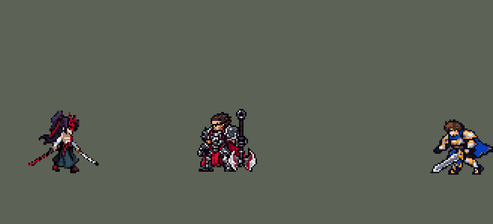

<!-- 本页上半部分由 tools/docs/gen_hero_docs.py 按仓库里现在的数据生成，手改会被覆盖；「开发记录」以下是手写的，生成时原样保留。 -->

# 永恩 Yone


| 项目 | 内容 |
|---|---|
| id | `league_yone` |
| 所属的包 | 主包（mod_id `league`） |
| 分路 | 中单 |
| 分类 / 标签 | 刺客（Assassin） · AD / Melee / CC / Shield |
| 高清帧 | 1 倍像素（无高清帧） |
| 附加包 | [永恩 R 附加包](#附加包)（`league_yone_r`） |



其他预览：[combos](../preview/league_yone_combos.gif)、[逐帧预览](../preview/league_yone_frames.png)、[特效表](../preview/league_yone_effects.png)

## 现在的技能

下面是游戏里显示的技能说明（`league/text/champion.i18n` 的简体中文，去掉了颜色和图标），冷却、距离来自 `league/champion/league_yone.data_champion`；1 秒 = 60 tick。

### 普攻 / 被动（被动「狩人之道」）

*攻击间隔 0.92 秒 · 攻击距离 25000*

普攻造成100% 攻击力的物理伤害。被动 狩人之道：20%暴击几率，暴击造成双倍伤害；每第二次普攻换用恶魔刀，造成50% 攻击力的物理伤害和40% 攻击力的真实伤害。

### 技能1 · 错玉切

*冷却 4 秒 · 施放距离 45000 · 施放：方向 · 敌人（不含防御塔）*

向前出剑，对直线上的敌人造成25 + 100% 攻击力的物理伤害，视为普攻，可以暴击。命中后获得一层风暴聚集，满2层时下一次改为向前冲刺，带着旋风击飞路径上的敌人1秒。

### 技能2 · 凛神斩

*冷却 7 秒 · 施放距离 40000 · 施放：指定目标 · 敌人（不含防御塔）*

向前顺劈，造成15 + 25% 攻击力的物理伤害和10 + 15% 攻击力的真实伤害（英雄另受5% 最大生命值），每命中一名英雄得35 + 35% 攻击力护盾。每15秒先施放破障之锋：灵体冲向英雄，4秒后归位，以真实伤害重现期间对英雄伤害的25%。

### 大招 · 封尘绝念斩

*冷却 50 秒 · 施放距离 80000 · 施放：指定目标 · 敌方英雄*

对一条直线上的所有敌人造成70 + 50% 攻击力的物理伤害和50 + 35% 攻击力的真实伤害并击飞0.75秒，永恩冲到目标身后。连招 Q3 R：Q3 击飞英雄后1.5秒内施放，不蓄力直接斩出；斩中英雄叠一层错玉切（R Q3）。

### 数值

攻击力 80（每级 +18）、生命 850（每级 +80）、护甲 25（每级 +8）、魔抗 15（每级 +4）、移速 1100（每级 +12）、暴击 20（每级 +0）。

## 附加包

附加包是可选的原生代码 mod（都在附加包合集 `league_addons` 里），**不装主包里的英雄也是完整的**。

### 永恩 R 附加包

[永恩 R 附加包](../../addons/league_yone_r/README.md)：`league_yone_r` v0.1.2

|  | 主包（纯数据） | 装了附加包 |
|---|---|---|
| 落在哪里 | 选中的目标身后 | 直线上离他最远的那个被斩中的英雄身后、他身体外面（两人里大的身体半径 + 1000；一个都没斩中就照主包，落在 90000 内最近的敌方英雄身后） |
| 拉人 | 没有 | 落地后把斩中的英雄拉向他（每 tick 2000，每个最多 16000，停在他身前 12000） |
| 伤害、击飞、画面、Q3 连 R | 主包 | 一样 |

## 相关脚本和素材

- [`tools/kit/yone_combos.py`](../../tools/kit/yone_combos.py)
- [`tools/lol/extract_yone.py`](../../tools/lol/extract_yone.py)
- [`tools/art/preview_yone.py`](../../tools/art/preview_yone.py)
- [`tools/art/import_yone.py`](../../tools/art/import_yone.py)
- [`assets/source/yone/`](../../assets/source/yone)

## 开发记录

> 下面是原来 README 里「英雄：永恩」一节，原样搬过来（只改了相对链接）。

| 部分 | 内容 |
|---|---|
| 定位 | 刺客（Assassin），第四组的中单，亚索的哥哥；本包第四个刺客（李青、易、艾克之后），和亚索一样吃攻击力、带暴击 |
| 普攻 | 挥刀，100% 攻击力的物理伤害，射程 25000，攻击间隔 0.92 秒 |
| 被动 | 「狩人之道」：暴击几率 20%。英雄联盟是暴击几率翻倍、暴击伤害降低；引擎的暴击固定 2 倍，几率也不能乘，和亚索一样直接给 20%。每第二次普攻换恶魔刀（单独的一段挥刀动作），造成 50% 攻击力的物理伤害和 40% 攻击力的真实伤害。英雄联盟里这一刀一半是魔法伤害；引擎的魔法伤害只按法术强度算，永恩没有法强，所以魔法那一半改成按攻击力算的真实伤害，比例打折（W、R 也这样处理） |
| 技能1 | Q「错玉切」：向前突刺，45000 × 12000 的直线，25 + 100% 攻击力的物理伤害，算普攻（能暴击）。命中后叠一层「风暴聚集」（一次施放只叠一层），10 秒内叠满 2 层时腰间起风，下一次 Q 改为向前冲刺 40000，带着旋风击飞路径上（半径 12000）的敌人 1 秒，伤害同上。射程 45000，冷却 4 秒，也对小兵和野怪放。英雄联盟里 Q 的冷却随攻速缩短，这里固定 |
| 技能2 | W「凛神斩」：向目标方向扇形顺劈（半径 45000、约 100°），15 + 25% 攻击力的物理伤害和 10 + 15% 攻击力的真实伤害，英雄另受 5% 最大生命值的伤害（3% 物理、2% 真实；只打英雄，免得几下打掉大龙）。每命中一名英雄获得 35 + 35% 攻击力的护盾 1.5 秒，命中几名就叠几层。冷却 7 秒，也对小兵和野怪放。合并 E「破障之锋」（单独冷却 15 秒）：50000 内有敌方英雄时，这次 W 先灵魂出窍：身体留在原地（英雄联盟的「身体停留」动作），灵体冲到一名敌方英雄身边再斩，4 秒内移速 +25%，4 秒后被拉回身体。灵体期间对英雄的每一击都在对方身上留下印记，拉回时印记引爆，以真实伤害重现那一击数值的 25%：引擎读不到造成了多少伤害，所以按每一击自己的数值算。拉回用艾克 R 的锚点（射程 1 的直线投射物记住位置，239 tick 后 `Teleport`）；他死了就不拉回也不引爆。目标跑进战争迷雾（永恩这边看不见）时，引爆的伤害不生效（模拟里测到的引擎行为） |
| 大招 | R「封尘绝念斩」：只对英雄放，射程 80000，冷却 50 秒。蓄力 15 tick 后沿直线斩出（90000 × 20000，从永恩穿过目标延伸到后面），线上所有敌人受到 70 + 50% 攻击力的物理伤害和 50 + 35% 攻击力的真实伤害并被击飞 0.75 秒，永恩冲到目标身后（`RushMoveToBack`）。英雄联盟里他停在最后一个被命中的英雄身后，还会把人往中间拉；这里停在选中的目标身后，不拉人 |
| 附加包 | 可选的附加包 [`addons/league_yone_r`](../../addons/league_yone_r/README.md)（在附加包合集里，原生代码，主包不装它也完整）：R 照英雄联盟冲到直线上最后一个被斩中的英雄身后，再把斩中的英雄拉向他（每个最多拉 16000；主包冲到选中的目标身后，不拉人） |
| 连招 | 用户要求（0.42.9）：「亚索也加点连招」「永恩也是」「小鱼人也顺便加一点连招」。和李青、阿卡丽一样，每个连招由用掉的那个技能自己打出来，不锁技能栏：**Q3 R**——Q3 击飞敌方英雄后 1.5 秒内放 R，不再蓄力 15 tick：摆 Q3 的冲刺姿势，第 8 tick 就斩出（同样的直线、伤害、击飞和冲到目标身后），趁他们还在空中；**R Q3**——R 斩中敌方英雄时给风暴聚集叠一层（一次施放一层），R 之后的 Q 更常是 Q3，腰间起风就是这一层。永恩的 Q 和 W 是本包最大的两棵技能树（游戏每 tick 整棵复制），所以连招只加在 R 上，Q 只多一个看不见的Q3 孪生投射物。模拟 6 局：快速 R 3 次（共 31 次 R；R 冷却 50 秒，Q3 命中英雄时 R 好着的只有约三分之一），R 后有风 15 次（改前 2 次）。强度（中路对 5 个原版法师，720 局）：旧版 +2.20，连招版 +2.20，强度不变。 |
| 数值 | 攻击 80（+18）、生命 850（+80）、护甲 25（+8）、魔抗 15（+4）、移速 1100（+12），暴击 20%。数值是自己设计的，用 SDK 对战模拟调：打中路，对 5 个原版中单（`pyromancer`、`ice_mage`、`lightning_mage`、`wind_mage`、`white_mage`），两边、三套队友阵容各 24 局，一批 720 局。团队击杀差：初版（攻击 110，各技能高一档）+6.65～+6.89，太强；拆开测试（每个候选只削一块）：属性 −4.0、真实伤害 −2.1、R −1.6、W −1.0，灵魂出窍几乎不影响（+0.1）；第二轮降攻击和真伤比例后 +3.7～+4.4；第三轮按美术定下的出手帧重跑（普攻第 10 tick、Q 第 9 tick、Q3 第 9 tick 起冲、W 第 9 tick、R 第 16 tick），攻击 80–95、R 和 W 再削，候选在 +1.6～+3.0（两批种子）。最后把恶魔刀从 50% 物理 + 25% 真实改成 50% + 40%（原来第二刀加起来比第一刀还低），W 的护盾只按命中的英雄给（文字才写得进游戏的长度上限），攻击 80，两批种子 +2.20 / +2.34，就用这一版（同一套数值在接上特效之前，第一批是 +1.98：印记 buff、扇形提前出现这些只影响画面的改动也会改变模拟里事件的先后，差别在一批的噪声以内）。原版最强的 `lightning_mage` 同样两批 +1.19 / +1.62；本包中单：安妮 +1.65 / +1.36、拉克丝约 +2.2、亚索 +2.30 |
| 亚索联动 | Q3 和 R 的击飞算亚索大招要的控制。亚索打上路、永恩打中路时，亚索每局放 R 2.15 次；同一批 48 局里中路换成原版 `lightning_mage` 是 3.19 次，`pyromancer` 0.65 次（之前测过安妮 2.19、拉克丝 1.04）。永恩和安妮差不多，亚索不用调 |
| 精灵图 | 12 个动作 75 帧：待机、移动（英雄联盟的走路动作）、普攻（钢刀）、普攻（恶魔刀）、Q、Q3 冲刺、W、E 灵体冲刺、R、灵魂出窍时留在原地的身体、受击、死亡。连角 41 px（不算角约 37 px），30 色，动作全部取自英雄联盟原版动画 |
| 特效 | 钢刀和恶魔刀的命中、Q 风之矛突刺和命中、风暴聚集（腰间的风）、Q3 冲刺旋风、击飞旋风、W 扇形顺劈和交叉斩痕、护盾、灵魂出窍的灵火、灵体光环、灵魂印记（留在敌人身上直到引爆）、印记引爆、拉回身体、R 直线斩（先出预警红线，再炸开） |
| 图标 | 官方技能图标（Q / W / R），64×64 |
| 音频 | 从本地客户端提取的 17 条技能音效和 6 条中文语音（Q、Q3、W、E、E 返回、R）。不提交到仓库，按下面的命令在本地生成 |
| 修正（0.128.1） | 用户：「永恩的确不放大」（玩家：「永恩一直不开大招是什么原因 放的打野位」）。游戏 0.6.4 里他的 R 一次都没放过：临时的只读观察包记了 5 局，R 好了、80 码内有敌方英雄的时间每局约 3600 tick，游戏的 AI 一次都没选 R，同时问游戏「对最近的敌人放 R」17880 次里 17843 次合法——是 AI 不想放；经典模拟每局放 3.7（打野）到 5.4 次（中路）。在游戏里一块块试出来：R 换成直接打目标一下每局放 2–17 次；只留延迟的直线斩击 + 击飞 1 局 10 次；再加上开头的预警线和冲到身后 12 局 0 次；**完整的 R 只去掉预警线 4 局 24 次**；预警线改成打友方 3 局 0 次；在 R 外面套奥莉安娜 Q / E 那样的打分分支 4 局 0 次。元凶是开头那条只画地上线的空效果直线（`league_yone_r_line`，等 34 tick、apply 999）：大招里有它，0.6.4 的 AI 就不选这个大招。[`tools/fix/fix_yone_r_line.py`](../../tools/fix/fix_yone_r_line.py) 把它从 R 的两支（普通、Q3 之后）里去掉，画面定义一起删；斩击、击飞、冲刺、印记、灵体分身、Q3 连招都不变，地上不再先出现那条预警线 |

```bash
python tools/lol/extract_yone.py --lol "D:\WeGameApps\lol" --vgmstream "<vgmstream-cli.exe 路径>"
python tools/lol/native_pose.py assets/source/yone/poses.json --out <渲染文件夹> --alpha --parts
python tools/art/restyle_native.py assets/source/yone/poses.json --renders <渲染文件夹>   # 角色图
python tools/art/import_native.py --hero yone
python tools/art/import_yone.py      # 特效；--raw <Codex 的交付文件夹> 先把原始图转成原尺寸条
python tools/kit/yone_combos.py   # 连招写进技能数据（只跑一次，--check 查）
python tools/art/preview_yone.py
```

美术（提示词见 [`assets/source/yone/PROMPTS.md`](../../assets/source/yone/PROMPTS.md)）：
- 分工：角色图由 Claude 画，Codex 只画特效。
- 比例和镜头：镜头 yaw 35、pitch 25，镜像，头 2.0、腿 0.8、头发 0.5，高度 34。英雄联盟里永恩的皮肤带着基础造型看不到的子模型（亚扎卡纳、道具、刀光拖尾、刀鞘、内裙），两把刀用单独的贴图 `Swords_TX`。为此渲染工具加了两个可选项，不开时其他英雄的输出完全不变：`"hide_submeshes"` 写成名字列表时只隐藏这些子模型（`pose_ref.py --hide-submesh`），`"submesh_textures"` 给子模型指定贴图（`--submesh-texture Katana=Swords_TX`）。钢刀是武器（`^sword$`），红色的恶魔刀是单独的部件（`^ghostsword$`）。
- 头部：三个方案放大 12 倍给用户挑，选了 A（照英雄联盟原样）：红色 V 字面具盖住上半张脸，两根角一根往后斜、一根往上，面具下两只眼睛发紫光（近眼 2 格、远眼 1 格），黑色长发扎在后面、一绺垂在脸侧，下半张脸露出苍白的皮肤，不画嘴。连角 41 px，像素面积约 500，和原版剑士（472）、双刀（503）差不多，比亚索（602）小一圈。
- 动作图：头贴在每一帧英雄联盟头部关节的位置。Q 突刺、Q3 冲刺、W 和 R 蓄力蹲得很低，大头会把身体挡住，这几段往待机姿势混合 30%–40%；死亡第 2 帧头转了四分之一圈，保持竖直（`"turn": 180`）；W 的起跳抬高两成（`"rise"`）。移动用英雄联盟里永恩平时移动的动作：动画图里 `Run` 播的是 `run_base` = `Yone_Walk01`（走路；只有回城加速时换成 `run_homeguard`），8 帧 × 136 ms，一圈 1.09 秒（这段动作 1.267 秒，按每帧 1/35 秒播放，和英雄联盟的节奏一样）。最初用的是 `Yone_Run01` 快跑（动画图里的 `run_fast`，不是他平时的移动），8 帧 × 80 ms、一圈 0.64 秒；用户发现姿势和节奏都和英雄联盟不一样，改成了现在这样。待机 6 帧都用第 1 帧，第 3–5 帧整体下沉一格呼吸。第二刀用英雄联盟的 `Attack02`（恶魔刀），单独一个动作 `attack2`；灵魂出窍时留在原地的身体是 `Spell3_bodyLoop`（`e_body`，2 × 2000 ms）。待机里钢刀刀身在护手下面断了一行（两格白色被描边盖住），0.91.0 按用户截图（「永恩的模型 刀上缺失了像素 ？ 补一补」）补回白色、描边下移一格（`assets/source/native/yone_retouch.json`，`import_native.py` 读它）。
- 特效用 Codex 画的 16 张（生图原稿，近黑色不透明底，Q 突刺的 5 帧宽度不等）：`import_yone.py --raw` 按最亮通道去底（英雄联盟的深色墨迹 `#1E1648` 保留），每张 16 色、硬透明，按技能范围定大小：普攻命中 14 / 16 px、Q 风之矛 42 px（45000 长的判定，从他身前开始）、Q 命中 16 px、风暴聚集 36 px 宽（中间空出他的身体）、Q3 旋风 30 px（前沿在他身前 22 px，跟着他冲）、击飞旋风 28 px 高、W 扇形从尖端到弧 45 px（半径 45000）、交叉斩痕 16 px（R 线上每个敌人身上也用它）、护盾 46 px 高、出窍灵火 36 px 高、灵体光环 39 px 宽、印记 16 px、引爆 24 px、拉回的地环 30 px、R 斩 90 px 长。四个直线类画面（突刺、旋风、扇形、R 斩）上下镜像成严格对称，游戏朝左施放时整张转 180°；印记切成开头、循环、收尾三段，做成挂在敌人身上的 `ThreePhase` buff，持续到引爆那一刻。W 的扇形比出手早 5 tick 出现（出手时正好斩满），R 的预警线 250 ms 后炸开，正好是伤害那一刻。
- 结果：30 色，和右边像素同色的比例 29%（原版英雄 18%–46%）。头像截取点 (−1, −39)。

逐帧预览：[`docs/preview/league_yone_frames.png`](../preview/league_yone_frames.png?v=1014g)，特效：[`docs/preview/league_yone_effects.png`](../preview/league_yone_effects.png?v=1014g)。
