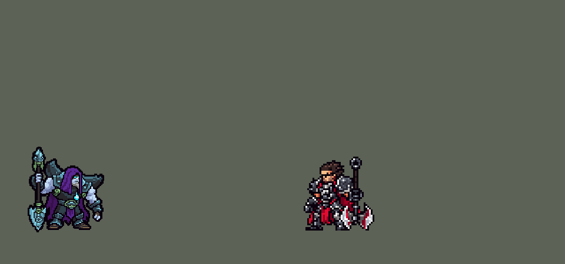

<!-- 本页上半部分由 tools/docs/gen_hero_docs.py 按仓库里现在的数据生成，手改会被覆盖；「开发记录」以下是手写的，生成时原样保留。 -->

# 约里克 Yorick


| 项目 | 内容 |
|---|---|
| id | `league_yorick` |
| 所属的包 | 主包（mod_id `league`） |
| 分路 | 上单 |
| 分类 / 标签 | 近战（Melee） · AD / Melee / Tank |
| 高清帧 | PPU 1.75 |
| 附加包 | [约里克附加包：坟照英雄联盟挖、雾行者和室女是真的单位](#附加包)（`league_yorick`） |



其他预览：[skills](../preview/league_yorick_skills.gif)、[逐帧预览](../preview/league_yorick_frames.png)、[特效表](../preview/league_yorick_effects.png)

## 现在的技能

下面是游戏里显示的技能说明（`league/text/champion.i18n` 的简体中文，去掉了颜色和图标），冷却、距离来自 `league/champion/league_yorick.data_champion`；1 秒 = 60 tick。

### 普攻 / 被动

*攻击间隔 1.33 秒 · 攻击距离 25000*

抡铲。牧魂人：临终仪式打英雄（打别的每两下）挖一座坟，满3座时下一铲唤醒3只雾行者咬目标6秒（每只每口9 + 13% 攻击力），同时暗灵缠身把附近的敌方英雄定身1秒。

### 技能1 · 临终仪式

*冷却 1 秒 · 施放距离 25000 · 施放：指定目标 · 敌人（不含防御塔）*

下一铲造成45 + 140% 攻击力物理伤害，回复30 + 20% 攻击力生命。

### 技能2 · 哀伤之雾

*冷却 1 秒 · 施放距离 55000 · 施放：指定目标 · 敌人（不含防御塔）*

扔出一团黑雾：范围内敌人受到65 + 65% 攻击力+最大生命4%，护甲-25%持续4秒，减速30%。

### 大招 · 海屿悼词

*冷却 80 秒 · 施放距离 40000 · 施放：指定目标 · 敌方英雄*

在敌方英雄身后召唤迷雾室女和2只雾行者，跟着它10秒，每秒抓20 + 45% 攻击力；期间约里克普攻英雄额外造成最大生命3%真实伤害。

### 数值

攻击力 91（每级 +14）、法强 10（每级 +5）、生命 1100（每级 +100）、护甲 35（每级 +8）、魔抗 26（每级 +4）、移速 1000（每级 +10）、生命回复 2（每级 +1）。

## 附加包

附加包是可选的原生代码 mod（都在附加包合集 `league_addons` 里），**不装主包里的英雄也是完整的**。

### 约里克附加包：坟照英雄联盟挖、雾行者和室女是真的单位

[约里克附加包：坟照英雄联盟挖、雾行者和室女是真的单位](../../addons/league_yorick/README.md)：`league_yorick` v0.2.0

| 机制 | 主包（纯数据） | 附加包 |
|---|---|---|
| 挖坟 | 临终仪式打英雄挖一座坟，打别的（小兵、野怪）**每两下**挖一座 | 打英雄照旧挖一座；打别的只有**这一铲打死了它**才挖一座（英雄联盟：击杀或英雄、大型野怪） |
| 室女的加伤 | 室女在场时，约里克普攻**任何**敌方英雄都额外造成最大生命 `r_pct`% 真实伤害 | 只有普攻**室女跟着的那个英雄**才加伤 |
| 唤醒的雾行者（v0.2.0，游戏里还没看过） | 画面和伤害挂在目标身上 6 秒：3 只每秒各咬一口（9 + 13% 攻击力），目标死了就散 | 3 个真的单位，从目标身边冒出来：自己追、自己咬（每口 9 + 13% 攻击力，每秒一口），生命是约里克的 15%、没有护甲魔抗，可以被打死，留 10 秒；黑雾打中英雄时，离他 118000 以内的雾行者跳到他身边（扑咬 20 + 30% 攻击力，打一次）。宿主给不出单位时和主包一样 |
| 迷雾室女（v0.2.0，游戏里还没看过） | 画面和伤害挂在目标身后 10 秒：每秒抓一下（20 + 45% 攻击力），带 2 只挂着的雾行者 | 一个真的单位，出现在目标身后，带 2 只雾行者单位：自己追、自己抓（每下 20 + 45% 攻击力，每秒一下），生命是约里克的 120%、护甲和魔抗是他护甲的 85%，可以被打死，留 15 秒；她站着的时候约里克的 Q 冷却减半、普攻她的目标加伤，她被打死就没了。宿主给不出单位时和主包一样 |

装上附加包后游戏里显示的说明（和主包不同的部分）：

- **普攻 / 被动**：【附加包】抡铲。牧魂人：临终仪式打英雄或打死单位挖一座坟，满3座时下一铲在目标身边唤醒3只雾行者，自己追咬敌人10秒（每口9 + 13% 攻击力，可被击杀），同时暗灵缠身把附近的敌方英雄定身1秒。
- **大招 · 海屿悼词**：【附加包】在敌方英雄身后召唤迷雾室女和2只雾行者，自己追击敌人15秒，她每秒抓20 + 45% 攻击力，可被击杀；她在场时约里克普攻她的目标额外造成最大生命3%真实伤害。

## 相关脚本和素材

- [`tools/kit/build_yorick.py`](../../tools/kit/build_yorick.py)
- [`tools/kit/setup_yorick.py`](../../tools/kit/setup_yorick.py)
- [`tools/lol/extract_yorick.py`](../../tools/lol/extract_yorick.py)
- [`tools/art/preview_yorick.py`](../../tools/art/preview_yorick.py)
- [`tools/art/rig_yorick.py`](../../tools/art/rig_yorick.py)
- [`assets/source/yorick/`](../../assets/source/yorick)

## 开发记录

> 下面是原来 README 里「英雄：约里克」一节，原样搬过来（只改了相对链接）。

| 部分 | 内容 |
|---|---|
| 定位 | 上单（Melee，标签 AD / Melee / Tank），第 167 位英雄（J 组第二位）。牧魂人 约里克：暗影岛的掘墓人，深紫色大兜帽里一张灰蓝色的脸、两只青色发光的眼睛、灰白山羊胡，肩后一块棺材板一样的大钢肩甲，胸前一个青色灯瓶，破烂的深紫斗篷，拿一把和他一样高的长柄铲子；召唤雾行者（小个子食尸鬼，整个头是一张大嘴）和迷雾室女（发着青光的女幽灵） |
| 普攻 / 被动 | 抡铲（射程 25000，每 80 tick 一下，91 攻击 +14/级）。**牧魂人**（并入**暗灵缠身**）：临终仪式打英雄挖一座坟，打别的每两下挖一座（坟各留 30 秒）；坟满 3 座时下一铲是**唤醒**：3 只雾行者扑在目标身上咬 6 秒（每只每口 9 + 13% 攻击，每秒一口），同时目标脚下冒出一圈灵魂墙，把 18000 内的敌方英雄定身 1 秒。雾行者和室女是跟着目标的特效（数据里召唤物不能自己走），目标死了就散 |
| 技能1 | **临终仪式**（冷却 4.75 秒，近战）：重重一铲 45 + 140% 攻击 物理伤害，回复 30 + 20% 攻击 的生命；挖坟和唤醒见上 |
| 技能2 | **哀伤之雾**（冷却 9 秒，射程 55000）：扔出一团黑雾，落点 15000 内的敌人受到 65 + 65% 攻击 + 最大生命 4%，护甲 −25% 4 秒，减速 30% 1.5 秒 |
| 大招 | **海屿悼词**（冷却 80 秒，射程 40000，对敌方英雄）：迷雾室女在他身后升起，带 2 只雾行者，跟着他 10 秒，每秒抓 20 + 45% 攻击；她在场时约里克普攻英雄额外造成最大生命 3% 的真实伤害 |
| 连招 | 「有连招要做连招」：**黑雾 → 雾行者扑上去 + 临终仪式马上好**：黑雾打中英雄，已经在场的雾行者扑上去咬一口（20 + 30% 攻击），Q 冷却清零并立刻打过去；**灵魂墙 → 黑雾**：唤醒的灵魂墙困住英雄时，哀伤之雾冷却清零并立刻扔向被困的英雄；**海屿悼词 → 临终仪式刷新**：室女升起时 Q 冷却清零并立刻打，室女在场时 Q 冷却减半；**坟满 → 唤醒雾行者** |
| 数值 | 攻击 91（+14）、生命 1100（+100）、护甲 35（+8）、魔抗 26（+4）、移速 1000（+10）、射程 25000 |
| 平衡 | 经典引擎模拟（上路，对斗士、处刑人、骑士、狂战士、枪骑兵、长柄战士，两边三套阵容；纳尔同一批对局 +0.01 / +0.59）：草稿（生命 1080、攻击 90、Q 40 + 140%、雾行者 8 + 12%、E 60 + 60%、R 40%）+0.05 / −0.98；生命 1140、攻击 94、护甲 36、Q 55 每 4.5 秒、雾行者 10 + 14%、E 70 + 70%、R 50% +1.70（16 组种子，太强）；定稿（上面的数值）+0.44（16 组种子；克烈 +0.29） |
| 附加包 | `league_yorick`（在 `league_addons` 合集里，[`addons/league_yorick/README.md`](../../addons/league_yorick/README.md)）：用户「和英雄联盟不一样的地方都是做附加包」——**坟照英雄联盟挖**（打英雄、或者这一铲打死了小兵 / 野怪才挖，不再每两下）；**室女的加伤只打她的目标**（主包里她在场时打谁都加伤） |
| 精灵图（高清帧 PPU 1.75） | Codex 第 0 步画了 A（约里克待机，两稿）和 B（迷雾室女 + 雾行者，两稿）（[`tools/art/pack_yorick_picture.py`](../../tools/art/pack_yorick_picture.py)，斗篷是布料模拟、渲染时藏掉、按文字画），[`tools/art/design_yorick_hd.py`](../../tools/art/design_yorick_hd.py) 按原图自己的格子读回；用户定 A-2、铲尖到靴底 48 游戏像素、PPU 1.75，A-2 原样就是 83 行，不用第 1 步重画（[`tools/art/design_yorick_model.py`](../../tools/art/design_yorick_model.py) 只把远处那只眼睛补成 2×1）；召唤物定 B-2。动作是 Codex 照骨架画的 17 个姿势（[`tools/art/pack_yorick_poses.py`](../../tools/art/pack_yorick_poses.py)，铲子 83 格长、平着抡的地方斜过来放进画布），[`tools/art/design_yorick_poses.py`](../../tools/art/design_yorick_poses.py) 读回、贴回定稿的头，[`tools/art/rig_yorick.py`](../../tools/art/rig_yorick.py) 照英雄联盟的片段拼成待机、跑、普攻、Q、唤醒（坟满的 Q 单独一个动作）、E、R、受击、死亡（倒下后灵魂飘起，铲子掉在地上） |
| 特效 | 18 张特效（[`tools/art/pack_yorick_fx.py`](../../tools/art/pack_yorick_fx.py) 的提示词，参考是英雄联盟里约里克和召唤物自己的贴图，[`tools/lol/fx_ref_yorick.py`](../../tools/lol/fx_ref_yorick.py)），Codex 画回来，[`tools/art/import_yorick_fx.py`](../../tools/art/import_yorick_fx.py) 切成 `league_yorick_fx` / `league_yorick_big`：铲子砸中、重铲、挖出墓碑、雾行者爬出来 / 围着咬 / 咬中 / 扑上去、灵魂墙和抓脚的鬼手、黑雾飞出去 / 落地 / 打中、头上的破甲印记、脚下的黑雾减速、迷雾室女升起 / 跟着抓 / 抓中、约里克打她目标的加伤；「雾行者咬中」「黑雾弹道」两张按提示词在格子上重画（[`tools/art/fix_yorick_fx.py`](../../tools/art/fix_yorick_fx.py)），室女浮高 12 游戏像素、青色的头露在目标上方 |
| 音效 | 英雄联盟的音效和配音（[`tools/lol/extract_yorick.py`](../../tools/lol/extract_yorick.py)，20 段）：普攻的出手和打中，临终仪式的出手、打中和挖坟，唤醒，雾行者召唤、咬、扑，灵魂墙升起和困住，黑雾的扔出、落地和标记，大招的出手、室女升起和抓中；配音：Q、E、R |
| 图标 | 官方技能图标（临终仪式、哀伤之雾、海屿悼词，另有暗灵缠身、牧魂人、唤醒），从本地客户端取 |
| 选人卡片 | 铲尖到靴底 48 游戏像素：界面缩到 0.81（`league.dll` 的 UI_SIZES），脸 (3, −31)、`banpick_center` −1（按 `tools/art/bp_card_audit.py` 的规则）。待机按 `tools/art/hero_reels.py` 剪进举手召唤和立铲各一帧 |
| 俄洛伊的灵魂 | `tools/art/illaoi_souls.py` 加上约里克（167 个），`league_illaoi` 0.2.3 |
| 动作补帧（2026-11-14） | 用户：「还有有的动画感觉只有一帧 不如oppi的地方都要补 参考联盟的动画」。对照表里他普攻、临终仪式、唤醒各只有 3 帧，哀伤之雾和海屿悼词各 2 帧，阵亡 4 帧里只有 2 个不同的姿势。没有新画，也没交给 Codex：[`tools/art/inbetween.py`](../../tools/art/inbetween.py) 用他已有的关键姿势做中间帧。他两只手横握铲子，所以转的是铲子露在近手外面的那一头（绕那只拳头转一个角度——放大 8 倍、转过去、再缩回原来的格子，只用这一块自己的颜色，弯折藏在拳头里）；铲子竖着穿过拳头的姿势里，铲头那一头顺着杆往拳头里收几格（整格移动）；前臂绕肘转；阵亡时脱手的铲子绕铲头倒下去。头和这几块以外的身体逐格不变（[`tools/art/rig_yorick.py`](../../tools/art/rig_yorick.py) 每一帧都核对）。下面写的是「几帧，其中几个不同的姿势」：同一张图整个挪几格不算新姿势。**普攻** 3 帧 → 7 帧，其中 6 个不同的姿势：铲头再往后引 10 度、举在身后、开始往前抡（14 度）；砸下（200 毫秒，往前 3 格）、铲头从地上弹起 9 度、落定（和「砸下」是同一张）；回待机。**临终仪式** 3 帧 → 6 帧，其中 5 个不同的姿势：铲子斜着举起来（借海屿悼词举铲的姿势）、横举过头；砸下（220 毫秒，往前 3 格）、弹起 9 度、落定；回待机。**唤醒（`awaken`）** 3 帧 → 6 帧，其中 6 个不同的姿势：铲子还差 8 格没举到头、举直；往下插——铲头离地 8 格（200 毫秒）、插进地里；前臂还差 28 度没举起（350 毫秒）、举手召唤。**哀伤之雾** 2 帧 → 4 帧，其中 4 个不同的姿势：蓄力；手臂甩出去——还低 36 度（200 毫秒）、低 15 度、甩到位。**海屿悼词** 2 帧 → 5 帧，其中 5 个不同的姿势：铲头还低 14 度、举向天；往下插——铲头离地 9 格（267 毫秒）、3 格、插好。**阵亡** 4 帧（2 个不同的姿势）→ 7 帧，其中 5 个不同的姿势：受击、脱手的铲子分三帧倒下去（18、36、54 度，身体还是那一张）；身体从倒地的铲子上方浮起来——低 8 格（400 毫秒）、低 3 格、浮定（这三帧是同一个身体往上升）。每个动作总时长不变，括号里的起点都是原来的毫秒数，没有短于 50 毫秒的帧，技能数据没改；跑步、待机、受击逐帧没变（腿在袍子底下，没动）。转过的铲头纹路比原图糊一点，每帧只放 60 – 134 毫秒；每帧 3 倍看过，转过的 4 – 5 倍看过。待机里剪的召唤、插铲各换成两帧（`hero_reels.json`）。图集 2029×703 → 2047×1204，选人格子用的那张 1.2 → 2.6 MiB。游戏里还没看过 |
| 雾行者和迷雾少女做成真的单位（附加包 0.2.0，2026-11-14） | 用户：「召唤物的全做啊 剩下的一批英雄也做了啊 都做完了装进去了再测」。英雄联盟（wiki 现行页面）：雾行者是自己走、自己打的小鬼（生命 100–331、攻击 15–113、没有护甲魔抗，最多 4 只，打死为止），黑雾标记的英雄附近的雾行者会扑过去；迷雾少女是能被打死的女幽灵（生命 1050–3700，每秒一击，带 2–4 只雾行者），约里克普攻她的目标加伤。这里原来两者都是挂在目标身上的画面和伤害（数据里召唤物不会走）。现在（只在附加包里，主包的数据没动；主包多两张单位图 `league_yorick_walker` / `league_yorick_maiden`，[`tools/art/unit_yorick_summons.py`](../../tools/art/unit_yorick_summons.py) 用特效图 `k_swarm` / `k_spawn` / `r_maiden` / `r_spawn` 里它们自己的 1 倍帧拼的：idle / run / attack / hit / dead，和今天画面上一样大）：唤醒时在目标身边生成 3 个雾行者单位（每口 9 + 13% 攻击力、每秒一口，生命是他的 15%，留 10 秒）；黑雾打中英雄时 118000 内的雾行者跳到他身边，扑咬 20 + 30% 攻击力打一次；大招在目标身后生成室女单位（每下 20 + 45% 攻击力、每秒一下，生命是他的 120%，留 15 秒）和 2 只雾行者，她站着时 Q 冷却减半和普攻加伤跟着她，她被打死就没了。宿主给不出单位（没有这个接口、失败、读不成单位、一出来就没了、测试开关 `unit=off`）时照原来挂在目标身上。伤害的账：雾行者一直够得着时 10 秒 30 口（原来 18 口），按 60% 的时间够得着约 18 口；室女 15 下（原来 10 下），按三分之二约 10 下——两个比例是猜的。经典引擎不跑原生代码，副本在经典引擎上走的是原来那一支；单位、扑咬、室女的时间都要一局游戏看日志（`WALKER` / `MAIDEN` 开头的行）。还没做：英雄联盟里雾行者从坟里爬出来（这里坟只是计数）、最多 4 只（这里账上最多 8 只，不提前结束）、室女的远程攻击（单位的攻击没有飞行物，按他的射程近身抓）、约里克死了单位跟着消失（没有让单位消失的接口，到时间为止） |

重新生成（素材来自本机的英雄联盟客户端，音频不进仓库）：

```bash
python tools/lol/extract_yorick.py --lol "D:\WeGameApps\lol" --vgmstream <vgmstream-cli.exe>
python tools/kit/build_yorick.py                # 技能数据，数字都在脚本的参数表 P 里
python tools/kit/setup_yorick.py                # 五种语言的文字、音效配置、共享文件里他的键（脸 3,-31，卡片 -1）
python tools/art/design_yorick_hd.py            # Codex 第 0 步的原图读回（A-1 / A-2 / B-1 / B-2）
python tools/art/design_yorick_model.py         # 定稿 A-2 原样（远处的眼睛补成 2×1）
python tools/art/design_yorick_poses.py         # Codex 的姿势读回（贴回定稿的头）
python tools/art/fix_yorick_fx.py               # 重画的两张特效（雾行者咬中、黑雾弹道）
python tools/art/import_yorick_fx.py            # 特效 -> league_yorick_fx / league_yorick_big
python tools/art/rig_yorick.py                  # 1 倍帧和 1.75 的原帧
python tools/art/ppu_restyle.py --hero yorick   # 外描边、脸的位置
python tools/art/ppu_hd.py --hero yorick        # hd_ / lo_ 帧
python tools/art/hero_reels.py --hero yorick    # 待机和选人卡片的小动作
python tools/art/preview_yorick.py              # 预览、演示 GIF 和每个技能单独的 GIF
python tools/art/illaoi_souls.py                # 俄洛伊的灵魂（加了英雄或改了待机都要重跑），再跑 addons/league_illaoi/make_override.py
python addons/league_yorick/make_override.py    # 附加包的约里克副本（主包的约里克改了以后要重跑）
```
