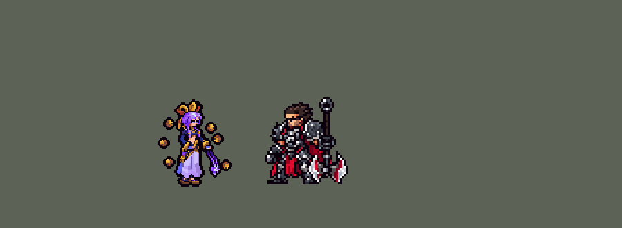

<!-- 本页上半部分由 tools/docs/gen_hero_docs.py 按仓库里现在的数据生成，手改会被覆盖；「开发记录」以下是手写的，生成时原样保留。 -->

# 芸阿娜 Yunara


| 项目 | 内容 |
|---|---|
| id | `league_yunara` |
| 所属的包 | 主包（mod_id `league`） |
| 分路 | ADC |
| 分类 / 标签 | 射手（Range） · AD / Range |
| 高清帧 | PPU 1.5 |
| 附加包 | [芸阿娜附加包](#附加包)（`league_yunara`） |



其他预览：[逐帧预览](../preview/league_yunara_frames.png)、[特效表](../preview/league_yunara_effects.png)

## 现在的技能

下面是游戏里显示的技能说明（`league/text/champion.i18n` 的简体中文，去掉了颜色和图标），冷却、距离来自 `league/champion/league_yunara.data_champion`；1 秒 = 60 tick。

### 普攻 / 被动

*攻击间隔 0.83 秒 · 攻击距离 57500*

念珠普攻附带18 + 20% 法强魔法伤害。初生之誓：这段伤害也会暴击（基础暴击10%）。灵蕴拳：普攻攒灵蕴，满了自动开启5秒：攻速+40%，多附带18 + 20% 法强魔法伤害，并溅射周围敌人30% 攻击力物理伤害。

### 技能1 · 善恶轮

*冷却 10 秒 · 施放距离 90000 · 施放：指定目标 · 敌人（不含防御塔）*

掷出旋转念珠，对路径上的敌人造成70 + 85% 攻击力物理伤害和衰减减速，终点再旋转1秒。超凡形态：改为射线，造成160 + 120% 攻击力物理伤害。

### 技能2 · 明踪步

*冷却 9 秒 · 施放距离 80000 · 施放：指定目标 · 敌方英雄*

附近有敌方英雄时，移速+40%（追击时+60%），持续1.5秒。超凡形态：敌方英雄贴近时改为向后冲刺。

### 大招 · 定圣诀

*冷却 70 秒 · 施放距离 70000 · 施放：指定目标 · 敌方英雄*

附近有2个以上敌方英雄或目标被控制时，进入超凡形态15秒：灵蕴拳持续开启，善恶轮变为射线，明踪步变为冲刺，两者冷却立刻减少80%。

### 数值

攻击力 103（每级 +19）、生命 1000（每级 +90）、护甲 22（每级 +7）、魔抗 15（每级 +3）、移速 900（每级 +9）、暴击 10（每级 +0）。

## 附加包

附加包是可选的原生代码 mod（都在附加包合集 `league_addons` 里），**不装主包里的英雄也是完整的**。

### 芸阿娜附加包

[芸阿娜附加包](../../addons/league_yunara/README.md)：`league_yunara` v0.1.1

|  | 主包（纯数据） | 装了附加包 |
|---|---|---|
| 夜影翻（超凡形态的 E） | 敌方英雄贴身（35000 内）就往后冲，不然只加速 | **按情况选方向**：最近的敌方英雄残血（35% 以下）又快出射程就往前冲把它拉进射程；它贴身、或她自己残血（40% 以下）就往后冲 |
| 明踪步 | 释放时攻击距离内没有敌方英雄算「追击」，给 +60% 移速，不然 +40% | **读她实际的移动**：+40%，她真的朝最近的敌方英雄跑时（方向偏差 45° 以内）再加 20%（英雄联盟的 1.5 倍） |
| 定圣诀 | 附近有 2 个以上敌方英雄、或目标被控制才开 | **另外按真实血量**：大招射程内有敌方英雄残血（40% 以下），或她自己残血（50% 以下）而攻击距离内有敌方英雄，也开 |
| 超凡形态的样子 | 脚下和身后的金光（view_buffs `r_on`） | 另外**站着、跑着都画成带金边和头后光环的她**（游戏 0.6.4） |

装上附加包后游戏里显示的说明（和主包不同的部分）：

- **技能2 · 明踪步**：【附加包】附近有敌方英雄时，移速+40%，朝敌方英雄跑时+60%，持续1.5秒。超凡形态：冲刺，被贴身或残血时往后，追残血时往前。
- **大招 · 定圣诀**：【附加包】附近有2个以上敌方英雄、目标被控制、有敌方英雄残血（40%以下）或她自己残血（50%以下）被近身时，进入超凡形态15秒：灵蕴拳持续开启，善恶轮变为射线，明踪步变为冲刺，两者冷却立刻减少80%；站着跑着都是金光中的她。

## 相关脚本和素材

- [`tools/kit/build_yunara.py`](../../tools/kit/build_yunara.py)
- [`tools/kit/setup_yunara.py`](../../tools/kit/setup_yunara.py)
- [`tools/lol/extract_yunara.py`](../../tools/lol/extract_yunara.py)
- [`tools/art/preview_yunara.py`](../../tools/art/preview_yunara.py)
- [`tools/art/rig_yunara.py`](../../tools/art/rig_yunara.py)
- [`tools/art/design_yunara.py`](../../tools/art/design_yunara.py)
- [`assets/source/yunara/`](../../assets/source/yunara)

## 开发记录

> 下面是原来 README 里「英雄：芸阿娜」一节，原样搬过来（只改了相对链接）。

| 部分 | 内容 |
|---|---|
| 定位 | ADC（Range，标签 AD / Range），第 119 位英雄。不破之誓 芸阿娜：英雄联盟 2025 年的艾欧尼亚射手，掷出漂在身边的铜念珠作战，开大进入超凡形态。用户的选择：「方案可以，全按推荐做（下路 ADC，基础暴击 10%，做附加包，R 形态换待机/跑步，PPU 1.5）」。TFM2 只有三个技能格：Q 灵蕴拳并进普攻（攒满自动开启），技能 1 = W 善恶轮 / 寂灭掌，技能 2 = E 明踪步 / 夜影翻，大招 = R 定圣诀。技能名照英雄联盟 16.20 的官方中文（客户端把名字和称号对调：芸阿娜 / 不破之誓） |
| 普攻 / 被动 | 掷出铜念珠，攻击间隔 50 tick，射程 57500：100% 攻击力物理伤害，外加 18 + 20% 法强魔法伤害。**初生之誓**（英雄联盟：暴击附带魔法伤害）：数据看不到这一下有没有暴击，所以魔法那一段自己掷暴击（暴击率相同，期望伤害相同）；基础暴击 10%。**灵蕴拳**：普攻打中英雄攒一下灵蕴，打小兵、野怪半下（6 秒不再攒就散），攒满 3 下自动开启 5 秒：攻速 +40%，念珠多 18 + 20% 法强魔法伤害，并**溅射**：命中后在目标脚下扩散一圈 30000 半径的波纹，周围的敌人受 30% 攻击力物理伤害（目标本身的念珠物理少 30%，总伤害不变） |
| 技能1 | **W 善恶轮**（对 90000 内的敌人放，小兵、野怪也打）：出手前 8 tick 记下目标站的位置（走开就躲得掉），250 ms 掷出旋转念珠，穿过路上每个敌人 70 + 85% 攻击力物理伤害和 1.5 秒内衰减的减速（45%、30%、20% 三层叠出来），飞到 110000 处原地旋转 1 秒（每 15 tick 14 + 12% 攻击力）。冷却 10 秒。**超凡形态时是寂灭掌**：施法起就亮出整条瞄准线，第 34 tick 射线命中整条线上的敌人 160 + 120% 攻击力物理伤害、1 秒内衰减的减速，射线再亮 14 tick |
| 技能2 | **E 明踪步**（80000 内有敌方英雄时放）：1.5 秒移速 +40%，攻击距离内没有敌方英雄（在追人）时 +60%。冷却 9 秒。**超凡形态时是夜影翻**：敌方英雄贴身（35000 内）就后空翻往后冲（每 tick 2600，14 tick），不然按追击加速 |
| 大招 | **R 定圣诀**，只在团战开（用户的规则：看好时机）：75000 内有 2 个以上敌方英雄，或 70000 内有被控制的敌方英雄；不满足就退回冷却（3 tick 的空动作）。进入超凡形态 15 秒：灵蕴拳全程开启，W 变寂灭掌，E 变夜影翻，开的时候 W、E 剩下的冷却最多留 20%（英雄联盟的 W 冷却减 80%）。冷却 70 秒。修正（0.170.1，用户让查她的附加包日志）：超凡形态给 W、E 的冷却封顶 20%（3 tick 的 `skill_cooldown_mult` 400），引擎给大招封顶时把它也算进去，大招自己的 70 秒冷却被压到 14 秒，形态一结束又能开（看的那一局 46 秒里开了 3 次）；同一个 buff 再加 `ult_cooldown_mult` −400 抵掉。经典模拟：两次开大的间隔不再有 15 秒左右的，W、E 照样提前好，平衡 +1.52 → +1.44（误差内），数值不变 |
| 超凡形态的样子 | 主包：脚下金色光环、身后金光上升（view_buffs `r_on`）。待机、跑步的动画不能在运行中换，所以整身换成带金边和光环的造型只有附加包做 |
| 附加包 | 可选的附加包 [`addons/league_yunara`](../../addons/league_yunara/README.md)（在附加包合集里，原生代码，主包不装它也完整）：**夜影翻按情况选方向**（最近的敌方英雄残血又快出射程就往前冲把它拉进射程，它贴身或她自己残血就往后冲；日志记实际冲了多远）；**明踪步朝英雄跑时更快**（读她实际的移动方向，朝最近的敌方英雄跑时再加 20%）；**定圣诀按真实血量开**（大招射程内有敌方英雄残血 40% 以下，或她自己残血 50% 以下而攻击距离内有敌方英雄）；**超凡形态整身换形态**（站着、跑着、普攻、挨打都是带金边和头后光环的她，`r_idle` / `r_run` / `r_attack` / `r_hit`（后两个 0.1.1）；游戏 0.6.4）。日志 `league_yunara.log`（DASH、DASH DONE、TOWARD、RISE、FORM） |
| 数值 | 攻击 103（+19）、生命 1000（+90）、护甲 22（+7）、魔抗 15（+3）、移速 900（+9）、暴击 10%、射程 57500 |
| 平衡 | 下路对四个基础射手（gunner / soldier / archer / gambler），三套阵容、两边各打，10 分钟经典引擎模拟：照英雄联盟比例的草案（攻击 106、灵蕴拳攻速 45%、W 90、射线 200、生命 1000）+2.47，偏强；攻击 100、攻速 40%、W 70、射线 160、生命 950：+1.73 / +1.48（种子 1–12 / 13–24）；按动作条的时间（W 从受保护的延时里出手、R 3 tick 门槛）再跑 +1.32；攻击 103、生命 1000 定稿：+1.52 / +1.35，24 个种子 +1.44（厄斐琉斯 +1.45）。她没有击飞和硬控，亚索的 R 不用重算 |
| 精灵图（高清帧 PPU 1.5） | Codex 第 0 步画了待机（A）、掌击（B）和念珠表（W）三张原画（[`tools/art/pack_yunara_picture.py`](../../tools/art/pack_yunara_picture.py)，念珠和龙头珠在英雄联盟里是单独的子网格，用它们自己的贴图渲参考），[`tools/art/review_yunara_size.py`](../../tools/art/review_yunara_size.py) 按它自己的格子读回、和射手们按游戏大小并排，用户：「选 A，40 行，第 1 步按游戏格子重画，头放大到约四分之一，念珠画小一点」。第 1 步 Codex 在游戏格子上重画（[`tools/art/pack_yunara_model.py`](../../tools/art/pack_yunara_model.py)），取第 2 稿：[`tools/art/design_yunara.py`](../../tools/art/design_yunara.py) 先把六颗念珠从身体上拿掉（两颗贴着发饰的穗子和裤子的描边，按圆切开），身体删整行整列到 60 行（闭着的眼睛、眉线、嘴所在的行列保留），念珠照原稿的铜色手画成 7 × 7 的八角形（6 × 6 在游戏大小下像方块），摆回原来的位置。动作不找 Codex（用户：「动作帧你参考塔姆怎么做的吧 做到完美后喊我review」）：[`tools/art/rig_yunara.py`](../../tools/art/rig_yunara.py) 在这个密度上无损摆——龙头珠是自由漂浮的刚体，远侧前臂（护腕和手套）绕手肘转直角（推掌）或上下翻（举起），两条宽裤腿按折缝分开、两段式整行斜移（凉鞋整块平移），身体压过腿下蹲；念珠不进收边（收边会把念珠和身体之间的缝填上颜色），最后盖上、碰到身体会在 2 格内挪开；跑步照英雄联盟 run_base 一秒一圈，念珠拖在头后，龙头珠随步子摆；后空翻是整个人按直角转（游戏会挪她，图不另外移）；死亡跪下、向前扑倒，龙头珠侧躺在地上。附加包的 `r_idle` / `r_run` 是同一套帧加一圈浅金边和头后的光环。用户：「动作美术通过」。头像点 (1, −39)（发饰顶），待机最高处 −31，卡片 −8。2026-10-19 补帧：超凡形态只有站和走带金边，普攻、挨打时金边光环会闪掉——新增 `r_attack` / `r_hit`；只在超凡形态播的射线 `skill_r`、后空翻 `skill2_r` 也补上金边（翻转的几帧只留金边，光环会停在原地浮着）；E 2→4 帧，普攻、R 6 帧，死亡 8 帧。之后用户：「芸安娜的眼睛有点怪 美化一下帮我」——删格子时 Codex 那道斜着的闭眼线只剩下两个斜挨着的格子（一个黑点带一条尾巴），于是眼睛按格子重画（[`tools/art/design_yunara.py`](../../tools/art/design_yunara.py) 的 `EYES`），照原画的意思：半闭的眼睛，深色的上眼皮、外眼角的睫毛下垂，下面露出淡紫偏蓝的眼珠（只用在眼睛上），远侧的眼睛同样画在脸颊边上；压在眼皮上的棕色眉毛去掉（看着像皱眉），嘴唇改成淡粉色。所有帧用的都是这张脸 |
| 特效 | 第 3 步 22 张特效（[`tools/art/pack_yunara_fx.py`](../../tools/art/pack_yunara_fx.py)，颜色：普攻、灵蕴拳、善恶轮、明踪步是紫蓝色的灵气，超凡形态、寂灭掌是金白色，念珠是她自己的铜色），Codex 画并读回成游戏大小（`assets/source/yunara/codex_fx`）。[`tools/art/import_yunara_fx.py`](../../tools/art/import_yunara_fx.py)：念珠和射线朝方向转（上下对称），其余全部左右对称（游戏不镜像特效图；偶数宽的格子去掉正中重复的一列，轴正好在站立点上）；射线是 LineRangeProjectile 自己的画面，只播一次：瞄准线到第 34 tick 命中，随后爆开。写成 `league_yunara_fx` 和 `league_yunara_big`。用户：「特效通过」 |
| 音效 | 英雄联盟的音效和配音（[`tools/lol/extract_yunara.py`](../../tools/lol/extract_yunara.py)）：念珠出手 / 打中、灵蕴拳开启和强化出手 / 打中、善恶轮出手 / 飞行 / 打中、寂灭掌蓄力 / 射线 / 打中、明踪步、夜影翻、定圣诀，配音是她的 Q / W / E / R 台词（中文） |
| 图标 | 官方技能图标（善恶轮、明踪步、定圣诀，另有灵蕴拳、寂灭掌、夜影翻和被动），从本地客户端取 |

重新生成（素材来自本机的英雄联盟客户端，音频不进仓库）：

```bash
python tools/lol/extract_yunara.py --lol "D:\WeGameApps\lol" --vgmstream <vgmstream-cli.exe>
python tools/kit/build_yunara.py                     # 技能数据，数字都在脚本的参数表 P 里
python tools/kit/setup_yunara.py                     # 五种语言的文字、音效配置、共享文件里她的键（头像点在 VIEW）
python tools/art/design_yunara_cut.py                # Codex 第 1 步两稿逐格读回
python tools/art/design_yunara.py                    # 定稿：身体 60 行 + 念珠
python tools/art/rig_yunara.py                       # 1 倍帧和 1.5 的原帧（无损摆姿，含附加包的 r_idle / r_run）
python tools/art/ppu_restyle.py --hero yunara        # 描边（不要加 --preview）
python tools/art/ppu_hd.py --hero yunara             # hd_ / lo_ 帧
python tools/art/import_yunara_fx.py                 # 特效
python tools/art/preview_yunara.py                   # 预览和演示 GIF
python addons/league_yunara/make_override.py         # 附加包的副本（主包的芸阿娜改了就重跑）
```

美术提示词见 [`assets/source/yunara/`](../../assets/source/yunara) 里的 `PICTURE_PROMPT.md`、`MODEL_PROMPTS.md`、`PROMPTS_FX.md`；Codex 的交付在 `codex_picture/`、`codex_model/`、`codex_fx/`。

逐帧预览：[`docs/preview/league_yunara_frames.png`](../preview/league_yunara_frames.png?v=1019a)，特效：[`docs/preview/league_yunara_effects.png`](../preview/league_yunara_effects.png?v=1017a)。
