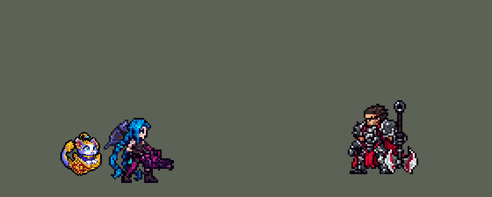

<!-- 本页上半部分由 tools/docs/gen_hero_docs.py 按仓库里现在的数据生成，手改会被覆盖；「开发记录」以下是手写的，生成时原样保留。 -->

# 悠米 Yuumi


| 项目 | 内容 |
|---|---|
| id | `league_yuumi` |
| 所属的包 | 主包（mod_id `league`） |
| 分路 | 辅助 |
| 分类 / 标签 | 功能型（Util） · AP / Magic / Range / Heal / Shield |
| 高清帧 | PPU 1.5（画成 75%） |
| 附加包 | [悠米附加包](#附加包)（`league_yuumi`） |



其他预览：[逐帧预览](../preview/league_yuumi_frames.png)、[特效表](../preview/league_yuumi_effects.png)

## 现在的技能

下面是游戏里显示的技能说明（`league/text/champion.i18n` 的简体中文，去掉了颜色和图标），冷却、距离来自 `league/champion/league_yuumi.data_champion`；1 秒 = 60 tick。

### 普攻 / 被动

*攻击间隔 1.5 秒 · 攻击距离 50000*

射出书页光弹。猫的博爱：每6秒普攻命中英雄时多造成50 + 25% 法强魔法伤害，回复自己60 + 20% 法强生命，下次附身时队友也回复同样多。

### 技能1 · 摸鱼飞弹

*冷却 7 秒 · 施放距离 80000 · 施放：指定目标 · 敌人（不含防御塔）*

发射飞弹，打中第一个敌人造成110 + 50% 法强魔法伤害并减速20%；飞了0.33秒以上改为170 + 70% 法强，减速50%。

### 技能2 · 悠米出动！

*冷却 6 秒 · 施放距离 75000 · 施放：指定目标 · 敌方英雄*

附身在交战中的队友身上4秒（不可选取、跟着他走，照样能放摸鱼飞弹和魔典终章），他每秒回复45 + 15% 法强生命。旺盛精力：给他130 + 60% 法强护盾，攻速+20%、移速+10%。

### 大招 · 魔典终章

*冷却 45 秒 · 施放距离 80000 · 施放：指定目标 · 敌方英雄*

翻开魔典连发5道波纹，每道造成110 + 35% 法强魔法伤害并减速，沿途友军回复60 + 10% 法强生命；第3道定身1.25秒。

### 数值

攻击力 82（每级 +5）、法强 35（每级 +18）、生命 1000（每级 +85）、护甲 18（每级 +6）、魔抗 22（每级 +4）、移速 980（每级 +10）。

## 附加包

附加包是可选的原生代码 mod（都在附加包合集 `league_addons` 里），**不装主包里的英雄也是完整的**。

### 悠米附加包

[悠米附加包](../../addons/league_yuumi/README.md)：`league_yuumi` v0.1.1

|  | 主包（纯数据） | 装了附加包 |
|---|---|---|
| 附身多久 | 4 秒，到时间跳下来 | **不限时**，队友死了才跳下来 |
| 附身时能不能出招 | 不能（放逐中） | **能**：Q、R、再给他一次旺盛精力，都从他头上放 |
| 附身时谁能打到她 | 谁都打不到（放逐） | 平时谁都打不到（一段一段地放逐）；出招的那一小段受到的伤害 -100%、免控 |
| 附身时队友回血 | 每秒 45 + 15% 法强，4 秒 | 每秒 45 + 15% 法强，一直回 |
| 猫的博爱 | 只有普攻 | 普攻或**摸鱼飞弹**命中英雄（附身时她不普攻） |

装上附加包后游戏里显示的说明（和主包不同的部分）：

- **普攻 / 被动**：【扩展包】射出书页光弹。猫的博爱：每6秒普攻或摸鱼飞弹命中英雄时多造成50 + 25% 法强魔法伤害，回复自己60 + 20% 法强生命，下次附身时队友也回复同样多。
- **技能2 · 悠米出动！**：【扩展包】悠米出动！：附身在交战中的队友身上，不限时（谁都选不中，出招时才现身），他每秒回复45 + 15% 法强生命，他死了才跳下来。旺盛精力：给他130 + 60% 法强护盾，攻速+20%、移速+10%；附身时再放只给他旺盛精力。

## 相关脚本和素材

- [`tools/kit/build_yuumi.py`](../../tools/kit/build_yuumi.py)
- [`tools/kit/setup_yuumi.py`](../../tools/kit/setup_yuumi.py)
- [`tools/lol/extract_yuumi.py`](../../tools/lol/extract_yuumi.py)
- [`tools/art/preview_yuumi.py`](../../tools/art/preview_yuumi.py)
- [`tools/art/rig_yuumi.py`](../../tools/art/rig_yuumi.py)
- [`assets/source/yuumi/`](../../assets/source/yuumi)

## 开发记录

> 下面是原来 README 里「英雄：悠米」一节，原样搬过来（只改了相对链接）。

| 部分 | 内容 |
|---|---|
| 定位 | 辅助（Util，标签 AP / Magic / Range / Heal / Shield），第 135 位英雄。魔法猫咪 悠米：淡紫蓝色的小猫，白脸大蓝眼睛、金色头饰上挂着蓝色小球，坐在一本会飞的深红金边魔法书（门扉之书）里（10-17 的分组计划 C 组的辅助）。用户的选择：「技能方案 A（Q / W+E / R）」、主包「放逐式短附身」、附加包「放逐跟随 + 出招时现身」、附身样子「趴在头上的小猫」。团战经理只有三个主动技能位：技能 1 = Q 摸鱼飞弹，技能 2 = W 悠米出动！（附身）+ E 旺盛精力（附身时给队友），大招 = R 魔典终章；被动猫的博爱在普攻里。技能名照英雄联盟 16.20 的官方中文 |
| 普攻 / 被动 | 射出一颗书页光弹（射程 50000，100% 攻击）。**猫的博爱**：每 6 秒普攻第一次命中英雄，多造成 50 + 25% 法强 魔法伤害、回复自己 60 + 20% 法强 生命，并把这份治疗留到下次附身时给队友 |
| 技能1 | **Q 摸鱼飞弹**（对小兵、野怪也放，射程 80000）：飞弹直线飞向目标，打中第一个敌人 110 + 50% 法强 魔法伤害、减速 20% 1 秒。英雄联盟里飞了 1.35 秒以上就强化；数据读不到飞了多久，按飞行时间算：飞了 20 tick（约 50000 远）以上改为 170 + 70% 法强、减速 50% 2 秒。冷却 7 秒 |
| 技能2 | **W 悠米出动！+ E 旺盛精力**，在交战中放（射程 75000 内有敌方英雄）：先找正在那个敌方英雄身边挨打的队友，再找身边 70000 内的队友，扑到他身上**附身 4 秒**：每 tick 传送到他身上跟着他走，一段一段地放逐自己（每段 20 tick，谁都选不中、看不见），他头上出现趴在书上的小猫（`league_yuumi_ride`，1.5 倍密度），每秒回复 45 + 15% 法强 生命；**附身时照样能放 Q 和 R**：两段放逐之间（Q 或 R 好了时空 5 tick，都在冷却时只空 1 tick）她从队友头上起手，放的那一小段不再被放逐（主包换不了她的动作帧，这一小段她画在队友脚下），R 的波纹在她又被放逐后照样一道道发出去；整个附身期间（两段之间的空当和出招时也算）她受到的伤害 -100%、免控；同时给他**旺盛精力**：130 + 60% 法强 护盾 3 秒、攻速 +20%、移速 +10%（第一次进游戏时是 +35% / +20%，用户：「附身后ADC非常的强 移速又快」）。4 秒后她跳下来落在他身边。身边没有队友就只给自己旺盛精力。冷却 6 秒（用户看演示时问「附体在别人身上不能放大招？」——第一版附身时一直放逐、不能出招，改成分段放逐后能放） |
| 大招 | **R 魔典终章**（射程 80000）：把书立起来，朝目标连发 5 道波纹（每 0.75 秒一道，宽 24000，穿过所有单位）：每道对敌人 110 + 35% 法强 魔法伤害、减速 20%，沿途友军回复 60 + 10% 法强 生命（她自己也回）。英雄联盟是同一个人被 3 道打中才定身；数据数不了每个人挨了几道，**第 3 道打中的都定身 1.25 秒**。放波纹的时候她可以走动。冷却 45 秒 |
| 附加包 | 可选的附加包 [`addons/league_yuumi`](../../addons/league_yuumi/README.md)（在附加包合集里，原生代码，主包不装它也完整），照英雄联盟：**附身不限时**，一段一段地放逐她、每 tick 把她摆到队友身上，队友死了才跳下来；**出招时现身**：Q / R 好了且身边有敌方英雄（或 W 好了再给一次旺盛精力），就解除放逐让她从队友头上出这一招（期间受到的伤害 -100%、免控），她自己的动作换成空白帧，头上的小猫一直在；附身时不普攻、不回城、不走开；摸鱼飞弹也能触发猫的博爱。日志 `league_yuumi.log`（ATTACH、DETACH、WINDOW、FORM） |
| 数值 | 攻击 82（+5）、法强 35（+18）、生命 1000（+85）、护甲 18（+6）、魔抗 22（+4）、移速 980（+10）、射程 50000 |
| 平衡 | 10 分钟经典引擎模拟，辅助位对五个原版辅助（priest / monk / bard / pythoness / spirit_caller），三套阵容、两边各打，每档 8 个种子：初稿（生命 880、Q 70 + 40%、W 回血 15 + 6%、E 70 + 40%、R 60 + 25%、每 10 秒附身 4 秒）-3.11（同批米利欧 -0.56）；W 回血 30 + 10%、E 100 + 50%、攻速 35% -2.73；再加 Q 90 / 140、R 80、波纹回血 40、生命 950 -1.96；W 每 7 秒 -1.16；W 回血 45 + 15%、E 130 + 60%、每 6 秒、生命 1000 -0.86；Q 110 + 50% / 170 + 70%、R 110 + 35% 回血 60、攻击 82、被动 50 / 回血 60 -0.36 / +0.27（种子 9–16；同批米利欧 -1.74）；按动作条的时间（普攻、Q 的出手帧，W 第 4 帧离开，R 第 3 帧书立起来）-0.28 / -0.10；附身时能放 Q / R（分段放逐）-0.85 / -0.73（同批米利欧 -0.56；两段之间的空当她能挨打，场均输出从 2600 掉到 2190）；整个附身期间免伤免控 -0.68 / +0.18（场均输出 3140，K/D/A 0.8 / 2.2 / 4.5）；第一次进游戏后旺盛精力改成攻速 +20%、移速 +10% -0.54 / -0.55 |
| 精灵图（高清帧 PPU 1.5，游戏里 75%） | Codex 第 0 步画了待机（A：坐在打开的书里）、附身（B：趴在摊平的书上）、合上的书（C）三张原画（[`tools/art/pack_yuumi_picture.py`](../../tools/art/pack_yuumi_picture.py)），[`tools/art/design_yuumi_hd.py`](../../tools/art/design_yuumi_hd.py) 按各自的格子读回，[`tools/art/review_yuumi_size.py`](../../tools/art/review_yuumi_size.py) 和辅助、小个子英雄按游戏大小并排，用户：「32 像素」「PPU 1.5」，附身的小猫「14」。第 1 步 Codex 在游戏格子上画了待机、侧面、扑出、大招扒书、附身、合书六种（[`tools/art/pack_yuumi_model.py`](../../tools/art/pack_yuumi_model.py)），[`tools/art/design_yuumi_model.py`](../../tools/art/design_yuumi_model.py) 按各自的格子读回、整行整列删到 48 行（脸的行列不删），用户选了 A-2、S-1、L-2、R-2、C-1。英雄联盟里她不用腿跑：跑是坐在书里飞，普攻和 Q 是从书里扑出去，R 是把书立起来扒在书边，死亡是钻进书里、书合上掉在地上——动作不找 Codex：[`tools/art/rig_yuumi.py`](../../tools/art/rig_yuumi.py) 用定稿造型整块摆（只整格平移），侧面、扑出、大招都换上待机的同一张脸（按下巴和脸的中线对齐，只清下巴以上的旧头，脖子和领口保留——第一版清到了下巴下面两行，扑出时头和身子之间留了一条缝，用户：「头和身体分离了？好好修吧」）；每个动作对照英雄联盟的动画（`tools/lol/anim_graph.py Yuumi`、`pose_ref.py`）。用户看完又说「还有模型太大」，选了 75%（24 像素）：`league.dll` 的大小表缩（`hd.rs` SIZES），帧往下移 6 格让书底还在地上，帧不重画。附身时附加包换上的空白 `a_*` 帧由 `rig_yuumi.py --ride-tags` 加进图表 |
| 特效 | 第 3 步 19 张特效（[`tools/art/pack_yuumi_fx.py`](../../tools/art/pack_yuumi_fx.py)，颜色照英雄联盟：她的光是金色的星光和粉紫色的魔法，治疗是粉色的小爱心，大招的波纹是粉紫色带金边）。弹道图（光弹、飞弹、波纹）朝右画、上下对称（游戏按飞行方向转），其余全部左右对称（游戏不镜像特效图）。[`tools/art/import_yuumi_fx.py`](../../tools/art/import_yuumi_fx.py) 写成 `league_yuumi_fx` 和 `league_yuumi_big` |
| 音效 | 英雄联盟的音效和配音（[`tools/lol/extract_yuumi.py`](../../tools/lol/extract_yuumi.py)，17 段）：普攻出手 / 打中，被动打中，Q 出手 / 打中 / 强化打中，W 起跳 / 附身 / 跳下，旺盛精力，R 出手 / 每道波纹 / 打中 / 治疗；Q、W、R 的配音（片段名 `league_yuumi_sfx_*`，和声音名不同） |
| 图标 | 官方技能图标（摸鱼飞弹、悠米出动！、魔典终章，另有被动），从本地客户端取 |

重新生成（素材来自本机的英雄联盟客户端，音频不进仓库）：

```bash
python tools/lol/extract_yuumi.py --lol "D:\WeGameApps\lol" --vgmstream <vgmstream-cli.exe>
python tools/kit/build_yuumi.py                     # 技能数据，数字都在脚本的参数表 P 里
python tools/kit/setup_yuumi.py --face 6,-14        # 五种语言的文字、音效配置、共享文件里她的键
python tools/art/design_yuumi_model.py              # Codex 第 1 步的造型读回（A-2 / S-1 / L-2 / R-2 / C-1）
python tools/art/rig_yuumi.py                       # 1 倍帧和 1.5 的原帧（整块摆）
python tools/art/ppu_restyle.py --hero yuumi        # 外描边、往下移 6 格（不要加 --preview）
python tools/art/ppu_hd.py --hero yuumi             # hd_ / lo_ 帧
python tools/art/rig_yuumi.py --ride-tags           # 附加包的空白 a_* 帧
python tools/art/import_yuumi_fx.py                 # 特效（和附身的小猫）
python tools/art/preview_yuumi.py                   # 预览和演示 GIF
python addons/league_yuumi/make_override.py         # 附加包的副本（主包的悠米改了就重跑）
```

逐帧预览：[`docs/preview/league_yuumi_frames.png`](../preview/league_yuumi_frames.png?v=1019a)，特效：[`docs/preview/league_yuumi_effects.png`](../preview/league_yuumi_effects.png?v=1019a)。
