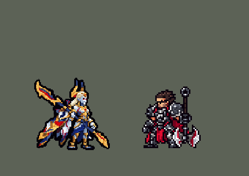

<!-- 本页上半部分由 tools/docs/gen_hero_docs.py 按仓库里现在的数据生成，手改会被覆盖；「开发记录」以下是手写的，生成时原样保留。 -->

# 亚恒 Zaahen


| 项目 | 内容 |
|---|---|
| id | `league_zaahen` |
| 所属的包 | 主包（mod_id `league`） |
| 分路 | 上单 |
| 分类 / 标签 | 近战（Melee） · AD / Melee |
| 高清帧 | PPU 1.75 |
| 附加包 | [亚恒附加包](#附加包)（`league_zaahen`） |



其他预览：[skills](../preview/league_zaahen_skills.gif)、[逐帧预览](../preview/league_zaahen_frames.png)、[特效表](../preview/league_zaahen_effects.png)

## 现在的技能

下面是游戏里显示的技能说明（`league/text/champion.i18n` 的简体中文，去掉了颜色和图标），冷却、距离来自 `league/champion/league_zaahen.data_champion`；1 秒 = 60 tick。

### 普攻 / 被动

*攻击间隔 1.2 秒 · 攻击距离 25000*

长刀横扫。不落之志：打中英雄叠果决，每层攻击力+2%，叠满12层攻击力+30%并得120 + 100% 攻击力护盾（每60秒一次）；5秒没打中英雄就清空。

### 技能1 · 暗裔长刀

*冷却 1 秒 · 施放距离 27000 · 施放：指定目标 · 敌人（不含防御塔）*

两连斩，每斩30 + 85% 攻击力物理伤害、打中英雄回复30 + 15% 攻击力（别的单位一半）。5.5秒内再按：上挑造成60 + 60% 攻击力并击飞0.75秒。

### 技能2 · 厄影回锋

*冷却 1 秒 · 施放距离 52000 · 施放：指定目标 · 敌人（不含防御塔）*

往前刺出长刀：沿途敌人受到90 + 80% 攻击力物理伤害、晕眩0.25秒并被拽回身边；接着赤金突袭绕身一斩，70 + 70% 攻击力。

### 大招 · 大赦

*冷却 80 秒 · 施放距离 40000 · 施放：指定目标 · 敌方英雄*

展翼升空（免控、受到伤害-50%），冲向敌方英雄插刀落地：周围敌人受到200 + 180% 攻击力物理伤害，每打中一个英雄回复60 + 40% 攻击力。被动：攻击无视20%护甲。

### 数值

攻击力 94（每级 +13）、法强 10（每级 +5）、生命 1080（每级 +110）、护甲 34（每级 +9）、魔抗 30（每级 +4）、移速 1000（每级 +11）、生命回复 2（每级 +1）。

## 附加包

附加包是可选的原生代码 mod（都在附加包合集 `league_addons` 里），**不装主包里的英雄也是完整的**。

### 亚恒附加包

[亚恒附加包](../../addons/league_zaahen/README.md)：`league_zaahen` v0.1.0

| 机制 | 主包（纯数据） | 附加包 |
|---|---|---|
| 不落之志（果决） | 一串标记一层一层叠：控制器每 3 拍看一次，同一拍里的几下只算一层；每层攻击力 +`det_ad`%，满 `det_n` 层换成 +`full_ad`% | **每一下打在敌方英雄身上的伤害**都算一层（普攻、Q 的每一斩、上挑、W、E、R），每层攻击力 +`det_pct`%，最多 `det_n` 层、叠满翻倍；最后一下之后 `det_t` 拍没打中英雄，每 30 拍掉一层 |
| 叠满后的复活 | 数据看不到致命伤害：叠满时给一个 `rv_sh` + `rv_sh_r`% 攻击力的护盾（每 `rv_cd` 拍一次） | **叠满时受到致命伤害就倒下**：生命停在 1，放逐 `rv_rise` 拍（无敌、选不中、不能行动），慢慢回到最大生命 `rv_hp`%，再展翼站起来、果决叠满；每 `rv_cd` 拍一次。别人给的「不死」在身上时不触发 |
| 赤金突袭（E） | 三个技能位放不下：并进 W，拽完人原地绕身一斩 | **有自己的技能位**：每 `e_cd` 拍一次，`e_reach` 内有敌方英雄、他能行动时，朝最近的那个冲过去（最多 `e_dash`，停在让对方正好落在外圈的地方），落地绕身斩：内圈 `e_r0`、外圈 `e_r`，`e_dmg` + `e_ratio`% 攻击力，外圈多 `e_out`% 并加最大生命 `e_pct`% 的魔法伤害；W 不再带绕身斩 |
| 暗裔长刀的回血 | 每斩回固定的 `q_heal` + `q_heal_r`% 攻击力 | 每斩回**最大生命 `q_hp`%**（打英雄；别的单位一半），英雄联盟的算法 |

装上附加包后游戏里显示的说明（和主包不同的部分）：

- **普攻 / 被动**：【附加包】长刀横扫。不落之志：每次伤害打中英雄叠1层果决（攻击力+1%，最多12层，叠满翻倍）；叠满时受到致命伤害就倒下：4秒无敌、选不中，回到最大生命50%再展翼站起，果决叠满（每60秒一次）。
- **技能1 · 暗裔长刀**：【附加包】两连斩，每斩30 + 85% 攻击力物理伤害、打中英雄回复最大生命6%（别的单位一半）。5.5秒内再按：上挑造成60 + 60% 攻击力并击飞0.75秒。
- **技能2 · 厄影回锋**：【附加包】刺出长刀：90 + 80% 攻击力物理伤害、晕眩0.25秒并拽回身边。赤金突袭（每9秒）：冲向英雄绕身斩70 + 70% 攻击力，外圈+50%并加最大生命5%魔法伤害。
- **大招 · 大赦**：【附加包】展翼升空（免控、受到伤害-50%），冲向敌方英雄插刀落地：周围敌人受到200 + 180% 攻击力物理伤害，每打中一个英雄回复60 + 40% 攻击力。被动：攻击无视20%护甲。

## 相关脚本和素材

- [`tools/kit/build_zaahen.py`](../../tools/kit/build_zaahen.py)
- [`tools/kit/setup_zaahen.py`](../../tools/kit/setup_zaahen.py)
- [`tools/lol/extract_zaahen.py`](../../tools/lol/extract_zaahen.py)
- [`tools/art/preview_zaahen.py`](../../tools/art/preview_zaahen.py)
- [`tools/art/rig_zaahen.py`](../../tools/art/rig_zaahen.py)
- [`assets/source/zaahen/`](../../assets/source/zaahen)

## 开发记录

| 部分 | 内容 |
|---|---|
| 定位 | 上单（Melee，标签 AD / Melee），第 174 位英雄（用户点名做的「下一个英雄 亚恒」，不在分组计划里）。不落魔锋 亚恒：暗裔战士，浅蓝灰皮肤、红眼睛、白金长发，金头冠上两只高高的金角，白金板甲、深宝蓝长腰布，背后收拢的暗裔翅膀，比人还长的金色暗裔长刀 |
| 普攻 / 被动 | 长刀横扫（射程 25000，每 72 tick 一下，94 攻击 +13/级）。**不落之志**：打中英雄叠一层果决（每层攻击力 +2%，记在他身上，5 秒没打中英雄就清空），叠满 12 层换成攻击力 +30%，并得 120 + 100% 攻击的护盾（每 60 秒一次：英雄联盟里叠满能复活，数据看不到致命伤害，复活在附加包里）。**R 的被动**：他的攻击无视 20% 护甲 |
| 技能1 | **暗裔长刀**（冷却 7 秒，射程 27000）：两连斩，每斩 30 + 85% 攻击物理伤害，打中英雄回复 30 + 15% 攻击（别的单位一半）；1.5 秒后的 4 秒内（共 5.5 秒）再按：下蹲上挑，60 + 60% 攻击并击飞 0.75 秒 |
| 技能2 | **厄影回锋**（冷却 13 秒，射程 52000）：长刀往前刺出一条线（56000 长），沿途敌人受到 90 + 80% 攻击物理伤害、晕眩 0.25 秒并被拽回身边；**赤金突袭**并进 W（三个技能位放不下第四个）：拽完人原地绕身一斩，20000 内 70 + 70% 攻击 |
| 大招 | **大赦**（冷却 80 秒，射程 40000，对敌方英雄）：展翼升空（1 秒内免控、受到伤害 −50%），冲向敌方英雄插刀落地：22000 内敌人受到 200 + 180% 攻击物理伤害，每打中一个英雄回复 60 + 40% 攻击 |
| 连招 | 「有连招要做连招」，四个都做了：**W 拽中英雄 → 暗裔长刀马上好**（控制器接着两连斩）；**Q 上挑挑飞英雄 → 大招冷却缩短**（冷却砍到一半，3 拍的 `ult_cooldown_mult`）；**大赦砸中英雄 → 果决一下涨 4 层**；**果决叠满 → Q 和 W 马上好** |
| 数值 | 攻击 94（+13）、生命 1080（+110）、护甲 34（+9）、魔抗 30（+4）、移速 1000（+11）、射程 25000 |
| 平衡 | 经典引擎模拟（上单，对斗士、处刑者、骑士、狂战士、枪兵、长柄战士，两边三套阵容；原版斗士同一批对局 +1.33，安蓓萨上线时 +0.59 / +0.42）：草稿（攻击 88、Q 20 + 70%、W 70 + 60%、E 50 + 50%、R 160 + 150%）−1.72；攻击 94、Q 30 + 85% +0.27；再加 W 90 + 80%、E 70 + 70%、R 200 + 180%（**定稿**）+0.76 / +0.47（种子 1–8 / 9–16，平均 +0.62）；定稿再加生命护甲和果决 +1.68；定稿往回收一档 +0.27。附加包的规则在这个引擎里跑不了（原生效果被去掉） |
| 附加包 | `league_zaahen`（在 `league_addons` 合集里，[`addons/league_zaahen/README.md`](../../addons/league_zaahen/README.md)）：用户「和英雄联盟不一样的地方都要做附加包」——**果决按每一下伤害叠**（12 层，叠满翻倍，5 秒后每半秒掉一层）；**叠满时受到致命伤害就复活**（放逐 4 秒、回到最大生命 50% 再展翼站起来，每 60 秒一次）；**赤金突袭有自己的技能位**（冲向英雄再绕身斩，外圈伤害更高、多打最大生命 5% 魔法伤害）；**暗裔长刀按最大生命回血**（6%） |
| 精灵图（高清帧 PPU 1.75） | Codex 第 0 步画了 A（待机）和 B（展翼举刀）（[`tools/art/pack_zaahen_picture.py`](../../tools/art/pack_zaahen_picture.py)），[`tools/art/design_zaahen_hd.py`](../../tools/art/design_zaahen_hd.py) 按原图自己的格子读回（初稿 A-1 116×116，选定稿 A-2 81×77，B-2 70×86）；用户定 **A-2、高 48、PPU 1.75**（[`tools/art/design_zaahen_model.py`](../../tools/art/design_zaahen_model.py)：缩到 88×84，脸上只读回一只红眼，补成两只眼和一条嘴线；B 同比例做成展翼的样子）。姿势包照英雄联盟原版的帧摆骨架（[`tools/art/pack_zaahen_poses.py`](../../tools/art/pack_zaahen_poses.py)：骨盆、腿、手臂都是定稿的长短，长刀 116 格当道具、握的位置自动调到不出画不入地，翅膀收拢 / 后掠 / 半开 / 全开），Codex 画 20 个姿势；[`tools/art/design_zaahen_poses.py`](../../tools/art/design_zaahen_poses.py) 按头找到每张的比例（7.25–10.75 px 一格）读回，身体按骨架量出来大了 3–25%，缩回定稿的大小，贴回定稿的头，清掉 Codex 自己留在旁边的头发和角；[`tools/art/rig_zaahen.py`](../../tools/art/rig_zaahen.py) 拼成待机、跑、普攻、两连斩（`skill`）、上挑（`skill_up`）、W（`skill2`；主包带绕身斩的 `skill2e`）、附加包的冲刺（`dash`）和绕身斩（`skill3`：转身的那一帧是整个人左右翻过来）、大招、受击、阵亡；附加包的复活是一张高清特效表 `league_zaahen_rise`（倒地 → 光柱 → 拄刀跪起 → 展翼站起，左右各一份） |
| 特效 | 16 张（[`tools/art/pack_zaahen_fx.py`](../../tools/art/pack_zaahen_fx.py) 的提示词，参考是英雄联盟里亚恒自己的贴图，[`tools/lol/fx_ref_zaahen.py`](../../tools/lol/fx_ref_zaahen.py)），用户用 Gemini 画的（「gemini做的 你得处理一下」）：[`tools/art/clean_zaahen_fx.py`](../../tools/art/clean_zaahen_fx.py) 按格切（有的画成 2×2、2×3、2×4 的格子）、从格子边缘往里洗掉黑底 / 白底 / 白色补丁、颜色收进暗裔金 / 暗裔红 / 翅膀深蓝 / 星光 / 尘土五套色板、左右（W 的弹道上下）对称；复活的光柱 Gemini 画在白底上分不出来，按提示词用代码画（金红符文圈、一道道光束、往上飘的花瓣）；[`tools/art/import_zaahen_fx.py`](../../tools/art/import_zaahen_fx.py) 切成 `league_zaahen_fx` / `league_zaahen_big`。大招本来还有一圈金色护体光环，人升空后它停在地面高度、套在腿上，去掉了 |
| 音效 | 英雄联盟的音效和配音（[`tools/lol/extract_zaahen.py`](../../tools/lol/extract_zaahen.py)，21 段）：普攻的出手和打中，Q 的出手、强化斩打中、再按、上挑打中，W 的出手和打中英雄，E 的出手和外圈打中，大招的出手、砸地、打中英雄，果决叠满，复活；配音：Q、W、E、R、果决叠满、复活 |
| 图标 | 官方技能图标（暗裔长刀、厄影回锋、大赦，另有赤金突袭、Q 再按、不落之志），从本地客户端取 |
| 选人卡片 | 角尖到脚底 48 游戏像素、带长刀和翅膀 50 宽，普攻和 Q 把长刀举得更高：UI_SIZES 0.78、`banpick_center` −11（和约里克一样，长刀的细尖在卡片顶上被裁掉，`tools/art/bp_card_audit.py`）。脸 (1, −41)：头冠顶上、两只角下面（`tfm2_ase.py face` 会把左上方的刀刃尖当成头顶）。待机按 `tools/art/hero_reels.py` 剪进一小段举刀（普攻的第一帧） |
| 俄洛伊的灵魂 | `tools/art/illaoi_souls.py` 加上亚恒（173 个），`league_illaoi` 0.2.12 |

重新生成（素材来自本机的英雄联盟客户端，音频不进仓库）：

```bash
python tools/lol/extract_zaahen.py --lol "D:\WeGameApps\lol" --vgmstream <vgmstream-cli.exe>
python tools/kit/build_zaahen.py                # 技能数据，数字都在脚本的参数表 P 里
python tools/kit/setup_zaahen.py --banpick -11  # 五种语言的文字、音效配置、共享文件里他的键（脸 1,-41）
python tools/art/design_zaahen_hd.py            # Codex 第 0 步的原图读回（A-1 / A-2 / B-2）
python tools/art/design_zaahen_model.py         # 定稿 A-2 缩到 84 行（补眼睛和嘴），B-2 同比例
python tools/art/design_zaahen_poses.py         # Codex 的姿势读回（按头的格子，身体缩回定稿大小，贴回定稿的头）
python tools/art/clean_zaahen_fx.py             # Gemini 的特效清理成游戏大小
python tools/art/import_zaahen_fx.py            # 特效 -> league_zaahen_fx / league_zaahen_big
python tools/art/rig_zaahen.py                  # 1 倍帧和 1.75 的原帧
python tools/art/rig_zaahen.py --rise           # 附加包复活的高清特效表 league_zaahen_rise
python tools/art/ppu_restyle.py --hero zaahen   # 外描边（补描边围出来的小洞）
python tools/art/ppu_hd.py --hero zaahen        # hd_ / lo_ 帧（要在 hero_reels 之前）
python tools/art/hero_reels.py --hero zaahen    # 待机和选人卡片的小动作
python tools/art/preview_zaahen.py              # 预览和每个技能单独的 GIF
python tools/art/review_zaahen_actions.py --out <文件夹> --sheet   # 和英雄联盟原版逐个动作对照的 GIF
python tools/art/illaoi_souls.py                # 俄洛伊的灵魂（加了英雄或改了待机都要重跑），再跑 addons/league_illaoi/make_override.py
python addons/league_zaahen/make_override.py    # 附加包的亚恒副本（主包的亚恒改了以后要重跑）
```
