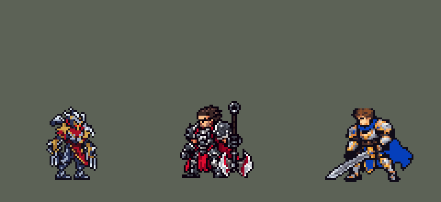

<!-- 本页上半部分由 tools/docs/gen_hero_docs.py 按仓库里现在的数据生成，手改会被覆盖；「开发记录」以下是手写的，生成时原样保留。 -->

# 劫 Zed


| 项目 | 内容 |
|---|---|
| id | `league_zed` |
| 所属的包 | 主包（mod_id `league`） |
| 分路 | 中单 |
| 分类 / 标签 | 刺客（Assassin） · AD / Melee |
| 高清帧 | PPU 1.62 |
| 附加包 | [劫读血附加包](#附加包)（`league_zed_mark`）、[游戏 AI 不按的技能替它按](#附加包)（`league_ult_press`） |



其他预览：[combos](../preview/league_zed_combos.gif)、[逐帧预览](../preview/league_zed_frames.png)、[特效表](../preview/league_zed_effects.png)

## 现在的技能

下面是游戏里显示的技能说明（`league/text/champion.i18n` 的简体中文，去掉了颜色和图标），冷却、距离来自 `league/champion/league_zed.data_champion`；1 秒 = 60 tick。

### 普攻 / 被动

*攻击间隔 0.92 秒 · 攻击距离 23000*

影忍法！灭魂劫：技能命中英雄后，下次攻击英雄附加其6%最大生命真实伤害（10秒）。影奥义！鬼斩（自动，4秒）：旋斩周围，造成65 + 75% 攻击力伤害，减速25%。

### 技能1 · 影奥义！分身

*冷却 12 秒 · 施放距离 55000 · 施放：指定目标 · 敌方英雄*

影子落到敌方英雄脚下（5秒），接着鬼斩和诸刃；影子在时模仿他的每次诸刃和鬼斩。影子旁只有一名敌人时，和影子互换位置追击。

### 技能2 · 影奥义！诸刃

*冷却 4 秒 · 施放距离 55000 · 施放：指定目标 · 敌人（不含防御塔）*

掷出手里剑，贯穿一条直线：首个敌人受到75 + 100% 攻击力伤害，之后的受到60%。

### 大招 · 禁奥义！瞬狱影杀阵

*冷却 50 秒 · 施放距离 60000 · 施放：指定目标 · 刚交过手的敌方英雄*

对交战中的英雄发动：无法选中，突进穿过并留下影子（模仿诸刃和鬼斩）与印记，3秒后爆发110 + 100% 攻击力，期间每次命中+35（最多3次）。击杀、被包围或被控时，和影子互换位置。

### 数值

攻击力 135（每级 +26）、生命 980（每级 +86）、护甲 26（每级 +8）、魔抗 18（每级 +4）、移速 1100（每级 +13）。

## 附加包

附加包是可选的原生代码 mod（都在附加包合集 `league_addons` 里），**不装主包里的英雄也是完整的**。

### 劫读血附加包

[劫读血附加包](../../addons/league_zed_mark/README.md)：`league_zed_mark` v0.1.3

主包 `league` 保持纯数据。数据读不到生命也读不到伤害，所以主包里劫的两处是替代做法：

- **被动「影忍法！灭魂劫」**：英雄联盟里是攻击生命低于 50% 的英雄时附加其最大生命的伤害；主包改成「技能刚打中过英雄」后的下一次普攻（`league_zed_cw_ready`），附加 6% 最大生命真实伤害，10 秒一次。
- **大招「禁奥义！瞬狱影杀阵」**：英雄联盟里印记爆发时附加印记期间造成伤害的一部分；主包改成按期间命中次数（最多 3 次）每次加固定伤害（`r_1`..`r_3`）。

### 游戏 AI 不按的技能替它按

[游戏 AI 不按的技能替它按](../../addons/league_ult_press/README.md)：`league_ult_press` v0.5.6（通用附加包，下面只列和劫有关的部分）

|  | 装了附加包，什么时候按 |
|---|---|
| 劫 W、格温 E、佛耶戈 E、卡特琳娜 W（冲上去的） | 他生命 **≥ 40%**；射程内（劫 55000、格温 45000、佛耶戈 46000、卡特琳娜 55000，引擎只接最近被我方打过的）的敌方英雄，**不在敌方塔下**（75000 内；生命 25% 以下的除外）、**目标身边 60000 内的敌方英雄不比他身边的我方英雄（含他）多**，挑**生命比例最低**的。劫还要 **Q 好着**（主包标记 `league_zed_q_cd` 不在，W-E-Q 一起出手，主包最初的设计）。AI 正往远处撤（走路目的地比现在离目标远 10000 以上）时不按 |

## 相关脚本和素材

- [`tools/kit/build_zed.py`](../../tools/kit/build_zed.py)
- [`tools/kit/setup_zed.py`](../../tools/kit/setup_zed.py)
- [`tools/lol/extract_zed.py`](../../tools/lol/extract_zed.py)
- [`tools/art/preview_zed.py`](../../tools/art/preview_zed.py)
- [`tools/art/rig_zed.py`](../../tools/art/rig_zed.py)
- [`tools/art/import_zed.py`](../../tools/art/import_zed.py)
- [`tools/art/design_zed.py`](../../tools/art/design_zed.py)
- [`assets/source/zed/`](../../assets/source/zed)

## 开发记录

> 下面是原来 README 里「英雄：劫」一节，原样搬过来（只改了相对链接）。

| 部分 | 内容 |
|---|---|
| 定位 | 中单（刺客，分类 Assassin），第 78 位英雄。影流之主 劫：把影子甩到敌人身边，和影子一起出招，再换位追杀。用户选中单、刺客、完整还原 + 高手连招；被动和大招的读血、读伤害：「这个改成用 rust 附加包」 |
| 普攻 / 被动 | 腕刃近战，射程 23000，攻击间隔 55 tick，第 9 tick 刺中。被动「影忍法！灭魂劫」：英雄联盟里攻击生命低于 50% 的英雄时附加其最大生命的伤害；数据读不到生命，主包改成**技能刚打中过英雄**（`cw_ready`，4 秒）后的下一次普攻打英雄时附加其 6% 最大生命真实伤害，10 秒一次（附加包读真实生命，见下）。打塔：原来普攻那一下由一颗只作用于非防御塔敌人的追踪投射物打出，对塔挥手一点伤害都没有（玩家：「劫的平A没办法攻击防御塔」）；2026-10-17 起命中也作用于防御塔。经典模拟里四位英雄原来对塔出手 66 次、打中 0 次，现在 69 次里打中 57 次（其余被打断或换成了技能） |
| 鬼斩（自动） | E「影奥义！鬼斩」没有技能位，冷却 240 tick（4 秒）：身边 24000 内有敌人（小兵、野怪也算）时普攻换成原地旋斩，第 8 tick 斩中周围敌人 50 + 75% 攻击力，英雄减速 25% 1.5 秒 |
| 技能1 | W「影奥义！分身」：冷却 720 tick（12 秒），射程 55000，只对敌方英雄放。第 3 tick 甩出影子（一个隐形的抛物线投射物落到英雄脚下，4 tick 落地），影子站 5 秒；**同一次施放接着三影齐发**：第 8 tick 鬼斩（若就绪），第 6 + 10 tick 诸刃（若就绪），影子各晚一 tick 模仿（它的鬼斩是落点的范围伤害，它的手里剑从影子飞回劫、穿过中间的目标）。**影子在场时劫之后放的每次诸刃和鬼斩，影子都跟着放**（最多晚 12 tick）。落地 90 tick 内、影子旁边只有一名敌方英雄而劫身边没有时，**和影子互换位置**追击（W 二段）：影子留在他原来站的地方，活完剩下的时间、照样模仿他的诸刃和鬼斩（英雄联盟的 W 二段就是互换位置；原来换过去影子就没了）。撤退优先：大招影子正要换回或刚换回（1.5 秒内）时不追 |
| 技能2 | Q「影奥义！诸刃」：冷却 240 tick（4 秒），射程 55000，也对小兵和野怪放。第 10 tick 朝 6 tick 前目标所在的位置掷出手里剑（凯特琳的锁定瞄准，躲得开），速度 10000、长 70000，贯穿：第一个单位 60 + 100% 攻击力，之后的 60% |
| 大招 | R「禁奥义！瞬狱影杀阵」：冷却 3000 tick（50 秒），只对正在交战的敌方英雄放（`EnemyChampionRecentlyAttacked`，60000 内）。24 tick 无法选中（100% 减伤 + 免控 + 隐身），第 6 tick 冲过目标（`RushMoveToBack`），挂上死亡印记，原地留下影子（6 秒，期间同样模仿他的每次诸刃和鬼斩，最多晚 6 tick）。3 秒后印记爆发 80 + 100% 攻击力，期间他每命中一次 +35（最多 3 次；数据读不到伤害，附加包按真实伤害，见下）。**R 二段（换回影子）**，用户：「大招的影子也能位移过去吗」「做第一和第二个」：影子在场时，下面任一情况劫就换回影子（影子每 6 tick 一个检查点，统一看 `r_back` 标记）：① **爆发打死了目标**（德莱厄斯大招重置的击杀判断：爆发前挂 `r_kill`，一 tick 后目标身上的延迟效果把它清掉，目标死了延迟效果不跑、标记留下，4 tick 后转成 `r_back`）；② 爆发时身边 40000 内有两名以上敌方英雄；③ **他被控**（每个检查点从他自己身上找「被控的友方英雄」，眩晕、定身、击飞、拉拽、恐惧、魅惑都算，厄运小姐大招被控就断的写法；紧贴他的友方英雄被控也会触发）；④ 装了附加包时生命低于 30%（见下）。换回时也是**互换位置**：大招影子留在劫原来的地方，模仿他的诸刃和鬼斩直到大招影子的时间结束。两个影子同时想换时撤退优先，同一时刻只换一次（用户：「这个改一改」）。模拟：被控换回 8 局 4 次，被控时也能换（换位后从影子旁起步）；爆发伤害调成必杀的测试版里 4 次击杀 4 次都在 6–8 tick 后换回 |
| 附加包（替 AI 按） | 可选的附加包 [`addons/league_ult_press`](../../addons/league_ult_press/README.md)（在附加包合集里，原生代码，主包不装它也完整）：游戏 0.6.4 的 AI 很少按他的 W（只读观察包：每 10 分钟 5.5 次，401 局，冷却 12 秒——W 一次放出 W-E-Q，Q、E 在冷却时这一支看起来没有伤害）。附加包按局面替 AI 按（用户：「有问题的英雄全部改成rust」）：Q 好着、他生命不低于 40% 时，55000 内不在敌方塔下（生命 25% 以下的除外）、身边的敌方英雄不比他身边的我方英雄多的敌方英雄里，挑生命比例最低的放 W；AI 正往远处撤时不按 |
| 高手连招 | 用户选了「完整还原 + 高手连招」。**三影齐发（W-E-Q）**：W 一次施放里放完影子、鬼斩、诸刃，影子同时模仿；**换位追击（W 二段）**；**R-W-E-Q**：印记期间 W 就绪时，Q 的技能位是空分支（AI 不放），AI 先开 W 连招；**R 二段撤退**（击杀、被包围、被控、残血）；W 影子和大招影子同时在场时，劫的每次诸刃、鬼斩两个影子都跟着放（三个身体） |
| 引擎限制 | 投射物都从施法者身上出发；从影子位置的区域里再发投射物或范围伤害不会生成（`work/zd/test_echo.py` 测过）。所以影子是一个落点：它要做的事都排在落点上的延迟效果里：W 连招里的鬼斩和诸刃精确地晚一 tick 模仿，之后的每次诸刃、鬼斩在下一个检查点模仿（W 影子每 12 tick、R 影子每 6 tick 一个）。影子的画面也按检查点切成一块一块（W 每块 12 tick、R 每块 6 tick）：这一格模仿诸刃就播影子自己的甩手里剑（`sh_q`），模仿鬼斩就播它的旋斩（`sh_e`），否则播站立的下一帧，两张画面不会叠在一起，也不会断档（之前站立画面 45 tick 一块、只在和检查点重合的地方播，影子成形后消失再出现：「会突然出现然后消失了再出现」；模仿时只有手里剑和斩圈，看不出影子在出手：「看不到攻击和技能的效果」）。用户：「你可以增加节点 实现成原样的」——W 技能树因此有 781 个节点（引擎每 tick 复制 W、Q 两棵树，比一般英雄占用多；R 影子的检查点放在大招树里，引擎不复制大招树）。互换位置后留在原地的影子：换位前两 tick 在劫脚下生成新的落点（投射物从施法者身上出发，`work/zd4/probe_swap.py` 在模拟器里确认），由劫身上的周期效果（AddCasted）生成：W 影子的挂在他的普攻上、大招影子的挂在大招上，都不进每 tick 复制的 W 树（`tools/perf/tick.rs` 实测：同样 660 个节点放进 W 树每 tick CPU +35%，放进周期效果几乎为 0）。W 树 781 → 844 个节点，普攻 775、大招 5705 |
| 读血附加包 | 附加包 [`addons/league_zed_mark`](../../addons/league_zed_mark/README.md)（在附加包合集里）用原生代码：被动读目标真实生命，**低于 50%** 时普攻附加其最大生命的 6% / 8% / 10%（1–6 / 7–12 / 13 级起）魔法伤害，同一目标 10 秒一次；大招记下印记期间他打到目标的伤害，爆发时追加其中的 **35%**；大招影子在场、他生命低于 **30%** 时换回影子。主包不装附加包也完整可玩（击杀、被包围、被控照样换回）；附加包只做了单元测试，要在游戏里看日志确认 |
| 数值 | 攻击 125（+26）、生命 920（+86）、护甲 26（+8）、魔抗 18（+4）、移速 1100（+13）。数值是自己设计的，用 SDK 对战模拟调：中单，对 5 个原版法师（`pyromancer`、`ice_mage`、`lightning_mage`、`wind_mage`、`white_mage`），3 套阵容、两边各打，10 分钟。初稿 −3.82：技能位冷却只有 60 tick、真冷却放在标记里，AI 每秒都去「放」空的 W，一直往敌方英雄身上走；W 连招从甩影子到出手里剑 46 tick，73 发手里剑只有 5 发打中英雄；换位追击常把他送进人堆。改成技能位冷却等于真冷却、连招压到 15 tick、手里剑提速、换位只在落地 90 tick 内且影子旁只有一名敌人时，攻击 102 → 125：种子 1–12 +1.16、25–36 +0.41（同期阿卡丽 +0.48、乐芙兰 +0.93） |。影子改成原样（模仿他之后的每次诸刃和鬼斩）后：种子 1–12 +1.26、25–36 +1.07，数值不变；但那一版的换位追击其实从没触发（检查点和换位的步长只在第 180 tick 重合，过了 90 tick 的期限），修好影子闪烁后换位恢复，他更常换进人堆（死亡 1.7 → 2.2）：+0.05 / +0.17。影子自己出手、模仿不再漏掉（每 12 次漏 1 次）后：+0.21 / +0.68，和同期阿卡丽相当；大招影子加上击杀、被控换回后：+0.50 / +1.11（死亡 2.1 / 1.9），数值不变；换位改成互换位置（影子留在原地继续模仿）后：+0.86 / +1.27（死亡 2.0 / 2.0），数值不变 |
| 亚索联动 | 劫只有减速，没有击飞和眩晕，亚索大招不受影响，不用调 |
| 精灵图 | 9 个动作 55 帧：待机 8、移动 8（英雄联盟的小碎步加弹跳：身体颠 4 行、脚跟后踢，第 3、4 帧两腿交叉，近侧前臂整块往后摆）、普攻 6、W（`skill`）4、Q（`skill2`）6、E（`skill_e`）6、R（`ult`）7、受击 2、死亡 8。高 40 px，9 色。头像截取点 (−1, −37) |
| 特效 | Codex 生图的 19 张（`import_zed.py` 缩成游戏像素）：`league_zed_fx` 普攻刺击、灭魂劫的暗红爆裂和就绪印记、劫和影子的两枚手里剑（朝飞行方向转，上下对称）、Q 命中、鬼斩命中和减速、影子甩出的烟、影子成形 / 站立 / 消散（从正面画的黑紫影子）、换位烟柱、死亡印记；影子自己的出手（Codex 补画的 2 张：`sh_q` 举刃交叉、甩出、收手，`sh_e` 胸前交叉、展臂旋斩、收手，各 200 ms，用户：「可以让codex补」）；`league_zed_big` 劫和影子的鬼斩圈、R 突刺斩痕、印记爆发 |
| 音效 | 英雄联盟的音效和配音（`tools/lol/extract_zed.py`）：普攻刺击和命中、被动的暴击命中、Q 出手 / 飞行 / 命中、W 影子飞出 / 落地 / 换位、E 旋斩和命中、R 出手 / 命中 / 印记 / 爆发；Q、W、E、R 的中文配音。版权属于 Riot Games，**不提交到仓库**，按下面的命令在本地生成 |
| 图标 | 官方技能图标（W / Q / R），从本地客户端提取，缩到 64×64；E 自动，没有技能位 |
| 高清帧（PPU 1.62） | 2026-10-28 用 PPU 重做（用户：「下一个英雄重做劫」「通过，用 1.62」）。设计图：Codex 照他的旧精灵描密、「像英雄联盟一点」的原图（它交了粗、细两版，用户选粗的 A 版），按原图约 13 像素一格读回（40 × 65 格；65 行 / 1.62 = 原来的 40 像素，`design_zed_hd.py`）。动作：Codex 照旧版同一帧用设计图整帧重画（`pack_zed_actions.py`，38 帧；腕刃跟着旧版那一帧走，背上的手里剑每帧都在，跑步一开始就逐帧写清腿怎么摆），每张的缩放取整个人的面积和头的大小两种量法的平均读回（`casts_zed_hd.py`；Codex 每张画的大小不一样，只按头量会差 5%）；和待机一模一样的旧帧直接用设计图，和别的帧同一张图的旧帧用那一帧的画、放在自己的位置；待机不上下起伏（待机是从动作里剪的随机片段）；没有烤进动作的特效，影子分身是单独画的特效，不跟着换（`rig_zed_hd.py`）。高 40 像素和原来一样，没有 SIZES 行；头像点、选人卡片（-10）不变 |

重新生成（素材来自本机的英雄联盟客户端，音频不进仓库）：

```bash
python tools/lol/extract_zed.py --lol "D:\WeGameApps\lol" --vgmstream "<vgmstream-cli.exe 路径>"
python tools/kit/build_zed.py           # 技能数据，数字都在脚本的参数表 P 里；--nodes 看每棵技能树的节点数
python tools/kit/setup_zed.py           # 五种语言的文字、音效配置、共享文件里他的键
python addons/league_zed_mark/make_override.py   # 附加包的副本（去掉数据替代，被动读血、大招读伤害）
python tools/art/design_zed2.py           # 造型 C：Codex 在游戏格子上的平涂重画，放上画布、补针孔，盔甲换成和地面分得开的银和蓝钢，胸口披巾收成 V 字，闭合描边（design_zed.py 是第一版）
python tools/art/rig_zed.py             # 动作：造型自己的零件无损摆姿势（整格平移、90° 旋转、翻转、整行移动、叠放）
python tools/art/import_native.py --hero zed
python tools/art/import_zed.py          # 特效；--raw assets/source/zed/codex_fx（和 codex_fx_shadow）先把生图原稿缩成游戏尺寸的原尺寸条
# PPU 1.62 重做（2026-10-28）：
python tools/art/pack_zed_ppu.py --out <文件夹>          # 给 Codex 的设计图包（照他的旧精灵描密）
python tools/art/design_zed_hd.py                      # Codex 的原图（hd/raw/zed-A.png）按自己的格子读回 -> hd/design.png
python tools/art/pack_zed_actions.py --out <文件夹>      # 给 Codex 的动作包（照旧版同一帧整帧重画）
python tools/art/casts_zed_hd.py --measure             # 每帧按头量的放大倍数（和面积一起定 ZOOM）
python tools/art/rig_zed_hd.py                         # 读回 -> 原始条和 1 倍图
python tools/art/ppu_restyle.py --hero zed && python tools/art/ppu_hd.py --hero zed
python tools/art/ppu_one.py --hero zed && python tools/art/rig_zed_hd.py --one-ground && python tools/art/hero_reels.py --hero zed
python tools/art/preview_zed.py
python tools/art/review_zed_actions.py --out <文件夹>    # 旧版 / 新版对照动图
```

美术（动作的提示词见 [`assets/source/zed/MODEL_STRIPS.md`](../../assets/source/zed/MODEL_STRIPS.md)，特效的见 [`PROMPTS_FX.md`](../../assets/source/zed/PROMPTS_FX.md)；Codex 的交付在 [`codex_model/`](../../assets/source/zed/codex_model)、[`codex_strips/`](../../assets/source/zed/codex_strips)、[`codex_fx/`](../../assets/source/zed/codex_fx)、[`codex_fx_shadow/`](../../assets/source/zed/codex_fx_shadow)）：

- 原画：Codex 画了待机（A）和大招突刺（B）两版，用户：「用A」。
- 造型：Codex 自己整理的两版把金面甲调成了一团暗红；它的生图原稿本身很好，按原稿的格子读回、各部件均匀删到 40 行（`design_zed.py`，头盔的行列和脚底不删），给了 5 版，用户选「3」；删列删掉了两边护臂外侧的银钩刺，把那两列设成不删找了回来，用户：「可以了」。
- 动作：Codex 第 2 步画的身体比待机大、腿不是造型的腿（它自己的交付说明也这么写），用户：「有问题的地方帮我修复」。全部用造型自己的零件重摆（`rig_zed.py`）：两只前臂（金护臂 + 两根腕刃）按肘部整块转向，小腿整行平移，下蹲时靴子画在身体上面；死亡先单膝跪地，再整个人转 90° 向前扑倒。跑步给了两种，用户：「用B吧」（交叉步）；10 月 10 日缩到 85% 后改成整条腿从胯部摆的交替步（见上）。待机呼吸由 rig 自己做（共享的呼吸会切短腕刃）。
- 特效：Codex 第 3 步的 19 张（`import_zed.py --raw`），颜色归到包里给每张的色阶：银、影子黑紫、红、火星。
- 影子出手：影子原来只有一张正面站姿，模仿技能时看不出它在出手，用户：「可以让codex补」。Codex 补画 `sh_q` / `sh_e` 各 3 帧（`import_zed.py --raw assets/source/zed/codex_fx_shadow`，只重做这两张）：按收手那一帧和站立的影子一样高（41 px）缩放；E 展臂那一帧在 Codex 的格子里比另外两帧偏右约 15 px，每帧按自己画面框的中线、脚底对齐。
- 红色方：两枚手里剑严格上下对称；其余命中、地面圈、头顶标记、影子人形（从正面画，包括它的出手）严格左右对称，不需要画进动作帧；R 留下的影子画在落点上，不再跟着施法者。
- 动作（10 月 9 日，用户：「劫的动作不像LOL 改一改」）：原来只有手臂在动、身体站着。按英雄联盟的动作（`native_pose.py` 渲染，量了每帧头的位移：普攻刺出时下蹲 9 行、Q 甩镖下蹲 23 行、R 砍下去下蹲 12 行）重摆全身：普攻蓄力缩身、低刺前扑；W 抬手时微微起身；Q 蓄力时整个人转过去背对（整体镜像）、再深蹲前扑甩出；E 蹲、跳起张开双刃、空中转身（镜像）、落地蹲；R 蓄力后缩、俯冲（离地、腿后拖）、低姿砍下、落地蹲起。全部仍是无损的整行移动、下沉、镜像和腿摆，不重采样。模组版本 0.83.5。
- 造型重画（10 月 9 日，用户：「劫走路姿势 平A动作都不像英雄联盟」「头部太大 也不像英雄联盟」「劫的体型有点胖」）：根子是原造型矮壮、兜帽占 18/40 行。照格温/莉莉娅的办法让 Codex 按英雄联盟比例在游戏格子上重画：第一轮丢了背刃、头糊了（「你照着原图来啊」），第二轮 B 照原画 A 把背刃、灰盔深面具红眼红围巾、金肩甲补回（交付 [`codex_grid/`](../../assets/source/zed/codex_grid)，1x 每格一像素）；我只把身体上孤立的金色/浅色碎格并进旁边的钢灰（`work/zd4/polish_b_zd.py`，21 格），头、背刃、描边不动。`rig_zed.py` 的部件（头、两前臂连爪刃、小腿）按新造型重新锚定，所有动作重新生成（整体移动、下沉、镜像、腿摆，无旋转）。头像点 (−1, −42)，选人卡片 `banpick_center` −6。模组版本 0.84.8。
- 第三轮 C（用户：「现在的劫感觉有点糊吧」）：B 的 796 格里 338 格四邻没有同色，碎得发糊。Codex 在同一张格子上把 B 平涂重画，剪影逐格不变（`zed-grid-C_1x.png`，碎格 134、9 色）；`design_zed2.py` 照 B 的位置放上画布，填 1–2 格的针孔，清掉不挨颜色的 6 格描边，闭合描边一次（不然待机原样帧导入后多出针孔）。`rig_zed.py` 按 C 的配色重切前臂：左边爪刃在第 51–54 列（护臂下第 56–57 列是大腿外沿，原来跟着前臂走、抬手时大腿缺一块），右前臂不再带走披风的红（原来出招时刀刃下面挂着一条红）。
- 缩到 90%（用户：「做的挺好的 劫 就是有点太大了」）：照赵信的办法在 rig 里把造型整行整列删一次（`shrink_frames.py`，`SCALE = 0.9`），不重采样，删和相邻最像的行列，不穿过红眼和面罩（`SHRINK_KEEP`），爪刃所在的列不删（第一次删了第 76 列，右爪下段掉了）；所有部件在原造型上切好再一起缩，关节点和行号跟着移，缩完闭合一次描边。31×47 → 28×42。头像点 (0, −40)，选人卡片 `banpick_center` −9（待机顶 −30）。
- 缩到 85%、不再发糊、重做跑步（10 月 10 日，用户：「腿部有点奇怪吧？没改好？模型丢失 还有走路也有点奇怪」「还可继续缩一点」「另外模型说不出来的糊 相比其他英雄角色 你看一下什么原因吧」「这是什么 这么奇怪 红色方框？？」）：
  - 缩小：90% 那次自动选的删列穿过远侧小腿（第 58 列），脚踝那一行只剩描边。改成手选删第 57、67、73、84、87、91、94 行和第 59、70、73 列（`CUT_ROWS`、`CUT_COLS`，都删在两边本来就画得一样的地方），不碰兜帽尖、眼睛和面罩、爪刃、远侧小腿。31×47 → 28×40。
  - 糊的原因：和其他 82 个英雄在竞技场底色上比，C 的两种盔甲灰（#788393、#3A3D4E）就是地面的橄榄灰（色差 20、23），45% 的有色格子和地面色差不到 25（其他英雄的中位数 3%，只有阿木木和墨菲特更多）；外轮廓还有一成多是灰和红而不是黑线（中位数 4%）。腿、手臂、刀刃融进地面，只剩零散的金、白、红。改法不动任何一格的位置：浅灰换成冷银 #9DAAC4、深灰换成深蓝钢 #2C3458；描边从亮度 30 起闭合（原来 70 起，钢色和红色的边上不补黑线，`DARK`）。现在和地面接近的格子 0%，外轮廓 98% 是黑线。
  - 胸口的“红色方框”：面罩下面那块红是兜帽披巾的前襟，原画 A 里从金面甲下垂到胸口收成 V 字、两边是银甲片；C 画成一块红，中间两格暗红（布褶的影子）被一圈红围住，缩小后像个方框。这两格改成红色，下面一行收到中间两格、两边换成银甲（`CHEST`，共 4 格）。
  - 跑步：原来的交叉步只摆第 88 行以下的小腿，9 行要挪 8 列（腿斜到 40°），交叉时两条银腿和靴子叠成一团。改成整条腿（大腿、护胫、靴子）从胯部整行平移摆动：落地在前，每帧往后滑一列，抬起 2、后踢 4、前摆 3、前伸 1；任何时候都有一只脚着地，两脚相距 4–12 列、不叠在一起。两腿并排交替不交叉（两只靴子相距 9 列，交叉时近侧靴子压在远侧腿上，像一条腿上飘着一只靴子）。两只前臂反向摆，近侧爪刃往后摆时抬起、不碰靴子；每次落地身体下沉一行。
  - 腕刃（用户：「武器做的太长了吧」「只能说武器形状做的不像」）：英雄联盟的劫（`native_pose.py` 按游戏尺寸渲染）每只护臂下垂着两把平行的直刀，刀尖到膝盖。C 把近侧（画面右边）那只画成一根 1 格细线，中途拐弯分叉，一直拖到靴子；远侧两把的刀尖往外岔开。在 85% 的造型上重画（`rig_zed.py` 的 `BLADES`，每格归各自的前臂，所有动作跟着走）：每只手两把直刀、隔一列，银色刀身、白色刀尖；近侧从护臂下方第 73、75 列垂到第 92–93 行（短了 3 行），远侧两把刀尖改成笔直向下。
  - 头像点 (−1, −37)；待机顶 −28，选人卡片不需要 `banpick_center`（和锐雯、薇恩、阿卡丽一样）。模组版本 0.85.1。
- 交叉步（10 月 10 日，用户：「走路有交叉步没」，选了「像奥拉夫那样给 Codex 准备一个跑步腿部的素材包」）：重画包 [`RUN_CROSS.md`](../../assets/source/zed/RUN_CROSS.md)（上半身 8 帧照旧，每帧两条腿该在的位置，英雄联盟原版 8 帧）。Codex 交回的 8 帧里画面右边那只靴子有 7 帧踩在地上、还一帧帧往前挪（像滑冰），右爪旁边多出几格（用户：「灵活利用工具吧 还有走路别导致武器变形 codex已经犯了这个问题」），没有用。现在 `rig_zed.py` 用造型自己的两条腿摆：每条腿每帧给膝盖、靴子的横移和抬起的行数（`RUN_STEPS`），大腿从胯部往下按比例整行平移到膝盖，小腿接着斜到靴子，靴子（第 97 行以下）整块平移、不弯；抬腿时小腿和靴子一起抬起、藏到大腿后面（弯膝）。节奏照英雄联盟：近腿第 7、8、1、2 帧着地往后滑，第 3 帧在远腿后面蹬起，第 4 帧踢到远腿后面（交叉），第 5 帧膝盖从身下穿过，第 6 帧往前伸；远腿错开半圈。两只靴子每圈换两次前后，最多相距 12 列，任何时候都有一只着地，不叠在一起；每次落地的中段身体下沉一行。近侧前臂（护臂和两把腕刃，连同它围住的一格暗红、它和身体共用的描边）在近腿往前的第 6–8、1 帧整块往后挪一列、盖在披巾上，刀一格不变（`run_fore`）；往前挪、或者摆远侧前臂，都会在披巾 / 身体边上露出一条缝，只能编像素去填（第一把刀旁边多一格、披巾多一列红、远侧肘部一团黑），所以不摆。补描边只在动过的格子附近（和其他动作一样），导入时不再补像素；8 帧每帧一块，没有针孔和孤立描边，头、躯干、远侧前臂和造型逐格一样。模组版本 0.86.3。用户：「左腿完全变形」——远腿膝盖偏 4、靴子偏 8、抬 4 行时小腿成了 45° 的斜条、靴子藏到大腿后面；现在远腿大腿最多偏 2、小腿再多偏 1、靴子最多抬 2 行（始终露在大腿下面），近腿后踢的靴子大体藏在远腿小腿后面、脚跟抬 2–3 行（两边都露出来像远腿多了一只靴子）。模组版本 0.86.4。用户：「右腿看起来像撞了左腿」「腿左右也要一样吧」——近腿后踢藏在远腿后面像撞上去了，而且 C 把远腿画成浅色 2 格宽的护胫加 3 格的靴子、近腿是深色裤腿加 9 格带鞋尖的靴子。现在造型的远侧小腿（膝盖行以下）换成近侧小腿的逐格复制、左移 10 列（`rig_zed.py` 的 `legs_alike`，待机和所有动作一起换；原来框选的部件漏在身体里的那一列靴子也一起清掉），两条腿各走各的道：近腿靴子不往待机位置的左边去、远腿不往右边去，同一张步伐表错开半圈——着地 4 帧每帧后滑一列，脚跟抬 2，摆过时抬 3，落下时 2、1。模组版本 0.86.5。用户：「这一版还是没有明显在走路的感觉」——每只靴子一圈只挪 3 列、身体只颠 1 行，像原地踏步。量了 oppi 的李青跑步（正面人形、和我们一样大）：两脚从相距 25 列收到 6 列再张开，每帧 2–3 列，抬脚 3–4 行，身体颠 3 行，两脚不互相穿过。照这个节奏：每只靴子在自己一侧走 6 列，着地 4 帧每帧往后滑 2 列，再脚跟抬起、抬 4 行往前摆 4 帧（膝盖比靴子靠前一列），两条腿错开半圈，两脚张开到相距 20 列、收拢到挨在一起；身体在张开和收拢的帧低 2 行、中间低 1 行，大腿跟着身体一起下沉、在膝盖处叠住（只沉身体时远侧手臂和躯干之间的透空缝被大腿顶端封住，补成一块黑）。试过让两脚交叉穿过，两条腿又叠成一团，没用。模组版本 0.86.6。用户：「还是和英雄联盟那种小碎步跳跃的感觉不一样」——英雄联盟的 Zed_run（`pose_joints.py`，约 40 px）髋部一圈上下颠两次、约 5 px（脚落地时最高、蹬地前猛沉），着地 4 帧，然后脚跟往后高高踢起约 8 px 再摆过去：步子小、弹跳大。现在每只靴子在自己一侧只走 4 列（近腿第 7、8、1、2 帧着地，远腿第 3–6 帧，每帧后滑一列），脚跟踢到大腿后面（抬 3、5 行，小腿藏在大腿后面，靴子在膝盖后一列），再往前摆（抬 3、1 行）；身体和大腿第 1、2、5、6 帧沉 3、4 行，第 3、4、7、8 帧不沉；沉到最低的那帧两只前臂相对身体晚一拍、高 1 行（爪尖不碰地）。帧序和英雄联盟同编号。模组版本 0.86.7。用户：「交叉步还能明显一点吗」——量下来近侧靴子每帧都在远侧前面 8–16 列，从没换过前后。英雄联盟里第 2–5 帧远侧脚在前；现在第 3、4 帧两条腿从胯部往里斜（小腿最多比大腿多斜 3 列），远侧靴子落到近侧前面 1–3 列，近侧脚跟抬 4–5 行、从远侧腿前面踢过去。试过把两条腿在胯部整条往里挪，远侧大腿顶端缩进披巾下面、腰下露出一块空（用户：「腿和腰这里有点变形」），胯部不挪。模组版本 0.86.8。用户：「右手武器看起来有点变形」——第 6 帧身体沉 4 行，往前迈的近侧靴子顶端碰上了近侧刀尖，刀和靴子连成一片像刀变长了；现在近侧靴子第 6 帧还收在刀的左边（抬 2 行），第 7 帧才落到前面，8 帧里近侧刀尖下面都留着空。模组版本 0.86.9。

逐帧预览：[`docs/preview/league_zed_frames.png`](../preview/league_zed_frames.png?v=1028hd)，特效：[`docs/preview/league_zed_effects.png`](../preview/league_zed_effects.png?v=1014g)。
