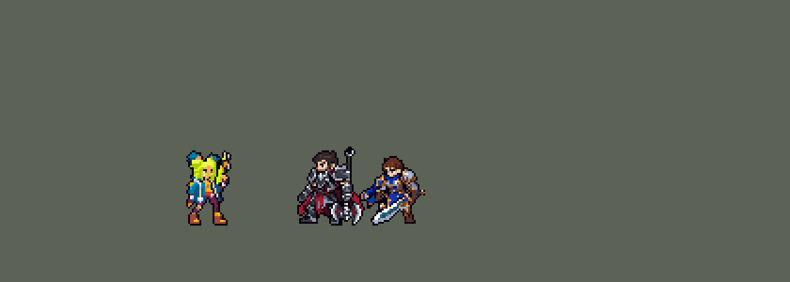

<!-- 本页上半部分由 tools/docs/gen_hero_docs.py 按仓库里现在的数据生成，手改会被覆盖；「开发记录」以下是手写的，生成时原样保留。 -->

# 泽丽 Zeri


| 项目 | 内容 |
|---|---|
| id | `league_zeri` |
| 所属的包 | 主包（mod_id `league`） |
| 分路 | ADC |
| 分类 / 标签 | 射手（Range） · AD / Range / Shield |
| 高清帧 | PPU 3（画成 105%） |
| 附加包 | [泽丽附加包：W 撞墙激光 + 被动偷盾](#附加包)（`league_zeri`） |



其他预览：[逐帧预览](../preview/league_zeri_frames.png)、[特效表](../preview/league_zeri_effects.png)

## 现在的技能

下面是游戏里显示的技能说明（`league/text/champion.i18n` 的简体中文，去掉了颜色和图标），冷却、距离来自 `league/champion/league_zeri.data_champion`；1 秒 = 60 tick。

### 普攻 / 被动（被动「内能迁转」）

*攻击间隔 0.93 秒 · 攻击距离 60000*

普攻电火迸射：7发连射打第一个敌人。被动内能迁转：每5次攻击充满电，下一击为电击弹，额外造成40 + 100% 法强魔法伤害并减速，命中英雄再造成4%最大生命真实伤害，自己获得护盾和移速。

### 技能1 · 强穿激光

*冷却 10 秒 · 施放距离 90000 · 施放：方向 · 敌人（不含防御塔）*

发射电脉冲，对第一个敌人造成60 + 110% 攻击力物理伤害并减速35%。先打中小兵或野怪时，从那里化为长激光，伤害并减速身后所有敌人。

### 技能2 · 灿丽花火

*冷却 20 秒 · 施放距离 75000 · 施放：指定目标 · 敌人（不含防御塔）*

短距冲刺（被贴身时后撤），之后5秒普攻贯穿：后面的敌人受到80%伤害，并额外造成20 + 30% 法强魔法伤害。命中英雄缩短冷却。

### 大招 · 超限爆闪

*冷却 60 秒 · 施放距离 70000 · 施放：指定目标 · 敌方英雄*

电新星对周围敌人造成150 + 100% 法强魔法伤害，超载5秒：攻速+30%、移速+20%，命中英雄叠加移速并延长；普攻变为三连发，在敌人间连锁闪电。

### 数值

攻击力 92（每级 +18）、法强 20（每级 +8）、生命 860（每级 +86）、护甲 20（每级 +7）、魔抗 15（每级 +3）、移速 920（每级 +10）。

## 附加包

附加包是可选的原生代码 mod（都在附加包合集 `league_addons` 里），**不装主包里的英雄也是完整的**。

### 泽丽附加包：W 撞墙激光 + 被动偷盾

[泽丽附加包：W 撞墙激光 + 被动偷盾](../../addons/league_zeri/README.md)：`league_zeri` v0.1.3

- W「强穿激光」的脉冲**先打中小兵或野怪**时才在那里化为长激光（小兵代替墙）；
- 被动「内能迁转」的电击弹打中英雄时给自己一个**小护盾**（代替偷盾）。

装上附加包后游戏里显示的说明（和主包不同的部分）：

- **普攻 / 被动（被动「内能迁转」）**：普攻电火迸射：7发连射打第一个敌人。被动内能迁转：每5次攻击充满电，下一击为电击弹，额外造成40 + 100% 法强魔法伤害并减速，命中英雄再造成4%最大生命真实伤害，自己获得移速；伤害打到敌人护盾时偷取45%变成自己的护盾。
- **技能1 · 强穿激光**：发射电脉冲，对第一个敌人造成60 + 110% 攻击力物理伤害并减速35%。先打中小兵、野怪或撞到墙时，从那里化为长激光，伤害并减速身后所有敌人。

## 相关脚本和素材

- [`tools/kit/build_zeri.py`](../../tools/kit/build_zeri.py)
- [`tools/kit/setup_zeri.py`](../../tools/kit/setup_zeri.py)
- [`tools/lol/extract_zeri.py`](../../tools/lol/extract_zeri.py)
- [`tools/art/preview_zeri.py`](../../tools/art/preview_zeri.py)
- [`tools/art/rig_zeri.py`](../../tools/art/rig_zeri.py)
- [`tools/art/import_zeri.py`](../../tools/art/import_zeri.py)
- [`tools/art/design_zeri.py`](../../tools/art/design_zeri.py)
- [`assets/source/zeri/`](../../assets/source/zeri)

## 开发记录

> 下面是原来 README 里「英雄：泽丽」一节，原样搬过来（只改了相对链接）。

| 部分 | 内容 |
|---|---|
| 定位 | ADC（射手，分类 Range，标签 AD / Range / Shield），第 89 位英雄。祖安花火 泽丽：平端电枪连射，普攻给电池充电，充满打出追踪电击弹；W 打到小兵化成长激光，E 冲刺后子弹贯穿，大招电新星后超载三连发、连锁闪电。用户的选择全用推荐方案：Q 当普攻（7 发连射打第一个）、被动「普攻充能 + 强化弹 + 护盾」、W「打到小兵/野怪就变激光」、E「看局势冲刺」、大招「开团时放（武装等待）」、加入高手连招；W 撞墙激光和真偷盾做成附加包 |
| 普攻 | Q「电火迸射」当普攻：一串 7 发电弹（一个不穿透的直线弹，打第一个挡路的单位，小兵会挡），100% 攻击力物理伤害，攻击距离 60000（比原版射手略长），第 8 tick 出手（动作帧第 3 帧，平端的枪口） |
| 被动 | 「内能迁转」：每次普攻给电池充一格（R 的新星直接充满），充满后下一发变成追踪的电击弹：100% 攻击力 + 40 + 100% 法强魔法伤害，减速 40% 0.5 秒，打英雄再加其最大生命 4% 真实伤害，自己得到 40 + 30% 攻击力的护盾 3 秒、移速 +10% 1.5 秒（护盾代表英雄联盟的偷盾） |
| 偷盾 / 撞墙附加包 | 可选的附加包 [`addons/league_zeri`](../../addons/league_zeri/README.md)（在附加包合集里，原生代码，主包不装它也完整）：电击弹不给自己的小护盾，改成伤害打到敌人护盾时偷 45% 变成自己的护盾 3 秒；W 的电脉冲撞到墙（地图的墙格子或地图边缘）就从那里化成长激光。附加包里的泽丽是 `make_override.py` 从主包生成的副本 |
| 技能1 | W「强穿激光」：冷却 600 tick（10 秒），朝 90000 内的敌人放（小兵野怪也算），第 16 tick 射出电脉冲，打中第一个敌人：60 + 110% 攻击力、减速 35% 2 秒；先打中小兵或野怪时，从那里往后化成一道 100000 长的激光，打中后面所有敌人。打中英雄且电池满时立刻补一发电击弹 |
| 技能2 | E「灿丽花火」：冷却 1200 tick（20 秒），照薇恩 Q 的三种走位冲刺 30000（被英雄贴身就后撤、射程里有东西就后跳、否则冲向目标），之后 5 秒普攻贯穿：第一个单位吃满，后面的敌人吃 80% 攻击力 + 20 + 30% 法强魔法伤害；每次打中英雄缩短冷却。**高手连招 E 接 W** |
| 大招 | R「超限爆闪」：冷却 3600 tick（60 秒），武装等待（图奇 R 的做法）：射程 90000 内有两个敌方英雄就立刻放，否则待命 10 秒，期间普攻时只要有一个英雄就放，没放出来退还冷却。放出：第 9 tick 以她为中心炸开新星（半径 75000）：150 + 100% 法强魔法伤害 + 60% 攻击力物理伤害，电池充满，超载 5 秒：攻速 +30%、移速 +20%，每打中一个英雄移速再叠 +3% 并延长超载（最多 2.5 秒）；超载时普攻变三连发，打中的地方连锁闪电劈 30000 内所有敌人：15 + 40% 法强魔法伤害。**高手连招 R 接 E** |
| 数值 | 攻击 92（+18）、生命 860（+86）、护甲 20（+7）、魔抗 15（+3）、移速 920（+10）。用 SDK 对战模拟调：ADC，对 4 个原版射手（`gunner`、`soldier`、`archer`、`gambler`），种子 1–12 +1.33（同一批图奇 +1.36、莎弥拉 +1.70），25–36 +1.70（图奇 +1.71、莎弥拉 +1.21） |
| 精灵图 | 9 个动作 48 帧：待机 8（上半身整个往下沉一行的呼吸）、移动 8（英雄联盟那样身体前倾的冲刺：头在胯前 6 格，枪平端在身前，直腿大步跑，逐帧手修）、普攻 5（第 3 帧开枪）、W（`skill`）5（第 4 帧开枪）、E 前冲 4、E 后跳 4、R 4（第 3 帧新星）、受击 2、死亡 8（跪下、向前扑倒）。发髻尖到鞋底 40 行、24 格宽，26 色。头像截取点、选人卡片按高清帧设（见下一行；1 倍的是 (2, −38)、−11） |
| 高清帧 | PPU 3（0.99.0，用户：「用PPU的方法重做泽丽 刀妹亚索都重做了」，选了 PPU 3、照原图比例，又「然后模型缩小点 现在太大」）：同样 9 个动作 48 帧、同样的时间和站位点，每帧是 1 倍帧的 3 倍大小，战场上大小不变、像素细 3 倍（卡牌和图鉴也是）。造型 [`tools/art/design_zeri_hd.py`](../../tools/art/design_zeri_hd.py)：Codex 的两张原画（A 步枪竖在肩上，B 步枪双手平端）按发髻尖到鞋底 111 行（游戏里 37 格）读格子，两张合一套 32 色，脸逐格画（眉、睫毛、绿眼、脸颊记号、嘴），B 的身体接 A 的头，所有动作同一张脸（`assets/source/zeri/ppu3/idle.txt`、`level.txt`）。动作 [`tools/art/ppu_zeri.py`](../../tools/art/ppu_zeri.py) 照 1 倍的摆法摆。跑步是英雄联盟自己的腿（用户：「跑步全部重画 还原LOL的」「不要腿部有任何变形」「你不会自己做一个自然一点的？」）：把英雄联盟泽丽的跑步按定稿的腿长从正侧面渲染（藏掉外套、背包和枪，近侧远侧两条腿分开上色，`ppu3/run_legs.json`），每 8×8 一块按材质投成定稿的紧身裤、靴子、袜子、扣子颜色，加粗一格、一圈描边，近侧膝盖贴定稿的护膝，远侧腿压暗一档；上半身是 B 的平端姿势从胯往上每三行前移两格（枪和双手、头各整块），胯放在英雄联盟的胯上。第 7 帧远侧大腿根、第 8 帧的靴子按用户指出的两处改过（「这里还有两处变形 其他都好了」：大腿根绕胯收圆；第 8 帧取 710 毫秒、正侧面看，靴子不再是楔形）。渲染图是 Riot 的模型，只留在本地；没有渲染图时跑步从写好的条带读回。局内画成 105%（0.99.1，用户：「等等泽丽感觉游戏里有点小」，从对比图里选了 105%，39 格高）：和古拉加斯一样由 `league.dll` 的 `SIZES` 按比例画，像素一格不改，卡牌、图鉴、头像也一样大；按她的站位点放大，所以每帧往上挪 2 个高清行，鞋底还在地上（`ppu_zeri.py` 的 `SCALE`、`RAISE`；跑步第 4 帧和 R 第 2 帧在空中、框里头顶没空间，只挪 1 行）。子弹、电击弹和 W 的电脉冲从高清帧平端的枪口出来（105% 下在站位点前 11 格、上方 11 格：`build_zeri.py` 的 `a_y` −6000，飞行特效先隐藏 1 帧，`import_zeri.py` 的 `LEAD`；用户：「挪到高清枪口」；没有 DLL 时 1 倍的枪更长，子弹从枪身中间出来）。头像截取点 (1, −36)，画风统一后 (1, −38)（DLL 下卡牌、图鉴、头像都画 105% 的高清待机：头顶在脚上方 36 格）；选人卡片不用 `banpick_center`（顶端在帧中心上方 27.5 格，没超过卡片的 28 格） |
| 特效 | Codex 生图的 24 张（游戏尺寸版逐格切，`import_zeri.py`；红色方的对称逐格检查）：`league_zeri_fx` 连射电弹 / 命中、电击弹 / 命中 / 减速、充满电的电光、护盾、加速线、W 蓄力 / 电脉冲 / 命中 / 减速、E 生效时的电弧 / 贯穿弹 / 命中、R 三连发 / 命中 / 连锁闪电；`league_zeri_big` W 的长激光（画在格子右半边，从脉冲停下的点往外射）、附加包的撞墙激光、E 冲刺电光、R 电新星、超载、超载延长。颜色照英雄联盟：柠檬黄绿的电、白芯、青色的边，R 带一点彩虹边 |
| 音效 | 英雄联盟的音效和配音（`tools/lol/extract_zeri.py`）：连射、命中、电击弹、充满电、护盾，W 蓄力 / 发射 / 激光 / 命中，E 冲刺 / 落地，R 施放 / 超载 / 连锁；W、E、R、充满电的配音（片段名 `league_zeri_sfx_vo_*`，和声音名不同）。版权属于 Riot Games，**不提交到仓库**，按下面的命令在本地生成 |
| 图标 | 官方技能图标（W 强穿激光 / E 灿丽花火 / R 超限爆闪），从本地客户端提取，缩到 64×64 |

重新生成（素材来自本机的英雄联盟客户端，音频不进仓库）：

```bash
python tools/lol/extract_zeri.py --lol "D:\WeGameApps\lol" --vgmstream "<vgmstream-cli.exe 路径>"
python tools/kit/build_zeri.py         # 技能数据，数字都在脚本的参数表 P 里；--nodes 看每棵技能树的节点数
python tools/kit/setup_zeri.py         # 五种语言的文字、音效配置、共享文件里她的键（头像点和选人卡片点也在里面）
python tools/art/design_zeri.py --final        # 造型：assets/source/zeri/design40/zeri40_final.txt 写成 zeri_native.png
python tools/art/rig_zeri.py           # 动作：用定稿自己的部件摆出全部 48 帧（跑步读逐帧手修的 run40/run.txt；--base 重写它）
python tools/art/import_native.py --hero zeri   # 也会把高清帧写成 hd_ 动作（tools/art/ppu_hd.py）
python tools/art/design_zeri_hd.py --finish     # 高清造型：ppu3/idle.txt、level.txt（--base 从原画重读底稿）
python tools/lol/native_pose.py assets/source/zeri/ppu3/run_legs.json --out <目录> --alpha --parts   # 跑步的英雄联盟腿（只在本地）
python tools/lol/pose_joints.py assets/source/zeri/ppu3/run_legs.json --tag run --json <目录>/joints_run.json
python tools/art/ppu_zeri.py --renders <目录>  # 高清帧 assets/source/ppu/zeri_<动作>.png（不带 --renders 时跑步从条带读回）
python tools/art/ppu_hd.py --hero zeri          # 只重写精灵图里的 hd_ 动作
python tools/art/import_zeri.py        # 特效：游戏尺寸版逐格切，拼成特效表
python tools/art/preview_zeri.py       # 预览和演示 GIF
python addons/league_zeri/make_override.py   # 偷盾 / 撞墙附加包的副本（主包的泽丽改了就重跑）
```

美术（提示词见 [`assets/source/zeri/`](../../assets/source/zeri) 里的 `PICTURE_PROMPT.md`、`MODEL_PROMPTS.md`、`REFINE_PROMPTS.md`、`FACE_PROMPTS.md`、`GRID_PROMPTS.md`、`MODEL_STRIPS.md`、`PROMPTS_FX.md`）：

- 造型：Codex 的几版（`codex_model/`、`codex_refine/`）用户都觉得头大、身体僵、画风不统一，最后用户给了自己画的一张泽丽（`user_ref/zeri_user.png`）：「你拿这版泽丽 一点点还原吧 还原到完美」，40 行。按格子叠在原图上，每格取原图里最多的非黑颜色（一格一半以上是黑才画描边），脸保持原图本来的大小，细节一格格保留（`design40/zeri40_v5.txt`）。脸让 Codex 只重画脸框里的 8×8 格（`codex_face/`，用户选 C），再按英雄联盟模型的脸改成粗深眉、黑眼线、黄绿瞳、珊瑚色嘴唇；照 oppi 的做法舍弃小细节（头带改成头发、发髻的紫色尖刺、枪上的灰钉、扣子的黑槽、靴子银扣等去掉），补齐头发缺口和衣服上的破洞；最后照霞不画嘴，眼睛换成更亮的绿瞳（用户选 B）。装进游戏后用户嫌大（「整体模型缩小一点吧 在游戏里太大了」），去掉了眼睛上方的两块粗眉（「眼睛上这两块看着好怪」），缩到 37 行时整行删的是躯干里的行（先是两行上衣，后来是一行腰带和一行短裤），躯干短了两行、宽度不变，看着像啤酒肚（「游戏内走路有点啤酒肚的感觉」「应该是上半身模型的问题 泽丽让我看起来就觉得像是啤酒肚」）；给了躯干不删、改删头发 / 发髻 / 靴筒的方案，用户选了「恢复到40」：现在是 40 行原稿（只去了粗眉）。
- 动作：Codex 用定稿部件拼的帧把垂着的左臂转出去、从腰间开枪、腿整条左右滑。`rig_zeri.py` 只用不失真的操作：枪 + 手 + 前臂一整块绕手肘转 90°，平端在腰前开枪（平端时袖口的白色并成一条紫红前臂）；左手不动；跑步照英雄联盟泽丽的冲刺身体前倾（用户：「泽丽不应该是身体前倾着跑的的吗 再LOL里面」「你去网上看看视频吧 泽丽怎么跑的 然后全部重改」）：上身不重采样，从胯往上每两行往前移一格（一条均匀的斜线，`RUN_LEAN`），头整块平移、和定稿逐像素一致，在胯前 6 格；平端的枪按手肘那一行移，前臂往回接到袖口；整帧往后挪 3 格，起跑时胯还在站位点上、脚不往前跳（`RUN_DX`）。腿画直（用户：「走路时候腿应该是直的吧 现在泽丽画成歪的了」「把腿画直吧 歪着造成整个身体变形」「所有的AD都是画直了移动的」）：和包里的射手（韦鲁斯、莎弥拉、希维尔）一样，每条腿是从胯到靴子的一根直线，大腿照定稿上粗下细（胯处 4 格、膝盖以下 2 格，斜的时候每行加宽，看着和直着一样粗），近侧膝盖带棕色护膝，脚是定稿整只靴子、平放，只带定稿自己那一圈描边；每帧腿长基本一样，步子整体在胯后面，腿跟着身体的斜度往后斜（用户：「你身体斜过来了 腿也要跟着一个角度吧？」）：着地的脚从胯前一点往后滑，蹬地后往后上方踢起，抬一行往前摆，步子最大的两帧双脚离地（英雄联盟的冲刺）；远侧腿是同一套阶段错开 4 帧、在近侧胯右边 2 格，整条腿连靴子压暗一档（只用定稿自己的颜色往深一级），交叉时分得清前后；脚落地那帧上身和胯一起沉一行（`RUN_SEQ`、`RUN_STEP`）。8 帧最后逐格手修，存成字母表 `assets/source/zeri/run40/run.txt`（`rig_zeri.py --base` 先写出自动摆的帧，用户：「你给我一帧一帧改到完美」）。腰带下两行短裤留在上身上，腿从短裤下面伸出；腰下、两腿之间、两只靴子之间和平端的前臂旁边，一格宽的缝和三面封住的凹口都补成描边，不露底色（用户：「这里没对齐留空档要注意吧」），挨着底色的彩色格一律补上描边（顺带补齐了普攻、W 平端时前臂下沿和发髻右边、待机呼吸帧短裤两角、死亡跪地帧原来漏掉的几格描边）。之前几版都被否：照英雄联盟的角度画（腿粗、膝盖折）、直接描英雄联盟的跑步（腿在纵深方向摆，投影忽长忽短）、凯特琳式弯膝的腿（「腿像在变长、变短」「看起来像原地踩踏板」，着地腿的膝盖往前折，显得歪）。E 前冲、R 的腾空帧就是跑步里的跨步（前倾）；E 后跳是整个人原样抬高两行（前倾的跨步往后退，看着像原地跑）；死亡跪下后整个人转 90° 向前扑倒。每帧审计：一整块、没有洞、没有落单的描边、头和定稿逐像素一致。
- 特效：24 张用 Codex 的游戏尺寸版逐格切，枪口在站位点前 26 格、脚底上 17 格，子弹飞过枪口前不显示。

逐帧预览：[`docs/preview/league_zeri_frames.png`](../preview/league_zeri_frames.png?v=1014g)，特效：[`docs/preview/league_zeri_effects.png`](../preview/league_zeri_effects.png?v=1014g)。
