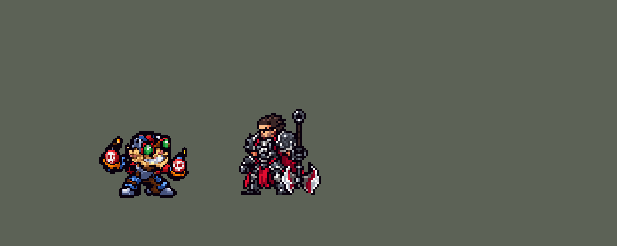

<!-- 本页上半部分由 tools/docs/gen_hero_docs.py 按仓库里现在的数据生成，手改会被覆盖；「开发记录」以下是手写的，生成时原样保留。 -->

# 吉格斯 Ziggs


| 项目 | 内容 |
|---|---|
| id | `league_ziggs` |
| 所属的包 | 主包（mod_id `league`） |
| 分路 | 中单 |
| 分类 / 标签 | 法师（Magician） · AP / Magic / Range |
| 高清帧 | PPU 1.2 |
| 附加包 | [吉格斯附加包](#附加包)（`league_ziggs`） |



其他预览：[逐帧预览](../preview/league_ziggs_frames.png)、[特效表](../preview/league_ziggs_effects.png)

## 现在的技能

下面是游戏里显示的技能说明（`league/text/champion.i18n` 的简体中文，去掉了颜色和图标），冷却、距离来自 `league/champion/league_ziggs.data_champion`；1 秒 = 60 tick。

### 普攻 / 被动

*攻击间隔 1.47 秒 · 攻击距离 55000*

扔小炸弹。一触即发：每12秒下次普攻多造成40 + 60% 法强魔法伤害，每放一个技能冷却-4秒。定点爆破：3级起，敌方英雄贴身时在脚下引爆，造成80 + 50% 法强魔法伤害并击退，自己也被炸开。

### 技能1 · 弹跳炸弹

*冷却 4.5 秒 · 施放距离 80000 · 施放：指定目标 · 敌人（不含防御塔）*

扔出炸弹沿直线弹跳，最多落地3次，落地时附近有敌人就爆炸：周围敌人受到105 + 85% 法强魔法伤害。

### 技能2 · 海克斯爆破雷区

*冷却 12 秒 · 施放距离 75000 · 施放：地点 · 敌人（不含防御塔）*

撒下雷区5秒：敌人第一次踩雷受到65 + 45% 法强魔法伤害，之后每0.5秒受到其40%；每次踩雷减速30%。

### 大招 · 科学的地狱火炮

*冷却 60 秒 · 施放距离 220000 · 施放：指定目标 · 敌方英雄*

把超大炸弹扔向远处的敌方英雄，落点先出现预警：范围内敌人受到250 + 85% 法强魔法伤害，中心共受到385 + 130% 法强。优先扔向被控制的敌方英雄。

### 数值

攻击力 76（每级 +6）、法强 40（每级 +20）、生命 900（每级 +95）、护甲 18（每级 +7）、魔抗 22（每级 +4）、移速 900（每级 +9）。

## 附加包

附加包是可选的原生代码 mod（都在附加包合集 `league_addons` 里），**不装主包里的英雄也是完整的**。

### 吉格斯附加包

[吉格斯附加包](../../addons/league_ziggs/README.md)：`league_ziggs` v0.1.1

|  | 主包（不装附加包） | 装了附加包 |
|---|---|---|
| 定点爆破（W） | 3 级起，敌方英雄贴身时自动在脚下引爆：伤害、击退敌人、自己被炸开 | 同上；另外 W 不在冷却时，身边 `w_hex_r` 以内有**血量低于 `w_ex`% 的敌方防御塔**，就在塔上炸开、直接把塔炸掉（算他的击杀），W 进入冷却（英雄联盟：W 能炸掉 25–35% 血以下的防御塔） |
| 一触即发（被动） | 每 12 秒（放技能减 4 秒）下次普攻多一份魔法伤害，打塔和打别的一样 | 强化弹打中防御塔的那一下 ×`p_tower`%（1.75 倍，英雄联盟对建筑的加成） |

## 相关脚本和素材

- [`tools/kit/build_ziggs.py`](../../tools/kit/build_ziggs.py)
- [`tools/kit/setup_ziggs.py`](../../tools/kit/setup_ziggs.py)
- [`tools/lol/extract_ziggs.py`](../../tools/lol/extract_ziggs.py)
- [`tools/art/preview_ziggs.py`](../../tools/art/preview_ziggs.py)
- [`tools/art/rig_ziggs.py`](../../tools/art/rig_ziggs.py)
- [`assets/source/ziggs/`](../../assets/source/ziggs)

## 开发记录

> 下面是原来 README 里「英雄：吉格斯」一节，原样搬过来（只改了相对链接）。

| 部分 | 内容 |
|---|---|
| 定位 | 中单（Magician，标签 AP / Magic / Range），第 124 位英雄。爆破鬼才 吉格斯：约德尔爆破专家（10-17 的分组计划里排在 ADC，用户这次指定中单）。用户确认方案（「可以」）：布局 A——技能 1 = Q 弹跳炸弹，技能 2 = E 海克斯爆破雷区，大招 = R 科学的地狱火炮；W 定点爆破没有自己的格子，守望在敌人贴身时自动放。技能名照英雄联盟 16.20 的官方中文 |
| 普攻 / 被动 | 扔小炸弹（追踪弹，第 10 tick 出手，防御塔也打），攻击间隔 88 tick，射程 55000。**一触即发**：每 12 秒下一次普攻扔海克斯强化炸弹，多造成 40 + 60% 法强魔法伤害；每放一个技能（Q、W、E、R 都算）冷却减少 4 秒（英雄联盟 12 秒、每个技能 −4 秒）。数据不能给计时减时间，所以等待是同时挂上的三个旗子（4、8、12 秒，泽拉斯法力涌动的做法），三个都没了才强化，每放一个技能拿掉剩下最长的一个 |
| 技能1 | **Q 弹跳炸弹**（对 80000 内的敌人放，小兵、野怪也打）：炸弹沿着朝目标的直线一跳一跳，最多落地 3 次（离他 40000、62000、84000，第一跳 26 tick，之后每跳 30 tick），每次落地时半径 20000 内有敌人就爆炸、炸弹停下：105 + 85% 法强魔法伤害；第三次一定炸。英雄联盟的第一跳落在瞄准点：数据里的投射物都从英雄身上飞出，落点不能接着飞，所以三个落点按固定距离排开，三个爆炸范围首尾相接，线上的敌人照样炸得到；空中的炸弹按弧线的高度一帧帧贴在路径上（`q_air<高度>`）。冷却 4.5 秒 |
| 技能2 | **E 海克斯爆破雷区**（对 75000 内的敌人放）：一把地雷落在目标站的地方，半径 30000 的雷区留 5 秒，落地 30 tick 后生效。每个敌人第一次踩雷受到完整一颗：65 + 45% 法强魔法伤害（每个单位只算一次的区域，就是英雄联盟「同一个人后面的雷伤害降低」）；之后留在雷区里每 0.5 秒再踩一颗，伤害 40%；每次踩雷减速 30% 1.5 秒。雷区是一整片同时消失（英雄联盟是一颗一颗）。冷却 12 秒 |
| W | **定点爆破**（守望自动放，3 级起，15 秒一次）：22000 内有敌方英雄贴身、他没在放别的技能，炸药包就在他脚下炸开：半径 30000 内 80 + 50% 法强魔法伤害并把敌人击退，他自己往后被炸飞 40 格（不掉血）。引擎的击退只能「远离施法者」，正好就是脚下自爆逃生的方向；英雄联盟里扔到远处、从炸点往外推的用法做不到。模拟里一局 1–6 次 |
| 大招 | **R 科学的地狱火炮**，**看场面才放**（用户的规则：灵活判断）：按 R 只是待命 10 秒，守望每 12 tick 看一次：先扔向 220000 内被控制的敌方英雄；待命过了 5 秒还没有，就扔向队友最近打过的敌方英雄（不管在哪条路：英雄联盟里吉格斯大招支援全图）；没扔出去就退还冷却（只留 1 秒）。炸弹飞 70 tick，落在目标起飞时站的地方（走开躲得掉），落点全程亮着红色骷髅预警圈：半径 40000 内 250 + 85% 法强魔法伤害，中心 18000 内再加 135 + 45%（英雄联盟外圈是中心的 65%）。射程按英雄联盟的 5000 应是 500000，直线弹道太远会被地图边裁偏，所以封顶 220000（泽拉斯大招一档）。冷却 60 秒 |
| 附加包 | 可选的附加包 [`addons/league_ziggs`](../../addons/league_ziggs/README.md)（在附加包合集里，原生代码，主包不装它也完整）：**定点爆破炸塔**——W 不在冷却时，身边 60000 内有血量低于 30% 的敌方防御塔，就在塔上炸开、把塔炸掉（算他的击杀），W 进冷却；**一触即发打塔** ×1.75。两件事都要读防御塔的血量，数据做不到。不按任何技能键。日志 `league_ziggs.log`（SPAWN、HEXPLODE、FUSE） |
| 数值 | 攻击 76（+6）、法强 40（+20）、生命 900（+95）、护甲 18（+7）、魔抗 22（+4）、移速 900（+9）、射程 55000 |
| 平衡 | 中路对原版的五个法师（pyromancer / ice_mage / lightning_mage / wind_mage / white_mage），三套阵容、两边各打，10 分钟经典引擎模拟：草案（Q 75 + 60% 每 5 秒、E 45 + 30%、W 60 + 40%、R 190 + 65% / 中心 100 + 35%、被动 30 + 50%、生命 880）+0.01（伤害 8772，辛德拉 +1.17、12513）；伤害 +25% +0.14；+40%、Q 每 4.5 秒、生命 900 **+1.06**。按动作帧对好出手时间后，种子 1–8 +1.70、9–16 +0.31（辛德拉 +1.22），平均约 +1.0，和辛德拉同一档 |
| 精灵图（高清帧 PPU 1.2） | Codex 第 0 步画了原版待机（A：两手张开托炸弹）和收拢姿势（B）两张原画（[`tools/art/pack_ziggs_picture.py`](../../tools/art/pack_ziggs_picture.py)），[`tools/art/review_ziggs_size.py`](../../tools/art/review_ziggs_size.py) 和约德尔人们按游戏大小并排，用户：「用 A（两手张开托炸弹），游戏里 32 像素高」。第 1 步 Codex 在游戏格子上重画两稿（[`tools/art/pack_ziggs_model.py`](../../tools/art/pack_ziggs_model.py)），[`tools/art/design_ziggs_cut.py`](../../tools/art/design_ziggs_cut.py) 读回 A-1（62 行）整行整列删到 48 行：镜片和牙齿的行列保留，两颗炸弹单独裁（骷髅保留）再按同一套格子贴回（一起裁时删掉的行全落在腿上）。动作照塔姆的做法（用户：「动作帧的话你参考塔姆怎么做的 做完后自己review 完美了再喊我review」）：[`tools/art/rig_ziggs.py`](../../tools/art/rig_ziggs.py) 把两只手（连炸弹，炸弹能单独拿掉：扔出去）、身体、两条腿切成整块，只整格移动（手绕肩直角转会把远侧手藏到头后面、近侧手挡住脸，所以只平移）。走路照内瑟斯的宽站姿走法（两条腿各自整条迈步）；用户觉得「有点 僵硬」，炸弹随步子上下晃的版本把袖子拉长了（「手臂有点变形吧」），选了 D 版：步子加大、落脚时上身下沉一格、两腿交错时整个人弹起一格（布隆的走法），手和身体从不相对移动；待机呼吸；死亡坐倒后仰躺、稍微陷进地面，两颗炸弹落在身边。动作：待机、走路、普攻、Q、E、W（蹲下放包、被炸飞只往上抬：往后飞由技能本身移动他）、R（两手举起，大炸弹是特效 `r_cast`）、挨打、阵亡。动作按每游戏像素 1.5 格摆好后，用户看了演示：「太高清了 降低点像素」，[`tools/art/review_ziggs_ppu.py`](../../tools/art/review_ziggs_ppu.py) 把 1.5 / 1.3 / 1.2 / 1.0 按游戏大小并排，用户：「降到 PPU 1.2」（`ppu_restyle` 降密度，游戏里的大小不变） 2026-10-19 补帧：死亡 8 帧（落地回弹，地上的炸弹不动）。用户：「吉格斯的头太大了在游戏里 缩小一点」——第 23 行以上（头盔、护目镜、耳朵、牙）删掉第 1、3 行和第 14、16、18、21、23、25 列（头盔顶、近侧耳朵和头盔侧面），护目镜的镜片和框、牙齿一格不动，胡子、脖子和两肩不删（删了头会和袖子裂开），用户从两档里选了「B 更窄」 |
| 特效 | 第 3 步 20 张特效（[`tools/art/pack_ziggs_fx.py`](../../tools/art/pack_ziggs_fx.py)，颜色照英雄联盟：红色骷髅炸弹、橙黄的火、灰烟、被动和地雷的海克斯蓝白火花、大招的红色骷髅预警圈），Codex 画并读回成游戏大小（`assets/source/ziggs/codex_fx`）。飞行的炸弹（普攻、强化弹、地雷包、大炸弹）随飞行方向转动，所以上下对称、不画骷髅、火星拖在身后；其余左右对称（游戏不镜像特效图）。[`tools/art/import_ziggs_fx.py`](../../tools/art/import_ziggs_fx.py)：Q 的空中炸弹按 9 个高度生成 `q_air2`–`q_air18`，雷区每 0.25 秒在落点重贴一次，预警圈铺满飞行的 70 tick，炸药包的爆炸留在原地（他被炸飞）。写成 `league_ziggs_fx` 和 `league_ziggs_big` |
| 音效 | 英雄联盟的音效和配音（[`tools/lol/extract_ziggs.py`](../../tools/lol/extract_ziggs.py)，21 段）：普攻出手 / 打中、一触即发出手 / 打中、弹跳炸弹出手 / 弹起 / 爆炸 / 打中、雷区出手 / 落地 / 引爆、炸药包出手 / 爆炸 / 打中、地狱火炮出手 / 爆炸 / 打中，配音是他的 Q / E / W / R 台词（中文） |
| 图标 | 官方技能图标（弹跳炸弹、海克斯爆破雷区、科学的地狱火炮，另有定点爆破和一触即发），从本地客户端取 |

重新生成（素材来自本机的英雄联盟客户端，音频不进仓库）：

```bash
python tools/lol/extract_ziggs.py --lol "D:\WeGameApps\lol" --vgmstream <vgmstream-cli.exe>
python tools/kit/build_ziggs.py                      # 技能数据，数字都在脚本的参数表 P 里
python tools/kit/setup_ziggs.py                      # 五种语言的文字、音效配置、共享文件里他的键
python tools/art/design_ziggs_cut.py                 # Codex 第 1 步的造型读回（A-1，炸弹单独裁）
python tools/art/rig_ziggs.py                        # 1 倍帧和 1.5 的原帧（整块摆）
python tools/art/ppu_restyle.py --hero ziggs         # 描边（不要加 --preview）
python tools/art/ppu_hd.py --hero ziggs              # hd_ / lo_ 帧
python tools/art/import_ziggs_fx.py                  # 特效
python tools/art/preview_ziggs.py                    # 预览和演示 GIF
python addons/league_ziggs/make_override.py          # 附加包的副本（主包的吉格斯改了就重跑）
```

美术提示词见 [`assets/source/ziggs/`](../../assets/source/ziggs) 里的 `PICTURE_PROMPT.md`、`MODEL_PROMPTS.md`、`PROMPTS_FX.md`；Codex 的交付在 `codex_picture/`、`codex_model/`、`codex_fx/`。

逐帧预览：[`docs/preview/league_ziggs_frames.png`](../preview/league_ziggs_frames.png?v=1018a)，特效：[`docs/preview/league_ziggs_effects.png`](../preview/league_ziggs_effects.png?v=1018a)。
