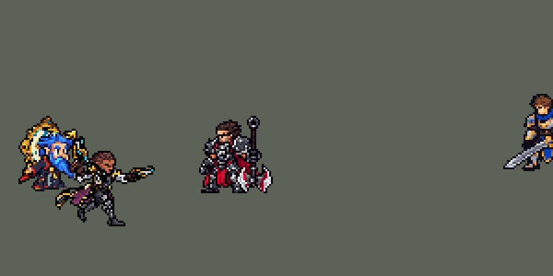

<!-- 本页上半部分由 tools/docs/gen_hero_docs.py 按仓库里现在的数据生成，手改会被覆盖；「开发记录」以下是手写的，生成时原样保留。 -->

# 基兰 Zilean


| 项目 | 内容 |
|---|---|
| id | `league_zilean` |
| 所属的包 | 主包（mod_id `league`） |
| 分路 | 辅助 |
| 分类 / 标签 | 功能型（Util） · AP / Magic / Range / CC / Heal |
| 高清帧 | 1 倍像素（无高清帧） |
| 附加包 | [基兰复活附加包](#附加包)（`league_zilean_rewind`）、[游戏 AI 不按的技能替它按](#附加包)（`league_ult_press`） |



其他预览：[逐帧预览](../preview/league_zilean_frames.png)、[特效表](../preview/league_zilean_effects.png)

## 现在的技能

下面是游戏里显示的技能说明（`league/text/champion.i18n` 的简体中文，去掉了颜色和图标），冷却、距离来自 `league/champion/league_zilean.data_champion`；1 秒 = 60 tick。

### 普攻 / 被动（被动「瓶中时光」）

*攻击间隔 1.5 秒 · 攻击距离 55000*

发射时光法球。被动瓶中时光：每90秒攒满一瓶，下次时光发条加速友方英雄时送给他：他和基兰各获得10攻击力、10法强和80生命值，直到阵亡。

### 技能1 · 定时炸弹

*冷却 7 秒 · 施放距离 70000 · 施放：指定目标 · 敌人（不含防御塔）*

向目标脚下扔出炸弹（出手时锁定落点，可躲开），粘在附近第一个敌人身上（英雄优先），3秒后爆炸，造成80 + 70% 法强的魔法伤害。穿梭未来（每12秒）：炸弹粘上英雄时倒转时间再扔一颗，两颗立即爆炸并晕眩1.25秒，技能冷却缩短。

### 技能2 · 时光发条

*冷却 10 秒 · 施放距离 70000 · 施放：指定目标 · 敌方英雄*

使一名敌方英雄减速35%，同时让身边一名友方英雄（没有则自己）移速+35%，持续2.5秒。

### 大招 · 时光倒流

*冷却 60 秒 · 施放距离 60000 · 施放：指定目标 · 敌方英雄*

附近的友方英雄被控制、或基兰被两名以上敌方英雄贴身时，为其挂上时光符文：5秒内不会阵亡，结束时时光回溯，回复400 + 150% 法强生命值。

### 数值

攻击力 80（每级 +6）、法强 30（每级 +15）、生命 900（每级 +95）、护甲 22（每级 +7）、魔抗 24（每级 +4）、移速 1000（每级 +10）。

## 附加包

附加包是可选的原生代码 mod（都在附加包合集 `league_addons` 里），**不装主包里的英雄也是完整的**。

### 基兰复活附加包

[基兰复活附加包](../../addons/league_zilean_rewind/README.md)：`league_zilean_rewind` v0.2.0

主包 `league` 保持纯数据。主包里基兰的 R 由 AI 在敌方英雄 60000 内时放出、**待命** 900 tick（没用上就退还冷却）；
待命期间他每次出手查一次：附近有**被控制**的友方英雄、或自己被**两名以上**敌方英雄贴身，才给那个人挂 5 秒的时光符文
（`league_zilean_r_rune`，带「不死」，生命最低停在 1），到第 299 tick 不管有没有危险都回血。主包测过平均一局只出 0.8 次，
挂上的也多半用不上——看起来就是「基兰不放大」。这个附加包用原生代码把它做成 League 的「时光倒流」：

- **给快死的人挂**（v0.2.0）：四个动作里的那段检查去掉，改由被动 `league_zilean_rewind:guard`（挂在 `passive_ult` 上，
  学会 R 后每 tick 运行）决定：R 待命时每 3 tick 看一次基兰 **90000 内**的己方英雄（含他自己），**身边 45000 内有敌方英雄**，
  而且**生命低于 30%**，或 **1 秒（60 tick）内被打掉 30% 以上、只剩 60% 以下**——给生命比例最低的那个挂符文，播主包 R 的
  施法动作（30 tick）、画面和声音，去掉待命（冷却照常走完，不退还）。基兰被控住（眩晕、击飞、沉默等）时不放。
- 符文期间**受到致命伤害**（生命被「不死」停在 1）时：去掉符文，**倒流 2.5 秒**——清掉控制，放逐（不可选中、
  隐身、不能行动，播倒流的画面），期间不死也不受伤；结束后回复 **400 + 150% 基兰法强**（挂符文那一刻算）。
- 符文 5 秒**没用上就不回血**（同 League）。
- 基兰挂完符文就阵亡了也照样倒流，回血算被保护者自己的治疗。

### 游戏 AI 不按的技能替它按

[游戏 AI 不按的技能替它按](../../addons/league_ult_press/README.md)：`league_ult_press` v0.5.5（通用附加包，下面只列和基兰有关的部分）

|  | 装了附加包，什么时候按 |
|---|---|
| 奥莉安娜 E、基兰 E | 在打架：她 / 他或射程内的队友 40000 内有敌方英雄（基兰也追射程内生命不到 40% 的） |

## 相关脚本和素材

- [`tools/lol/extract_zilean.py`](../../tools/lol/extract_zilean.py)
- [`tools/art/preview_zilean.py`](../../tools/art/preview_zilean.py)
- [`tools/art/import_zilean.py`](../../tools/art/import_zilean.py)
- [`tools/art/design_zilean.py`](../../tools/art/design_zilean.py)
- [`assets/source/zilean/`](../../assets/source/zilean)

## 开发记录

> 下面是原来 README 里「英雄：基兰」一节，原样搬过来（只改了相对链接）。

| 部分 | 内容 |
|---|---|
| 定位 | 辅助（远程法师，分类 Util），用户 10 月 2 日排的第十组的辅助；本包第十个辅助（索拉卡、蕾欧娜、迦娜、锤石、莫甘娜、娜美、塔里克、布里茨、娑娜之后）。时光守护者：Q 定时炸弹，两颗炸弹叠在同一个人身上就眩晕；E 减速敌人、加速队友；R 给危险中的队友挂上时光符文，符文时间内死不了 |
| 普攻 | 时光法球，100% 攻击力的物理伤害，射程 55000，攻击间隔 90 tick，第 17 tick 出手（动作第 5 帧，法球在手上 (17, −6)），法球每 tick 5000，`y_offset` −1000（抬 6 px） |
| 被动 | 「瓶中时光」：英雄联盟里存经验送给队友；本作没有给经验的效果，瓶子里装的是属性：每 90 秒攒满一瓶（每条命第一个动作开始计时），下一次 E 加速到队友时倒给他——队友和基兰各 +10 攻击、+10 法术强度、+80 生命，一直到死（每瓶各算一份，能叠）。模拟里每局约 2.5 瓶 |
| 技能1 | Q「定时炸弹」：对 70000 内的敌人施放（小兵和野怪也算，清线、打野也用），冷却 7 秒。第 12 tick 出手（举起的手 (15, −21)），炸弹抛向目标出手那一刻站的位置（24 tick 落地，走开的英雄躲得掉），粘在落点 8000 内的第一个敌人身上（先找英雄，同英雄联盟），3 秒后在他身边爆炸：半径 30000，80 + 70% 法术强度的魔法伤害。没粘到人就落在地上，3 秒后原地爆炸。携带炸弹的单位先死了，炸弹当场爆炸（同英雄联盟；`league_shaco` R 的死亡侦测：携带者身上每 4 tick 扔一颗只飞 1 tick 的隐形探测弹，落地 6 tick 后发现携带者没了就在落点引爆，携带期间身上有燃烧图标）——改之前炸弹粘在快死的小兵身上就没了（一局 27 颗里丢了 8 颗） |
| W（并入 Q） | 「穿梭未来」（用户选：自动 QWQ）：英雄联盟里 W 刷新 Q，玩家的连招是 Q、W、Q，两颗炸弹叠在同一个人身上立刻一起爆并眩晕。炸弹粘到敌方英雄、W 好了（冷却 12 秒）时：基兰倒转时光（W 动作 0.5 秒，身后大钟面倒转），再放一次 Q，第二颗炸弹追着那个英雄飞过去，打中后两颗一起爆：伤害翻倍（160 + 140% 法术强度），范围内所有敌人眩晕 1.25 秒，第一颗炸弹的倒计时和爆炸取消。同时 Q、E 剩下的冷却最多只剩原冷却的 62.5%（英雄联盟的 W 减少其它技能冷却 10 秒），大招不受影响。模拟里每局约 11 次 QWQ，眩晕英雄 15–17 次 |
| 技能2 | E「时光发条」（用户选：同时减速和加速）：对 70000 内的敌方英雄施放，冷却 10 秒。英雄联盟里二选一，AI 不会选，这里两个都给：敌方英雄减速 35% 2.5 秒；基兰身边 40000（找不到再 80000）内的一名友方英雄加速 35% 2.5 秒，身边没有队友就加速自己。攒满的瓶子在这一下倒给加速的队友。模拟里每局约 11 次，10 次加速到了队友 |
| 大招 | R「时光倒流」（用户选：不死符文 + 等危险）：冷却 60 秒。英雄联盟里符文时间内死亡的队友会复活；本作读不到当前生命值、也不能复活，但有「不死」状态（`undying`，生命不会降到 0）：符文 5 秒内不死，结束时倒流回血 400 + 150% 法术强度。什么时候放：用 `league_kayle` R 的做法，敌方英雄进入 60000 时「备好」15 秒，备好时基兰的每个动作都检查一次：90000 内有被控制的友方英雄就给他；没有的话，40000 内有两名敌方英雄时给自己；15 秒没用上就把冷却退回 1 秒，下次接近再备好。检查范围是 60000 / 30000 时每局只放 0.2 次，90000 / 40000 时 0.8 次。被救的队友符文内没有死；回血 250 + 80% 时 7 个里有 5 个符文一结束就死了，提高到 400 + 150%（英雄联盟复活 600–1100 + 200%）后 6 个里 3 个。英雄联盟复活后的 2 秒停滞（无敌）也试过，没有采用（不是用户选的方案，数值也差不多） |
| 附加包（替 AI 按） | 可选的附加包 [`addons/league_ult_press`](../../addons/league_ult_press/README.md)（在附加包合集里，原生代码，主包不装它也完整）：游戏 0.6.4 的 AI 很少按他的 E（只读观察包：每 10 分钟 4.8 次，435 局，冷却 10 秒）。附加包按局面替 AI 按（用户：「有问题的英雄全部改成rust」）：他或 70000 内的队友 40000 内有敌方英雄（在打架），或 70000 内有生命不到 40% 的敌方英雄（追）就按 |
| 数值 | 攻击 80（+6）、法强 30（+15）、生命 900（+95）、护甲 22（+7）、魔抗 24（+4）、移速 1000（+10）。数值是自己设计的，用 SDK 对战模拟调：辅助位，对 5 个原版辅助（`priest`、`bard`、`enchanter`、`monk`、`taoist`），三套队友阵容、两边各 24 局，一批 720 局。第一版 +1.12（同一批娑娜 +1.52）：大招很少放、E 每局只放 8 次；大招检查范围 90000 / 40000、E 射程 70000 后两批 +2.16 / +2.28（同一批娑娜 +1.92、娜美 +1.21、迦娜 +0.31）；Q 提高到 90 + 75% 时 +2.74，太强没用；大招回血改成 400 + 150% 后两批 +2.25 / +2.36。之后 Q 加上携带者死亡时当场爆炸（同英雄联盟）：照搬萨科大招的探测（每 4 tick 一颗飞 6 tick 的隐形探测弹）时，同种子从 +2.44 掉到 +2.01、对英雄的伤害少 9%，探测弹不引爆也一样（+1.97）——空中一直飞着隐形弹会改变 AI 的打法（作用对象改成友方时反而 +3.06）；探测弹改成 1 tick 落地后两批 +2.40 / +2.40（对英雄伤害 7558 / 7424），定下这版。 |
| 亚索联动 | QWQ 双炸弹的眩晕是亚索大招要的控制：基兰打辅助、亚索打中路同队时，亚索每局 R 到被控英雄 1.40 次（同一批蕾欧娜 2.19、原版牧师 0.50），亚索不用调 |
| 精灵图 | 8 个动作 47 帧：待机、移动（飘着走）、普攻、Q、W、E、受击、死亡（大招用 Q 的动作，英雄联盟的 R 也是 Q 的动作）。造型按用户在 Codex 里挑的原画 A（英雄联盟的待机：浮在空中、两手掌心朝上、背后金色大钟、没拿法杖），Codex 生图草稿 A_draft_02 按自己的格子读回、整行整列删到 40 行（用户选 A2_40）：蓝色长胡子和头发、蓝眼睛、红黑长袍、背后的金色大钟。35 × 40 px，33 色；待机最高点 −28（钟顶），不设 `banpick_center`；头像截取点 (−2, −35) |
| 音效 | 英雄联盟的音效和配音（`tools/lol/extract_zilean.py`）：普攻法球和命中、Q 出手 / 粘上 / 倒计时滴答 / 落地 / 爆炸 / 双炸弹爆炸、W 倒转、E 出手 / 减速 / 加速、瓶中时光、R 施放 / 符文 / 倒流；R 带中文配音 |

重新生成（素材来自本机的英雄联盟客户端，音频不进仓库）：

```bash
python tools/lol/extract_zilean.py --lol "D:\WeGameApps\lol" --vgmstream "<vgmstream-cli.exe 路径>"
python tools/lol/native_pose.py assets/source/zilean/poses.json --out <渲染文件夹>   # 动作参考帧
python tools/art/design_zilean.py         # 造型：Codex 的生图草稿 A_draft_02 按自己的格子读回，删到 40 行
python tools/art/fix_zilean_strips.py     # 动作：四个技能的第 3 帧、死亡的散块和倒地、胸口漏底
python tools/art/import_native.py --hero zilean
python tools/art/import_zilean.py         # 特效；--raw <Codex 的特效交付文件夹> 先把生图原稿缩成游戏尺寸的原尺寸条
python tools/art/preview_zilean.py
```

美术（原画的提示词见 [`assets/source/zilean/PICTURE_PROMPT.md`](../../assets/source/zilean/PICTURE_PROMPT.md)，造型的见 [`MODEL_PROMPTS.md`](../../assets/source/zilean/MODEL_PROMPTS.md)，动作的见 [`MODEL_STRIPS.md`](../../assets/source/zilean/MODEL_STRIPS.md)，特效的见 [`PROMPTS_FX.md`](../../assets/source/zilean/PROMPTS_FX.md)；Codex 的交接说明在 [`codex_picture/`](../../assets/source/zilean/codex_picture)、[`codex_model/`](../../assets/source/zilean/codex_model)、[`codex_strips/`](../../assets/source/zilean/codex_strips)、[`codex_fx/`](../../assets/source/zilean/codex_fx)）：

- 原画和造型：Codex 画了 A、B 两张原画，用户选 A（英雄联盟的待机）。造型要的是 40 行的游戏尺寸，Codex 交的成品 A 读回来 45 × 56、B 54 × 77，没有缩；它的生图草稿可以用：三张草稿的 7 个裁法（A_draft_03 的 40 / 43 / 46 行、A_draft_02 的 40 / 44 行、正面的 B 43 / 46 行）和包里的英雄并排给用户看，用户选 A_draft_02 的 40 行（`design_zilean.py`）：草稿按自己的格子读回（`scripts/regrid.py`，9 px 一格，52 × 62），颜色并到 30 种（十个眼睛格子不动，眼白统一成一种白、瞳孔用描边的近黑），整行整列删到 39 行（脸的行列不删，眼睛、钟面的青色数字和金色高光加权保留），一层描边补到 40 行，128 × 128 画布上脚底在第 99 行、两脚中间在第 64 列。
- 动作：Codex 用生图画了 7 条，每帧贴定稿的头、把自己画的钟换成定稿的钟。逐帧在 8 倍下看过，`fix_zilean_strips.py` 只修坏掉的几帧：普攻、Q、W、E 的第 3 帧（英雄联盟深深弯腰、钟翻过头顶）下半身碎成暗块，改成重复第 2 帧（同凯南普攻第 2 帧的修法），弯腰只留英雄联盟的 70 ms；死亡第 1、2 帧有一只手和一整条袖子飘在身体外面，只留身体（最大的连通块）；胡子下面胸口漏底（贴的头和 Codex 的长袍没接上：普攻第 4 帧有 72 格透明，定稿 25 格——胡子两边和齿轮里本来的空隙），被身体围住的透明格按贴头的位置取定稿同一处的像素，只补定稿那里有身体的格子；死亡第 4–8 帧原稿是整个定稿按最近邻转了 55、75、85 度，脸和描边碎成点，改成第 4 帧定稿转 45 度（RotSprite），第 5–8 帧转 90 度——仰面倒在钟上、脸朝上，同英雄联盟和凯南的死亡，放在 Codex 摆的位置、最低一行贴脚底线。其余都是 Codex 的原帧；待机 6 帧都是定稿。用户：「没问题」。
- 导入：待机 6 帧都用定稿，第 3–5 帧从第 94/95 行的接缝往下沉一格呼吸（`BOB`）；按眼白定头的位置（`EYES`）；描边补齐（`COMPLETE`）。
- 特效用 Codex 画的 19 种（110 帧，生图原稿，`import_zilean.py --raw` 同瑞兹：每个游戏像素取覆盖的原稿像素里最多的颜色，四分之一以上不透明才画，颜色归到包里的青、金、紫三套色阶，光效外圈最暗的一档去掉；炸弹、瓶子、符文是实物，保留自己的暗边）。Codex 自己按 8 px 网格读回的条图格数太少（双炸弹爆炸只有 38 格宽，要 64），所以从原稿重读；4 × 2 排版的原稿格边混进来的邻格碎片去掉；大招符文原稿每格往左漂，按钟面逐帧对齐。位置：普攻、Q、E 的出手闪光在手上 (18, −6)、举起的手 (16, −21)、(15, −5)，命中和粘着的炸弹在上半身 (0, −8)，眩晕的三只小钟在头顶 (0, −33)，减速的钟圈在腰上，加速圈、大招的符文钟和地上的炸弹在脚下，W 倒转的钟面在他身后 (−1, −9)，爆炸的闪光在地面圈正上方（地面圈落在脚下），瓶子的光流落到头顶 (0, −27)，符文的钟在头顶上方 (0, −23)，回溯的光柱从脚下升起。时长：粘着的炸弹 4 帧 × 125 ms（技能每 30 tick 重放一次），地上的炸弹 3 秒（前 10 帧转两圈，最后两帧变亮），单炸弹爆炸 0.49 秒、双炸弹 0.6 秒，眩晕 1.25 秒，减速、加速、符文跟着状态循环。

逐帧预览：[`docs/preview/league_zilean_frames.png`](../preview/league_zilean_frames.png?v=1014g)，特效：[`docs/preview/league_zilean_effects.png`](../preview/league_zilean_effects.png?v=1014g)。
